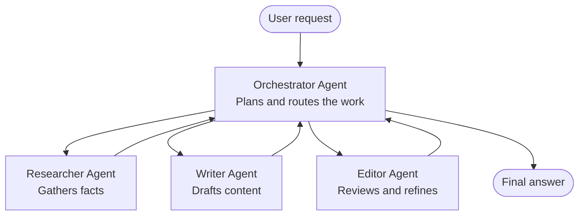

# Nozioni di Base Multi-Agente - Distribuisci il Tuo Primo Sistema AI Coordinato

**Navigazione Capitoli:**
- **📚 Home del Corso**: [AZD Per Principianti](../../README.md)
- **📖 Capitolo Attuale**: Capitolo 5 - Soluzioni AI Multi-Agente
- **⬅️ Precedente**: [Capitolo 4: Infrastruttura](../chapter-04-infrastructure/README.md)
- **➡️ Successivo**: [Schemi di Coordinazione](../chapter-06-pre-deployment/coordination-patterns.md)

> Guida ai comandi rivista in base al riferimento `azd 1.37.2` rilasciato. Le distribuzioni cloud non sono state eseguite.

## Introduzione

Nei capitoli precedenti hai distribuito una singola applicazione—e nel Capitolo 2 hai distribuito un singolo agente AI. Questa lezione fa il passo successivo: distribuire un **sistema multi-agente**, dove diversi agenti specializzati collaborano per risolvere un problema che nessun singolo agente potrebbe gestire bene da solo.

La buona notizia per i principianti: **non ti servono nuovi comandi.** Una soluzione multi-agente è ancora un progetto azd. Userai `azd init`, `azd up`, testerai, e `azd down`—esattamente il flusso di lavoro che già conosci. Cambia solo la *forma* dell’app interna.

## Obiettivi di Apprendimento

Al termine di questa lezione, sarai in grado di:
- Comprendere cosa significa "multi-agente" e quando vale la pena della complessità aggiuntiva
- Riconoscere i ruoli comuni in un sistema multi-agente (orchestratore + specialisti)
- Distribuire un template multi-agente reale e funzionante con `azd up`
- Comprendere le risorse Azure che supportano un'app multi-agente
- Sapere come verificare, personalizzare e smantellare la soluzione in sicurezza

## Risultati di Apprendimento

Dopo aver completato questa lezione, saprai:
- Spiegare la differenza tra un agente singolo e un sistema multi-agente
- Scegliere tra un agente singolo con strumenti e un vero design multi-agente
- Distribuire e testare un template multi-agente completo con azd
- Identificare dove ciascun agente gira e come comunicano
- Pulire tutte le risorse per evitare costi continuativi

---

## Cos’è un Sistema Multi-Agente?

Un singolo agente AI è un modello con un set di istruzioni e (opzionalmente) alcuni strumenti. Funziona bene per compiti mirati. Ma man mano che un compito cresce—ricerca, poi scrittura, poi modifica, poi verifica dei fatti—inserire tutto in un solo prompt rende l'agente più lento, meno affidabile e più difficile da debug.

Un **sistema multi-agente** divide il lavoro in specialisti che eseguono ciascuno un lavoro bene, coordinati da un orchestratore:



### I due ruoli che vedrai sempre

| Ruolo | Compito | Esempio |
|------|---------|---------|
| **Orchestratore** | Decide *cosa succede dopo* e smista il lavoro tra agenti | "Prima ricerca, poi scrivi, poi modifica" |
| **Specialista** | Esegue un compito mirato e restituisce un risultato | Un "ricercatore" che raccoglie solo fatti |

### Hai veramente bisogno di più agenti?

Parti semplice. Usa il multi-agente **solo** quando vale una di queste condizioni:

- ✅ Il compito ha **fasi distinte** che beneficiano di istruzioni diverse (ricerca vs. scrittura vs. revisione)
- ✅ Vuoi che gli specialisti lavorino **in parallelo** per risparmiare tempo
- ✅ Fasi diverse richiedono **strumenti o fonti dati diversi**
- ✅ Hai bisogno che ogni fase sia **testabile e debugabile indipendentemente**

Se il tuo compito è una singola domanda-risposta o una semplice chiamata a uno strumento, un **agente singolo con strumenti** (Capitolo 2) è più semplice, economico e facile da operare.

> **Consiglio per principianti:** "Più agenti" non significa "meglio." Ogni agente aggiunge latenza, costo e una nuova cosa da monitorare. Aggiungi agenti solo quando il problema chiaramente si divide in parti.

---

## Due Modi per Costruire Multi-Agente su Azure

| Approccio | Cos’è | Ideale per |
|----------|-------|-----------|
| **Agente singolo + strumenti** | Un agente Foundry che chiama funzioni/strumenti | Flussi di lavoro semplici, iniziare |
| **Agenti coordinati multipli** | Diversi agenti con un orchestratore | Fasi distinte, lavoro parallelo, specializzazione |

Questa lezione si concentra sul secondo approccio usando un **template pronto all’uso**, così puoi vedere un sistema multi-agente reale in esecuzione prima di costruirne uno tuo.

---

## Pratica: Distribuisci un’App Multi-Agente Funzionante

Distribuiremo **Contoso Creative Writer**, un esempio ufficiale Azure che coordina agenti di ricerca, prodotto, scrittura e modifica per produrre un articolo. Prima di procedere, verifica i [prerequisiti e costi dell’esempio](https://github.com/Azure-Samples/contoso-creative-writer#azure-account-requirements): richiede quota modello, Azure AI Search, accesso a Bing Grounding, Python, Docker e hook compatibili con Bash. Disponibilità di modello e regione dipendono dall’abbonamento; la distribuzione non è garantita scegliendo una regione particolare.

### Passo 1: Inizializza il template

```bash
# Create a working folder
mkdir creative-writer && cd creative-writer

# Initialize from the official multi-agent template
azd init --template Azure-Samples/contoso-creative-writer .
```

> Sfoglia altri template multi-agente in qualsiasi momento nella [galleria Awesome AZD AI](https://azure.github.io/awesome-azd/?tags=ai). Altre opzioni amichevoli per principianti includono `get-started-with-ai-agents` e `azure-ai-travel-agents`.

### Passo 2: Autenticati

```bash
# Required for azd workflows
azd auth login

# Also required by this sample's Azure CLI hooks
az login
```

### Passo 3: Controlla l’ambiente

```bash
# init normally creates/selects an environment; confirm it before proceeding
azd env list
# Only if you need an additional environment:
# azd env new dev
```

### Passo 4: Anteprima, poi distribuisci

```bash
# See what will be created before spending anything (recommended)
azd provision --preview

# Provision infrastructure and deploy all agents in one step
azd up
```

`azd up` chiederà le impostazioni di abbonamento e regione mancanti, poi fornirà le risorse e distribuirà l’applicazione. L'anteprima non riserva quota né garantisce successo; gli hook del template possono comunque girare durante un’anteprima di provisioning, quindi controllali prima. Per estendere quanto azd aspetta per ogni **distribuzione di servizio** (non provisioning di modello):

```bash
azd deploy --timeout 1800
```

Un timeout interrompe l'attesa di azd; non cancella la distribuzione in Azure. Controlla lo stato della risorsa prima di ritentare.

> **Avviso su costi e capacità:** Le app multi-agente distribuiscono modelli AI che consumano quota e impongono costi. Se `azd up` fallisce sulla quota modello, consulta [Risoluzione Problemi AI](../chapter-07-troubleshooting/ai-troubleshooting.md) per correzioni di regione e quota, e il Capitolo 6 [Pianificazione Capacità](../chapter-06-pre-deployment/capacity-planning.md).

---

## Comprendere Cosa Hai Distribuito

Un'app multi-agente tipica come questa fornisce un set di risorse Azure che mappano direttamente alle responsabilità nel diagramma sopra:

| Risorsa | Perché è presente |
|----------|----------------|
| **Microsoft Foundry / Modelli** | Ospita i modelli linguistici usati da ogni agente |
| **Azure AI Search** | Fornisce all’agente ricercatore dati fondati da cercare |
| **Container Apps** (o App Service) | Ospita l’orchestratore e il codice degli agenti |
| **Cosmos DB** (in alcuni esempi) | Conserva stato/memoria condivisa passata tra agenti |
| **Application Insights** | Traccia le richieste *fra* agenti così puoi debug il flusso |

### Come comunicano gli agenti tra loro

Nella maggior parte degli esempi azd multi-agente, l’**orchestratore gira nel codice dell’applicazione** (per esempio, usando un framework come Semantic Kernel o Microsoft Agent Framework). L’orchestratore chiama ciascun agente specialista a turno, passa i risultati, e assemblea la risposta finale. Gli agenti condividono il contesto attraverso:

- **Chiamate a funzioni/strumenti** — l’orchestratore invoca uno specialista e riceve un risultato
- **Memoria condivisa** — un database (spesso Cosmos DB) contiene stato che entrambi gli agenti possono leggere
- **Messaggi/eventi** — per un accoppiamento più lasco, gli agenti comunicano tramite una coda o Service Bus

> **Perché è importante per il debug:** poiché ogni fase è separata, Application Insights ti mostra *quale* agente è stato lento o ha fallito. Questa è una ragione fondamentale per dividere il lavoro tra agenti.

---

## Verifica la Distribuzione

Conferma che il sistema funzioni davvero prima di procedere:

```bash
# Show the deployed endpoints
azd show

# Open the app's monitoring dashboard
azd monitor

# Open Application Insights Logs (not a terminal log stream)
azd monitor --logs
```

Poi apri l’URL dell’app da `azd show` e richiedi un articolo breve. Usa la vista debug dell’esempio per ispezionare il flusso di lavoro degli agenti. La ricerca transazioni di Application Insights può mostrare i singoli passi solo se l’esempio li strumenta e li correla; azd non aggiunge automaticamente gli span degli agenti.

**Criteri di successo:**
- ✅ `azd show` elenca un endpoint raggiungibile
- ✅ Una richiesta produce un risultato che chiaramente passa per più fasi
- ✅ La vista debug mostra molteplici passaggi degli agenti; se il tracing è abilitato, verifica la relativa telemetria dopo l’ingestione

---

## Personalizza: Aggiungi o Modifica un Agente

Poiché ogni agente è solo istruzioni più strumenti, la personalizzazione è semplice:

1. **Trova le definizioni degli agenti** nel template (spesso un set di file `prompts/`, `agents/` o `*.prompty`).
2. **Modifica le istruzioni di un agente** — per esempio, dì all’agente editor di applicare un tono specifico o conteggio parole.
3. **Ridistribuisci solo il codice** (l’infrastruttura rimane invariata):

   ```bash
   azd deploy
   ```

Per andare oltre con il tuo *proprio* progetto agente Foundry, usa il bundle GA con AZD 1.37.0+ in una directory vuota separata:

```bash
azd ext install microsoft.foundry
azd ai agent init
azd up
azd ai agent invoke      # test, with response timing
```

Consulta la [guida GA hosted-agent](../chapter-02-ai-development/microsoft-foundry-integration.md#hosted-agent-walkthrough-ga) per test locali di Agent Inspector, distribuzione remota del codice, e gestione della pulizia. Il [riferimento AZD AI CLI](../chapter-08-production/production-ai-practices.md#azd-ai-cli-commands-and-extensions) copre anche l’estensione valutazioni separata, ottimizzazione e eliminazione agente.

---

## Pulizia

Le app multi-agente eseguono più servizi fatturabili. Smantella tutto quando hai finito:

```bash
# Review the resources and confirm deletion interactively
azd down
```

L’eliminazione è distruttiva. Per un laboratorio usa-e-getta, `azd down --force --purge` salta l'eliminazione e le conferme di purga soft-delete supportate; la purga è irreversibile dove supportata e può essere bloccata da protezione contro purga. La soft deletion riguarda il recupero/riutilizzo del nome, non è di per sé prova di costi continuativi. Verifica risorse trattenute e fatturazione dopo la pulizia.

Se hai anche inizializzato un agente hosted contro un progetto Foundry esistente, `azd down` lascia indietro l’agente di quel progetto e altre risorse. Rimuovi separatamente solo le risorse indesiderate che possiedi. Per un nuovo progetto Foundry creato dal suo ambiente AZD, `azd down` elimina il gruppo di risorse e tutto il contenuto.

---

## Una Nota sui Sistemi Multi-Agente di Produzione

La [Soluzione Multi-Agente Retail](../../examples/retail-scenario.md) in questo repository è una **blueprint architetturale**, non un template con un solo comando—documenta come *verrebbe* costruito un sistema retail di produzione (e specifica che una build completa è uno sforzo consistente). Usala come riferimento di design *dopo* aver distribuito un campione funzionante qui. Per considerazioni di produzione (resilienza, costo, monitoraggio, governance), continua al [Capitolo 8: Pratiche AI in Produzione](../chapter-08-production/production-ai-practices.md).

---

## Riepilogo

- Un sistema multi-agente divide il lavoro tra specialisti coordinati da un orchestratore.
- Usalo solo quando il compito ha fasi distinte, parallelismo o strumenti diversi per fase—altrimenti preferisci un agente singolo.
- Il flusso di lavoro azd non cambia: `azd init` → `azd up` → test → `azd down`.
- Un template reale come `contoso-creative-writer` ti permette di vedere e personalizzare un’app multi-agente funzionante oggi.
- Il tracing Application Insights tra agenti è uno dei maggiori vantaggi pratici del design multi-agente.

---

## 🔗 Navigazione

| Direzione | Lezione |
|-----------|--------|
| **Precedente** | [Capitolo 4: Infrastruttura](../chapter-04-infrastructure/README.md) |
| **Successivo** | [Schemi di Coordinazione](../chapter-06-pre-deployment/coordination-patterns.md) |

## 📖 Risorse Correlate

- [Guida Agenti AI](../chapter-02-ai-development/agents.md)
- [Schemi di Coordinazione](../chapter-06-pre-deployment/coordination-patterns.md)
- [Pratiche AI in Produzione](../chapter-08-production/production-ai-practices.md)
- [Risoluzione Problemi AI](../chapter-07-troubleshooting/ai-troubleshooting.md)

---

<!-- CO-OP TRANSLATOR DISCLAIMER START -->
**Disclaimer**:
Questo documento è stato tradotto utilizzando il servizio di traduzione AI [Co-op Translator](https://github.com/Azure/co-op-translator). Sebbene ci impegniamo per garantire la precisione, si prega di notare che le traduzioni automatizzate possono contenere errori o imprecisioni. Il documento originale nella sua lingua nativa deve essere considerato la fonte autorevole. Per informazioni critiche, si raccomanda una traduzione professionale effettuata da un essere umano. Non siamo responsabili per eventuali malintesi o interpretazioni errate derivanti dall’uso di questa traduzione.
<!-- CO-OP TRANSLATOR DISCLAIMER END -->