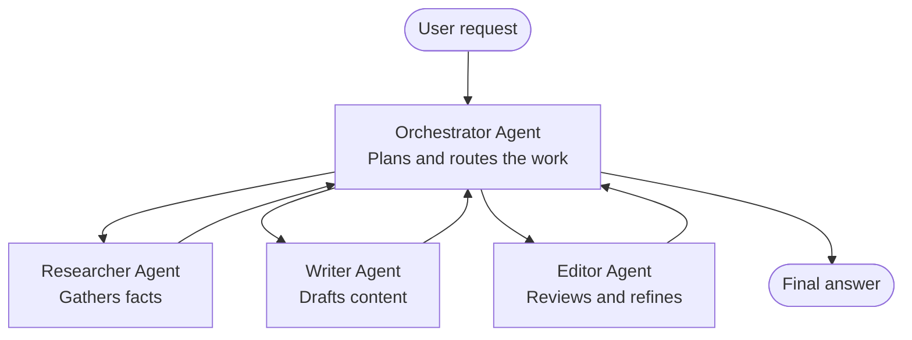

# Nozioni di base Multi-Agent - Distribuisci il tuo primo sistema AI coordinato

**Navigazione Capitolo:**
- **📚 Home del corso**: [AZD Per Principianti](../../README.md)
- **📖 Capitolo attuale**: Capitolo 5 - Soluzioni AI Multi-Agent
- **⬅️ Precedente**: [Capitolo 4: Infrastruttura](../chapter-04-infrastructure/README.md)
- **➡️ Successivo**: [Modelli di Coordinazione](../chapter-06-pre-deployment/coordination-patterns.md)

> Linee guida del comando verificate con il riferimento `azd 1.37.2` rilasciato. Non sono state eseguite distribuzioni cloud.

## Introduzione

Nei capitoli precedenti hai distribuito una singola applicazione—e nel Capitolo 2 hai distribuito un singolo agente AI. Questa lezione compie il passo successivo: distribuire un **sistema multi-agente**, in cui diversi agenti specializzati lavorano insieme per risolvere un problema che nessun singolo agente potrebbe gestire bene da solo.

La buona notizia per i principianti: **non ti servono nuovi comandi.** Una soluzione multi-agente è ancora un progetto azd. Tu `azd init`, `azd up`, testerai e `azd down`—esattamente il flusso di lavoro che già conosci. Ciò che cambia è la *struttura* dell'applicazione interna.

## Obiettivi di Apprendimento

Alla fine di questa lezione, sarai in grado di:
- Capire cosa significa "multi-agente" e quando vale la pena della complessità extra
- Riconoscere i ruoli comuni in un sistema multi-agente (orchestratore + specialisti)
- Distribuire un modello multi-agente reale e funzionante con `azd up`
- Comprendere le risorse Azure che supportano un'app multi-agente
- Sapere come verificare, personalizzare e smantellare la soluzione in sicurezza

## Risultati di Apprendimento

Dopo aver completato questa lezione, sarai in grado di:
- Spiegare la differenza tra un agente singolo e un sistema multi-agente
- Scegliere tra un singolo agente con strumenti e un vero design multi-agente
- Distribuire e testare un modello multi-agente end to end con azd
- Identificare dove gira ogni agente e come comunicano
- Pulire tutte le risorse per evitare addebiti continui

---

## Cos'è un Sistema Multi-Agente?

Un singolo agente AI è un modello con un set di istruzioni e (opzionalmente) alcuni strumenti. Funziona bene per compiti focalizzati. Ma man mano che un compito cresce—ricerca, poi scrittura, poi editing, poi verifica dei fatti—mettere tutto in un unico prompt rende l'agente più lento, meno affidabile e più difficile da debug.

Un **sistema multi-agente** suddivide il lavoro in specialisti che fanno bene un compito, coordinati da un orchestratore:



### I due ruoli che vedrai sempre

| Ruolo | Compito | Esempio |
|------|---------|---------|
| **Orchestratore** | Decide *cosa succede dopo* e distribuisce il lavoro tra gli agenti | "Prima ricerca, poi scrivi, poi modifica" |
| **Specialista** | Fa un lavoro specifico e ritorna un risultato | Un "ricercatore" che raccoglie solo fatti |

### Hai davvero bisogno di più agenti?

Parti semplice. Usa un multi-agente **solo** quando è vero uno di questi casi:

- ✅ Il compito ha **fasi distinte** che beneficiano di istruzioni diverse (ricerca vs scrittura vs revisione)
- ✅ Vuoi che gli specialisti lavorino **in parallelo** per risparmiare tempo
- ✅ Passaggi diversi richiedono **strumenti o fonti dati diverse**
- ✅ Hai bisogno che ogni step sia **testabile e debugabile indipendentemente**

Se il tuo compito è una semplice domanda e risposta o una chiamata a uno strumento semplice, un **agente singolo con strumenti** (Capitolo 2) è più semplice, economico e facile da gestire.

> **Suggerimento per principianti:** "Più agenti" non significa "meglio." Ogni agente aggiunge latenza, costo e un nuovo elemento da monitorare. Aggiungi agenti solo quando il problema si divide chiaramente in parti.

---

## Due Modi per Costruire Multi-Agente su Azure

| Approccio | Cos'è | Migliore per |
|----------|--------|--------------|
| **Agente singolo + strumenti** | Un agente Foundry che chiama funzioni/strumenti | Flussi di lavoro semplici, approccio iniziale |
| **Agenti coordinati multipli** | Diversi agenti con un orchestratore | Fasi distinte, lavoro parallelo, specializzazione |

Questa lezione si concentra sul secondo approccio usando un **modello pronto all'uso**, così puoi vedere un vero sistema multi-agente funzionante prima di costruirne uno tuo.

---

## Pratica: Distribuisci un'app Multi-Agente Funzionante

Distribuiremo **Contoso Creative Writer**, un esempio ufficiale Azure che coordina agenti di ricerca, prodotto, scrittura e revisione per produrre un articolo. Prima di procedere, controlla i [prerequisiti e costi dell'esempio](https://github.com/Azure-Samples/contoso-creative-writer#azure-account-requirements): richiede quota modello, Azure AI Search, accesso Bing Grounding, Python, Docker e hook compatibili con Bash. La disponibilità di modello e regione dipende dal tuo abbonamento; la distribuzione non è garantita scegliendo una regione specifica.

### Passo 1: Inizializza il modello

```bash
# Create a working folder
mkdir creative-writer && cd creative-writer

# Initialize from the official multi-agent template
azd init --template Azure-Samples/contoso-creative-writer .
```

> Sfoglia altri modelli multi-agente in qualsiasi momento nella [galleria Awesome AZD AI](https://azure.github.io/awesome-azd/?tags=ai). Altre opzioni amichevoli per principianti includono `get-started-with-ai-agents` e `azure-ai-travel-agents`.

### Passo 2: Autenticati

```bash
# Required for azd workflows
azd auth login

# Also required by this sample's Azure CLI hooks
az login
```

### Passo 3: Verifica l'ambiente

```bash
# init normally creates/selects an environment; confirm it before proceeding
azd env list
# Only if you need an additional environment:
# azd env new dev
```

### Passo 4: Anteprima, poi distribuisci

```bash
# See what will be created before spending anything (recommended)
azd provision --preview

# Provision infrastructure and deploy all agents in one step
azd up
```

`azd up` chiederà le impostazioni mancanti di abbonamento e regione, quindi assegnerà risorse e distribuirà l'applicazione. L'anteprima non riserva quota né garantisce successo; gli hook del modello possono ancora eseguire durante un'anteprima di provisioning, quindi ispezionali prima. Per estendere quanto a lungo azd attende ciascuna **distribuzione di servizio** (non provisioning del modello):

```bash
azd deploy --timeout 1800
```

Un timeout ferma l'attesa di azd; non annulla la distribuzione in Azure. Controlla lo stato della risorsa prima di riprovare.

> **Avviso su costi e capacità:** Le app multi-agente distribuiscono modelli AI che consumano quota e generano costi. Se `azd up` fallisce per quota modello, consulta [Risoluzione problemi AI](../chapter-07-troubleshooting/ai-troubleshooting.md) per risolvere regione e quota, e il Capitolo 6 [Pianificazione capacità](../chapter-06-pre-deployment/capacity-planning.md).

---

## Comprendere Cosa Hai Distribuito

Un'app multi-agente tipica come questa assegna un insieme di risorse Azure che mappano direttamente alle responsabilità nel diagramma sopra:

| Risorsa | Perché c'è |
|---------|-------------|
| **Microsoft Foundry / Modelli** | Ospita i modelli linguistici usati da ogni agente |
| **Azure AI Search** | Fornisce dati fondati all'agente ricercatore da cercare |
| **Container Apps** (o App Service) | Ospita il codice dell'orchestratore e degli agenti |
| **Cosmos DB** (in alcuni esempi) | Conserva stato/memoria condivisa passata tra gli agenti |
| **Application Insights** | Traccia le richieste *attraverso* gli agenti per permetterti di fare debug del flusso |

### Come gli agenti comunicano tra loro

Nella maggior parte degli esempi multi-agente azd, l'**orchestratore gira nel codice dell'applicazione** (per esempio, usando un framework come Semantic Kernel o il Microsoft Agent Framework). L'orchestratore chiama ciascun agente specialista a turno, passa i risultati e assembla la risposta finale. Gli agenti condividono il contesto tramite:

- **Chiamate a funzioni/strumenti** — l'orchestratore invoca uno specialista e riceve un risultato
- **Memoria condivisa** — un database (spesso Cosmos DB) contiene lo stato che entrambi gli agenti possono leggere
- **Messaggi/eventi** — per un collegamento più sciolto, gli agenti comunicano tramite una coda o Service Bus

> **Perché questo è importante per il debug:** poiché ogni passo è separato, Application Insights ti mostra *quale* agente è stato lento o ha fallito. Questo è un motivo principale per dividere il lavoro tra agenti.

---

## Verifica la Distribuzione

Conferma che il sistema stia effettivamente funzionando prima di procedere:

```bash
# Show the deployed endpoints
azd show

# Open the app's monitoring dashboard
azd monitor

# Open Application Insights Logs (not a terminal log stream)
azd monitor --logs
```

Poi apri l'URL dell'app da `azd show` e richiedi un articolo breve. Usa la vista di debug dell'esempio per ispezionare il flusso di lavoro degli agenti. La ricerca di transazioni in Application Insights può mostrare i singoli passaggi solo se l'esempio li strumenta e li correla; azd non aggiunge automaticamente span agenti.

**Criteri di successo:**
- ✅ `azd show` elenca un endpoint raggiungibile
- ✅ Una richiesta produce un risultato che passa chiaramente attraverso più fasi
- ✅ La vista di debug mostra più passaggi agenti; se il tracciamento è abilitato, verifica la telemetria corrispondente dopo l'ingestione

---

## Personalizza: Aggiungi o Modifica un Agente

Poiché ogni agente è solo istruzioni più strumenti, la personalizzazione è accessibile:

1. **Trova le definizioni dell'agente** nel modello (spesso una serie di file `prompts/`, `agents/`, o `*.prompty`).
2. **Modifica le istruzioni dell'agente** — per esempio, indica all'agente editor di applicare un tono o numero di parole specifico.
3. **Ridistribuisci solo il codice** (l'infrastruttura resta invariata):

   ```bash
   azd deploy
   ```

Per andare oltre con il tuo *proprio* progetto agente Foundry, usa l'inizializzazione interattiva dell'estensione agente:

```bash
azd extension install azure.ai.agents
azd ai agent init
azd up
azd ai agent invoke      # test, with response timing
```

Consulta [Capitolo 2: Agenti](../chapter-02-ai-development/agents.md) e il [riferimento AZD AI CLI](../chapter-08-production/production-ai-practices.md#azd-ai-cli-commands-and-extensions) per il ciclo completo: agente `invoke`, il flusso di lavoro separato dell'estensione valutazioni `azd ai eval`, agente `optimize` e agente `delete`.

---

## Pulizia

Le app multi-agente eseguono più servizi a pagamento. Elimina tutto quando hai finito:

```bash
# Review the resources and confirm deletion interactively
azd down
```

La cancellazione è distruttiva. Per un laboratorio usa e getta, `azd down --force --purge` salta la cancellazione e le conferme di soft-delete; il purge soft è irreversibile dove supportato e può essere bloccato da protezione purge. La soft delete è una questione di recupero/riutilizzo nome, non prova di costi continui. Controlla risorse residue e fatturazione dopo la pulizia.

---

## Nota sui Sistemi Multi-Agente in Produzione

La [Retail Multi-Agent Solution](../../examples/retail-scenario.md) in questo repo è un **modello architetturale**, non un template con un comando — documenta come *verrebbe* costruito un sistema retail di produzione (ed è esplicita che una realizzazione completa è un lavoro sostanziale). Usala come riferimento di design *dopo* aver distribuito un esempio funzionante qui. Per preoccupazioni di produzione (resilienza, costi, monitoraggio, governance), continua al [Capitolo 8: Pratiche AI in Produzione](../chapter-08-production/production-ai-practices.md).

---

## Riepilogo

- Un sistema multi-agente suddivide il lavoro tra specialisti coordinati da un orchestratore.
- Usalo solo quando il compito ha fasi distinte, parallelismo o strumenti diversi per passaggio—altrimenti preferisci un agente singolo.
- Il flusso azd resta invariato: `azd init` → `azd up` → test → `azd down`.
- Un modello reale come `contoso-creative-writer` ti permette di vedere e personalizzare oggi un'app multi-agente funzionante.
- Il tracciamento di Application Insights tra agenti è uno dei maggiori vantaggi pratici del design multi-agente.

---

## 🔗 Navigazione

| Direzione | Lezione |
|-----------|--------|
| **Precedente** | [Capitolo 4: Infrastruttura](../chapter-04-infrastructure/README.md) |
| **Successivo** | [Modelli di Coordinazione](../chapter-06-pre-deployment/coordination-patterns.md) |

## 📖 Risorse Correlate

- [Guida agli Agenti AI](../chapter-02-ai-development/agents.md)
- [Modelli di Coordinazione](../chapter-06-pre-deployment/coordination-patterns.md)
- [Pratiche AI in Produzione](../chapter-08-production/production-ai-practices.md)
- [Risoluzione Problemi AI](../chapter-07-troubleshooting/ai-troubleshooting.md)

---

<!-- CO-OP TRANSLATOR DISCLAIMER START -->
**Disclaimer**:
Questo documento è stato tradotto utilizzando il servizio di traduzione AI [Co-op Translator](https://github.com/Azure/co-op-translator). Sebbene ci impegniamo per garantire la precisione, si prega di notare che le traduzioni automatizzate possono contenere errori o imprecisioni. Il documento originale nella sua lingua nativa deve essere considerato la fonte autorevole. Per informazioni critiche, si raccomanda una traduzione professionale effettuata da un essere umano. Non siamo responsabili per eventuali malintesi o interpretazioni errate derivanti dall’uso di questa traduzione.
<!-- CO-OP TRANSLATOR DISCLAIMER END -->