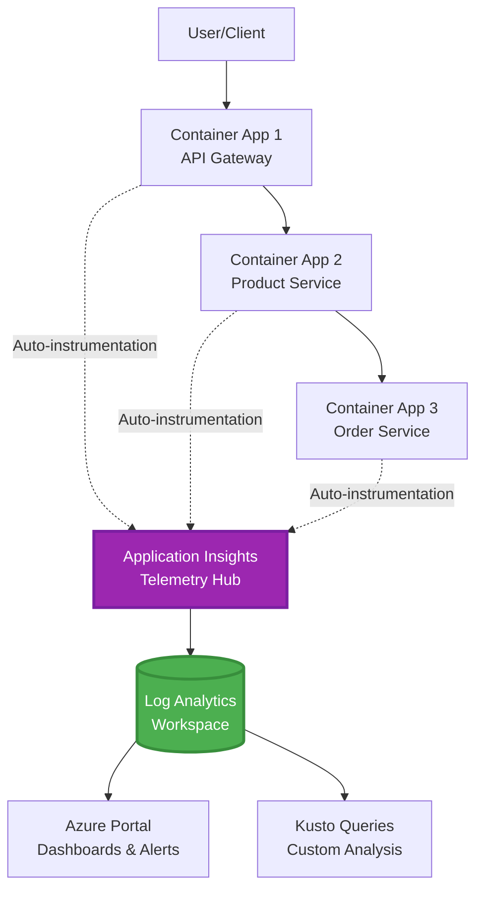
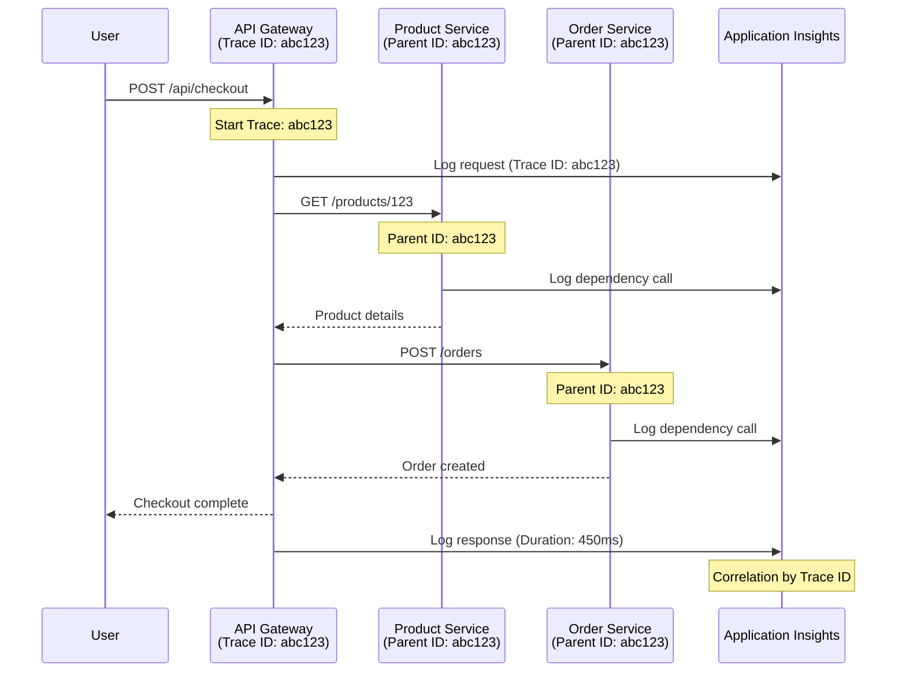

# Integrazione di Application Insights con AZD

⏱️ **Tempo stimato**: 40-50 minuti | 💰 **Impatto sui costi**: ~$5-15/mese | ⭐ **Complessità**: Intermedio

**📚 Percorso di apprendimento:**
- ← Precedente: [Controlli preliminari](preflight-checks.md) - Validazione pre-distribuzione
- 🎯 **Sei qui**: Integrazione Application Insights (Monitoraggio, telemetria, debug)
- → Successivo: [Guida al deployment](../chapter-04-infrastructure/deployment-guide.md) - Distribuzione su Azure
- 🏠 [Home del corso](../../README.md)

---

## Cosa Imparerai

Completando questa lezione, sarai in grado di:
- Dichiarare **Application Insights** nell’infrastruttura AZD e configurare l'instrumentazione SDK
- Configurare il **distributed tracing** per microservizi
- Implementare **telemetria personalizzata** (metriche, eventi, dipendenze)
- Impostare **metriche live** per il monitoraggio in tempo reale
- Creare **alert e dashboard** dalle distribuzioni AZD
- Fare debug di problemi in produzione con **query di telemetria**
- Ottimizzare **strategie di costi e campionamento**
- Monitorare **applicazioni AI/LLM** (token, latenza, costi)

## Perché Application Insights con AZD è Importante

### La Sfida: Osservabilità in Produzione

**Senza Application Insights:**
```
❌ No visibility into production behavior
❌ Manual log aggregation across services
❌ Reactive debugging (wait for customer complaints)
❌ No performance metrics
❌ Cannot trace requests across services
❌ Unknown failure rates and bottlenecks
```

**Con Application Insights + AZD:**
```
✅ Automatic telemetry collection
✅ Centralized logs from all services
✅ Proactive issue detection
✅ End-to-end request tracing
✅ Performance metrics and insights
✅ Real-time dashboards
✅ AZD provisions the monitoring declared in your templates
```

**Analogia**: Application Insights è come avere un "registratore di volo" + cruscotto di controllo per la tua applicazione. Puoi vedere tutto ciò che accade in tempo reale e rivedere qualsiasi incidente.

---

## Panoramica dell’Architettura

### Application Insights nell’Architettura AZD



### Cosa Viene Monitorato Automaticamente

L’auto-strumentazione supportata cattura richieste/dipendenze per librerie strumentate. Eventi e metriche personalizzate richiedono codice applicativo; i test di disponibilità devono essere configurati separatamente. Non raccoglie ogni riga sotto solo perché la risorsa esiste.

| Tipo di Telemetria | Cosa Cattura | Caso d’Uso |
|----------------|------------------|----------|
| **Richieste** | Richieste HTTP, codici di stato, durata | Monitoraggio prestazioni API |
| **Dipendenze** | Chiamate esterne (DB, API, storage) | Identificare colli di bottiglia |
| **Eccezioni** | Errori non gestiti con stack trace | Debug di malfunzionamenti |
| **Eventi personalizzati** | Eventi di business (registrazione, acquisto) | Analytics e funnel |
| **Metriche** | Contatori di prestazioni, metriche personalizzate | Pianificazione capacità |
| **Trace** | Messaggi di log con gravità | Debug e auditing |
| **Disponibilità** | Test di uptime e risposta | Monitoraggio SLA |

---

## Prerequisiti

### Strumenti Richiesti

```bash
# Verify Azure Developer CLI
azd version
# Command reference baseline: azd 1.37.2

# Verify Azure CLI
az --version
# ✅ Expected: azure-cli 2.50.0 or higher
```

### Requisiti Azure

- Sottoscrizione Azure attiva
- Permessi per creare:
  - Risorse Application Insights
  - Workspace Log Analytics
  - Container Apps
  - Gruppi di risorse

### Prerequisiti di Conoscenza

Dovresti aver completato:
- [Fondamenti di AZD](../chapter-01-foundation/azd-basics.md) - Concetti base AZD
- [Configurazione](../chapter-03-configuration/configuration.md) - Impostazione ambiente
- [Primo Progetto](../chapter-01-foundation/first-project.md) - Deployment base

---

## Lezione 1: Application Insights Automatico con AZD

### Come AZD Provisiona Application Insights

AZD provisiona Application Insights **solo quando l’infrastruttura del progetto lo dichiara**. `azure.yaml` da solo non crea monitoraggio né strumenta il codice applicativo.

> **Ambito di esempio:** Questa lezione contiene frammenti di integrazione, non un progetto completo `monitored-app` in questo repository. Fornisci un template principale e mappatura parametri, ambiente Container Apps, registry/image e configurazione identità, Dockerfile e tag di servizio prima del deployment. Le lezioni successive mostrano frammenti alternativi/di estensione, non file da incollare tutti insieme invariati. Parti da un [esempio microservizi](../../../../examples/microservices) funzionante se ti serve una baseline eseguibile.

### Struttura del Progetto

```
monitored-app/
├── azure.yaml                     # AZD configuration
├── infra/
│   ├── main.bicep                # Main infrastructure
│   ├── core/
│   │   └── monitoring.bicep      # Application Insights + Log Analytics
│   └── app/
│       └── api.bicep             # Container App with monitoring
└── src/
    ├── app.py                    # Application with telemetry
    ├── requirements.txt
    └── Dockerfile
```

---

### Passo 1: Configura AZD (azure.yaml)

**File: `azure.yaml`**

```yaml
name: monitored-app
metadata:
  template: monitored-app@1.0.0

services:
  api:
    project: ./src
    language: python
    host: containerapp

# Monitoring must be declared in infra/ and enabled in application code.
```

Questo dichiara il servizio distribuibile. La seguente configurazione Bicep e SDK fornisce il monitoraggio; azd non li aggiunge implicitamente.

---

### Passo 2: Infrastruttura di Monitoraggio (Bicep)

**File: `infra/core/monitoring.bicep`**

```bicep
param logAnalyticsName string
param applicationInsightsName string
param location string = resourceGroup().location
param tags object = {}

// Log Analytics Workspace (required for Application Insights)
resource logAnalytics 'Microsoft.OperationalInsights/workspaces@2022-10-01' = {
  name: logAnalyticsName
  location: location
  tags: tags
  properties: {
    sku: {
      name: 'PerGB2018'  // Pay-as-you-go pricing
    }
    retentionInDays: 30  // Keep logs for 30 days
    features: {
      enableLogAccessUsingOnlyResourcePermissions: true
    }
  }
}

// Application Insights
resource applicationInsights 'Microsoft.Insights/components@2020-02-02' = {
  name: applicationInsightsName
  location: location
  tags: tags
  kind: 'web'
  properties: {
    Application_Type: 'web'
    WorkspaceResourceId: logAnalytics.id
    IngestionMode: 'LogAnalytics'
    publicNetworkAccessForIngestion: 'Enabled'
    publicNetworkAccessForQuery: 'Enabled'
  }
}

// Outputs for Container Apps
output logAnalyticsWorkspaceId string = logAnalytics.id
output logAnalyticsWorkspaceName string = logAnalytics.name
output applicationInsightsConnectionString string = applicationInsights.properties.ConnectionString
output applicationInsightsInstrumentationKey string = applicationInsights.properties.InstrumentationKey
output applicationInsightsName string = applicationInsights.name
output applicationInsightsId string = applicationInsights.id
```

---

### Passo 3: Collega Container App ad Application Insights

**File: `infra/app/api.bicep`**

```bicep
param name string
param location string
param tags object = {}
param containerAppsEnvironmentId string
param containerImage string
param applicationInsightsConnectionString string

resource containerApp 'Microsoft.App/containerApps@2023-05-01' = {
  name: name
  location: location
  tags: tags
  properties: {
    managedEnvironmentId: containerAppsEnvironmentId
    configuration: {
      ingress: {
        external: true
        targetPort: 8000
      }
      secrets: [
        {
          name: 'appinsights-connection-string'
          value: applicationInsightsConnectionString
        }
      ]
    }
    template: {
      containers: [
        {
          name: 'api'
          image: containerImage // Supply an accessible image and registry authentication
          resources: {
            cpu: json('0.5')
            memory: '1Gi'
          }
          env: [
            {
              name: 'APPLICATIONINSIGHTS_CONNECTION_STRING'
              secretRef: 'appinsights-connection-string'
            }
            {
              name: 'APPLICATIONINSIGHTS_ENABLED'
              value: 'true'
            }
          ]
        }
      ]
    }
  }
}

output uri string = 'https://${containerApp.properties.configuration.ingress.fqdn}'
```

---

### Passo 4: Codice Applicativo con Telemetria

**File: `src/app.py`**

```python
from flask import Flask, request, jsonify
from azure.monitor.opentelemetry import configure_azure_monitor
import logging
import os

app = Flask(__name__)

# Get Application Insights connection string
connection_string = os.environ.get('APPLICATIONINSIGHTS_CONNECTION_STRING')

if connection_string:
    # Azure Monitor OpenTelemetry instruments supported libraries, including Flask.
    configure_azure_monitor(
        connection_string=connection_string,
        logger_name=__name__,
        enable_live_metrics=True
    )
    logger = logging.getLogger(__name__)
    logger.setLevel(logging.INFO)
    
    print("✅ Application Insights enabled")
else:
    logger = logging.getLogger(__name__)
    logger.setLevel(logging.INFO)
    print("⚠️ Application Insights not configured")

@app.route('/health')
def health():
    logger.info('Health check endpoint called')
    return jsonify({'status': 'healthy', 'monitoring': 'enabled' if connection_string else 'disabled'})

@app.route('/api/products')
def get_products():
    logger.info('Fetching products')
    
    # In-memory fixture: this is not a database dependency call.
    products = [
        {'id': 1, 'name': 'Laptop', 'price': 999.99},
        {'id': 2, 'name': 'Mouse', 'price': 29.99},
        {'id': 3, 'name': 'Keyboard', 'price': 79.99}
    ]
    
    logger.info(f'Returned {len(products)} products')
    return jsonify(products)

@app.route('/api/error-test')
def error_test():
    """Test error tracking"""
    logger.error('Testing error tracking')
    try:
        raise ValueError('This is a test exception')
    except Exception as e:
        logger.exception('Exception occurred in error-test endpoint')
        return jsonify({'error': str(e)}), 500

@app.route('/api/slow')
def slow_endpoint():
    """Test performance tracking"""
    import time
    logger.info('Slow endpoint called')
    time.sleep(3)  # Simulate slow operation
    logger.warning('Endpoint took 3 seconds to respond')
    return jsonify({'message': 'Slow operation completed'})

if __name__ == '__main__':
    app.run(host='0.0.0.0', port=8000)
```

**File: `src/requirements.txt`**

```txt
Flask
azure-monitor-opentelemetry
gunicorn
requests
openai
```

Risolvi queste dipendenze nel tuo progetto, testale insieme e blocca le versioni risultanti. I nuovi progetti dovrebbero usare Azure Monitor OpenTelemetry, non gli exporter OpenCensus Python dismessi.

---

### Passo 5: Distribuisci e Verifica

```bash
# Deploy only after completing and wiring the infrastructure fragments above
azd up

# Get app URL
APP_URL=$(azd env get-value API_URL) # Requires this output in main.bicep

# Generate telemetry
curl $APP_URL/health
curl $APP_URL/api/products
curl $APP_URL/api/error-test
curl $APP_URL/api/slow
```

**✅ Output previsto:**
```json
{
  "status": "healthy",
  "monitoring": "enabled"
}
```

---

### Passo 6: Visualizza Telemetria nel Portale Azure

```bash
# Get Application Insights details
azd env get-values | grep APPLICATIONINSIGHTS

# Open in Azure Portal
az monitor app-insights component show \
  --app $(azd env get-values | grep APPLICATIONINSIGHTS_NAME | cut -d '=' -f2 | tr -d '"') \
  --resource-group $(azd env get-values | grep AZURE_RESOURCE_GROUP | cut -d '=' -f2 | tr -d '"') \
  --query "appId" -o tsv
```

**Naviga in Portale Azure → Application Insights → Transaction Search**

Dovresti vedere:
- ✅ Richieste HTTP con codici di stato
- ✅ Durata richiesta (3+ secondi per `/api/slow`)
- ✅ Dettagli eccezione da `/api/error-test`
- ✅ Messaggi di log personalizzati

---

## Lezione 2: Telemetria e Eventi Personalizzati

### Traccia Eventi di Business

Aggiungiamo telemetria personalizzata per eventi critici di business.

**File: `src/telemetry.py`**

```python
from contextlib import contextmanager
from azure.monitor.opentelemetry import configure_azure_monitor
from opentelemetry import metrics, trace
from opentelemetry.trace import SpanKind
import logging
import os

class TelemetryClient:
    """Custom telemetry client for Application Insights"""
    
    def __init__(self, connection_string=None):
        self.connection_string = connection_string or os.environ.get('APPLICATIONINSIGHTS_CONNECTION_STRING')
        
        # Configure once per process. If app.py already calls this, keep only
        # one configure_azure_monitor call and use logger_name='telemetry'.
        if self.connection_string:
            configure_azure_monitor(
                connection_string=self.connection_string,
                logger_name=__name__,
                enable_live_metrics=True
            )
        self.logger = logging.getLogger(__name__)
        self.logger.setLevel(logging.INFO)
        self.tracer = trace.get_tracer(__name__)
        self.meter = metrics.get_meter(__name__)
        self.instruments = {}
    
    def track_event(self, event_name: str, properties: dict = None):
        """Track custom business event"""
        properties = properties or {}
        self.logger.info(
            f"CustomEvent: {event_name}",
            extra={
                # OTel log attributes become customDimensions in App Insights.
                    'event_name': event_name,
                    **properties
            }
        )
    
    def track_metric(self, metric_name: str, value: float, properties: dict = None):
        """Track custom metric"""
        properties = properties or {}
        if metric_name not in self.instruments:
            self.instruments[metric_name] = self.meter.create_histogram(metric_name)
        self.instruments[metric_name].record(value, attributes=properties)
    
    @contextmanager
    def track_dependency(self, name: str):
        """Time the real operation inside a client span; exceptions mark failure."""
        with self.tracer.start_as_current_span(name, kind=SpanKind.CLIENT) as span:
            yield span

# Global telemetry client
telemetry = TelemetryClient()
```

### Aggiorna Applicazione con Eventi Personalizzati

**File: `src/app.py` (potenziato)**

Aggiungi queste rotte alla applicazione Flask esistente; mantieni le rotte salute/test precedenti. Il blocco abbreviato sotto mostra un’app separata per chiarezza. L’inizializzazione della telemetria ora si trova in `telemetry.py`—non inizializzare due volte gli exporter.

```python
from flask import Flask, request, jsonify
from telemetry import telemetry
import time
import random
import os

app = Flask(__name__)

@app.route('/api/purchase', methods=['POST'])
def purchase():
    """Track purchase event with custom telemetry"""
    data = request.get_json(silent=True) or {}
    product_id = data.get('product_id')
    quantity = data.get('quantity', 1)
    price = data.get('price', 0)
    if not isinstance(quantity, int) or quantity < 1 or \
       not isinstance(price, (int, float)) or price < 0:
        return jsonify({'error': 'quantity and price must be non-negative numbers; quantity >= 1'}), 400
    
    # Track business event
    telemetry.track_event('Purchase', {
        'product_id': product_id,
        'quantity': quantity,
        'total_amount': price * quantity,
        'user_id': request.headers.get('X-User-Id', 'anonymous')
    })
    
    # Track revenue metric
    telemetry.track_metric('Revenue', price * quantity, {
        'product_id': product_id,
        'currency': 'USD'
    })
    
    return jsonify({
        'order_id': f'ORD-{random.randint(1000, 9999)}',
        'status': 'confirmed',
        'total': price * quantity
    })

@app.route('/api/search')
def search():
    """Track search queries"""
    query = request.args.get('q', '')
    
    start_time = time.time()
    
    # Simulate search (would be real database query)
    results = [{'id': 1, 'name': f'Result for {query}'}]
    
    duration = (time.time() - start_time) * 1000  # Convert to ms
    
    # Track search event
    telemetry.track_event('Search', {
        'query': query,
        'results_count': len(results),
        'duration_ms': duration
    })
    
    # Track search performance metric
    telemetry.track_metric('SearchDuration', duration, {
        'query_length': len(query)
    })
    
    return jsonify({'results': results, 'count': len(results)})

@app.route('/api/external-call')
def external_call():
    """Track external API dependency"""
    import requests
    
    try:
        # Set an actual test endpoint; api.example.com is not a working API.
        with telemetry.track_dependency('ExternalAPI'):
            response = requests.get(os.environ['EXTERNAL_API_URL'], timeout=5)
            response.raise_for_status()
            result = response.json()
    except Exception as e:
        return jsonify({'error': 'External dependency failed'}), 502
    
    return jsonify(result)

if __name__ == '__main__':
    app.run(host='0.0.0.0', port=8000)
```

### Testa la Telemetria Personalizzata

```bash
# Track purchase event
curl -X POST $APP_URL/api/purchase \
  -H "Content-Type: application/json" \
  -H "X-User-Id: user123" \
  -d '{"product_id": 1, "quantity": 2, "price": 29.99}'

# Track search event
curl "$APP_URL/api/search?q=laptop"

# Track external dependency
curl $APP_URL/api/external-call
```

**Visualizza nel Portale Azure:**

Naviga in Application Insights → Logs, quindi esegui:

```kusto
// View purchase events
traces
| where customDimensions.event_name == "Purchase"
| project 
    timestamp,
    product_id = tostring(customDimensions.product_id),
    total_amount = todouble(customDimensions.total_amount),
    user_id = tostring(customDimensions.user_id)
| order by timestamp desc

// Revenue recorded in Purchase events (not a billing ledger)
traces
| where customDimensions.event_name == "Purchase"
| summarize TotalRevenue = sum(todouble(customDimensions.total_amount)) by bin(timestamp, 1h)
| render timechart

// View search performance
traces
| where customDimensions.event_name == "Search"
| summarize 
    AvgDuration = avg(todouble(customDimensions.duration_ms)),
    SearchCount = count()
  by bin(timestamp, 5m)
| render timechart
```

---

## Lezione 3: Distributed Tracing per Microservizi

### Abilita il Tracing Cross-Service

Con strumentazione compatibile e propagazione W3C trace-context, Application Insights correla le richieste tra servizi. Condividere solo una connection string non stabilisce span parent-child. Il frammento architetturale seguente fa riferimento a moduli che devi implementare.

**File: `infra/main.bicep`**

```bicep
targetScope = 'subscription'

param environmentName string
param location string = 'eastus'

var tags = { 'azd-env-name': environmentName }

resource rg 'Microsoft.Resources/resourceGroups@2021-04-01' = {
  name: 'rg-${environmentName}'
  location: location
  tags: tags
}

// Monitoring (shared by all services)
module monitoring './core/monitoring.bicep' = {
  name: 'monitoring'
  scope: rg
  params: {
    logAnalyticsName: 'log-${environmentName}'
    applicationInsightsName: 'appi-${environmentName}'
    location: location
    tags: tags
  }
}

// API Gateway
module apiGateway './app/api-gateway.bicep' = {
  name: 'api-gateway'
  scope: rg
  params: {
    name: 'ca-gateway-${environmentName}'
    location: location
    tags: union(tags, { 'azd-service-name': 'gateway' })
    applicationInsightsConnectionString: monitoring.outputs.applicationInsightsConnectionString
  }
}

// Product Service
module productService './app/product-service.bicep' = {
  name: 'product-service'
  scope: rg
  params: {
    name: 'ca-products-${environmentName}'
    location: location
    tags: union(tags, { 'azd-service-name': 'products' })
    applicationInsightsConnectionString: monitoring.outputs.applicationInsightsConnectionString
  }
}

// Order Service
module orderService './app/order-service.bicep' = {
  name: 'order-service'
  scope: rg
  params: {
    name: 'ca-orders-${environmentName}'
    location: location
    tags: union(tags, { 'azd-service-name': 'orders' })
    applicationInsightsConnectionString: monitoring.outputs.applicationInsightsConnectionString
  }
}

output APPLICATIONINSIGHTS_CONNECTION_STRING string = monitoring.outputs.applicationInsightsConnectionString
output GATEWAY_URL string = apiGateway.outputs.uri
```

### Visualizza Transazione End-to-End



**Query di traccia end-to-end:**

```kusto
// Find complete request flow
let traceId = "abc123...";  // Copy operation_Id from a request in Application Insights
dependencies
| union requests
| where operation_Id == traceId
| project 
    timestamp,
    type = itemType,
    name,
    duration,
    success,
    cloud_RoleName
| order by timestamp asc
```

---

## Lezione 4: Metriche Live e Monitoraggio in Tempo Reale

### Abilita Live Metrics Stream

Live Metrics fornisce telemetria quasi in tempo reale quando supportata e abilitata dall’SDK. Non è un SLA di latenza. La configurazione Python OpenTelemetry sopra opta con `enable_live_metrics=True`.

**Accesso a Live Metrics:**

```bash
# Get Application Insights resource
APPI_NAME=$(azd env get-values | grep APPLICATIONINSIGHTS_NAME | cut -d '=' -f2 | tr -d '"')

# Get resource group
RG_NAME=$(azd env get-values | grep AZURE_RESOURCE_GROUP | cut -d '=' -f2 | tr -d '"')

echo "Navigate to: Azure Portal → Resource Groups → $RG_NAME → $APPI_NAME → Live Metrics"
```

**Cosa vedi in tempo reale:**
- ✅ Tasso di richieste in entrata (richieste/sec)
- ✅ Chiamate di dipendenza in uscita
- ✅ Conteggio eccezioni
- ✅ Utilizzo CPU e memoria
- ✅ Numero di server attivi
- ✅ Telemetria di esempio

### Genera Carico per Test

```bash
# Generate load to see live metrics
for i in {1..100}; do
  curl --silent --max-time 10 "$APP_URL/api/products"
  curl --silent --max-time 10 "$APP_URL/api/search?q=test$i"
done

# Watch live metrics in Azure Portal
# You should see request rate spike
```

---

## Esercizi Pratici

### Esercizio 1: Imposta Alert ⭐⭐ (Medio)

**Obiettivo**: Crea alert per alti tassi di errore e risposte lente.

**Passaggi:**

1. **Crea alert per tasso di errore:**

```bash
# Get Application Insights resource ID
APPI_ID=$(az monitor app-insights component show \
  --app $APPI_NAME \
  --resource-group $RG_NAME \
  --query "id" -o tsv)

# Create metric alert for failed requests
az monitor metrics alert create \
  --name "High-Error-Rate" \
  --resource-group $RG_NAME \
  --scopes $APPI_ID \
  --condition "count requests/failed > 10" \
  --window-size 5m \
  --evaluation-frequency 1m \
  --description "Alert when failed request count exceeds 10 per 5 minutes"
```

2. **Crea alert per risposte lente:**

```bash
az monitor metrics alert create \
  --name "Slow-Responses" \
  --resource-group $RG_NAME \
  --scopes $APPI_ID \
  --condition "avg requests/duration > 3000" \
  --window-size 5m \
  --evaluation-frequency 1m \
  --description "Alert when average response time exceeds 3 seconds"
```

3. **Crea alert via Bicep (preferito per AZD):**

**File: `infra/core/alerts.bicep`**

```bicep
param applicationInsightsId string
param actionGroupId string = ''
param location string = resourceGroup().location

// High error rate alert
resource errorRateAlert 'Microsoft.Insights/metricAlerts@2018-03-01' = {
  name: 'high-error-rate'
  location: 'global'
  properties: {
    description: 'Alert when error rate exceeds threshold'
    severity: 2
    enabled: true
    scopes: [
      applicationInsightsId
    ]
    evaluationFrequency: 'PT1M'
    windowSize: 'PT5M'
    criteria: {
      'odata.type': 'Microsoft.Azure.Monitor.SingleResourceMultipleMetricCriteria'
      allOf: [
        {
          name: 'Error rate'
          metricName: 'requests/failed'
          operator: 'GreaterThan'
          threshold: 10
          timeAggregation: 'Count'
        }
      ]
    }
    actions: actionGroupId != '' ? [
      {
        actionGroupId: actionGroupId
      }
    ] : []
  }
}

// Slow response alert
resource slowResponseAlert 'Microsoft.Insights/metricAlerts@2018-03-01' = {
  name: 'slow-responses'
  location: 'global'
  properties: {
    description: 'Alert when response time is too high'
    severity: 3
    enabled: true
    scopes: [
      applicationInsightsId
    ]
    evaluationFrequency: 'PT1M'
    windowSize: 'PT5M'
    criteria: {
      'odata.type': 'Microsoft.Azure.Monitor.SingleResourceMultipleMetricCriteria'
      allOf: [
        {
          name: 'Response duration'
          metricName: 'requests/duration'
          operator: 'GreaterThan'
          threshold: 3000
          timeAggregation: 'Average'
        }
      ]
    }
  }
}

output errorAlertId string = errorRateAlert.id
output slowResponseAlertId string = slowResponseAlert.id
```

4. **Testa alert:**

```bash
# Generate errors
for i in {1..20}; do
  curl $APP_URL/api/error-test
done

# Generate slow responses
for i in {1..10}; do
  curl $APP_URL/api/slow
done

# Check rule configuration (not fired/resolved alert-instance history)
az monitor metrics alert list \
  --resource-group $RG_NAME \
  --query "[].{Name:name, Enabled:enabled}" \
  --output table
```

**✅ Criteri di successo:**
- ✅ Alert creati con successo
- ✅ Alert attivati quando superano le soglie
- ✅ Puoi visualizzare la cronologia degli alert nel Portale Azure
- ✅ Integrati nel deployment AZD

**Tempo**: 20-25 minuti

---

### Esercizio 2: Crea Dashboard Personalizzata ⭐⭐ (Medio)

**Obiettivo**: Costruisci una dashboard che mostri metriche chiave dell’applicazione.

**Passaggi:**

1. **Crea dashboard via Portale Azure:**

Naviga su: Portale Azure → Dashboard → Nuova Dashboard

2. **Aggiungi riquadri per metriche chiave:**

- Conteggio richieste (ultime 24 ore)
- Tempo medio di risposta
- Tasso di errore
- Top 5 operazioni più lente
- Distribuzione geografica degli utenti

3. **Crea dashboard via Bicep:**

**File: `infra/core/dashboard.bicep`**

```bicep
param dashboardName string
param applicationInsightsId string
param location string = resourceGroup().location

resource dashboard 'Microsoft.Portal/dashboards@2020-09-01-preview' = {
  name: dashboardName
  location: location
  properties: {
    lenses: [
      {
        order: 0
        parts: [
          // Request count
          {
            position: {
              x: 0
              y: 0
              rowSpan: 4
              colSpan: 6
            }
            metadata: {
              type: 'Extension/Microsoft_OperationsManagementSuite_Workspace/PartType/LogsDashboardPart'
              inputs: [
                {
                  name: 'resourceId'
                  value: applicationInsightsId
                }
                {
                  name: 'query'
                  value: '''
                    requests
                    | summarize RequestCount = count() by bin(timestamp, 1h)
                    | render timechart
                  '''
                }
              ]
            }
          }
          // Error rate
          {
            position: {
              x: 6
              y: 0
              rowSpan: 4
              colSpan: 6
            }
            metadata: {
              type: 'Extension/Microsoft_OperationsManagementSuite_Workspace/PartType/LogsDashboardPart'
              inputs: [
                {
                  name: 'resourceId'
                  value: applicationInsightsId
                }
                {
                  name: 'query'
                  value: '''
                    requests
                    | summarize 
                        Total = count(),
                        Failed = countif(success == false)
                    | extend ErrorRate = (Failed * 100.0) / Total
                    | project ErrorRate
                  '''
                }
              ]
            }
          }
        ]
      }
    ]
  }
}

output dashboardId string = dashboard.id
```

4. **Distribuisci dashboard:**

```bicep
// Add to a subscription-scoped main.bicep with rg and monitoring declared
module dashboard './core/dashboard.bicep' = {
  name: 'dashboard'
  scope: rg
  params: {
    dashboardName: 'dashboard-${environmentName}'
    applicationInsightsId: monitoring.outputs.applicationInsightsId
    location: location
  }
}
```

```bash
# Deploy
azd up
```

**✅ Criteri di successo:**
- ✅ La dashboard mostra metriche chiave
- ✅ Puoi fissarla nella home del Portale Azure
- ✅ Si aggiorna in tempo reale
- ✅ Distribuibile tramite AZD

**Tempo**: 25-30 minuti

---

### Esercizio 3: Monitora Applicazione AI/LLM ⭐⭐⭐ (Avanzato)

**Obiettivo**: Traccia l’uso dei modelli Microsoft Foundry (token, costi, latenza).

**Passaggi:**

1. **Crea wrapper di monitoraggio AI:**

**File: `src/ai_telemetry.py`**

```python
from telemetry import telemetry
from openai import AzureOpenAI
import time

class MonitoredAzureOpenAI:
    """Microsoft Foundry Models client with automatic telemetry"""
    
    def __init__(self, api_key, endpoint, input_usd_per_million,
                 output_usd_per_million, api_version="2024-10-21"):
        self.client = AzureOpenAI(
            api_key=api_key,
            api_version=api_version,
            azure_endpoint=endpoint
        )
        self.input_rate = input_usd_per_million
        self.output_rate = output_usd_per_million
    
    def chat_completion(self, model: str, messages: list, **kwargs):
        """Track chat completion with telemetry"""
        start_time = time.time()
        
        try:
            # Call Microsoft Foundry Models
            response = self.client.chat.completions.create(
                model=model,
                messages=messages,
                **kwargs
            )
            
            duration = (time.time() - start_time) * 1000  # ms
            
            # Extract usage
            usage = response.usage
            prompt_tokens = usage.prompt_tokens
            completion_tokens = usage.completion_tokens
            total_tokens = usage.total_tokens
            
            # Approximation: supply actual deployment/region/contract rates.
            # Cached input, batch, provisioned and other charges need separate accounting.
            prompt_cost = (prompt_tokens / 1_000_000) * self.input_rate
            completion_cost = (completion_tokens / 1_000_000) * self.output_rate
            total_cost = prompt_cost + completion_cost
            
            # Track custom event
            telemetry.track_event('OpenAI_Request', {
                'model': model,
                'prompt_tokens': prompt_tokens,
                'completion_tokens': completion_tokens,
                'total_tokens': total_tokens,
                'duration_ms': duration,
                'cost_usd': total_cost,
                'success': True
            })
            
            # Track metrics
            telemetry.track_metric('OpenAI_Tokens', total_tokens, {
                'model': model,
                'type': 'total'
            })
            
            telemetry.track_metric('OpenAI_Cost', total_cost, {
                'model': model,
                'currency': 'USD'
            })
            
            telemetry.track_metric('OpenAI_Duration', duration, {
                'model': model
            })
            
            return response
            
        except Exception as e:
            duration = (time.time() - start_time) * 1000
            
            telemetry.track_event('OpenAI_Request', {
                'model': model,
                'duration_ms': duration,
                'success': False,
                'error': str(e)
            })
            
            raise
```

2. **Usa client monitorato:**

```python
from flask import Flask, request, jsonify
from ai_telemetry import MonitoredAzureOpenAI
import os

app = Flask(__name__)

# Initialize monitored OpenAI client
openai_client = MonitoredAzureOpenAI(
    api_key=os.environ['AZURE_OPENAI_API_KEY'],
    endpoint=os.environ['AZURE_OPENAI_ENDPOINT'],
    input_usd_per_million=float(os.environ['INPUT_USD_PER_MILLION']),
    output_usd_per_million=float(os.environ['OUTPUT_USD_PER_MILLION'])
)

@app.route('/api/chat', methods=['POST'])
def chat():
    data = request.json
    user_message = data.get('message')
    
    # Call with automatic monitoring
    response = openai_client.chat_completion(
        model=os.environ['AZURE_OPENAI_DEPLOYMENT'], # Deployment name, not catalog ID
        messages=[
            {'role': 'user', 'content': user_message}
        ]
    )
    
    return jsonify({
        'response': response.choices[0].message.content,
        'tokens': response.usage.total_tokens
    })
```

3. **Query metriche AI:**

```kusto
// Total AI spend over time
traces
| where customDimensions.event_name == "OpenAI_Request"
| where tobool(customDimensions.success) == true
| summarize TotalCost = sum(todouble(customDimensions.cost_usd)) by bin(timestamp, 1h)
| render timechart

// Token usage by model
traces
| where customDimensions.event_name == "OpenAI_Request"
| summarize 
    TotalTokens = sum(toint(customDimensions.total_tokens)),
    RequestCount = count()
  by Model = tostring(customDimensions.model)

// Average latency
traces
| where customDimensions.event_name == "OpenAI_Request"
| summarize AvgDuration = avg(todouble(customDimensions.duration_ms))
| project AvgDurationSeconds = AvgDuration / 1000

// Cost per request
traces
| where customDimensions.event_name == "OpenAI_Request"
| extend Cost = todouble(customDimensions.cost_usd)
| summarize 
    TotalCost = sum(Cost),
    RequestCount = count(),
    AvgCostPerRequest = avg(Cost)
```

**✅ Criteri di successo:**
- ✅ Ogni chiamata OpenAI tracciata automaticamente
- ✅ Visualizzabili uso token e costi
- ✅ Latenza monitorata
- ✅ Possibilità di impostare alert di budget

**Tempo**: 35-45 minuti

---

## Ottimizzazione dei Costi

### Strategie di Campionamento

Controlla i costi campionando la telemetria:

```python
import os

# Configure before the one configure_azure_monitor() call in your process.
os.environ["OTEL_TRACES_SAMPLER"] = "microsoft.fixed_percentage"
os.environ["OTEL_TRACES_SAMPLER_ARG"] = "0.1" # 10% trace sampling
```

Il campionamento delle trace non riduce ogni categoria di telemetria del 90%. Metriche e log emessi indipendentemente necessitano di controlli di volume propri. Scegli la percentuale in base alle necessità di osservabilità, non con un divieto generale in produzione.

Imposta il campionamento SDK esplicitamente; la proprietà `SamplingPercentage` del componente non è un sostituto per configurare il sampler Python OpenTelemetry.

### Conservazione Dati

```bicep
resource logAnalytics 'Microsoft.OperationalInsights/workspaces@2022-10-01' = {
  name: logAnalyticsName
  properties: {
    retentionInDays: 30  // Minimum (cheapest)
    // Options: 30, 31, 60, 90, 120, 180, 270, 365, 550, 730
  }
}
```

### Stime di Costo Mensile

| Volume dati | Conservazione | Costo mensile |
|-------------|-------------|---------------|
| 1 GB/mese | 30 giorni | ~$2-5 |
| 5 GB/mese | 30 giorni | ~$10-15 |
| 10 GB/mese | 90 giorni | ~$25-40 |
| 50 GB/mese | 90 giorni | ~$100-150 |

Questi dati sono indicativi, non preventivi. Verifica prezzi di ingestione, conservazione, alert e test nella tua regione e contratto; le quote gratuite sono condivise/scalate secondo la tariffazione Azure Monitor, non SKU gratuite garantite per risorsa Application Insights.

---

## Verifica di Conoscenza

### 1. Integrazione Base ✓

Verifica la tua comprensione:

- [ ] **Q1**: Come provisiona AZD Application Insights?
  - **A**: Distribuisce le risorse di monitoraggio dichiarate esplicitamente nei template Bicep/Terraform del progetto.

- [ ] **Q2**: Quale variabile ambiente abilita Application Insights?
  - **A**: `APPLICATIONINSIGHTS_CONNECTION_STRING`

- [ ] **Q3**: Quali sono i tre principali tipi di telemetria?
  - **A**: Richieste (chiamate HTTP), Dipendenze (chiamate esterne), Eccezioni (errori)

**Verifica pratica:**
```bash
# Check if Application Insights is configured
azd env get-values | grep APPLICATIONINSIGHTS

# Verify telemetry is flowing
az monitor app-insights metrics show \
  --app $APPI_NAME \
  --resource-group $RG_NAME \
  --metric "requests/count"
```

---

### 2. Telemetria Personalizzata ✓

Verifica la tua comprensione:

- [ ] **Q1**: Come si tracciano eventi di business personalizzati?
  - **A**: Il wrapper di questa lezione scrive log OTel strutturati con attributi `event_name`, consultabili in `traces`; questi non sono `customEvents` automatici.

- [ ] **Q2**: Qual è la differenza tra eventi e metriche?
  - **A**: Gli eventi sono occorrenze discrete, le metriche sono misure numeriche

- [ ] **Q3**: Come correlare telemetria tra servizi?
  - **A**: Application Insights usa automaticamente `operation_Id` per la correlazione

**Verifica pratica:**
```kusto
// Verify custom events
traces
| where customDimensions.event_name != ""
| summarize count() by tostring(customDimensions.event_name)
```

---

### 3. Monitoraggio in Produzione ✓

Verifica la tua comprensione:

- [ ] **Q1**: Cos’è il campionamento e perché usarlo?
  - **A**: Il campionamento riduce il volume dati (e i costi) catturando solo una percentuale della telemetria

- [ ] **Q2**: Come si impostano gli alert?
  - **A**: Usa metric alert in Bicep o Portale Azure basati sulle metriche Application Insights

- [ ] **Q3**: Qual è la differenza tra Log Analytics e Application Insights?
  - **A**: Application Insights memorizza i dati in Log Analytics workspace; App Insights offre viste specifiche per applicazioni

**Verifica pratica:**
```bash
# Check the sampler configured for the running application, not only the ARM component.
az containerapp show --name "$APP_NAME" --resource-group "$RG_NAME" \
  --query "properties.template.containers[].env[?starts_with(name, 'OTEL_TRACES_SAMPLER')]"
```

---

## Best Practices

### ✅ FAI:

1. **Usa ID di correlazione**
   ```python
   logger.info('Processing order', extra={
           'order_id': order_id,
           'user_id': user_id
   })
   ```

2. **Imposta alert per metriche critiche**
   ```bicep
   // Error rate, slow responses, availability
   ```

3. **Usa logging strutturato**
   ```python
   # ✅ GOOD: Structured
   logger.info('User signup', extra={'user_id': 'pseudonymous-id'})
   
   # ❌ BAD: Unstructured
   logger.info(f'User 123 signed up')
   ```

4. **Monitora dipendenze**
   ```python
   # Automatically track database calls, HTTP requests, etc.
   ```

5. **Usa Live Metrics durante i deployment**

### ❌ NON FARE:

1. **Non registrare dati sensibili**
   ```python
   # ❌ BAD
   logger.info(f'Login: {username}:{password}')
   
   # ✅ GOOD
   logger.info('Login attempt', extra={'result': 'failed'})
   ```

2. **Non scegliere il campionamento senza misurare il volume e le esigenze diagnostiche**
   ```python
   # ❌ Expensive
   # 100% traces may be appropriate for a small workload or investigation.
   
   # ✅ Cost-effective
   # A lower trace rate reduces visibility; validate coverage before enabling.
   ```

3. **Non ignorare le code dei messaggi non recapitati (dead letter queues)**

4. **Non dimenticare di impostare limiti di conservazione dei dati**

---

## Risoluzione dei problemi

### Problema: Nessuna telemetria rilevata

**Diagnosi:**
```bash
# Check connection string is set
azd env get-values | grep APPLICATIONINSIGHTS

# Check application logs via Azure Monitor
azd monitor --logs

# Or use Azure CLI for Container Apps:
az containerapp logs show --name $APP_NAME --resource-group $RG_NAME --tail 50
```

**Soluzione:**
```bash
# Verify connection string in Container App
az containerapp show \
  --name $APP_NAME \
  --resource-group $RG_NAME \
  --query "properties.template.containers[0].env" \
  | grep -i applicationinsights
```

---

### Problema: Costi elevati

**Diagnosi:**
```bash
# Query ingestion volume in the linked Log Analytics workspace.
# WORKSPACE_ID is the workspace customer ID (GUID), not its ARM resource ID.
az monitor log-analytics query --workspace "$WORKSPACE_ID" \
  --analytics-query "Usage | where TimeGenerated > ago(30d) | where IsBillable == true | summarize IngestedMB=sum(Quantity) by DataType"
```

**Soluzione:**
- Ridurre la frequenza di campionamento
- Diminuire il periodo di conservazione
- Rimuovere i log verbosi

---

## Ulteriori informazioni

### Documentazione ufficiale
- [Panoramica di Application Insights](https://learn.microsoft.com/azure/azure-monitor/app/app-insights-overview)
- [Configurazione Azure Monitor OpenTelemetry](https://learn.microsoft.com/azure/azure-monitor/app/opentelemetry-enable?tabs=python)
- [Kusto Query Language](https://learn.microsoft.com/azure/data-explorer/kusto/query/)
- [Monitoraggio AZD](https://learn.microsoft.com/azure/developer/azure-developer-cli/monitor-your-app)

### Passi successivi in questo corso
- ← Precedente: [Verifiche Preliminari](preflight-checks.md)
- → Successivo: [Guida al Deployment](../chapter-04-infrastructure/deployment-guide.md)
- 🏠 [Home del Corso](../../README.md)

### Esempi correlati
- [Esempio Modelli Microsoft Foundry](../../../../examples/azure-openai-chat) - Telemetria AI
- [Esempio Microservizi](../../../../examples/microservices) - Tracciamento distribuito

---

## Riepilogo

**Hai imparato:**
- ✅ Provisioning automatico di Application Insights con AZD
- ✅ Telemetria personalizzata (eventi, metriche, dipendenze)
- ✅ Tracciamento distribuito tra microservizi
- ✅ Metriche dal vivo e monitoraggio in tempo reale
- ✅ Avvisi e dashboard
- ✅ Monitoraggio applicazioni AI/LLM
- ✅ Strategie di ottimizzazione dei costi

**Punti chiave:**
1. **Dichiara il monitoraggio esplicitamente** - AZD distribuisce i tuoi template; l’instrumentazione SDK invia la telemetria
2. **Usa logging strutturato** - Facilita le interrogazioni
3. **Traccia eventi di business** - Non solo metriche tecniche
4. **Monitora i costi AI** - Traccia token e spese
5. **Imposta avvisi** - Sii proattivo, non reattivo
6. **Ottimizza i costi** - Usa campionamento e limiti di conservazione

**Passi successivi:**
1. Completa gli esercizi pratici
2. Aggiungi Application Insights ai tuoi progetti AZD
3. Crea dashboard personalizzate per il tuo team
4. Impara [Guida al Deployment](../chapter-04-infrastructure/deployment-guide.md)

---

<!-- CO-OP TRANSLATOR DISCLAIMER START -->
**Disclaimer**:
Questo documento è stato tradotto utilizzando il servizio di traduzione AI [Co-op Translator](https://github.com/Azure/co-op-translator). Sebbene ci impegniamo per garantire la precisione, si prega di notare che le traduzioni automatizzate possono contenere errori o imprecisioni. Il documento originale nella sua lingua nativa deve essere considerato la fonte autorevole. Per informazioni critiche, si raccomanda una traduzione professionale effettuata da un essere umano. Non siamo responsabili per eventuali malintesi o interpretazioni errate derivanti dall’uso di questa traduzione.
<!-- CO-OP TRANSLATOR DISCLAIMER END -->