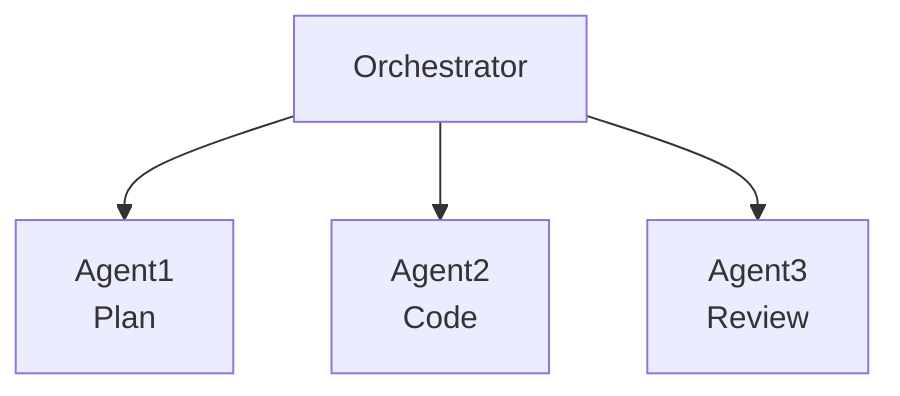
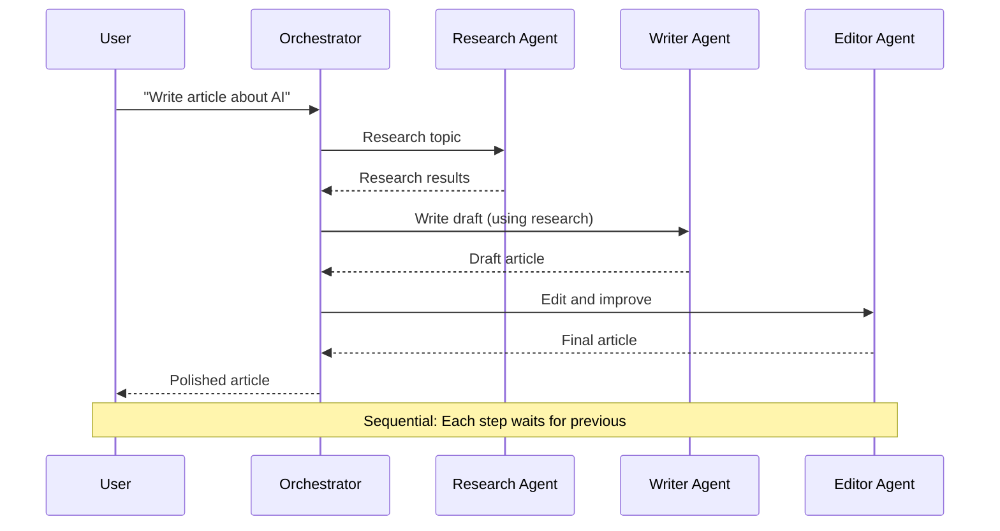
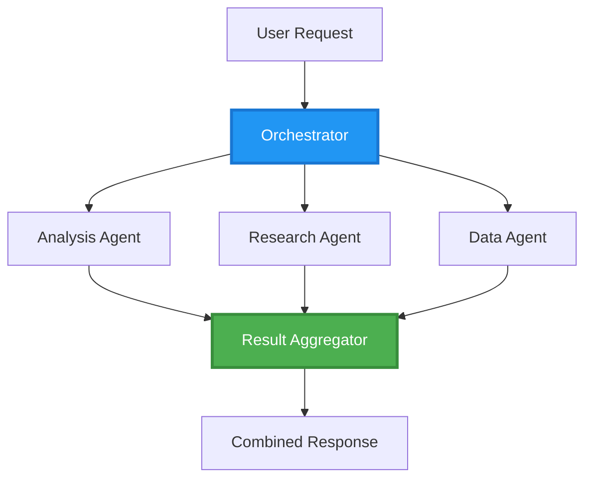
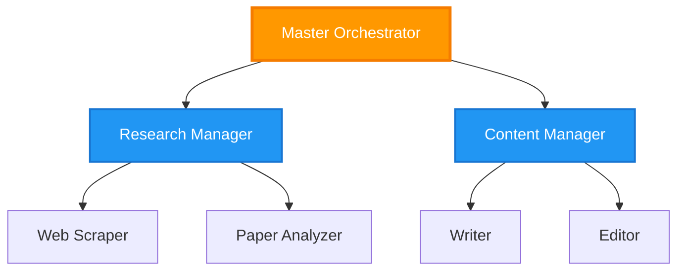
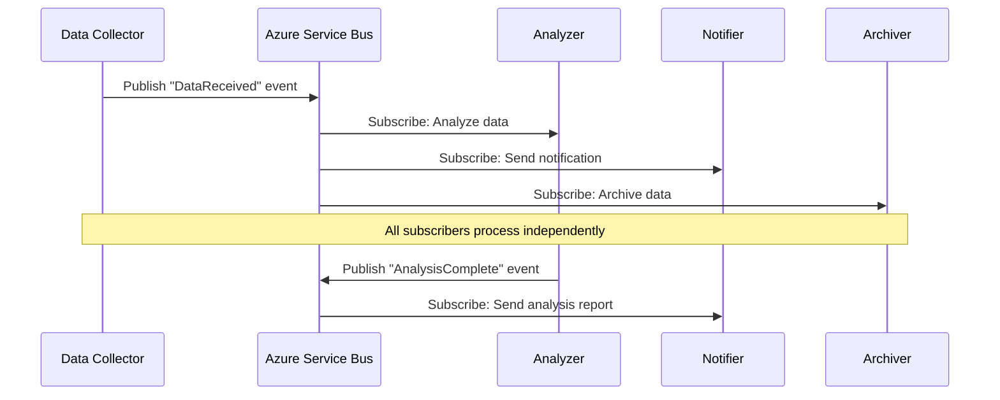
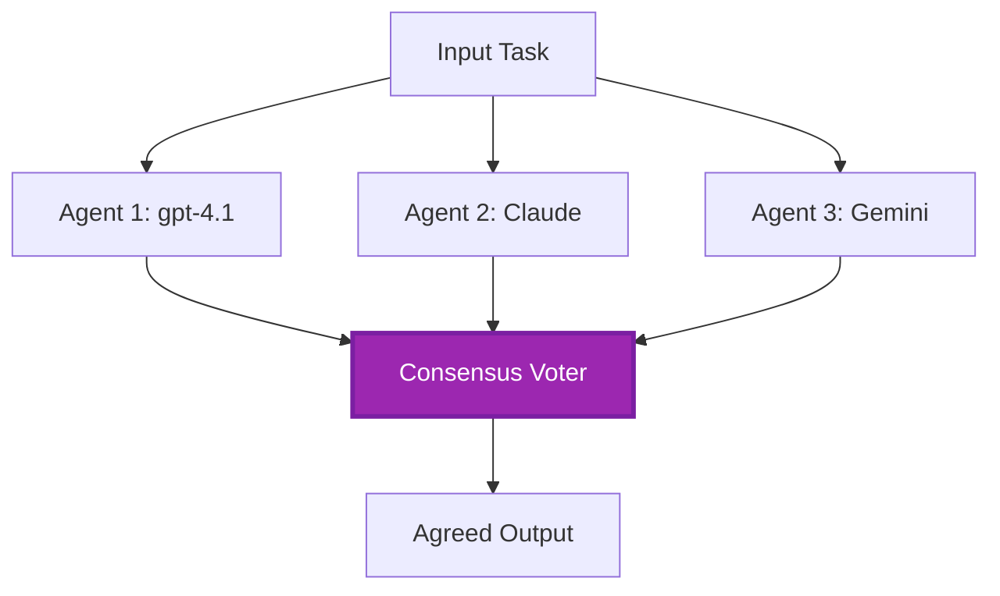
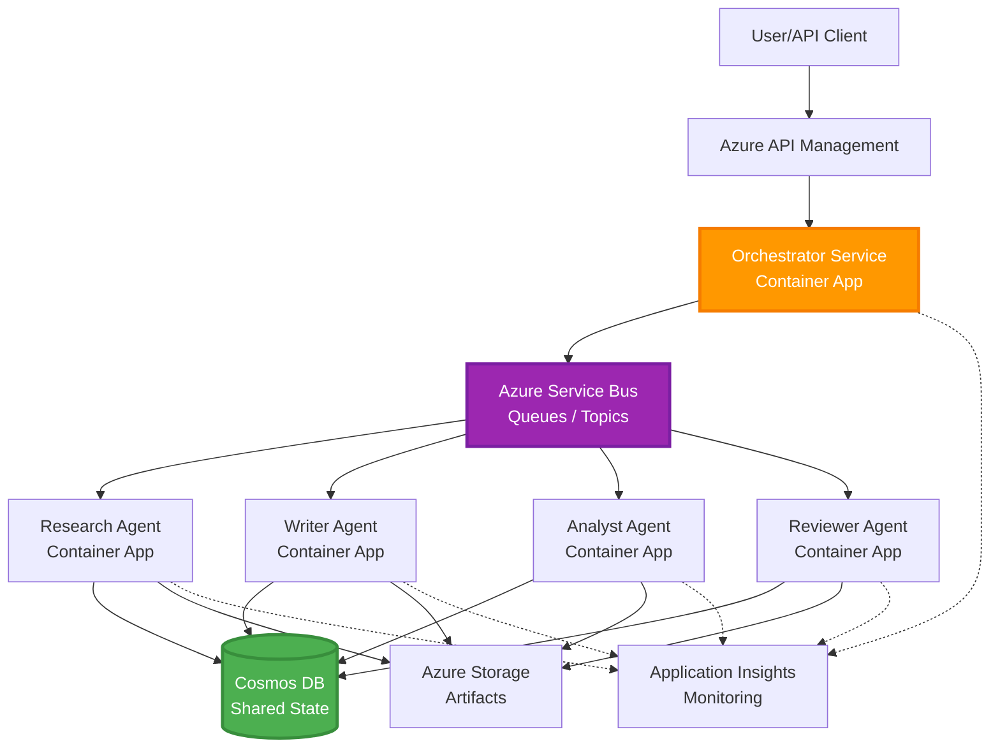

# Modelli di Coordinamento Multi-Agente

⏱️ **Tempo stimato**: 60-75 minuti di lettura; diverse ore per l'implementazione | 💰 **Costo stimato**: dipende dal carico di lavoro | ⭐ **Complessità**: Avanzato

**📚 Percorso di apprendimento:**
- ← Precedente: [Capacity Planning](capacity-planning.md) - Strategie di dimensionamento e scalabilità delle risorse
- 🎯 **Sei qui**: Modelli di Coordinamento Multi-Agente (Orchestrazione, comunicazione, gestione dello stato)
- → Successivo: [SKU Selection](sku-selection.md) - Scelta dei servizi Azure appropriati
- 🏠 [Home del corso](../../README.md)

---

## Cosa Imparerai

Completando questa lezione, sarai in grado di:
- Comprendere i **modelli di architettura multi-agente** e quando usarli
- Implementare **modelli di orchestrazione** (centralizzato, decentralizzato, gerarchico)
- Progettare strategie di **comunicazione tra agenti** (sincrona, asincrona, event-driven)
- Gestire lo **stato condiviso** tra agenti distribuiti
- Distribuire **sistemi multi-agente** su Azure con AZD
- Applicare **modelli di coordinamento** in scenari reali di AI
- Monitorare e fare debug di sistemi di agenti distribuiti

## Perché il Coordinamento Multi-Agente è Importante

### L'evoluzione: da Agente Singolo a Multi-Agente

**Agente Singolo (Semplice):**
```
User → Agent → Response
```
- ✅ Facile da comprendere e implementare
- ✅ Veloce per compiti semplici
- ❌ Limitato dalle capacità di un solo modello
- ❌ Non può parallelizzare compiti complessi
- ❌ Nessuna specializzazione

**Sistema Multi-Agente (Avanzato):**

- ✅ Agenti specializzati per compiti specifici
- ✅ Esecuzione parallela per velocità
- ✅ Modulabile e manutenibile
- ✅ Migliore per flussi di lavoro complessi
- ⚠️ Richiede logica di coordinamento

**Analogia**: Un agente singolo è come una persona che fa tutti i compiti. Il multi-agente è come un team dove ogni membro ha competenze specializzate (ricercatore, programmatore, revisore, scrittore) che lavorano insieme.

---

## Modelli Core di Coordinamento

### Modello 1: Coordinamento Sequenziale (Catena di Responsabilità)

**Quando usarlo**: I compiti devono essere completati in un ordine specifico, ogni agente costruisce sull'output precedente.



**Vantaggi:**
- ✅ Flusso dati chiaro
- ✅ Facile da debuggare
- ✅ Ordine di esecuzione prevedibile

**Limitazioni:**
- ❌ Più lento (nessun parallelismo)
- ❌ Un errore blocca l’intera catena
- ❌ Non gestisce compiti interdipendenti

**Esempi d’uso:**
- Pipeline di creazione contenuti (ricerca → scrittura → modifica → pubblicazione)
- Generazione di codice (pianificazione → implementazione → test → distribuzione)
- Generazione di report (raccolta dati → analisi → visualizzazione → sintesi)

---

### Modello 2: Coordinamento Parallelo (Fan-Out/Fan-In)

**Quando usarlo**: Compiti indipendenti possono essere eseguiti simultaneamente, i risultati vengono combinati alla fine.



**Vantaggi:**
- ✅ Veloce (esecuzione parallela)
- ✅ Tollera errori (risultati parziali accettabili)
- ✅ Scalabile orizzontalmente

**Limitazioni:**
- ⚠️ I risultati possono arrivare fuori ordine
- ⚠️ Necessaria logica di aggregazione
- ⚠️ Gestione complessa dello stato

**Esempi d’uso:**
- Raccolta dati multicanale (API + database + scraping web)
- Analisi competitiva (più modelli generano soluzioni, si seleziona la migliore)
- Servizi di traduzione (traduzione simultanea in più lingue)

---

### Modello 3: Coordinamento Gerarchico (Manager-Lavoratore)

**Quando usarlo**: Flussi di lavoro complessi con sotto-compiti, necessità di delega.



**Vantaggi:**
- ✅ Gestisce flussi di lavoro complessi
- ✅ Modulabile e manutenibile
- ✅ Confini di responsabilità chiari

**Limitazioni:**
- ⚠️ Architettura più complessa
- ⚠️ Maggiore latenza (più livelli di coordinamento)
- ⚠️ Richiede orchestrazione sofisticata

**Esempi d’uso:**
- Elaborazione documenti aziendali (classificazione → instradamento → elaborazione → archiviazione)
- Pipeline di dati multi-stadio (ingestione → pulizia → trasformazione → analisi → report)
- Flussi di lavoro di automazione complessi (pianificazione → allocazione risorse → esecuzione → monitoraggio)

---

### Modello 4: Coordinamento Event-Driven (Publish-Subscribe)

**Quando usarlo**: Gli agenti devono reagire agli eventi, si desidera un accoppiamento debole.



**Vantaggi:**
- ✅ Accoppiamento debole tra agenti
- ✅ Facile aggiungere nuovi agenti (basta iscriversi)
- ✅ Elaborazione asincrona
- ✅ Resiliente (persistenza messaggi)

**Limitazioni:**
- ⚠️ Consistenza eventuale
- ⚠️ Debug complesso
- ⚠️ Sfide nell’ordinamento dei messaggi

**Esempi d’uso:**
- Sistemi di monitoraggio in tempo reale (allarmi, dashboard, log)
- Notifiche multi-canale (email, SMS, push, Slack)
- Pipeline di elaborazione dati (molteplici consumatori degli stessi dati)

---

### Modello 5: Coordinamento Basato su Consenso (Votazione/Quorum)

**Quando usarlo**: Serve l'accordo di più agenti prima di procedere.



**Vantaggi:**
- ✅ Maggiore accuratezza (più opinioni)
- ✅ Tollerante ai guasti (fallimenti di minoranza accettabili)
- ✅ Controllo qualità incorporato

**Limitazioni:**
- ❌ Costoso (molte chiamate a modelli)
- ❌ Più lento (attesa di tutti gli agenti)
- ⚠️ Necessaria risoluzione dei conflitti

**Esempi d’uso:**
- Moderazione dei contenuti (più modelli revisionano il contenuto)
- Revisione codice (più linters/analizzatori)
- Diagnosi medica (più modelli AI, validazione esperta)

---

## Panoramica Architetturale

### Sistema Multi-Agente Completo su Azure



**Componenti chiave:**

| Componente | Scopo | Servizio Azure |
|-----------|---------|---------------|
| **API Gateway** | Punto di ingresso, limitazione rate, autenticazione | API Management |
| **Orchestratore** | Coordina i flussi di lavoro degli agenti | Container Apps |
| **Message Queue** | Comunicazione asincrona | Service Bus / Event Hubs |
| **Agenti** | Lavoratori AI specializzati | Container Apps / Functions |
| **State Store** | Stato condiviso, tracciamento compiti | Cosmos DB |
| **Storage degli Artifact** | Documenti, risultati, log | Blob Storage |
| **Monitoraggio** | Tracciamento distribuito, log | Application Insights |

Le code/topic di Service Bus e gli Event Hubs sono servizi diversi con modelli di consegna/consumo differenti; Event Hubs non è un sostituto drop-in per il codice Service Bus worker qui sotto. Parallelismo, messaggi persistiti e votazione modelli non garantiscono da soli tolleranza ai guasti o maggiore accuratezza.

---

## Prerequisiti

### Strumenti Richiesti

```bash
# Verify Azure Developer CLI
azd version
# Command reference baseline: azd 1.37.2

# Verify Azure CLI
az --version
# ✅ Expected: azure-cli 2.50.0 or higher

# Verify Docker (for local testing)
docker --version
# ✅ Expected: Docker version 20.10 or higher
```

### Requisiti Azure

- Sottoscrizione Azure attiva
- Permessi per creare:
  - Container Apps
  - Namespace Service Bus
  - Account Cosmos DB
  - Account di archiviazione
  - Application Insights

### Prerequisiti di Conoscenza

Dovresti aver completato:
- [Gestione Configurazione](../chapter-03-configuration/configuration.md)
- [Autenticazione e Sicurezza](../chapter-03-configuration/authsecurity.md)
- [Esempio Microservizi](../../../../examples/microservices)

---

## Guida all'Implementazione

> **Frammenti di design, non un laboratorio eseguibile:** L’albero del progetto e le etichette `File:` qui sotto descrivono i file da creare nel tuo progetto; questo repository non contiene un’applicazione `multi-agent-system` completa. Mancano pezzi come template main/parameter, ambiente/registro Container Apps, Dockerfile e lock dipendenze, setup database/container Cosmos, deployment modelli, configurazione identità/ruoli, regole di scaling, e lavoratori/code paralleli. Non aspettarti che `azd init` generi questi file né che `azd up` distribuisca gli snippet senza modifiche. Per un punto di partenza eseguibile, completa [Nozioni Base Multi-Agente](../chapter-05-multi-agent/multi-agent-basics.md).

**Assunzioni di runtime:** Python 3.10+, `azure-servicebus`, `azure-cosmos`, `openai`, Flask, e (per il monitoraggio) `azure-monitor-opentelemetry`; metti `shared` nel percorso di import Python in ogni immagine di servizio. Il container Cosmos `agent-state/tasks` deve esistere già con chiave di partizione `/id`. Le connessioni basate su chiavi semplificano questi frammenti, non sono linee guida per la produzione: preferisci identità gestite con ruoli dati Service Bus/Cosmos/OpenAI scoped. Non esporre chiavi in output o log.

La consegna Service Bus è **almeno una volta**. Conserva idempotenza per task **e passaggio**, usa concorrenza ottimistica (ETags) per leggere/modificare/scrivere stato, e rinnova i lock messaggi durante l’elaborazione lunga. Il semplice gestore di stato sotto è solo sequenziale e non implementa queste garanzie di produzione.

### Struttura del Progetto

```
multi-agent-system/
├── azure.yaml                    # AZD configuration
├── infra/
│   ├── main.bicep               # Main infrastructure
│   ├── core/
│   │   ├── servicebus.bicep     # Message queue
│   │   ├── cosmos.bicep         # State store
│   │   ├── storage.bicep        # Artifact storage
│   │   └── monitoring.bicep     # Application Insights
│   └── app/
│       ├── orchestrator.bicep   # Orchestrator service
│       └── agent.bicep          # Agent template
└── src/
    ├── orchestrator/            # Orchestration logic
    │   ├── app.py
    │   ├── workflows.py
    │   └── Dockerfile
    ├── agents/
    │   ├── research/            # Research agent
    │   ├── writer/              # Writer agent
    │   ├── analyst/             # Analyst agent
    │   └── reviewer/            # Reviewer agent
    └── shared/
        ├── state_manager.py     # Shared state logic
        └── message_handler.py   # Message handling
```

---

## Lezione 1: Modello di Coordinamento Sequenziale

### Implementazione: Pipeline di Creazione Contenuti

Progettiamo una pipeline sequenziale: Ricerca → Scrittura → Modifica. La pubblicazione è fuori da questo esempio.

### 1. Configurazione AZD

**File: `azure.yaml`**

```yaml
name: content-pipeline
metadata:
  template: multi-agent-sequential@1.0.0

services:
  orchestrator:
    project: ./src/orchestrator
    language: python
    host: containerapp
  
  research-agent:
    project: ./src/agents/research
    language: python
    host: containerapp
  
  writer-agent:
    project: ./src/agents/writer
    language: python
    host: containerapp
  
  editor-agent:
    project: ./src/agents/editor
    language: python
    host: containerapp
```

### 2. Infrastruttura: Service Bus per Coordinamento

**File: `infra/core/servicebus.bicep`**

```bicep
param name string
param location string
param tags object = {}

resource serviceBusNamespace 'Microsoft.ServiceBus/namespaces@2022-10-01-preview' = {
  name: name
  location: location
  tags: tags
  sku: {
    name: 'Standard'
    tier: 'Standard'
  }
  properties: {
    minimumTlsVersion: '1.2'
  }
}

// Queue for orchestrator → research agent
resource researchQueue 'Microsoft.ServiceBus/namespaces/queues@2022-10-01-preview' = {
  parent: serviceBusNamespace
  name: 'research-tasks'
  properties: {
    maxDeliveryCount: 3
    lockDuration: 'PT5M'
    deadLetteringOnMessageExpiration: true
  }
}

// Queue for research agent → writer agent
resource writerQueue 'Microsoft.ServiceBus/namespaces/queues@2022-10-01-preview' = {
  parent: serviceBusNamespace
  name: 'writer-tasks'
  properties: {
    maxDeliveryCount: 3
    lockDuration: 'PT5M'
  }
}

// Queue for writer agent → editor agent
resource editorQueue 'Microsoft.ServiceBus/namespaces/queues@2022-10-01-preview' = {
  parent: serviceBusNamespace
  name: 'editor-tasks'
  properties: {
    maxDeliveryCount: 3
    lockDuration: 'PT5M'
  }
}

output namespace string = serviceBusNamespace.name
// Do not output RootManageSharedAccessKey. Resolve scoped credentials
// securely or use managed identity in the application and scale rules.
```

### 3. Gestore dello Stato Condiviso

**File: `src/shared/state_manager.py`**

```python
from azure.cosmos import CosmosClient, PartitionKey
from datetime import datetime, timezone
import os

class StateManager:
    """Manages shared state across agents using Cosmos DB"""
    
    def __init__(self):
        endpoint = os.environ['COSMOS_ENDPOINT']
        key = os.environ['COSMOS_KEY']
        
        self.client = CosmosClient(endpoint, key)
        self.database = self.client.get_database_client('agent-state')
        self.container = self.database.get_container_client('tasks')
    
    def create_task(self, task_id: str, task_type: str, input_data: dict):
        """Create a new task"""
        task = {
            'id': task_id,
            'type': task_type,
            'status': 'pending',
            'input': input_data,
            'created_at': datetime.now(timezone.utc).isoformat(),
            'steps': []
        }
        self.container.create_item(task)
        return task
    
    def update_task_step(self, task_id: str, step_name: str, result: dict):
        """Update task with completed step"""
        task = self.container.read_item(task_id, partition_key=task_id)
        
        task['steps'].append({
            'name': step_name,
            'completed_at': datetime.now(timezone.utc).isoformat(),
            'result': result
        })
        
        self.container.replace_item(task_id, task)
        return task
    
    def complete_task(self, task_id: str, final_result: dict):
        """Mark task as complete"""
        task = self.container.read_item(task_id, partition_key=task_id)
        task['status'] = 'completed'
        task['result'] = final_result
        task['completed_at'] = datetime.now(timezone.utc).isoformat()
        self.container.replace_item(task_id, task)
        return task
    
    def get_task(self, task_id: str):
        """Retrieve task state"""
        return self.container.read_item(task_id, partition_key=task_id)
```

### 4. Servizio Orchestratore

**File: `src/orchestrator/app.py`**

```python
from flask import Flask, request, jsonify
from azure.servicebus import ServiceBusClient, ServiceBusMessage
import json
import uuid
import os
from shared.state_manager import StateManager

app = Flask(__name__)
state_manager = StateManager()

# Service Bus connection
servicebus_connection_str = os.environ['SERVICEBUS_CONNECTION_STRING']
servicebus_client = ServiceBusClient.from_connection_string(servicebus_connection_str)

@app.route('/health', methods=['GET'])
def health():
    return jsonify({'status': 'healthy', 'service': 'orchestrator'})

@app.route('/create-content', methods=['POST'])
def create_content():
    """
    Sequential workflow: Research → Write → Edit (returns a draft; no publishing)
    """
    data = request.get_json(silent=True) or {}
    topic = data.get('topic')
    
    if not topic:
        return jsonify({'error': 'Topic required'}), 400
    
    # Create task in state store
    task_id = str(uuid.uuid4())
    task = state_manager.create_task(
        task_id=task_id,
        task_type='content_creation',
        input_data={'topic': topic}
    )
    
    # Send message to research agent (first step)
    sender = servicebus_client.get_queue_sender('research-tasks')
    message = ServiceBusMessage(
        body=json.dumps({
            'task_id': task_id,
            'topic': topic,
            'next_queue': 'writer-tasks'  # Where to send results
        }),
        content_type='application/json'
    )
    
    with sender:
        sender.send_messages(message)
    
    return jsonify({
        'task_id': task_id,
        'status': 'started',
        'workflow': 'sequential',
        'steps': ['research', 'write', 'edit'],
        'message': 'Content creation pipeline initiated'
    }), 202

@app.route('/task/<task_id>', methods=['GET'])
def get_task_status(task_id):
    """Check task status"""
    try:
        task = state_manager.get_task(task_id)
        return jsonify(task)
    except Exception as e:
        return jsonify({'error': str(e)}), 404

if __name__ == '__main__':
    app.run(host='0.0.0.0', port=8080)
```

### 5. Agente Ricercatore

**File: `src/agents/research/app.py`**

```python
from azure.servicebus import ServiceBusClient, ServiceBusMessage
from openai import AzureOpenAI
import json
import os
import time
from shared.state_manager import StateManager

# Initialize clients
state_manager = StateManager()
servicebus_client = ServiceBusClient.from_connection_string(
    os.environ['SERVICEBUS_CONNECTION_STRING']
)

openai_client = AzureOpenAI(
    api_key=os.environ['AZURE_OPENAI_API_KEY'],
    api_version="2024-10-21",
    azure_endpoint=os.environ['AZURE_OPENAI_ENDPOINT']
)

def process_research_task(message_data):
    """Process research request and pass to writer"""
    task_id = message_data['task_id']
    topic = message_data['topic']
    next_queue = message_data['next_queue']
    
    print(f"🔬 Researching: {topic}")
    
    # Call Microsoft Foundry Models for research
    response = openai_client.chat.completions.create(
        model=os.environ['AZURE_OPENAI_DEPLOYMENT'],
        messages=[
            {"role": "system", "content": "You are a research assistant. Provide comprehensive research on the given topic."},
            {"role": "user", "content": f"Research this topic thoroughly: {topic}"}
        ],
        max_tokens=1500
    )
    
    research_results = response.choices[0].message.content
    
    # Update state
    state_manager.update_task_step(
        task_id=task_id,
        step_name='research',
        result={'research': research_results}
    )
    
    # Send to next agent (writer)
    sender = servicebus_client.get_queue_sender(next_queue)
    message = ServiceBusMessage(
        body=json.dumps({
            'task_id': task_id,
            'topic': topic,
            'research': research_results,
            'next_queue': 'editor-tasks'
        }),
        content_type='application/json'
    )
    
    with sender:
        sender.send_messages(message)
    
    print(f"✅ Research complete for task {task_id}")

def main():
    """Listen to research queue"""
    receiver = servicebus_client.get_queue_receiver('research-tasks')
    
    print("🔬 Research Agent started, listening for tasks...")
    
    with receiver:
        while True:
            messages = receiver.receive_messages(max_wait_time=5)
            for message in messages:
                try:
                    message_data = json.loads(str(message))
                    process_research_task(message_data)
                    receiver.complete_message(message)
                except Exception as e:
                    print(f"❌ Error processing message: {e}")
                    receiver.abandon_message(message)

if __name__ == '__main__':
    main()
```

### 6. Agente Scrittore

**File: `src/agents/writer/app.py`**

```python
from azure.servicebus import ServiceBusClient, ServiceBusMessage
from openai import AzureOpenAI
import json
import os
from shared.state_manager import StateManager

state_manager = StateManager()
servicebus_client = ServiceBusClient.from_connection_string(
    os.environ['SERVICEBUS_CONNECTION_STRING']
)

openai_client = AzureOpenAI(
    api_key=os.environ['AZURE_OPENAI_API_KEY'],
    api_version="2024-10-21",
    azure_endpoint=os.environ['AZURE_OPENAI_ENDPOINT']
)

def process_writing_task(message_data):
    """Write article based on research"""
    task_id = message_data['task_id']
    topic = message_data['topic']
    research = message_data['research']
    next_queue = message_data['next_queue']
    
    print(f"✍️ Writing article: {topic}")
    
    # Call Microsoft Foundry Models to write article
    response = openai_client.chat.completions.create(
        model=os.environ['AZURE_OPENAI_DEPLOYMENT'],
        messages=[
            {"role": "system", "content": "You are a professional writer. Write engaging, well-structured articles."},
            {"role": "user", "content": f"Based on this research:\n\n{research}\n\nWrite a comprehensive article about: {topic}"}
        ],
        max_tokens=2000
    )
    
    article_draft = response.choices[0].message.content
    
    # Update state
    state_manager.update_task_step(
        task_id=task_id,
        step_name='writing',
        result={'draft': article_draft}
    )
    
    # Send to editor
    sender = servicebus_client.get_queue_sender(next_queue)
    message = ServiceBusMessage(
        body=json.dumps({
            'task_id': task_id,
            'topic': topic,
            'draft': article_draft
        }),
        content_type='application/json'
    )
    
    with sender:
        sender.send_messages(message)
    
    print(f"✅ Article draft complete for task {task_id}")

def main():
    """Listen to writer queue"""
    receiver = servicebus_client.get_queue_receiver('writer-tasks')
    
    print("✍️ Writer Agent started, listening for tasks...")
    
    with receiver:
        while True:
            messages = receiver.receive_messages(max_wait_time=5)
            for message in messages:
                try:
                    message_data = json.loads(str(message))
                    process_writing_task(message_data)
                    receiver.complete_message(message)
                except Exception as e:
                    print(f"❌ Error: {e}")
                    receiver.abandon_message(message)

if __name__ == '__main__':
    main()
```

### 7. Agente Editor

**File: `src/agents/editor/app.py`**

```python
from azure.servicebus import ServiceBusClient
from openai import AzureOpenAI
import json
import os
from shared.state_manager import StateManager

state_manager = StateManager()
servicebus_client = ServiceBusClient.from_connection_string(
    os.environ['SERVICEBUS_CONNECTION_STRING']
)

openai_client = AzureOpenAI(
    api_key=os.environ['AZURE_OPENAI_API_KEY'],
    api_version="2024-10-21",
    azure_endpoint=os.environ['AZURE_OPENAI_ENDPOINT']
)

def process_editing_task(message_data):
    """Edit and finalize article"""
    task_id = message_data['task_id']
    topic = message_data['topic']
    draft = message_data['draft']
    
    print(f"📝 Editing article: {topic}")
    
    # Call Microsoft Foundry Models to edit
    response = openai_client.chat.completions.create(
        model=os.environ['AZURE_OPENAI_DEPLOYMENT'],
        messages=[
            {"role": "system", "content": "You are an expert editor. Improve grammar, clarity, and structure."},
            {"role": "user", "content": f"Edit and improve this article:\n\n{draft}"}
        ],
        max_tokens=2000
    )
    
    final_article = response.choices[0].message.content
    
    # Mark task as complete
    state_manager.complete_task(
        task_id=task_id,
        final_result={
            'topic': topic,
            'final_article': final_article,
            'word_count': len(final_article.split())
        }
    )
    
    print(f"✅ Article finalized for task {task_id}")

def main():
    """Listen to editor queue"""
    receiver = servicebus_client.get_queue_receiver('editor-tasks')
    
    print("📝 Editor Agent started, listening for tasks...")
    
    with receiver:
        while True:
            messages = receiver.receive_messages(max_wait_time=5)
            for message in messages:
                try:
                    message_data = json.loads(str(message))
                    process_editing_task(message_data)
                    receiver.complete_message(message)
                except Exception as e:
                    print(f"❌ Error: {e}")
                    receiver.abandon_message(message)

if __name__ == '__main__':
    main()
```

### 8. Distribuisci e Testa

Questi comandi si applicano **solo dopo aver implementato i file mancanti**. L’inizializzazione agente Foundry interattiva è un flusso separato; non genera questo design Service Bus.

```bash
# In your completed custom project
azd up

# Alternative in a SEPARATE empty folder (agents beta.23 requires azd >= 1.37)
azd extension install azure.ai.agents
azd ai agent init
azd up
```

> Consulta [Comandi AZD AI CLI](../chapter-08-production/production-ai-practices.md#azd-ai-cli-commands-and-extensions) per tutte le flag e opzioni `azd ai`.

```bash
# Get orchestrator URL
ORCHESTRATOR_URL=$(azd env get-values | grep ORCHESTRATOR_URL | cut -d '=' -f2 | tr -d '"')

# Create content
curl -X POST $ORCHESTRATOR_URL/create-content \
  -H "Content-Type: application/json" \
  -d '{"topic": "The Future of AI in Healthcare"}'
```

**✅ Output atteso:**
```json
{
  "task_id": "a1b2c3d4-e5f6-7890-abcd-ef1234567890",
  "status": "started",
  "workflow": "sequential",
  "steps": ["research", "write", "edit"],
  "message": "Content creation pipeline initiated"
}
```

**Controlla progresso task:**
```bash
TASK_ID="a1b2c3d4-e5f6-7890-abcd-ef1234567890"
curl $ORCHESTRATOR_URL/task/$TASK_ID
```

**✅ Output atteso (completato):**
```json
{
  "id": "a1b2c3d4-e5f6-7890-abcd-ef1234567890",
  "type": "content_creation",
  "status": "completed",
  "steps": [
    {
      "name": "research",
      "completed_at": "2025-11-19T10:30:00Z",
      "result": {"research": "..."}
    },
    {
      "name": "writing",
      "completed_at": "2025-11-19T10:32:00Z",
      "result": {"draft": "..."}
    }
  ],
  "result": {
    "topic": "The Future of AI in Healthcare",
    "final_article": "...",
    "word_count": 1500
  }
}
```

---

## Lezione 2: Modello di Coordinamento Parallelo

### Implementazione: Aggregatore di Ricerca Multi- Fonte

Costruiamo un sistema parallelo che raccoglie informazioni da più fonti simultaneamente.

### Orchestratore Parallelo

**File: `src/orchestrator/parallel_workflow.py`**

```python
from flask import Flask, request, jsonify
from azure.servicebus import ServiceBusClient, ServiceBusMessage
import json
import uuid
import os
from shared.state_manager import StateManager

app = Flask(__name__)
state_manager = StateManager()

servicebus_client = ServiceBusClient.from_connection_string(
    os.environ['SERVICEBUS_CONNECTION_STRING']
)

@app.route('/research-parallel', methods=['POST'])
def research_parallel():
    """
    Parallel workflow: Multiple agents work simultaneously
    """
    data = request.json
    query = data.get('query')
    
    task_id = str(uuid.uuid4())
    task = state_manager.create_task(
        task_id=task_id,
        task_type='parallel_research',
        input_data={
            'query': query,
            'agents': ['web', 'academic', 'news', 'social']
        }
    )
    
    # Fan-out: publish sequentially; workers may process concurrently.
    agents = [
        ('web-research-queue', 'web'),
        ('academic-research-queue', 'academic'),
        ('news-research-queue', 'news'),
        ('social-research-queue', 'social')
    ]
    
    for queue_name, agent_type in agents:
        sender = servicebus_client.get_queue_sender(queue_name)
        message = ServiceBusMessage(
            body=json.dumps({
                'task_id': task_id,
                'query': query,
                'agent_type': agent_type,
                'result_queue': 'aggregation-queue'
            }),
            content_type='application/json'
        )
        
        with sender:
            sender.send_messages(message)
    
    return jsonify({
        'task_id': task_id,
        'status': 'started',
        'workflow': 'parallel',
        'agents_dispatched': 4,
        'message': 'Parallel research initiated'
    }), 202

if __name__ == '__main__':
    app.run(host='0.0.0.0', port=8080)
```

### Logica di Aggregazione

**File: `src/agents/aggregator/app.py`**

```python
from azure.servicebus import ServiceBusClient
import json
import os
from collections import defaultdict
from shared.state_manager import StateManager

state_manager = StateManager()
servicebus_client = ServiceBusClient.from_connection_string(
    os.environ['SERVICEBUS_CONNECTION_STRING']
)

# Single-process demo only: not durable or shared across replicas.
# Production: use durable unique (task_id, agent_type) result records.
task_results = defaultdict(dict)
expected_agents = 4  # web, academic, news, social

def process_result(message_data):
    """Aggregate results from parallel agents"""
    task_id = message_data['task_id']
    agent_type = message_data['agent_type']
    result = message_data['result']
    
    # Store result
    task_results[task_id][agent_type] = {
        'agent': agent_type,
        'data': result
    }
    
    print(f"📊 Received result from {agent_type} agent ({len(task_results[task_id])}/{expected_agents})")
    
    # Check if all agents completed (fan-in)
    if len(task_results[task_id]) == expected_agents:
        print(f"✅ All agents completed for task {task_id}. Aggregating...")
        
        # Combine results
        aggregated = {
            'query': message_data['query'],
            'sources': list(task_results[task_id].values()),
            'summary': generate_summary(list(task_results[task_id].values()))
        }
        
        # Mark complete
        state_manager.complete_task(task_id, aggregated)
        
        # Clean up
        del task_results[task_id]
        
        print(f"✅ Aggregation complete for task {task_id}")

def generate_summary(results):
    """Generate summary from all sources"""
    summaries = [r['data'].get('summary', '') for r in results]
    return '\n\n'.join(summaries)

def main():
    """Listen to aggregation queue"""
    receiver = servicebus_client.get_queue_receiver('aggregation-queue')
    
    print("📊 Aggregator started, listening for results...")
    
    with receiver:
        while True:
            messages = receiver.receive_messages(max_wait_time=5)
            for message in messages:
                try:
                    message_data = json.loads(str(message))
                    process_result(message_data)
                    receiver.complete_message(message)
                except Exception as e:
                    print(f"❌ Error: {e}")
                    receiver.abandon_message(message)

if __name__ == '__main__':
    main()
```

**Vantaggi del Modello Parallelo:**
- ⚡ **Potenzialmente latenza più bassa** (limitatà dal lavoratore più lento più overhead di coordinamento)
- 🔄 **Supporta risultati parziali** con scadenze esplicite e policy di fallimento (non implementato dal semplice aggregatore)
- 📈 **Scalabile** (aggiungi facilmente altri agenti)

---

## Esercizi Pratici

### Esercizio 1: Aggiungi Gestione Timeout ⭐⭐ (Medio)

**Obiettivo**: Implementare la logica di timeout affinché l'aggregatore non attenda indefinitamente agenti lenti.

**Punto di partenza:** Esegui questa simulazione locale di scadenza prima di integrarla in un worker di coda. Un timeout controllato solo all'arrivo di un altro messaggio non si attiva mai se il lavoratore mancante non invia nulla.

**Passi**:

1. **Aggiungi monitoraggio timeout all'aggregatore:**

```python
import asyncio

async def simulated_agent(name, delay):
    await asyncio.sleep(delay)
    return {'agent': name, 'result': 'done'}

async def main():
    tasks = [asyncio.create_task(simulated_agent(name, delay))
             for name, delay in [('web', 0.1), ('academic', 0.2),
                                 ('news', 0.3), ('social', 3)]]
    done, pending = await asyncio.wait(tasks, timeout=1)
    results = [task.result() for task in done]
    for task in pending:
        task.cancel()
    await asyncio.gather(*pending, return_exceptions=True)
    print({'completed_agents': len(results), 'timed_out': bool(pending)})
    assert len(results) == 3 and pending

asyncio.run(main())
```

2. **Output atteso:**

```text
{'completed_agents': 3, 'timed_out': True}
```

3. **Integrazione sistema coda (compito di design):** Conserva la scadenza di dispatch e gli agenti attesi durante la creazione del task, esegui periodicamente la scansione delle scadenze indipendentemente dai risultati in arrivo, finalizza atomicamente i risultati parziali, e ignora messaggi tardivi/duplicati per task finalizzati. Un timeout locale non cancella lavoratori remoti.

Solo per il tuo progetto implementato:

```bash
azd deploy aggregator

# Submit task
curl -X POST $ORCHESTRATOR_URL/research-parallel \
  -H "Content-Type: application/json" \
  -d '{"query": "AI safety research"}'

# Check results after 30 seconds
curl $ORCHESTRATOR_URL/task/$TASK_ID
```

**✅ Criteri di successo:**
- ✅ Il test locale restituisce dopo la sua scadenza di un secondo anche se un agente è incompleto
- ✅ La risposta indica risultati parziali (`"timed_out": true`)
- ✅ Vengono restituiti i risultati disponibili (3 su 4 agenti)

**Tempo**: 20-25 minuti

---

### Esercizio 2: Implementa la Logica di Ripetizione ⭐⭐⭐ (Avanzato)

**Obiettivo**: Ritentare automaticamente i task agent falliti prima di rinunciare.

**Passi**:

1. **Usa i conteggi di consegna Service Bus invece di reinserire contatori di retry personalizzati:**

```python
import json
import time
# Integration fragment: use a live peek-lock ServiceBusReceiver.
# Set queue maxDeliveryCount to 4 for one attempt + up to three retries.
```

2. **Aggiungi gestore di retry agli agenti:**

```python
def process_with_retry(message, receiver, process_func):
    """Process message with automatic retry on failure"""
    try:
        message_data = json.loads(str(message))
        
        # Process the message
        process_func(message_data)
        
        # Success - complete
        receiver.complete_message(message)
        
    except Exception as e:
        if message.delivery_count < 4:
            # Bounded exponential delay: 5s, 10s, 20s.
            # Renew the lock if processing + waiting can exceed its duration.
            time.sleep(5 * 2 ** (message.delivery_count - 1))
            receiver.abandon_message(message)
        else:
            # Max retries exceeded - move to dead letter queue
            print(f"❌ Max attempts exceeded for message {message.message_id}")
            receiver.dead_letter_message(
                message,
                reason="MaxRetriesExceeded",
                error_description=str(e)
            )
```

3. **Monitora la dead letter queue:**

```python
def monitor_dead_letters():
    """Check dead letter queue for failed messages"""
    receiver = servicebus_client.get_queue_receiver(
        'research-tasks',
        sub_queue='deadletter'
    )
    
    with receiver:
        messages = receiver.receive_messages(max_wait_time=5)
        for message in messages:
            print(f"☠️ Dead letter: {message.message_id}")
            print(f"Reason: {message.dead_letter_reason}")
            print(f"Description: {message.dead_letter_error_description}")
```

**✅ Criteri di successo:**
- ✅ I task falliti vengono ritentati automaticamente (fino a 3 volte)
- ✅ Backoff esponenziale tra i retry (5s, 10s, 20s), con rinnovo del lock messaggio dove necessario
- ✅ Dopo il numero massimo di retry, i messaggi vanno nella dead letter queue
- ✅ I messaggi nella dead letter possono essere ispezionati; il replay richiede un flusso di recupero idempotente separato

**Tempo**: 30-40 minuti

---

### Esercizio 3: Implementa Circuit Breaker ⭐⭐⭐ (Avanzato)

**Obiettivo**: Evitare fallimenti a cascata fermando le richieste verso agenti malfunzionanti.

**Passi**:

1. **Crea la classe circuit breaker:**

```python
from enum import Enum
from datetime import datetime, timedelta, timezone

class CircuitState(Enum):
    CLOSED = "closed"      # Normal operation
    OPEN = "open"          # Failing, reject requests
    HALF_OPEN = "half_open"  # Testing if recovered

class CircuitBreaker:
    def __init__(self, failure_threshold=5, timeout_seconds=60):
        self.failure_threshold = failure_threshold
        self.timeout_seconds = timeout_seconds
        self.failure_count = 0
        self.last_failure_time = None
        self.state = CircuitState.CLOSED
    
    def call(self, func):
        """Execute function with circuit breaker protection"""
        if self.state == CircuitState.OPEN:
            # Check if timeout expired
            if datetime.now(timezone.utc) - self.last_failure_time > timedelta(seconds=self.timeout_seconds):
                self.state = CircuitState.HALF_OPEN
                print("🔄 Circuit breaker: HALF_OPEN (testing)")
            else:
                raise Exception(f"Circuit breaker OPEN for agent. Try again in {self.timeout_seconds}s")
        
        try:
            result = func()
            
            # Success
            self.failure_count = 0 # Count consecutive failures only
            if self.state == CircuitState.HALF_OPEN:
                self.state = CircuitState.CLOSED
                self.failure_count = 0
                print("✅ Circuit breaker: CLOSED (recovered)")
            
            return result
            
        except Exception as e:
            self.failure_count += 1
            self.last_failure_time = datetime.now(timezone.utc)
            
            if self.failure_count >= self.failure_threshold:
                self.state = CircuitState.OPEN
                print(f"🔴 Circuit breaker: OPEN (too many failures)")
            
            raise
```

2. **Applica alle chiamate degli agenti:**

```python
# In orchestrator
agent_circuits = {
    'web': CircuitBreaker(failure_threshold=5, timeout_seconds=60),
    'academic': CircuitBreaker(failure_threshold=5, timeout_seconds=60),
    'news': CircuitBreaker(failure_threshold=5, timeout_seconds=60),
    'social': CircuitBreaker(failure_threshold=5, timeout_seconds=60)
}

def send_to_agent(agent_type, message_data):
    """Send with circuit breaker protection"""
    circuit = agent_circuits[agent_type]
    
    try:
        circuit.call(lambda: send_message(agent_type, message_data))
    except Exception as e:
        print(f"⚠️ Skipping {agent_type} agent: {e}")
        # Continue with other agents
```

Questo circuito protegge l'**operazione di invio**, non il completamento da parte del lavoratore remoto: mettere con successo in coda un messaggio non dice nulla sul fatto che un agente sia attivo. `send_message` è la funzione mittente della tua applicazione. Per circuiti di esecuzione, alimenta i fallimenti/time-out dei task osservati in un coordinatore durevole. Questa classe in memoria è una dimostrazione a singolo thread, non un circuito breaker distribuito.

3. **Testare il circuito breaker localmente:**

```python
# Run after the class definition; no Azure changes required.
circuit = CircuitBreaker(failure_threshold=5, timeout_seconds=0)
def fail():
    raise RuntimeError("simulated failure")
for _ in range(5):
    try:
        circuit.call(fail)
    except RuntimeError:
        pass
assert circuit.state == CircuitState.OPEN
assert circuit.call(lambda: "recovered") == "recovered"
assert circuit.state == CircuitState.CLOSED
print("Circuit breaker recovery verified")
```

**✅ Criteri di successo:**
- ✅ Dopo 5 fallimenti, il circuito si apre (rifiuta richieste)
- ✅ Dopo 60 secondi, il circuito diventa semi-aperto (testa il recupero)
- ✅ Gli altri agenti continuano a lavorare normalmente
- ✅ Il circuito si chiude automaticamente quando l'agente si riprende

**Tempo**: 40-50 minuti

---

## Monitoraggio e Debugging

### Tracciamento Distribuito con Application Insights

**File: `src/shared/tracing.py`**

```python
from azure.monitor.opentelemetry import configure_azure_monitor
from opentelemetry import trace
from opentelemetry.trace import SpanKind
import logging
import os

connection_string = os.environ.get('APPLICATIONINSIGHTS_CONNECTION_STRING')

# Configure once per process. Message send/receive trace-context propagation
# and agent attributes on exceptions need explicit instrumentation.
if connection_string:
    configure_azure_monitor(connection_string=connection_string, logger_name=__name__)
tracer = trace.get_tracer(__name__)

# Configure logging
logger = logging.getLogger(__name__)
logger.setLevel(logging.INFO)

def trace_agent_call(agent_name, task_id, operation_name, operation):
    """Trace agent operations"""
    with tracer.start_as_current_span(f'agent.{agent_name}.{operation_name}', kind=SpanKind.CLIENT) as span:
        span.set_attribute('agent', agent_name)
        span.set_attribute('task_id', task_id)
        span.set_attribute('operation', operation_name)
        
        try:
            result = operation()
            span.set_attribute('status', 'success')
            logger.info('Agent operation completed', extra={
                'agent': agent_name, 'task_id': task_id, 'operation': operation_name
            })
            return result
        except Exception as e:
            span.set_attribute('status', 'error')
            logger.exception('Agent operation failed', extra={
                'agent': agent_name, 'task_id': task_id, 'operation': operation_name
            })
            raise
```

### Query di Application Insights

**Traccia i workflow multi-agente:**

```kusto
// Trace complete workflow for a task
traces
| where customDimensions.task_id == "a1b2c3d4-..."
| project timestamp, message, customDimensions.agent, customDimensions.operation
| order by timestamp asc
```

**Confronto prestazioni agenti:**

```kusto
// Compare agent execution times
dependencies
| where name contains "agent"
| summarize 
    avg_duration = avg(duration),
    p95_duration = percentile(duration, 95),
    count = count()
  by agent = tostring(customDimensions.agent)
| order by avg_duration desc
```

**Analisi dei fallimenti:**

```kusto
// Find which agents fail most
exceptions
| where customDimensions.agent != ""
| summarize 
    failure_count = count(),
    unique_errors = dcount(outerMessage)
  by agent = tostring(customDimensions.agent)
| order by failure_count desc
```

---

## Analisi dei costi

### Costi del sistema multi-agente (stime mensili)

Dati illustrativi per pianificazione, non preventivi: la somma qui di seguito è **$240-565/mese**. Verifica le tariffe regionali attuali, le ore attive/inattive delle repliche, il mix di token in ingresso/uscita, lo storage e la telemetria. Serverless non prevede throughput minimo riservato ma fattura comunque per richieste e storage.

| Componente | Configurazione | Costo |
|-----------|--------------|------|
| **Orchestratore** | 1 Container App (1 vCPU, 2GB) | $30-50 |
| **4 Agenti** | 4 Container Apps (0.5 vCPU, 1GB ciascuno) | $60-120 |
| **Service Bus** | Tier standard, 10M messaggi | $10-20 |
| **Cosmos DB** | Serverless, 5GB storage, 1M RUs | $25-50 |
| **Blob Storage** | 10GB storage, 100K operazioni | $5-10 |
| **Application Insights** | 5GB ingestione | $10-15 |
| **Microsoft Foundry Models** | gpt-4.1, 10M token | $100-300 |
| **Totale** | | **$240-565/mese** |

### Strategie di ottimizzazione dei costi

1. **Usa serverless dove possibile:**
   ```bicep
   // Cosmos DB serverless (no minimum cost)
   properties: {
     databaseAccountOfferType: 'Standard'
     capabilities: [{ name: 'EnableServerless' }]
   }
   ```

2. **Scala gli agenti a zero quando inattivi:**
   ```bicep
   scale: {
     minReplicas: 0  // Requires a Service Bus/KEDA scale rule to wake workers
     maxReplicas: 10
   }
   ```

3. **Usa batch per Service Bus:**
   ```python
   # Send messages in batches (cheaper)
   sender.send_messages([message1, message2, message3])
   ```

4. **Cache dei risultati usati frequentemente:**
   ```python
   # Use Azure Cache for Redis
   if cache.exists(query_hash):
       return cache.get(query_hash)
   ```

---

## Best Practices

### ✅ FARE:

1. **Usa operazioni idempotenti**
   ```python
   # Pseudocode: implement a durable, atomic per-step deduplication claim.
   def process_task(task_id):
       raise NotImplementedError("Claim (task_id, step) atomically, execute, persist outcome")
   ```

2. **Implementa logging completo**
   ```python
   logger.info(f"Agent: {agent_name}, Task: {task_id}, Action: {action}")
   ```

3. **Usa ID di correlazione**
   ```python
   # Pass task_id through entire workflow
   message_data = {
       'task_id': task_id,  # Correlation ID
       'timestamp': datetime.utcnow().isoformat()
   }
   ```

4. **Imposta TTL (time-to-live) per i messaggi**
   ```bicep
   properties: {
     defaultMessageTimeToLive: 'PT1H'  // 1 hour max
   }
   ```

5. **Monitora le code dead letter**
   ```python
   # Regular monitoring of failed messages
   monitor_dead_letters()
   ```

### ❌ NON FARE:

1. **Non creare dipendenze circolari**
   ```python
   # ❌ BAD: Agent A → Agent B → Agent A (infinite loop)
   # ✅ GOOD: Define clear directed acyclic graph (DAG)
   ```

2. **Non bloccare i thread degli agenti**
   ```python
   # ❌ BAD: Synchronous wait
   while not task_complete:
       time.sleep(1)
   
   # ✅ GOOD: Use message queue callbacks
   ```

3. **Non ignorare fallimenti parziali**
   ```python
   # ❌ BAD: Fail entire workflow if one agent fails
   # ✅ GOOD: Return partial results with error indicators
   ```

4. **Non usare retry infiniti**
   ```python
   # ❌ BAD: retry forever
   # ✅ GOOD: max_retries = 3, then dead letter
   ```

---

## Guida alla risoluzione dei problemi

### Problema: messaggi bloccati in coda

**Sintomi:**
- Messaggi si accumulano in coda
- Agenti non processano
- Stato task bloccato su "pending"

**Diagnosi:**
```bash
# Check queue depth
az servicebus queue show \
  --resource-group "$RG_NAME" \
  --namespace-name mybus \
  --name research-tasks \
  --query "countDetails"

# Check agent logs using Azure CLI
az containerapp logs show --name research-agent --resource-group $RG_NAME --tail 50
```

**Soluzioni:**

1. **Aumenta le repliche degli agenti:**
   ```bash
   az containerapp update \
     --resource-group "$RG_NAME" \
     --name research-agent \
     --min-replicas 3 \
     --max-replicas 10
   ```

2. **Controlla la coda dead letter:**
   ```bash
   az servicebus queue show \
     --resource-group "$RG_NAME" \
     --namespace-name mybus \
     --name research-tasks \
     --query "countDetails.deadLetterMessageCount"
   ```

---

### Problema: task in timeout/non completa mai

**Sintomi:**
- Stato task resta "in_progress"
- Alcuni agenti completano, altri no
- Nessun messaggio di errore

**Diagnosi:**
```bash
# Check task state
curl $ORCHESTRATOR_URL/task/$TASK_ID

# Check Application Insights
# Run query: traces | where customDimensions.task_id == "..."
```

**Soluzioni:**

1. **Implementa timeout nell'aggregatore (Esercizio 1)**

2. **Controlla i fallimenti degli agenti con Azure Monitor:**
   ```bash
   # View logs via azd monitor
   azd monitor --logs
   
   # Or use Azure CLI to check specific container app logs
   az containerapp logs show --name <agent-name> --resource-group $RG_NAME --follow | grep "ERROR\|FAIL"
   ```

3. **Verifica che tutti gli agenti siano in esecuzione:**
   ```bash
   az containerapp list \
     --resource-group rg-agents \
     --query "[].{name:name, status:properties.runningStatus}"
   ```

---

## Per saperne di più

### Documentazione ufficiale
- [Azure Service Bus](https://learn.microsoft.com/azure/service-bus-messaging/service-bus-messaging-overview)
- [Cosmos DB](https://learn.microsoft.com/azure/cosmos-db/introduction)
- [Container Apps DAPR](https://learn.microsoft.com/azure/container-apps/dapr-overview)
- [AI Agent Orchestration Patterns](https://learn.microsoft.com/azure/architecture/ai-ml/guide/ai-agent-design-patterns)

### Prossimi passi in questo corso
- ← Precedente: [Capacity Planning](capacity-planning.md)
- → Successivo: [SKU Selection](sku-selection.md)
- 🏠 [Course Home](../../README.md)

### Esempi correlati
- [Microservices Example](../../../../examples/microservices) - Pattern di comunicazione tra servizi
- [Microsoft Foundry Models Example](../../../../examples/azure-openai-chat) - Integrazione AI

---

## Riassunto

**Hai imparato:**
- ✅ Cinque pattern di coordinamento (sequenziale, parallelo, gerarchico, event-driven, consensus)
- ✅ Architettura multi-agente su Azure (Service Bus, Cosmos DB, Container Apps)
- ✅ Gestione dello stato tra agenti distribuiti
- ✅ Gestione timeout, retry e circuit breaker
- ✅ Monitoraggio e debugging di sistemi distribuiti
- ✅ Strategie di ottimizzazione dei costi

**Punti chiave:**
1. **Scegli il pattern giusto** - Sequenziale per workflow ordinati, parallelo per velocità, event-driven per flessibilità
2. **Gestisci lo stato con cura** - Usa Cosmos DB o simili per stato condiviso
3. **Gestisci i fallimenti in modo elegante** - Timeout, retry, circuit breaker, code dead letter
4. **Monitora tutto** - Il tracciamento distribuito è essenziale per il debugging
5. **Ottimizza i costi** - Scala a zero, usa serverless, implementa cache

**Prossimi passi:**
1. Completa gli esercizi pratici
2. Costruisci un sistema multi-agente per il tuo caso d’uso
3. Studia [SKU Selection](sku-selection.md) per ottimizzare prestazioni e costi

---

<!-- CO-OP TRANSLATOR DISCLAIMER START -->
**Disclaimer**:
Questo documento è stato tradotto utilizzando il servizio di traduzione AI [Co-op Translator](https://github.com/Azure/co-op-translator). Sebbene ci impegniamo per garantire la precisione, si prega di notare che le traduzioni automatizzate possono contenere errori o imprecisioni. Il documento originale nella sua lingua nativa deve essere considerato la fonte autorevole. Per informazioni critiche, si raccomanda una traduzione professionale effettuata da un essere umano. Non siamo responsabili per eventuali malintesi o interpretazioni errate derivanti dall’uso di questa traduzione.
<!-- CO-OP TRANSLATOR DISCLAIMER END -->