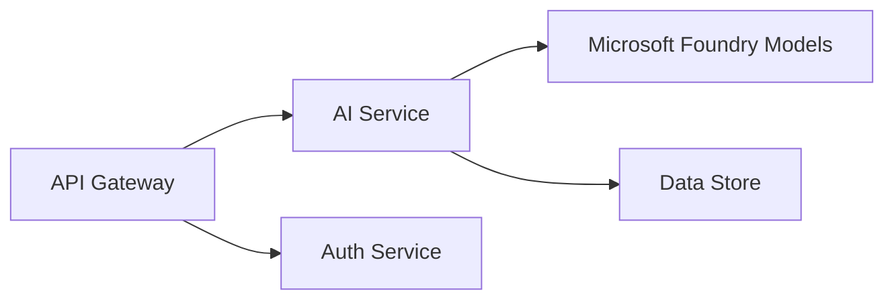
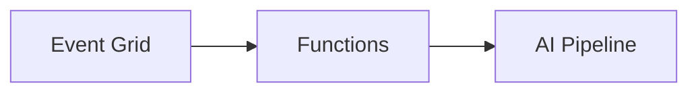

# Capitolo 8: Pattern per Produzione e Enterprise

**📚 Corso**: [AZD Per Principianti](../../README.md) | **⏱️ Durata**: 2-3 ore | **⭐ Complessità**: Avanzato

---

## Panoramica

Questo capitolo tratta i pattern di deployment pronti per l'impresa, il rafforzamento della sicurezza, il monitoraggio e l'ottimizzazione dei costi per carichi di lavoro AI in produzione.

Si tratta di un riferimento architetturale, non di un template completo e distribuibile in produzione. Gli esempi omettono dettagli di integrazione che devono essere forniti e testati nella vostra applicazione; leggere la checklist non certifica la prontezza per la produzione.

> **Revisione della release (2026-11-04):** Le linee guida AI CLI sono state verificate contro la documentazione/sorgente di `azd 1.37.2`, agenti `1.0.0-beta.23`, e valutazioni `1.0.0-beta.2`. Vedi [modifiche e correzioni della release](production-ai-practices.md#recent-release-changes-and-fixes) per i requisiti di compatibilità e i dettagli di migrazione; questa non è una convalida di deployment live.

## Obiettivi di Apprendimento

Completando questo capitolo, sarai in grado di:
- Distribuire applicazioni resilienti multi-regione
- Implementare pattern di sicurezza enterprise
- Configurare un monitoraggio completo
- Ottimizzare i costi su larga scala
- Impostare pipeline CI/CD con AZD

---

## 📚 Lezioni

| # | Lezione | Descrizione | Tempo |
|---|--------|-------------|------|
| 1 | [Pratiche AI per la Produzione](production-ai-practices.md) | Pattern di deployment enterprise | 90 min |

---

## 🚀 Checklist per la Produzione

- [ ] Deployment multi-regione per la resilienza
- [ ] Identità gestita per l'autenticazione (senza chiavi)
- [ ] Application Insights per il monitoraggio
- [ ] Budget e avvisi sui costi configurati
- [ ] Scansione della sicurezza abilitata
- [ ] Integrazione pipeline CI/CD
- [ ] Piano di disaster recovery

---

## 🏗️ Pattern Architetturali

### Pattern 1: Microservizi AI



### Pattern 2: AI guidata da eventi



---

## 🔐 Best Practice di Sicurezza

```bicep
// Illustrative properties from different resources, NOT a standalone Bicep file.
// Attach identity to the application host:
identity: {
  type: 'SystemAssigned'
}

// AI account properties (also require private endpoints, DNS and app connectivity):
properties: {
  publicNetworkAccess: 'Disabled'
  networkAcls: {
    defaultAction: 'Deny'
  }
}
```

---

## 💰 Ottimizzazione dei Costi

| Strategia | Vincolo principale |
|----------|---------|
| Scala a zero (Container Apps) | Richiede un trigger adatto; altri servizi continuano a generare costi |
| Utilizzo di livelli di consumo per dev | Confronta il prezzo del servizio selezionato e il carico di lavoro |
| Scaling programmato | Scala tramite infrastruttura/automazione supportata |
| Prenotazioni/capacità riservata | Solo quando supportato; gli impegni possono aumentare i costi inattivi |

Usa il [pattern completo della risorsa budget](production-ai-practices.md#2-cost-monitoring-and-budgets) con una data di inizio valida, ambito di fatturazione, destinatari e autorizzazioni. Un budget invia allarmi; non limita la spesa. Il risparmio dipende dall’utilizzo misurato e non è garantito in percentuale.

---

## 📊 Configurazione del Monitoraggio

```bash
# Open the Application Insights logs view (requires configured monitoring)
azd monitor --logs

# Check Application Insights
azd monitor --overview

# View metrics
az monitor metrics list --resource <resource-id>
```

---

## 🔗 Navigazione

| Direzione | Capitolo |
|-----------|---------|
| **Precedente** | [Capitolo 7: Risoluzione dei problemi](../chapter-07-troubleshooting/README.md) |
| **Corso completato** | [Home del corso](../../README.md) |

---

## 📖 Risorse Correlate

- [Guida AI Agents](../chapter-02-ai-development/agents.md)
- [Application Insights](../chapter-06-pre-deployment/application-insights.md)
- [Soluzioni Multi-Agente](../chapter-05-multi-agent/README.md)
- [Esempio di Microservizi](../../examples/microservices/README.md)

---

<!-- CO-OP TRANSLATOR DISCLAIMER START -->
**Disclaimer**:
Questo documento è stato tradotto utilizzando il servizio di traduzione AI [Co-op Translator](https://github.com/Azure/co-op-translator). Sebbene ci impegniamo per garantire la precisione, si prega di notare che le traduzioni automatizzate possono contenere errori o imprecisioni. Il documento originale nella sua lingua nativa deve essere considerato la fonte autorevole. Per informazioni critiche, si raccomanda una traduzione professionale effettuata da un essere umano. Non siamo responsabili per eventuali malintesi o interpretazioni errate derivanti dall’uso di questa traduzione.
<!-- CO-OP TRANSLATOR DISCLAIMER END -->