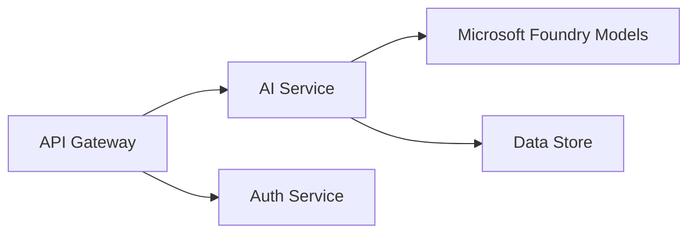
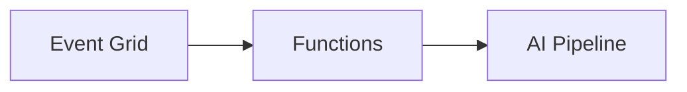

# Capitolo 8: Pattern di Produzione e Aziendali

**📚 Corso**: [AZD Per Principianti](../../README.md) | **⏱️ Durata**: 2-3 ore | **⭐ Complessità**: Avanzato

---

## Panoramica

Questo capitolo tratta modelli di distribuzione pronti per l'impresa, rafforzamento della sicurezza, monitoraggio e ottimizzazione dei costi per carichi di lavoro AI in produzione.

Questo è un riferimento architetturale, non un template completo distribuibile in produzione. Gli esempi omettono dettagli di integrazione che devono essere forniti e testati nella vostra applicazione; la lettura della checklist non certifica la prontezza per la produzione.

> **Aggiornamento Foundry GA (2026-11-09):** Usare `azd >= 1.37.0` e il bundle `microsoft.foundry` 1.0 generalmente disponibile per il workflow Foundry; le valutazioni si installano separatamente. Vedere [ambito del rilascio e migrazione](production-ai-practices.md#recent-release-changes-and-fixes) e l'[esempio di pipeline autenticata](production-ai-practices.md#cicd-pipeline-configuration). Questa è una revisione della documentazione, non una convalida di distribuzione live o uno status GA generale per funzionalità di anteprima opzionali.

## Obiettivi di Apprendimento

Completando questo capitolo, sarete in grado di:
- Distribuire applicazioni resilienti multi-regione
- Implementare pattern di sicurezza aziendale
- Configurare un monitoraggio completo
- Ottimizzare i costi su larga scala
- Impostare pipeline CI/CD con AZD

---

## 📚 Lezioni

| # | Lezione | Descrizione | Tempo |
|---|--------|-------------|------|
| 1 | [Pratiche AI in Produzione](production-ai-practices.md) | Pattern di distribuzione aziendale | 90 min |

---

## 🚀 Checklist di Produzione

- [ ] Distribuzione multi-regione per resilienza
- [ ] Identità gestita per autenticazione (senza chiavi)
- [ ] Application Insights per monitoraggio
- [ ] Budget e avvisi di costo configurati
- [ ] Scansione di sicurezza abilitata
- [ ] Integrazione pipeline CI/CD
- [ ] Piano di disaster recovery

---

## 🏗️ Pattern Architetturali

### Pattern 1: Microservizi AI



### Pattern 2: AI basata su Eventi



---

## 🔐 Best Practice di Sicurezza

```bicep
// Illustrative properties from different resources, NOT a standalone Bicep file.
// Attach identity to the application host:
identity: {
  type: 'SystemAssigned'
}

// AI account properties (also require private endpoints, DNS and app connectivity):
properties: {
  publicNetworkAccess: 'Disabled'
  networkAcls: {
    defaultAction: 'Deny'
  }
}
```

---

## 💰 Ottimizzazione dei Costi

| Strategia | Vincolo Principale |
|----------|---------|
| Scala a zero (Container Apps) | Richiede un trigger adatto; altri servizi continuano a generare costi |
| Usare livelli a consumo per dev | Confronta i prezzi del servizio selezionato e il carico di lavoro |
| Scalatura programmata | Scala tramite infrastruttura/automazione supportata |
| Prenotazioni/capacità provvista | Solo se supportato; impegni possono aumentare i costi inattivi |

Usate il [pattern completo di risorsa budget](production-ai-practices.md#2-cost-monitoring-and-budgets) con una data di inizio valida, ambito di fatturazione, destinatari e permessi. Un budget invia avvisi; non limita la spesa. Il risparmio dipende dall'utilizzo misurato e non è garantito in percentuali.

---

## 📊 Configurazione del Monitoraggio

```bash
# Open the Application Insights logs view (requires configured monitoring)
azd monitor --logs

# Check Application Insights
azd monitor --overview

# View metrics
az monitor metrics list --resource <resource-id>
```

---

## 🔗 Navigazione

| Direzione | Capitolo |
|-----------|---------|
| **Precedente** | [Capitolo 7: Risoluzione dei Problemi](../chapter-07-troubleshooting/README.md) |
| **Corso Completo** | [Home del Corso](../../README.md) |

---

## 📖 Risorse Correlate

- [Guida Agenti AI](../chapter-02-ai-development/agents.md)
- [Application Insights](../chapter-06-pre-deployment/application-insights.md)
- [Soluzioni Multi-Agente](../chapter-05-multi-agent/README.md)
- [Esempio Microservizi](../../examples/microservices/README.md)

---

<!-- CO-OP TRANSLATOR DISCLAIMER START -->
**Disclaimer**:
Questo documento è stato tradotto utilizzando il servizio di traduzione AI [Co-op Translator](https://github.com/Azure/co-op-translator). Sebbene ci impegniamo per garantire la precisione, si prega di notare che le traduzioni automatizzate possono contenere errori o imprecisioni. Il documento originale nella sua lingua nativa deve essere considerato la fonte autorevole. Per informazioni critiche, si raccomanda una traduzione professionale effettuata da un essere umano. Non siamo responsabili per eventuali malintesi o interpretazioni errate derivanti dall’uso di questa traduzione.
<!-- CO-OP TRANSLATOR DISCLAIMER END -->