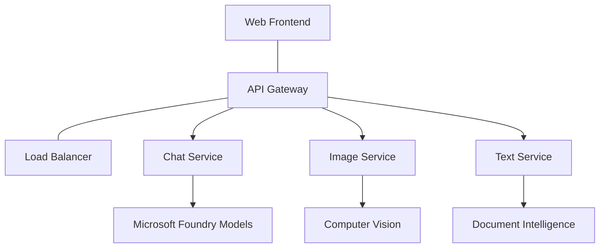

# Best practice per workload AI in produzione con AZD

**Navigazione del capitolo:**
- **📚 Home del corso**: [AZD per principianti](../../README.md)
- **📖 Capitolo corrente**: Capitolo 8 - Modelli di produzione e aziendali
- **⬅️ Capitolo precedente**: [Capitolo 7: Risoluzione dei problemi](../chapter-07-troubleshooting/debugging.md)
- **⬅️ Correlati**: [AI Workshop Lab](../chapter-02-ai-development/ai-workshop-lab.md)
- **🎯 Corso completo**: [AZD per principianti](../../README.md)

## Panoramica

Questa guida spiega i modelli di progettazione AI in produzione usando Azure Developer CLI (AZD). È un riferimento di design, non un'applicazione distribuibile o una certificazione di produzione.

**Confini degli esempi:** A meno che non siano esplicitamente descritti come completi, i frammenti Bicep presumono parametri e risorse referenziate da un template contenitore. Omettono immagini/piani host, identità, assegnazioni ruoli, DNS, output e altre integrazioni richieste. I percorsi YAML del servizio e gli script hook/test sono file illustrativi da creare **nella tua applicazione**; non sono forniti da questo corso. Usa un esempio AZD funzionante come base, compila l'infrastruttura completa e testala in un ambiente isolato prima della produzione.

## Sfide chiave affrontate

Le preoccupazioni comuni in produzione includono distribuzioni multiservizio, gestione di identità e segreti, scalabilità, controllo dei costi e monitoraggio. Non si afferma qui una prevalenza misurata.

## Modelli di architettura per AI in produzione

### Modello 1: Architettura AI a microservizi

**Quando usarlo**: Applicazioni AI complesse con molteplici capacità



**Implementazione AZD**:

```yaml
# azure.yaml
name: enterprise-ai-platform
services:
  web:
    project: ./web
    host: staticwebapp
  api-gateway:
    project: ./api-gateway
    host: containerapp
  chat-service:
    project: ./services/chat
    host: containerapp
  vision-service:
    project: ./services/vision
    host: containerapp
  text-service:
    project: ./services/text
    host: containerapp
```

### Modello 2: Elaborazione AI basata su eventi

**Quando usarlo**: Elaborazioni batch, analisi documenti, workflow asincroni

```bicep
// Event Hub for AI processing pipeline
resource eventHub 'Microsoft.EventHub/namespaces@2024-01-01' = {
  name: eventHubNamespaceName
  location: location
  sku: {
    name: 'Standard'
    tier: 'Standard'
    capacity: 1
  }
}

// Service Bus for reliable message processing
resource serviceBus 'Microsoft.ServiceBus/namespaces@2024-01-01' = {
  name: serviceBusNamespaceName
  location: location
  sku: {
    name: 'Premium'
    tier: 'Premium'
    capacity: 1
  }
}

// Function App for processing
resource functionApp 'Microsoft.Web/sites@2023-01-01' = {
  name: functionAppName
  location: location
  kind: 'functionapp,linux'
  properties: {
    siteConfig: {
      appSettings: [
        {
          name: 'FUNCTIONS_EXTENSION_VERSION'
          value: '~4'
        }
        {
          name: 'AZURE_OPENAI_ENDPOINT'
          value: '@Microsoft.KeyVault(VaultName=${keyVault.name};SecretName=openai-endpoint)'
        }
      ]
    }
  }
}
```

Questo crea frammenti di namespace, non hub, code, sottoscrizioni o trigger di Function. Una Function eseguibile necessita anche di un piano host, configurazione runtime/storage, un'identità allegata, RBAC e accesso di rete. Il riferimento a Key Vault necessita permesso di lettura segreti; un URL endpoint non è una credenziale.

## Riflettendo sulla salute degli agenti AI

Quando una web app tradizionale si guasta, i sintomi sono familiari: una pagina non si carica, un'API restituisce errore o un deployment fallisce. Le applicazioni AI basate su intelligenza artificiale possono guastarsi allo stesso modo—ma anche comportarsi in modi più sottili che non producono errori evidenti.

Questa sezione ti aiuta a costruire un modello mentale per monitorare i workload AI così sai dove guardare quando qualcosa non va.

### Come la salute degli agenti differisce dalla salute delle app tradizionali

Anche le app tradizionali possono avere errori di correttezza sottili. Un agente AI aggiunge qualità di risposta non deterministica oltre ai soliti problemi di disponibilità e correttezza. Considera la salute dell'agente in due livelli:

| Livello | Cosa monitorare | Dove guardare |
|-------|---------------|---------------|
| **Salute infrastrutturale** | Il servizio è attivo? Le risorse sono allocate? Gli endpoint sono raggiungibili? | `azd monitor`, salute risorsa su Azure Portal, log container/app |
| **Salute comportamentale** | L'agente risponde correttamente? Le risposte sono tempestive? Il modello viene chiamato correttamente? | Tracce Application Insights, metriche latenza chiamate modello, log qualità risposte |

La salute infrastrutturale è familiare—uguale per ogni app azd. La salute comportamentale è il nuovo livello introdotto dai workload AI.

### Dove guardare quando le app AI si comportano inaspettatamente

Se la tua app AI non produce i risultati attesi, ecco una lista concettuale di controllo:

1. **Inizia dal basilare.** L'app è attiva? Raggiunge le dipendenze? Controlla `azd monitor` e la salute delle risorse come faresti per qualsiasi app.
2. **Verifica la connessione al modello.** La tua app chiama con successo il modello AI? Chiamate modello fallite o scadute sono la causa più comune dei problemi e si vedono nei log dell'app.
3. **Ispeziona input e contesto in sicurezza.** Risposte errate possono derivare da recupero dati, istruzioni, limiti modello o esecuzione strumenti. Usa dati diagnostici accessibili con controllo, non abilitare logging indiscriminato di prompt/risposte in produzione.
4. **Rivedi la latenza delle risposte.** Le chiamate a modelli AI sono più lente delle tipiche API. Se l'app sembra lenta, verifica se i tempi di risposta del modello sono aumentati—potrebbe indicare limitazioni, congestione o limiti di capacità.
5. **Monitora segnali di costo.** Picchi inattesi in uso token o chiamate API possono indicare un loop, prompt errato o ritentativi eccessivi.

Non devi padroneggiare subito gli strumenti di osservabilità. L'essenziale è che le app AI hanno un livello aggiuntivo di comportamento da monitorare, e il monitoraggio integrato di azd (`azd monitor`) ti offre un punto di partenza per entrambe le dimensioni.

---

## Best practice di sicurezza

### 1. Modello di sicurezza Zero-Trust

**Strategia di implementazione**:
- Nessuna comunicazione servizio-a-servizio senza autenticazione
- Tutte le chiamate API usano identità gestite
- Isolamento di rete con endpoint privati
- Controlli di accesso con privilegi minimi

```bicep
// Managed Identity for each service
resource chatServiceIdentity 'Microsoft.ManagedIdentity/userAssignedIdentities@2023-01-31' = {
  name: 'chat-service-identity'
  location: location
}

// Role assignments with minimal permissions
resource openAIUserRole 'Microsoft.Authorization/roleAssignments@2022-04-01' = {
  scope: openAIAccount
  name: guid(openAIAccount.id, chatServiceIdentity.id, '5e0bd9bd-7b93-4f28-af87-19fc36ad61bd')
  properties: {
    roleDefinitionId: subscriptionResourceId('Microsoft.Authorization/roleDefinitions', '5e0bd9bd-7b93-4f28-af87-19fc36ad61bd')
    principalId: chatServiceIdentity.properties.principalId
    principalType: 'ServicePrincipal'
  }
}
```

### 2. Gestione sicura dei segreti

**Pattern di integrazione Key Vault**:

```bicep
// Key Vault with proper access policies
resource keyVault 'Microsoft.KeyVault/vaults@2023-02-01' = {
  name: keyVaultName
  location: location
  properties: {
    tenantId: tenant().tenantId
    sku: {
      family: 'A'
      name: 'standard' // Premium is needed for HSM-backed keys, not ordinary secrets
    }
    enableRbacAuthorization: true  // Use RBAC instead of access policies
    enablePurgeProtection: true    // Prevent accidental deletion
    enableSoftDelete: true
    softDeleteRetentionInDays: 90
  }
}

// Optional legacy key-auth alternative; omit when using Entra ID.
resource openAIKeySecret 'Microsoft.KeyVault/vaults/secrets@2023-02-01' = {
  parent: keyVault
  name: 'openai-api-key'
  properties: {
    value: openAIAccount.listKeys().key1
    attributes: {
      enabled: true
    }
  }
}
```

Assegna l'identità runtime `Key Vault Secrets User` al giusto ambito e collegala all'host; `enableRbacAuthorization` da sola non concede accesso. Preferisci autenticazione tramite identità gestita OpenAI con `disableLocalAuth: true`. Il segreto chiave opzionale ha senso solo per account abilitati specificamente, e il principale di provisioning ha bisogno di permesso scrittura segreti.

### 3. Sicurezza di rete

**Configurazione endpoint privati**:

```bicep
// Virtual Network for AI services
resource virtualNetwork 'Microsoft.Network/virtualNetworks@2023-04-01' = {
  name: vnetName
  location: location
  properties: {
    addressSpace: {
      addressPrefixes: ['10.0.0.0/16']
    }
    subnets: [
      {
        name: 'ai-services-subnet'
        properties: {
          addressPrefix: '10.0.1.0/24'
          privateEndpointNetworkPolicies: 'Disabled'
        }
      }
      {
        name: 'app-services-subnet'
        properties: {
          addressPrefix: '10.0.2.0/24'
          delegations: [
            {
              name: 'Microsoft.Web/serverFarms'
              properties: {
                serviceName: 'Microsoft.Web/serverFarms'
              }
            }
          ]
        }
      }
    ]
  }
}

// Private endpoints for all AI services
resource openAIPrivateEndpoint 'Microsoft.Network/privateEndpoints@2023-04-01' = {
  name: '${openAIAccountName}-pe'
  location: location
  properties: {
    subnet: {
      id: virtualNetwork.properties.subnets[0].id
    }
    privateLinkServiceConnections: [
      {
        name: 'openai-connection'
        properties: {
          privateLinkServiceId: openAIAccount.id
          groupIds: ['account']
        }
      }
    ]
  }
}
```

Gli endpoint privati richiedono anche gruppi zone DNS privati/collegamenti VNet e integrazione app VNet. Non bloccano automaticamente l'accesso pubblico: disabilita esplicitamente l'accesso pubblico all'account AI dopo aver validato connettività privata e accesso al deployment.

## Prestazioni e scalabilità

### 1. Strategie di auto-scalabilità

**Auto-scalabilità per Container Apps**:

```bicep
resource containerApp 'Microsoft.App/containerApps@2023-05-01' = {
  name: containerAppName
  location: location
  properties: {
    configuration: {
      ingress: {
        external: true
        targetPort: 8000
        transport: 'http'
      }
    }
    template: {
      scale: {
        minReplicas: 2  // Always have 2 instances minimum
        maxReplicas: 50 // Scale up to 50 for high load
        rules: [
          {
            name: 'http-scaling'
            http: {
              metadata: {
                concurrentRequests: '20'  // Scale when >20 concurrent requests
              }
            }
          }
          {
            name: 'cpu-scaling'
            custom: {
              type: 'cpu'
              metadata: {
                type: 'Utilization'
                value: '70'  // Scale when CPU >70%
              }
            }
          }
        ]
      }
    }
  }
}
```

### 2. Strategie di caching

**Cache Redis per risposte AI**:

```bicep
// Legacy Azure Cache for Redis example (not recommended for new deployments)
resource redisCache 'Microsoft.Cache/redis@2023-04-01' = {
  name: redisCacheName
  location: location
  properties: {
    sku: {
      name: 'Premium'
      family: 'P'
      capacity: 1
    }
    enableNonSslPort: false
    minimumTlsVersion: '1.2'
    redisConfiguration: {
      'maxmemory-policy': 'allkeys-lru'
    }
    // Sharding distributes data; replication/failover provides availability.
    shardCount: 2
  }
}

// Cache configuration in application
var cacheConnectionString = '${redisCache.properties.hostName}:6380,password=${redisCache.listKeys().primaryKey},ssl=True,abortConnect=False'
```

Azure Cache for Redis Basic/Standard/Premium è su un [percorso di sostituzione](https://learn.microsoft.com/azure/azure-cache-for-redis/retirement-faq). Usa Azure Managed Redis per nuovi progetti e la sua configurazione documentata di SKU, identità e TLS, invece di copiare questa risorsa legacy in un nuovo sistema di produzione. La riga connection-string è un segnaposto non funzionale, non una credenziale. Partiziona le chiavi cache per autorizzazione, modello/istruzioni e versione recupero, con scadenza; una cache condivisa solo per query può esporre dati di un altro utente.

### 3. Bilanciamento del carico e gestione del traffico

**Application Gateway con WAF**:

```bicep
// Application Gateway with Web Application Firewall
resource applicationGateway 'Microsoft.Network/applicationGateways@2023-04-01' = {
  name: appGatewayName
  location: location
  properties: {
    sku: {
      name: 'WAF_v2'
      tier: 'WAF_v2'
      capacity: 2
    }
    webApplicationFirewallConfiguration: {
      enabled: true
      firewallMode: 'Prevention'
      ruleSetType: 'OWASP'
      ruleSetVersion: '3.2'
    }
    // Backend pools for AI services
    backendAddressPools: [
      {
        name: 'ai-services-pool'
        properties: {
          backendAddresses: [
            {
              fqdn: '${containerApp.properties.configuration.ingress.fqdn}'
            }
          ]
        }
      }
    ]
  }
}
```

Questa è una risorsa parziale gateway: un deployment reale richiede subnet gateway/configurazione IP, IP frontend e porte, listener/certificati TLS, impostazioni HTTP backend/probe, regole e priorità di routing e una policy WAF revisionata. Hostname/SNI TLS e autenticazione devono corrispondere al backend Container App.

## 💰 Ottimizzazione dei costi

### 1. Dimensionamento corretto delle risorse

**Configurazioni specifiche ambientali**:

Questi nomi sono **input custom-template illustrativi**, non configurazioni automatiche AZD. Mappali prima in `infra/main.parameters.json`/Bicep e configurazione host. Per esempio, il sample RAG usa `AZURE_SEARCH_SERVICE_SKU` e `AZURE_OPENAI_CHATGPT_DEPLOYMENT_CAPACITY`, non i nomi generici seguenti. Dai la memoria ai Container Apps in un'unità supportata come `1Gi` nella risorsa reale. Applica modifiche infrastruttura con `azd up` o `azd provision`; `azd deploy` da solo non applica modifiche Bicep.

```bash
# Development environment
azd env new development
azd env set AZURE_OPENAI_SKU "S0"
azd env set AZURE_OPENAI_CAPACITY 10
azd env set AZURE_SEARCH_SKU "basic"
azd env set CONTAINER_CPU 0.5
azd env set CONTAINER_MEMORY 1.0

# Production environment  
azd env new production
azd env set AZURE_OPENAI_SKU "S0"
azd env set AZURE_OPENAI_CAPACITY 100
azd env set AZURE_SEARCH_SKU "standard"
azd env set CONTAINER_CPU 2.0
azd env set CONTAINER_MEMORY 4.0
```

### 2. Monitoraggio costi e budget

```bicep
// Supply the first day of the current UTC month, e.g. 2026-11-01T00:00:00Z.
param budgetStartDate string

// Cost management and budgets
resource budget 'Microsoft.Consumption/budgets@2024-08-01' = {
  name: 'ai-workload-budget'
  properties: {
    timePeriod: {
      startDate: budgetStartDate
    }
    timeGrain: 'Monthly'
    amount: 2000  // In the billing currency, not necessarily USD
    category: 'Cost'
    notifications: {
      warning: {
        enabled: true
        operator: 'GreaterThan'
        threshold: 80
        contactEmails: [
          'finance@company.com'
          'engineering@company.com'
        ]
        contactRoles: [
          'Owner'
          'Contributor'
        ]
      }
      critical: {
        enabled: true
        operator: 'GreaterThan'
        threshold: 95
        contactEmails: [
          'cto@company.com'
        ]
      }
    }
  }
}
```

Sostituisci i destinatari d'esempio e verifica ambito/permessi. Gli avvisi budget usano dati di fatturazione ritardati e non impongono un limite di spesa.

### 3. Ottimizzazione uso token

**Gestione costi OpenAI**:

Questa è solo una euristica basata sui caratteri per un'anteprima UI, **non** un validatore del limite token modello. Il codice di produzione deve usare un tokenizer adatto al modello distribuito e considerare istruzioni di sistema, schemi strumenti, storici e budget output. Rifiuta un messaggio utente sovradimensionato invece di tranciarlo silenziosamente.

```typescript
// Application-level token optimization
class TokenOptimizer {
  private readonly maxTokens = 4000;
  private readonly reserveTokens = 500;
  
  optimizePrompt(userInput: string, context: string): string {
    const availableTokens = this.maxTokens - this.reserveTokens;
    if (this.estimateTokens(userInput) + 8 >= availableTokens) {
      throw new Error("User input exceeds the illustrative prompt budget");
    }
    const estimatedTokens = this.estimateTokens(userInput + context) + 8;
    
    if (estimatedTokens > availableTokens) {
      // Truncate context, not user input
      context = this.truncateContext(context, Math.max(0, availableTokens - this.estimateTokens(userInput) - 8));
    }
    
    return `${context}\n\nUser: ${userInput}`;
  }
  
  private estimateTokens(text: string): number {
    // Rough estimation: 1 token ≈ 4 characters
    return Math.ceil(text.length / 4);
  }

  private truncateContext(text: string, estimatedBudget: number): string {
    return text.slice(0, Math.max(0, estimatedBudget) * 4);
  }
}
```

## Monitoraggio e osservabilità

### 1. Application Insights completo

```bicep
// Application Insights with advanced features
resource applicationInsights 'Microsoft.Insights/components@2020-02-02' = {
  name: applicationInsightsName
  location: location
  kind: 'web'
  properties: {
    Application_Type: 'web'
    WorkspaceResourceId: logAnalyticsWorkspace.id
    SamplingPercentage: 100  // Ingestion setting; review cost and SDK sampling separately
    DisableIpMasking: false  // Retain IP masking
  }
}

// Custom metrics for AI operations
resource aiMetricAlerts 'Microsoft.Insights/metricAlerts@2018-03-01' = {
  name: 'ai-high-error-rate'
  location: 'global'
  properties: {
    description: 'Alert when failed request count exceeds 10 in five minutes'
    severity: 2
    enabled: true
    scopes: [
      applicationInsights.id
    ]
    evaluationFrequency: 'PT1M'
    windowSize: 'PT5M'
    criteria: {
      'odata.type': 'Microsoft.Azure.Monitor.SingleResourceMultipleMetricCriteria'
      allOf: [
        {
          name: 'high-error-rate'
          metricName: 'requests/failed'
          operator: 'GreaterThan'
          threshold: 10
          timeAggregation: 'Count'
        }
      ]
    }
  }
}
```

### 2. Monitoraggio specifico AI

**Dashboard personalizzate per metriche AI**:

```json
{
  "dashboard": {
    "name": "AI Application Monitoring",
    "tiles": [
      {
        "name": "OpenAI Request Volume",
        "query": "dependencies | where target contains 'openai' | summarize count() by bin(timestamp, 5m)"
      },
      {
        "name": "AI Response Latency",
        "query": "dependencies | where target contains 'openai' | summarize avg(duration) by bin(timestamp, 5m)"
      },
      {
        "name": "Token Usage",
        "query": "customMetrics | where name == 'openai_tokens_used' | summarize sum(value) by bin(timestamp, 1h)"
      },
      {
        "name": "Cost per Hour",
        "query": "customMetrics | where name == 'openai_cost' | summarize sum(value) by bin(timestamp, 1h)"
      }
    ]
  }
}
```

Questo JSON è uno schizzo definito dall'app, non uno schema importabile del dashboard Azure portal. Le query token/costi richiedono che la tua app emetta esattamente quelle metriche personalizzate; non sono create da AZD. Adatta i filtri dipendenza ai nomi reali di endpoint/span del modello.

### 3. Controlli di salute e monitoraggio uptime

```bicep
// Application Insights availability tests
resource availabilityTest 'Microsoft.Insights/webtests@2022-06-15' = {
  name: 'ai-app-availability-test'
  location: location
  tags: {
    'hidden-link:${applicationInsights.id}': 'Resource'
  }
  properties: {
    SyntheticMonitorId: 'ai-app-availability-test'
    Name: 'AI Application Availability Test'
    Description: 'Tests AI application endpoints'
    Enabled: true
    Frequency: 300  // 5 minutes
    Timeout: 120    // 2 minutes
    Kind: 'standard'
    Locations: [
      {
        Id: 'us-east-2-azr'
      }
      {
        Id: 'us-west-2-azr'
      }
    ]
    Request: {
      RequestUrl: 'https://${webApp.properties.defaultHostName}/health'
      HttpVerb: 'GET'
      FollowRedirects: true
      ParseDependentRequests: false
    }
    ValidationRules: {
      ExpectedHttpStatusCode: 200
      SSLCheck: true
      SSLCertRemainingLifetimeCheck: 7
    }
  }
}
```

## Disaster Recovery e alta disponibilità

Il test precedente presume un App Service `webApp` e risorsa Application Insights esistenti. I test di disponibilità standard sono a tariffa e richiedono un endpoint raggiungibile; app solo private necessitano di un design di monitoraggio privato adeguato. I test URL ping sono obsoleti; usa [test disponibilità standard](https://learn.microsoft.com/azure/azure-monitor/app/availability).

### 1. Deployment multi-regione

```yaml
# azure.yaml - Multi-region configuration
name: ai-app-multiregion
services:
  api-primary:
    project: ./api
    host: containerapp
    env:
      AZURE_REGION: eastus
  api-secondary:
    project: ./api
    host: containerapp
    env:
      AZURE_REGION: westus2
```

```bicep
// Separate App Service topology, not the Container Apps declarations above
resource trafficManager 'Microsoft.Network/trafficManagerProfiles@2022-04-01' = {
  name: trafficManagerProfileName
  location: 'global'
  properties: {
    profileStatus: 'Enabled'
    trafficRoutingMethod: 'Priority'
    dnsConfig: {
      relativeName: trafficManagerProfileName
      ttl: 30
    }
    monitorConfig: {
      protocol: 'HTTPS'
      port: 443
      path: '/health'
      intervalInSeconds: 30
      toleratedNumberOfFailures: 3
      timeoutInSeconds: 10
    }
    endpoints: [
      {
        name: 'primary-endpoint'
        type: 'Microsoft.Network/trafficManagerProfiles/azureEndpoints'
        properties: {
          targetResourceId: primaryAppService.id
          endpointStatus: 'Enabled'
          priority: 1
        }
      }
      {
        name: 'secondary-endpoint'
        type: 'Microsoft.Network/trafficManagerProfiles/azureEndpoints'
        properties: {
          targetResourceId: secondaryAppService.id
          endpointStatus: 'Enabled'
          priority: 2
        }
      }
    ]
  }
}
```

Le variabili ambientali non determinano le localizzazioni risorsa. IaC deve fornire host regionali distinti e associare ogni servizio con tag `resourceName` o `azd-service-name`. Esempio Traffic Manager è una **topologia App Service separata** (`primaryAppService`/`secondaryAppService`), non un routing per le dichiarazioni Container Apps. Container Apps richiede endpoint/front door esterno configurato adeguatamente, routing TLS/dominio personalizzato e probe salute.

### 2. Backup e ripristino dati

```bicep
// Backup configuration for critical data
resource backupVault 'Microsoft.DataProtection/backupVaults@2023-05-01' = {
  name: backupVaultName
  location: location
  identity: {
    type: 'SystemAssigned'
  }
  properties: {
    storageSettings: [
      {
        datastoreType: 'VaultStore'
        type: 'LocallyRedundant'
      }
    ]
  }
}

```

Solo il vault non effettua backup. Configura una **policy supportata e istanza di backup specifiche del workload**, permessi sorgente, conservazione e test restore usando le [matrici di supporto Azure Backup](https://learn.microsoft.com/azure/backup/backup-support-matrix). Non esiste una policy Azure Backup generica per deployment modelli Azure OpenAI ospitati. Tieni definizioni deploy infrastruttura/modello sotto controllo versione; proteggi documenti caricati, dati applicazione e artefatti fine-tuning usando le funzionalità backup/export supportate di ogni servizio di supporto. Definisci e testa esplicitamente RPO/RTO.

## DevOps e integrazione CI/CD

### 1. Workflow GitHub Actions

```yaml
# .github/workflows/deploy-ai-app.yml
name: Deploy AI Application

on:
  push:
    branches: [main]
  pull_request:
    branches: [main]

jobs:
  test:
    runs-on: ubuntu-latest
    steps:
      - uses: actions/checkout@v4
      
      - name: Setup Python
        uses: actions/setup-python@v4
        with:
          python-version: '3.11'
          
      - name: Install dependencies
        run: |
          pip install -r requirements.txt
          pip install pytest
          
      - name: Run tests
        run: pytest tests/
        
      - name: AI Safety Tests
        run: |
          python scripts/test_ai_safety.py
          python scripts/validate_prompts.py

```

Questa è la **parte solo test** di un workflow e presume che tu abbia creato `requirements.txt`, `tests/` e i due script di sicurezza. Aggiungi i job autenticati OIDC per provisioning/deploy da [Configurazione pipeline CI/CD](#cicd-pipeline-configuration), con `needs: test`, trigger push/manuale fidato e ambienti GitHub protetti. Non deployare codice pull-request non fidato con credenziali cloud. Un runner fresco non ha ambiente AZD locale selezionato; fornisci input ambiente/sottoscrizione/posizione e usa `azd auth login`, non solo `azure/login`.

### 2. Validazione infrastruttura

```bash
# scripts/validate_infrastructure.sh
#!/bin/bash
set -euo pipefail

echo "Validating AI infrastructure deployment..."

# Requires Azure CLI login and the resource group selected explicitly.
: "${AZURE_RESOURCE_GROUP:?Set AZURE_RESOURCE_GROUP}"
: "${AZURE_OPENAI_NAME:?Set AZURE_OPENAI_NAME}"
: "${AZURE_OPENAI_CHAT_DEPLOYMENT:?Set the actual deployment name}"

# A successful empty list is not proof that resources exist.
types=("Microsoft.CognitiveServices/accounts" "Microsoft.Search/searchServices"
       "Microsoft.Storage/storageAccounts" "Microsoft.KeyVault/vaults")
for resource_type in "${types[@]}"; do
    count=$(az resource list --resource-group "$AZURE_RESOURCE_GROUP" \
        --resource-type "$resource_type" --query "length(@)" -o tsv)
    if [[ "$count" -lt 1 ]]; then
        echo "ERROR: No $resource_type found in $AZURE_RESOURCE_GROUP"
        exit 1
    fi
done

# Validate OpenAI model deployments
echo "Validating OpenAI model deployments..."
state=$(az cognitiveservices account deployment show \
  --name "$AZURE_OPENAI_NAME" --resource-group "$AZURE_RESOURCE_GROUP" \
  --deployment-name "$AZURE_OPENAI_CHAT_DEPLOYMENT" \
  --query "properties.provisioningState" -o tsv)
if [[ "$state" != "Succeeded" ]]; then
    echo "ERROR: Required model deployment is not provisioned successfully"
    exit 1
fi

echo "Infrastructure validation completed successfully!"
```

Atteso: uscita zero e messaggio completamento solo quando tutti i tipi attesi esistono e il deployment modello nominato è provisionato. Verifica inventario/stato provisioning, **non** la salute risorsa, topologia esatta, RBAC, raggiungibilità rete o comportamento modello. Adatta i tipi attesi alla tua architettura, poi esegui un test di readiness applicazione autenticato separato.

## Checklist di prontezza alla produzione

### Sicurezza ✅
- [ ] Tutti i servizi usano identità gestite
- [ ] Segreti archiviati in Key Vault
- [ ] Endpoint privati configurati
- [ ] Gruppi sicurezza rete implementati
- [ ] RBAC con privilegi minimi
- [ ] WAF abilitato sugli endpoint pubblici

### Prestazioni ✅
- [ ] Auto-scalabilità configurata
- [ ] Caching implementato
- [ ] Bilanciamento carico configurato
- [ ] CDN per contenuti statici
- [ ] Pool connessioni database
- [ ] Ottimizzazione uso token

### Monitoraggio ✅
- [ ] Application Insights configurato
- [ ] Metriche personalizzate definite
- [ ] Regole alert impostate
- [ ] Dashboard creata
- [ ] Controlli di salute implementati
- [ ] Policy di conservazione log

### Affidabilità ✅
- [ ] Deployment multiregione
- [ ] Piano backup e recovery
- [ ] Circuit breaker implementati
- [ ] Policy di retry configurate
- [ ] Degradazione controllata
- [ ] Endpoint controlli salute

### Gestione costi ✅
- [ ] Alert budget configurati
- [ ] Dimensionamento corretto risorse
- [ ] Sconti dev/test applicati
- [ ] Acquisto istanze riservate
- [ ] Dashboard monitoraggio costi
- [ ] Revisioni costi regolari

### Conformità ✅
- [ ] Requisiti residenza dati soddisfatti
- [ ] Logging audit abilitato
- [ ] Policy conformità applicate
- [ ] Baseline sicurezza implementate
- [ ] Valutazioni sicurezza regolari
- [ ] Piano risposta incidenti

## Benchmark prestazionali

### Obiettivi illustrativi di produzione

Questi sono esempi di SLO da negoziare e testare con carico, non benchmark misurati o garanzie. La latenza di risposta dipende da modello/lunghezza output; la spesa mensile token dipende da traffico e prezzi, non solo dal conteggio token.

| Metrica | Obiettivo | Monitoraggio |
|--------|----------|-------------|
| **Tempo di risposta** | < 2 secondi | Application Insights |
| **Disponibilità** | 99.9% | Monitoraggio uptime |
| **Tasso di errore** | < 0.1% | Log applicazione |
| **Spesa modello** | < $500/mese (budget esemplificativo) | Gestione costi |
| **Utenti concorrenti** | 1000+ | Test di carico |
| **Tempo di Recupero** | < 1 ora | Test di disaster recovery |

### Test di Carico

Di seguito è riportato uno schizzo dell'interfaccia per uno script di test di carico **che devi implementare**; questo repository non fornisce `scripts/load_test.py`. Definisci i payload delle richieste, l'autenticazione, i carichi di lavoro rappresentativi, le asserzioni di latenza/errore percentile e un limite di spesa nel tuo strumento di test di carico preferito prima di eseguirlo:

```bash
# Load testing script for AI applications
python scripts/load_test.py \
  --endpoint https://your-ai-app.azurewebsites.net \
  --concurrent-users 100 \
  --duration 300 \
  --ramp-up 60
```

## 🤝 Best Practice della Comunità

Basato sui feedback della community Discord di Microsoft Foundry:

### Principali Raccomandazioni dalla Comunità:

1. **Inizia in piccolo, scala gradualmente**: Parti con SKU di base e scala in base all'uso reale
2. **Monitora tutto**: Imposta un monitoraggio completo fin dal primo giorno
3. **Automatizza la sicurezza**: Usa l'infrastruttura come codice per una sicurezza coerente
4. **Testa a fondo**: Includi test specifici per AI nella tua pipeline
5. **Pianifica i costi**: Monitora l'uso dei token e imposta avvisi di budget precocemente

### Errori Comuni da Evitare:

- ❌ Hardcoding delle chiavi API nel codice
- ❌ Mancata configurazione di un monitoraggio adeguato
- ❌ Ignorare l'ottimizzazione dei costi
- ❌ Non testare scenari di fallimento
- ❌ Deployment senza controlli di integrità

## Comandi e Estensioni AZD AI

AZD include un set crescente di comandi ed estensioni specifiche per AI che semplificano i flussi di lavoro AI in produzione. Questi strumenti colmano il divario tra sviluppo locale e deployment in produzione per carichi di lavoro AI.

> **Aggiornamento Foundry GA (2026-11-09):** Il bundle `microsoft.foundry` ha raggiunto la **versione 1.0 / disponibilità generale** il [5 novembre 2026](https://devblogs.microsoft.com/azure-sdk/microsoft-foundry-azure-developer-cli-ga/). Usa **`azd >= 1.37.0`** per questo flusso di lavoro. La precedente revisione di `azd 1.37.2`, agents beta.23 e evaluations beta.2 è mantenuta sotto come storia di migrazione, non come versione attuale del bundle. Questa è una revisione di documentazione/fonte, non una validazione di deployment live né una dichiarazione che ogni estensione opzionale, API o funzione in anteprima sia GA.

### Estensioni AZD per AI

AZD utilizza un sistema di estensioni per aggiungere capacità specifiche per l'AI. Installa e gestisci estensioni con:

```bash
# List all available extensions (including AI)
azd extension list

# Inspect installed versions
azd version
azd ext list --installed

# Install the GA Foundry bundle
azd ext install microsoft.foundry

# Install the separate Foundry evaluations extension
azd extension install azure.ai.evaluations

# Install the fine-tuning extension
azd extension install azure.ai.finetune

# Install the custom models extension
azd extension install azure.ai.models

# Upgrade the Foundry bundle
azd ext upgrade microsoft.foundry
```

**Estensioni AI disponibili:**

| Estensione | Scopo | Stato |
|-----------|---------|--------|
| `microsoft.foundry` | Meta-pacchetto che installa le sette estensioni principali qui sotto; nessun gruppo comandi proprio | Bundle GA 1.0 |
| `azure.ai.agents` | `azd ai agent`: configurazione agenti, esecuzione locale e operazioni | Inclusa; versione indipendente |
| `azure.ai.connections` | `azd ai connection`: connessioni progetto | Inclusa; versione indipendente |
| `azure.ai.inspector` | `azd ai inspector`: UI locale Agent Inspector | Inclusa; versione indipendente |
| `azure.ai.projects` | `azd ai project`: risorse progetto e deployment modelli | Inclusa; versione indipendente |
| `azure.ai.routines` | `azd ai routine`: pianificazioni e trigger | Inclusa; versione indipendente |
| `azure.ai.skills` | `azd ai skill`: linee guida comportamentali riutilizzabili | Inclusa; versione indipendente |
| `azure.ai.toolboxes` | `azd ai toolbox`: raccolte strumenti versionate | Inclusa; versione indipendente |
| `azure.ai.evaluations` | Dataset di valutazione, valutatori, gruppi di valutazione e run | Installazione/rilascio separati |
| `azure.ai.dataset` | Registrazione e versioning dataset | Installazione/rilascio separati |
| `azure.ai.finetune` | Fine-tuning modello Foundry | Installazione/rilascio separati |
| `azure.ai.models` | Modelli custom Foundry | Installazione/rilascio separati |

L'installazione individuale di `azure.ai.agents` rimane supportata e installa le dipendenze; il bundle è il default del corso per il flusso di lavoro GA. Bundle GA non è una garanzia generale di stato di rilascio per funzionalità opzionali dei suoi componenti. Vedi [packaging e verifica delle estensioni](https://learn.microsoft.com/azure/foundry/agents/how-to/install-cli-foundry-extensions) e ispeziona l'aiuto dei comandi installati prima di usarli.

> Aggiorna prima il core CLI con `azd update` o il metodo appropriato di [installazione/aggiornamento](https://learn.microsoft.com/azure/developer/azure-developer-cli/install-azd), poi esegui `azd ext upgrade microsoft.foundry`. Aggiorna le valutazioni installate separatamente secondo necessità con `azd ext upgrade azure.ai.evaluations`. Non esiste un comando core `azd upgrade`. Registra e rivedi le estensioni con versioni indipendenti nell'automazione di produzione; un aggiornamento non migra automaticamente configurazioni vecchie.

### Cambiamenti e Fix Recenti del Rilascio

| Rilascio | Cosa cambia per questo corso |
|---------|------------------------------|
| `microsoft.foundry` 1.0 GA (2026-11-05) | Predefinito al bundle delle sette estensioni, conserva impostazioni agent/deployment in `azure.yaml`, testa localmente con Agent Inspector, e carica codice per build Foundry remota. Installa valutazioni separatamente e reinstalla estensioni richieste su runner CI. |
| `azd 1.37.0` | Aggiunge API di anteprima stabili per deployment e corregge la riscrittura indesiderata di impostazioni `azure.yaml` da modifiche estensioni. |
| `azd 1.37.1` | Corregge la propagazione di Ctrl+C attraverso le estensioni e distingue l'annullamento/timeouts da fallimenti generici. |
| `azd 1.37.2` | Migliora la validazione provisioning: avvisi critici predefiniti a **No**, fallisce senza conferma in esecuzioni unattended, e l'annullamento salta hook post-provision. Corregge anche valori ambiente irrisolti nelle deny list Deployment Stacks quando feature alpha attiva. |
| Agents `beta.22` | Migra valutazioni a `azd ai eval`, cambia ottimizzazione all'API GA v1, richiede `toolboxes` plurale, e separa opt-in managed-harness, voice, e long-running preview. Corregge selezione modelli specifica ambiente e autenticazione toolbox. |
| Agents `beta.23` | Espone `init --harness`; corregge output risposte A2A 0.3, percorsi/moduli prompt-agent invalidi su diversi livelli infrastrutturali, diagnostica timeout attivazione e avvisi RBAC sviluppatore persistenti. |
| Evaluations `beta.2` | Richiede configurazioni valutazione camelCase, aggiunge authoring conversazioni statiche/simulate e fonti file locali esplicite, e corregge gestione identità/versione dataset, conteggi quality-gate e diagnostica run falliti. |

Un timeout di attivazione agente **non** dimostra un fallimento di deployment: ispeziona la versione tentata e il suo stato prima di ritentare. Avvisi RBAC sviluppatore possono rimanere anche se il provisioning ha successo; risolvi gli accessi mancanti prima di invocare come quel developer.

Le righe beta sopra descrivono fix e limiti di migrazione precedenti, non una richiesta di bloccare progetti nuovi a quelle versioni.

Fonti: [Annuncio Foundry GA](https://devblogs.microsoft.com/azure-sdk/microsoft-foundry-azure-developer-cli-ga/), [rilasci AZD](https://github.com/Azure/azure-dev/releases), [rilascio agents beta.23](https://github.com/Azure/azure-dev/releases/tag/azd-ext-azure-ai-agents_1.0.0-beta.23), [migrazione agents beta.22](https://github.com/Azure/azure-dev/releases/tag/azd-ext-azure-ai-agents_1.0.0-beta.22), e [rilascio evaluations beta.2](https://github.com/Azure/azure-dev/releases/tag/azd-ext-azure-ai-evaluations_1.0.0-beta.2).

**Cosa sono le estensioni `skills` e `connections` incluse nel bundle?**

Queste sono installate con il bundle core ma hanno scopi diversi:

- **`azure.ai.skills`** — Una **skill** incapsula linee guida comportamentali riutilizzabili per agenti. Condividi istruzioni revisionate tra agenti invece di copiarle. Una skill non implementa uno strumento né concede accesso a dati; usa toolbox e codice applicativo per esecuzione strumenti.
- **`azure.ai.connections`** — Una **connessione** è un collegamento gestito dal tuo progetto Foundry a una risorsa esterna necessaria agli agenti: una fonte dati (es. Azure AI Search), un endpoint strumento, o altro servizio. Le connessioni centralizzano *dove* e *come* gli agenti accedono ai dati, così credenziali ed endpoint stanno in un luogo governato anziché sparsi nel codice.

Non è necessario configurare tutte le capacità incluse per distribuire il tuo primo agente. Usa le skill quando agenti condividono linee guida comportamentali e le connessioni quando condividono risorse esterne.

### Inizializzare Progetti Agenti con `azd ai agent init`

Il comando `azd ai agent init` crea lo scheletro di un progetto agente Microsoft Foundry. Per un esempio di deployment eseguibile con Python 3.13+ e uv attuale, segui la [guida GA hosted-agent](../chapter-02-ai-development/microsoft-foundry-integration.md#hosted-agent-walkthrough-ga). I comandi seguenti invece illustrano l’adozione di **un tuo** template progetto `azure.yaml` corrente; il template locale nominato non è fornito da questo corso:

```bash
# Initialize a new agent project from a local project template
azd ai agent init --template ./templates/support-agent/azure.yaml

# Initialize and target a specific Foundry project
azd ai agent init --template ./templates/support-agent/azure.yaml --project-id <foundry-project-id>

# Adopt the template into a different directory
azd ai agent init --template ./templates/support-agent/azure.yaml --src ./agents/my-agent
```

**Flag chiave:**

| Flag | Descrizione |
|------|-------------|
| `-t, --template` | Percorso o URI GitHub supportato a un documento progetto `azure.yaml` |
| `-p, --project-id` | ID progetto Microsoft Foundry esistente per il tuo ambiente azd |
| `-s, --src` | Directory di origine per agenti generati, o directory target se adotti un progetto |
| `--deploy-mode code` | Carica sorgente per build Foundry remota invece di costruire un container locale |
| `--model-deployment` | Riutilizza una deployment modello esistente nominata durante l’inizializzazione |
| `--kind` | Inizializza un agente `hosted`, `prompt`, o preview `prompt-voice` |
| `--harness` | Harness di esecuzione opzionale per `--kind prompt`; richiede opt-in preview |
| `-e, --environment` | L'ambiente azd da usare |

`--manifest`/`-m` è un alias deprecato per `--template`/`-t`; rinominare il flag non converte un vecchio manifest in documento progetto attuale. `--host containerapp` non è un flag agent-init attuale. Per un’app Container Apps ordinaria, usa `azd init --template` con template che dichiara `host: containerapp`.

Per progetto esistente con esattamente un servizio `azure.ai.project`, `azd ai agent add support-agent --file ./agents/support-agent.yaml` aggiunge o aggiorna definizione agente diretta senza provisioning o deployment. I comandi runtime rifiutano vecchie definizioni implicit `agent.yaml`/AgentManifest e servizi annidati `config:`; migrali a servizio `azure.ai.agent` attuale. Quando init stampa un passo successivo `cd`, eseguilo prima di `azd up`: init non cambia la directory della shell.

**Suggerimento produzione**: Usa `--project-id` per collegarti direttamente a un progetto Foundry esistente, mantenendo legati codice agente e risorse cloud sin dall'inizio.

#### Funzionalità Preview Opzionali

Managed harness, voice e long-running invocation sono disabilitati indipendentemente di default. Imposta solo l'interruttore per la feature necessaria nell'**ambiente del processo shell/CI**, non con `azd env set`:

| Funzionalità | Variabile ambiente processo |
|---------|------------------------------|
| Managed harness (`init --kind prompt --harness ...`) | `AZD_ALPHA_ENABLE_AGENTS_MANAGED_HARNESS=true` |
| Voice (`init --kind prompt-voice`) | `AZD_ALPHA_ENABLE_AGENTS_VOICE=true` |
| Invocazione long-running | `AZD_ALPHA_ENABLE_AGENTS_LONG_RUNNING=true` |

Per esempio, usa `export AZD_ALPHA_ENABLE_AGENTS_MANAGED_HARNESS=true` in Bash o `$env:AZD_ALPHA_ENABLE_AGENTS_MANAGED_HARNESS = "true"` in PowerShell prima di eseguire il comando rilevante. Un interruttore non attiva gli altri. Vedi il [README agents rilasciati](https://github.com/Azure/azure-dev/blob/azd-ext-azure-ai-agents_1.0.0-beta.23/cli/azd/extensions/azure.ai.agents/README.md) per tutti gli switch preview e limitazioni.

### Gestione del Ciclo di Vita Agente

L'estensione `azure.ai.agents` del bundle supporta test locale e operazioni agent in produzione. Installa `azure.ai.evaluations` separatamente per misurare qualità:

```bash
# Start the local agent and Agent Inspector (leave running)
azd ai agent run

# From a second terminal in the project directory
azd ai agent invoke --local "Explain how this agent is deployed."

# Invoke a deployed agent and view server response timing
# (total latency and time to first byte)
azd ai agent invoke

# Show the live endpoint configuration before changing it
azd ai agent endpoint show

# Download the deployed source of a code-based hosted agent
# (with SHA-256 verification)
azd ai agent code download

# Delete a hosted agent and all of its versions
# (--force terminates active sessions)
azd ai agent delete --force
```

**Ciclo di vita a colpo d'occhio:**

| Fase | Comando | Uso in produzione |
|-------|---------|----------------|
| Test locale | `azd ai agent run`, poi `azd ai agent invoke --local "Test prompt"` | Ispeziona richieste e risposte prima del deployment; le chiamate ai modelli Azure sono comunque a pagamento |
| Deploy | `azd deploy` | In modalità codice, costruisci sorgente caricato remotamente in Foundry |
| Test | `azd ai agent invoke` | Valida risposte e misura latenza prima del rilascio |
| Diagnosi | `azd ai agent doctor`, `azd ai agent monitor --follow` | Controlla configurazione/permessi e flusso log agent |
| Ispezione | `azd ai agent endpoint show` | Rivedi auth/config endpoint; individua cambiamenti critici in anticipo |
| Misura | `azd ai eval init`, `generate`, `run start` | Definisci, deploya e esegui valutazioni ripetibili |
| Migliora | `azd ai agent optimize --eval <evaluation-name> --optimize-model <optimizer-deployment>` | Riutilizza una valutazione compatibile per ottimizzare l’agente |
| Recupero | `azd ai agent code download` | Recupera esattamente la sorgente deployata per audit/rollback |
| Ritiro | `azd ai agent delete --force` | Smantella un agente e le sue versioni pulitamente |

> Esegui `azd ai agent --help` per ispezionare i comandi nella tua versione installata. Il bundle è GA; le funzionalità preview con gating indipendente sono ancora opt-in. Prima del cleanup, distingui cancellazione agente da quella progetto: `azd down` cancella il resource group di un progetto appena creato, ma lascia risorse di progetti riutilizzati. Segui la [guida al cleanup](../chapter-02-ai-development/microsoft-foundry-integration.md#7-clean-up-deliberately).

`endpoint show` supporta agenti hosted, prompt e voice, ma aggiornamenti endpoint sono solo hosted; workflow agents non supportati. Il download del codice e l'esempio di ritiro hosted-agent sopra non sono operazioni generiche per ogni tipo agente.

#### Migrazione Valutazioni e Controlli Qualità

A partire dagli agenti **1.0.0-beta.22 (2026-10-23)**, i comandi legacy `azd ai agent eval` forniscono guida migrazione invece del precedente flusso valutazione. Non copiare esempi vecchi `eval generate --dataset ...`: la valutazione ora è sotto **`azd ai eval`**.

In un progetto agent inizializzato, autenticarsi con `azd auth login`, confermare l'ambiente/progetto Foundry selezionato e installare `azure.ai.evaluations`. È necessaria una distribuzione del modello giudice per la valutazione basata sul modello; la generazione e la simulazione di conversazioni possono richiedere le proprie selezioni di modelli e comportare costi aggiuntivi.

```bash
# Generate a draft rubric and dataset from the deployed agent
azd ai eval generate

# After reviewing the assets, configure a named evaluation
azd ai eval init --name quality

# Review generated files, then register datasets, evaluators, and eval groups
azd up

# Start an evaluation and wait for its results
azd ai eval run start --eval quality --wait

# Inspect runs and available test-case output
azd ai eval run list
azd ai eval run show <run-id>
azd ai eval run output list <run-id>
```

Per l'esempio dell'annuncio GA, selezionare **Dataset e valutatore** e **Turno** durante la generazione, quindi selezionare quegli asset revisionati e un modello giudice durante l'inizializzazione. Seguire i passaggi successivi stampati piuttosto che presumere che gli asset generati siano già registrati. È anche possibile inizializzare rispetto a un dataset/rubrica revisionata esistente senza generare nuovi dati. La configurazione della valutazione risiede normalmente in `evals/azure.eval.yaml`, referenziata dal servizio `azure.ai.eval` in `azure.yaml`. Le chiavi sono in **camelCase** (`evaluationLevel`, `maxSamples`, `initializationParameters`, `dataMapping`); le vecchie chiavi di configurazione in snake_case vengono rifiutate. I percorsi all'interno di una configurazione referenziata si risolvono in relazione a quel file, non alla radice del repository.

Per le valutazioni delle conversazioni, scegliere **statico** per valutare trascrizioni completate senza invocare un agente, oppure **simulazione** per generare conversazioni da semi di scenario. La simulazione richiede un target agente, un modello simulatore e una selezione separata del modello giudice. Per comandi non presidiati, fornire gli input elencati da `azd ai eval init --help` e `azd ai eval generate --help`; non presumere che il modello di generazione sia anche il giudice o il simulatore.

Per CI, configurare una policy di qualità esplicita utilizzando `azd ai eval run start --help` (`--fail-on`) e considerare un'uscita dell'host non zero come fallimento. Una esecuzione completata non è automaticamente una promozione della qualità. Esaminare le righe fallite/errore e la diagnostica; conteggi dei risultati mancanti o incoerenti non sono prova di successo. I dataset registrati mantengono la loro identità/versione di servizio; `--max-samples` non può ridurre un dataset registrato. Pubblicare un dataset più piccolo deliberatamente, oppure usare una fonte locale supportata.

```bash
# Example CI policy: at least 90% of all test cases must pass
azd ai eval run start --eval quality --wait --no-prompt --fail-on "pass-rate=0.9"
```

Il gate della percentuale di passaggio utilizza i casi di test superati divisi per il totale dei casi di test; righe fallite, in errore, saltate e altrimenti non superate contribuiscono negativamente. Non combinare un gate con `--no-wait`, che ritorna prima che il verdetto sia disponibile.

#### Migrazione della Configurazione di Ottimizzazione

L'ottimizzazione ora utilizza l'API GA v1. Per riutilizzare una valutazione compatibile **livello turno, basata su dataset** dal nuovo flusso di lavoro:

```bash
# Replace placeholders with the evaluation name and optimizer model deployment
azd ai agent optimize --eval-config ./evals/azure.eval.yaml --eval <evaluation-name> --optimize-model <optimizer-deployment>
```

`--eval` seleziona una valutazione; `--eval-config` seleziona il suo file di configurazione (incluse definizioni con file). `--config` invece prende una **richiesta API di ottimizzazione standalone** in YAML o JSON. Non passare un vecchio `eval.yaml` agente o il nuovo `azure.eval.yaml` a `--config`, e non combinare `--config` con `--eval`/`--eval-config`. Le valutazioni basate su conversazioni, tracce o simulazioni non sono intercambiabili con la scorciatoia di ottimizzazione basata su dataset; usare il formato di richiesta di ottimizzazione supportato per questi scenari. Rivedere i candidati prima di applicarli o distribuirli.

Vedere la [riferimento valutazioni per la release revisionata](https://github.com/Azure/azure-dev/blob/azd-ext-azure-ai-evaluations_1.0.0-beta.2/cli/azd/extensions/azure.ai.evaluations/README.md) e [fonte comando ottimizzazione per la release revisionata](https://github.com/Azure/azure-dev/blob/azd-ext-azure-ai-agents_1.0.0-beta.23/cli/azd/extensions/azure.ai.agents/internal/cmd/optimize.go) per opzioni esatte.

#### Anteprima Distribuzione Hosted-Agent in Sola Lettura

Per un ambiente esistente legato a Foundry con un servizio `azure.ai.agent` unificato di `kind: hosted`, confrontare la configurazione supportata prima della distribuzione:

```bash
azd deploy <service-name> --preview --no-prompt
```

Questa anteprima non distribuisce l'agente. Non è una differenza completa di infrastruttura/sicurezza: agenti prompt/voce/workflow, layout di configurazione legacy e alcune impostazioni hosted sono fuori dal suo ambito. Un risultato `unknown` non autorizza la distribuzione. Non esiste un comando standalone `azd ai agent deploy` o `--dry-run` agente; usare il flusso di distribuzione core.

### Protocollo Contesto Modello (MCP) con `azd mcp`

AZD include supporto nativo per server MCP (Alpha), consentendo agli agenti AI e agli strumenti di interagire con le tue risorse Azure attraverso un protocollo standardizzato:

```bash
# Start the MCP server for your project
azd mcp start

# Review current Copilot consent rules for tool execution
azd copilot consent list
```

Il server MCP espone il contesto del progetto azd—ambienti, servizi e risorse Azure—a strumenti di sviluppo basati su AI. Questo consente:

- **Distribuzione assistita da AI**: permetti agli agenti di codice di interrogare lo stato del progetto e attivare distribuzioni
- **Scoperta risorse**: gli strumenti AI possono scoprire quali risorse Azure usa il progetto
- **Gestione ambiente**: gli agenti possono passare tra ambienti dev/staging/produzione

### Generazione di Infrastruttura con `azd infra generate`

Per carichi di lavoro AI di produzione, puoi generare e personalizzare Infrastructure as Code invece di affidarti al provisioning automatico:

```bash
# Generate supported infrastructure for this project type
azd infra generate
```

Il supporto dipende dal progetto/host e dai provider installati; questo non è un comando generale di reverse-engineering per risorse Azure arbitrariamente né una promessa di generare sia Bicep che Terraform. Esegui `azd infra generate --help` e ispeziona il formato generato. Dove supportato, scrivere IaC su disco ti permette di:
- Esaminare e auditare l'infrastruttura prima della distribuzione
- Aggiungere policy di sicurezza personalizzate (regole di rete, endpoint privati)
- Integrare con processi esistenti di revisione IaC
- Controllare le versioni delle modifiche infrastrutturali separatamente dal codice applicativo

### Hook del Ciclo di Vita di Produzione

I hook AZD ti consentono di inserire logica personalizzata in ogni fase del ciclo di vita della distribuzione—critici per i flussi di lavoro AI di produzione:

```yaml
# azure.yaml - Production hooks example
name: ai-production-app
hooks:
  preprovision:
    shell: sh
    run: scripts/validate-quotas.sh    # Check AI model quota before provisioning
  postprovision:
    shell: sh
    run: scripts/verify-networking.sh  # Verify IaC-provisioned private connectivity
  predeploy:
    shell: sh
    run: scripts/run-ai-safety-tests.sh  # Run prompt safety checks
  postdeploy:
    shell: sh
    run: scripts/smoke-test.sh           # Verify agent responses post-deploy
services:
  agent-api:
    project: ./src/agent
    host: containerapp
    hooks:
      predeploy:
        shell: sh
        run: scripts/validate-model-access.sh  # Per-service hook
```

```bash
# Run a specific hook manually during development
azd hooks run predeploy
```

**Hook di produzione raccomandati per carichi di lavoro AI:**

| Hook | Caso d'Uso |
|------|----------|
| `preprovision` | Validare le quote di sottoscrizione per la capacità del modello AI |
| `postprovision` | Verificare connettività privata e output delle risorse richieste |
| `predeploy` | Eseguire test di sicurezza AI, validare template di prompt |
| `postdeploy` | Test rapidi delle risposte agente, verificare connettività modello |

### Configurazione Pipeline CI/CD

Prima convalidare il progetto localmente e completare un `azd up` con successo. Poi usare `azd pipeline config` per collegarlo a GitHub Actions o Azure Pipelines con autenticazione Azure sicura:

```bash
# Configure CI/CD pipeline (interactive)
azd pipeline config

# Configure with a specific provider
azd pipeline config --provider github
```

Questo comando:
- Crea o configura un'identità pipeline; rivedere il suo ambito/permessi di ruolo generati invece di presumere il minimo privilegio
- Configura credenziali federate (nessun segreto memorizzato)
- Genera o aggiorna il file di definizione pipeline
- Imposta variabili d'ambiente richieste nel sistema CI/CD

#### Passo-passo: la tua prima pipeline GitHub Actions

Ecco il percorso completo da un progetto azd funzionante a distribuzioni automatizzate a ogni push.

**1. Assicurati che il tuo progetto sia su GitHub**

```bash
git init
git add .
git commit -m "Initial azd project"
gh repo create my-ai-app --private --source=. --push
```

**2. Esegui la configurazione pipeline**

```bash
azd pipeline config --provider github
```

azd eseguirà, interattivamente:
- Chiederà quale sottoscrizione Azure e ambiente targettare
- Creerà una **registrazione app + service principal** Entra per la pipeline
- Imposterà le **credenziali federate (OIDC)**—così GitHub si autentica su Azure con token a breve termine e **non vengono memorizzati segreti**
- Spingerà le **variabili** richieste nel repo GitHub (`AZURE_CLIENT_ID`, `AZURE_TENANT_ID`, `AZURE_SUBSCRIPTION_ID`, `AZURE_ENV_NAME`, `AZURE_LOCATION`)

**3. Comprendi il workflow generato**

Per un modello supportato, configura/rivedi `.github/workflows/azure-dev.yml`. L'esempio Foundry seguente mantiene checkout, accesso OIDC e impostazioni ambiente target e installa il bundle GA più le valutazioni sul runner. Aggiungi la toolchain della tua app e i requisiti del provider infrastruttura; per Terraform, mantieni setup generato, stato remoto e passaggi di autenticazione. Scegli e blocca una versione AZD revisionata uguale o superiore alla 1.37.0; questo estratto usa il minimo annuncio.

```yaml
# .github/workflows/azure-dev.yml
on:
  push:
    branches: [ main ]
  workflow_dispatch:        # lets you run it manually too

permissions:
  id-token: write           # required for OIDC federated login
  contents: read

concurrency:
  group: foundry-production-deployment
  cancel-in-progress: false

jobs:
  build:
    runs-on: ubuntu-latest
    env:
      AZURE_CLIENT_ID: ${{ vars.AZURE_CLIENT_ID }}
      AZURE_TENANT_ID: ${{ vars.AZURE_TENANT_ID }}
      AZURE_SUBSCRIPTION_ID: ${{ vars.AZURE_SUBSCRIPTION_ID }}
      AZURE_ENV_NAME: ${{ vars.AZURE_ENV_NAME }}
      AZURE_LOCATION: ${{ vars.AZURE_LOCATION }}
    steps:
      - uses: actions/checkout@v4
      - name: Install azd
        uses: Azure/setup-azd@v2
        with:
          version: 1.37.0
      - name: Install Foundry extensions
        run: azd ext install microsoft.foundry azure.ai.evaluations
      - name: Log in with OIDC
        run: azd auth login --client-id "$AZURE_CLIENT_ID" --federated-credential-provider "github" --tenant-id "$AZURE_TENANT_ID"
      - name: Provision infrastructure
        run: azd provision --no-prompt
      - name: Deploy application
        run: azd deploy --no-prompt
      - name: Evaluate deployed agent
        run: azd ai eval run start --eval quality --wait --no-prompt --fail-on "pass-rate=0.9"
```

Il passaggio di valutazione richiede un `evals/azure.eval.yaml` committato, il suo riferimento di servizio in `azure.yaml`, asset di test non segreti revisionati e accesso pipeline a dataset, valutatori e distribuzioni modello referenziati. Configura la valutazione `quality` prima di abilitare questo passaggio; ometti sia il passaggio sia l'installazione delle valutazioni se il progetto non lo usa. Un'esecuzione completata da sola non è un gate di qualità: questo esempio richiede almeno il 90% di tutti i casi superati.

Usa un ambiente AZD separato e approvazioni appropriate per ogni stadio. Il gruppo di concorrenza serializza solo questo workflow, non altri strumenti o repository che aggiornano lo stesso agente. Concedi alla pipeline l'identità le autorizzazioni risorsa e Foundry richieste e memorizza eventuali credenziali runtime necessarie in segreti, non in configurazione committata. Vedi la [guida completa Foundry CI/CD](https://learn.microsoft.com/azure/foundry/agents/how-to/set-up-ci-cd-cli) per i requisiti specifici del provider.

**4. Verifica che funzioni**

```bash
# Push a change to trigger the pipeline
git commit -am "Trigger pipeline" --allow-empty
git push
```

Apri la scheda **Actions** nel tuo repo GitHub e osserva il workflow eseguire automaticamente `azd provision` e `azd deploy`.

> **Perché le credenziali federate sono importanti:** pipeline più vecchie memorizzavano un segreto client in GitHub. Le credenziali federate OIDC rimuovono completamente quel segreto—GitHub richiede un token breve a runtime, più sicuro e senza necessità di rotazione o perdite. Questa è la configurazione predefinita di `azd pipeline config`.

> **Segreti vs. variabili:** identificatori non sensibili (`AZURE_CLIENT_ID`, ecc.) vanno nelle **variabili** del repo. Se la tua app necessita davvero di un segreto a build-time, aggiungilo come **secret** GitHub e riferiscilo con `${{ secrets.NAME }}`—ma preferisci Key Vault + identità gestita a runtime (vedi [Capitolo 3](../chapter-03-configuration/authsecurity.md)).

**Workflow di produzione con configurazione pipeline:**

```bash
# 1. Set up production environment
azd env new production
azd env set AZURE_OPENAI_CAPACITY 100

# 2. Configure the pipeline
azd pipeline config --provider github

# 3. Review the generated trigger, provisioning/deployment steps, and approvals
```

#### Passo-passo: Azure DevOps Pipelines

Preferisci Azure DevOps a GitHub Actions? azd lo supporta nativamente con il provider `azdo`. Il flusso è quasi identico—azd genera il file pipeline, crea una connessione servizio e monta l'autenticazione.

**1. Assicurati di avere un progetto Azure DevOps**

Necessiti di un'organizzazione e di un progetto su `https://dev.azure.com/<your-org>`. Genera un Personal Access Token (PAT) con ambiti **Build (Leggi & esegui)**, **Code (Leggi & scrivi)** e **Service Connections (Leggi, consulta & gestisci)**—azd ti chiederà di inserirlo.

**2. Configura la pipeline**

```bash
azd pipeline config --provider azdo
```

azd:
- Chiederà la tua organizzazione Azure DevOps e progetto
- Creerà (o riutilizzerà) una **connessione servizio** ad Azure usando un service principal
- Configurerà la **federazione identità workload (OIDC)** affinché nessun segreto client sia memorizzato
- Configurerà una definizione pipeline (tipicamente `.azdo/pipelines/azure-dev.yml`) dal template pipeline del progetto

**3. Rivedi la pipeline generata**

Usa la pipeline generata dal progetto, inclusi i suoi **passaggi di connessione servizio Azure e autenticazione AZD**. La guida ufficiale [Azure Pipelines setup](https://learn.microsoft.com/azure/developer/azure-developer-cli/pipeline-azure-pipelines) mostra il frammento di installazione qui sotto; questa è **solo installazione**, non un workflow di distribuzione autenticato eseguibile:

```yaml
# .azdo/pipelines/azure-dev.yml (installer fragment only)
trigger:
  - main

pool:
  vmImage: ubuntu-latest

steps:
  - task: setup-azd@0
    displayName: Install azd
```

Installa l'estensione AZD Azure DevOps se quel task non è disponibile nella tua organizzazione. Per i job Foundry, verifica AZD 1.37.0+ e installa `microsoft.foundry` sul runner, più `azure.ai.evaluations` quando sono richieste valutazioni. Non copiare passaggi shell `azd provision`/`azd deploy` nudi senza autenticazione: avere una connessione servizio configurata non accede automaticamente ogni processo in AZD. Segui il login OIDC del template generato e il contesto task autorizzato, e fornisci ambiente/sottoscrizione/posizione selezionati.

**4. Da dove provengono le variabili**

azd memorizza i valori dell'ambiente (`AZURE_ENV_NAME`, `AZURE_LOCATION`, `AZURE_SUBSCRIPTION_ID`) come un **gruppo di variabili** in Azure DevOps così la pipeline può leggerli. Puoi visualizzarli e modificarli sotto **Pipelines → Library**.

> **Stesso vantaggio OIDC di GitHub:** il provider `azdo` configura anch'esso la federazione di identità workload per impostazione predefinita, quindi non c'è nessun segreto client memorizzato nella connessione servizio—Azure DevOps scambia un token breve a runtime. Passa `--auth-type client-credentials` solo se la tua organizzazione non può ancora usare OIDC.

**5. Esegui**

```bash
git commit -am "Add Azure DevOps pipeline" --allow-empty
git push
```

Apri **Pipelines** in Azure DevOps per osservare `azd provision` e `azd deploy` eseguirsi.

### Aggiunta di Componenti con `azd add`

Aggiungi progressivamente servizi Azure a un progetto esistente:

```bash
# Add a new service component interactively
azd add
```

Questo è particolarmente utile per espandere applicazioni AI di produzione—per esempio aggiungendo un servizio di ricerca vettoriale, un nuovo endpoint agente o un componente di monitoraggio a una distribuzione esistente.

## Risorse Aggiuntive

- **Azure Well-Architected Framework**: [Linee guida per carichi di lavoro AI](https://learn.microsoft.com/azure/well-architected/ai/)
- **Documentazione Microsoft Foundry**: [Documenti ufficiali](https://learn.microsoft.com/azure/ai-studio/)
- **Template della Community**: [Campioni Azure](https://github.com/Azure-Samples)
- **Community Discord**: [Canale #Azure](https://discord.gg/microsoft-azure)
- **Agent Skills per Azure**: [microsoft/github-copilot-for-azure su skills.sh](https://skills.sh/microsoft/github-copilot-for-azure) - Abilità agent riutilizzabili per Azure AI, Foundry, distribuzione, ottimizzazione costi e diagnostica. Installa nel tuo editor:
  ```bash
  npx skills add microsoft/github-copilot-for-azure
  ```

---

**Navigazione capitolo:**
- **📚 Home Corso**: [AZD per Principianti](../../README.md)
- **📖 Capitolo Corrente**: Capitolo 8 - Modelli Produzione & Enterprise
- **⬅️ Capitolo Precedente**: [Capitolo 7: Risoluzione dei problemi](../chapter-07-troubleshooting/debugging.md)
- **⬅️ Correlati anche**: [Laboratorio AI Workshop](../chapter-02-ai-development/ai-workshop-lab.md)
- **🎯 Corso Completo**: [AZD Per Principianti](../../README.md)

**Ricorda**: I carichi di lavoro di AI in produzione richiedono pianificazione attenta, monitoraggio e ottimizzazione continua. Inizia con questi modelli e adattali alle tue esigenze specifiche.

---

<!-- CO-OP TRANSLATOR DISCLAIMER START -->
**Disclaimer**:
Questo documento è stato tradotto utilizzando il servizio di traduzione AI [Co-op Translator](https://github.com/Azure/co-op-translator). Sebbene ci impegniamo per garantire la precisione, si prega di notare che le traduzioni automatizzate possono contenere errori o imprecisioni. Il documento originale nella sua lingua nativa deve essere considerato la fonte autorevole. Per informazioni critiche, si raccomanda una traduzione professionale effettuata da un essere umano. Non siamo responsabili per eventuali malintesi o interpretazioni errate derivanti dall’uso di questa traduzione.
<!-- CO-OP TRANSLATOR DISCLAIMER END -->