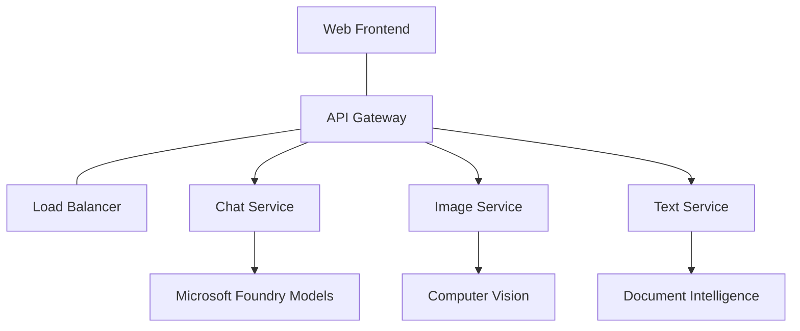

# Best Practice per il Carico di Lavoro AI in Produzione con AZD

**Navigazione del Capitolo:**
- **📚 Home del Corso**: [AZD per Principianti](../../README.md)
- **📖 Capitolo Corrente**: Capitolo 8 - Modelli di Produzione e Enterprise
- **⬅️ Capitolo Precedente**: [Capitolo 7: Risoluzione Problemi](../chapter-07-troubleshooting/debugging.md)
- **⬅️ Correlati**: [Laboratorio AI Workshop](../chapter-02-ai-development/ai-workshop-lab.md)
- **🎯 Corso Completo**: [AZD per Principianti](../../README.md)

## Panoramica

Questa guida spiega i modelli di progettazione AI per la produzione usando Azure Developer CLI (AZD). È un riferimento di progettazione, non un'applicazione distribuibile o una certificazione di produzione.

**Confini di esempio:** A meno che non sia esplicitamente descritto come completo, i frammenti Bicep presuppongono parametri e risorse referenziate da un template contenitore. Omettono immagini/piani host, identità, assegnazioni di ruolo, DNS, output e altre integrazioni necessarie. I percorsi YAML del servizio e gli script hook/test sono file illustrativi da creare **nella tua applicazione**; non sono forniti da questo corso. Usa un esempio AZD funzionante come base, compila l'infrastruttura completa e testala in un ambiente isolato prima della produzione.

## Principali Sfide Affrontate

Le preoccupazioni comuni in produzione includono distribuzioni multi-servizio, gestione identità e segreti, scalabilità, controllo dei costi e monitoraggio. Non si dichiara qui una prevalenza misurata.

## Modelli Architetturali per AI in Produzione

### Modello 1: Architettura AI Microservizi

**Quando usare**: Applicazioni AI complesse con capacità multiple



**Implementazione AZD**:

```yaml
# azure.yaml
name: enterprise-ai-platform
services:
  web:
    project: ./web
    host: staticwebapp
  api-gateway:
    project: ./api-gateway
    host: containerapp
  chat-service:
    project: ./services/chat
    host: containerapp
  vision-service:
    project: ./services/vision
    host: containerapp
  text-service:
    project: ./services/text
    host: containerapp
```

### Modello 2: Elaborazione AI Event-Driven

**Quando usare**: Elaborazione batch, analisi documenti, workflow asincroni

```bicep
// Event Hub for AI processing pipeline
resource eventHub 'Microsoft.EventHub/namespaces@2024-01-01' = {
  name: eventHubNamespaceName
  location: location
  sku: {
    name: 'Standard'
    tier: 'Standard'
    capacity: 1
  }
}

// Service Bus for reliable message processing
resource serviceBus 'Microsoft.ServiceBus/namespaces@2024-01-01' = {
  name: serviceBusNamespaceName
  location: location
  sku: {
    name: 'Premium'
    tier: 'Premium'
    capacity: 1
  }
}

// Function App for processing
resource functionApp 'Microsoft.Web/sites@2023-01-01' = {
  name: functionAppName
  location: location
  kind: 'functionapp,linux'
  properties: {
    siteConfig: {
      appSettings: [
        {
          name: 'FUNCTIONS_EXTENSION_VERSION'
          value: '~4'
        }
        {
          name: 'AZURE_OPENAI_ENDPOINT'
          value: '@Microsoft.KeyVault(VaultName=${keyVault.name};SecretName=openai-endpoint)'
        }
      ]
    }
  }
}
```

Questo crea frammenti dello spazio dei nomi, non hub, code, sottoscrizioni o trigger Function. Una Function eseguibile richiede anche un piano host, configurazione runtime/storage, un'identità allegata, RBAC e accesso di rete. Il riferimento a Key Vault necessita del permesso di leggere il segreto; un URL endpoint di per sé non è una credenziale.

## Considerazioni sulla Salute degli Agenti AI

Quando un'app web tradizionale si rompe, i sintomi sono familiari: una pagina non si carica, un'API restituisce un errore o un deployment fallisce. Le applicazioni AI possono rompersi in tutti questi modi—ma possono anche comportarsi in modo meno evidente senza produrre errori evidenti.

Questa sezione ti aiuta a costruire un modello mentale per monitorare i carichi di lavoro AI, così sai dove cercare quando qualcosa non va.

### Come la Salute degli Agenti Differisce dalla Salute di App Tradizionali

Anche le app tradizionali possono avere fallimenti sottili di correttezza. Un agente AI aggiunge qualità di risposta non deterministica ai consueti problemi di disponibilità e correttezza. Pensa alla salute dell'agente in due livelli:

| Livello | Cosa Monitorare | Dove Guardare |
|-------|--------------|---------------|
| **Salute dell'infrastruttura** | Il servizio è in esecuzione? Le risorse sono fornite? Gli endpoint sono raggiungibili? | `azd monitor`, stato risorse nel portale Azure, log container/app |
| **Salute comportamentale** | L’agente risponde correttamente? Le risposte sono tempestive? Il modello viene chiamato correttamente? | Tracce Application Insights, metriche latenza chiamata modello, log qualità risposte |

La salute dell'infrastruttura è familiare—uguale per qualsiasi app azd. La salute comportamentale è il nuovo livello introdotto dai carichi AI.

### Dove Guardare Quando le App AI Non Si Comportano Come Previsto

Se la tua app AI non produce i risultati attesi, ecco una checklist concettuale:

1. **Inizia dalle basi.** L’app è in esecuzione? Raggiunge le sue dipendenze? Controlla `azd monitor` e lo stato delle risorse proprio come faresti con qualsiasi app.
2. **Verifica la connessione al modello.** La tua app chiama con successo il modello AI? Chiamate modello fallite o scadute sono la causa più comune e si vedranno nei log dell’applicazione.
3. **Ispeziona input e base in modo sicuro.** Risposte errate possono derivare da recupero, istruzioni, limiti del modello o esecuzione degli strumenti. Usa dati diagnostici redatti e controllati; non abilitare il logging indiscriminato di prompt/risposte in produzione.
4. **Controlla la latenza di risposta.** Le chiamate a modelli AI sono più lente dei tipici API call. Se l’app è lenta, verifica se i tempi di risposta modello sono aumentati—può indicare throttling, limiti di capacità o congestione a livello regionale.
5. **Monitora segnali di costo.** Picchi inattesi nell’uso di token o chiamate API possono indicare un loop, prompt mal configurato o ripetizioni eccessive.

Non devi padroneggiare subito gli strumenti di osservabilità. Il punto chiave è che le applicazioni AI hanno un livello comportamentale extra da monitorare, e il monitoraggio built-in di azd (`azd monitor`) ti dà un punto di partenza per indagare entrambi i livelli.

---

## Best Practice di Sicurezza

### 1. Modello di Sicurezza Zero-Trust

**Strategia di Implementazione**:
- Niente comunicazione servizio-servizio senza autenticazione
- Tutte le chiamate API usano identità gestite
- Isolamento di rete con endpoint privati
- Controlli di accesso a minimo privilegio

```bicep
// Managed Identity for each service
resource chatServiceIdentity 'Microsoft.ManagedIdentity/userAssignedIdentities@2023-01-31' = {
  name: 'chat-service-identity'
  location: location
}

// Role assignments with minimal permissions
resource openAIUserRole 'Microsoft.Authorization/roleAssignments@2022-04-01' = {
  scope: openAIAccount
  name: guid(openAIAccount.id, chatServiceIdentity.id, '5e0bd9bd-7b93-4f28-af87-19fc36ad61bd')
  properties: {
    roleDefinitionId: subscriptionResourceId('Microsoft.Authorization/roleDefinitions', '5e0bd9bd-7b93-4f28-af87-19fc36ad61bd')
    principalId: chatServiceIdentity.properties.principalId
    principalType: 'ServicePrincipal'
  }
}
```

### 2. Gestione Sicura dei Segreti

**Pattern di Integrazione Key Vault**:

```bicep
// Key Vault with proper access policies
resource keyVault 'Microsoft.KeyVault/vaults@2023-02-01' = {
  name: keyVaultName
  location: location
  properties: {
    tenantId: tenant().tenantId
    sku: {
      family: 'A'
      name: 'standard' // Premium is needed for HSM-backed keys, not ordinary secrets
    }
    enableRbacAuthorization: true  // Use RBAC instead of access policies
    enablePurgeProtection: true    // Prevent accidental deletion
    enableSoftDelete: true
    softDeleteRetentionInDays: 90
  }
}

// Optional legacy key-auth alternative; omit when using Entra ID.
resource openAIKeySecret 'Microsoft.KeyVault/vaults/secrets@2023-02-01' = {
  parent: keyVault
  name: 'openai-api-key'
  properties: {
    value: openAIAccount.listKeys().key1
    attributes: {
      enabled: true
    }
  }
}
```

Assegna l'identità runtime `Key Vault Secrets User` all’ambito appropriato e allegala all’host; `enableRbacAuthorization` da sola non concede accesso. Preferisci l’autenticazione con identità gestita OpenAI usando `disableLocalAuth: true`. La chiave segreta opzionale ha senso solo per un account volutamente abilitato con chiave, e il principal di provisioning necessita anche del permesso di scrivere segreti.

### 3. Sicurezza di Rete

**Configurazione Endpoint Privato**:

```bicep
// Virtual Network for AI services
resource virtualNetwork 'Microsoft.Network/virtualNetworks@2023-04-01' = {
  name: vnetName
  location: location
  properties: {
    addressSpace: {
      addressPrefixes: ['10.0.0.0/16']
    }
    subnets: [
      {
        name: 'ai-services-subnet'
        properties: {
          addressPrefix: '10.0.1.0/24'
          privateEndpointNetworkPolicies: 'Disabled'
        }
      }
      {
        name: 'app-services-subnet'
        properties: {
          addressPrefix: '10.0.2.0/24'
          delegations: [
            {
              name: 'Microsoft.Web/serverFarms'
              properties: {
                serviceName: 'Microsoft.Web/serverFarms'
              }
            }
          ]
        }
      }
    ]
  }
}

// Private endpoints for all AI services
resource openAIPrivateEndpoint 'Microsoft.Network/privateEndpoints@2023-04-01' = {
  name: '${openAIAccountName}-pe'
  location: location
  properties: {
    subnet: {
      id: virtualNetwork.properties.subnets[0].id
    }
    privateLinkServiceConnections: [
      {
        name: 'openai-connection'
        properties: {
          privateLinkServiceId: openAIAccount.id
          groupIds: ['account']
        }
      }
    ]
  }
}
```

Gli endpoint privati richiedono anche gruppi zone DNS private/collegamenti VNet e integrazione applicativa VNet. Non bloccano automaticamente l’accesso pubblico: disabilita esplicitamente l’accesso pubblico dell’account AI dopo aver validato connettività privata e accesso al deployment.

## Prestazioni e Scalabilità

### 1. Strategie di Auto-Scaling

**Auto-scaling Container Apps**:

```bicep
resource containerApp 'Microsoft.App/containerApps@2023-05-01' = {
  name: containerAppName
  location: location
  properties: {
    configuration: {
      ingress: {
        external: true
        targetPort: 8000
        transport: 'http'
      }
    }
    template: {
      scale: {
        minReplicas: 2  // Always have 2 instances minimum
        maxReplicas: 50 // Scale up to 50 for high load
        rules: [
          {
            name: 'http-scaling'
            http: {
              metadata: {
                concurrentRequests: '20'  // Scale when >20 concurrent requests
              }
            }
          }
          {
            name: 'cpu-scaling'
            custom: {
              type: 'cpu'
              metadata: {
                type: 'Utilization'
                value: '70'  // Scale when CPU >70%
              }
            }
          }
        ]
      }
    }
  }
}
```

### 2. Strategie di Caching

**Redis Cache per Risposte AI**:

```bicep
// Legacy Azure Cache for Redis example (not recommended for new deployments)
resource redisCache 'Microsoft.Cache/redis@2023-04-01' = {
  name: redisCacheName
  location: location
  properties: {
    sku: {
      name: 'Premium'
      family: 'P'
      capacity: 1
    }
    enableNonSslPort: false
    minimumTlsVersion: '1.2'
    redisConfiguration: {
      'maxmemory-policy': 'allkeys-lru'
    }
    // Sharding distributes data; replication/failover provides availability.
    shardCount: 2
  }
}

// Cache configuration in application
var cacheConnectionString = '${redisCache.properties.hostName}:6380,password=${redisCache.listKeys().primaryKey},ssl=True,abortConnect=False'
```

Azure Cache for Redis Basic/Standard/Premium è in una [fase di dismissione](https://learn.microsoft.com/azure/azure-cache-for-redis/retirement-faq). Usa Azure Managed Redis per nuovi design e la sua configurazione documentata di SKU, identità e TLS, invece di copiare questa risorsa legacy in un nuovo sistema di produzione. La stringa di connessione indicata è un segnaposto non funzionale, non una credenziale. Partiziona le chiavi cache per autorizzazione, modello/istruzioni e versione recuperata, con scadenza; una cache condivisa solo per query può esporre i dati di un altro utente.

### 3. Bilanciamento del Carico e Gestione Traffico

**Application Gateway con WAF**:

```bicep
// Application Gateway with Web Application Firewall
resource applicationGateway 'Microsoft.Network/applicationGateways@2023-04-01' = {
  name: appGatewayName
  location: location
  properties: {
    sku: {
      name: 'WAF_v2'
      tier: 'WAF_v2'
      capacity: 2
    }
    webApplicationFirewallConfiguration: {
      enabled: true
      firewallMode: 'Prevention'
      ruleSetType: 'OWASP'
      ruleSetVersion: '3.2'
    }
    // Backend pools for AI services
    backendAddressPools: [
      {
        name: 'ai-services-pool'
        properties: {
          backendAddresses: [
            {
              fqdn: '${containerApp.properties.configuration.ingress.fqdn}'
            }
          ]
        }
      }
    ]
  }
}
```

Questa è una risorsa gateway parziale: un deployment reale necessita anche subnet gateway/configurazione IP, IP frontend e porte, listener/certificati TLS, impostazioni/probe HTTP backend, regole di routing e priorità, e una politica WAF rivista. Hostname/SNI TLS e autenticazione devono corrispondere al backend Container App.

## 💰 Ottimizzazione dei Costi

### 1. Dimensionamento Corretto delle Risorse

**Configurazioni Specifiche per Ambiente**:

Questi nomi sono **input personalizzati di template illustrativi**, non impostazioni AZD automatiche. Mappali prima su `infra/main.parameters.json`/Bicep e configurazione host. Per esempio, il sample RAG usa `AZURE_SEARCH_SERVICE_SKU` e `AZURE_OPENAI_CHATGPT_DEPLOYMENT_CAPACITY`, non i nomi generici sottostanti. Dai alla memoria Container Apps una unità supportata come `1Gi` nella risorsa effettiva. Applica modifiche infrastrutturali con `azd up` o `azd provision`; `azd deploy` da sola non applica modifiche Bicep.

```bash
# Development environment
azd env new development
azd env set AZURE_OPENAI_SKU "S0"
azd env set AZURE_OPENAI_CAPACITY 10
azd env set AZURE_SEARCH_SKU "basic"
azd env set CONTAINER_CPU 0.5
azd env set CONTAINER_MEMORY 1.0

# Production environment  
azd env new production
azd env set AZURE_OPENAI_SKU "S0"
azd env set AZURE_OPENAI_CAPACITY 100
azd env set AZURE_SEARCH_SKU "standard"
azd env set CONTAINER_CPU 2.0
azd env set CONTAINER_MEMORY 4.0
```

### 2. Monitoraggio dei Costi e Budget

```bicep
// Supply the first day of the current UTC month, e.g. 2026-11-01T00:00:00Z.
param budgetStartDate string

// Cost management and budgets
resource budget 'Microsoft.Consumption/budgets@2024-08-01' = {
  name: 'ai-workload-budget'
  properties: {
    timePeriod: {
      startDate: budgetStartDate
    }
    timeGrain: 'Monthly'
    amount: 2000  // In the billing currency, not necessarily USD
    category: 'Cost'
    notifications: {
      warning: {
        enabled: true
        operator: 'GreaterThan'
        threshold: 80
        contactEmails: [
          'finance@company.com'
          'engineering@company.com'
        ]
        contactRoles: [
          'Owner'
          'Contributor'
        ]
      }
      critical: {
        enabled: true
        operator: 'GreaterThan'
        threshold: 95
        contactEmails: [
          'cto@company.com'
        ]
      }
    }
  }
}
```

Sostituisci i destinatari d’esempio e verifica ambito/permessi. Gli alert budget usano dati di fatturazione ritardati e non impongono un limite di spesa.

### 3. Ottimizzazione Uso Token

**Gestione Costi OpenAI**:

Questa è solo un’euristica basata sui caratteri per un’anteprima UI, **non** un validatore del limite token modello. Il codice di produzione deve usare un tokenizer appropriato al modello distribuito e considerare istruzioni di sistema, schemi degli strumenti, storia e budget output. Rifiuta un messaggio utente sovradimensionato piuttosto che troncarlo silenziosamente.

```typescript
// Application-level token optimization
class TokenOptimizer {
  private readonly maxTokens = 4000;
  private readonly reserveTokens = 500;
  
  optimizePrompt(userInput: string, context: string): string {
    const availableTokens = this.maxTokens - this.reserveTokens;
    if (this.estimateTokens(userInput) + 8 >= availableTokens) {
      throw new Error("User input exceeds the illustrative prompt budget");
    }
    const estimatedTokens = this.estimateTokens(userInput + context) + 8;
    
    if (estimatedTokens > availableTokens) {
      // Truncate context, not user input
      context = this.truncateContext(context, Math.max(0, availableTokens - this.estimateTokens(userInput) - 8));
    }
    
    return `${context}\n\nUser: ${userInput}`;
  }
  
  private estimateTokens(text: string): number {
    // Rough estimation: 1 token ≈ 4 characters
    return Math.ceil(text.length / 4);
  }

  private truncateContext(text: string, estimatedBudget: number): string {
    return text.slice(0, Math.max(0, estimatedBudget) * 4);
  }
}
```

## Monitoraggio e Osservabilità

### 1. Application Insights Completo

```bicep
// Application Insights with advanced features
resource applicationInsights 'Microsoft.Insights/components@2020-02-02' = {
  name: applicationInsightsName
  location: location
  kind: 'web'
  properties: {
    Application_Type: 'web'
    WorkspaceResourceId: logAnalyticsWorkspace.id
    SamplingPercentage: 100  // Ingestion setting; review cost and SDK sampling separately
    DisableIpMasking: false  // Retain IP masking
  }
}

// Custom metrics for AI operations
resource aiMetricAlerts 'Microsoft.Insights/metricAlerts@2018-03-01' = {
  name: 'ai-high-error-rate'
  location: 'global'
  properties: {
    description: 'Alert when failed request count exceeds 10 in five minutes'
    severity: 2
    enabled: true
    scopes: [
      applicationInsights.id
    ]
    evaluationFrequency: 'PT1M'
    windowSize: 'PT5M'
    criteria: {
      'odata.type': 'Microsoft.Azure.Monitor.SingleResourceMultipleMetricCriteria'
      allOf: [
        {
          name: 'high-error-rate'
          metricName: 'requests/failed'
          operator: 'GreaterThan'
          threshold: 10
          timeAggregation: 'Count'
        }
      ]
    }
  }
}
```

### 2. Monitoraggio Specifico AI

**Dashboard Personalizzate per Metriche AI**:

```json
{
  "dashboard": {
    "name": "AI Application Monitoring",
    "tiles": [
      {
        "name": "OpenAI Request Volume",
        "query": "dependencies | where target contains 'openai' | summarize count() by bin(timestamp, 5m)"
      },
      {
        "name": "AI Response Latency",
        "query": "dependencies | where target contains 'openai' | summarize avg(duration) by bin(timestamp, 5m)"
      },
      {
        "name": "Token Usage",
        "query": "customMetrics | where name == 'openai_tokens_used' | summarize sum(value) by bin(timestamp, 1h)"
      },
      {
        "name": "Cost per Hour",
        "query": "customMetrics | where name == 'openai_cost' | summarize sum(value) by bin(timestamp, 1h)"
      }
    ]
  }
}
```

Questo JSON è uno schema definito dall'applicazione, non un dashboard importabile del portale Azure. Le query token/costo richiedono che la tua app emetta esattamente queste metriche personalizzate; non sono create da AZD. Adatta i filtri di dipendenza per i nomi endpoint/span modello effettivi.

### 3. Health Check e Monitoraggio Uptime

```bicep
// Application Insights availability tests
resource availabilityTest 'Microsoft.Insights/webtests@2022-06-15' = {
  name: 'ai-app-availability-test'
  location: location
  tags: {
    'hidden-link:${applicationInsights.id}': 'Resource'
  }
  properties: {
    SyntheticMonitorId: 'ai-app-availability-test'
    Name: 'AI Application Availability Test'
    Description: 'Tests AI application endpoints'
    Enabled: true
    Frequency: 300  // 5 minutes
    Timeout: 120    // 2 minutes
    Kind: 'standard'
    Locations: [
      {
        Id: 'us-east-2-azr'
      }
      {
        Id: 'us-west-2-azr'
      }
    ]
    Request: {
      RequestUrl: 'https://${webApp.properties.defaultHostName}/health'
      HttpVerb: 'GET'
      FollowRedirects: true
      ParseDependentRequests: false
    }
    ValidationRules: {
      ExpectedHttpStatusCode: 200
      SSLCheck: true
      SSLCertRemainingLifetimeCheck: 7
    }
  }
}
```

## Disaster Recovery e Alta Disponibilità

Il test precedente presuppone un esistente App Service `webApp` e risorsa Application Insights. I test di disponibilità standard sono a pagamento e richiedono un endpoint raggiungibile; app solo private necessitano di un design monitoraggio privato appropriato. I test URL ping sono deprecati; usa [test di disponibilità standard](https://learn.microsoft.com/azure/azure-monitor/app/availability).

### 1. Deployment Multi-Regione

```yaml
# azure.yaml - Multi-region configuration
name: ai-app-multiregion
services:
  api-primary:
    project: ./api
    host: containerapp
    env:
      AZURE_REGION: eastus
  api-secondary:
    project: ./api
    host: containerapp
    env:
      AZURE_REGION: westus2
```

```bicep
// Separate App Service topology, not the Container Apps declarations above
resource trafficManager 'Microsoft.Network/trafficManagerProfiles@2022-04-01' = {
  name: trafficManagerProfileName
  location: 'global'
  properties: {
    profileStatus: 'Enabled'
    trafficRoutingMethod: 'Priority'
    dnsConfig: {
      relativeName: trafficManagerProfileName
      ttl: 30
    }
    monitorConfig: {
      protocol: 'HTTPS'
      port: 443
      path: '/health'
      intervalInSeconds: 30
      toleratedNumberOfFailures: 3
      timeoutInSeconds: 10
    }
    endpoints: [
      {
        name: 'primary-endpoint'
        type: 'Microsoft.Network/trafficManagerProfiles/azureEndpoints'
        properties: {
          targetResourceId: primaryAppService.id
          endpointStatus: 'Enabled'
          priority: 1
        }
      }
      {
        name: 'secondary-endpoint'
        type: 'Microsoft.Network/trafficManagerProfiles/azureEndpoints'
        properties: {
          targetResourceId: secondaryAppService.id
          endpointStatus: 'Enabled'
          priority: 2
        }
      }
    ]
  }
}
```

Le variabili d’ambiente non scelgono la posizione risorsa. IaC deve fornire host regionali distinti e legare ogni servizio con tag `resourceName` o `azd-service-name`. L’esempio Traffic Manager è una **topologia App Service separata** (`primaryAppService`/`secondaryAppService`), non routing per dichiarazioni Container Apps. Container Apps richiede un endpoint/front door esterno opportunamente configurato, routing TLS/dominio personalizzato e probe salute.

### 2. Backup e Recupero Dati

```bicep
// Backup configuration for critical data
resource backupVault 'Microsoft.DataProtection/backupVaults@2023-05-01' = {
  name: backupVaultName
  location: location
  identity: {
    type: 'SystemAssigned'
  }
  properties: {
    storageSettings: [
      {
        datastoreType: 'VaultStore'
        type: 'LocallyRedundant'
      }
    ]
  }
}

```

Il vault da solo non esegue backup. Configura una **policy supportata e istanza backup specifiche per workload**, permessi sorgente, retention e test ripristino usando [matrici supporto Azure Backup](https://learn.microsoft.com/azure/backup/backup-support-matrix). Non esiste una policy di backup Azure generica per distribuzioni di modelli Azure OpenAI ospitati. Mantieni definizioni infrastruttura/distribuzione modello in controllo sorgente; proteggi documenti caricati, dati applicazione e artefatti fine-tuning usando funzionalità backup/export supportate da ogni servizio di backing. Definisci e testa RPO/RTO esplicitamente.

## Integrazione DevOps e CI/CD

### 1. Workflow GitHub Actions

```yaml
# .github/workflows/deploy-ai-app.yml
name: Deploy AI Application

on:
  push:
    branches: [main]
  pull_request:
    branches: [main]

jobs:
  test:
    runs-on: ubuntu-latest
    steps:
      - uses: actions/checkout@v4
      
      - name: Setup Python
        uses: actions/setup-python@v4
        with:
          python-version: '3.11'
          
      - name: Install dependencies
        run: |
          pip install -r requirements.txt
          pip install pytest
          
      - name: Run tests
        run: pytest tests/
        
      - name: AI Safety Tests
        run: |
          python scripts/test_ai_safety.py
          python scripts/validate_prompts.py

```

Questa è la **parte solo test** di un workflow e presuppone che tu abbia creato `requirements.txt`, `tests/`, e i due script di sicurezza. Aggiungi i job autenticati OIDC di provisioning/deployment da [Configurazione Pipeline CI/CD](#cicd-pipeline-configuration), con `needs: test`, trigger push/manuale affidabile e ambienti GitHub protetti. Non distribuire codice pull request non affidabile con credenziali cloud. Un runner nuovo non ha ambiente AZD locale selezionato; fornisci input ambiente/sottoscrizione/posizione e usa `azd auth login`, non solo `azure/login`.

### 2. Validazione Infrastruttura

```bash
# scripts/validate_infrastructure.sh
#!/bin/bash
set -euo pipefail

echo "Validating AI infrastructure deployment..."

# Requires Azure CLI login and the resource group selected explicitly.
: "${AZURE_RESOURCE_GROUP:?Set AZURE_RESOURCE_GROUP}"
: "${AZURE_OPENAI_NAME:?Set AZURE_OPENAI_NAME}"
: "${AZURE_OPENAI_CHAT_DEPLOYMENT:?Set the actual deployment name}"

# A successful empty list is not proof that resources exist.
types=("Microsoft.CognitiveServices/accounts" "Microsoft.Search/searchServices"
       "Microsoft.Storage/storageAccounts" "Microsoft.KeyVault/vaults")
for resource_type in "${types[@]}"; do
    count=$(az resource list --resource-group "$AZURE_RESOURCE_GROUP" \
        --resource-type "$resource_type" --query "length(@)" -o tsv)
    if [[ "$count" -lt 1 ]]; then
        echo "ERROR: No $resource_type found in $AZURE_RESOURCE_GROUP"
        exit 1
    fi
done

# Validate OpenAI model deployments
echo "Validating OpenAI model deployments..."
state=$(az cognitiveservices account deployment show \
  --name "$AZURE_OPENAI_NAME" --resource-group "$AZURE_RESOURCE_GROUP" \
  --deployment-name "$AZURE_OPENAI_CHAT_DEPLOYMENT" \
  --query "properties.provisioningState" -o tsv)
if [[ "$state" != "Succeeded" ]]; then
    echo "ERROR: Required model deployment is not provisioned successfully"
    exit 1
fi

echo "Infrastructure validation completed successfully!"
```

Atteso: zero di uscita e messaggio di completamento solo se tutti i tipi attesi esistono e il deployment modello nominato è provisionato. Controlla lo stato inventario/provisioning, **non** salute risorse, topologia esatta, RBAC, raggiungibilità rete o comportamento modello. Adatta tipi attesi alla tua architettura, poi esegui un test separato di readiness applicativa autenticata.

## Checklist di Prontezza per la Produzione

### Sicurezza ✅
- [ ] Tutti i servizi usano identità gestite
- [ ] Segreti conservati in Key Vault
- [ ] Endpoint privati configurati
- [ ] Gruppi sicurezza di rete implementati
- [ ] RBAC con minimo privilegio
- [ ] WAF abilitato sugli endpoint pubblici

### Prestazioni ✅
- [ ] Auto-scaling configurato
- [ ] Caching implementato
- [ ] Bilanciamento carico impostato
- [ ] CDN per contenuti statici
- [ ] Pool di connessioni database
- [ ] Ottimizzazione uso token

### Monitoraggio ✅
- [ ] Application Insights configurato
- [ ] Metriche personalizzate definite
- [ ] Regole alert impostate
- [ ] Dashboard creata
- [ ] Health check implementati
- [ ] Politiche di conservazione log

### Affidabilità ✅
- [ ] Deploy multi-regione
- [ ] Piano backup e recupero
- [ ] Circuit breaker implementati
- [ ] Politiche di retry configurate
- [ ] Degradazione graduale
- [ ] Endpoint di health check

### Gestione Costi ✅
- [ ] Alert budget configurati
- [ ] Dimensionamento corretto risorse
- [ ] Sconti dev/test applicati
- [ ] Acquisto istanze riservate
- [ ] Dashboard monitoraggio costi
- [ ] Revisioni regolari dei costi

### Conformità ✅
- [ ] Requisiti di residenza dati rispettati
- [ ] Logging di audit abilitato
- [ ] Policy di conformità applicate
- [ ] Baseline di sicurezza implementate
- [ ] Valutazioni di sicurezza regolari
- [ ] Piano di risposta agli incidenti

## Benchmark Prestazionali

### Obiettivi Produttivi Illustrativi

Questi sono SLO di esempio da negoziare e testare con carico, non benchmark misurati o garanzie. La latenza di risposta dipende da modello/lunghezza output; la spesa mensile token dipende da traffico e prezzi, non solo dal conteggio token.

| Metrica | Obiettivo | Monitoraggio |
|--------|--------|------------|
| **Tempo di risposta** | < 2 secondi | Application Insights |
| **Disponibilità** | 99.9% | Monitoraggio uptime |
| **Tasso di errore** | < 0.1% | Log applicazione |
| **Spesa Modello** | < $500/mese (budget esempio) | Gestione costi |
| **Utenti concorrenti** | 1000+ | Test di carico |
| **Tempo di Recupero** | < 1 ora | Test di disaster recovery |

### Test di Carico

Di seguito è riportato uno schizzo dell’interfaccia per uno script di test di carico **che devi implementare**; questo repository non fornisce `scripts/load_test.py`. Definisci i payload di richiesta, l’autenticazione, i carichi di lavoro rappresentativi, le asserzioni di latenza/errore percentili e un limite di spesa nello strumento di test di carico scelto prima di eseguirlo:

```bash
# Load testing script for AI applications
python scripts/load_test.py \
  --endpoint https://your-ai-app.azurewebsites.net \
  --concurrent-users 100 \
  --duration 300 \
  --ramp-up 60
```

## 🤝 Best Practice della Community

Basato sul feedback della community Microsoft Foundry Discord:

### Principali Raccomandazioni dalla Community:

1. **Inizia in piccolo, scala gradualmente**: Inizia con SKU base e scala in base all’uso effettivo
2. **Monitora tutto**: Imposta un monitoraggio completo fin dal primo giorno
3. **Automatizza la sicurezza**: Usa infrastruttura come codice per una sicurezza coerente
4. **Testa a fondo**: Includi test specifici per l’IA nella tua pipeline
5. **Pianifica i costi**: Monitora l’uso dei token e imposta avvisi di budget precoci

### Errori Comuni da Evitare:

- ❌ Hardcoding delle chiavi API nel codice
- ❌ Mancata configurazione di un monitoraggio adeguato
- ❌ Ignorare l’ottimizzazione dei costi
- ❌ Non testare scenari di errore
- ❌ Distribuire senza controlli di integrità

## Comandi ed Estensioni AZD AI CLI

AZD include un set in crescita di comandi ed estensioni specifici per l’IA che semplificano i flussi di lavoro di produzione AI. Questi strumenti colmano il divario tra lo sviluppo locale e la distribuzione in produzione per carichi di lavoro AI.

> **Revisione della release (2026-11-04):** Le istruzioni CLI sottostanti sono state verificate contro le release pubblicate di `azd` **1.37.2**, `azure.ai.agents` **1.0.0-beta.23**, e `azure.ai.evaluations` **1.0.0-beta.2**. Gli agenti beta.23 richiedono `azd >= 1.37.0`; le valutazioni beta.2 richiedono `azd >= 1.33.0`. Usa almeno 1.37.0 per il flusso di lavoro combinato. Questa è una revisione di documentazione/sorgente, non una validazione live della distribuzione Azure.

### Estensioni AZD per AI

AZD usa un sistema di estensioni per aggiungere funzionalità specifiche per l’IA. Installa e gestisci le estensioni con:

```bash
# List all available extensions (including AI)
azd extension list

# Inspect installed extension details
azd version
azd extension show azure.ai.agents

# Install the Foundry agents extension
azd extension install azure.ai.agents

# Install the separate Foundry evaluations extension
azd extension install azure.ai.evaluations

# Install the fine-tuning extension
azd extension install azure.ai.finetune

# Install the custom models extension
azd extension install azure.ai.models

# Upgrade all installed extensions
azd extension upgrade --all
```

**Estensioni AI disponibili:**

| Estensione | Scopo | Stato |
|-----------|---------|--------|
| `azure.ai.agents` | Gestione del servizio Foundry Agent | Anteprima |
| `azure.ai.evaluations` | Dataset di valutazione, valutatori, gruppi di valutazione e esecuzioni | Anteprima |
| `azure.ai.skills` | Competenze agenti riutilizzabili | Anteprima |
| `azure.ai.connections` | Connessioni Foundry (fonti dati, strumenti) | Anteprima |
| `azure.ai.finetune` | Fine-tuning modello Foundry | Anteprima |
| `azure.ai.models` | Modelli personalizzati Foundry | Anteprima |
| `azure.coding-agent` | Configurazione agente di codifica | Disponibile |

> Esegui `azd extension list --installed` e `azd extension show azure.ai.evaluations` per ispezionare le versioni installate. Aggiorna prima il core della CLI usando le [istruzioni di installazione/aggiornamento](https://learn.microsoft.com/azure/developer/azure-developer-cli/install-azd) (per un’installazione Windows winget: `winget upgrade Microsoft.Azd`), poi esegui `azd extension upgrade --all`. Non esiste un comando core `azd upgrade`. Rivedi le modifiche che introducono rotture prima di aggiornare l’automazione in produzione; non dare per scontato che un aggiornamento dell’estensione preservi vecchi formati di comando o configurazione.

### Cambiamenti e Correzioni Recenti della Release

| Release | Cosa cambia per questo corso |
|---------|------------------------------|
| `azd 1.37.0` | Aggiunge API di anteprima di distribuzione stabili e corregge modifiche di estensioni che sovrascrivevano impostazioni `azure.yaml` non correlate. |
| `azd 1.37.1` | Corregge la propagazione di Ctrl+C tra estensioni e distingue cancellazioni/timeouts da fallimenti generici. |
| `azd 1.37.2` | Migliora la validazione del provisioning: avvisi critici a default su **No**, fallisce senza conferma nelle esecuzioni non presidiate e la cancellazione salta i post-hook di provisioning. Corregge anche valori ambiente irrisolti nelle deny list degli Stack di Distribuzione quando quella funzionalità alfa è abilitata. |
| Agenti `beta.22` | Migra la valutazione a `azd ai eval`, cambia l’ottimizzazione all’API GA v1, richiede `toolboxes` plurale, e separa managed-harness, voice, e opt-in per anteprima a lunga esecuzione. Corregge selezione modello specifica per ambiente e autenticazione toolbox. |
| Agenti `beta.23` | Espone `init --harness`; corregge output risposta A2A 0.3, percorsi/moduli prompt-agent invalidi attraverso i livelli di infrastruttura, diagnostica timeout attivazione, e avvisi RBAC sviluppatore conservati. |
| Valutazioni `beta.2` | Richiede configurazione valutazione camelCase, aggiunge creazione conversazioni statica/simulata e fonti file locali esplicite, e corregge gestione identità/versione dataset, conteggi gate qualità, e diagnostica run fallite. |

Un timeout di attivazione agente non dimostra un fallimento di distribuzione: ispeziona la versione tentata e il suo stato prima di riprovare. Avvisi RBAC sviluppatore possono rimanere anche se il provisioning ha successo; risolvi l’accesso mancante prima di invocare come quel developer.

Fonti: [AZD releases](https://github.com/Azure/azure-dev/releases), [agents beta.23 release](https://github.com/Azure/azure-dev/releases/tag/azd-ext-azure-ai-agents_1.0.0-beta.23), [agents beta.22 migration](https://github.com/Azure/azure-dev/releases/tag/azd-ext-azure-ai-agents_1.0.0-beta.22), e [evaluations beta.2 release](https://github.com/Azure/azure-dev/releases/tag/azd-ext-azure-ai-evaluations_1.0.0-beta.2).

**Cosa sono le più recenti estensioni `skills` e `connections`?**

Due estensioni in anteprima sono apparse insieme agli strumenti agenti e valgono la pena di essere comprese anche dai principianti:

- **`azure.ai.skills`** — Una **skill** è una capacità riutilizzabile (uno strumento o comportamento pacchettizzato) che puoi assegnare a uno o più agenti invece di riimplementarla ogni volta. Pensala come un blocco comune: definisci una skill "cerca nella documentazione" o "consulta un ordine" una volta sola, e poi riusala su diversi agenti. Questo mantiene i sistemi multi-agente (Capitolo 5) coerenti ed evita copia-incolla.
- **`azure.ai.connections`** — Una **connessione** è un collegamento gestito dal tuo progetto Foundry a una risorsa esterna necessaria ai tuoi agenti—una fonte dati (come Azure AI Search), un endpoint di uno strumento, o un altro servizio. Le connessioni centralizzano *dove* e *come* gli agenti accedono ai dati, quindi credenziali e endpoint risiedono in un unico posto governato invece di essere sparsi nel codice.

Non ti servono per distribuire i tuoi primi agenti—usa `azure.ai.agents` mentre impari. Ricorri a `skills` quando ti ritrovi a duplicare lo stesso strumento tra agenti, e a `connections` quando più agenti condividono la stessa fonte dati.

### Inizializzare Progetti Agente con `azd ai agent init`

Il comando `azd ai agent init` struttura un progetto agente Microsoft Foundry. Usa un modello progetto `azure.yaml` attuale, non un manifesto agente legacy implicito:

```bash
# Initialize a new agent project from a local project template
azd ai agent init --template ./templates/support-agent/azure.yaml

# Initialize and target a specific Foundry project
azd ai agent init --template ./templates/support-agent/azure.yaml --project-id <foundry-project-id>

# Adopt the template into a different directory
azd ai agent init --template ./templates/support-agent/azure.yaml --src ./agents/my-agent
```

**Flag principali:**

| Flag | Descrizione |
|------|-------------|
| `-t, --template` | Percorso o URI GitHub supportato a un documento progetto `azure.yaml` |
| `-p, --project-id` | ID progetto Microsoft Foundry esistente per il tuo ambiente azd |
| `-s, --src` | Directory sorgente per agenti generati, o directory target quando si adotta un progetto |
| `--kind` | Inizializza un agente `hosted`, `prompt`, o in anteprima `prompt-voice` |
| `--harness` | Esecuzione harness opzionale per `--kind prompt`; richiede opt-in in anteprima |
| `-e, --environment` | L’ambiente azd da usare |

`--manifest`/`-m` è un alias deprecato per `--template`/`-t`; rinominare il flag non converte un vecchio manifesto in un documento progetto corrente. `--host containerapp` non è un flag agent-init attuale. Per una applicazione Container Apps ordinaria, usa `azd init --template` con un modello che dichiari `host: containerapp`.

Per un progetto esistente con esattamente un servizio `azure.ai.project`, `azd ai agent add support-agent --file ./agents/support-agent.yaml` aggiunge o aggiorna una definizione diretta agente senza provisioning o distribuzione. I comandi runtime rigettano manifeste legacy impliciti `agent.yaml`/AgentManifest e definizioni servizio nidificate `config:`; migrale a un servizio `azure.ai.agent` attuale. Quando init stampa un prossimo passo `cd`, eseguilo prima di `azd up`: init non cambia la directory del terminale.

**Suggerimento per la produzione**: Usa `--project-id` per connetterti direttamente a un progetto Foundry esistente, mantenendo il codice agente e le risorse cloud collegati fin dall’inizio.

#### Funzionalità Anteprima Opzionali

Managed harness, voice e invocazioni a lunga esecuzione sono disabilitati singolarmente per default. Imposta solo l’interruttore per la funzione necessaria nell’**ambiente processo shell/CI**, non con `azd env set`:

| Funzionalità | Variabile ambiente processo |
|---------|------------------------------|
| Managed harness (`init --kind prompt --harness ...`) | `AZD_ALPHA_ENABLE_AGENTS_MANAGED_HARNESS=true` |
| Voice (`init --kind prompt-voice`) | `AZD_ALPHA_ENABLE_AGENTS_VOICE=true` |
| Invocazione a lunga esecuzione | `AZD_ALPHA_ENABLE_AGENTS_LONG_RUNNING=true` |

Per esempio, usa `export AZD_ALPHA_ENABLE_AGENTS_MANAGED_HARNESS=true` in Bash o `$env:AZD_ALPHA_ENABLE_AGENTS_MANAGED_HARNESS = "true"` in PowerShell prima di eseguire il comando pertinente. Un interruttore non abilita gli altri. Vedi il [README degli agenti rilasciati](https://github.com/Azure/azure-dev/blob/azd-ext-azure-ai-agents_1.0.0-beta.23/cli/azd/extensions/azure.ai.agents/README.md) per tutti gli switch di anteprima e limitazioni.

### Gestire il Ciclo di Vita dell’Agente

Usa `azure.ai.agents` per testare, ispezionare, ottimizzare e ritirare gli agenti, e la separata estensione `azure.ai.evaluations` per misurare la qualità:

```bash
# Invoke a deployed agent and view server response timing
# (total latency and time to first byte)
azd ai agent invoke

# Show the live endpoint configuration before changing it
azd ai agent endpoint show

# Download the deployed source of a code-based hosted agent
# (with SHA-256 verification)
azd ai agent code download

# Delete a hosted agent and all of its versions
# (--force terminates active sessions)
azd ai agent delete --force
```

**Ciclo di vita a colpo d’occhio:**

| Fase | Comando | Uso in produzione |
|-------|---------|----------------|
| Test | `azd ai agent invoke` | Valida risposte e misura latenza prima del rilascio |
| Ispeziona | `azd ai agent endpoint show` | Rivedi autenticazione/config endpoint; individua cambiamenti critici presto |
| Misura | `azd ai eval init`, `generate`, `run start` | Definisci, distribuisci ed esegui valutazioni ripetibili |
| Migliora | `azd ai agent optimize --eval <evaluation-name> --optimize-model <optimizer-deployment>` | Riusa una valutazione compatibile per ottimizzare l’agente |
| Recupera | `azd ai agent code download` | Recupera la fonte distribuita esatta per audit/rollback |
| Ritira | `azd ai agent delete --force` | Smantella un agente e le sue versioni pulitamente |

> Questi sono comandi in anteprima e possono cambiare tra le versioni dell’estensione. Esegui `azd ai agent --help` per vedere i sottocomandi esatti disponibili nella tua versione installata.

`endpoint show` supporta agenti hosted, prompt e voice, ma gli aggiornamenti endpoint sono solo hosted; agenti workflow non sono supportati. Il download codice e l’esempio di ritiro agente hosted sopra non sono operazioni generiche per ogni tipo di agente.

#### Migrazione Valutazione e Controlli di Qualità

A partire dagli agenti **1.0.0-beta.22 (2026-10-23)**, i comandi legacy `azd ai agent eval` forniscono guida alla migrazione invece del precedente flusso di lavoro di valutazione. Non copiare i vecchi esempi `eval generate --dataset ...`: la valutazione ora risiede sotto **`azd ai eval`**.

In un progetto agente inizializzato, autentica con `azd auth login`, conferma l’ambiente/progetto Foundry selezionato, e installa `azure.ai.evaluations`. Una distribuzione modello giudice è necessaria per scoring basato su modello; generazione e simulazione conversazione possono richiedere selezioni modello separate e generare costi aggiuntivi.

```bash
# Scaffold evals/ and wire an azure.ai.eval service into azure.yaml
azd ai eval init

# Optionally synthesize a rubric and dataset from the agent
azd ai eval generate

# Review generated files, then register datasets, evaluators, and eval groups
azd up

# Start an evaluation and wait for its results
azd ai eval run start --wait

# Inspect runs and available test-case output
azd ai eval run list
azd ai eval run show <run-id>
azd ai eval run output list <run-id>
```

Segui le selezioni interattive e i passi successivi stampati invece di assumere che le risorse generate siano già registrate. La configurazione valutazione normalmente risiede in `evals/azure.eval.yaml`, referenziata dal servizio `azure.ai.eval` in `azure.yaml`. Le chiavi sono in **camelCase** (`evaluationLevel`, `maxSamples`, `initializationParameters`, `dataMapping`); le vecchie chiavi snake_case sono rigettate. I percorsi all’interno di una configurazione referenziata si risolvono relativi a quel file, non alla radice del repository.

Per le valutazioni di conversazione, scegli **statico** per valutare trascrizioni completate senza invocare un agente, oppure **simulazione** per generare conversazioni da scenari di seed. La simulazione necessita un agente target, un modello simulatore, e una selezione modello giudice separata. Per comandi senza presenza umana, fornisci gli input elencati da `azd ai eval init --help` e `azd ai eval generate --help`; non assumere che il modello di generazione sia anche il giudice o simulatore.

Per CI, configura una policy di qualità esplicita usando `azd ai eval run start --help` (`--fail-on`) e tratta un’uscita host non zero come fallimento. Un run completato non è automaticamente un pass di qualità. Rivedi righe fallite/errore e diagnostiche; conteggi risultati mancanti o incoerenti non provano successo. Dataset registrati mantengono identità/versione servizio; `--max-samples` non può selezionare un subset di dataset registrato. Pubblica un dataset più piccolo intenzionalmente, o usa una fonte file locale supportata.

```bash
# Example CI policy: at least 90% of all test cases must pass
azd ai eval run start --wait --fail-on "pass-rate=0.9"
```

La soglia di passaggio usa i test passati diviso il totale casi test; righe fallite, errore, saltate e non superate contano contro. Non combinare una soglia con `--no-wait`, che ritorna prima che un verdetto sia disponibile.

#### Migrazione Configurazione Ottimizzazione

L’ottimizzazione ora usa l’API GA v1. Per riutilizzare una valutazione compatibile **a livello di turno, supportata da dataset** dal nuovo flusso di lavoro:

```bash
# Replace placeholders with the evaluation name and optimizer model deployment
azd ai agent optimize --eval-config ./evals/azure.eval.yaml --eval <evaluation-name> --optimize-model <optimizer-deployment>
```

`--eval` seleziona una valutazione; `--eval-config` seleziona il suo file di configurazione (inclusi le definizioni basate su file). `--config` invece prende una **richiesta di ottimizzazione API autonoma** in YAML o JSON. Non passare un vecchio `eval.yaml` agent o il nuovo `azure.eval.yaml` a `--config`, e non combinare `--config` con `--eval`/`--eval-config`. Le valutazioni basate su conversazioni, tracce o simulazioni non sono intercambiabili con il collegamento diretto all’ottimizzazione basata sul dataset; usa il formato di richiesta di ottimizzazione supportato per quegli scenari. Rivedi i candidati prima di applicarli o distribuirli.

Consulta il [riferimento alle valutazioni per la versione revisionata](https://github.com/Azure/azure-dev/blob/azd-ext-azure-ai-evaluations_1.0.0-beta.2/cli/azd/extensions/azure.ai.evaluations/README.md) e il [sorgente comando ottimizzazione per la versione revisionata](https://github.com/Azure/azure-dev/blob/azd-ext-azure-ai-agents_1.0.0-beta.23/cli/azd/extensions/azure.ai.agents/internal/cmd/optimize.go) per le opzioni esatte.

#### Anteprima Distribuzione Agent Ospitato in Sola Lettura

Per un ambiente esistente vincolato a Foundry con un servizio unificato `azure.ai.agent` di `kind: hosted`, confronta la configurazione supportata prima di distribuire:

```bash
azd deploy <service-name> --preview --no-prompt
```

Questa anteprima non distribuisce l'agente. Non è una differenza completa di infrastruttura/sicurezza: agenti prompt/voice/workflow, layout di configurazione legacy e alcune impostazioni ospitate sono fuori dal suo ambito. Un risultato `unknown` non equivale ad approvazione per distribuire. Non esiste un comando autonomo per `azd ai agent deploy` o agent `--dry-run`; usa il workflow di distribuzione principale.

### Protocollo Contesto Modello (MCP) con `azd mcp`

AZD include il supporto integrato al server MCP (Alpha), che permette agli agenti e strumenti AI di interagire con le tue risorse Azure attraverso un protocollo standardizzato:

```bash
# Start the MCP server for your project
azd mcp start

# Review current Copilot consent rules for tool execution
azd copilot consent list
```

Il server MCP espone il contesto del tuo progetto azd—ambienti, servizi e risorse Azure—a strumenti di sviluppo potenziati dall’AI. Questo consente:

- **Distribuzione assistita da AI**: lascia che gli agenti di codifica interrogino lo stato del progetto e inneschino distribuzioni
- **Scoperta risorse**: gli strumenti AI possono scoprire quali risorse Azure utilizza il tuo progetto
- **Gestione ambienti**: gli agenti possono passare tra ambienti sviluppo/staging/produzione

### Generazione infrastruttura con `azd infra generate`

Per carichi di lavoro AI in produzione, puoi generare e personalizzare Infrastructure as Code anziché affidarti al provisioning automatico:

```bash
# Generate supported infrastructure for this project type
azd infra generate
```

Il supporto dipende dal progetto/host e dai provider installati; questo non è un comando generale di reverse-engineering per risorse Azure arbitrarie né una promessa di generare sia Bicep che Terraform. Esegui `azd infra generate --help` e ispeziona il formato generato. Dove supportato, scrivere l'IaC su disco permette di:
- Rivedere e controllare l'infrastruttura prima della distribuzione
- Aggiungere policy di sicurezza personalizzate (regole di rete, endpoint privati)
- Integrare i processi di revisione IaC esistenti
- Versionare le modifiche infrastrutturali separatamente dal codice applicativo

### Hook del Ciclo di Vita in Produzione

Gli hook di AZD ti permettono di iniettare logica personalizzata in ogni fase del ciclo di vita della distribuzione—critico per i workflow AI di produzione:

```yaml
# azure.yaml - Production hooks example
name: ai-production-app
hooks:
  preprovision:
    shell: sh
    run: scripts/validate-quotas.sh    # Check AI model quota before provisioning
  postprovision:
    shell: sh
    run: scripts/verify-networking.sh  # Verify IaC-provisioned private connectivity
  predeploy:
    shell: sh
    run: scripts/run-ai-safety-tests.sh  # Run prompt safety checks
  postdeploy:
    shell: sh
    run: scripts/smoke-test.sh           # Verify agent responses post-deploy
services:
  agent-api:
    project: ./src/agent
    host: containerapp
    hooks:
      predeploy:
        shell: sh
        run: scripts/validate-model-access.sh  # Per-service hook
```

```bash
# Run a specific hook manually during development
azd hooks run predeploy
```

**Hook consigliati in produzione per carichi AI:**

| Hook | Caso d’uso |
|------|----------|
| `preprovision` | Valida le quote dell’abbonamento per la capacità dei modelli AI |
| `postprovision` | Verifica connettività privata e output risorsa richiesti |
| `predeploy` | Esegui test di sicurezza AI, valida template prompt |
| `postdeploy` | Test rapido delle risposte agente, verifica connettività modello |

### Configurazione Pipeline CI/CD

Usa `azd pipeline config` per collegare il tuo progetto a GitHub Actions o Azure Pipelines con autenticazione Azure sicura:

```bash
# Configure CI/CD pipeline (interactive)
azd pipeline config

# Configure with a specific provider
azd pipeline config --provider github
```

Questo comando:
- Crea o configura un'identità pipeline; rivedi il suo ambito permessi/ruolo generato anziché assumere il minimo privilegio
- Configura credenziali federate (nessun segreto memorizzato)
- Genera o aggiorna il file di definizione pipeline
- Imposta le variabili d’ambiente richieste nel sistema CI/CD

#### Passo per passo: la tua prima pipeline GitHub Actions

Ecco la guida completa da un progetto azd funzionante a distribuzioni automatizzate ad ogni push.

**1. Assicurati che il progetto sia su GitHub**

```bash
git init
git add .
git commit -m "Initial azd project"
gh repo create my-ai-app --private --source=. --push
```

**2. Esegui la configurazione pipeline**

```bash
azd pipeline config --provider github
```

azd interattivamente:
- Chiederà quale abbonamento Azure e ambiente targettare
- Creerà una registrazione app Entra **+ service principal** per la pipeline
- Configurerà **credenziali federate (OIDC)**—così GitHub autentica su Azure con token a breve durata e **nessun segreto è memorizzato**
- Spingerà le **variabili** richieste al tuo repo GitHub (`AZURE_CLIENT_ID`, `AZURE_TENANT_ID`, `AZURE_SUBSCRIPTION_ID`, `AZURE_ENV_NAME`, `AZURE_LOCATION`)

**3. Comprendi il workflow generato**

Per un template supportato, configura/rivedi `.github/workflows/azure-dev.yml`. Le parti chiave sono così (il template deve fornire toolchain dell’app e parametri ambiente):

```yaml
# .github/workflows/azure-dev.yml
on:
  push:
    branches: [ main ]
  workflow_dispatch:        # lets you run it manually too

permissions:
  id-token: write           # required for OIDC federated login
  contents: read

jobs:
  build:
    runs-on: ubuntu-latest
    env:
      AZURE_CLIENT_ID: ${{ vars.AZURE_CLIENT_ID }}
      AZURE_TENANT_ID: ${{ vars.AZURE_TENANT_ID }}
      AZURE_SUBSCRIPTION_ID: ${{ vars.AZURE_SUBSCRIPTION_ID }}
      AZURE_ENV_NAME: ${{ vars.AZURE_ENV_NAME }}
      AZURE_LOCATION: ${{ vars.AZURE_LOCATION }}
    steps:
      - uses: actions/checkout@v4
      - name: Install azd
        uses: Azure/setup-azd@v2
      - name: Log in with OIDC
        run: azd auth login --client-id "$AZURE_CLIENT_ID" --federated-credential-provider "github" --tenant-id "$AZURE_TENANT_ID"
      - name: Provision infrastructure
        run: azd provision --no-prompt
      - name: Deploy application
        run: azd deploy --no-prompt
```

**4. Verifica che funzioni**

```bash
# Push a change to trigger the pipeline
git commit -am "Trigger pipeline" --allow-empty
git push
```

Apri la scheda **Actions** nel tuo repo GitHub e osserva il workflow eseguire automaticamente `azd provision` e `azd deploy`.

> **Perché le credenziali federate sono importanti:** pipelines più vecchie memorizzavano un client secret su GitHub. Le credenziali federate OIDC eliminano completamente quel segreto—GitHub richiede un token a breve durata al runtime, più sicuro e senza necessità di rotazione o perdita. Questo è il setup predefinito di `azd pipeline config`.

> **Segreti vs. variabili:** identificatori non sensibili (`AZURE_CLIENT_ID`, etc.) vanno nelle **variabili** repo. Se la tua app realmente necessita di un segreto a build time, aggiungilo come **segreto** GitHub e riferiscilo con `${{ secrets.NAME }}`—ma preferisci Key Vault + identità gestita a runtime (vedi [Capitolo 3](../chapter-03-configuration/authsecurity.md)).

**Workflow di produzione con configurazione pipeline:**

```bash
# 1. Set up production environment
azd env new production
azd env set AZURE_OPENAI_CAPACITY 100

# 2. Configure the pipeline
azd pipeline config --provider github

# 3. Review the generated trigger, provisioning/deployment steps, and approvals
```

#### Passo per passo: Azure DevOps Pipelines

Preferisci Azure DevOps a GitHub Actions? azd lo supporta nativamente con il provider `azdo`. Il flusso è quasi identico—azd genera il file pipeline, crea una connessione di servizio e configura l’autenticazione.

**1. Assicurati di avere un progetto Azure DevOps**

Ti serve una organizzazione e un progetto a `https://dev.azure.com/<your-org>`. Genera un Token di Accesso Personale (PAT) con ambiti **Build (Lettura & esecuzione)**, **Code (Lettura & scrittura)**, e **Service Connections (Lettura, query & gestione)**—azd te lo chiederà.

**2. Configura la pipeline**

```bash
azd pipeline config --provider azdo
```

azd:
- Chiederà la tua organizzazione e progetto Azure DevOps
- Creerà (o riutilizzerà) una **connessione di servizio** ad Azure usando un service principal
- Configurerà **federazione identità workload (OIDC)** così nessun client secret è memorizzato
- Configurerà una definizione pipeline (comunemente `.azdo/pipelines/azure-dev.yml`) dal template pipeline del progetto

**3. Rivedi la pipeline generata**

Usa la pipeline generata dal progetto, inclusi i suoi **passi di connessione servizio Azure e autenticazione AZD**. La guida ufficiale [Azure Pipelines setup guide](https://learn.microsoft.com/azure/developer/azure-developer-cli/pipeline-azure-pipelines) mostra il frammento di installazione sotto; questo è solo **installazione**, non un workflow di distribuzione autenticato eseguibile:

```yaml
# .azdo/pipelines/azure-dev.yml (installer fragment only)
trigger:
  - main

pool:
  vmImage: ubuntu-latest

steps:
  - task: setup-azd@0
    displayName: Install azd
```

Installa l’estensione AZD Azure DevOps se quel task non è disponibile nella tua organizzazione. Non copiare passi shell `azd provision`/`azd deploy` nudi senza autenticazione: avere una connessione di servizio configurata non fa automaticamente il login di ogni processo in AZD. Segui il login OIDC del template generato e il contesto autorizzato del task, e fornisci ambiente/abbonamento/posizione selezionati.

**4. Da dove vengono le variabili**

azd memorizza i valori d’ambiente (`AZURE_ENV_NAME`, `AZURE_LOCATION`, `AZURE_SUBSCRIPTION_ID`) come **variable group** in Azure DevOps affinché la pipeline li legga. Puoi visualizzarli e modificarli sotto **Pipelines → Library**.

> **Stesso beneficio OIDC di GitHub:** il provider `azdo` configura anche la federazione identità workload di default, quindi non c’è client secret memorizzato nella connessione di servizio—Azure DevOps scambia un token a breve durata al runtime. Passa `--auth-type client-credentials` solo se la tua organizzazione non può ancora usare OIDC.

**5. Esegui la pipeline**

```bash
git commit -am "Add Azure DevOps pipeline" --allow-empty
git push
```

Apri **Pipelines** in Azure DevOps per osservare `azd provision` e `azd deploy` eseguire.

### Aggiunta Componenti con `azd add`

Aggiungi progressivamente servizi Azure a un progetto esistente:

```bash
# Add a new service component interactively
azd add
```

Questo è particolarmente utile per espandere applicazioni AI in produzione—per esempio, aggiungendo un servizio di ricerca vettoriale, un nuovo endpoint agente o un componente di monitoraggio a una distribuzione esistente.

## Risorse Aggiuntive

- **Azure Well-Architected Framework**: [Guida carichi AI](https://learn.microsoft.com/azure/well-architected/ai/)
- **Documentazione Microsoft Foundry**: [Documenti ufficiali](https://learn.microsoft.com/azure/ai-studio/)
- **Template della Comunità**: [Esempi Azure](https://github.com/Azure-Samples)
- **Comunità Discord**: [Canale #Azure](https://discord.gg/microsoft-azure)
- **Agent Skills for Azure**: [microsoft/github-copilot-for-azure su skills.sh](https://skills.sh/microsoft/github-copilot-for-azure) - Competenze agent riutilizzabili per Azure AI, Foundry, distribuzione, ottimizzazione costi e diagnostica. Installa nel tuo editor:
  ```bash
  npx skills add microsoft/github-copilot-for-azure
  ```

---

**Navigazione Capitolo:**
- **📚 Home Corso**: [AZD Per Principianti](../../README.md)
- **📖 Capitolo Corrente**: Capitolo 8 - Pattern Produzione & Enterprise
- **⬅️ Capitolo Precedente**: [Capitolo 7: Risoluzione Problemi](../chapter-07-troubleshooting/debugging.md)
- **⬅️ Anche Correlato**: [Laboratorio AI Workshop](../chapter-02-ai-development/ai-workshop-lab.md)
- **🎯 Corso Completo**: [AZD Per Principianti](../../README.md)

**Ricorda**: i carichi AI in produzione richiedono pianificazione attenta, monitoraggio e ottimizzazione continua. Parti da questi pattern e adatta alle tue esigenze specifiche.

---

<!-- CO-OP TRANSLATOR DISCLAIMER START -->
**Disclaimer**:
Questo documento è stato tradotto utilizzando il servizio di traduzione AI [Co-op Translator](https://github.com/Azure/co-op-translator). Sebbene ci impegniamo per garantire la precisione, si prega di notare che le traduzioni automatizzate possono contenere errori o imprecisioni. Il documento originale nella sua lingua nativa deve essere considerato la fonte autorevole. Per informazioni critiche, si raccomanda una traduzione professionale effettuata da un essere umano. Non siamo responsabili per eventuali malintesi o interpretazioni errate derivanti dall’uso di questa traduzione.
<!-- CO-OP TRANSLATOR DISCLAIMER END -->