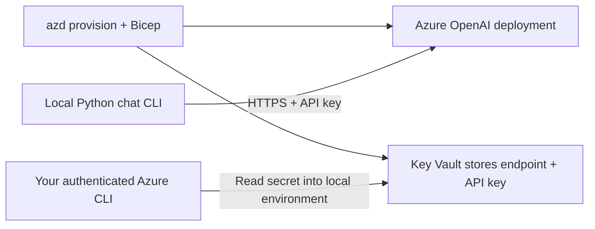

# Azure OpenAI Chat — CLI locale e infrastruttura AZD

**Livello:** Intermedio · **Tempo:** 35–60 minuti incluso il setup

Questo esempio predispone una **risorsa Azure OpenAI e Key Vault**, poi esegue una
interfaccia chat Python CLI **sulla tua macchina**. Non ospita un'applicazione web
o un Container App. Il modello predefinito è `gpt-4.1`, versione `2025-04-14`, con
capacità di deployment `GlobalStandard` 20. Verifica la disponibilità attuale e la quota nella
regione selezionata prima di effettuare il provisioning; le date di ciclo di vita del modello possono variare.

## Obiettivi di apprendimento

- Predisporre l'infrastruttura modello con Bicep e azd.
- Recuperare una chiave API da Key Vault senza includerla negli output del deployment.
- Inviare richieste di Chat Completions e mantenere la cronologia della conversazione.
- Interpretare il conteggio dei token e i limiti delle stime di costo.



Questo esempio non include integrazione runtime con identità gestite, failover multi-regione,
limitatore di frequenza personalizzato, modalità streaming, o calcolo ospitato. L'SDK OpenAI
esegue fino a due tentativi per errori ripetibili; la CLI segnala errori residui.

## Prerequisiti

- Una versione stabile corrente di [azd](https://learn.microsoft.com/azure/developer/azure-developer-cli/install-azd)
  (versione rilasciata alla data di revisione: 1.37.2).
- [Azure CLI](https://learn.microsoft.com/cli/azure/install-azure-cli).
- Python **3.10+** (consigliato 3.11) e un ambiente virtuale.
- Un abbonamento Azure con permessi per creare risorse Cognitive Services e Key Vault,
  distribuire modelli e leggere i segreti del vault.
- Disponibilità regionale e quota `GlobalStandard` per `gpt-4.1`. I requisiti di accesso
  dipendono dall'abbonamento e dalla funzionalità; non c'è una tempistica garantita per l'approvazione.

```bash
azd version
az version
python --version
azd auth login
az login
```

Queste sono sessioni di autenticazione separate. Seleziona lo stesso abbonamento in entrambi
gli strumenti prima di eseguire i comandi seguenti.

## Avvio rapido (Bash)

Esegui dalla radice del repository:

```bash
cd examples/azure-openai-chat
azd env new myopenai
azd provision
```

Scegli una regione supportata. Il provisioning crea un gruppo di risorse, account OpenAI,
deployment modello, Key Vault, e i segreti `openai-endpoint`/`openai-api-key`.
Non ci sono **servizi da distribuire** in `azure.yaml`.

Carica gli output non segreti e recupera il segreto nella tua shell corrente:

```bash
export AZURE_OPENAI_ENDPOINT="$(azd env get-value AZURE_OPENAI_ENDPOINT)"
export AZURE_OPENAI_MODEL="$(azd env get-value AZURE_OPENAI_MODEL)"
KV_NAME="$(azd env get-value AZURE_KEY_VAULT_NAME)"
export AZURE_OPENAI_API_KEY="$(az keyvault secret show \
  --vault-name "$KV_NAME" --name openai-api-key --query value --output tsv)"

python -m venv .venv
source .venv/bin/activate
python -m pip install -r src/requirements.txt
python src/chat.py
```

In PowerShell, attiva con `.\.venv\Scripts\Activate.ps1` e assegna variabili d'ambiente
con `$env:AZURE_OPENAI_ENDPOINT = azd env get-value AZURE_OPENAI_ENDPOINT`
(e similmente per il modello). Recupera la chiave API usando
`$env:AZURE_OPENAI_API_KEY = az keyvault secret show --vault-name $KV_NAME --name openai-api-key --query value -o tsv`.
Imposta prima `$KV_NAME = azd env get-value AZURE_KEY_VAULT_NAME`.

Non stampare, commettere o incollare la chiave API nei report delle issue. La CLI legge le variabili
di ambiente del processo; **non** recupera segreti da Key Vault né carica file `.env`.
`config.py` convalida endpoint, limite dei token e temperatura all'avvio.

Output previsto (contenuto e utilizzo variano):

```text
Azure OpenAI Chat Application
Model: gpt-4.1
...
You: Say hello in one sentence.
Assistant: Hello! How can I help you today?
[Tokens: ... | Cost: $...]
```

Comandi: `stats` mostra i totali, `clear` cancella la cronologia della conversazione e
`quit`/`exit` termina la sessione. Non esistono comandi `--stream`, `--show-tokens`, `tokens`,
o `cost`.

## Verifica il deployment

Dopo aver caricato le variabili shell sopra:

```bash
curl --fail-with-body \
  "${AZURE_OPENAI_ENDPOINT%/}/openai/deployments/${AZURE_OPENAI_MODEL}/chat/completions?api-version=2024-10-21" \
  -H "Content-Type: application/json" \
  -H "api-key: $AZURE_OPENAI_API_KEY" \
  -d '{"messages":[{"role":"user","content":"Say hello!"}],"max_tokens":50}'

az keyvault secret list --vault-name "$KV_NAME" --query "[].name" -o table
```

Successo: l'API restituisce HTTP 200 con `choices[0].message.content` e `usage`;
il vault elenca `openai-api-key` e `openai-endpoint`. Un deploy ARM riuscito
da solo non verifica l'inferenza.

## File e configurazione

```text
azure.yaml                         # Infrastructure-only AZD project
infra/main.bicep                   # Subscription deployment
infra/main.parameters.json         # Environment, location, principal ID
infra/resources/openai.bicep       # Account + model
infra/resources/keyvault.bicep     # Vault + deploying user's secret access policy
infra/resources/secrets.bicep      # Writes secrets, no key output
src/chat.py                        # Interactive CLI
src/config.py                      # Environment validation
src/requirements.txt               # Python packages
```

Per modificare modello/versione/capacità forniti, modifica i valori di default in
`infra/main.bicep` e lancia `azd provision`. Impostare `AZURE_OPENAI_MODEL` nella
shell seleziona soltanto un **nome di deployment esistente**; non effettua il deployment di un altro modello.

| Variabile di runtime | Default / origine |
|---|---|
| `AZURE_OPENAI_ENDPOINT` | Obbligatorio; output azd non segreto |
| `AZURE_OPENAI_API_KEY` | Obbligatorio; recuperare da Key Vault |
| `AZURE_OPENAI_MODEL` | `gpt-4.1`; nome del deployment Azure |
| `AZURE_OPENAI_MAX_TOKENS` | 800 (intervallo di validazione 1–4096) |
| `AZURE_OPENAI_TEMPERATURE` | 0,7 (intervallo 0–2) |
| `AZURE_OPENAI_INPUT_PRICE_PER_1K` | 0,002 USD; tariffa illustrativa per input non memorizzato nella cache |
| `AZURE_OPENAI_OUTPUT_PRICE_PER_1K` | 0,008 USD; tariffa illustrativa per output |

## Costi e limitazioni di sicurezza

La visualizzazione dei costi è una **stima**, non la fatturazione Azure. Moltiplica l'uso
dei token API per le tariffe configurate e non considera sconti per input in cache,
differenze regionali/SKU, tasse, variazioni di prezzo o chiamate fallite/riprovate.
Sovrascrivi **entrambe le tariffe** quando usi un altro modello o SKU e verifica l'attuale
[prezzatura Azure OpenAI](https://azure.microsoft.com/pricing/details/cognitive-services/openai-service/).

Per illustrazione, 100 richieste usando 500 token input non memorizzati nella cache e 200 token output ciascuna
ai tassi predefiniti costano `100 × (500/1000 × .002 + 200/1000 × .008) = $0.26`.
Le operazioni/lo storage di Key Vault comportano costi separati. Non c'è una tariffa fissa di $50/mese
per questa CLI locale e non c'è calcolo ospitato nel modello.

Il vault usa una policy di accesso per il principale che effettua il deployment; non è un esempio di applicazione RBAC o
con identità gestita. Vengono usati endpoint pubblici e autenticazione con chiave API
a scopo didattico. Limita i permessi e aggiungi controlli appropriati su identità/rete
prima di adattarlo per la produzione.

## Esercizi pratici

### 1. Verifica il contesto e resettalo

**Inizio:** esecuzione CLI. **Obiettivo:** osservare la cronologia.
Dì "Ricorda la parola cedro," poi chiedi "Quale parola ti ho chiesto di ricordare?"
Esegui `stats`; due turni riusciti dovrebbero contare come due messaggi scambiati.
Esegui `clear` e `stats`; i messaggi scambiati dovrebbero essere zero (totali di token rimangono).
La formulazione esatta del modello non è deterministica.

### 2. Cambiare il limite di risposta

**Inizio:** esci dalla CLI, mantenendo la stessa shell.
Esegui `export AZURE_OPENAI_MAX_TOKENS=100`, riavvia `python src/chat.py`, e chiedi
una breve spiegazione di azd. Controlla che il banner mostri 100.
Ripristina con `unset AZURE_OPENAI_MAX_TOKENS`. Un limite di risposta più piccolo non
riduce i token di cronologia già inviati.

### Problemi comuni

- **Variabili d'ambiente mancanti:** il provisioning non esporta i valori della shell;
  ripeti i passaggi di esportazione. Un nuovo terminale ne ha bisogno di nuovo.
- **403 lettura di Key Vault:** verifica l'iscrizione/login di Azure CLI e il principale
  nella policy di accesso al vault. Le modifiche alla policy possono impiegare tempo per propagarsi.
- **404 inferenza:** controlla il nome del deployment, l'endpoint e lo stato del deployment.
- **429 inferenza:** attendi il reset dei limiti di velocità; verifica la quota del modello regionale.
  La CLI rimuove i turni falliti dalla cronologia quindi riprovare non li duplica.
- **Lunghezza del contesto:** l'esempio non tronca conversazioni lunghe; usa `clear`.
- **Modello non disponibile/ritirato:** consulta la disponibilità attuale del modello e aggiorna
  modello/versione/SKU insieme; la versione API e la versione del modello sono impostazioni differenti.

## Pulizia e passaggi successivi

```bash
azd down
unset AZURE_OPENAI_API_KEY
```

La conservazione del soft-delete di Key Vault è di sette giorni; la cancellazione definitiva richiede permessi separati.
Non esiste una suite di test consolidata; non eseguire il comando `pytest tests/` inesistente.
Aggiungi test API simulati prima di estendere il codice.

[Esempi di container](../../../../examples/container-app) · [Progetto architetturale retail](../retail-scenario.md) ·
[Homepage del corso](../../README.md) · [Segnala un problema](https://github.com/microsoft/AZD-for-beginners/issues)

---

<!-- CO-OP TRANSLATOR DISCLAIMER START -->
**Disclaimer**:
Questo documento è stato tradotto utilizzando il servizio di traduzione AI [Co-op Translator](https://github.com/Azure/co-op-translator). Sebbene ci impegniamo per garantire la precisione, si prega di notare che le traduzioni automatizzate possono contenere errori o imprecisioni. Il documento originale nella sua lingua nativa deve essere considerato la fonte autorevole. Per informazioni critiche, si raccomanda una traduzione professionale effettuata da un essere umano. Non siamo responsabili per eventuali malintesi o interpretazioni errate derivanti dall’uso di questa traduzione.
<!-- CO-OP TRANSLATOR DISCLAIMER END -->