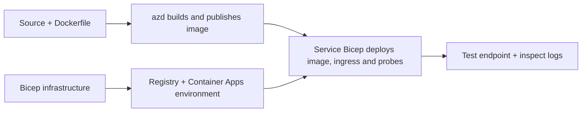

# Esempi di Distribuzione Container App con AZD

Questa directory contiene due esempi didattici con codice sorgente, Dockerfile,
infrastruttura Bicep, e `azure.yaml`. Nessuno dei due è pronto per la produzione.

## Scegli un esempio

| Esempio | Cosa è implementato | Prerequisito |
|---|---|---|
| [Simple Flask API](../../../../examples/container-app/simple-flask-api) | API CRUD Python singola, elementi in memoria, sonde di integrità, scaling HTTP | Conoscenza base di CLI e HTTP |
| [Two-service microservices](../../../../examples/container-app/microservices) | Gateway Node.js, servizio prodotto Python solo lettura interno, telemetria e scaling | Completa prima l'esempio single-service |

Prevedi 30–60 minuti includendo setup e verifica. I tempi di provisioning di Azure variano.

## Prerequisiti

- [Azure Developer CLI](https://learn.microsoft.com/azure/developer/azure-developer-cli/install-azd)
- [Azure CLI](https://learn.microsoft.com/cli/azure/install-azure-cli) per comandi di verifica
- Docker con il suo demone in esecuzione per la creazione di queste immagini container
- Una sottoscrizione Azure con permessi di creazione risorse e quota regionale sufficiente
- Bash per gli esempi shell, o comandi PowerShell equivalenti

```bash
azd version
az version
docker info
azd auth login
az login
```

I due strumenti hanno sessioni di login separate. Usa un azd stabile e aggiornato; la
versione stabile pubblicata al momento della revisione è la 1.37.2. Richieste di versioni
minime più vecchie non sono una garanzia di compatibilità.

## Avvio rapido

Dalla radice del repository:

```bash
cd examples/container-app/simple-flask-api
azd env new flask-demo
azd up
API_URL=$(azd env get-value API_ENDPOINT)
curl --fail-with-body "${API_URL}/health"
```

Previsto: HTTP 200 con `"status": "healthy"`. Segui il README di esempio per creare,
leggere, aggiornare ed eliminare un elemento, e per ispezionare i registri.



Il provisioning iniziale utilizza un'immagine pubblica hello-world sulla porta 80. Specifica del servizio
I file di parametri Bicep consentono a `azd deploy` di sostituirlo con l'immagine dell'applicazione compilata
e la porta/app corretta per le probe (8000 per Flask/prodotto, 8080 per il gateway).
Mantieni questi file con le loro impostazioni `azure.yaml` `module`.

## Configurazione: cosa cambia cosa

`azure.yaml` seleziona directory sorgente, lingue, host e moduli di deployment.
CPU/memoria del contenitore, ingress, probe, conteggi delle repliche e regole di scalabilità sono definiti
in **Bicep**, non in proprietà di servizio arbitrarie `resources`, `scale` o `regions`.

`azd env set SOME_VALUE ...` memorizza un valore localmente. Cambia una risorsa distribuita
solo quando un parametro, una mappatura dell'ambiente o un hook consumano esplicitamente quel
valore. Questi esempi non consumano `MAX_REPLICAS`, `SCALE_TO_ZERO_TIMEOUT`,
`CONTAINER_APP_REPLICA_TYPE` o impostazioni personalizzate canary dai valori dell'ambiente azd.
Modifica il Bicep pertinente ed esegui `azd up` per riprovisionare e distribuire.

Non mettere il codice sorgente dell'applicazione sotto `infra/`. `project` deve puntare alla directory
sorgente contenente il Dockerfile e il manifesto delle dipendenze.

## Monitoraggio e costi

- `azd monitor --logs` apre una visualizzazione del portale; non è un flusso di log terminale.
  Usa `az containerapp logs show --follow` con il nome reale della risorsa.
- L'API semplice scrive i log stdout raccolti tramite Container Apps/Log Analytics.
  La risorsa Application Insights fornita non è strumentata automaticamente.
- Il gateway dei microservizi utilizza l'SDK Application Insights per Node.js; il servizio Python
  esporta tracce di log delle applicazioni. Il tracciamento completo di richieste/dipendenze Python
  non è configurato.
- Lo scale-to-zero può ridurre i costi di calcolo, ma il registro e l'ingestione/archiviazione dei log
  possono comunque comportare costi. Le impostazioni predefinite dei microservizi mantengono in esecuzione le repliche.
  Stima la tua regione e il tuo utilizzo nel
  [calcolatore prezzi di Azure](https://azure.microsoft.com/pricing/calculator/).

## Modelli avanzati — implementazioni non incluse

Queste sono indicazioni di progettazione, non progetti locali aggiuntivi o snippet da copiare e incollare:

- **Dati persistenti e autenticazione:** sostituire gli archivi in memoria e aggiungere
  l'autenticazione/autorizzazione Microsoft Entra ID prima della produzione.
- **Blue-green/canary:** utilizzare la modalità multi-revisione di Container Apps, etichette delle revisioni,
  pesi del traffico, verifica dello stato e procedure di rollback.
  Non è presente alcuna configurazione `deploymentStrategy: canary` azd in questi esempi.
  Vedi [gestione delle revisioni](https://learn.microsoft.com/azure/container-apps/revisions).
- **Multi-regione:** crea ambienti e app separati in Bicep e progetta
  il routing globale e la coerenza dei dati. Un elenco di servizi `regions` non è un
  meccanismo di distribuzione azd.
- **Queue workers:** aggiungi la sorgente del worker, dipendenze, risorse della coda, un gestore
  identità con ruoli di data-plane e una regola di scala autenticata. Non copiare
  un percorso `src/worker` vuoto e aspettarti un progetto eseguibile.
- **Dapr:** fornisci componenti, configura il sidecar, installa l’SDK corrispondente,
  e implementa la gestione degli errori di stato/pub-sub.
- **Segreti:** usa identità gestita e assegnazioni di ruolo ove possibile. Creare
  semplicemente un Key Vault non concede alle applicazioni l’accesso o il caricamento dei segreti.

## Pulizia

Dalla directory di esempio:

```bash
azd down
```

Rivedere le richieste di eliminazione e confermare che il gruppo di risorse dedicato sia stato rimosso.
Non utilizzare questi esempi come base per la produzione senza ulteriori progettazioni e test.

[Indice degli esempi](../README.md) · [Pagina principale del corso](../../README.md) ·
[Documentazione Container Apps](https://learn.microsoft.com/azure/container-apps/) ·
[Segnala un problema](https://github.com/microsoft/AZD-for-beginners/issues)

---

<!-- CO-OP TRANSLATOR DISCLAIMER START -->
**Disclaimer**:
Questo documento è stato tradotto utilizzando il servizio di traduzione AI [Co-op Translator](https://github.com/Azure/co-op-translator). Sebbene ci impegniamo per garantire la precisione, si prega di notare che le traduzioni automatizzate possono contenere errori o imprecisioni. Il documento originale nella sua lingua nativa deve essere considerato la fonte autorevole. Per informazioni critiche, si raccomanda una traduzione professionale effettuata da un essere umano. Non siamo responsabili per eventuali malintesi o interpretazioni errate derivanti dall’uso di questa traduzione.
<!-- CO-OP TRANSLATOR DISCLAIMER END -->