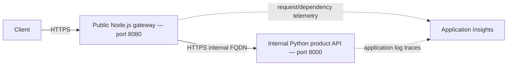

# Microservizi a due servizi — Azure Container Apps

**Livello:** Intermedio · **Tempo:** 45–60 minuti inclusa la configurazione

Questo esempio didattico implementa un **Node.js API Gateway** e un **Servizio Prodotto Python in sola lettura**. Sono inclusi codice sorgente, Dockerfile, Bicep e configurazione azd.

Non si tratta di un sistema pronto per la produzione.

## Cosa imparerai

- Distribuire due servizi indipendentemente.
- Usare un FQDN backend interno su HTTPS.
- Verificare le risposte di successo, non trovato e servizio non disponibile.
- Capire la telemetria e i limiti di scalabilità indipendenti.



Il catalogo prodotto contiene cinque prodotti fissi in memoria. Non ci sono **handler POST,
PUT o DELETE**, database, Service Bus, servizi ordini/utenti/notifiche,
codice C# o Go. Queste sono idee per sviluppi futuri, non funzionalità incluse.
Il gateway non autentica gli utenti; l'ingresso interno non è un sostituto
per l'autorizzazione dell'applicazione.

## Prerequisiti

Completa prima il [single Flask API](../../../../../examples/container-app/simple-flask-api).
Installa una versione stabile attuale di azd (rilascio pubblicato al momento della revisione: 1.37.2), Azure CLI,
e Docker con il demone in esecuzione. Hai bisogno di un abbonamento Azure, permessi
di creazione risorse e quota regionale Container Apps.

```bash
azd version
az version
docker info
azd auth login
az login
```

Usa lo stesso abbonamento in entrambi gli strumenti CLI. I comandi di seguito usano Bash.

## Distribuisci e verifica

Dalla radice del repository:

```bash
cd examples/container-app/microservices
azd env new microservices-demo
azd up
GATEWAY_URL=$(azd env get-value API_GATEWAY_URL)
RG_NAME=$(azd env get-value AZURE_RESOURCE_GROUP)
GATEWAY_NAME=$(azd env get-value API_GATEWAY_NAME)
PRODUCT_NAME=$(azd env get-value PRODUCT_SERVICE_NAME)

curl --fail-with-body "${GATEWAY_URL}/health"
curl --fail-with-body "${GATEWAY_URL}/api/products"
curl --fail-with-body "${GATEWAY_URL}/api/products/1"
curl -i "${GATEWAY_URL}/api/products/999"
```

**Successo:** health 200; list 200 con **cinque** prodotti; il prodotto 1 è un Laptop
dal prezzo 999,99 con stock 50; prodotto sconosciuto restituisce 404.
Le descrizioni sono incluse nelle risposte; i timestamp variano.

L'approvvigionamento iniziale utilizza immagini pubbliche hello-world sulla porta 80 così non prova
a scaricare immagini inesistenti da un registro vuoto. I moduli Bicep specifici per il servizio
e i file parametri le sostituiscono con immagini costruite e porte/probe app durante
`azd deploy`. I parametri principali preservano i nomi immagine pubblicati per l'approvvigionamento successivo.

## Servizi e rete

| Servizio | Endpoint esposti | Risorse di default |
|---|---|---|
| Gateway | GET `/`, `/health`, `/api/products`, `/api/products/:id` | 1 vCPU, 2 GiB, 2–20 repliche |
| Product | GET `/`, `/health`, `/products`, `/products/<id>` | 0.5 vCPU, 1 GiB, 1–10 repliche |

L'ingresso del prodotto ha `external: false` e `allowInsecure: false`. Bicep inietta
`PRODUCT_SERVICE_URL=https://<actual-internal-fqdn>` nel gateway. HTTP sarebbe
redirect; HTTPS corrisponde all'ingress configurato. Un nome DNS breve deve corrispondere al
**nome reale del Container App**, non alla chiave logica del servizio `product-service`.
Non tentare di chiamare l'URL interno direttamente dal tuo laptop.

Il gateway ha un timeout di cinque secondi per le chiamate di prodotto. Gli ID prodotto mancanti
si propagano come 404; fallimenti di trasporto/altri fallimenti backend restituiscono 503. Il gateway
`/health` verifica solo il gateway, non la disponibilità del backend.

## File e configurazione

```text
azure.yaml
infra/main.bicep
infra/main.parameters.json
infra/abbreviations.json
infra/core/container-apps-environment.bicep
infra/core/monitor.bicep
infra/app/api-gateway.bicep
infra/app/api-gateway.parameters.json
infra/app/product-service.bicep
infra/app/product-service.parameters.json
src/api-gateway/{app.js,package.json,Dockerfile}
src/product-service/{main.py,requirements.txt,Dockerfile}
```

Scaling, CPU/memoria, porte e probe sono configurati in `infra/app/*.bicep`. Modifica quei
file e esegui `azd up` per applicare l'infrastruttura e ridistribuire. Non c'è
un parametro di variabile d'ambiente `GATEWAY_MAX_REPLICAS` in questo esempio.

Per modifiche solo al codice:

```bash
azd deploy product-service
azd deploy api-gateway
```

L'immagine Node utilizza Node 22; l'immagine Python utilizza Python 3.11. Entrambi si collegano a
`0.0.0.0`. Ingress/probe usano rispettivamente le porte 8080 (gateway) e 8000 (prodotto).

## Sviluppo locale con Docker

Esegui da questa directory di esempio. Usa una rete definita dall'utente, **non `localhost`
da un container per raggiungere l'altro**:

```bash
docker network create azd-microservices-demo
docker build -t local-product ./src/product-service
docker build -t local-gateway ./src/api-gateway
docker run -d --name azd-product --network azd-microservices-demo local-product
docker run -d --name azd-gateway --network azd-microservices-demo \
  -p 8080:8080 -e PRODUCT_SERVICE_URL=http://azd-product:8000 local-gateway
curl --fail-with-body http://localhost:8080/api/products
```

Previsto: cinque prodotti. HTTP è usato solo per questa rete Docker locale.

```bash
docker stop azd-product azd-gateway
docker rm azd-product azd-gateway
docker network rm azd-microservices-demo
```

## Monitoraggio

```bash
az containerapp logs show --name "$GATEWAY_NAME" --resource-group "$RG_NAME" --follow
# In a separate terminal:
az containerapp logs show --name "$PRODUCT_NAME" --resource-group "$RG_NAME" --tail 100
```

`azd monitor --logs` apre una vista portale; non trasmette i log del terminale.
L'SDK Node raccoglie richieste/dipendenze del gateway. Il `AzureLogHandler` di Python
esporta **tracce di log**, non richieste Flask automatiche, dipendenze SQL o tracce distribuite complete.
OpenCensus è un SDK legacy; preferisci Azure Monitor OpenTelemetry
quando estendi questo esempio.

Nei Log di Application Insights, genera richieste e ispeziona:

```kusto
requests
| where timestamp > ago(1h)
| where name contains "products"
| summarize RequestCount=count(), AvgDuration=avg(duration) by bin(timestamp, 5m)
```

Per i messaggi dell'applicazione Python:

```kusto
traces
| where timestamp > ago(1h)
| where message contains "products"
| project timestamp, message, severityLevel
```

Consenti un ritardo di ingestione e un campionamento; non aspettarti un conteggio esatto delle richieste o una
latenza garantita. Nessun avviso personalizzato o dashboard è configurato.

## Esercizi pratici

### Esercizio 1: Modifica il catalogo

**Punto di partenza:** `src/product-service/main.py`.
**Obiettivo:** verificare il deployment indipendente del servizio.
Cambia lo stock del Laptop da 50 a 49 nella lista fissa `products`, esegui
`azd deploy product-service`, poi richiedi `${GATEWAY_URL}/api/products/1`.

**Criteri di successo / soluzione:** HTTP 200 con `"stock":49`. Ripristina 50 e ridistribuisci.
**Problema comune:** modificare il gateway invece del servizio che possiede il catalogo.
Questo cambia i dati sorgente, non un database persistente dell'inventario.

### Esercizio 2: Verifica la configurazione delle repliche

**Punto di partenza:** `infra/app/product-service.bicep`.
**Obiettivo:** osservare un cambiamento dell'infrastruttura senza indovinare l'autoscaling.
Cambia `minReplicas: 1` in `minReplicas: 2`, esegui `azd up`, poi:

```bash
az containerapp show --name "$PRODUCT_NAME" --resource-group "$RG_NAME" \
  --query properties.template.scale -o json
```

**Criteri di successo:** il minimo configurato è 2 e il massimo resta 10.
Ripristina il minimo a 1 e esegui `azd up`.
**Problema comune:** `azd deploy` da solo non applica modifiche all'infrastruttura condivisa non correlata.
Non impostare `maxReplicas` a zero come simulazione di fallimento.
Questo verifica la configurazione, non un test di carico o un conteggio garantito e istantaneo delle repliche.

### Esercizio 3: Testa localmente la gestione del servizio non disponibile

**Punto di partenza:** entrambi i container Docker locali sopra sono in esecuzione.
**Obiettivo:** distinguere un fallimento backend da un prodotto mancante.
Ferma solo il container del prodotto:

```bash
docker stop azd-product
curl -i http://localhost:8080/api/products
docker start azd-product
curl --fail-with-body http://localhost:8080/api/products
```

**Criteri di successo:** mentre è fermo, il gateway restituisce 503 con
`"error":"Product service unavailable"`; dopo il riavvio, la lista restituisce 200.
Riprova dopo un breve ritardo di avvio se necessario.
**Problema comune:** fermare il gateway testa un fallimento differente (nessuna risposta HTTP).

## Costi e lacune in produzione

Le repliche minime predefinite mantengono il calcolo in esecuzione. Anche il registro e il monitoraggio comportano
costi. Non esiste un totale fisso convalidato di $50/mese: stima CPU/memoria regionale,
ore di replica, richieste, registro e conservazione dei log nel
[calcolatore prezzi Azure](https://azure.microsoft.com/pricing/calculator/).
Elimina rapidamente le risorse di apprendimento.

Il lavoro di produzione include autenticazione/autorizzazione, identità gestite con ambito,
dati persistenti, convalida input/risposta, strumentazione di osservabilità supportata,
test di carico/errore, CI/CD, avvisi e procedure di recupero. Aggiungere un servizio di ordinazione,
coda o database è un compito di implementazione separato, non un esercizio completato
o una funzionalità già disponibile qui.

## Risoluzione dei problemi e pulizia

- **Immagine non trovata durante la prima fornitura:** il bootstrap dovrebbe usare l’immagine pubblica;
  verifica i valori predefiniti del parametro principale dell’immagine e le mappature del modulo di distribuzione.
- **Errori 503:** controlla i log del prodotto, la revisione dell’immagine e l’URL HTTPS interno iniettato.
- **Percorso 404 inatteso:** l’API del prodotto è di sola lettura; verifica il percorso, non un gestore CRUD inesistente.
- **Nessuna telemetria:** ispeziona le stringhe di connessione in fase di esecuzione senza esporle e
  consenti un ritardo nell’ingestione. Le tabelle delle richieste Python non sono popolate dal suo gestore di log.

Da questa directory di esempio:

```bash
azd down
```

Rivedi i prompt di eliminazione e verifica che il gruppo di risorse dedicato venga rimosso.

[Precedente: Flask API](../../../../../examples/container-app/simple-flask-api) · [Successivo: App database](../../../../../examples/database-app) ·
[Sviluppo AI](../../../docs/chapter-02-ai-development/README.md) ·
[Home del corso](../../../README.md) · [Segnala un problema](https://github.com/microsoft/AZD-for-beginners/issues)

---

<!-- CO-OP TRANSLATOR DISCLAIMER START -->
**Disclaimer**:
Questo documento è stato tradotto utilizzando il servizio di traduzione AI [Co-op Translator](https://github.com/Azure/co-op-translator). Sebbene ci impegniamo per garantire la precisione, si prega di notare che le traduzioni automatizzate possono contenere errori o imprecisioni. Il documento originale nella sua lingua nativa deve essere considerato la fonte autorevole. Per informazioni critiche, si raccomanda una traduzione professionale effettuata da un essere umano. Non siamo responsabili per eventuali malintesi o interpretazioni errate derivanti dall’uso di questa traduzione.
<!-- CO-OP TRANSLATOR DISCLAIMER END -->