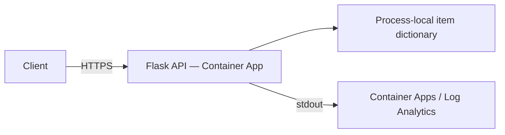

# API Flask Semplice — Azure Container Apps

**Livello:** Principiante · **Tempo:** 30–45 minuti incluso il setup

Distribuisci una API CRUD Python Flask con Azure Developer CLI (azd). Sono inclusi sorgenti, Dockerfile,
Bicep e parametri di distribuzione. Questo è un **esempio didattico**, non
un'API pronta per la produzione.

## Cosa imparerai

- Costruire e pubblicare un container tramite azd.
- Configurare ingress e probe di liveness/readiness.
- Verificare le risposte CRUD e ispezionare i log dell'applicazione.
- Comprendere perché i dati in memoria non sono adatti per applicazioni durature.



**Importante:** gli elementi sono contenuti in un solo processo. Il default è **un worker Gunicorn,
0–1 repliche**, evitando intenzionalmente dati incoerenti tra worker/repliche.
Gli elementi si perdono al riavvio, cambio di revisione o scale-to-zero. Aumentare le repliche
richiede uno storage persistente condiviso. L'API non dispone di autenticazione o autorizzazione.

## Prerequisiti

- [azd stabile corrente](https://learn.microsoft.com/azure/developer/azure-developer-cli/install-azd)
  (release pubblicata al momento della revisione: 1.37.2).
- [Azure CLI](https://learn.microsoft.com/cli/azure/install-azure-cli) per verifica.
- Docker con il suo demone in esecuzione; è richiesto per la build locale predefinita dell'immagine.
- Sottoscrizione Azure, permessi di creazione risorse e quota regionale per Container Apps.
- Bash per i comandi seguenti (o PowerShell equivalente).
- Python 3.11 per sviluppo locale opzionale.

```bash
azd version
az version
docker info
azd auth login
az login
```

Gli strumenti CLI hanno sessioni di login separate. Usa la stessa sottoscrizione in entrambi.

## Avvio rapido

Dalla root del repository:

```bash
cd examples/container-app/simple-flask-api
azd env new flask-demo
azd up
API_URL=$(azd env get-value API_ENDPOINT)
RG_NAME=$(azd env get-value AZURE_RESOURCE_GROUP)
API_NAME=$(azd env get-value API_NAME)
curl --fail-with-body "${API_URL}/health"
```

Atteso: HTTP 200 e JSON con `"status":"healthy"`,
`"service":"simple-flask-api"` e un timestamp UTC corrente.
Il provisioning e la build dell'immagine solitamente richiedono diversi minuti; i tempi variano.

Il provisioning iniziale usa un'immagine hello-world pubblica in ascolto sulla porta 80.
`azure.yaml` seleziona `infra/app/api.bicep` e il file parametri corrispondente per
la distribuzione del servizio, che cambia immagine, ingress e probe sulla porta 8000.
Non eliminare quei parametri di distribuzione.

## Verifica CRUD

Esegui i seguenti comandi in sequenza mentre la stessa replica rimane attiva:

```bash
# Create: HTTP 201; note the returned id (1 for a fresh process).
curl -i -X POST "${API_URL}/api/items" \
  -H "Content-Type: application/json" \
  -d '{"name":"Test Item","description":"My first item"}'

# Read list: HTTP 200, total 1 in a fresh process.
curl --fail-with-body "${API_URL}/api/items"

# Replace 1 if your create response returned another id.
curl --fail-with-body "${API_URL}/api/items/1"
curl -i -X PUT "${API_URL}/api/items/1" \
  -H "Content-Type: application/json" -d '{"name":"Updated Item"}'
curl -i -X DELETE "${API_URL}/api/items/1"
curl -i "${API_URL}/api/items/1"
```

Successo: POST 201, letture/PUT 200, DELETE 204 senza corpo, poi item mancante 404.
JSON malformato/non-oggetto o nome vuoto restituiscono 400.
Se un elemento sparisce tra richieste, controlla un riavvio o scale-to-zero;
questa è una limitazione intenzionale in memoria, non persistenza.

| Endpoint | Metodi |
|---|---|
| `/` | GET — informazioni servizio |
| `/health` | GET — liveness/readiness |
| `/api/items` | GET, POST |
| `/api/items/{id}` | GET, PUT, DELETE |

## Log e configurazione

```bash
az containerapp logs show --name "$API_NAME" --resource-group "$RG_NAME" --follow
```

Atteso: avvio Gunicorn, log accessi richieste e messaggi dell'applicazione.
`azd monitor --logs` apre una vista portale; non effettua streaming sul terminale.
Application Insights è predisposto ma **non strumentato da questo codice Flask**;
usa Container Apps/Log Analytics per i log stdout.

Modifica `infra/app/api.bicep` per CPU/memoria, limiti replica o regole di scalabilità, poi
esegui `azd up`. I default sono 0.5 vCPU, 1 GiB, minimo 0 / massimo 1 replica e
soglia HTTP di 50 richieste concorrenti. Scale-to-zero può aggiungere latenza cold-start.

Arbitrari `azd env set MAX_REPLICAS`, `API_KEY`, `LOG_LEVEL`, o
I valori di `SCALE_TO_ZERO_TIMEOUT` **non sono collegati a questo modello o app**.
Impostare un valore non lo rende automaticamente una variabile di ambiente a runtime.
L'immagine lega esplicitamente la porta 8000; aggiornare insieme Dockerfile, Bicep ingress e probe
se si cambia la porta.

## File

```text
azure.yaml
infra/main.bicep
infra/main.parameters.json
infra/app/container-apps.bicep       # Environment, registry, monitoring
infra/app/api.bicep                  # App, ingress, probes, scale settings
infra/app/api.parameters.json        # Image and resource values for azd deploy
src/app.py
src/Dockerfile
src/requirements.txt
```

## Sviluppo locale

Da questa directory di esempio:

```bash
python -m venv .venv
source .venv/bin/activate  # PowerShell: .\.venv\Scripts\Activate.ps1
python -m pip install -r src/requirements.txt
python src/app.py
```

In un altro terminale, testa `http://localhost:8000/health` e gli endpoint CRUD.
Oppure costruisci e esegui l'immagine reale:

```bash
docker build -t flask-api:local ./src
docker run --rm -p 8000:8000 flask-api:local
```

Per modifiche solo al codice dopo il primo deployment, esegui `azd deploy api`.
Per modifiche a Bicep, esegui `azd up` per ripristinare e distribuire.

## Esercizi pratici

### 1. Validare il rifiuto dell'input

**Punto di partenza:** API distribuita, `API_URL` sopra.
**Obiettivo:** verificare che l'API rifiuti forme JSON non valide e nomi mancanti.

```bash
curl -i -X POST "${API_URL}/api/items" \
  -H "Content-Type: application/json" -d '[]'
curl -i -X POST "${API_URL}/api/items" \
  -H "Content-Type: application/json" -d '{"name":""}'
```

**Criteri di successo / soluzione:** entrambi restituiscono 400 con un errore JSON, non 500.
**Problema comune:** omissione dell'header content-type JSON.

### 2. Aggiungere un endpoint versione in sola lettura

**Punto di partenza:** `src/app.py`. **Obiettivo:** estendere e ridistribuire l'API.
Aggiungi questo prima del blocco `if __name__ == '__main__':`:

```python
@app.route('/version', methods=['GET'])
def version():
    return jsonify({'version': '1.0.0'})
```

Esegui `azd deploy api`, poi `curl --fail-with-body "${API_URL}/version"`.
**Criteri di successo:** HTTP 200 e `{"version":"1.0.0"}`.
**Problema comune:** mettere la route dopo la chiamata bloccante `app.run()` quando
si testa con `python src/app.py`.

### Punto di controllo conoscenza

Perché un solo worker non è sufficiente per dati durevoli? Perché anche un solo processo perde
il proprio dizionario al riavvio. Una versione di produzione richiede storage condiviso persistente,
autenticazione, autorizzazione, migrazioni, test e monitoraggio operativo.

## Costi e risoluzione dei problemi

Questa non è una distribuzione garantita a costo zero: il registro Basic e l'archiviazione/ingestione dei log
possono causare costi anche se il calcolo dell'app è a zero. Usa il
[calcolatore prezzi](https://azure.microsoft.com/pricing/calculator/) per la tua regione.

- **Errore build Docker:** confermare `docker info`, accesso alla rete e dipendenze.
- **App non in salute:** controllare i log della console/sistema e verificare che porta immagine, ingress,
  e probe siano coerenti. Un segnaposto non deve essere probe sulla porta Flask.
- **403/permessi:** confermare permessi di sottoscrizione e creazione risorse.
- **Elementi scompaiono:** lo stato in memoria si resetta al riavvio/scala a zero; aggiungere un database
  per comportamento duraturo.

## Pulizia e passi successivi

```bash
azd down
```

Rivedi il prompt di cancellazione e verifica che il gruppo di risorse dedicato sia rimosso.
Non usare la pulizia distruttiva su un gruppo di risorse contenente dati non correlati.

[Prossimo: app database](../../../../../examples/database-app) · [Microservizi](../../../../../examples/container-app/microservices) ·
[Panoramica container](../README.md) · [Home corso](../../../README.md) ·
[Segnala un problema](https://github.com/microsoft/AZD-for-beginners/issues)

---

<!-- CO-OP TRANSLATOR DISCLAIMER START -->
**Disclaimer**:
Questo documento è stato tradotto utilizzando il servizio di traduzione AI [Co-op Translator](https://github.com/Azure/co-op-translator). Sebbene ci impegniamo per garantire la precisione, si prega di notare che le traduzioni automatizzate possono contenere errori o imprecisioni. Il documento originale nella sua lingua nativa deve essere considerato la fonte autorevole. Per informazioni critiche, si raccomanda una traduzione professionale effettuata da un essere umano. Non siamo responsabili per eventuali malintesi o interpretazioni errate derivanti dall’uso di questa traduzione.
<!-- CO-OP TRANSLATOR DISCLAIMER END -->