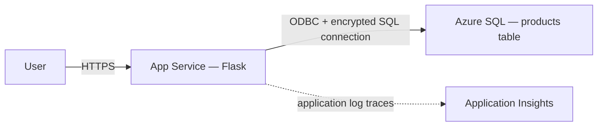

# Flask e Azure SQL su App Service

**Livello:** Intermedio · **Tempo:** 30–60 minuti inclusi i prerequisiti

Questo esempio distribuisce un'API di lettura Python Flask su **Linux App Service** e un database Basic
Azure SQL. Sono inclusi codice sorgente, Bicep e configurazione azd. Si tratta di un'applicazione
didattica, non di un'architettura di database pronta per la produzione.

## Cosa imparerai

- Fornire risorse App Service, SQL e di monitoraggio con Bicep.
- Configurare la connettività SQL crittografata senza memorizzare le credenziali.
- Inizializzare uno schema prima di avviare i worker Gunicorn.
- Verificare i dati inseriti, le risposte di non trovato e la salute del database.



Risorse: gruppo di risorse dedicato, piano App Service Linux B1, app Web Python 3.11,
server SQL e database Basic da 2 GB, Application Insights e Log Analytics.
L'app Web utilizza **il deployment da sorgente/ZIP e l'installazione delle dipendenze Oryx**;
`azd deploy` non compila né esegue il deployment del Dockerfile opzionale.

## Prerequisiti

- Versione stabile corrente di [azd](https://learn.microsoft.com/azure/developer/azure-developer-cli/install-azd)
  (rilascio pubblicato al momento della revisione: 1.37.2).
- [Azure CLI](https://learn.microsoft.com/cli/azure/install-azure-cli) per la verifica.
- Sottoscrizione Azure, permessi per creare le risorse elencate e quota regionale.
- Python **3.11** per lo sviluppo locale; il `pyodbc==5.0.1` committato potrebbe richiedere
  strumenti di build nativi sulle versioni più recenti di Python.
- Microsoft ODBC Driver 18 (o 17) per SQL Server sulle macchine locali. `pip install
  pyodbc` non installa il driver di sistema. Vedi
  [installazione ODBC](https://learn.microsoft.com/sql/connect/odbc/download-odbc-driver-for-sql-server).
- Docker solo se si testa il container opzionale localmente.

```bash
azd version
az version
azd auth login
az login
```

Usa la stessa sottoscrizione in entrambi gli strumenti. I comandi sotto usano Bash.

## Distribuzione

Dalla radice del repository:

```bash
cd examples/database-app
azd env new sql-demo
azd provision
azd deploy
WEB_URL=$(azd env get-value WEB_APP_URI)
WEB_NAME=$(azd env get-value WEB_APP_NAME)
RG_NAME=$(azd env get-value AZURE_RESOURCE_GROUP)
```

Scegli una regione supportata. `sqlAdminLogin` predefinito è `sqladmin`; il
parametro richiesto `sqlAdminPassword` è sicuro. Fornisci una password forte quando richiesto.
Tieni le credenziali di distribuzione fuori da Git e dalle segnalazioni di bug. L'interpolazione della stringa di connessione
attuale si aspetta una password senza delimitatori di stringa di connessione come
`;`; adatta l'escape prima di usare tali valori.

Bicep imposta un comando di avvio che esegue `init_database()` **prima** di Gunicorn
gli worker si avviano. Questo è necessario perché importare `app:app` non esegue
il blocco `if __name__ == '__main__'` di Python. Su un database nuovo, l'inizializzazione
crea `products` e inserisce cinque righe. È un esempio semplice per insegnare, non un
framework di migrazione concorrente; utilizzare migrazioni adeguate prima di scalare le istanze.

L'app seleziona il driver Microsoft ODBC 18 installato, poi il 17, se la stringa di connessione
non specifica esplicitamente un driver. Se nessuno dei due esiste, l'avvio fallisce con
un errore di installazione che richiede un intervento. Verificare la disponibilità del driver
nel runtime di App Service selezionato invece di darlo per scontato.

## Verificare

```bash
curl --fail-with-body "${WEB_URL}/"
curl --fail-with-body "${WEB_URL}/health"
curl --fail-with-body "${WEB_URL}/products"
curl --fail-with-body "${WEB_URL}/products/1"
curl -i "${WEB_URL}/products/999"
```

Previsto:

- `/` restituisce informazioni sull'endpoint.
- `/health` restituisce 200 con `{"status":"healthy","database":"connected"}`.
- `/products` restituisce cinque prodotti inseriti in un database nuovo.
- `/products/1` restituisce Laptop con prezzo 1299.99.
- Un prodotto inesistente restituisce 404 con `{"error":"Product not found"}`.

L'API è di sola lettura. Non ci sono rotte POST/PUT/DELETE o interfaccia browser.
Un errore di connessione al database restituisce 503 da `/health`; non è un successo.

## File e configurazione

```text
azure.yaml                         # Python App Service source deployment
infra/main.bicep
infra/main.parameters.json
infra/abbreviations.json
infra/resources/sql-server.bicep
infra/resources/sql-database.bicep
infra/resources/app-service-plan.bicep
infra/resources/web-app.bicep       # Settings + initialization/startup command
infra/resources/app-insights.bicep
src/web/app.py
src/web/requirements.txt
src/web/Dockerfile                 # Optional local container, not the azd target
.env.sample
```

`SQL_CONNECTION_STRING` è passato come parametro Bicep sicuro al modulo Web App
e archiviato nelle impostazioni di App Service, non negli output di deployment.
`APPLICATIONINSIGHTS_CONNECTION_STRING` configura l'esportazione dei log.
`SCM_DO_BUILD_DURING_DEPLOYMENT=true` abilita l'installazione dipendenze lato server.
Impostare valori arbitrari di `azd env` non altera automaticamente le impostazioni dell'app.

La regola `0.0.0.0` del firewall SQL permette connessioni da **servizi Azure,
comprese sottoscrizioni di altri clienti**, soggette ad autenticazione SQL. Non è
limitata a questa app o sottoscrizione. L'accesso pubblico alla rete SQL è abilitato.
Usare il networking a portata definita e un'identità applicativa non amministrativa prima della produzione.

## Sviluppo locale

Usare Python 3.11 e un driver Microsoft SQL ODBC installato:

```bash
python -m venv .venv
source .venv/bin/activate  # PowerShell: .\.venv\Scripts\Activate.ps1
python -m pip install -r src/web/requirements.txt
export SQL_CONNECTION_STRING='Server=tcp:YOUR_SERVER.database.windows.net,1433;Database=YOUR_DATABASE;UID=YOUR_USER;PWD=YOUR_PASSWORD;Encrypt=yes;TrustServerCertificate=no;Connection Timeout=30;'
python src/web/app.py
```

Sostituire i segnaposto in modo sicuro. Un file `.env` copiato **non viene caricato automaticamente**
da questa applicazione. Esportare invece le variabili nella shell attuale.
Per Azure SQL da un laptop, consentire temporaneamente solo il proprio IP pubblico:

```bash
SQL_SERVER=$(azd env get-value SQL_SERVER_NAME)
MY_IP=YOUR_PUBLIC_IP
az sql server firewall-rule create -g "$RG_NAME" -s "$SQL_SERVER" \
  -n AllowMyLearningIP --start-ip-address "$MY_IP" --end-ip-address "$MY_IP"
```

Rimuovere la regola dopo i test:

```bash
az sql server firewall-rule delete -g "$RG_NAME" -s "$SQL_SERVER" -n AllowMyLearningIP
```

Test opzionale del container da questa directory di esempio:

```bash
docker build -t sql-flask:local src/web
docker run --rm -p 8000:8000 -e SQL_CONNECTION_STRING sql-flask:local
```

Questa immagine installa il Driver 18 usando il repository di pacchetti Debian 12 corrispondente alla sua
base Bookworm, inizializza il database una volta, poi avvia Gunicorn.

## Monitoraggio e risoluzione problemi

Abilitare/seguire i log applicativi del filesystem di App Service quando si diagnostica l'avvio:

```bash
az webapp log config --name "$WEB_NAME" --resource-group "$RG_NAME" \
  --application-logging filesystem --level information
az webapp log tail --name "$WEB_NAME" --resource-group "$RG_NAME"
```

Questo codice esporta le **tracce di log** dell'applicazione tramite un handler OpenCensus legacy.
Non configura il tracciamento automatico delle richieste/dipendenze Flask, Live Metrics,
auditing SQL, impostazioni diagnostiche o avvisi. Questi richiedono configurazioni separate.
Per nuova strumentazione, preferire Azure Monitor OpenTelemetry.

In Application Insights Logs, dopo aver effettuato richieste API:

```kusto
traces
| where timestamp > ago(1h)
| where message contains "products" or message contains "Health check"
| project timestamp, message, severityLevel
```

Consentire un ritardo nell'ingestione. L'attività sulla tabella richieste o i Live Metrics non costituiscono un criterio
di completamento per questa strumentazione solo di log.

- **Driver mancante:** ispezionare `pyodbc.drivers()` nel runtime e installare un
  driver Microsoft ODBC supportato. Un pacchetto Python da solo non è sufficiente.
- **Fallimento connessione:** controllare impostazioni SQL, credenziali, firewall e driver selezionato.
  sottoscrizione. Non disabilitare la crittografia per bypassare un errore.
- **Tabella prodotti mancante:** confermare che il comando di avvio Bicep è stato distribuito;
  avviare `gunicorn app:app` da solo salta l'inizializzazione.
- **Errore di compilazione del pacchetto:** utilizzare Python 3.11 o fornire i prerequisiti di compilazione nativi.
- **Dati a prezzo zero:** zero è un prezzo decimale valido; deve serializzarsi come 0.0,
  non `null`.

## Esercizi pratici

### Esercizio 1: Verificare il comportamento del prodotto mancante

**Punto di partenza:** API distribuita e `WEB_URL` sopra.
**Obiettivo:** distinguere una riga mancante da un database rotto.
Richiedere `/health` e `/products/999` usando i comandi sopra.
**Criteri di successo / risposta:** stato 200 per la salute, 404 per prodotto inesistente (non 500 o 503).
**Problema comune:** assumere che una risposta non trovata dimostri che la connessione SQL è interrotta.

### Esercizio 2: Modificare un valore predefinito

**Punto di partenza:** Azure SQL Query Editor, collegato al database di esempio.
**Obiettivo:** dimostrare che i dati dell'API sono memorizzati in SQL e non nella memoria del processo.

```sql
UPDATE products SET price = 0 WHERE id = 1;
SELECT id, name, price FROM products WHERE id = 1;
```

Richiedere `${WEB_URL}/products/1`. **Criteri di successo:** il prezzo è `0.0`, non `null`.
Ripristinare il valore:

```sql
UPDATE products SET price = 1299.99 WHERE id = 1;
```

**Problema comune:** modificare la lista seed di Python non aggiorna le righe già presenti in SQL.
Non eseguire esercizi di schema/dati su un database di produzione.

### Esercizio 3: Aggiungere un endpoint di conteggio in sola lettura

**Punto di partenza:** `src/web/app.py`.
**Obiettivo:** estendere l'API utilizzando una query aggregata senza parametri.
Aggiungere questo prima del blocco `if __name__ == '__main__':`:

```python
@app.route('/product-count')
def product_count():
    from contextlib import closing
    with closing(get_db_connection()) as conn, closing(conn.cursor()) as cursor:
        cursor.execute("SELECT COUNT(*) FROM products")
        return jsonify({'count': cursor.fetchone()[0]})
```

Eseguire `azd deploy web`, quindi richiedere `${WEB_URL}/product-count`.
**Criteri di successo:** 200 con `{"count":5}` sul database seedato intatto.
**Problema comune:** cambiare la rotta ma dimenticare di ridistribuire.
Per la produzione, aggiungere gestione degli errori/test; questo breve esercizio si concentra sulla query.

## Costi, lacune in produzione e pulizia

B1 App Service e il database Basic vengono fatturati mentre sono allocati. Fermare il
Web App **non** interrompe la fatturazione del piano App Service. I log e l’archiviazione possono aggiungere costi.
Usare il [calcolatore prezzi di Azure](https://azure.microsoft.com/pricing/calculator/)
per i prezzi regionali correnti. Passare a F1 richiede anche la disabilitazione di `alwaysOn`;
non è un semplice cambio con una riga. SQL serverless non è automaticamente gratuito.

Il lavoro di produzione include un’identità app con privilegi minimi (non admin SQL),
autenticazione/autorizzazione, rete privata, migrazioni sicure, revisione del pooling/ciclo di vita
della connessione, telemetria, audit, avvisi, test e procedure di recupero.
La cache Redis e le tabelle aggiuntive sono idee di sviluppo, non esercizi implementati.

Da questa directory di esempio:

```bash
azd down
```

Verificare il prompt di cancellazione e assicurarsi che il gruppo di risorse dedicato venga rimosso.
Non cancellare gruppi contenenti dati non correlati.

[Esempi di container](../../../../examples/container-app) ·
[Sviluppo AI](../../docs/chapter-02-ai-development/README.md) ·
[Homepage del corso](../../README.md) · [Segnala un problema](https://github.com/microsoft/AZD-for-beginners/issues)

---

<!-- CO-OP TRANSLATOR DISCLAIMER START -->
**Disclaimer**:
Questo documento è stato tradotto utilizzando il servizio di traduzione AI [Co-op Translator](https://github.com/Azure/co-op-translator). Sebbene ci impegniamo per garantire la precisione, si prega di notare che le traduzioni automatizzate possono contenere errori o imprecisioni. Il documento originale nella sua lingua nativa deve essere considerato la fonte autorevole. Per informazioni critiche, si raccomanda una traduzione professionale effettuata da un essere umano. Non siamo responsabili per eventuali malintesi o interpretazioni errate derivanti dall’uso di questa traduzione.
<!-- CO-OP TRANSLATOR DISCLAIMER END -->