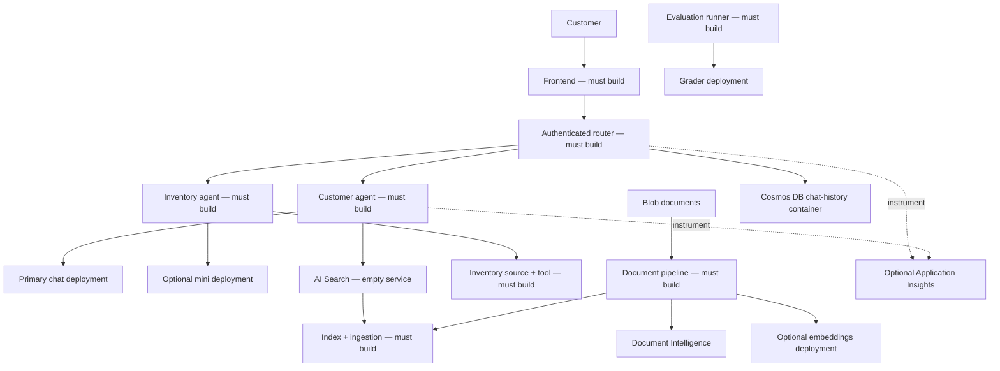

# Supporto Clienti Multi-Agente — Architettura Retail Blueprint

**Capitolo 5: Soluzioni AI Multi-Agente**

- [Home del corso](../README.md)
- [Capitolo 5](../docs/chapter-05-multi-agent/README.md)
- [Prerequisito: integrazione AI](../docs/chapter-02-ai-development/microsoft-foundry-integration.md)
- [Successivo: pianificazione della capacità](../docs/chapter-06-pre-deployment/capacity-planning.md)
- [Struttura infrastrutturale ARM](retail-multiagent-arm-template/README.md)

> **Guida architettonica, non un'applicazione funzionante.** Gli unici file di implementazione retail
> sono `azuredeploy.json`, `azuredeploy.parameters.json` e `deploy.sh` in
> `retail-multiagent-arm-template/`. I container router/frontend sono segnaposto hello-world.
> Non esistono agenti retail, UI, pipeline di ingestione, valutatori, scanner,
> o suite di test per l'applicazione localmente.

## Panoramica

**Obiettivo:** progettare un sistema di supporto clienti con un agente cliente e un agente inventario,
identificare ciò che l'infrastruttura fornisce e pianificare i contratti applicativi mancanti
e le verifiche.

**Pubblico:** sviluppatori che hanno completato il campione di chat locale
[chat sample](../../../examples/azure-openai-chat) e [two-service container sample](../../../examples/container-app/microservices).
Prevedere 2-3 ore per lo studio architetturale. Costruire l'applicazione è un progetto separato:
una stima indicativa per sviluppatori esperti è di 80-120 ore di sviluppo,
**non una promessa di consegna**; la messa in produzione, test,
revisione della sicurezza e le operazioni richiedono lavoro aggiuntivo.

### Risultati di apprendimento

- Spiegare routing, grounding, permessi degli strumenti e proprietà della conversazione.
- Distinguere identificatori di modello, nomi di deployment, versioni API e versioni ARM.
- Progettare l'ingestione e il recupero di documenti con dimensioni vettoriali corrispondenti.
- Definire requisiti funzionali, di valutazione e di recupero da errori verificabili.
- Separare obiettivi architetturali opzionali dalle risorse effettivamente fornite.

## Architettura della Soluzione



Questa è una **architettura target dell'applicazione**, non un diagramma di servizi agenti in esecuzione.
Lo scaffold ARM crea solo i servizi sottostanti e due container segnaposto.
Front Door, registry, identità gestite, assegnazioni di ruolo,
endpoint privati, failover, strumentazione applicativa e alert non sono inclusi.

### Responsabilità e contratti

| Componente | Comportamento richiesto | Evidenze prima di dichiararlo completo |
|---|---|---|
| Frontend | Autenticare utenti, visualizzare chat, caricare documenti in modo sicuro | Test UI e upload, errori accessibili |
| Router | Autorizzare richieste, scegliere agente, limiti di chiamata/timeout degli strumenti | Test routing, controlli autorizzativi, test di guasto |
| Agente cliente | Basare risposte politiche/prodotto su fonti approvate | Citazioni corrette, astensione quando i dati mancanti |
| Strumento inventario | Leggere stock autorevole con permessi limitati | Test di stock deterministici; nessuna disponibilità inventata |
| Pipeline documenti | Estrarre, suddividere, incorporare, indicizzare, aggiornare/eliminare | Fixture indicizzate e comportamento di retry/dead-letter |
| Archiviazione conversazioni | Isolare utenti, far rispettare la conservazione | Test di autorizzazione cross-utente e TTL |
| Esecuzione valutazione | Confrontare output con verità di base e rubriche | Copertura, conteggi fallimenti, report riproducibili |

Considera il router come un banco accoglienza e gli strumenti come sistemi interni limitati:
scegliere uno specialista non autorizza l’accesso a tutti i record del cliente.
Applicare identità e permessi nel codice dell'applicazione e servizi dati, non nei prompt.

## Infrastruttura vs. Applicazione

Leggi il [README scaffold](retail-multiagent-arm-template/README.md) prima
di effettuare il provisioning. Elenca risorse esatte, modalità, costi e limitazioni.

| Uso logico | Nome deployment ARM | Modello / versione | Regione predefinita |
|---|---|---|---|
| Chat cliente | `gpt-4.1-chat` | `gpt-4.1` / `2025-04-14` | `eastus2` |
| Inventario | `gpt-4.1-mini-inventory` | `gpt-4.1-mini` / `2025-04-14` | `westus2`, opzionale |
| Embedding | `text-embedding-ada-002` | `text-embedding-ada-002` / `2` | `francecentral`, opzionale |
| Valutazione | `gpt-4.1-grader` | `gpt-4.1` / `2025-04-14` | Regione primaria di default |

Controlla disponibilità modello/versione/SKU e quota in **ogni regione**. Chat/mini/grader
usano `GlobalStandard`; embeddings usano `Standard`. Le mappature unità capacità-TPM sono
specifiche del modello. Non aggiungere unità capacità dissimili come garanzia universale di quota.

L'argomento `model` di una richiesta Azure OpenAI è il **nome del deployment**, non
necessariamente l'identificatore catalogo del modello. La versione API del piano dati `2024-10-21`
è distinta dalla versione modello `2025-04-14` e dalla risorsa ARM `apiVersion`.
Non si può risolvere un modello non disponibile cambiando solo la versione API del piano dati.

`--no-multi-region` esclude account secondari e embedding. Rimangono un account chat primario e
un account grader indipendente. Account modello separati non forniscono failover automatico;
ciò richiede routing applicativo, deployment compatibili, controlli di salute,
limiti di retry e revisione della residenza dati.

## Roadmap di implementazione

### 1. Inizia con un'interazione testata

Prima di effettuare il provisioning del grande scaffold, usa il campione chat locale per stabilire
la connettività di inferenza. Definisci una domanda rappresentativa del cliente, la fonte di risposta approvata,
la citazione attesa e il comportamento in caso di assenza di tale fonte.

### 2. Definisci routing e confini degli strumenti

Crea il tuo codice sorgente router, manifesto delle dipendenze, Dockerfile e test. Un
contratto illustrativo potrebbe essere `POST /chat` con `{"message":"...","conversation_id":"..."}`.
**Quell'endpoint è una proposta di design; non è implementato dal template ARM.**

Valida tipi/limiti del corpo, ricava l'identità utente dall'autenticazione, applica
la proprietà della conversazione, applica timeout alle richieste e ritorna codici d’errore significativi.
Non considerare i fallimenti HTTP o risposte vuote come risultati agenti riusciti.

### 3. Implementa grounding e ingestione

Il template ARM non crea un indice di ricerca. Questo è un **frammento JSON di riferimento
da adattare nella tua definizione di indice**, non un file già nel repo:

```json
{
  "name": "retail-product-index",
  "fields": [
    {"name": "id", "type": "Edm.String", "key": true},
    {"name": "title", "type": "Edm.String", "searchable": true},
    {"name": "content", "type": "Edm.String", "searchable": true},
    {"name": "category", "type": "Edm.String", "filterable": true},
    {
      "name": "content_vector",
      "type": "Collection(Edm.Single)",
      "searchable": true,
      "dimensions": 1536,
      "vectorSearchProfile": "retail-profile"
    }
  ],
  "vectorSearch": {
    "algorithms": [{"name": "retail-hnsw", "kind": "hnsw"}],
    "profiles": [{"name": "retail-profile", "algorithm": "retail-hnsw"}]
  }
}
```

Il profilo collega il campo vettoriale al suo algoritmo. Le dimensioni devono corrispondere
all'output embedding effettivo (1536 per questo deployment `ada-002`). Per il recupero in Python,
usa `azure.search.documents.models.VectorizedQuery` anziché un dizionario incompleto
che manca del tipo di query vettoriale:

```python
# Reference function only: supply an authenticated async SearchClient and an embedding.
from azure.search.documents.models import VectorizedQuery

async def retrieve(search_client, embedding):
    results = await search_client.search(
        search_text=None,
        vector_queries=[VectorizedQuery(
            vector=embedding,
            k_nearest_neighbors=5,
            fields="content_vector"
        )],
        select=["id", "title", "content"]
    )
    return [document async for document in results]
```

Crea un'implementazione di ingestione separata che:

1. Autorizza l'accesso all'upload e valida tipo e dimensione del contenuto.
2. Legge blob privati usando chiamate SDK autenticate. Un URL blob privato da solo
   **non è** un input leggibile per Document Intelligence; invia i byte scaricati con
   `AnalyzeDocumentRequest(bytes_source=...)` o usa un SAS a scadenza breve e con permessi appropriati,
   dopo aver verificato i requisiti di accesso.
3. Estrae testo, lo suddivide per rispettare i limiti embedding e genera embedding.
4. Crea chiavi documento stabili e valide e carica chunk con vettori corrispondenti.
5. Controlla risultati indicizzazione per documento, gestisce retry e aggiorna/elimina dati obsoleti.

Non interpolare chiavi/valori arbitrari utente nei filtri OData. Permetti solo campi specifici,
valida tipi di valore e scappa virgolette stringa. Filtri booleani e numerici necessitano
di letterali tipizzati, non stringhe tra virgolette.

### 4. Grounding web

**Bing Search v7 è stato ritirato l'11 agosto 2025.** La vecchia risorsa `Microsoft.Bing/accounts`
e gli esempi `api.bing.microsoft.com/v7.0/search` non sono un percorso di implementazione supportato.
Valuta una integrazione grounding attualmente supportata in
Microsoft Foundry e il suo SDK, permessi, fatturazione e requisiti di citazione;
nessuna è implementata qui. Non è un sostituto diretto per l’endpoint ritirato.

### 5. Aggiungi telemetria e valutazione

Creare Application Insights non strumenta il codice. Usa l'instrumentation Azure Monitor
OpenTelemetry supportata quando costruisci una nuova applicazione, propaga il contesto trace
tra i servizi e evita di registrare prompt clienti, documenti o segreti.
Troncando una query non la si anonimizza.

Misura durata richieste, fallimenti routing/strumenti, pertinenza recupero, correttezza citazioni,
uso token e astensione. Conserva fatti inventario/politica di verità di base
assieme ai casi di valutazione: un grader non può determinare affidabilmente accuratezza fattuale
da solo con domanda e risposta.

Un deployment grader non è un esecutore di valutazioni. Implementa rubriche versionate,
output strutturati/validazione schema, controlli su range di punteggio, conteggi di fallimenti trasporto
e casi revisionati da umani. Riporta separatamente casi incompleti/errore; non convertirli
in voti riusciti o includerli silenziosamente come risposte modello di qualità zero.

Analogamente, pochi controlli di parole chiave non sono una certificazione di sicurezza.
Una richiesta HTTP fallita, strategia test mancante o risposta vuota devono rendere il test **inconcludente o
fallito**, non dare un punteggio “100% sicuro”. Esegui test autorizzati con strumenti appropriati
e revisione umana prima di qualsiasi affermazione di prontezza di produzione.

### 6. Distribuisci la tua applicazione

Crea le tue directory sorgente, manifesti, test, registry e permessi pull per immagini.
Sostituisci i segnaposto con immagini buildate e aggiorna ingress/probes per adattarsi
a ogni porta ascolto app. Configura variabili ambiente runtime in Bicep
o una mappatura esplicita ambiente azd supportata.

Non esiste un dizionario `config` generico sotto un servizio azd che crea automaticamente
variabili ambiente runtime. `azd env set` modifica solo risorse che consumano esplicitamente quei valori.
Nessun canary, lista regioni o hook di fine-tuning è
implementato in questo scaffold.

## Esercizi pratici di design

Questi sono **esercizi architetturali**, non affermazioni di codice starter retail eseguibile.

### Esercizio 1: Verifica il confine

**Punto di partenza:** i tre file in `retail-multiagent-arm-template/`.
**Obiettivo:** distinguere provisioning da funzionalità applicativa.
Apri `azuredeploy.json`, individua sia immagini container che valori `targetPort`,
poi elenca i componenti applicativi mancanti dal repository.

**Criteri di successo / risposta:** entrambe le immagini sono segnaposto hello-world che ascoltano
sulla porta 80; agenti, UI chat, gestori router, indicizzazione/ingestione, valutatore e scanner
sono assenti. Una richiesta root segnaposto riuscita non convalida `/chat`.
**Problema comune:** interpretare nomi di risorse come `retail-router` come codice funzionante.

### Esercizio 2: Traccia la configurazione vettoriale

**Punto di partenza:** JSON indice sopra.
**Obiettivo:** comprendere la relazione campo → profilo → algoritmo.
Identifica quali valori devono cambiare quando si passa a un modello embedding con una
dimensione output diversa, poi ispeziona la funzione `retrieve`.

**Criteri di successo / risposta:** cambia il campo `dimensions` alla lunghezza vettore effettiva;
mantieni `vectorSearchProfile` allineato a un profilo dichiarato e al suo algoritmo;
la query `fields` deve nominare il campo vettoriale. Rigenera i vettori documento esistenti
quando cambia il modello embedding.
**Problema comune:** cambiare solo il nome del modello mantenendo vettori incompatibili.

### Esercizio 3: Definisci un test di fallimento

**Punto di partenza:** tabella responsabilità.
**Obiettivo:** prevenire falsi successi.
Scrivi comportamento atteso per un’API inventario non disponibile, indice ricerca senza
documenti corrispondenti e richiesta di valutazione che ritorna HTTP 503.

**Criteri di successo / risposta:** nessun valore inventato per inventario; astensione esplicita o
escalation quando il contesto manca; la valutazione segnala un fallimento di trasporto
anziché un pass qualità o sicurezza. Aggiungi test eseguibili quando costruisci l’app.
**Problema comune:** catturare ogni eccezione e continuare con una risposta vuota.

## Costi, risoluzione problemi e pulizia

- L'infrastruttura genera costi continui anche con indici di ricerca vuoti e app segnaposto.
  Usa prezzi regionali correnti; né “minimale” né multi-regione implica gratuità.
- I costi token dipendono da modello, input cache/non-cache, output e SKU deployment.
  Il routing può risparmiare solo se il carico misurato e i risultati qualitativi lo giustificano;
  un risparmio fisso 60-80% non è garantito.
- Controlla disponibilità modello e quota prima del provisioning; distingui permessi,
  nome deployment, regione, versione modello e versione API errori.
- Non eseguire `setup-data.sh` mancanti, CLI valutatore o comandi `pytest tests/`.
  Le loro implementazioni fanno parte del tuo backlog di sviluppo.
- Lo scaffold è solo ARM: segui le
  [istruzioni di verifica e pulizia](retail-multiagent-arm-template/README.md).
  `azd down` non gestisce queste risorse.

## Risorse correlate

- [Campione chat locale funzionante](../../../examples/azure-openai-chat)
- [Campione due-service container funzionante](../../../examples/container-app/microservices)
- [Indice vettoriale AI Search](https://learn.microsoft.com/azure/search/vector-search-how-to-create-index)
- [Documentazione Container Apps](https://learn.microsoft.com/azure/container-apps/)
- [Risoluzione problemi](../docs/chapter-07-troubleshooting/common-issues.md)
- [Segnala un problema](https://github.com/microsoft/AZD-for-beginners/issues)

---

<!-- CO-OP TRANSLATOR DISCLAIMER START -->
**Disclaimer**:
Questo documento è stato tradotto utilizzando il servizio di traduzione AI [Co-op Translator](https://github.com/Azure/co-op-translator). Sebbene ci impegniamo per garantire la precisione, si prega di notare che le traduzioni automatizzate possono contenere errori o imprecisioni. Il documento originale nella sua lingua nativa deve essere considerato la fonte autorevole. Per informazioni critiche, si raccomanda una traduzione professionale effettuata da un essere umano. Non siamo responsabili per eventuali malintesi o interpretazioni errate derivanti dall’uso di questa traduzione.
<!-- CO-OP TRANSLATOR DISCLAIMER END -->