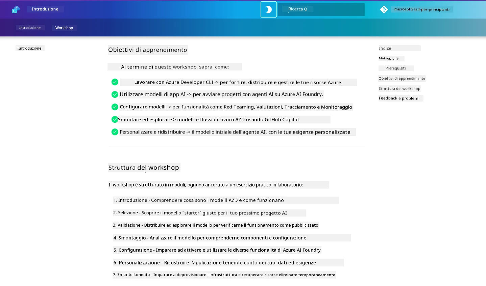

<div align="center">
  <div style="background: linear-gradient(135deg, #0078d4, #106ebe); border-radius: 10px; padding: 20px; margin: 20px 0; box-shadow: 0 4px 15px rgba(0, 120, 212, 0.3); border: 2px solid #005a9e;">
    <h2 style="color: white; margin: 0; font-size: 24px; text-shadow: 1px 1px 2px rgba(0,0,0,0.3);">
      🎯 Laboratorio AZD per sviluppatori AI
    </h2>
    <p style="color: white; margin: 10px 0 0 0; font-size: 16px; text-shadow: 1px 1px 2px rgba(0,0,0,0.3);">
      <strong>Un laboratorio pratico per costruire applicazioni AI con Azure Developer CLI.</strong><br>
      Completa 7 moduli per padroneggiare i template AZD e i flussi di lavoro per il deployment AI.
    </p>
    <div style="margin-top: 15px;">
      <span style="background: rgba(255,255,255,0.2); padding: 5px 10px; border-radius: 15px; color: white; font-size: 14px;">
        📅 Guida alla fonte rivista: novembre 2026
      </span>
    </div>
  </div>
</div>

# Laboratorio AZD per sviluppatori AI

Benvenuto al laboratorio pratico per imparare Azure Developer CLI (AZD) con un focus sul deployment di applicazioni AI. Questo laboratorio ti aiuta a ottenere una comprensione applicata dei template AZD in 3 passaggi:

1. **Scoperta** - trova il template giusto per te.
1. **Deployment** - distribuisci e convalida che funzioni
1. **Personalizzazione** - modifica e iterare per renderlo tuo!

Nel corso di questo laboratorio, verrai anche introdotto agli strumenti e flussi di lavoro core per sviluppatori, per aiutarti a semplificare il tuo percorso di sviluppo end-to-end.

<br/>

## Guida basata su browser

Le lezioni del laboratorio sono in Markdown. Puoi navigarle direttamente su GitHub - o avviare un'anteprima basata su browser come mostrato nello screenshot qui sotto.



Per usare questa opzione - fai il fork del repository sul tuo profilo e avvia GitHub Codespaces. Una volta che il terminale VS Code è attivo, digita questo comando:

Questa anteprima browser funziona in GitHub Codespaces, container di sviluppo o in una clonazione locale con Python e MkDocs installati.

```bash title="" linenums="0"
python -m pip install -r requirements-dev.txt
python -m mkdocs serve --config-file workshop/mkdocs.yml
```

Esegui questi comandi dalla **radice del repository del corso**, non dal campione AI inizializzato separatamente. Mantieni l'anteprima in primo piano così gli errori rimangono visibili; interrompila con Ctrl+C. Per controllare il sito senza servirlo, esegui `python -m mkdocs build --strict --config-file workshop/mkdocs.yml`.

In pochi secondi vedrai una finestra pop-up. Seleziona l'opzione per `Open in browser`. La guida basata su web si aprirà in una nuova scheda browser. Alcuni vantaggi di questa anteprima:

1. **Ricerca integrata** - trova parole chiave o lezioni rapidamente.
1. **Icona copia** - passa sopra i blocchi di codice per vedere questa opzione
1. **Cambio tema** - passa tra temi scuri e chiari
1. **Ottieni aiuto** - clicca l'icona Discord nel footer per unirti!

<br/>

## Panoramica del laboratorio

**Durata:** 3-4 ore  
**Livello:** Principiante a Intermedio  
**Prerequisiti:** Familiarità con Azure, concetti AI, VS Code e strumenti da riga di comando.

Questo è un laboratorio pratico dove impari facendo. Una volta completati gli esercizi, consigliamo di rivedere il curriculum AZD For Beginners per continuare il tuo percorso di apprendimento su best practice di Sicurezza e Produttività.

| Tempo| Modulo  | Obiettivo |
|:---|:---|:---|
| 15 min | [Introduzione](docs/instructions/0-Introduction.md) | Definisci il contesto, comprendi gli obiettivi |
| 30 min | [Seleziona Template AI](docs/instructions/1-Select-AI-Template.md) | Esplora opzioni e scegli l'iniziale | 
| 30 min | [Valida Template AI](docs/instructions/2-Validate-AI-Template.md) | Distribuisci la soluzione predefinita su Azure |
| 30 min | [Deconstruisci Template AI](docs/instructions/3-Deconstruct-AI-Template.md) | Esplora struttura e configurazione |
| 30 min | [Configura Template AI](docs/instructions/4-Configure-AI-Template.md) | Attiva e prova le funzionalità disponibili |
| 30 min | [Personalizza Template AI](docs/instructions/5-Customize-AI-Template.md) | Adatta il template alle tue esigenze |
| 30 min | [Smantella infrastruttura](docs/instructions/6-Teardown-Infrastructure.md) | Pulisci e libera risorse |
| 15 min | [Conclusione & prossimi passi](docs/instructions/7-Wrap-up.md) | Risorse di apprendimento, sfida del laboratorio |

<br/>

## Cosa imparerai

Considera il Template AZD come una sandbox didattica per esplorare varie capacità e strumenti per lo sviluppo end-to-end su Microsoft Foundry. Al termine di questo laboratorio, dovresti avere una sensazione intuitiva per vari strumenti e concetti in questo contesto.

| Concetto  | Obiettivo |
|:---|:---|
| **Azure Developer CLI** | Comprendere i comandi e i flussi di lavoro dello strumento|
| **Template AZD**| Comprendere struttura progetto e configurazione|
| **Azure AI Agent**| Provisioning e deployment del progetto Microsoft Foundry  |
| **Azure AI Search**| Abilita l’ingegneria contestuale con agenti |
| **Osservabilità**| Esplora tracing, monitoraggio e valutazioni |
| **Red Teaming**| Esplora test avversari e mitigazioni |

<br/>

## Struttura del laboratorio

Il laboratorio è strutturato per portarti da scoperta del template, a deployment, deconstruzione e personalizzazione - usando il template ufficiale [Getting Started with AI Agents](https://github.com/Azure-Samples/get-started-with-ai-agents) come base.

### [Modulo 1: Seleziona Template AI](docs/instructions/1-Select-AI-Template.md) (30 min)

- Cosa sono i Template AI?
- Dove posso trovare i Template AI?
- Come posso iniziare a costruire agenti AI?
- **Lab**: Avvio rapido in Codespaces o container di sviluppo

### [Modulo 2: Valida Template AI](docs/instructions/2-Validate-AI-Template.md) (30 min)

- Qual è l'architettura del Template AI?
- Qual è il flusso di lavoro di sviluppo AZD?
- Come posso ottenere aiuto con lo sviluppo AZD?
- **Lab**: Distribuisci & convalida template agenti AI

### [Modulo 3: Deconstruisci Template AI](docs/instructions/3-Deconstruct-AI-Template.md) (30 min)

- Esplora il tuo ambiente in `.azure/` 
- Esplora la tua configurazione risorse in `infra/` 
- Esplora la tua configurazione AZD in `azure.yaml`s
- **Lab**: Modifica variabili ambiente & ridistribuisci

### [Modulo 4: Configura Template AI](docs/instructions/4-Configure-AI-Template.md) (30 min)
- Esplora: Generation potenziata da recupero
- Esplora: Valutazione agenti & Red Teaming
- Esplora: Tracciamento & monitoraggio
- **Lab**: Esplora agente AI + osservabilità 

### [Modulo 5: Personalizza Template AI](docs/instructions/5-Customize-AI-Template.md) (30 min)
- Definisci: PRD con requisiti scenario
- Configura: variabili ambiente per AZD
- Implementa: Lifecycle hook per attività aggiuntive
- **Lab**: personalizza template per il mio scenario

### [Modulo 6: Smantella infrastruttura](docs/instructions/6-Teardown-Infrastructure.md) (30 min)
- Riepilogo: cosa sono i Template AZD?
- Riepilogo: perché usare Azure Developer CLI?
- Prossimi passi: prova un template differente!
- **Lab**: deprovisioning infrastruttura & pulizia

<br/>

## Sfida del laboratorio

Vuoi sfidarti a fare di più? Ecco alcuni suggerimenti di progetto - o condividi le tue idee con noi!!

| Progetto | Descrizione |
|:---|:---|
|1. **Deconstruisci un template AI complesso** | Usa il flusso di lavoro e strumenti descritti e verifica se riesci a distribuire, convalidare e personalizzare un altro template di soluzione AI. _Cosa hai imparato?_|
|2. **Personalizza con il tuo scenario**  | Prova a scrivere un PRD (Product Requirements Document) per uno scenario diverso. Poi usa GitHub Copilot nel repo del template in Agent Model - e chiedigli di generarti un flusso di lavoro di personalizzazione. _Cosa hai imparato? Come potresti migliorare questi suggerimenti?_|
| | |

## Hai feedback?

1. Pubblica un issue in questo repo - taggalo `Workshop` per comodità.
1. Unisciti al Discord Microsoft Foundry - connettiti con i tuoi pari!


| | | 
|:---|:---|
| **📚 Homepage corso**| [AZD For Beginners](../README.md)|
| **📖 Documentazione** | [Inizia con i template AI](https://learn.microsoft.com/en-us/azure/ai-foundry/how-to/develop/ai-template-get-started)|
| **🛠️Template AI** | [Template Microsoft Foundry](https://ai.azure.com/templates) |
|**🚀 Prossimi passi** | [Inizia il laboratorio](#workshop-overview) |
| | |

<br/>

---

**Navigazione:** [Corso principale](../README.md) | [Introduzione](docs/instructions/0-Introduction.md) | [Modulo 1: Seleziona template](docs/instructions/1-Select-AI-Template.md)

**Pronto per iniziare a costruire applicazioni AI con AZD?**

[Inizia il laboratorio: Introduzione →](docs/instructions/0-Introduction.md)

---

<!-- CO-OP TRANSLATOR DISCLAIMER START -->
**Disclaimer**:
Questo documento è stato tradotto utilizzando il servizio di traduzione AI [Co-op Translator](https://github.com/Azure/co-op-translator). Sebbene ci impegniamo per garantire la precisione, si prega di notare che le traduzioni automatizzate possono contenere errori o imprecisioni. Il documento originale nella sua lingua nativa deve essere considerato la fonte autorevole. Per informazioni critiche, si raccomanda una traduzione professionale effettuata da un essere umano. Non siamo responsabili per eventuali malintesi o interpretazioni errate derivanti dall’uso di questa traduzione.
<!-- CO-OP TRANSLATOR DISCLAIMER END -->