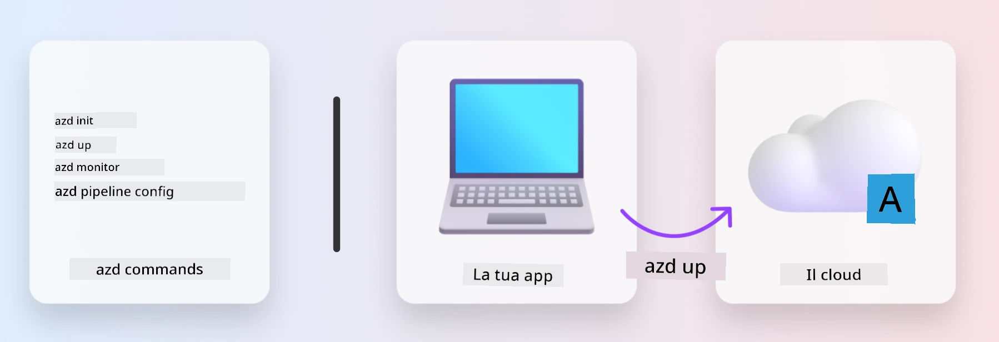
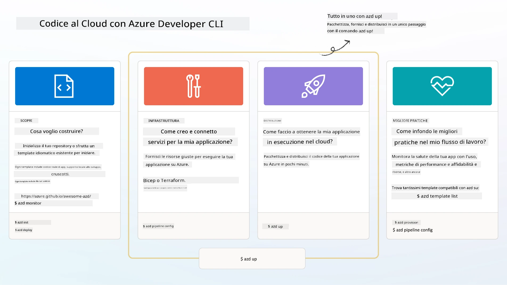

# 1. Seleziona un Modello

!!! tip "AL TERMINE DI QUESTO MODULO SARAI IN GRADO DI"

    - [ ] Describe what AZD templates are
    - [ ] Discover and use AZD templates for AI
    - [ ] Get started with the AI Agents template
    - [ ] **Lab 1:** AZD Quickstart in Codespaces or a dev container

---

## 1. Un'Analogia del Costruttore

Costruire un'applicazione AI moderna pronta per l'impresa _da zero_ può essere scoraggiante. È un po' come costruire la tua nuova casa da solo, mattone dopo mattone. Sì, si può fare! Ma non è il modo più efficace per ottenere il risultato finale desiderato!

Invece, spesso iniziamo con un _modello di progetto_ esistente e lavoriamo con un architetto per personalizzarlo in base ai nostri requisiti personali. Ed è proprio questo l'approccio da adottare quando si costruiscono applicazioni intelligenti. Prima, trova una buona architettura di progetto che si adatti al tuo ambito di problema. Poi lavora con un architetto della soluzione per personalizzare e sviluppare la soluzione per il tuo scenario specifico.

Ma dove possiamo trovare questi modelli di progetto? E come troviamo un architetto disposto a insegnarci come personalizzare e distribuire questi modelli da soli? In questo workshop, rispondiamo a queste domande presentandoti tre tecnologie:

1. [Azure Developer CLI](https://aka.ms/azd) - uno strumento open-source che accelera il percorso dello sviluppatore dal lavoro locale (build) alla distribuzione in cloud (ship).
1. [Microsoft Foundry Templates](https://ai.azure.com/templates) - repository standardizzati open-source contenenti codice di esempio, infrastruttura e file di configurazione per distribuire un'architettura di soluzione AI.
1. [GitHub Copilot Agent Mode](https://code.visualstudio.com/docs/copilot/chat/chat-agent-mode) - un agente di codifica basato sulla conoscenza di Azure, che può guidarci nella navigazione del codice e nelle modifiche - utilizzando il linguaggio naturale.

Con questi strumenti a disposizione, ora possiamo _scoprire_ il modello giusto, _distribuirlo_ per verificarne il funzionamento e _personalizzarlo_ per adattarlo ai nostri scenari specifici. Immergiamoci e impariamo come funzionano.


---

## 2. Azure Developer CLI

La [Azure Developer CLI](https://learn.microsoft.com/en-us/azure/developer/azure-developer-cli/) (o `azd`) è uno strumento da linea di comando open-source che può velocizzare il tuo percorso dal codice al cloud con un set di comandi amichevoli per gli sviluppatori che funzionano in modo coerente sia nel tuo IDE (sviluppo) che negli ambienti CI/CD (devops).

Con `azd`, il tuo percorso di distribuzione può essere semplice come:

- `azd init` - Inizializza un nuovo progetto AI da un modello AZD esistente.
- `azd up` - Fornisce l'infrastruttura e distribuisce la tua applicazione in un solo passaggio.
- `azd monitor` - Ottieni monitoraggio e diagnostica in tempo reale per la tua applicazione distribuita.
- `azd pipeline config` - Configura pipeline CI/CD per automatizzare la distribuzione su Azure.

**🎯 | ESERCIZIO**: <br/> Esplora ora lo strumento da linea di comando `azd` nel tuo ambiente attuale del workshop. Può essere GitHub Codespaces, un contenitore dev o una clone locale con i prerequisiti installati. Inizia digitando questo comando per vedere cosa può fare lo strumento:

```bash title="" linenums="0"
azd help
```



---

## 3. Il Modello AZD

Per `azd` per ottenere questo, deve conoscere l'infrastruttura da fornire, le impostazioni di configurazione da applicare e l'applicazione da distribuire. Qui entrano in gioco i [modelli AZD](https://learn.microsoft.com/en-us/azure/developer/azure-developer-cli/azd-templates?tabs=csharp).

I modelli AZD sono repository open-source che combinano codice di esempio con infrastruttura e file di configurazione necessari per distribuire l'architettura della soluzione.
Usando un approccio di _Infrastructure-as-Code_ (IaC), permettono che le definizioni delle risorse del modello e le impostazioni di configurazione vengano gestite con il controllo versione (proprio come il codice sorgente dell'app) - creando flussi di lavoro riutilizzabili e coerenti tra gli utenti di quel progetto.

Quando crei o riutilizzi un modello AZD per _il tuo_ scenario, considera queste domande:

1. Cosa stai costruendo? → Esiste un modello che ha codice iniziale per quello scenario?
1. Come è architettata la tua soluzione? → Esiste un modello che ha le risorse necessarie?
1. Come viene distribuita la tua soluzione? → Pensa a `azd deploy` con hook di pre/post-elaborazione!
1. Come puoi ottimizzarla ulteriormente? → Pensa a monitoraggio integrato e pipeline di automazione!

**🎯 | ESERCIZIO**: <br/> 
Visita la galleria [Awesome AZD](https://azure.github.io/awesome-azd/) e usa i filtri per esplorare i più di 250 modelli attualmente disponibili. Vedi se riesci a trovare uno che corrisponda ai requisiti del _tuo_ scenario.



---

## 4. Modelli per App AI

Per applicazioni AI potenziate, Microsoft fornisce modelli specializzati con **Microsoft Foundry** e **Foundry Agents**. Questi modelli accelerano il tuo percorso verso la creazione di applicazioni intelligenti pronte per la produzione.

### Modelli Microsoft Foundry & Foundry Agents

Seleziona un modello qui sotto per distribuirlo. Ogni modello è disponibile su [Awesome AZD](https://azure.github.io/awesome-azd/) e può essere inizializzato con un singolo comando.

| Modello | Descrizione | Comando di Distribuzione |
|----------|-------------|----------------|
| **[AI Chat con RAG](https://github.com/Azure-Samples/azure-search-openai-demo)** | Applicazione di chat basata su ricerca | `azd init -t Azure-Samples/azure-search-openai-demo .` |
| **[Inizia con AI Agents](https://github.com/Azure-Samples/get-started-with-ai-agents)** | Applicazione di chat supportata da agenti; usata durante tutto questo workshop | `azd init -t Azure-Samples/get-started-with-ai-agents .` |
| **[Inizia con AI Chat](https://github.com/Azure-Samples/get-started-with-ai-chat)** | Applicazione di chat AI di partenza | `azd init -t Azure-Samples/get-started-with-ai-chat .` |

Queste sono alternative: inizializza **un** modello in una sua directory vuota. Il parametro finale `.` seleziona quella directory; ometterlo nelle versioni attuali di AZD crea una sottodirectory nominata come il modello. L'inizializzazione scarica un progetto; `azd up` esegue la distribuzione a pagamento dopo aver verificato prerequisiti, risorse, supporto per regione e quote.

### Avvio Rapido

1. **Naviga modelli**: Visita [https://azure.github.io/awesome-azd/](https://azure.github.io/awesome-azd/) e filtra per `AI`, `Agents`, o `Microsoft Foundry`
2. **Seleziona il tuo modello**: Scegli uno che corrisponde al tuo caso d'uso
3. **Inizializza**: Esegui il comando `azd init` per il modello scelto
4. **Distribuisci**: Esegui `azd up` per fornire e distribuire

**🎯 | ESERCIZIO**: <br/>
Seleziona uno dei modelli sopra in base al tuo scenario:

- **Continui questo workshop?** → Scegli **Inizia con AI Agents**
- **Stai costruendo una chat basata su ricerca?** → Esplora **AI Chat con RAG** separatamente
- **Hai bisogno di un'altra architettura?** → Cerca nella galleria e verifica il repository reale, lo status di implementazione e i prerequisiti

```bash title="Initialize the workshop template in an empty directory" linenums="0"
azd init -t Azure-Samples/get-started-with-ai-agents .
azd auth login
azd up
```

!!! info "Esplora Altri Modelli"
    La [Awesome AZD Gallery](https://azure.github.io/awesome-azd/) contiene oltre 250 modelli. Usa i filtri per trovare modelli che corrispondano ai tuoi requisiti specifici per lingua, framework e servizi Azure.

---

<!-- CO-OP TRANSLATOR DISCLAIMER START -->
**Disclaimer**:
Questo documento è stato tradotto utilizzando il servizio di traduzione AI [Co-op Translator](https://github.com/Azure/co-op-translator). Sebbene ci impegniamo per garantire la precisione, si prega di notare che le traduzioni automatizzate possono contenere errori o imprecisioni. Il documento originale nella sua lingua nativa deve essere considerato la fonte autorevole. Per informazioni critiche, si raccomanda una traduzione professionale effettuata da un essere umano. Non siamo responsabili per eventuali malintesi o interpretazioni errate derivanti dall’uso di questa traduzione.
<!-- CO-OP TRANSLATOR DISCLAIMER END -->