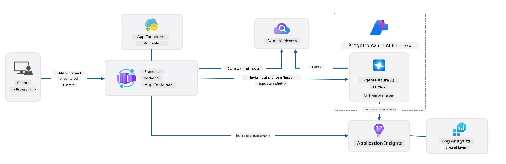
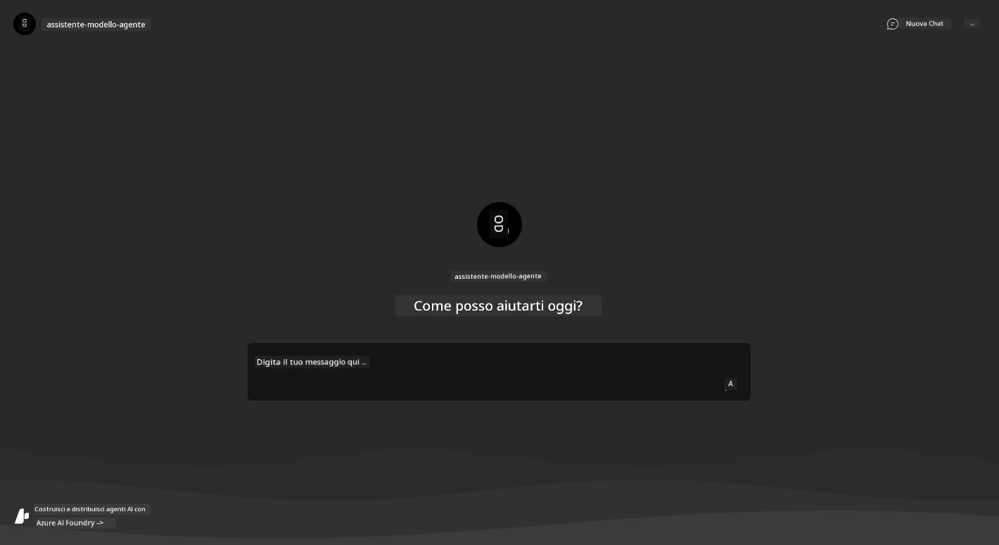

# 2. Convalidare un Template

> Guida sorgente rivista in base ad AZD 1.37.2 e all'esempio corrente il 4 novembre 2026. Gli screenshot sono illustrativi; la navigazione nel portale, i valori predefiniti del template e la disponibilità del servizio possono cambiare. Questa revisione non ha eseguito una distribuzione Azure live.

!!! tip "ALLA FINE DI QUESTO MODULO SARAI IN GRADO DI"

    - [ ] Identify the sample's prerequisites and intended resources
    - [ ] Deploy the selected template into an intentional environment
    - [ ] Verify the application and agent behavior separately from deployment success
    - [ ] **Lab 2:** Record evidence of a working baseline, or an actionable deployment blocker

---

## 1. Verificare i prerequisiti

Il [Azure Developer CLI](https://learn.microsoft.com/azure/developer/azure-developer-cli/) gestisce la distribuzione dell'applicazione usando la configurazione, l'infrastruttura e il codice del template. Verifica la versione installata:

```bash
azd version
```

Usa le [istruzioni correnti per installazione/aggiornamento](https://learn.microsoft.com/azure/developer/azure-developer-cli/install-azd) se necessario. L’esempio revisionato dichiara AZD `>=1.14.0`, ma si consiglia una release supportata attuale. Le estensioni AI opzionali hanno requisiti di versione separati; il normale flusso di lavoro `azd up` di questo esempio non richiede l’estensione agents.

Prima di eseguire il provisioning, leggi la [configurazione account Azure](https://github.com/Azure-Samples/get-started-with-ai-agents/blob/main/docs/azure_account_setup.md) e la [guida al deployment](https://github.com/Azure-Samples/get-started-with-ai-agents/blob/main/docs/deployment.md) dell’esempio. Conferma il tuo abbonamento, i permessi, la disponibilità del modello, la quota regionale e i costi previsti. Un account Azure gratuito non garantisce l’accesso né l’utilizzo gratuito di ogni servizio richiesto.

## 2. Aprire l’esempio selezionato

Usa il repository [Get Started with AI Agents](https://github.com/Azure-Samples/get-started-with-ai-agents) inizializzato nel Modulo 1. Se non lo hai inizializzato, scegli una di queste alternative:

- Apri un [Codespace per l’esempio](https://github.com/codespaces/new/Azure-Samples/get-started-with-ai-agents).
- Clona l’esempio e segui la sua configurazione locale/dev-container.
- In una **directory vuota**, esegui:

```bash
azd init --template Azure-Samples/get-started-with-ai-agents .
```

Non inizializzare un secondo template su un progetto esistente. Esegui i comandi successivi dalla radice dell’esempio contenente `azure.yaml`, non dalla radice del repository del corso.

L’esempio ospita un’applicazione chat supportata da un agent in Container Apps e esegue il provisioning delle risorse Foundry di supporto. Rivedi l’architettura attuale e i servizi opzionali anziché considerare uno screenshot datato come inventario risorse esatto.



## 3. Distribuire intenzionalmente

```bash
azd auth login
azd up
```

Rivedi i prompt:

1. Scegli un nome ambiente AZD unico.
2. Seleziona l’abbonamento previsto, non semplicemente il primo offerto.
3. Seleziona una regione supportata dal modello/versione/SKU richiesti e dalla tua quota.
4. Leggi l’output del provisioning, deployment e dei post-deployment hook.

I valori predefiniti revisionati includono `gpt-5-mini`, versione `2025-08-07` e `GlobalStandard`. Controlla il template inizializzato e le [combinazioni modello/regione supportate](https://learn.microsoft.com/azure/ai-services/agents/concepts/model-region-support). Nessuna regione è garantita universalmente.

La durata del deployment varia. Se il provisioning fallisce, conserva l’errore e risolvi la causa prima di riprovare. Non eliminare il deployment o cancellare definitivamente le risorse come passaggio generico di problem solving.

## 4. Convalidare l’applicazione

```bash
azd show
```

Apri l’endpoint per `api_and_frontend`, oppure trova il Container App nel gruppo di risorse del deployment nel [portale Azure](https://portal.azure.com/). Segui le istruzioni di accesso/autenticazione dell’esempio se è richiesto il login; non disabilitare l’autenticazione per superare un test rapido.



Prova alcune [domande di esempio](https://github.com/Azure-Samples/get-started-with-ai-agents/blob/main/docs/sample_questions.md):

- Una domanda generale di fatto.
- Una domanda la cui risposta dovrebbe essere presente nei documenti caricati nell’esempio.
- Una domanda alla quale non è possibile rispondere da tali documenti.

Verifica che l’interfaccia utente si carichi, l’API risponda, il recupero utilizzi i dati previsti, le citazioni corrispondano ai contenuti di origine, e le domande non supportate siano gestite correttamente. Un messaggio `azd up` riuscito da solo non attesta questi risultati.

## 5. Ispezionare l’agente distribuito

Apri il tuo progetto nel [portale Foundry](https://ai.azure.com/). Nel flusso portale revisionato, seleziona **Build**, poi **Agents**, e individua l’agente creato dall’esempio. Le etichette di navigazione possono cambiare.

Annota:

- Il nome e la versione dell’agente.
- La sua distribuzione modello configurata.
- Le istruzioni effettive e gli strumenti abilitati.
- Quali file o indice di ricerca sono collegati e se la configurazione è completata correttamente.

L’esempio revisionato usa un identificatore agente in forma `agent_name:agent_version` per i suoi test di valutazione. Non copiare un identificatore classic agent/thread da uno screenshot vecchio in un flusso API più recente.

Confronta i documenti caricati con `src/files/` nella tua revisione inizializzata. Screenshot precedenti mostravano 32 file; tale conteggio non è un default garantito attuale. Verifica ogni risposta a proposito di clienti/prodotti d’esempio contro i dati sintetici di origine reali, e non caricare dati clienti reali per questa esercitazione.

## 6. Confrontare con il playground

Apri il playground dell’agente selezionato in Foundry e poni la stessa domanda di recupero. Confronta la versione agente configurata, gli strumenti, le citazioni e la qualità della risposta con l’applicazione distribuita.

Le risposte sono probabilistiche; non è criterio una corrispondenza parola per parola. Se i risultati differiscono sostanzialmente, verifica che l’app e il playground puntino allo stesso progetto, agente/versione e fonte di conoscenza.

## 7. Verificare i prerequisiti di osservabilità

La [guida all’osservabilità](https://github.com/Azure-Samples/get-started-with-ai-agents/blob/main/docs/observability.md) dell’esempio è la fonte di verità per tracing, valutazione e configurazione red-teaming.

Nelle impostazioni di infrastruttura revisionate, Application Insights è abilitato ma **il tracing client è disabilitato** (`ENABLE_AZURE_MONITOR_TRACING=false`). Creare una risorsa di monitoraggio non prova che l’applicazione esporti tracce. Il Modulo 5 tratta l’abilitazione del tracing e la generazione di una richiesta di test.

Usa i log applicazione del Container App per indagare errori di avvio/API. In Foundry, ispeziona le viste di tracing e monitoraggio disponibili per l’agente. Le voci di valutazione richiedono la configurazione relativa, valutatori/regione supportati e richieste reali; non sono garantite automaticamente per ogni esecuzione.

Lascia disabilitata la cattura del contenuto prompt/response a meno che i suoi requisiti di privacy, conservazione, accesso e redazione non siano stati revisionati.

## 8. Comprendere i valori dell’ambiente

AZD memorizza l’ambiente selezionato in `.azure/<environment-name>/`. Gli input persistenti e gli output del deployment possono essere letti con:

```bash
azd env list
azd env get-value AZURE_ENV_NAME
azd env get-value AZURE_LOCATION
```

`azd env get-values` elenca tutti i valori, che possono includere configurazioni sensibili. Non incollare questo output in issue pubblici o log.

AZD usa l’ambiente selezionato durante l’esecuzione di comandi/hook, mentre le variabili dell’ambiente processo possono influenzare comandi e template. Questo **non** esporta valori nella shell genitore o in ogni processo Python avviato indipendentemente. Segui le [istruzioni per lo sviluppo locale](https://github.com/Azure-Samples/get-started-with-ai-agents/blob/main/docs/local_development.md) dell’esempio.

I valori predefiniti del template possono essere applicati in `infra/main.parameters.json` senza apparire come valori locali espliciti. Impostare una variabile arbitraria non modifica l’infrastruttura a meno che il template non la consumi.

Per esempio, per selezionare esplicitamente i valori predefiniti modello revisionati:

```bash
azd env set AZURE_AI_AGENT_MODEL_NAME gpt-5-mini
azd env set AZURE_AI_AGENT_MODEL_VERSION 2025-08-07
azd env set AZURE_AI_AGENT_DEPLOYMENT_SKU GlobalStandard
azd provision --preview
azd up
```

Verifica prima compatibilità, capacità, disponibilità e cambiamenti pianificati. Gli aggiornamenti infrastrutturali richiedono provisioning; `azd deploy` da solo non basta. I cambiamenti di modello supportati normalmente non richiedono lo smantellamento dell’intera applicazione.

`azd env refresh` recupera gli output del deployment per un ambiente accessibile; non ricostruisce tutti gli input personalizzati, sincronizza segreti o sostituisce la gestione della configurazione.

## 9. Registrare la baseline

- [ ] Ambiente, abbonamento, regione e modello corretti verificati.
- [ ] Provisioning, deployment e hook di setup richiesti completati senza errori irrisolti.
- [ ] Accesso all’applicazione, chat, recupero e citazioni controllati.
- [ ] Agente/versione e fonte di conoscenza identificati.
- [ ] Prerequisiti di osservabilità e eventuali blocchi residui documentati.

Continua con [Smontare un Template](3-Deconstruct-AI-Template.md).

---

<!-- CO-OP TRANSLATOR DISCLAIMER START -->
**Disclaimer**:
Questo documento è stato tradotto utilizzando il servizio di traduzione AI [Co-op Translator](https://github.com/Azure/co-op-translator). Sebbene ci impegniamo per garantire la precisione, si prega di notare che le traduzioni automatizzate possono contenere errori o imprecisioni. Il documento originale nella sua lingua nativa deve essere considerato la fonte autorevole. Per informazioni critiche, si raccomanda una traduzione professionale effettuata da un essere umano. Non siamo responsabili per eventuali malintesi o interpretazioni errate derivanti dall’uso di questa traduzione.
<!-- CO-OP TRANSLATOR DISCLAIMER END -->