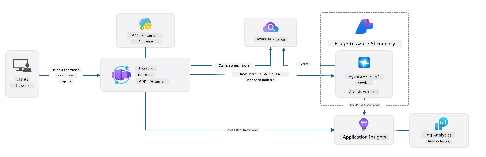

# 3. Decomporre un Template

!!! tip "AL TERMINE DI QUESTO MODULO SARAI IN GRADO DI"

    - [ ] Use GitHub Copilot and optional MCP tools for Azure documentation and read-only exploration
    - [ ] Identify the template's application, infrastructure, configuration, and test entry points
    - [ ] Verify generated explanations against actual repository files
    - [ ] **Lab 3:** Trace one request and one configuration input through the project

---

## 1. Attivare GitHub Copilot

Apri il campione AI inizializzato in VS Code e abilita [GitHub Copilot](https://code.visualstudio.com/docs/copilot/chat/chat-agent-mode). Accedi con un account che dispone di un piano idoneo; i limiti di utilizzo variano. Chiedi a Copilot di spiegare il repository prima di autorizzare modifiche.

### Server MCP opzionali

Questi servizi possono fornire strumenti aggiuntivi:

- [Server MCP di Azure](https://learn.microsoft.com/azure/developer/azure-mcp-server/overview)
- [Server MCP di Microsoft Learn](https://learn.microsoft.com/training/support/mcp)

In VS Code, consulta la [guida alla configurazione MCP](https://code.visualstudio.com/docs/copilot/chat/mcp-servers) e crea `.vscode/mcp.json` se necessario:

```json
{
  "servers": {
    "Azure MCP Server": {
      "type": "stdio",
      "command": "npx",
      "args": ["-y", "@azure/mcp@latest", "server", "start"]
    },
    "microsoft.docs.mcp": {
      "type": "http",
      "url": "https://learn.microsoft.com/api/mcp"
    }
  }
}
```

Il comando `npx` richiede un’installazione supportata di Node.js/npm e scarica codice eseguibile. Rivedi il pacchetto e blocca una versione approvata per una configurazione di squadra riproducibile. Avvia i server usando i controlli MCP di VS Code e ispeziona gli strumenti disponibili; i nomi possono cambiare tra le versioni.

**L'autenticazione è separata.** Usa `azd auth login` per AZD. Segui il flusso di autenticazione documentato di Azure MCP per i suoi strumenti; il solo login AZD non stabilisce una sessione MCP. Usa `az login` separatamente quando un esercizio o un hook invoca Azure CLI.

Prova prompt in sola lettura:

1. “Usa Microsoft Learn MCP per trovare la documentazione di configurazione di Azure Developer CLI.”
2. “Spiega l’`azure.yaml` di questo repository; cita i file che implementano ogni hook.”
3. “Usando gli strumenti Azure MCP disponibili, elenca le mie risorse distribuite senza modificare nulla.”

Controlla il tenant/sottoscrizione selezionati e ogni chiamata strumento proposta. Non approvare la creazione, eliminazione o modifiche di accesso alle risorse solo per esplorare l’architettura.

## 2. Comprendere l’architettura

Il campione ospita un backend Python FastAPI e un frontend React/TypeScript in Azure Container Apps. Il backend comunica con un agente in un progetto Microsoft Foundry. Il recupero e l’osservabilità dipendono dalle funzionalità abilitate nel template e dalla configurazione riuscita; non sono garantiti solo perché l’applicazione è stata distribuita.



Confronta questo diagramma con la [guida di distribuzione upstream attuale](https://github.com/Azure-Samples/get-started-with-ai-agents/blob/main/docs/deployment.md) e le tue risorse effettive. Controlla la distribuzione modello configurata, gli strumenti agente, l’identità gestita, le assegnazioni di ruolo e le risorse opzionali AI Search/Application Insights.

**Esercizio:** Chiedi a Copilot di tracciare una richiesta chat dal frontend attraverso l’API fino a Foundry, con riferimenti a file e funzioni. Apri quei riferimenti e verifica la spiegazione. Non dedurre autenticazione, routing o autorizzazione implementati solo da un diagramma.

## 3. Struttura del repository

I seguenti percorsi selezionati sono stati controllati rispetto al campione il 4 novembre 2026. La tua revisione inizializzata resta la fonte di verità:

```text
get-started-with-ai-agents/
  azure.yaml
  docker-compose.yaml
  requirements-dev.txt
  .devcontainer/
  infra/
    main.bicep
    main.parameters.json
    api.bicep
    core/
  src/
    Dockerfile
    pyproject.toml
    requirements.txt
    api/
      main.py
      routes.py
      search_index_manager.py
    frontend/
      package.json
      src/
    files/
  scripts/
    validate_env_vars.sh
    validate_env_vars.ps1
    postdeploy.sh
    postdeploy.ps1
  tests/
    test_evaluation.py
    test_red_teaming.py
  docs/
    deployment.md
    deploy_customization.md
    ai_search.md
    observability.md
    local_development.md
    troubleshooting.md
```

### Infrastruttura e configurazione

`infra/main.bicep` orchestra le risorse; `main.parameters.json` collega gli input del template ai valori ambiente AZD. `azure.yaml` seleziona il servizio applicazione e i lifecycle hooks. Traccia un input come `USE_AZURE_AI_SEARCH_SERVICE` attraverso questi file per trovare cosa cambia realmente.

### Applicazione e identità

Leggi `src/api/` e `src/frontend/` insieme. Identifica dove l’agente viene creato o recuperato, dove istruzioni/strumenti sono configurati e quale identità utilizza ogni chiamata Azure. I file campione sotto `src/files/` sono dati di dimostrazione, non un catalogo di produzione o modello di autorizzazione.

### Test e osservabilità

I punti di ingresso per valutazione e red team attuali sono sotto `tests/`; riferimenti a directory più vecchie `evals/` e `airedteaming/` sono obsoleti per questo campione. Leggi `docs/observability.md` per prerequisiti e costi prima di eseguire test cloud. Questi test Python sono separati dall’estensione opzionale AZD `azure.ai.evaluations`.

## 4. Verifica le tue scoperte

- Identifica la route API, l’interazione agente e il codice di recupero per una domanda campione.
- Spiega quale identità accede a Foundry e quale configurazione seleziona il suo endpoint.
- Trova gli script reali pre-up e post-deploy e il loro comportamento in caso di errori.
- Elenca qualsiasi dipendenza o funzionalità opzionale assente dalla tua distribuzione.

Continua a [Configurare un Template](4-Configure-AI-Template.md).

---

<!-- CO-OP TRANSLATOR DISCLAIMER START -->
**Disclaimer**:
Questo documento è stato tradotto utilizzando il servizio di traduzione AI [Co-op Translator](https://github.com/Azure/co-op-translator). Sebbene ci impegniamo per garantire la precisione, si prega di notare che le traduzioni automatizzate possono contenere errori o imprecisioni. Il documento originale nella sua lingua nativa deve essere considerato la fonte autorevole. Per informazioni critiche, si raccomanda una traduzione professionale effettuata da un essere umano. Non siamo responsabili per eventuali malintesi o interpretazioni errate derivanti dall’uso di questa traduzione.
<!-- CO-OP TRANSLATOR DISCLAIMER END -->