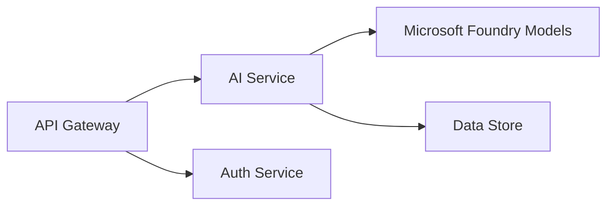

# 第8章: 本番環境＆エンタープライズパターン

**📚 コース**: [AZD For Beginners](../../README.md) | **⏱️ 所要時間**: 2-3時間 | **⭐ 難易度**: 上級

---

## 概要

本章では、エンタープライズ対応のデプロイパターン、セキュリティ強化、監視、及び本番AIワークロードのコスト最適化について説明します。

これはアーキテクチャのリファレンスであり、完全なデプロイ可能な本番テンプレートではありません。例ではご自身のアプリケーションに組み込みテストが必要な統合の詳細を省略しており、チェックリストを読むだけでは本番対応が保証されません。

> **リリースレビュー (2026-11-04):** AI CLI ガイダンスは`azd 1.37.2`、エージェント`1.0.0-beta.23`、評価`1.0.0-beta.2`のドキュメント/ソースと照合しました。互換性要件や移行の詳細は [リリース変更と修正](production-ai-practices.md#recent-release-changes-and-fixes) を参照してください。本検証はライブデプロイ検証ではありません。

## 学習目標

本章を修了することで以下ができるようになります:
- マルチリージョン耐障害アプリケーションのデプロイ
- エンタープライズセキュリティパターンの実装
- 包括的な監視の設定
- 大規模なコスト最適化
- AZDを使ったCI/CDパイプラインの構築

---

## 📚 レッスン

| # | レッスン | 説明 | 時間 |
|---|--------|-------------|------|
| 1 | [本番AI実践](production-ai-practices.md) | エンタープライズデプロイパターン | 90分 |

---

## 🚀 本番チェックリスト

- [ ] 耐障害性のためのマルチリージョンデプロイ
- [ ] 鍵不要の認証用マネージドID
- [ ] 監視用Application Insights設定
- [ ] コスト予算とアラートの設定
- [ ] セキュリティスキャン有効化
- [ ] CI/CDパイプライン統合
- [ ] 災害復旧計画

---

## 🏗️ アーキテクチャパターン

### パターン1: マイクロサービスAI



### パターン2: イベント駆動型AI


---

## 🔐 セキュリティのベストプラクティス

```bicep
// Illustrative properties from different resources, NOT a standalone Bicep file.
// Attach identity to the application host:
identity: {
  type: 'SystemAssigned'
}

// AI account properties (also require private endpoints, DNS and app connectivity):
properties: {
  publicNetworkAccess: 'Disabled'
  networkAcls: {
    defaultAction: 'Deny'
  }
}
```

---

## 💰 コスト最適化

| 戦略 | 主な制約 |
|----------|---------|
| ゼロスケール（Container Apps） | 適切なトリガーが必要；他のサービスはコストが発生し続ける |
| 開発環境で消費層を利用 | 選択したサービスの価格と作業負荷を比較 |
| スケジュールによるスケーリング | サポートされるインフラや自動化によるスケール |
| 予約/プロビジョニング容量 | サポートされる場合のみ；コミットメントはアイドルコスト増加の可能性あり |

有効な開始日、課金スコープ、受信者、権限を伴う[完全な予算リソースパターン](production-ai-practices.md#2-cost-monitoring-and-budgets)を使用してください。予算はアラートを送信しますが、支出を制限しません。節約は測定された利用率に依存し、保証された割合ではありません。

---

## 📊 監視設定

```bash
# Open the Application Insights logs view (requires configured monitoring)
azd monitor --logs

# Check Application Insights
azd monitor --overview

# View metrics
az monitor metrics list --resource <resource-id>
```

---

## 🔗 ナビゲーション

| 方向 | チャプター |
|-----------|---------|
| <strong>前へ</strong> | [Chapter 7: Troubleshooting](../chapter-07-troubleshooting/README.md) |
| <strong>コース完了</strong> | [Course Home](../../README.md) |

---

## 📖 関連リソース

- [AI Agents Guide](../chapter-02-ai-development/agents.md)
- [Application Insights](../chapter-06-pre-deployment/application-insights.md)
- [Multi-Agent Solutions](../chapter-05-multi-agent/README.md)
- [Microservices Example](../../examples/microservices/README.md)

---

<!-- CO-OP TRANSLATOR DISCLAIMER START -->
**免責事項**：
本書類は AI 翻訳サービス [Co-op Translator](https://github.com/Azure/co-op-translator) を使用して翻訳されています。正確性を期していますが、自動翻訳には誤りや不正確な部分が含まれる可能性があることをご承知おきください。原文の原語版が正式な情報源とみなされるべきです。重要な情報については、専門の人間による翻訳を推奨します。本翻訳の利用により生じたいかなる誤解や解釈違いについても、当方は責任を負いかねます。
<!-- CO-OP TRANSLATOR DISCLAIMER END -->