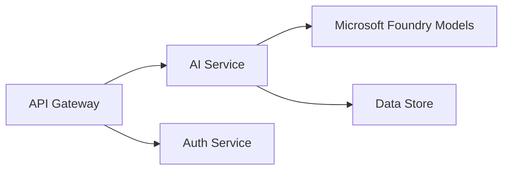
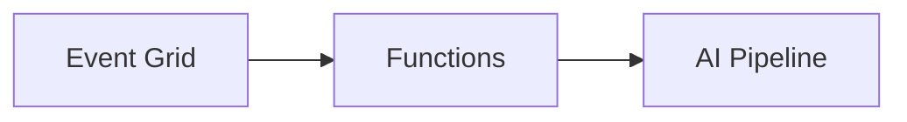

# 第8章：プロダクション＆エンタープライズパターン

**📚 コース**: [AZD For Beginners](../../README.md) | **⏱️ 所要時間**: 2-3時間 | **⭐ 難易度**: 上級

---

## 概要

本章では、エンタープライズ対応のデプロイメントパターン、セキュリティ強化、監視、プロダクションAIワークロードのコスト最適化について説明します。

これはアーキテクチャの参照であり、完全なデプロイ可能なプロダクションテンプレートではありません。例は統合の詳細を省略しており、それらはご自身のアプリケーションで提供しテストする必要があります。チェックリストを読むだけでプロダクション対応認定になるわけではありません。

> **Foundry GAアップデート (2026-11-09):** Foundryワークフローには`azd >= 1.37.0` とGAの `microsoft.foundry` 1.0バンドルを使用してください。評価版は別途インストールされます。[リリース範囲と移行](production-ai-practices.md#recent-release-changes-and-fixes)および[認証済みパイプラインの例](production-ai-practices.md#cicd-pipeline-configuration)を参照してください。これは文書のレビューであり、ライブデプロイの検証や任意のプレビュー機能の全体GAステータスではありません。

## 学習目標

本章を修了すると、以下ができるようになります：
- 複数リージョンにまたがる耐障害性の高いアプリケーションのデプロイ
- エンタープライズのセキュリティパターンの実装
- 包括的な監視の構成
- 大規模なコスト最適化
- AZDを用いたCI/CDパイプラインの設定

---

## 📚 レッスン

| # | レッスン | 説明 | 時間 |
|---|--------|-------------|------|
| 1 | [Production AI Practices](production-ai-practices.md) | エンタープライズ向けデプロイメントパターン | 90分 |

---

## 🚀 プロダクションチェックリスト

- [ ] 耐障害性のためのマルチリージョンデプロイ
- [ ] マネージドIDによる認証（キー不要）
- [ ] 監視のためのApplication Insights
- [ ] コスト予算とアラートの設定
- [ ] セキュリティスキャンの有効化
- [ ] CI/CDパイプラインとの統合
- [ ] 災害復旧計画

---

## 🏗️ アーキテクチャパターン

### パターン1: マイクロサービスAI



### パターン2: イベントドリブンAI



---

## 🔐 セキュリティベストプラクティス

```bicep
// Illustrative properties from different resources, NOT a standalone Bicep file.
// Attach identity to the application host:
identity: {
  type: 'SystemAssigned'
}

// AI account properties (also require private endpoints, DNS and app connectivity):
properties: {
  publicNetworkAccess: 'Disabled'
  networkAcls: {
    defaultAction: 'Deny'
  }
}
```

---

## 💰 コスト最適化

| 戦略 | 主な制約 |
|----------|---------|
| ゼロスケール (Container Apps) | 適したトリガーが必要。その他のサービスはコストが発生する |
| 開発向けに消費課金層を利用 | 選択したサービスの価格とワークロードを比較 |
| スケジュールスケーリング | 対応インフラ/自動化を使ってスケール |
| 予約/プロビジョニング容量 | 対応している場合のみ。コミットメントはアイドルコスト増加の可能性あり |

有効な開始日、課金スコープ、受信者、権限を持つ[完全な予算リソースパターン](production-ai-practices.md#2-cost-monitoring-and-budgets)を使用してください。予算はアラートを送信しますが支出上限を設定するものではありません。節約は測定された利用率に依存し、保証された割合ではありません。

---

## 📊 監視の設定

```bash
# Open the Application Insights logs view (requires configured monitoring)
azd monitor --logs

# Check Application Insights
azd monitor --overview

# View metrics
az monitor metrics list --resource <resource-id>
```

---

## 🔗 ナビゲーション

| 方向 | 章 |
|-----------|---------|
| <strong>前へ</strong> | [第7章：トラブルシューティング](../chapter-07-troubleshooting/README.md) |
| <strong>コース完了</strong> | [コースホーム](../../README.md) |

---

## 📖 関連資料

- [AI Agents Guide](../chapter-02-ai-development/agents.md)
- [Application Insights](../chapter-06-pre-deployment/application-insights.md)
- [Multi-Agent Solutions](../chapter-05-multi-agent/README.md)
- [Microservices Example](../../examples/microservices/README.md)

---

<!-- CO-OP TRANSLATOR DISCLAIMER START -->
**免責事項**：
本書類は AI 翻訳サービス [Co-op Translator](https://github.com/Azure/co-op-translator) を使用して翻訳されています。正確性を期していますが、自動翻訳には誤りや不正確な部分が含まれる可能性があることをご承知おきください。原文の原語版が正式な情報源とみなされるべきです。重要な情報については、専門の人間による翻訳を推奨します。本翻訳の利用により生じたいかなる誤解や解釈違いについても、当方は責任を負いかねます。
<!-- CO-OP TRANSLATOR DISCLAIMER END -->