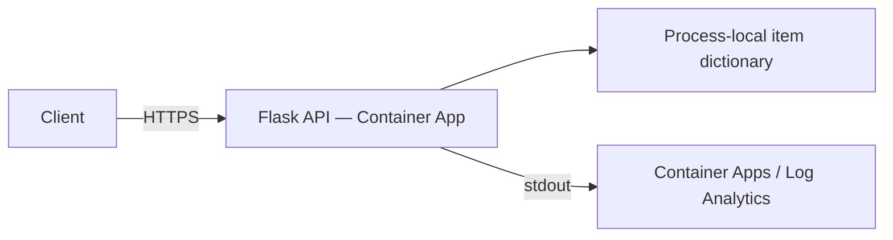

# シンプルな Flask API — Azure Container Apps

**レベル:** 初心者向け · **所要時間:** セットアップ込みで30〜45分

Azure Developer CLI (azd) を使って Python Flask の CRUD API をデプロイします。ソース、Dockerfile、
Bicep、デプロイパラメーターが含まれています。これは<strong>学習用サンプル</strong>であり、
本番対応の API ではありません。

## 学習内容

- azd を使ってコンテナのビルドと公開を行う。
- Ingress と liveness/readiness プローブを設定する。
- CRUD のレスポンスを検証し、アプリケーションログを調査する。
- メモリ上のデータが永続的なアプリケーションに向かない理由を理解する。



**重要:** アイテムは1つのプロセス内で保持されます。デフォルトは**1つの Gunicorn ワーカー、
0〜1 レプリカ**であり、ワーカーやレプリカ間で不整合なデータが生じることを意図的に避けています。
アイテムは再起動、リビジョン変更、スケール・トゥ・ゼロ時に失われます。レプリカを増やすには
共有の永続ストレージが必要です。この API には認証や認可はありません。

## 前提条件

- [Current stable azd](https://learn.microsoft.com/azure/developer/azure-developer-cli/install-azd)
  (レビュー時点の公開リリース: 1.37.2)。
- 検証用の [Azure CLI](https://learn.microsoft.com/cli/azure/install-azure-cli)。
- デフォルトのローカルイメージビルドに必要な、デーモンが稼働している Docker。
- Azure サブスクリプション、リソース作成権限、およびコンテナ アプリのリージョンクォータ。
- 以下のコマンド用の Bash（または同等の PowerShell）。
- オプションのローカル開発用の Python 3.11。

```bash
azd version
az version
docker info
azd auth login
az login
```

CLI ツールは別々のログイン セッションを持ちます。両方で同じサブスクリプションを使用してください。

## クイックスタート

リポジトリのルートから:

```bash
cd examples/container-app/simple-flask-api
azd env new flask-demo
azd up
API_URL=$(azd env get-value API_ENDPOINT)
RG_NAME=$(azd env get-value AZURE_RESOURCE_GROUP)
API_NAME=$(azd env get-value API_NAME)
curl --fail-with-body "${API_URL}/health"
```

期待される結果: HTTP 200 と `"status":"healthy"`、 
`"service":"simple-flask-api"`、および現在の UTC タイムスタンプを含む JSON。
プロビジョニングとイメージビルドには通常数分かかります。所要時間は異なります。

初期プロビジョニングはポート 80 で待ち受けるパブリックな hello-world イメージを使用します。
`azure.yaml` はサービスデプロイ用に `infra/app/api.bicep` とそれに対応するパラメータファイルを選択し、
イメージ、イングレス、およびプローブをポート 8000 に切り替えます。
それらのデプロイメントパラメータを削除しないでください。

## CRUD の検証

同じレプリカがアクティブな間に、以下を順に実行してください:

```bash
# Create: HTTP 201; note the returned id (1 for a fresh process).
curl -i -X POST "${API_URL}/api/items" \
  -H "Content-Type: application/json" \
  -d '{"name":"Test Item","description":"My first item"}'

# Read list: HTTP 200, total 1 in a fresh process.
curl --fail-with-body "${API_URL}/api/items"

# Replace 1 if your create response returned another id.
curl --fail-with-body "${API_URL}/api/items/1"
curl -i -X PUT "${API_URL}/api/items/1" \
  -H "Content-Type: application/json" -d '{"name":"Updated Item"}'
curl -i -X DELETE "${API_URL}/api/items/1"
curl -i "${API_URL}/api/items/1"
```

成功: POST は 201、読み取り/PUT は 200、DELETE は本文なしで 204、その後アイテムが見つからず 404。
不正な形式の JSON や非オブジェクト、または空の名前は 400 を返します。
リクエスト間でアイテムが消えた場合は、再起動またはスケール・トゥ・ゼロを確認してください;
これは意図的なメモリ内制限によるもので、永続化されていません。

| エンドポイント | メソッド |
|---|---|
| `/` | GET — サービス情報 |
| `/health` | GET — ライブネス/レディネス |
| `/api/items` | GET, POST |
| `/api/items/{id}` | GET, PUT, DELETE |

## ログと構成

```bash
az containerapp logs show --name "$API_NAME" --resource-group "$RG_NAME" --follow
```

期待されるもの: Gunicornの起動、リクエストアクセスログ、アプリケーションメッセージ。
`azd monitor --logs` はポータルビューを開きます。端末へのストリーム出力は行いません。
Application Insightsはプロビジョニングされていますが、**このFlaskコードによる計測は行われていません**；
stdoutログはContainer Apps/Log Analyticsを利用してください。

CPU/メモリ、レプリカの制限、スケールルールを設定するには`infra/app/api.bicep`を編集し、その後
`azd up` を実行します。デフォルトは0.5 vCPU、1 GiB、最小0/最大1レプリカ、HTTPしきい値は同時リクエスト50です。スケールトゥゼロはコールドスタートのレイテンシを追加する可能性があります。


任意の `azd env set MAX_REPLICAS`、`API_KEY`、`LOG_LEVEL`、または
`SCALE_TO_ZERO_TIMEOUT` の値は<strong>このテンプレートやアプリにはワイヤリングされていません</strong>。
値を設定しても自動的にランタイム環境変数になるわけではありません。
イメージはポート8000に明示的にバインドしています。ポートを変更する場合は、Dockerfile、Bicepのイングレス、およびプローブを一緒に更新してください。


## ファイル

```text
azure.yaml
infra/main.bicep
infra/main.parameters.json
infra/app/container-apps.bicep       # Environment, registry, monitoring
infra/app/api.bicep                  # App, ingress, probes, scale settings
infra/app/api.parameters.json        # Image and resource values for azd deploy
src/app.py
src/Dockerfile
src/requirements.txt
```

## ローカル開発

この例のディレクトリから:

```bash
python -m venv .venv
source .venv/bin/activate  # PowerShell: .\.venv\Scripts\Activate.ps1
python -m pip install -r src/requirements.txt
python src/app.py
```

他のターミナルで `http://localhost:8000/health` とCRUDエンドポイントをテストします。
または実際のイメージをビルドして実行します:

```bash
docker build -t flask-api:local ./src
docker run --rm -p 8000:8000 flask-api:local
```

初回デプロイ後のコードのみの変更には `azd deploy api` を実行します。
Bicepの変更には `azd up` を実行して再プロビジョニングおよびデプロイします。

## 実践演習

### 1. 入力拒否の検証

**開始点:** 上記の `API_URL` にデプロイされたAPI。
**目標:** APIが無効なJSON構造や名前の欠如を拒否することを検証する。

```bash
curl -i -X POST "${API_URL}/api/items" \
  -H "Content-Type: application/json" -d '[]'
curl -i -X POST "${API_URL}/api/items" \
  -H "Content-Type: application/json" -d '{"name":""}'
```

**成功基準/解決法:** どちらも500ではなく400とJSONのエラーを返すこと。
**よくある問題:** JSONコンテントタイプヘッダーを省略すること。

### 2. 読み取り専用バージョンエンドポイントを追加

**開始点:** `src/app.py`。**目標:** APIを拡張して再デプロイ。
`if __name__ == '__main__':` ブロックの前にこれを追加してください：

```python
@app.route('/version', methods=['GET'])
def version():
    return jsonify({'version': '1.0.0'})
```

`azd deploy api` を実行し、その後 `curl --fail-with-body "${API_URL}/version"` を実行します。
**成功基準：** HTTP 200 と `{"version":"1.0.0"}`。
**よくある問題:** ブロッキングな `app.run()` 呼び出しの後にルートを置くこと。 
`python src/app.py` を使ったテストです。

### 知識チェックポイント

なぜ1つのワーカーでは耐久性のあるデータに不十分なのか？それは、たとえ1つのプロセスでも再起動時に
辞書を失うからです。製品版では永続的な共有ストレージ、
認証、認可、マイグレーション、テスト、および運用監視が必要です。

## コストとトラブルシューティング

これは保証されたゼロ円のデプロイメントではありません：Basic レジストリとログのストレージ/取り込みは
アプリのコンピュートがゼロでも料金が発生する場合があります。ご利用の地域の
[pricing calculator](https://azure.microsoft.com/pricing/calculator/) をご利用ください。

- **Docker ビルド失敗：** `docker info`、ネットワークアクセス、依存関係を確認してください。
- **正常でないアプリ：** コンソール/システムログを確認し、イメージポート、イングレス、
  およびプローブが一致していることを確認してください。プレースホルダーは Flask ポートでプローブされてはなりません。
- **403/権限：** サブスクリプションおよびリソース作成の権限を確認してください。
- **アイテムが消える：** メモリ内の状態は再起動やスケールゼロでリセットされます。永続的な動作にはデータベースを追加してください。
  を追加してください。

## クリーンアップと次のステップ

```bash
azd down
```

削除プロンプトを確認し、専用のリソースグループが削除されたことを確認してください。
関連しないデータを含むリソースグループに対して破壊的なクリーンアップは行わないでください。

[次へ: データベース アプリ](../../../../../examples/database-app) · [マイクロサービス](../../../../../examples/container-app/microservices) ·
[コンテナーの概要](../README.md) · [コースホーム](../../../README.md) ·
[問題を報告する](https://github.com/microsoft/AZD-for-beginners/issues)

---

<!-- CO-OP TRANSLATOR DISCLAIMER START -->
**免責事項**：
本書類は AI 翻訳サービス [Co-op Translator](https://github.com/Azure/co-op-translator) を使用して翻訳されています。正確性を期していますが、自動翻訳には誤りや不正確な部分が含まれる可能性があることをご承知おきください。原文の原語版が正式な情報源とみなされるべきです。重要な情報については、専門の人間による翻訳を推奨します。本翻訳の利用により生じたいかなる誤解や解釈違いについても、当方は責任を負いかねます。
<!-- CO-OP TRANSLATOR DISCLAIMER END -->