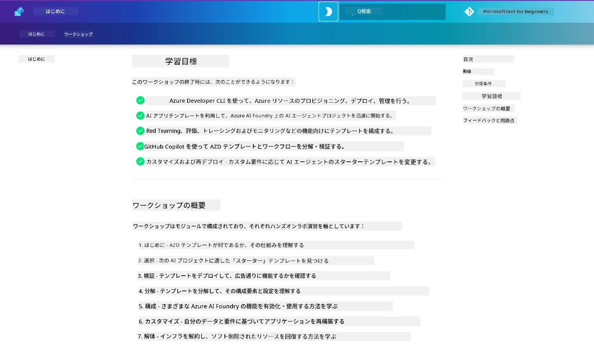

<div align="center">
  <div style="background: linear-gradient(135deg, #0078d4, #106ebe); border-radius: 10px; padding: 20px; margin: 20px 0; box-shadow: 0 4px 15px rgba(0, 120, 212, 0.3); border: 2px solid #005a9e;">
    <h2 style="color: white; margin: 0; font-size: 24px; text-shadow: 1px 1px 2px rgba(0,0,0,0.3);">
      🎯 AI開発者向けAZDワークショップ
    </h2>
    <p style="color: white; margin: 10px 0 0 0; font-size: 16px; text-shadow: 1px 1px 2px rgba(0,0,0,0.3);">
      <strong>Azure Developer CLIを使ったAIアプリケーション構築の実践的なワークショップです。</strong><br>
      7つのモジュールを完了してAZDテンプレートとAI展開のワークフローをマスターしましょう。
    </p>
    <div style="margin-top: 15px;">
      <span style="background: rgba(255,255,255,0.2); padding: 5px 10px; border-radius: 15px; color: white; font-size: 14px;">
        📅 ソースガイダンス確認日: 2026年11月
      </span>
    </div>
  </div>
</div>

# AI開発者向けAZDワークショップ

AIアプリケーション展開に焦点を当ててAzure Developer CLI (AZD) を学ぶハンズオンワークショップへようこそ。このワークショップでは3つのステップでAZDテンプレートの実践的理解を深めます：

1. <strong>発見</strong> - 自分に合ったテンプレートを見つける
1. <strong>展開</strong> - 展開し、動作確認を行う
1. <strong>カスタマイズ</strong> - 修正と繰り返しで自分のものにする！

ワークショップの中で、コアの開発ツールやワークフローも紹介し、エンドツーエンドの開発プロセスを効率化できるようにします。

<br/>

## ブラウザベースガイド

ワークショップのレッスンはMarkdown形式です。GitHubで直接ナビゲーションできるほか、下のスクリーンショットのようにブラウザベースのプレビューを起動できます。



このオプションを使うには、リポジトリを自分のプロフィールにフォークし、GitHub Codespacesを起動してください。VS Codeのターミナルが起動したら、次のコマンドを入力します：

このブラウザプレビューはGitHub Codespaces、開発コンテナ、またはPythonとMkDocsがインストールされたローカルクローンで動作します。

```bash title="" linenums="0"
python -m pip install -r requirements-dev.txt
python -m mkdocs serve --config-file workshop/mkdocs.yml
```

コマンドは<strong>コースリポジトリのルート</strong>から実行してください。AIサンプルとは別に初期化されたディレクトリではありません。プレビューはフォアグラウンドのままにしてエラーを確認し、終了はCtrl+Cです。サイトをサーブせずにチェックするには `python -m mkdocs build --strict --config-file workshop/mkdocs.yml` を実行してください。

数秒後にポップアップが表示されます。`Open in browser` オプションを選択してください。ウェブベースガイドが新しいブラウザタブで開きます。このプレビューの利点：

1. <strong>組み込み検索</strong> - キーワードやレッスンを素早く検索可能
1. <strong>コピーアイコン</strong> - コードブロック上にカーソルを置くと表示
1. <strong>テーマ切替</strong> - ダークテーマとライトテーマの切り替え可能
1. <strong>サポート</strong> - フッターのDiscordアイコンから参加可能！

<br/>

## ワークショップ概要

**実施時間:** 3〜4時間  
**レベル:** 初級〜中級  
**前提条件:** Azure、AIの基本理解、VS Codeとコマンドラインツールの利用経験。

本ワークショップは「手を動かして学ぶ」形式です。演習完了後は、AZD For Beginnersカリキュラムを見直し、セキュリティおよび生産性のベストプラクティス学習の継続を推奨します。

| 時間| モジュール  | 目的 |
|:---|:---|:---|
| 15分 | [イントロダクション](docs/instructions/0-Introduction.md) | 背景説明と目標理解 |
| 30分 | [AIテンプレート選択](docs/instructions/1-Select-AI-Template.md) | 選択肢を知り開始テンプレートを選定 | 
| 30分 | [AIテンプレート検証](docs/instructions/2-Validate-AI-Template.md) | デフォルトソリューションのAzure展開 |
| 30分 | [AIテンプレート分解](docs/instructions/3-Deconstruct-AI-Template.md) | 構造と構成の確認 |
| 30分 | [AIテンプレート設定](docs/instructions/4-Configure-AI-Template.md) | 利用可能機能の有効化と試用 |
| 30分 | [AIテンプレートカスタマイズ](docs/instructions/5-Customize-AI-Template.md) | ニーズに合わせたテンプレート適用 |
| 30分 | [インフラ解体](docs/instructions/6-Teardown-Infrastructure.md) | リソースの後片付けと開放 |
| 15分 | [まとめ＆次のステップ](docs/instructions/7-Wrap-up.md) | 学習リソース・ワークショップチャレンジ |

<br/>

## 学習内容

AZDテンプレートはMicrosoft Foundry上でのエンドツーエンド開発のための多様な機能やツールを試せる学習用サンドボックスと考えてください。本ワークショップ終了までには、ここで扱うツールや概念への直感的な理解が得られるはずです。

| 概念  | 目的 |
|:---|:---|
| **Azure Developer CLI** | コマンドや開発ワークフローの理解|
| **AZDテンプレート**| プロジェクト構造と構成の理解|
| **Azure AIエージェント**| Microsoft Foundryプロジェクトのプロビジョニング＆展開  |
| **Azure AIサーチ**| エージェントによるコンテキストエンジニアリング有効化 |
| <strong>可観測性</strong>| トレーシング、モニタリング、評価手法の学習 |
| <strong>レッドチーミング</strong>| 対抗テストと対策の探求 |

<br/>

## ワークショップ構成

本ワークショップでは、公式の [Getting Started with AI Agents](https://github.com/Azure-Samples/get-started-with-ai-agents) スターターテンプレートをベースに、テンプレートの発見から、展開、分解、カスタマイズまでの流れを体験します。

### [モジュール 1: AIテンプレート選択](docs/instructions/1-Select-AI-Template.md) (30分)

- AIテンプレートとは？
- AIテンプレートはどこで探せる？
- AIエージェント作成をどう始める？
- <strong>ラボ</strong>: Codespacesまたは開発コンテナでのクイックスタート

### [モジュール 2: AIテンプレート検証](docs/instructions/2-Validate-AI-Template.md) (30分)

- AIテンプレートのアーキテクチャとは？
- AZDの開発ワークフローとは？
- AZD開発支援をどう活用する？
- <strong>ラボ</strong>: AIエージェントテンプレートの展開と検証

### [モジュール 3: AIテンプレート分解](docs/instructions/3-Deconstruct-AI-Template.md) (30分)

- `.azure/`で環境を探る
- `infra/`でリソース構成を探る
- `azure.yaml`でAZD構成を探る
- <strong>ラボ</strong>: 環境変数変更と再展開

### [モジュール 4: AIテンプレート設定](docs/instructions/4-Configure-AI-Template.md) (30分)
- リトリーバル拡張生成を探る
- エージェント評価とレッドチーミングを探る
- トレーシングとモニタリングを探る
- <strong>ラボ</strong>: AIエージェント＋可観測性探索

### [モジュール 5: AIテンプレートカスタマイズ](docs/instructions/5-Customize-AI-Template.md) (30分)
- PRD（製品要求仕様）でシナリオ要件定義
- AZD用環境変数設定
- 追加タスク用のライフサイクルフック実装
- <strong>ラボ</strong>: 独自シナリオに向けたテンプレートカスタマイズ

### [モジュール 6: インフラ解体](docs/instructions/6-Teardown-Infrastructure.md) (30分)
- AZDテンプレートのまとめ
- Azure Developer CLI利用の利点まとめ
- 次のステップ: 別テンプレートも試す！
- <strong>ラボ</strong>: インフラのデプロビジョン＆クリーンアップ

<br/>

## ワークショップチャレンジ

もっと挑戦したいですか？以下はプロジェクトの提案例です。ぜひアイデアも共有してください！

| プロジェクト | 説明 |
|:---|:---|
|1. **複雑なAIテンプレート分解** | 今回紹介したワークフローとツールで別のAIソリューションテンプレートを展開・検証・カスタマイズしてみましょう。_何を学びましたか？_|
|2. <strong>自分のシナリオでカスタマイズ</strong>  | 別のシナリオ向けのPRD（製品要求仕様）を書いてみてください。次に、Agent ModelでGitHub Copilotを使い、テンプレートリポジトリのカスタマイズワークフロー生成を依頼します。_何を学びましたか？提案をどう改善できますか？_|
| | |

## フィードバックは？

1. このリポジトリでIssueを投稿し、タグに`Workshop`を付けてください。
1. Microsoft Foundry Discordに参加して仲間と交流しましょう！


| | | 
|:---|:---|
| **📚 コースホーム**| [AZD For Beginners](../README.md)|
| **📖 ドキュメント** | [AIテンプレートの始め方](https://learn.microsoft.com/en-us/azure/ai-foundry/how-to/develop/ai-template-get-started)|
| **🛠️AIテンプレート** | [Microsoft Foundryテンプレート](https://ai.azure.com/templates) |
|**🚀 次のステップ** | [ワークショップ開始](#workshop-overview) |
| | |

<br/>

---

**ナビゲーション:** [メインコース](../README.md) | [イントロダクション](docs/instructions/0-Introduction.md) | [モジュール 1: テンプレート選択](docs/instructions/1-Select-AI-Template.md)

**AZDでAIアプリ開発を始める準備はできましたか？**

[ワークショップ開始：イントロダクション →](docs/instructions/0-Introduction.md)

---

<!-- CO-OP TRANSLATOR DISCLAIMER START -->
**免責事項**：
本書類は AI 翻訳サービス [Co-op Translator](https://github.com/Azure/co-op-translator) を使用して翻訳されています。正確性を期していますが、自動翻訳には誤りや不正確な部分が含まれる可能性があることをご承知おきください。原文の原語版が正式な情報源とみなされるべきです。重要な情報については、専門の人間による翻訳を推奨します。本翻訳の利用により生じたいかなる誤解や解釈違いについても、当方は責任を負いかねます。
<!-- CO-OP TRANSLATOR DISCLAIMER END -->