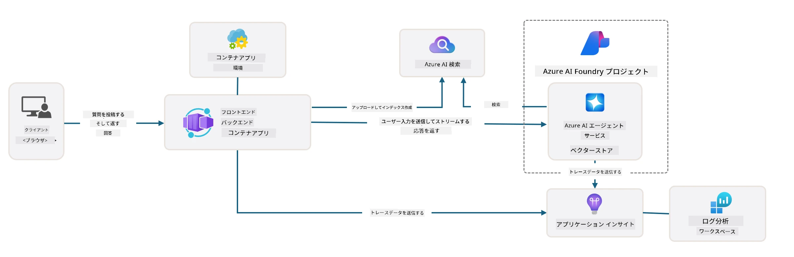

# 3. テンプレートの解析

!!! tip "このモジュールの最後には、あなたは以下ができるようになります"

    - [ ] Use GitHub Copilot and optional MCP tools for Azure documentation and read-only exploration
    - [ ] Identify the template's application, infrastructure, configuration, and test entry points
    - [ ] Verify generated explanations against actual repository files
    - [ ] **Lab 3:** Trace one request and one configuration input through the project

---

## 1. GitHub Copilot を有効化する

VS Code で初期化された AI サンプルを開き、[GitHub Copilot](https://code.visualstudio.com/docs/copilot/chat/chat-agent-mode) を有効にします。対象プランのアカウントでサインインしてください。使用制限はプランによって異なります。変更を承認する前に、Copilot にリポジトリの説明を依頼してください。

### オプションの MCP サーバー

これらのサービスは追加のツールを提供できます：

- [Azure MCP サーバー](https://learn.microsoft.com/azure/developer/azure-mcp-server/overview)
- [Microsoft Learn MCP サーバー](https://learn.microsoft.com/training/support/mcp)

VS Code 内で [MCP 設定ガイダンス](https://code.visualstudio.com/docs/copilot/chat/mcp-servers) を確認し、必要に応じて `.vscode/mcp.json` を作成します：

```json
{
  "servers": {
    "Azure MCP Server": {
      "type": "stdio",
      "command": "npx",
      "args": ["-y", "@azure/mcp@latest", "server", "start"]
    },
    "microsoft.docs.mcp": {
      "type": "http",
      "url": "https://learn.microsoft.com/api/mcp"
    }
  }
}
```

`npx` コマンドはサポートされている Node.js/npm のインストールが必要で、実行可能なコードをダウンロードします。パッケージを確認し、チームで再現可能なセットアップのために承認されたバージョンを固定してください。VS Code の MCP コントロールを使ってサーバーを起動し、利用可能なツールを確認します。ツール名はバージョンによって変更されることがあります。

**認証は別物です。** AZD には `azd auth login` を使用してください。Azure MCP のドキュメントにある認証フローに従ってツールを利用してください。AZD のログインだけでは MCP セッションは確立されません。演習やフックで Azure CLI が呼ばれる場合は、`az login` を別途使用してください。

読み取り専用プロンプトを試してください：

1. 「Microsoft Learn MCP を使って Azure Developer CLI の設定ドキュメントを探してください。」
2. 「このリポジトリの `azure.yaml` を説明してください。フックごとに実装しているファイルを教えてください。」
3. 「利用可能な Azure MCP ツールを使って、何も変更せずにデプロイ済みリソースを一覧にしてください。」

選択しているテナント／サブスクリプションや提案されたツール呼び出しを必ず確認してください。アーキテクチャの調査だけでリソースの作成、削除、アクセス変更を承認しないでください。

## 2. アーキテクチャを理解する

サンプルは Azure Container Apps 上で Python FastAPI のバックエンドと React／TypeScript のフロントエンドをホストしています。バックエンドは Microsoft Foundry プロジェクト内のエージェントと通信します。取得および可観測性は有効化されたテンプレート機能とセットアップの成功に依存し、アプリケーションがデプロイされたからといって保証されません。



この図を [最新の上流のデプロイガイド](https://github.com/Azure-Samples/get-started-with-ai-agents/blob/main/docs/deployment.md) と実際のリソースと比較してください。設定されたモデルのデプロイメント、エージェントツール、マネージド アイデンティティ、ロール割当、およびオプションの AI Search／Application Insights リソースを確認してください。

**演習：** Copilot に、フロントエンドから API 経由で Foundry に届くチャットリクエストのトレースを依頼し、ファイル名と関数参照を示してもらってください。その参照を開いて説明を検証しましょう。図だけで実装されている認証、ルーティング、認可を推測しないでください。

## 3. リポジトリ構造

以下の選択されたパスは 2026年11月4日にサンプルと照合しました。初期化したリビジョンが真のソースです：

```text
get-started-with-ai-agents/
  azure.yaml
  docker-compose.yaml
  requirements-dev.txt
  .devcontainer/
  infra/
    main.bicep
    main.parameters.json
    api.bicep
    core/
  src/
    Dockerfile
    pyproject.toml
    requirements.txt
    api/
      main.py
      routes.py
      search_index_manager.py
    frontend/
      package.json
      src/
    files/
  scripts/
    validate_env_vars.sh
    validate_env_vars.ps1
    postdeploy.sh
    postdeploy.ps1
  tests/
    test_evaluation.py
    test_red_teaming.py
  docs/
    deployment.md
    deploy_customization.md
    ai_search.md
    observability.md
    local_development.md
    troubleshooting.md
```

### インフラストラクチャと構成

`infra/main.bicep` がリソースを管理し、`main.parameters.json` がテンプレートの入力を AZD の環境値に接続します。`azure.yaml` はアプリケーションサービスとライフサイクルフックを選択します。`USE_AZURE_AI_SEARCH_SERVICE` のような入力をこれらのファイルでトレースし、実際に何が変わるのか調べてください。

### アプリケーションとアイデンティティ

`src/api/` と `src/frontend/` を一緒に読みます。エージェントが作成または取得される場所、指示やツールが設定される場所、および各 Azure 呼び出しで使用されるアイデンティティを特定してください。`src/files/` 配下のサンプルファイルはデモ用データで、生産用のカタログや認可モデルではありません。

### テストと可観測性

現在の評価とレッドチームのエントリポイントは `tests/` にあります。以前の `evals/` と `airedteaming/` のディレクトリ参照はこのサンプルには古くなっています。`docs/observability.md` を読み、クラウドテスト前の前提条件やコストを確認してください。これらの Python テストはオプションの `azure.ai.evaluations` AZD 拡張とは別物です。

## 4. 発見事項の検証

- サンプル質問の API ルート、エージェントとのやりとり、取得コードを特定する。
- Foundry にアクセスするアイデンティティと、そのエンドポイントを選択する設定について説明する。
- 実際の pre-up および post-deploy スクリプトとそのエラー処理の挙動を見つける。
- デプロイに存在しない依存関係やオプション機能を列挙する。

次に [テンプレートの構成](4-Configure-AI-Template.md) に進みましょう。

---

<!-- CO-OP TRANSLATOR DISCLAIMER START -->
**免責事項**：
本書類は AI 翻訳サービス [Co-op Translator](https://github.com/Azure/co-op-translator) を使用して翻訳されています。正確性を期していますが、自動翻訳には誤りや不正確な部分が含まれる可能性があることをご承知おきください。原文の原語版が正式な情報源とみなされるべきです。重要な情報については、専門の人間による翻訳を推奨します。本翻訳の利用により生じたいかなる誤解や解釈違いについても、当方は責任を負いかねます。
<!-- CO-OP TRANSLATOR DISCLAIMER END -->