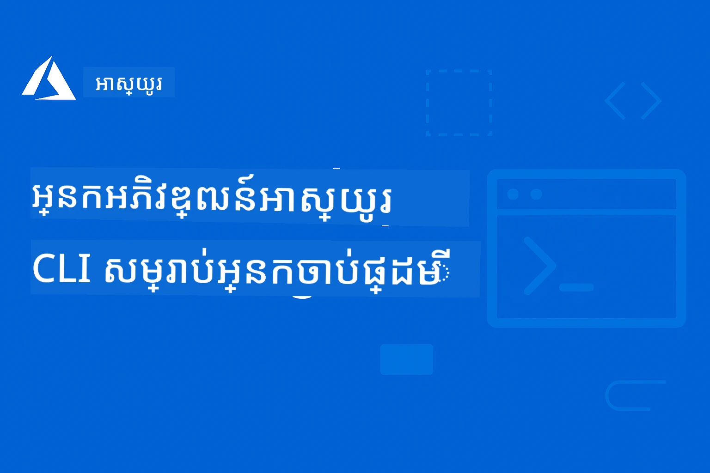

# AZD សម្រាប់អ្នកចាប់ផ្តើម៖ ធ្វើដំណើររៀនដោយមានរចនាសម្ព័ន្ធ

 

[](https://github.com/microsoft/AZD-for-beginners)
[](https://GitHub.com/microsoft/azd-for-beginners/network/)
[](https://github.com/microsoft/AZD-for-beginners)

[](https://discord.com/invite/nkVh3dp)
[](https://discord.gg/nTYy5BXMWG)

---

### ការបកប្រែដោយស្វ័យប្រវត្តិ (តែងតែទាន់សម័យ)

<!-- CO-OP TRANSLATOR LANGUAGES TABLE START -->
[Arabic](../ar/README.md) | [Bengali](../bn/README.md) | [Bulgarian](../bg/README.md) | [Burmese (Myanmar)](../my/README.md) | [Chinese (Simplified)](../zh-CN/README.md) | [Chinese (Traditional, Hong Kong)](../zh-HK/README.md) | [Chinese (Traditional, Macau)](../zh-MO/README.md) | [Chinese (Traditional, Taiwan)](../zh-TW/README.md) | [Croatian](../hr/README.md) | [Czech](../cs/README.md) | [Danish](../da/README.md) | [Dutch](../nl/README.md) | [Estonian](../et/README.md) | [Finnish](../fi/README.md) | [French](../fr/README.md) | [German](../de/README.md) | [Greek](../el/README.md) | [Hebrew](../he/README.md) | [Hindi](../hi/README.md) | [Hungarian](../hu/README.md) | [Indonesian](../id/README.md) | [Italian](../it/README.md) | [Japanese](../ja/README.md) | [Kannada](../kn/README.md) | [Khmer](./README.md) | [Korean](../ko/README.md) | [Lithuanian](../lt/README.md) | [Malay](../ms/README.md) | [Malayalam](../ml/README.md) | [Manipuri (Meitei Mayek)](../mni/README.md) | [Marathi](../mr/README.md) | [Nepali](../ne/README.md) | [Nigerian Pidgin](../pcm/README.md) | [Norwegian](../no/README.md) | [Persian (Farsi)](../fa/README.md) | [Polish](../pl/README.md) | [Portuguese (Brazil)](../pt-BR/README.md) | [Portuguese (Portugal)](../pt-PT/README.md) | [Punjabi (Gurmukhi)](../pa/README.md) | [Romanian](../ro/README.md) | [Russian](../ru/README.md) | [Serbian (Cyrillic)](../sr/README.md) | [Slovak](../sk/README.md) | [Slovenian](../sl/README.md) | [Spanish](../es/README.md) | [Swahili](../sw/README.md) | [Swedish](../sv/README.md) | [Tagalog (Filipino)](../tl/README.md) | [Tamil](../ta/README.md) | [Telugu](../te/README.md) | [Thai](../th/README.md) | [Turkish](../tr/README.md) | [Ukrainian](../uk/README.md) | [Urdu](../ur/README.md) | [Vietnamese](../vi/README.md)

> **ចូលចិត្ត Clone នៅក្នុងម៉ាស៊ីនរបស់អ្នក?**
>
> មូលដ្ឋានទិន្នន័យនេះមានការបកប្រែជាភាសាជាង ៥០ ដែលធ្វើឱ្យទំហំទាញយកធំជាងមុន។ ដើម្បី clone ដោយគ្មានការបកប្រែ សូមប្រើ sparse checkout៖
>
> **Bash / macOS / Linux:**
> ```bash
> git clone --filter=blob:none --sparse https://github.com/microsoft/AZD-for-beginners.git
> cd AZD-for-beginners
> git sparse-checkout set --no-cone '/*' '!translations' '!translated_images'
> ```
>
> **CMD (Windows):**
> ```cmd
> git clone --filter=blob:none --sparse https://github.com/microsoft/AZD-for-beginners.git
> cd AZD-for-beginners
> git sparse-checkout set --no-cone "/*" "!translations" "!translated_images"
> ```
>
> វានាំឱ្យអ្នកទទួលបានគ្រប់យ៉ាងដែលត្រូវការសម្រាប់បញ្ចប់វគ្គបណ្ដុះបណ្ដាលនេះដោយមានការទាញយកឆាប់រហ័សជាងមុន។
<!-- CO-OP TRANSLATOR LANGUAGES TABLE END -->

## 🆕 តើមានអ្វីថ្មីនៅក្នុង azd ថ្ងៃនេះ

> 📌 **ការពិនិត្យចេញផ្សាយ AI CLI (2026-11-04):** នេះជាការណែនាំបានត្រូវបានពិនិត្យទល់នឹងឯកសារ/ប្រភព ដែលបានបោះពុម្ពផ្សាយ **`azd 1.37.2`**, **agents `1.0.0-beta.23`**, និង **evaluations `1.0.0-beta.2`**។ ព្យាយាមប្រើ `azd >= 1.37.0` សម្រាប់ workflow រួម។ បើក `azd version` និង [ធ្វើបច្ចុប្បន្នភាព core CLI](https://learn.microsoft.com/azure/developer/azure-developer-cli/install-azd) មុនការដំឡើង extension។ មើល [ការផ្លាស់ប្តូរនិងកែតម្រូវចេញផ្សាយ](docs/chapter-08-production/production-ai-practices.md#recent-release-changes-and-fixes)។ នេះមិនមែនជាការត្រួតពិនិត្យការចេញផ្សាយផ្ទាល់ក្នុងវគ្គទាំងមូលទេ។

Azure Developer CLI គាំទ្រប្រភេទកម្មវិធីជាច្រើន រួមទាំង web apps, APIs និង AI agents តាមរយៈ host, template និង extension ដែលគាំទ្រ។

នេះគឺជាអ្វីដែលមានន័យសម្រាប់អ្នក៖

- **Agents AI ទទួលបានតួនាទីជារឿងសំខាន់ក្នុង azd។** អ្នកអាចចាប់ផ្តើម ធ្វើproduction និងគ្រប់គ្រងគម្រោង AI agent ដោយប្រើតែមុខងារ `azd init` → `azd up` ដែលអ្នកបានស្គាល់រួច។
- **ជីវិត agents ត្រូវបានគ្រប់គ្រងតាមរយៈ extension ២។** ប្រើ `azure.ai.agents` ដើម្បីចាប់ផ្តើម ស្វែងរក បង្កើត និងផ្អាក agents។ ត្រូវដំឡើង **`azure.ai.evaluations`** ផ្ទែកាត់សម្រាប់ `azd ai eval init`, `generate` និង `run start`។ Agents beta.22 បានជំនួសការ workflow ពីកំឡុងៈមុន និងស្មើផ្សំការកំណត់ optimization ដែលបានផ្លាស់ប្តូរ; សូមអាន [មេរៀនផ្លាស់ប្តូរ](docs/chapter-08-production/production-ai-practices.md#evaluation-migration-and-quality-checks)។
- **ប្លុកបន្ថែមសម្រាប់ AI ។** Extension ថ្មីបង្ហាញ-preview—`azure.ai.skills` និង `azure.ai.connections`—អនុញ្ញាតឱ្យអ្នកគ្រប់គ្រងជំនាញ agent ដែលអាចប្រើឡើងវិញ និងការតភ្ជាប់ Foundry តាមដានផ្ទាល់ដោយលំហ AZD។
- **ការរួមបញ្ចូល Microsoft Foundry** នាំមកនូវការចេញផ្សាយម៉ូដែល ការតម្កល់ និងការតំឡើងសេវាដល់ AI ផ្ទាល់ទៅក្នុងប្រព័ន្ធស្នាដៃ AZD។
- **បច្ចុប្បន្នភាពប្រចាំថ្ងៃល្អជាងមុន។** ការចេញផ្សាយថ្មីៗបានធ្វើឱ្យ `azd init` ធ្វើបានបន្ទាប់បន្សាយ (idempotent), បានធ្វើឱ្យ `azd auth login` លុបបំប្លែងស្លាកបញ្ជីស្វ័យប្រវត្តិ ហើយបន្ថែមការជូនដំណឹងកំណត់ការប្រើ `azd tool` ជាលើកដំបូងឲ្យកាន់តែរលូន។
- **Workflow មូលដ្ឋានមិនបានផ្លាស់ប្តូរ។** មិនថាអ្នកកំពុងបញ្ចេញកម្មវិធី todo, microservice ឬយុទ្ធសាស្ត្រអនុវត្ត AI ពហុ agent ក៏ Commands នៅតែមួយ។

> **សំគាល់សម្រាប់អ្នកប្រើ Aspire៖** Microsoft ឥឡូវបានយល់ព្រមយ៉ាងសាមញ្ញថា ផលិតផលនេះគឺ **Aspire** (ពីមុន ".NET Aspire")។ ការគាំទ្រ AZD Aspire មិនប្រែប្រួលទេ—គ្រាន់តែប្តូរពាក្យប៉ុណ្ណោះ។

ប្រសិនបើអ្នកធ្លាប់ប្រើ azd មុននេះ ការគាំទ្រ AI គឺជាការពង្រីកធម្មតា មិនមែនឧបករណ៍ដាច់ពីគ្នាឬមុខវិជ្ជាជំនាញកម្រិតខ្ពស់ទេ។ ប្រសិនប្រសើរបើអ្នកចាប់ផ្តើមថ្មី នឹងរៀនworkflow មួយដែលដំណើរការសម្រាប់អ្វីគ្រប់យ៉ាង។

---

## 🚀 តើ Azure Developer CLI (azd) គឺជាអ្វី?

**Azure Developer CLI (azd)** គឺជាឧបករណ៍បន្ទាត់បញ្ជារាយភាពងាយស្រួលសម្រាប់អ្នកអភិវឌ្ឍ ដែលធ្វើឲ្យការចេញផ្សាយកម្មវិធីទៅ Azure ងាយស្រួល។ ជំនួសការបង្កើតនិងភ្ជាប់ធនធាន Azure ដោយដៃ អ្នកអាចចេញផ្សាយកម្មវិធីទាំងមូលជាមួយបញ្ជារមួយតែពីរដង។

### មន្តស្នេររបស់ `azd up`

```bash
# This single command does everything:
# ✅ Creates all Azure resources  
# ✅ Configures networking and security
# ✅ Builds your application code
# ✅ Deploys to Azure
# ✅ Gives you a working URL
azd up
```

ទម្រង់ស្មុំផ្តល់ការកំណត់កម្មវិធី និងសេវាកម្មសំណង់។ ការចេញផ្សាយជោគជ័យត្រូវការសេវាកម្ម/ម៉ូដែលគាំទ្រ, កំណត់កម្រិត និងសិទិ្ធគ្រប់គ្រាន់, ចូលបញ្ចូលត្រឹមត្រូវ និងការផ្ទៀងផ្ទាត់កម្មវិធីដែលបានចេញផ្សាយ។ `azd up` មិនបានធ្វើឲ្យទំរង់ស្មុំមានសុវត្ថិភាព, យល់ព្រម ឬមានភាពត្រៀមខ្លួនសម្រាប់ផលិតកម្មនៅស្វ័យប្រវត្តិទេ។

---

## ❓ Azure Developer CLI និង Azure CLI: តើខុសគ្នាយ៉ាងដូចម្ដេច?

នេះជាសំណួរធម្មតាសម្រាប់អ្នកចាប់ផ្តើម។ ចម្លើយងាយៗគឺ៖

| លក្ខណៈពិសេស | **Azure CLI (`az`)** | **Azure Developer CLI (`azd`)** |
|---------|---------------------|--------------------------------|
| **គោលបំណង** | គ្រប់គ្រងធនធាន Azure បុគ្គលិក | ចេញផ្សាយកម្មវិធីពេញលេញ |
| **គំនិត** | រចនាសម្ព័ន្ធផ្អែក | ការវាយតម្លៃកម្មវិធីផ្អែក |
| **ឧទាហរណ៍** | `az webapp create --name myapp...` | `azd up` |
| **ការរៀន** | ត្រូវដឹងសេវាកម្ម Azure | តែស្គាល់កម្មវិធីរបស់អ្នក |
| **សមស្របសម្រាប់** | DevOps, រចនាសម្ព័ន្ធ | អ្នកអភិវឌ្ឍ, បង្កើតគំរូ |

### ប្រៀបធៀបសាមញ្ញ

- **Azure CLI** គឺដូចជាមានឧបករណ៍ទាំងអស់សម្រាប់សាងសង់ផ្ទះ - អង្ក្រង, គ្រាប់អំបោះ, និងព្រួញ។ អ្នកអាចសាងសង់អ្វីគ្រប់យ៉ាង ប៉ុន្តែត្រូវដឹងសំណង់។
- **Azure Developer CLI** គឺដូចជាចំណាត់ថ្នាក់អ្នកសាងសង់ - អ្នកពិពណ៌នាអ្វីដែលចង់បាន ហើយពួកគេត្រូវដល់ការសាងសង់។

### ប្រើពេលណា

| ស្ថានភាព | ប្រើនេះ |
|----------|----------|
| "ខ្ញុំចង់បញ្ចេញកម្មវិធីបណ្ដាញយ៉ាងរហ័ស" | `azd up` |
| "ខ្ញុំត្រូវការបង្កើតគណនីស្ដុកមួយ" | `az storage account create` |
| "ខ្ញុំកំពុងសាងសង់កម្មវិធី AI ពេញលេញ" | `azd init --template azure-search-openai-demo` |
| "ខ្ញុំត្រូវការត្រួតពិនិត្យករណីកំហុសធនធាន Azure មួយ" | `az resource show` |
| "ខ្ញុំចង់ចេញផ្សាយទៅបរិយាកាសផលិតកម្មដែលបានកំណត់រួច" | ពិនិត្យការកំណត់, សិទិ្ធចូល, គិតថ្លៃ, និងកំណត់ប្រតិបត្តិការមុនពេល `azd up --environment production` |

### ពួកគេធ្វើការជាមួយគ្នា!

AZD និង Azure CLI មានការផ្ទៀងផ្ទាត់ និងការកំណត់ផ្សេងៗគ្នា។ ប្រើ `azd auth login` សម្រាប់ AZD និង `az login` នៅពេលមានកំណត់ហេតុ ឬបញ្ជាងវិភាគដែលចាំបាច់ត្រូវបានប្រើ Azure CLI។ អ្នកអាចប្រើទាំងពីរ ៖
```bash
# Deploy your app with AZD
azd up

# Then fine-tune specific resources with Azure CLI
az webapp config set --name myapp --always-on true
```

---

## 🌟 រករកមើល Template នៅក្នុង Awesome AZD

កុំចាប់ផ្តើមពីសូន្យ! **Awesome AZD** ជាកំណត់បណ្ណាល័យសហគមន៍នៃ template ដែលអាចចេញផ្សាយបានភ្លាមៗ៖

| ធនធាន | ពណ៌នា |
|----------|-------------|
| 🔗 [**Awesome AZD Gallery**](https://azure.github.io/awesome-azd/) | អាចរុករកបាន ២០០+ template និងចេញផ្សាយដោយចុចមួយដង |
| 🔗 [**Submit a Template**](https://github.com/Azure/awesome-azd/issues) | បញ្ចូល template របស់អ្នកទៅសហគមន៍ |
| 🔗 [**GitHub Repository**](https://github.com/Azure/awesome-azd) | ផ្ដល់ពន្លឺ និងស្វែងរកប្រភព |

### Template AI រំពឹកគេពី Awesome AZD

ជ្រើសរើស template មួយនៅក្នុងថតទទេនោះ; បញ្ជាលើនេះជាផ្លូវជម្រើសផ្សេងៗ។ ការបន្សំ `.` កំណត់ថតនោះ។

```bash
# RAG Chat with Microsoft Foundry Models + AI Search
azd init --template azure-search-openai-demo .

# Quick AI Chat Application
azd init --template openai-chat-app-quickstart .

# AI Agents with Foundry Agents
azd init --template get-started-with-ai-agents .
```

---

## 🎯 ចាប់ផ្តើមក្នុង ៣ ជំហាន

មុនចាប់ផ្តើម សូមប្រាកដថា ម៉ាស៊ីនរបស់អ្នករួចរាល់សម្រាប់ template ដែលអ្នកចង់ចេញផ្សាយ៖

**Windows:**
```powershell
.\validate-setup.ps1
```

**macOS / Linux:**
```bash
bash ./validate-setup.sh
```

ប្រសិនបើតម្លើងត្រូវបានបរាជ័យ សូមដោះស្រាយបញ្ហានោះជាមុនក្របខ័ណ្ឌលឿននេះ។

### ជំហាន 1៖ ដំឡើង AZD (២ នាទី)

**Windows:**
```powershell
winget install microsoft.azd
```

**macOS:**
```bash
brew tap azure/azd && brew install azd
```

**Linux:**
```bash
curl -fsSL https://aka.ms/install-azd.sh | bash
```

### ជំហាន 2៖ ផ្ទៀងផ្ទាត់សុវត្ថិភាពសម្រាប់ AZD

```bash
# Optional if you plan to use Azure CLI commands directly in this course
az login

# Required for AZD workflows
azd auth login
```

ប្រសិនបើអ្នកមិនបានប្រាកដថាតើត្រូវការអ្វី សូមអនុវត្តបន្តនូវដំណើរការតំឡើងពេញលេញក្នុង [Installation & Setup](docs/chapter-01-foundation/installation.md#authentication-setup)។

### ជំហាន 3៖ ចេញផ្សាយកម្មវិធីដំបូងរបស់អ្នក

```bash
# Initialize from a template
azd init --template todo-nodejs-mongo .

# Deploy to Azure (creates everything!)
azd up
```

**🎉 នេះហើយ!** កម្មវិធីរបស់អ្នកឥឡូវនេះដំណើរការលើ Azure។

### បំលែងស្អាត (កុំភ្លេច!)

```bash
# Remove all resources when done experimenting
azd down --force --purge
```

---

## 📚 របៀបប្រើវគ្គសិក្សានេះ

វគ្គនេះបានរចនាសម្រាប់ **ការរៀនជាស៊ីចម្រាស់** - ចាប់ផ្តើមពីកន្លែងដែលអ្នកមានផាសុកភាព ហើយរៀបចំការរៀនជាបន្តបន្ទាប់៖

| បទពិសោធន៍របស់អ្នក | ចាប់ផ្តើមនៅទីនេះ |
|-----------------|------------|
| **ថ្មីទើបចូលបច្ចុប្បន្នភាពទៅ Azure** | [ជំពូកទី 1៖ មូលដ្ឋាន](#-chapter-1-foundation--quick-start) |
| **ស្គាល់ Azure មិនទាន់ស្គាល់ AZD** | [ជំពូកទី 1៖ មូលដ្ឋាន](#-chapter-1-foundation--quick-start) |
| **ចង់ចេញផ្សាយកម្មវិធី AI** | [ជំពូកទី 2៖ ការអភិវឌ្ឍជាចម្បង AI](#-chapter-2-ai-first-development-recommended-for-ai-developers) |
| **ចង់ហាត់ក្រាស់ដៃ** | [🎓 សិក្ខាសាលាផ្ទាល់](workshop/README.md) - បុព្វហេតុដឹកនាំ ៣-៤ ម៉ោង |
| **ត្រូវការឧទាហរណ៍ផលិតកម្ម** | [ជំពូកទី 8៖ ផលិតកម្ម និងសហគ្រាស](#-chapter-8-production--enterprise-patterns) |

### ការដំឡើងរហ័ស

1. **ផ្ដល់ Fork មូលដ្ឋាននេះ**: [](https://GitHub.com/microsoft/azd-for-beginners/fork)
2. **Clone វា**: `git clone https://github.com/YOUR-USERNAME/azd-for-beginners.git`
3. **ទទួលជំនួយ**: [សហគមន៍ Azure Discord](https://discord.com/invite/ByRwuEEgH4)

> **ចូលចិត្ត Clone នៅក្នុងម៉ាស៊ីនរបស់អ្នក?**

> មូលដ្ឋានទិន្នន័យនេះមានការបកប្រែជាភាសាជាង ៥០ ដែលធ្វើឱ្យទំហំទាញយកធំជាងមុន។ ដើម្បី clone ដោយគ្មានការបកប្រែ សូមប្រើ sparse checkout៖
> ```bash
> git clone --filter=blob:none --sparse https://github.com/microsoft/AZD-for-beginners.git
> cd AZD-for-beginners
> git sparse-checkout set --no-cone '/*' '!translations' '!translated_images'
> ```
> នេះផ្តល់ឱ្យអ្នកនូវអ្វីដែលអ្នកត្រូវការទាំងអស់ដើម្បីបញ្ចប់វគ្គនេះជាមួយនឹងការទាញយកបានលឿនជាងមុន។


## ទិដ្ឋភាពទូទៅនៃវគ្គរៀន

ជំនាញ Azure Developer CLI (azd) តាមរយៈជំពូកដែលបានបង្កើតឡើងយ៉ាងមានរចនាសម្ព័នសម្រាប់ការរៀនដំណើរការជាបន្តបន្ទាប់។ **ផ្តោតសំខាន់ពិសេសលើការដំឡើងកម្មវិធី AI ជាមួយការរួមបញ្ចូល Microsoft Foundry។**

### ហេតុអ្វីបានជាវគ្គនេះមានសារៈសំខាន់សម្រាប់អ្នកអភិវឌ្ឍន៍ទំនើប

អ្នកអភិវឌ្ឍន៍ដែលដំឡើងបំណែក AI ស្ទើរត្រូវការជំនួយលើ៖
- រចនាសម្ព័ន្ធ AI ដែលស្មុគស្មាញមានសេវាច្រើន
- អនុវត្តន៍ការដំឡើង AI ល្អបំផុតសម្រាប់ផលិតកម្ម
- បញ្ចូលនិងកំណត់សេវា Azure AI
- បរិច្ឆេទថ្លៃដើមសំរាប់បំណែក AI
- ដោះស្រាយបញ្ហាការដំឡើងដែលពាក់ព័ន្ធ AI

### គោលដៅការរៀន

ដោយបញ្ចប់វគ្គសម្រួលនេះ អ្នកនឹងអាច៖
- **ជំនាញមូលដ្ឋាន AZD**៖ គំនិតមូលដ្ឋាន ការដំឡើង និងកំណត់តាម
- **ដំឡើងកម្មវិធី AI**៖ ប្រើ AZD ជាមួយសេវា Microsoft Foundry
- **អនុវត្តប្រាក់ចំណូលជាអាគារជាកូដ**៖ សម្របសម្រួលធនធាន Azure ជាមួយទំរង់ Bicep
- **ដោះស្រាយបញ្ហាការដំឡើង**៖ ជួយដោះស្រាយបញ្ហាទូទៅ និងស្វែងរកកំហុស
- **បង្កើនប្រសិទ្ធភាពសម្រាប់ផលិតកម្ម**៖ សន្តិសុខ ការលំនឹង ការត្រួតពិនិត្យ និងការគ្រប់គ្រងថ្លៃដើម
- **បង្កើតដំណោះស្រាយជាមនុស្សប្រតិបត្តិជាច្រើន**៖ ដំឡើងរចនាសម្ព័ន្ធ AI ស្មុគស្មាញ

## មុនចាប់ផ្ដើម៖ គណនី ការចូលដំណើរការ និងការសន្មត់

មុនចាប់ផ្ដើមជំពូក ១ សូមប្រាកដថាអ្នកមានអ្វីខ្លះខាងក្រោម។ ជំហានដំឡើងក្នុងមគ្គុទេសក៍នេះចាត់ទុកថារឿងទាំងឡាយទាំងនេះបានរៀបចំរួចហើយ។

- **ការជាវ Azure**៖ អ្នកអាចប្រើការជាវដែលមានពីការងារឬគណនីផ្ទាល់ខ្លួនរបស់អ្នក ឬបង្កើត [សាកល្បងដោយឥតគិតថ្លៃ](https://aka.ms/azurefreetrial) ដើម្បីចាប់ផ្ដើម។
- **ការអនុញ្ញាតបង្កើតធនធាន Azure**៖ សម្រាប់ការប្រលងភាគច្រើន អ្នកគួរតែមានសិទ្ធិ **Contributor** នៅលើការជាវឬក្រុមធនធានគោលដៅ។ ខ្លះជំពូកប្រហែលជាក៏សន្មតថាអ្នកអាចបង្កើតក្រុមធនធាន សម្គាល់គ្រប់គ្រង និងការបែងចែក RBAC។
- [**គណនី GitHub**](https://github.com)៖ នេះមានប្រយោជន៍សម្រាប់ធ្វើ Fork ទុកឃ្លាំងប្រភព តាមដានការផ្លាស់ប្តូររបស់អ្នក និងប្រើ GitHub Codespaces សម្រាប់សិក្ខាសាលា។
- **គ្រោងតម្រូវក្នុងការរត់តាមម៉ាស៊ីន**៖ គំរូខ្លះត្រូវការឧបករណ៍ក្នុងដំណើរការពីម៉ាស៊ីនដូចជា Node.js, Python, Java, ឬ Docker។ បើកដោយកម្មវិធីចំណេញត្រួតពិនិត្យមុនចាប់ផ្ដើមដើម្បីរកឧបករណ៍ខ្វះលឿន។
- **ការស្គាល់មូលដ្ឋាននៃបន្ទាត់បញ្ជា**៖ អ្នកមិនចាំបាច់ជាអ្នកឯកទេស ប៉ុន្តែអ្នកគួរតែចេះដំណើរការបញ្ជាទាំងនេះដូចជា `git clone`, `azd auth login`, និង `azd up`។

> **ធ្វើការជាកម្មវិធីក្នុងការជាវអាជីវកម្ម?**
> ប្រសិនបើបរិយាកាស Azure របស់អ្នក មានអ្នកគ្រប់គ្រង អ្នកគួរតែបញ្ជាក់មុនថាអ្នកអាចដំឡើងធនធានក្នុងការជាវ ឬក្រុមធនធានដែលអ្នកមានគម្រោងប្រើ។ ប្រសិនបើមិនអាចធ្វើបាន សូមស្នើរសុំការជាវ sandbox ឬសិទ្ធិផ្ទាល់ក្រុម Contributor មុនចាប់ផ្ដើម។

> **ថ្មីចំពោះ Azure?**
> ចាប់ផ្ដើមជាមួយសាកល្បង Azure ផ្ទាល់ខ្លួន ឬការជាវបង់ប្រាក់តាមការប្រើប្រាស់នៅ https://aka.ms/azurefreetrial ដើម្បីបញ្ចប់ការប្រលងដោយពុំចាំបាច់រង់ចាំការអនុម័តកម្រិត tenant។

## 🗺️ ផែនទីវគ្គศึกษา៖ ការរុករកយ៉ាងលឿនតាមជំពូក

ជំពូកទាំងអស់មាន README ផ្ទាល់ខ្លួនជាមួយគោលដៅការរៀន ការចាប់ផ្ដើមយ៉ាងលឿន និងការប្រលង៖

| ជំពូក | ប្រធានបទ | មេរៀន | រយៈពេល | ភាពស្មុគស្មាញ |
|---------|-------|---------|----------|------------|
| **[ជំពូក 1: មូលដ្ឋាន](docs/chapter-01-foundation/README.md)** | ការចាប់ផ្ដើម | [មូលដ្ឋាន AZD](docs/chapter-01-foundation/azd-basics.md) &#124; [ការដំឡើង](docs/chapter-01-foundation/installation.md) &#124; [គម្រោងដំបូង](docs/chapter-01-foundation/first-project.md) | 30-45 នាទី | ⭐ |
| **[ជំពូក 2: អភិវឌ្ឍ AI](docs/chapter-02-ai-development/README.md)** | កម្មវិធី AI ជាចម្បង | [ការរួមបញ្ចូល Foundry](docs/chapter-02-ai-development/microsoft-foundry-integration.md) &#124; [ភ្នាក់ងារបច្ចេកវិទ្យា AI](docs/chapter-02-ai-development/agents.md) &#124; [ដំឡើងម៉ូដែល](docs/chapter-02-ai-development/ai-model-deployment.md) &#124; [សិក្ខាសាលា](docs/chapter-02-ai-development/ai-workshop-lab.md) | 1-2 ម៉ោង | ⭐⭐ |
| **[ជំពូក 3: ការកំណត់តំរូវការ](docs/chapter-03-configuration/README.md)** | អត្តសញ្ញាណ និងសន្តិសុខ | [កំណត់តំរូវការ](docs/chapter-03-configuration/configuration.md) &#124; [អត្តសញ្ញាណ និងសន្តិសុខ](docs/chapter-03-configuration/authsecurity.md) | 45-60 នាទី | ⭐⭐ |
| **[ជំពូក 4: ហេដ្ឋារចនាសម្ព័ន្ធ](docs/chapter-04-infrastructure/README.md)** | IaC និងការដំឡើង | [មគ្គុទេសក៍ដំឡើង](docs/chapter-04-infrastructure/deployment-guide.md) &#124; [ការបម្រុងទុក](docs/chapter-04-infrastructure/provisioning.md) | 1-1.5 ម៉ោង | ⭐⭐⭐ |
| **[ជំពូក 5: មនុស្សប្រតិបត្តិជាច្រើន](docs/chapter-05-multi-agent/README.md)** | ដំណោះស្រាយភ្នាក់ងារបច្ចេកវិទ្យា AI | [សេណារីយ៉ោលក់តាមសៀវភៅ](examples/retail-scenario.md) &#124; [លំនាំសម្របសម្រួល](docs/chapter-06-pre-deployment/coordination-patterns.md) | 2-3 ម៉ោង | ⭐⭐⭐⭐ |
| **[ជំពូក 6: មុនការដំឡើង](docs/chapter-06-pre-deployment/README.md)** | ការងារធ្វើផែនការ និងការត្រួតពិនិត្យ | [ការត្រួតពិនិត្យមុនបើកដំណើរការ](docs/chapter-06-pre-deployment/preflight-checks.md) &#124; [ការគ្រោងទុកសមត្ថភាព](docs/chapter-06-pre-deployment/capacity-planning.md) &#124; [ជម្រើស SKU](docs/chapter-06-pre-deployment/sku-selection.md) &#124; [App Insights](docs/chapter-06-pre-deployment/application-insights.md) | 1 ម៉ោង | ⭐⭐ |
| **[ជំពូក 7: ដោះស្រាយបញ្ហា](docs/chapter-07-troubleshooting/README.md)** | ដំណោះស្រាយ និងជួសជុល | [បញ្ហាទូទៅ](docs/chapter-07-troubleshooting/common-issues.md) &#124; [ការស្វែងរកកំហុស](docs/chapter-07-troubleshooting/debugging.md) &#124; [បញ្ហា AI](docs/chapter-07-troubleshooting/ai-troubleshooting.md) | 1-1.5 ម៉ោង | ⭐⭐ |
| **[ជំពូក 8: ផលិតកម្ម](docs/chapter-08-production/README.md)** | លំនាំសេដ្ឋកិច្ច | [ការអនុវត្តក្នុងផលិតកម្ម](docs/chapter-08-production/production-ai-practices.md) | 2-3 ម៉ោង | ⭐⭐⭐⭐ |
| **[🎓 សិក្ខាសាលា](workshop/README.md)** | មន្ទីរបណ្តុះបណ្តាលជាក់ស្តែង | [ការណែនាំ](workshop/docs/instructions/0-Introduction.md) &#124; [ជម្រើស](workshop/docs/instructions/1-Select-AI-Template.md) &#124; [ការត្រួតពិនិត្យ](workshop/docs/instructions/2-Validate-AI-Template.md) &#124; [ការបំបែក](workshop/docs/instructions/3-Deconstruct-AI-Template.md) &#124; [កំណត់](workshop/docs/instructions/4-Configure-AI-Template.md) &#124; [កែទម្រង់](workshop/docs/instructions/5-Customize-AI-Template.md) &#124; [ការបញ្ចប់](workshop/docs/instructions/6-Teardown-Infrastructure.md) &#124; [សង្ខេប](workshop/docs/instructions/7-Wrap-up.md) | 3-4 ម៉ោង | ⭐⭐ |

**រយៈពេលសរុបវគ្គ:** ~10-14 ម៉ោង | **ការកើនឡើងជំនាញ:** អ្នកចាប់ផ្ដើម → ប្រកបដោយភាពរួចរាល់សម្រាប់ផលិតកម្ម

---

## 📚 ជំពូកសម្រាប់រៀន

*ជ្រើសរើសផ្លូវរៀនរបស់អ្នក យោងតាមកម្រិតបទពិសោធន៍ និងគោលបំណង*

### 🚀 ជំពូក 1: មូលដ្ឋាន & ចាប់ផ្ដើមយ៉ាងលឿន
**លក្ខខណ្ឌជាមុន**: ជាវ Azure, ស្គាល់បន្ទាត់បញ្ជាមូលដ្ឋាន  
**រយៈពេល**: 30-45 នាទី  
**ភាពស្មុគស្មាញ**: ⭐

#### អ្វីដែលអ្នកនឹងរៀន
- ការយល់ដឹងពីមូលដ្ឋាន Azure Developer CLI
- ការដំឡើង AZD លើវេទិការបស់អ្នក
- ការដំឡើងជោគជ័យដំបូងរបស់អ្នក

#### ឯកសារសម្រាប់រៀន
- **🎯 ចាប់ផ្ដើមទីនេះ**: [Azure Developer CLI ជាអ្វី?](#-what-is-azure-developer-cli-azd)
- **📖 ទ្រឹស្តី**: [មូលដ្ឋាន AZD](docs/chapter-01-foundation/azd-basics.md) - គំនិតគោល និងពាក្យទាក់ទង
- **⚙️ ការដំឡើង**: [ការដំឡើង & ការតំឡើង](docs/chapter-01-foundation/installation.md) - មគ្គុទេសក៍សម្រាប់វេទិកា
- **🛠️ បណ្តុះបណ្តាលជាក់ស្តែង**: [គម្រោងដំបូងរបស់អ្នក](docs/chapter-01-foundation/first-project.md) - មេរៀនជំហាន-ដោយជំហាន
- **📋 សៀវភៅយោងរហ័ស**: [សៀវភៅបញ្ជា](resources/cheat-sheet.md)

#### លំហាត់អនុវត្តន៍
```bash
# Quick installation check
azd version

# Deploy your first application
azd init --template todo-nodejs-mongo .
azd up
```

**💡 លទ្ធផលជំពូក**: ដំឡើងកម្មវិធីបណ្ដាញសាមញ្ញទៅលើ Azure ដោយប្រើ AZD ជោគជ័យ

**✅ ការត្រួតពិនិត្យជោគជ័យ:**
```bash
# After completing Chapter 1, you should be able to:
azd version              # Shows installed version
azd init --template todo-nodejs-mongo  # Initializes project
azd up                  # Deploys to Azure
azd show                # Displays running app URL
# Application opens in browser and works
azd down --force --purge  # Cleans up resources
```

**📊 រយៈពេលវិនិយោគ:** 30-45 នាទី  
**📈 កម្រិតជំនាញបន្ទាប់ពីរៀន:** អាចដំឡើងកម្មវិធីមូលដ្ឋានដោយឯកជន

---

### 🤖 ជំពូក 2: អភិវឌ្ឍ AI ជាចម្បង (ណែនាំសម្រាប់អ្នកអភិវឌ្ឍ AI)
**លក្ខខណ្ឌជាមុន**: បញ្ចប់ជំពូក 1  
**រយៈពេល**: 1-2 ម៉ោង  
**ភាពស្មុគស្មាញ**: ⭐⭐

#### អ្វីដែលអ្នកនឹងរៀន
- ការរួមបញ្ចូល Microsoft Foundry ជាមួយ AZD
- ដំឡើងកម្មវិធីដែលបំភ្លឺដោយ AI
- ការយល់ដឹងអំពីកំណត់រចនាសម្ព័ន្ធសេវា AI

#### ឯកសារសម្រាប់រៀន
- **🎯 ចាប់ផ្ដើមទីនេះ**: [ការរួមបញ្ចូល Microsoft Foundry](docs/chapter-02-ai-development/microsoft-foundry-integration.md)
- **🤖 ភ្នាក់ងារបច្ចេកវិទ្យា AI**: [មគ្គុទេសក៍ភ្នាក់ងារ AI](docs/chapter-02-ai-development/agents.md) - ដំឡើងភ្នាក់ងារឆ្លាតវៃជាមួយ AZD
- **📖 លំនាំ**: [ដំឡើងម៉ូដែល AI](docs/chapter-02-ai-development/ai-model-deployment.md) - ដំឡើងនិងគ្រប់គ្រងម៉ូដែល AI
- **🛠️ សិក្ខាសាលា**: [មន្ទីរសិក្សា AI](docs/chapter-02-ai-development/ai-workshop-lab.md) - ធ្វើឱ្យដំណោះស្រាយ AI របស់អ្នកសម្រួលជាមួយ AZD
- **🎥 មគ្គុទេសក៍អន្តរកម្ម**: [សម្ភារៈសិក្សាសិក្ខាសាលា](workshop/README.md) - រៀនតាមកម្មវិធី MkDocs * បរិយាកាស DevContainer
- **📋 គំរូ**: [គំរូ Microsoft Foundry](#featured-microsoft-foundry-templates)
- **📝 ឧទាហរណ៌**: [ឧទាហរណ៍ដំឡើង AZD](examples/README.md)

#### លំហាត់អនុវត្តន៍
```bash
# Deploy your first AI application
azd init --template azure-search-openai-demo .
azd up

# Try additional AI templates
azd init --template openai-chat-app-quickstart .
azd init --template agent-openai-python-prompty .
```

**💡 លទ្ធផលជំពូក**: ដំឡើងនិងកំណត់បន្ថែមកម្មវិធីជជែក AI ដែលមានមុខងារស្វែងរកបញ្ច្រាស RAG

**✅ ការត្រួតពិនិត្យជោគជ័យ:**
```bash
# After Chapter 2, you should be able to:
azd init --template azure-search-openai-demo .
azd up
# Test the AI chat interface
# Ask questions and get AI-powered responses with sources
# Verify search integration works
azd monitor  # Check Application Insights shows telemetry
azd down --force --purge
```

**📊 រយៈពេលវិនិយោគ:** 1-2 ម៉ោង  
**📈 កម្រិតជំនាញបន្ទាប់ពីរៀន:** អាចដំឡើងកម្មវិធី​រៀន AI និងកំណត់តម្រូវការបន្ថែមសម្រាប់ភាពរួចរាល់ផលិតកម្ម
**💰 ចំណាយថ្លៃ:** យល់ព្រមថ្លៃអភិវឌ្ឍ $80-150/ខែ ថ្លៃផលិតកម្ម $300-3500/ខែ

#### 💰 ការពិចារណារបស់ថ្លៃសម្រាប់ការដំឡើង AI

**បរិយាកាសអភិវឌ្ឍ (ប្រមាណ $80-150/ខែ):**
- ម៉ូដែល Microsoft Foundry (បង់តាមការប្រើប្រាស់): $0-50/ខែ (ផ្អែកលើការប្រើស្លាបព្រិល)
- ការស្វែងរក AI (កម្រិតមូលដ្ឋាន): $75/ខែ
- កម្មវិធីកុងតឺន័រ (ប្រើប្រាស់): $0-20/ខែ
- ការផ្ទុក (ស្តង់ដារ): $1-5/ខែ

**បរិយាកាសផលិតកម្ម (ប្រមាណ $300-3,500+/ខែ):**
- ម៉ូដែល Microsoft Foundry (PTU សម្រាប់ការសម្របសម្រួលមួយ): $3,000+/ខែ ឬ បង់តាមការប្រើប្រាស់ជាមួយបរិមាណខ្ពស់
- ការស្វែងរក AI (កម្រិតស្ដង់ដារ): $250/ខែ
- កម្មវិធីកុងតឺន័រ (ឧទាហរណ៍): $50-100/ខែ
- Application Insights: $5-50/ខែ
- ការផ្ទុក (ព្រីមៀម): $10-50/ខែ

**💡 ការណែនាំបន្ថែមសម្រាប់ការបង្កើនប្រសិទ្ធភាពថ្លៃ:**
- ពិនិត្យតម្លៃសមាហរណដ៏ម៉ូដែលនិងឥណទានសម្រាប់គណនីជាក់លាក់; Azure OpenAI មិនឲ្យមានការអនុញ្ញាតឥតគិតថ្លៃ 50,000 ស្លាបព្រិលក្នុងមួយខែទេ
- ប្រតិបត្តិ `azd down` ដើម្បីលុបធនធានពេលមិនចាំបាច់បន្ថែម មុនពិនិត្យបរិយាកាសដែលបានជ្រើស
- ចាប់ផ្ដើមជាមួយវិធីបង់ប្រាក់តាមការប្រើប្រាស់ ពេលក្រោយបង្កើនទៅ PTU សម្រាប់ផលិតកម្មតែប៉ុណ្ណោះ
- ប្រើ `azd provision --preview` ដើម្បីពិចារណាហេដ្ឋារចនាសម្ព័ន្ធដែលបានគ្រោង រួចពិនិត្យតម្លៃធនធានដែលបានគិតជាមួយគណនីតម្លៃ Azure
- បើកអូតូលំនឹង៖ បង់តែចំនួនដែលបានប្រើប្រាស់ពិតប្រាកដ

**ការតាមដានថ្លៃ:**
```bash
# Inspect planned resources (this does not calculate prices)
azd provision --preview

# Monitor actual costs in Azure Portal
az consumption budget list --resource-group <your-rg>
```

---

### ⚙️ ជំពូក 3: ការកំណត់តំរូវការ និងអត្តសញ្ញាណ
**លក្ខខណ្ឌជាមុន**: បញ្ចប់ជំពូក 1  
**រយៈពេល**: 45-60 នាទី  
**ភាពស្មុគស្មាញ**: ⭐⭐

#### អ្វីដែលអ្នកនឹងរៀន
- ការកំណត់ និងគ្រប់គ្រងបរិយាកាស
- អត្តសញ្ញាណ និងបទប្បញ្ញត្តិសន្តិសុខល្អបំផុត
- ការកំណត់ឈ្មោះធនធាន និងការរៀបចំ

#### ឯកសារសម្រាប់រៀន
- **📖 កំណត់តំរូវការ**: [មគ្គុទេសក៍កំណត់តំរូវការ](docs/chapter-03-configuration/configuration.md) - ការកំណត់បរិយាកាស
- **🔐 សន្តិសុខ**: [លំនាំអត្តសញ្ញាណនិងសម្គាល់គ្រប់គ្រង](docs/chapter-03-configuration/authsecurity.md) - លំនាំអត្តសញ្ញាណ
- **📝 ឧទាហរណ៍**: [ឧទាហរណ៍កម្មវិធីមូលដ្ឋានទិន្នន័យ](examples/database-app/README.md) - ឧទាហរណ៍ AZD សម្រាប់មូលដ្ឋានទិន្នន័យ

#### លំហាត់អនុវត្តន៍
- កំណត់បរិយាកាសជាច្រើន (ការអភិវឌ្ឍ, staging, ផលិតកម្ម)
- កំណត់អត្តសញ្ញាណគ្រប់គ្រង
- អនុវត្តកំណត់បរិយាកាសឯកជន

**💡 លទ្ធផលជំពូក**: គ្រប់គ្រងបរិយាកាសជាច្រើនជាមួយអត្តសញ្ញាណនិងសន្តិសុខត្រឹមត្រូវ

---

### 🏗️ ជំពូក 4: ហេដ្ឋារចនាសម្ព័ន្ធជាកូដ & ការដំឡើង
**លក្ខខណ្ឌជាមុន**: បញ្ចប់ជំពូក 1-3  
**រយៈពេល**: 1-1.5 ម៉ោង  
**ភាពស្មុគស្មាញ**: ⭐⭐⭐

#### អ្វីដែលអ្នកនឹងរៀន
- លំនាំដំឡើងកម្រិតខ្ពស់
- ហេដ្ឋារចនាសម្ព័ន្ធជាកូដជាមួយ Bicep
- ย្បត្ដិការផ្លាស់ប្តូរធនធាន

#### ឯកសារសម្រាប់រៀន
- **📖 ដំឡើង**: [មគ្គុទេសក៍ដំឡើង](docs/chapter-04-infrastructure/deployment-guide.md) - សៀវភៅចុះកម្មវិធីទាំងមូល
- **🏗️ បម្រុងទុកធនធាន**: [ការគ្រប់គ្រងធនធាន Azure](docs/chapter-04-infrastructure/provisioning.md) - ការគ្រប់គ្រងធនធាន Azure
- **📝 ឧទាហរណ៍**: [ឧទាហរណ៍កម្មវិធីកុងតឺន័រ](../../examples/container-app) - ដំឡើងកម្មវិធីកុងតឺន័រ

#### លំហាត់អនុវត្តន៍
- បង្កើតគំរូ Bicep ផ្ទាល់ខ្លួន
- ដំឡើងកម្មវិធីដែលមានសេវាជាច្រើន
- អនុវត្តយុទ្ធសាស្ត្រដំឡើងប្លូ-ហ្គ្រីន

**💡 លទ្ធផលជំពូក**: ដំឡើងកម្មវិធីដែលមានសេវាច្រើនស្មុគស្មាញដោយប្រើគំរូហេដ្ឋារចនាសម្ព័ន្ធផ្ទាល់ខ្លួន

---

### 🎯 ជំពូក 5: ដំណោះស្រាយភ្នាក់ងារពហុ (កម្រិតខ្ពស់)
**លក្ខខណ្ឌជាមុន**: បញ្ចប់ជំពូក 1-2  
**រយៈពេល**: 2-3 ម៉ោង  
**ភាពស្មុគស្មាញ**: ⭐⭐⭐⭐

#### អ្វីដែលអ្នកនឹងរៀន
- លំនាំរចនាសម្ព័ន្ធភ្នាក់ងារពហុ
- ការសម្រួលនិងសម្របសម្រួលភ្នាក់ងារ
- ការដំឡើង AI ដែលរួចរាល់សម្រាប់ផលិតកម្ម

#### ឯកសារសម្រាប់រៀន
- **🤖 រចនាប័ទ្មដែលបានជ្រើសរើស**: [ដំណោះស្រាយភ្នាក់ងារលក់តាមសៀវភៅ](examples/retail-scenario.md) - គំរូរចនាសម្ព័ន្ធ មិនមែនកម្មវិធីពេញលេញ
- **🛠️ រចនាARM Templates**: [ប៉េគេ ARM Template](../../examples/retail-multiagent-arm-template) - ការបង្កើតខ្នាតមូលដ្ឋានផ្ទុក; គូសត្រួតពិនិត្យការប្រមូលផ្តុំបានមុន និងធាតុដែលអនុវត្តកម្មវិធីបាត់បង់
- **📖 វិចារ​ស្ថាបត្យកម្ម**: [លំនាំការសម្របសម្រួលភ្នាក់ងារច្រើន](docs/chapter-06-pre-deployment/coordination-patterns.md) - លំនាំ

#### ហាត់ប្រាណជាក់ស្តែង
```bash
# Inspect the retail infrastructure scaffold before choosing to deploy it
cd examples/retail-multiagent-arm-template
cat README.md

# After an intentional deployment, inspect infrastructure state
az deployment group show --resource-group <rg-name> --name <deployment-name>
```

**💡 លទ្ធផលមុខវិជ្ជា**: យល់ដឹងអំពីរចនាភ្នាក់ងារច្រើន និងកំណត់អត្តសញ្ញាណនូវការអនុវត្តការ ធ្វើតេស្ត និងការងារជាក់លាក់ដែលចាំបាច់ក្រៅពីការបង្កើតខ្នាតមូលដ្ឋាន

---

### 🔍 មុខវិជ្ជាទី 6: ការត្រួតពិនិត្យមុនដាក់បញ្ចូល និងការធ្វើការរៀបចំផែនការ
**Prerequisites**: បញ្ចប់មុខវិជ្ជាទី 4  
**រយៈពេល**: 1 ម៉ោង  
**ភាពស្មុគ​ស្មាញ**: ⭐⭐

#### អ្វីដែលអ្នកនឹងរៀន
- ការធ្វើផែនការសមត្ថភាព និងការត្រួតពិនិត្យធនធាន
- ប្រព័ន្ធជម្រើស SKU
- ការត្រួតពិនិត្យមុនបញ្ជូន និងស្វ័យប្រវត្តិការ

#### ប្រភពរៀន
- **📊 ផែនការ**: [ផែនការសមត្ថភាព](docs/chapter-06-pre-deployment/capacity-planning.md) - ត្រួតពិនិត្យធនធាន
- **💰 ជម្រើស**: [ជម្រើស SKU](docs/chapter-06-pre-deployment/sku-selection.md) - ជម្រើសថ្លៃសមរម្យ
- **✅ ត្រួតពិនិត្យ**: [ការត្រួតពិនិត្យមុនបញ្ជូន](docs/chapter-06-pre-deployment/preflight-checks.md) - ស្គ្រីបស្វ័យប្រវត្តិ

#### ហាត់ប្រាណជាក់ស្តែង
- ប្រតិបត្តិការត្រួតពិនិត្យសមត្ថភាព
- បង្កើនប្រសិទ្ធភាពជម្រើស SKU ដើម្បីសន្សំថ្លៃ
- អនុវត្តការត្រួតពិនិត្យមុនដាក់បញ្ចូលដោយស្វ័យប្រវត្តិ

**💡 លទ្ធផលមុខវិជ្ជា**: ត្រួតពិនិត្យ និងបង្កើនសមត្ថភាពការដាក់បញ្ចូលមុនការអនុវត្ត

---

### 🚨 មុខវិជ្ជាទី 7: ការបញ្ហា និងការសំអាតកំហុស
**Prerequisites**: បញ្ចប់មុខវិជ្ជាដាក់បញ្ចូលណាមួយ  
**រយៈពេល**: 1-1.5 ម៉ោង  
**ភាពស្មុគ​ស្មាញ**: ⭐⭐

#### អ្វីដែលអ្នកនឹងរៀន
- វិធីសាស្រ្តសំអាតកំហុសប្រព័ន្ធយ៉ាងមានរបៀប
- បញ្ហាទូទៅ និងដំណោះស្រាយ
- ការជួយដោះស្រាយបញ្ហាទាក់ទងនឹង AI

#### ប្រភពរៀន
- **🔧 បញ្ហាទូទៅ**: [បញ្ហាទូទៅ](docs/chapter-07-troubleshooting/common-issues.md) - សំណួរញឹកញាប់ និងដំណោះស្រាយ
- **🕵️ ការសំអាតកំហុស**: [មេរៀនសំអាតកំហុស](docs/chapter-07-troubleshooting/debugging.md) - វិធីសាស្រ្តជំហានៗ
- **🤖 បញ្ហា AI**: [ការជួយដោះស្រាយបញ្ហា AI](docs/chapter-07-troubleshooting/ai-troubleshooting.md) - បញ្ហាសេវា AI

#### ហាត់ប្រាណជាក់ស្តែង
- កំណត់បញ្ហាផ្នែកដាក់បញ្ចូល
- ដោះស្រាយបញ្ហាសង្វាក់សម្ងាត់
- សំអាតការតភ្ជាប់សេវា AI

**💡 លទ្ធផលមុខវិជ្ជា**: កំណត់ និងដោះស្រាយបញ្ហាដាក់បញ្ចូលដោយឯករាជ្យ

---

### 🏢 មុខវិជ្ជាទី 8: លំនាំផលិតកម្ម និងសហគ្រាស
**Prerequisites**: បញ្ចប់មុខវិជ្ជាទី 1-4  
**រយៈពេល**: 2-3 ម៉ោង  
**ភាពស្មុគ​ស្មាញ**: ⭐⭐⭐⭐

#### អ្វីដែលអ្នកនឹងរៀន
- យុទ្ធសាស្រ្តដាក់បញ្ចូលផលិតកម្ម
- លំនាំសន្តិសុខសហគ្រាស
- ការត្រួតពិនិត្យ និងបង្កើនប្រសិទ្ធិភាពថ្លៃដើម

#### ប្រភពរៀន
- **🏭 ផលិតកម្ម**: [អនុវត្តការ AI ផលិតកម្មល្អបំផុត](docs/chapter-08-production/production-ai-practices.md) - លំនាំសហគ្រាស
- **📝 ឧទាហរណ៍**: [ឧទាហរណ៍ Microservices](../../examples/microservices) - វិចារណដ្ឋានស្មុគស្មាញ
- **📊 ការត្រួតពិនិត្យ**: [ការតភ្ជាប់ Application Insights](docs/chapter-06-pre-deployment/application-insights.md) - ការត្រួតពិនិត្យ

#### ហាត់ប្រាណជាក់ស្តែង
- អនុវត្តលំនាំសន្តិសុខសហគ្រាស
- បង្កើតការត្រួតពិនិត្យយ៉ាងទូលំទូលាយ
- ដាក់បញ្ចូលទៅផលិតកម្មជាមួយការគ្រប់គ្រងត្រឹមត្រូវ

**💡 លទ្ធផលមុខវិជ្ជា**: ដាក់បញ្ចូលកម្មវិធីរួចមានស្រាប់សម្រាប់សហគ្រាសជាមួយសក្តានុពលផលិតកម្មពេញលេញ

---

## 🎓 សេចក្ដីសង្ខេបសិក្សា៖បទពិសោធន៍រៀនធ្វើដោយដៃ

> **⚠️ ស្ថានភាពសិក្សា: កំពុងអភិវឌ្ឍ**  
> សម្ភារៈសិក្សាបច្ចុប្បន្នកំពុងត្រូវបានអភិវឌ្ឍ និងកែប្រែក្នុងទម្រង់ល្អ។ ម៉ូឌុលមូលដ្ឋានមានមុខងារ ជាមួយផ្នែកខ្លះមិនទាន់ពេញលេញ។ យើងកំពុងសកម្មក្នុងការបញ្ចប់មាតិកាទាំងអស់។ [តាមដានការវិវត្តន៍ →](workshop/README.md)

### សម្ភារៈសិក្សាបណ្តាញអន្តរកម្ម
**បទពិសោធន៍រៀនធ្វើដោយដៃពេញលេញជាមួយឧបករណ៍ផ្អែកលើកម្មវិធីរុករក និងហាត់ដោយណែនាំ**

សម្ភារៈសិក្សារបស់យើងផ្តល់បទពិសោធន៍រៀនអន្តរកម្មដែលមានរចនាសម្ព័ន្ធ ហើយបំពេញប្រធានបទមុខវិជ្ជាច្រើនខាងលើ។ វាត្រូវបានរចនាឡើងសម្រាប់ការរៀនដោយខ្លួនឯង និងវគ្គបង្រៀនដោយគ្រូបង្រៀន។

#### 🛠️ លក្ខណៈពិសេសនៃសិក្ខាសាលា
- **មុខងារមូលដ្ឋានក្នុងកម្មវិធីរុករក**: សិក្ខាសាលាគ្រប់គ្រងដោយ MkDocs មានសមត្ថភាពស្វែងរក, ចម្លងនិងផ្នែកបន្ថែម
- **ការបញ្ចូល GitHub Codespaces**: ការតំឡើងបរិយាកាសអភិវឌ្ឍន៍មួយចុច
- **ផែនទីការរៀនដែលមានរចនា**: 8 ម៉ូឌុលហាត់ប្រាណ (រយៈពេល 3-4 ម៉ោងសរុប)
- **វិធីសាស្រ្តដែលជាដំណាក់កាល**: គំនូសនា → ជម្រើស → ត្រួតពិនិត្យ → ការបំបែក → ការកំណត់រចនា → ការផ្លាស់ប្ដូរ → ការរុះរក → សង្ខេប
- **បរិយាកាសឧបករណ៍ DevContainer អន្តរកម្ម**: ឧបករណ៍ និងការពឹងផ្អែកកំណត់រចនាស្រាច់

#### 📚 រចនាសម្ព័ន្ធម៉ូឌុលសិក្ខាសាលា
សិក្ខាសាលាពេញលេញអនុវត្តវិធីសាស្រ្តជាដំណាក់កាល 8 ម៉ូឌុលដែលនាំអ្នកពីការស្វែងរកទៅកាន់ជំនាញដាក់បញ្ចូល៖

| ម៉ូឌុល | ប្រធានបទ | អ្វីដែលអ្នកនឹងធ្វើ | រយៈពេល |
|--------|-------|----------------|----------|
| **0. ការណែនាំ** | សង្ខេបសិក្ខាសាលា | យល់ដឹងអំពីគោលបំណងសិក្សា, តម្រូវការមុន និងរចនាសម្ព័ន្ធសិក្ខាសាលា | 15 នាទី |
| **1. ជម្រើស** | ស្វែងរកទម្រង់ | ស្វែងរកទម្រង់ AZD និងជ្រើសរើសទម្រង់ AI ដែលត្រឹមត្រូវសម្រាប់ឧបសគ្គរបស់អ្នក | 20 នាទី |
| **2. ត្រួតពិនិត្យ** | ដាក់បញ្ចូល និងផ្ទៀងផ្ទាត់ | ដាក់បញ្ចូលទម្រង់ជាមួយ `azd up` និងផ្ទៀងផ្ទាត់ការវិបត្តិកម្មវិធី | 30 នាទី |
| **3. ការបំបែក** | យល់ពីរចនាសម្ព័ន្ធ | ប្រើ GitHub Copilot ដើម្បីស្វែងយល់អំពីរចនាសម្ព័ន្ធទម្រង់, ឯកសារ Bicep, និងការរៀបចំកូដ | 30 នាទី |
| **4. កំណត់រចនា** | ពង្រីក azure.yaml | បង្រៀនការកំណត់រចនា `azure.yaml`, រយៈពេលចងក្រង និងអថេរបរិយាកាស | 30 នាទី |
| **5. ផ្លាស់ប្ដូរ** | បង្កើតតាមរយៈជំនាញផ្ទាល់ខ្លួន | សម្រួល AI Search, ការតាមដាន, ការវាយតម្លៃ និងប្តូរតាមលក្ខណៈរបស់អ្នក | 45 នាទី |
| **6. ការរុះរក** | សម្អាត | សម្រួលធនធានដោយសុវត្ថិភាពជាមួយ `azd down --purge` | 15 នាទី |
| **7. សង្ខេប** | ជំហានបន្ទាប់ | ពិនិត្យការសម្រេច និងមេរៀនសំខាន់ៗ រួចបន្តការរៀនរបស់អ្នក | 15 នាទី |

**ដំណើរការសិក្ខាសាលា:**
```
Introduction → Selection → Validation → Deconstruction → Configuration → Customization → Teardown → Wrap-up
     ↓            ↓           ↓              ↓               ↓              ↓            ↓           ↓
  Overview    Find the     Deploy &      Explore        Master         Customize     Clean up    Review &
             right        verify        code &        azure.yaml      for your      resources   next steps
             template                   structure                     scenario
```

#### 🚀 ចាប់ផ្តើមជាមួយសិក្ខាសាលា
```bash
# Option 1: GitHub Codespaces (Recommended)
# Click "Code" → "Create codespace on main" in the repository

# Option 2: Local Development
git clone https://github.com/microsoft/azd-for-beginners.git
cd azd-for-beginners/workshop
# Follow the setup instructions in workshop/README.md
```

#### 🎯 លទ្ធផលរៀនពីសិក្ខាសាលា
ដោយបញ្ចប់សិក្ខាសាលា អ្នកចូលរួមនឹង៖
- **ដាក់បញ្ចូលកម្មវិធី AI ផលិតកម្ម**: ប្រើ AZD ជាមួយសេវាកម្ម Microsoft Foundry
- **ចេះរចនាសម្ព័ន្ធភ្នាក់ងារច្រើន**: អនុវត្តការ AI agent តាមការសម្របសម្រួល
- **អនុវត្តបច្ចេកទេសសន្តិសុខល្អបំផុត**: កំណត់សុវត្ថិភាពសម្ងាត់និងការគ្រប់គ្រងការចូលប្រើ
- **បង្កើនប្រសិទ្ធិភាពបុគ្គលិកភាព**: ផែនការការដាក់បញ្ចូលថ្លៃប្រសើរនិងមានប្រសិទ្ធភាព
- **ដោះស្រាយបញ្ហាការដាក់បញ្ចូល**: ដោះស្រាយបញ្ហាទូទៅដោយឯករាជ្យ

#### 📖 ប្រភពរៀនសិក្ខាសាលា
- **🎥 មេរៀនអន្តរកម្ម**: [សម្ភារៈសិក្ខាសាលា](workshop/README.md) - បរិយាកាសរៀនតាមកម្មវិធីរុករក
- **📋 សេចក្ដីណែនាំលំដាប់ម៉ូឌុល**:
  - [0. ការណែនាំ](workshop/docs/instructions/0-Introduction.md) - សង្ខេប និងគោលបំណងសិក្ខាសាលា
  - [1. ជម្រើស](workshop/docs/instructions/1-Select-AI-Template.md) - ស្វែងរក និងជម្រើសទម្រង់ AI
  - [2. ត្រួតពិនិត្យ](workshop/docs/instructions/2-Validate-AI-Template.md) - ដាក់បញ្ចូល និងផ្ទៀងផ្ទាត់ទម្រង់
  - [3. ការបំបែក](workshop/docs/instructions/3-Deconstruct-AI-Template.md) - ស្វែងយល់រចនាសម្ព័ន្ធទម្រង់
  - [4. កំណត់រចនា](workshop/docs/instructions/4-Configure-AI-Template.md) - បង្រៀន azure.yaml
  - [5. ផ្លាស់ប្ដូរ](workshop/docs/instructions/5-Customize-AI-Template.md) - ផ្លាស់ប្ដូរតាមលក្ខណៈរបស់អ្នក
  - [6. ការរុះរក](workshop/docs/instructions/6-Teardown-Infrastructure.md) - សម្អាតធនធាន
  - [7. សង្ខេប](workshop/docs/instructions/7-Wrap-up.md) - ពិនិត្យ និងជំហានបន្ទាប់
- **🛠️ ពហុមណ្ឌលហាត់ប្រាណ AI**: [ពហុមណ្ឌលហាត់ប្រាណ AI](docs/chapter-02-ai-development/ai-workshop-lab.md) - ហាត់ប្រាណផ្តោតលើ AI
- **💡 ការចាប់ផ្តើមរហ័ស**: [មគ្គុទេសក៍តំឡើងសិក្ខាសាលា](workshop/README.md#browser-based-guide) - ការកំណត់បរិយាកាស

**ល្អសម្រាប់**: បណ្តុះបណ្តាលក្រុមហ៊ុន, មហាវិទ្យាល័យ, រៀនដោយខ្លួនឯង និងវគ្គកុំព្យូទ័ររបស់អ្នកអភិវឌ្ឍ

---

## 📖 ការសម្រួលយកចូលលំអិត៖ សមត្ថភាព AZD

ក្រៅពីមូលដ្ឋាន AZD ផ្តល់នូវលក្ខណៈពិសេសដ៏មានអំណាចសម្រាប់ការដាក់បញ្ចូលផលិតកម្ម។

- **ការដាក់បញ្ចូលផ្អែកលើទម្រង់** - ប្រើទម្រង់បានរៀបចំរួចសម្រាប់លំនាំកម្មវិធីទូទៅ
- **ស្ថាបត្យកម្មជា Code** - គ្រប់គ្រងធនធាន Azure ជាមួយ Bicep ឬ Terraform  
- **ប្រព័ន្ធបន្តវេទិកាដែលរួមបញ្ចូលគ្នា** - បង្កើត, ដាក់បញ្ចូល និងត្រួតពិនិត្យកម្មវិធីដោយស្វ័យប្រវត្តិ
- **ល្អសម្រាប់អ្នកអភិវឌ្ឍ** - បង្កើតសក្តានុពលកំរិតខ្ពស់សម្រាប់ការអភិវឌ្ឍ និងបទពិសោធន៍អ្នកអភិវឌ្ឍ

### **AZD + Microsoft Foundry: ល្អសម្រាប់ការដាក់បញ្ចូល AI**

**ហេតុអ្វី AZD សម្រាប់ដំណោះស្រាយ AI?** AZD ដោះស្រាយបញ្ហាសំខាន់ៗដែលអ្នកអភិវឌ្ឍ AI ប៉ះពាល់៖

- **ទម្រង់ AI រួចរាល់** - ទម្រង់ត្រៀមរួចសម្រាប់ម៉ូដែល Microsoft Foundry, សេវា Azure AI និងការងារ ML
- **ការដាក់បញ្ចូល AI មានសុវត្ថិភាព** - លំនាំសន្តិសុខស្តង់ដារសម្រាប់សេវា AI, គន្លឹះ API និងម៉ូដែល endpoint  
- **លំនាំ AI ផលិតកម្ម** - អនុវត្តការអនុវត្តល្អបំផុតសម្រាប់ការដាក់បញ្ចូលកម្មវិធី AI ដែលអាចពឹងផ្អែកលើការកំណត់ថ្លៃប្រកបដោយប្រសិទ្ធិភាព
- **ដំណើរការការងារសម្រាប់ AI ពីដើមដល់ចុង** - ពីការអភិវឌ្ឍម៉ូដែលទៅដាក់បញ្ចូលផលិតកម្មជាមួយការត្រួតពិនិត្យត្រឹមត្រូវ
- **ការបង្រ្កាបថ្លៃដើម** - ផែនការដាក់ធនធាននិងវិធីសាស្រ្តកំណត់ទំហំសម្រាប់ការងារ AI
- **ការតភ្ជាប់ Microsoft Foundry** - តភ្ជាប់ជាស្រួលទៅកាន់កាតាឡុកម៉ូដែល និង endpoints Microsoft Foundry

---

## 🎯 បណ្ណាល័យទម្រង់ និងឧទាហរណ៍

### លំនាំពិសេស: ទម្រង់ Microsoft Foundry
**ចាប់ផ្តើមនៅទីនេះ ប្រសិនបើអ្នកកំពុងដាក់បញ្ចូលកម្មវិធី AI!**

> **កំណត់ចំណាំ:** ទម្រង់ទាំងនេះបង្ហាញលំនាំផ្សេងៗនៃ AI។ មួយចំនួនគឺ Azure Samples ផ្ទាល់ក្រៅ, ខ្លះទៀតជាការអនុវត្តក្នុងតំបន់។

| ទម្រង់ | មុខវិជ្ជា | ភាពស្មុគ​ស្មាញ | សេវា | ប្រភេទ |
|----------|---------|------------|----------|------|
| [**ចាប់ផ្តើមជាមួយ AI chat**](https://github.com/Azure-Samples/get-started-with-ai-chat) | មុខវិជ្ជាទី 2 | ⭐⭐ | AzureOpenAI + Azure AI Model Inference API + Azure AI Search + Azure Container Apps + Application Insights | ប្រែប្រួលខាងក្រៅ |
| [**ចាប់ផ្តើមជាមួយភ្នាក់ងារ AI**](https://github.com/Azure-Samples/get-started-with-ai-agents) | មុខវិជ្ជាទី 2 | ⭐⭐ | Foundry Agents + AzureOpenAI + Azure AI Search + Azure Container Apps + Application Insights| ប្រែប្រួលខាងក្រៅ |
| [**Azure Search + OpenAI Demo**](https://github.com/Azure-Samples/azure-search-openai-demo) | មុខវិជ្ជាទី 2 | ⭐⭐ | Azure OpenAI + Azure AI Search + Container Apps (default) + Storage | ប្រែប្រួលខាងក្រៅ |
| [**OpenAI Chat App Quickstart**](https://github.com/Azure-Samples/openai-chat-app-quickstart) | មុខវិជ្ជាទី 2 | ⭐ | AzureOpenAI + Container Apps + Application Insights | ប្រែប្រួលខាងក្រៅ |
| [**Agent OpenAI Python Prompty**](https://github.com/Azure-Samples/agent-openai-python-prompty) | មុខវិជ្ជាទី 5 | ⭐⭐⭐ | AzureOpenAI + Azure Functions + Prompty | ប្រែប្រួលខាងក្រៅ |
| [**Contoso Chat RAG**](https://github.com/Azure-Samples/contoso-chat) | មុខវិជ្ជាទី 8 | ⭐⭐⭐⭐ | AzureOpenAI + AI Search + Cosmos DB + Container Apps | ប្រែប្រួលខាងក្រៅ |
| [**ដំណោះស្រាយភ្នាក់ងារច្រើនលក់លក់រាយ**](examples/retail-scenario.md) | មុខវិជ្ជាទី 5 | ⭐⭐⭐⭐ | រចនាសម្ព័ន្ធនិងបង្កើតខ្នាតមូលដ្ឋាន; តម្រូវការអនុវត្តកម្មវិធី | **គំរូ​មូលដ្ឋាននៅក្នុងតំបន់** |

### លំនាំពិសេស: សេណារីយោរៀនសូត្រពេញ
**ទម្រង់កម្មវិធីរួចរាល់សម្រាប់ការសិក្សាមុខវិជ្ជា**

| ទម្រង់ | មុខវិជ្ជារៀន | ភាពស្មុគ​ស្មាញ | ការសិក្សាសំខាន់ៗ |
|----------|------------------|------------|--------------|
| [**openai-chat-app-quickstart**](https://github.com/Azure-Samples/openai-chat-app-quickstart) | មុខវិជ្ជាទី 2 | ⭐ | លំនាំដាក់បញ្ចូល AI បឋម |
| [**azure-search-openai-demo**](https://github.com/Azure-Samples/azure-search-openai-demo) | មុខវិជ្ជាទី 2 | ⭐⭐ | អនុវត្ត RAG ជាមួយ Azure AI Search |
| [**get-started-with-ai-agents**](https://github.com/Azure-Samples/get-started-with-ai-agents) | មុខវិជ្ជាទី 2 | ⭐⭐ | ការវាយតម្លៃ និងបទពិសោធន៍តេស្តដោយភ្នាក់ងារជំនួយ |
| [**agent-openai-python-prompty**](https://github.com/Azure-Samples/agent-openai-python-prompty) | មុខវិជ្ជាទី 5 | ⭐⭐⭐ | សំណុំបែបបទភ្នាក់ងារ និងការហៅមុខងារ |
| [**contoso-chat**](https://github.com/Azure-Samples/contoso-chat) | មុខវិជ្ជាទី 8 | ⭐⭐⭐ | ការរៀបចំពាណិជ្ជកម្ម AI សហគ្រាស |
| [**retail-multi-agent-solution**](examples/retail-scenario.md) | មុខវិជ្ជាទី 5 | ⭐⭐⭐⭐ | រចនាសម្ព័ន្ធភ្នាក់ងារច្រើនជាមួយភ្នាក់ងារ Customer និង Inventory |

### រៀនតាមប្រភេទឧទាហរណ៍

> **📌 ឧទាហរណ៍ក្នុងតំបន់ទល់នឹងក្រៅតំបន់:**  
> **ឧទាហរណ៍ក្នុងតំបន់** (ក្នុង repo នេះ) = ពិនិត្យមើល README របស់ឧទាហរណ៍សម្រាប់ស្ថានភាពអនុវត្ត និងតម្រូវការវិញ
> **ឧទាហរណ៍ក្រៅតំបន់** (Azure Samples) = ចម្លងពីភាគហ៊ុនដែលបានភ្ជាប់

#### ឧទាហរណ៍ក្នុងតំបន់ (រួចរាល់ប្រើប្រាស់បាន)
- [**ដំណោះស្រាយភ្នាក់ងារច្រើនលក់លក់រាយ**](examples/retail-scenario.md) - គំរូរចនាសម្ព័ន្ធជាមួយខ្នាតមូលដ្ឋាន ARM 
  - តួនាទីភ្នាក់ងារ Customer និង Inventory ដែលបានផ្តល់អនុសាសន៍
  - ត្រូវអនុវត្តការត្រួតពិនិត្យ និងកូដកម្មវិធី 
  - ការបញ្ជូនធនធានតែមួយមិនគ្រប់គ្រាន់សម្រាប់កម្មវិធីលក់លក់រាយបើក​ដំណើរ​ឡើង​បាន

#### ឧទាហរណ៍ក្នុងតំបន់ - កម្មវិធី Container (មុខវិជ្ជាទី 2-5)
**ឧទាហរណ៍ការដាក់បញ្ចូលកម្មវិធី container ពេញលេញនៅក្នុង repoនេះ:**
- [**ឧទាហរណ៍កម្មវិធី Container**](examples/container-app/README.md) - មគ្គុទេសក៍ពេញលេញនៃការដាក់បញ្ចូល container
  - [API Flask ងាយស្រួល](../../examples/container-app/simple-flask-api) - REST API មូលដ្ឋានជាមួយការកំណត់រំកិលទៅសូន្យ
  - [វិចារណដ្ឋាន Microservices](../../examples/container-app/microservices) - ឧទាហរណ៍រៀនពីសេវារយៈ២; ការកែលម្អផលិតកម្មជាការងារបន្ថែម
  - រៀនចាប់ផ្តើមរហ័ស, ផលិតកម្ម និងលំនាំដាក់បញ្ចូលខ្ពស់
  - គន្លឹះត្រួតពិនិត្យ, សន្តិសុខ និងការបង្កើនប្រសិទ្ធភាពថ្លៃដើម

#### ឧទាហរណ៍ក្រៅតំបន់ - កម្មវិធីសាមញ្ញ (មុខវិជ្ជាទី 1-2)
**ចម្លង repo Azure Samples ទាំងនេះដើម្បីចាប់ផ្តើម:**
- [កម្មវិធីវេបសាយសាមញ្ញ - Node.js + MongoDB](https://github.com/Azure-Samples/todo-nodejs-mongo) - លំនាំដាក់បញ្ចូលមូលដ្ឋាន
- [វេបសាយស្ថិតស្ថេរ - React SPA](https://github.com/Azure-Samples/todo-csharp-sql-swa-func) - ការដាក់បញ្ចូលមាតិកាស្ថិតស្ថេរ
- [កម្មវិធី Container - Python Flask](https://github.com/Azure-Samples/container-apps-store-api-microservice) - ការដាក់បញ្ចូល REST API

#### ឧទាហរណ៍ក្រៅតំបន់ - ការចូលបញ្ចូលមូលដ្ឋានទិន្នន័យ (មុខវិជ្ជាទី 3-4)  
- [កម្មវិធីទិន្នន័យ - C# + SQL](https://github.com/Azure-Samples/todo-csharp-sql) - គំរូការតភ្ជាប់ទិន្នន័យ
- [មុខងារ + Cosmos DB](https://github.com/Azure-Samples/todo-python-mongo-swa-func) - ហត្ថកម្មទិន្នន័យមិនមានម៉ាស៊ីនមេ

#### ឧទាហរណ៍ខាងក្រៅ - គំរូកម្រិតខ្ពស់ (ជំពូក 4-8)
- [Java Microservices](https://github.com/Azure-Samples/java-microservices-aca-lab) - ស្ថាបត្យកម្មមុខងារច្រើន
- [កម្មវិធី Container Apps Jobs](https://github.com/Azure-Samples/container-apps-jobs) - ការប្រមូលផ្ទុកផ្ទៃខាងក្រោយ  
- [Enterprise ML Pipeline](https://github.com/Azure/mlops-v2) - គំរូយោង MLOps; មិនមែនជាគំរូ AZD ដាក់បញ្ចូលផ្ទាល់

### ប្រមូលផ្តុំគំរូខាងក្រៅ
- [**វិចិត្រសាលគំរូ AZD ផ្លូវការជាផ្លូវការ**](https://azure.github.io/awesome-azd/) - ប្រមូលផ្តុំគំរូផ្លូវការនិងសហគមន៍ដែលបានជ្រើសរើស
- [**គំរូ Azure Developer CLI**](https://learn.microsoft.com/en-us/azure/developer/azure-developer-cli/azd-templates) - ឯកសារគំរូ Microsoft Learn
- [**ថតឧទាហរណ៍**](examples/README.md) - ឧទាហរណ៍រៀនក្នុងតំបន់ជាមួយការពន្យល់លម្អិត

---

## 📚 ធនធាន និងយោងសម្រាប់រៀន

### យោងរហ័ស
- [**តារាងពាក្យបញ្ជា**](resources/cheat-sheet.md) - ពាក្យបញ្ជា azd សំខាន់ៗត្រូវបានរៀបចាក្រមដោយជំពូក
- [**ពាក្យពេញលេញ**](resources/glossary.md) - ពាក្យសម្រួល Azure និង azd  
- [**សំណួរញឹកញាប់**](resources/faq.md) - សំណួរពេញនិយមត្រូវបានរៀបចារតាមជំពូករៀន
- [**មគ្គុទេសក៍សិក្សា**](resources/study-guide.md) - លំហាត់អនុវត្តទូលំទូលាយ

### ធ្វើហាតដ៍អនឡាញ
- [**ព្រឹត្តិបត្រការផលិត AI**](docs/chapter-02-ai-development/ai-workshop-lab.md) - បង្កើតដំណោះស្រាយ AI របស់អ្នកឱ្យអាចដាក់ជាមួយ AZD (2-3 ម៉ោង)
- [**សិក្ខាសាលាផ្សេងៗ**](workshop/README.md) - ការអនុវត្តពង្រីកជាផ្នែក 8 ជាមួយ MkDocs និង GitHub Codespaces
  - តាមលំដាប់: ការណែនាំ → ការជ្រើសរើស → ការត្រួតពិនិត្យ → ការបំបែក → ការកំណត់រចនា → ការប្តូរផ្ទាល់ខ្លួន → ការបាញ់កបាន → ការសង្ខេប

### ធនធានរៀនខាងក្រៅ
- [ឯកសារ Azure Developer CLI](https://learn.microsoft.com/en-us/azure/developer/azure-developer-cli/)
- [មជ្ឈមណ្ឌលស្ថាបត្យកម្ម Azure](https://learn.microsoft.com/en-us/azure/architecture/)
- [គណនាប្រាក់ Azure](https://azure.microsoft.com/pricing/calculator/)
- [ស្ថានភាព Azure](https://status.azure.com/)

### ជំនាញភ្នាក់ងារយល់ឃើញ AI សម្រាប់កម្មវិធីកែសម្រួលរបស់អ្នក
- [**ជំនាញ Microsoft Azure នៅ skills.sh**](https://skills.sh/microsoft/github-copilot-for-azure) - ជំនាញភ្នាក់ងារបើកចំហ 37 ក្នុង Azure AI, Foundry, ការដាក់បញ្ចូល, ការធ្វើវាយតម្លៃ, ការអភិវឌ្ឍថ្លៃនិងជាច្រើនទៀត។ ដំឡើងវា ក្នុង GitHub Copilot, Cursor, Claude Code ឬភ្នាក់ងារដែលគាំទ្រ៖
  ```bash
  npx skills add microsoft/github-copilot-for-azure
  ```

---

## 🔧 មគ្គុទេសក៍ដោះស្រាយបញ្ហារហ័ស

**បញ្ហាទូទៅដែលអ្នកចាប់ផ្តើមប្រឈមមុខ និងដំណោះស្រាយភ្លាមៗ:**

<details>
<summary><strong>❌ "azd: មិនមានពាក្យបញ្ជា"</strong></summary>

```bash
# Install AZD first
# Windows (PowerShell):
winget install microsoft.azd

# macOS:
brew tap azure/azd && brew install azd

# Linux:
curl -fsSL https://aka.ms/install-azd.sh | bash

# Verify installation
azd version
```
</details>

<details>
<summary><strong>❌ "រកមិនឃើញការជាវ" ឬ "មិនបានកំណត់ការជាវ"</strong></summary>

```bash
# List available subscriptions
az account list --output table

# Set default subscription
az account set --subscription "<subscription-id-or-name>"

# Set for AZD environment
azd env set AZURE_SUBSCRIPTION_ID "<subscription-id>"

# Verify
az account show
```
</details>

<details>
<summary><strong>❌ "InsufficientQuota" ឬ "Quota លើសកំណត់"</strong></summary>

```bash
# Try different Azure region
azd env set AZURE_LOCATION "westus2"
azd up

# Or use smaller SKUs in development
# Edit infra/main.parameters.json:
{
  "sku": "B1"  // Instead of "P1V2"
}
```
</details>

<details>
<summary><strong>❌ "azd up" បរាជ័យកណ្តាលផ្លូវ</strong></summary>

```bash
# Option 1: Inspect the error and retry after correcting its cause
azd show
azd up --debug

# Option 2: Just fix infrastructure
azd provision

# Option 3: Check detailed status
azd show

# Option 4: Check logs in Azure Monitor
azd monitor --logs
```
</details>

<details>
<summary><strong>❌ "ការផ្ទៀងផ្ទាត់បរាជ័យ" ឬ "សំបុត្របញ្ចប់"</strong></summary>

```bash
# Re-authenticate for AZD
azd auth logout
azd auth login

# Optional: refresh Azure CLI too if you are running az commands
az logout
az login

# Verify authentication
az account show
```
</details>

<details>
<summary><strong>❌ "ធនធាននេះមានហើយ" ឬ ដោយសារការប្រកួតឈ្នះឈ'iz</strong></summary>

```bash
# Inspect the conflicting resource before changing or deleting anything.
# For an isolated new deployment, create a separate environment:
azd env new dev-v2
azd up
```
</details>

<details>
<summary><strong>❌ ការដាក់កំណត់គំរូយឺតเกิน</strong></summary>

**ពេលរង់ចាំធម្មតា:**
- កម្មវិធីវេបសាមញ្ញ: 5-10 នាទី
- កម្មវិធីជាមួយមូលដ្ឋានទិន្នន័យ: 10-15 នាទី
- កម្មវិធី AI: 15-25 នាទី (ការផ្ដល់ជូន OpenAI យឺត)

```bash
# Check progress
azd show

# If stuck >30 minutes, check Azure Portal:
azd monitor --overview
# Look for failed deployments
```
</details>

<details>
<summary><strong>❌ "បានដាក់បញ្ឈប់ការអនុញ្ញាត" ឬ "ហាមឃាត់"</strong></summary>

```bash
# Check your Azure role
az role assignment list --assignee $(az account show --query user.name -o tsv)

# You need at least "Contributor" role
# Ask your Azure admin to grant:
# - Contributor (for resources)
# - User Access Administrator (for role assignments)
```
</details>

<details>
<summary><strong>❌ រកមិនឃើញ URL កម្មវិធីដែលបានដាក់ជូន</strong></summary>

```bash
# Show all service endpoints
azd show

# Or open Azure Portal
azd monitor

# Check specific service
azd env get-values
# Look for *_URL variables
```
</details>

### 📚 ធនធានដោះស្រាយបញ្ហាដេញម្លាំង

- **មគ្គុទេសក៍បញ្ហាធម្មតា:** [ដំណោះស្រាយលម្អិត](docs/chapter-07-troubleshooting/common-issues.md)
- **បញ្ហាជាក់លាក់ AI:** [ដោះស្រាយបញ្ហា AI](docs/chapter-07-troubleshooting/ai-troubleshooting.md)
- **មគ្គុទេសក៍វាយតម្លៃកូដ:** [ការវាយតម្លៃជាដំណាក់កាល](docs/chapter-07-troubleshooting/debugging.md)
- **សុំជំនួយ:** [Azure Discord](https://discord.gg/microsoft-azure) #azure-developer-cli

---

## 🎓 ការបញ្ចប់វគ្គសិក្សា និងវិញ្ញាបនប័ត្រ

### ការតាមដានការរីកចម្រើន
តាមដានការរៀនរបស់អ្នកនៅតាមរយៈជំពូកនីមួយៗ៖

- [ ] **ជំពូក ១**: មូលដ្ឋាន & ចាប់ផ្តើមយ៉ាងរហ័ស ✅
- [ ] **ជំពូក ២**: ការអភិវឌ្ឍផ្តើមពី AI ✅  
- [ ] **ជំពូក ៣**: ការកំណត់រចនា & ការផ្ទៀងផ្ទាត់ ✅
- [ ] **ជំពូក ៤**: ហេដ្ឋារចនាសម្ព័ន្ធជាជាកូដ & ការដាក់បញ្ចូល ✅
- [ ] **ជំពូក ៥**: ដំណោះស្រាយ AI ជាម៉ាស៊ីនភ្នាក់ងារ​ច្រើន ✅
- [ ] **ជំពូក ៦**: ការត្រួតពិនិត្យ និងគម្រោងមុនដាក់បញ្ចូល ✅
- [ ] **ជំពូក ៧**: ការដោះស្រាយបញ្ហា & វាយតម្លៃកូដ ✅
- [ ] **ជំពូក ៨**: ផលិតកម្ម & គំរូសហគ្រាស ✅

### ការត្រួតពិនិត្យការរៀន
បន្ទាប់ពីបញ្ចប់ជំពូកនីមួយៗ ពិនិត្យជំនាញរបស់អ្នកដោយ៖
1. **លំហាត់អនុវត្ត**៖ បញ្ចប់ការដាក់បញ្ចូលប្រតិបត្តិការ​ជំពូក
2. **ពិនិត្យចំណេះដឹង**៖ ស្វែងរកផ្នែក FAQ សម្រាប់ជំពូករបស់អ្នក
3. **ការពិភាក្សាសហគមន៍**៖ ចែករំលែកបទពិសោធន៍របស់អ្នកនៅក្នុង Azure Discord
4. **ជំពូកបន្ទាប់**៖ ទៅកាន់កម្រិតស្មុគស្មាញបន្ទាប់

### អត្ថប្រយោជន៍ពីការបញ្ចប់វគ្គសិក្សា
បន្ទាប់ពីបញ្ចប់ជំពូកទាំងអស់ អ្នកនឹងមាន៖
- **បទពិសោធន៍ផលិតកម្ម**: ដាក់បញ្ចូលកម្មវិធី AI ជាក់ស្តែងទៅ Azure
- **ជំនាញវិជ្ជាជីវៈ**: សមត្ថភាពដាក់បញ្ចូលសម្រាប់សហគ្រាស  
- **ការទទួលស្គាល់ពីសហគមន៍**: ជាសមាជិកសកម្មនៃសហគមន៍អ្នកអភិវឌ្ឍ Azure
- **ការរីកចម្រើនអាជីព**: ជំនាញ AZD និងការដាក់បញ្ចូល AI ដែលត្រូវការខ្ពស់

---

## 🤝 សហគមន៍ និងការគាំទ្រ

### សុំជំនួយ និងគាំទ្រ
- **បញ្ហាបច្ចេកទេស**: [រាយការណ៍បញ្ហា និងស្នើរសុំមុខងារ](https://github.com/microsoft/azd-for-beginners/issues)
- **សំណួររៀន**: [សហគមន៍ Microsoft Azure Discord](https://discord.gg/microsoft-azure) និង [](https://discord.gg/nTYy5BXMWG)
- **ជំនួយជាក់លាក់ AI**: ចូលរួមក្នុង [](https://discord.gg/nTYy5BXMWG)
- **ឯកសារ**: [ឯកសារផ្លូវការរបស់ Azure Developer CLI](https://learn.microsoft.com/en-us/azure/developer/azure-developer-cli/)

### មតិយោបល់សហគមន៍ពី Microsoft Foundry Discord

**ប្រធានបទដែលសហគមន៍ពិភាក្សាៈ**
- ការដាក់បញ្ចូលមុខងារច្រើន, ការគ្រប់គ្រងគណនី និងភាពត្រៀមរួចសម្រាប់ផលិតកម្ម
- គំរូ AI ជាក់លាក់, មគ្គុទេសក៍ដោះស្រាយបញ្ហា និងការអនុវត្តល្អបំផុត

**ចូលរួមសហគមន៍របស់យើងដើម្បី:**
- ចែករំលែកបទពិសោធន៍ AZD + AI និងទទួលបានជំនួយ
- ចូលប្រើការមើលជាមុននៃគំរូ AI ថ្មីៗ
- ធ្វើអ៊ីចង់លើការអនុវត្តល្អបំផុតនៃការដាក់បញ្ចូល AI
- មានឥទ្ធិពលលើការអភិវឌ្ឍមុខងារ AI + AZD នៅអនាគត

### ធ្វើរួមចំណែកក្នុងវគ្គសិក្សា
យើងស្វាគមន៍ការរួមចំណែក! សូមអាន [មគ្គុទេសក៍ការរួមចំណែក](CONTRIBUTING.md) សម្រាប់ព័ត៌មានលម្អិតអំពី:
- **ការកែលម្អខ្លឹមសារ**: កែលម្អជំពូក និងឧទាហរណ៍ដែលមានស្រាប់
- **ឧទាហរណ៍ថ្មីៗ**: បន្ថែមឧទាហរណ៍ និងគំរូពិតប្រាកដ  
- **ការបកប្រែ**: ជួយថែរក្សាគាំទ្រជាភាសាច្រើន
- **រាយការណ៍កំហុស**: ធ្វើឱ្យមានភាពត្រឹមត្រូវ និងច្បាស់លាស់
- **ស្តង់ដារសហគមន៍**: អនុរក្សវិធានការសំខាន់នៃសហគមន៍រួម

---

## 📄 ព័តកិច្ចវគ្គសិក្សា

### រក្សាសិទ្ធិ
គម្រោងនេះមានអាជ្ញាប័ណ្ណក្រោមអាជ្ញាប័ណ្ណ MIT - សូមមើលឯកសារ [LICENSE](../../LICENSE) សម្រាប់ព័ត៌មានលម្អិត។

### ធនធាន Microsoft សម្រាប់រៀនជាប់សាច់

ក្រុមការងារយើងផលិតវគ្គសិក្សាផ្សេងទៀតដែលទូលំទូលាយ៖

<!-- CO-OP TRANSLATOR OTHER COURSES START -->
### LangChain
[](https://aka.ms/langchain4j-for-beginners)
[](https://aka.ms/langchainjs-for-beginners?WT.mc_id=m365-94501-dwahlin)
[](https://github.com/microsoft/langchain-for-beginners?WT.mc_id=m365-94501-dwahlin)
---

### Azure / Edge / MCP / Agents
[](https://github.com/microsoft/AZD-for-beginners?WT.mc_id=academic-105485-koreyst)
[](https://github.com/microsoft/edgeai-for-beginners?WT.mc_id=academic-105485-koreyst)
[](https://github.com/microsoft/mcp-for-beginners?WT.mc_id=academic-105485-koreyst)
[](https://github.com/microsoft/ai-agents-for-beginners?WT.mc_id=academic-105485-koreyst)

---
 
### ស៊េរី Generative AI
[](https://github.com/microsoft/generative-ai-for-beginners?WT.mc_id=academic-105485-koreyst)
[-9333EA?style=for-the-badge&labelColor=E5E7EB&color=9333EA)](https://github.com/microsoft/Generative-AI-for-beginners-dotnet?WT.mc_id=academic-105485-koreyst)
[-C084FC?style=for-the-badge&labelColor=E5E7EB&color=C084FC)](https://github.com/microsoft/generative-ai-for-beginners-java?WT.mc_id=academic-105485-koreyst)
[-E879F9?style=for-the-badge&labelColor=E5E7EB&color=E879F9)](https://github.com/microsoft/generative-ai-with-javascript?WT.mc_id=academic-105485-koreyst)

---
 
### ការរៀនមូលដ្ឋាន
[](https://aka.ms/ml-beginners?WT.mc_id=academic-105485-koreyst)
[](https://aka.ms/datascience-beginners?WT.mc_id=academic-105485-koreyst)
[](https://aka.ms/ai-beginners?WT.mc_id=academic-105485-koreyst)
[](https://github.com/microsoft/Security-101?WT.mc_id=academic-96948-sayoung)
[](https://aka.ms/webdev-beginners?WT.mc_id=academic-105485-koreyst)
[](https://aka.ms/iot-beginners?WT.mc_id=academic-105485-koreyst)
[](https://github.com/microsoft/xr-development-for-beginners?WT.mc_id=academic-105485-koreyst)

---
 
### ស៊េរី Copilot
[](https://aka.ms/GitHubCopilotAI?WT.mc_id=academic-105485-koreyst)
[](https://github.com/microsoft/mastering-github-copilot-for-dotnet-csharp-developers?WT.mc_id=academic-105485-koreyst)
[](https://github.com/microsoft/CopilotAdventures?WT.mc_id=academic-105485-koreyst)
<!-- CO-OP TRANSLATOR OTHER COURSES END -->

---

## 🗺️ ទិសដៅវគ្គសិក្សា

**🚀 ត្រៀមខ្លួនសម្រាប់ចាប់ផ្តើមរៀន?**

**អ្នកចាប់ផ្តើម**: ចាប់ផ្តើមជាមួយ [ជំពូក ១: មូលដ្ឋាន & ចាប់ផ្តើមយ៉ាងរហ័ស](#-chapter-1-foundation--quick-start)  
**អ្នកអភិវឌ្ឍ AI**: លោតទៅ [ជំពូក ២: ការអភិវឌ្ឍផ្តើមពី AI](#-chapter-2-ai-first-development-recommended-for-ai-developers)  
**អ្នកអភិវឌ្ឍមានបទពិសោធន៍**: ចាប់ផ្តើមជាមួយ [ជំពូក ៣: ការកំណត់រចនា & ការផ្ទៀងផ្ទាត់](#️-chapter-3-configuration--authentication)

**ជំហានបន្ទាប់**: [ចាប់ផ្តើមជំពូក ១ - មូលដ្ឋាន AZD](docs/chapter-01-foundation/azd-basics.md) →

---

<!-- CO-OP TRANSLATOR DISCLAIMER START -->
**ការបដិសេធ**:
ឯកសារនេះត្រូវបានបម្លែងភាសា ដោយប្រើសេវាបម្លែងភាសា AI [Co-op Translator](https://github.com/Azure/co-op-translator)។ ទោះយើងខ្ញុំមានក្តីប្រាថ្នាឱ្យបានច្បាស់លាស់ តែសូមយល់ដឹងថាការបម្លែងដោយស្វ័យប្រវត្តិក៏អាចមានកំហុសឬភាពមិនត្រឹមត្រូវ។ ឯកសារដើមជាភាសាទីតាំងគួរត្រូវបានគេប្រើជាប្រភពច្បាស់លាស់។ សម្រាប់ព័ត៌មានសំខាន់ៗ សូមណែនាំឱ្យប្រើប្រាស់ការប្រែដោយមនុស្សជំនាញ។ យើងខ្ញុំមិនទទួលខុសត្រូវចំពោះការយល់ច្រឡំ ឬការបកស្រាយខុសបន្ទាប់ពីការប្រើប្រាស់ការបម្លែងនេះនោះទេ។
<!-- CO-OP TRANSLATOR DISCLAIMER END -->