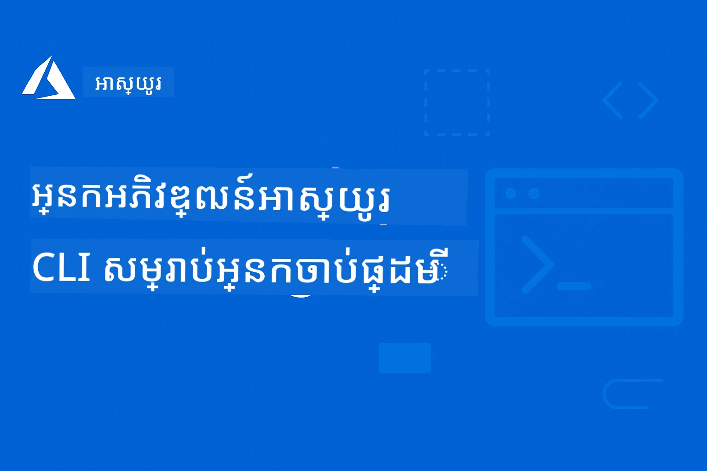

# AZD សម្រាប់អ្នកចាប់ផ្តើម៖ ការធ្វើដំណើររៀនដោយមានរចនាសម្ព័ន្ធ

 

[](https://github.com/microsoft/AZD-for-beginners)
[](https://GitHub.com/microsoft/azd-for-beginners/network/)
[](https://github.com/microsoft/AZD-for-beginners)

[](https://discord.com/invite/nkVh3dp)
[](https://discord.gg/nTYy5BXMWG)

---

### ការបកប្រែដោយស្វ័យប្រវត្តិ (រីងរាន់ជានិច្ច)

<!-- CO-OP TRANSLATOR LANGUAGES TABLE START -->
[Arabic](../ar/README.md) | [Bengali](../bn/README.md) | [Bulgarian](../bg/README.md) | [Burmese (Myanmar)](../my/README.md) | [Chinese (Simplified)](../zh-CN/README.md) | [Chinese (Traditional, Hong Kong)](../zh-HK/README.md) | [Chinese (Traditional, Macau)](../zh-MO/README.md) | [Chinese (Traditional, Taiwan)](../zh-TW/README.md) | [Croatian](../hr/README.md) | [Czech](../cs/README.md) | [Danish](../da/README.md) | [Dutch](../nl/README.md) | [Estonian](../et/README.md) | [Finnish](../fi/README.md) | [French](../fr/README.md) | [German](../de/README.md) | [Greek](../el/README.md) | [Hebrew](../he/README.md) | [Hindi](../hi/README.md) | [Hungarian](../hu/README.md) | [Indonesian](../id/README.md) | [Italian](../it/README.md) | [Japanese](../ja/README.md) | [Kannada](../kn/README.md) | [Khmer](./README.md) | [Korean](../ko/README.md) | [Lithuanian](../lt/README.md) | [Malay](../ms/README.md) | [Malayalam](../ml/README.md) | [Marathi](../mr/README.md) | [Nepali](../ne/README.md) | [Nigerian Pidgin](../pcm/README.md) | [Norwegian](../no/README.md) | [Persian (Farsi)](../fa/README.md) | [Polish](../pl/README.md) | [Portuguese (Brazil)](../pt-BR/README.md) | [Portuguese (Portugal)](../pt-PT/README.md) | [Punjabi (Gurmukhi)](../pa/README.md) | [Romanian](../ro/README.md) | [Russian](../ru/README.md) | [Serbian (Cyrillic)](../sr/README.md) | [Slovak](../sk/README.md) | [Slovenian](../sl/README.md) | [Spanish](../es/README.md) | [Swahili](../sw/README.md) | [Swedish](../sv/README.md) | [Tagalog (Filipino)](../tl/README.md) | [Tamil](../ta/README.md) | [Telugu](../te/README.md) | [Thai](../th/README.md) | [Turkish](../tr/README.md) | [Ukrainian](../uk/README.md) | [Urdu](../ur/README.md) | [Vietnamese](../vi/README.md)

> **ចូលចិត្តធ្វើការចម្លងនៅក្នុងតំបន់របស់អ្នក​?**
>
> សឹងតែមានការបកប្រែភាសាច្រើនជាង ៥០ ដែលបង្កើនទំហំទាញយកយ៉ាងខ្លាំង។ ដើម្បីចម្លងដោយគ្មានការបកប្រែ សូមប្រើការត្រួតពិនិត្យទាញយកតិចតួច ៖
>
> **Bash / macOS / Linux:**
> ```bash
> git clone --filter=blob:none --sparse https://github.com/microsoft/AZD-for-beginners.git
> cd AZD-for-beginners
> git sparse-checkout set --no-cone '/*' '!translations' '!translated_images'
> ```
>
> **CMD (Windows):**
> ```cmd
> git clone --filter=blob:none --sparse https://github.com/microsoft/AZD-for-beginners.git
> cd AZD-for-beginners
> git sparse-checkout set --no-cone "/*" "!translations" "!translated_images"
> ```
>
> នេះផ្ដល់វត្ថុបំណងទាំងអស់ដែលអ្នកត្រូវការ ដើម្បីបញ្ចប់វគ្គសិក្សាជាមួយនឹងការទាញយកលឿនជាងមុន។
<!-- CO-OP TRANSLATOR LANGUAGES TABLE END -->

## 🆕 មានអ្វីថ្មីនៅក្នុង azd ថ្ងៃនេះ

> 📌 **ព័ត៌មានបន្ទាប់ពីការចេញផ្សាយ Foundry GA (2026-11-09):** កញ្ចប់ **`microsoft.foundry` 1.0 គឺមានស្រាប់ សំរាប់ប្រើប្រាស់ទូទៅ**, ដែលបានផ្សព្វផ្សាយនៅថ្ងៃទី [5 ខែវិស្សាឆ្នាំ 2026](https://devblogs.microsoft.com/azure-sdk/microsoft-foundry-azure-developer-cli-ga/)។ ប្រើ **`azd >= 1.37.0`** ហើយដំឡើងវាជាមួយ `azd ext install microsoft.foundry`។ អនុវត្តតាម [មគ្គុទេសក៍អ្នកជំនួយដំណើរការផ្សាយ](docs/chapter-02-ai-development/microsoft-foundry-integration.md#hosted-agent-walkthrough-ga) សម្រាប់ការតំឡើង ប្រើសាកល្បងក្នុងស្រុក និងការបង្ហោះ។ ការតំឡើងនេះដើមពីការណែនាំបានបោះពុម្ពផ្សាយ មិនមែនជាការបង្ហោះ Azure តាមសកម្មភាពផ្ទាល់ទេ; កញ្ចប់ GA មិនបានធ្វើអោយមុខងារជាជម្រើស ផ្នែកបន្ថែម ឬ SDK គ្រប់យ៉ាងមានស្រាប់ទេ។

Azure Developer CLI គាំទ្រប្រភេទកម្មវិធីជាច្រើន រួមមានកម្មវិធីបណ្តាញ API ហើយនិងភ្នាក់ងារបញ្ញាសិប្បនិម្មិត ដោយប្រើម៉ាស៊ីនបម្រើ តំបន់តំរូវ និងផ្នែកបន្ថែមដែលគាំទ្រ។

នេះគឺជាការបញ្ជាក់សម្រាប់អ្នក៖

- **កញ្ចប់ GA សម្រាប់ការអភិវឌ្ឍ Foundry។** `microsoft.foundry` ដំឡើងផ្នែកបន្ថែមស្នូលប្រាំពីរជាមួយ រួមមានភ្នាក់ងារ គម្រោង និង Agent Inspector។ កូដភ្នាក់ងារ និងកំណត់ចេញផ្សាយនៅជាមួយគ្នា​នៅ `azure.yaml`។
- **សាកល្បងក្នុងស្រុក បន្ទាប់មកបង្ហោះកូដរបស់អ្នក។** ប្រើ `azd ai agent init --deploy-mode code`, `azd provision`, និង `azd ai agent run` សម្រាប់ពិនិត្យសំណើ និងការឆ្លើយតបក្នុងស្រុក។ បន្ទាប់មកប្រើ `azd deploy` សម្រាប់សំណង់ពីចម្ងាយក្នុង Foundry ដោយមិនចាំបាច់សង់ក្នុងកុងតែន័រក្នុងស្រុក។
- **វាស់វែងគុណភាពដោយផ្ទាល់ខ្លួន។** ដំឡើង **`azure.ai.evaluations`** សម្រាប់ `azd ai eval generate`, `init`, និង `run start`; វាមិនបានបញ្ចូលក្នុងកញ្ចប់នោះទេ។ រក្សាទុកឯកសារត្រួតពិនិត្យ និងតារាងវាយតម្លៃជាមួយកូដរបស់អ្នក។ គម្រោងចាស់គួរតែអនុវត្តតាម [មគ្គុទេសក៍រៀបចំវាយតម្លៃ និងបង្រ្កាបការផ្លាស់ប្តូរ](docs/chapter-08-production/production-ai-practices.md#evaluation-migration-and-quality-checks)។
- **បន្តប្រើការកំណត់រចនា​ក្នុង CI/CD។** បន្ទាប់ពីការបញ្ចប់ `azd up` ដោយជោគជ័យ សូមកំណត់រចនាច្រកការផ្លូវជាមួយ `azd pipeline config`។ ដំឡើងបន្ទុកនៅលើអ្នករត់ហើយរក្សាទុកការផ្ទៀងផ្ទាត់ និងការកំណត់បរិស្ថានដែលបានបង្កើត។
- **មូលដ្ឋានប្រចាំថ្ងៃរលូន។** ការចេញផ្សាយថ្មីៗបានធ្វើឱ្យ `azd init` មានលក្ខណៈ idempotent (សុវត្ថិភាពក្នុងការរត់ម្ដងទៀត), បានធ្វើឱ្យ `azd auth login` សម្អាតស្លាកសញ្ញាចាស់ដោយស្វ័យប្រវត្តិ និងបានបន្ថែមការផ្តល់កំណត់ដំណើរការដំបូងជាមិត្តភាពដោយ `azd tool`។
- **ដំណើរការស្នូលមិនបានផ្លាស់ប្តូរ។** មិនថាអ្នកកំពុងដាក់ឲ្យដំណើរការ Todo app, microservice, ឬដំណោះស្រាយ AI មានភ្នាក់ងារច្រើនដែរ ពាក្យបញ្ជា​គឺដូចគ្នាទាំងអស់។

> **កំណត់សម្គាល់សម្រាប់អ្នកប្រើ Aspire:** Microsoft ឥឡូវបានយោងផលិតផលនេះគ្រាប់មួយថា **Aspire** (មុននោះគឺ ".NET Aspire")។ ការគាំទ្រ azd Aspire មិនបានផ្លាស់ប្តូរ—គ្រាន់តែមានការកែលម្អឈ្មោះតែប៉ុណ្ណោះ។

ប្រសិនបើអ្នកបានប្រើ azd មកមុននេះ ការគាំទ្រ AI គឺជាការពន្យារពហុជាងមួយទូទៅ—មិនមែនជាឧបករណ៍ផ្សេងទេ ឬជាតំណផ្លូវខ្ពស់ទេ។ ប្រសិនបើអ្នកចាប់ផ្តើមថ្មី អ្នកនឹងរៀនមុខងារផ្ទាល់ខ្លួនមួយដែលដំណើរការសម្រាប់អ្វីៗគ្រប់យ៉ាង។

---

## 🚀 Azure Developer CLI (azd) ជាអ្វី?

**Azure Developer CLI (azd)** គឺជាឧបករណ៍បញ្ជា​ចំណុចបញ្ចូលមិត្តភាព​សម្រាប់អ្នកអភិវឌ្ឍន៍ ដែលធ្វើឱ្យការដាក់ឲ្យដំណើរការកម្មវិធីទៅ Azure ងាយស្រួល។ ជំនួសការបង្កើត និងភ្ជាប់ធនធាន Azure ច្រើនដៃក្នុងដៃ អ្នកអាចដាក់ឲ្យដំណើរការកម្មវិធីទាំងមូលជាមួយពាក្យបញ្ជាមួយ។

### មនោសញ្ចេតនាក្នុង `azd up`

```bash
# This single command does everything:
# ✅ Creates all Azure resources  
# ✅ Configures networking and security
# ✅ Builds your application code
# ✅ Deploys to Azure
# ✅ Gives you a working URL
azd up
```

កំណត់រចនាមូលដ្ឋានផ្តល់ជូនការកំណត់កម្មវិធី និងហេដ្ឋារចនាសម្ព័ន្ធ។ ការដាក់ឲ្យដំណើរការជោគជ័យត្រូវការសេវាកម្ម/ម៉ូដែលគាំទ្រ, គឺត្រូវមានសមត្ថភាពគ្រប់គ្រាន់ និងសិទ្ធិ, បញ្ចូលទិន្នន័យត្រឹមត្រូវ, និងការត្រួតពិនិត្យកម្មវិធីដែលបានដាក់ឲ្យដំណើរការ។ `azd up` មិនធ្វើឱ្យគំរូក្លាយជាសុវត្ថិភាព, មានការអនុលោម, ឬរួចរាល់សម្រាប់ផលិតកម្មដោយស្វ័យប្រវត្តិទេ។

---

## ❓ Azure Developer CLI ប្រៀបធៀបទៅនឹង Azure CLI: តើខុសគ្នាតើអ្វី?

នេះជាសំណួរដែលអ្នកចាប់ផ្តើមសួរញឹកញាប់បំផុត។ នេះជាចម្លើយសាមញ្ញ៖

| លក្ខណៈពិសេស | **Azure CLI (`az`)** | **Azure Developer CLI (`azd`)** |
|---------|---------------------|--------------------------------|
| **គោលបំណង** | គ្រប់គ្រងធនធាន Azure ឯកជន | គ្រប់គ្រងកម្មវិធីពេញលេញ |
| **ចិត្ដវិស័យ** | ផ្អែកលើហេដ្ឋារចនាសម្ព័ន្ធ | ផ្អែកលើកម្មវិធី |
| **ឧទាហរណ៍** | `az webapp create --name myapp...` | `azd up` |
| **កម្រិតរៀន** | ត្រូវដឹងសេវាកម្ម Azure | ត្រឹមតែដឹងកម្មវិធីរបស់អ្នក |
| **សមស្របបំផុតសម្រាប់** | DevOps, ហេដ្ឋារចនាសម្ព័ន្ធ | អ្នកអភិវឌ្ឍ, ការសាកល្បង |

### ឧទាហរណ៍សាមញ្ញ

- **Azure CLI** គឺដូចជាម៉ាស៊ីនរាល់ឧបករណ៍សម្រាប់សង់ផ្ទះ - អុំរក, ក្រចេះ, ទ្រនាប់។ អ្នកអាចសង់អ្វីយ៉ាងមួយបានទាំងអស់ ប៉ុន្តែត្រូវចេះសំណង់។
- **Azure Developer CLI** គឺដូចជាចុះហត្ថ​កម្មករ​ម្នាក់ - អ្នក​ពណ៌នា​អ្វី​ដែល​ចង់បាន ហើយគាត់ដោះស្រាយការសង់។

### ពេលណាដើម្បីប្រើប្រាស់មួយណា

| ហេតុការណ៍ | ប្រើអ្វីនេះ |
|----------|----------|
| "ខ្ញុំចង់បញ្ចេញកម្មវិធីវេបរបស់ខ្ញុំយ៉ាងឆាប់រហ័ស" | `azd up` |
| "ខ្ញុំត្រូវបង្កើតគណនីផ្ទុកមួយគត់" | `az storage account create` |
| "ខ្ញុំកំពុងសង់កម្មវិធី AI ពេញលេញមួយ" | `azd init --template azure-search-openai-demo` |
| "ខ្ញុំត្រូវតែឌីបភក់ធនធាន Azure មួយជាក់លាក់" | `az resource show` |
| "ខ្ញុំចង់បញ្ចេញទៅបរិយាកាសផលិតកម្មដែលបានកំណត់របស់ខ្ញុំ" | ពិនិត្យមើលការកំណត់, ការចូលប្រើ, ថ្លៃដើម និងច្រកប្រតិបត្តិការមុនពេល `azd up --environment production` |

### ពួកគេធ្វើការជាមួយគ្នា!

AZD និង Azure CLI មានប្រព័ន្ធផ្ទៀងផ្ទាត់ និងការកំណត់ខុសគ្នា។ ប្រើ `azd auth login` សម្រាប់ AZD ហើយ `az login` នៅពេលមានបន្ទាត់បញ្ជា ឬបញ្ជារវិភាគដែលត្រូវការអោយយល់ព្រម Azure CLI ។ អ្នកអាចប្រើទាំងពីរបាន៖
```bash
# Deploy your app with AZD
azd up

# Then fine-tune specific resources with Azure CLI
az webapp config set --name myapp --always-on true
```

---

## 🌟 រកមើលគំរូនៅក្នុង Awesome AZD

កុំចាប់ផ្តើមពីគ្មានអ្វី! **Awesome AZD** គឺជាការប្រមូលផ្តុំពីសហគមន៍នៃគំរូដែលអាចបញ្ចេញបានភ្លាមៗ៖

| ធនធាន | សេចក្ដីពិពណ៌នា |
|----------|-------------|
| 🔗 [**រូបភាព Awesome AZD**](https://azure.github.io/awesome-azd/) | រុករកគំរូ 200+ ជាមួយការបញ្ចេញក្នុងមួយចុច |
| 🔗 [**ដាក់ស្នើគំរូមួយ**](https://github.com/Azure/awesome-azd/issues) | រួមចំណែកគំរូរបស់អ្នកទៅសហគមន៍ |
| 🔗 [**ឃ្លាំង GitHub**](https://github.com/Azure/awesome-azd) | ផ្តាលតារា និងស្វែងយល់ប្រភព |

### គំរូ AI និយមពី Awesome AZD

ជ្រើសរើសគំរូមួយនៅក្នុងថតទទេមួយ riêngគ្នា; បញ្ជារខាងក្រោមជាជម្រើសជាច្រើន។ ការបញ្ចប់ `.` នាំឱ្យបង្កើតថតនោះ។

```bash
# RAG Chat with Microsoft Foundry Models + AI Search
azd init --template azure-search-openai-demo .

# Quick AI Chat Application
azd init --template openai-chat-app-quickstart .

# AI Agents with Foundry Agents
azd init --template get-started-with-ai-agents .
```

---

## 🎯 ចាប់ផ្តើមក្នុង 3 ជំហាន

មុននឹងចាប់ផ្តើម សូមប្រាកដថាម៉ាស៊ីនរបស់អ្នករួចរាល់សម្រាប់គំរូដែលអ្នកចង់បញ្ចេញ៖

**Windows:**
```powershell
.\validate-setup.ps1
```

**macOS / Linux:**
```bash
bash ./validate-setup.sh
```

ប្រសិនបើការត្រួតពិនិត្យដំណើរការណាមួយបរាជ័យ សូមជួសជុលវាមុន ហើយបន្តជាមួយការចាប់ផ្តើមរហ័ស។

### ជំហាន 1៖ តំឡើង AZD (2 នាទី)

**Windows:**
```powershell
winget install microsoft.azd
```

**macOS:**
```bash
brew tap azure/azd && brew install azd
```

**Linux:**
```bash
curl -fsSL https://aka.ms/install-azd.sh | bash
```

### ជំហាន 2៖ ផ្ទៀងផ្ទាត់សុពលភាពសម្រាប់ AZD

```bash
# Optional if you plan to use Azure CLI commands directly in this course
az login

# Required for AZD workflows
azd auth login
```

ប្រសិនបើអ្នកមិនប្រាកដថាតើត្រូវការមួយណា សូមអនុវត្តចរន្តការតំឡើងពេញលេញនៅក្នុង [Installation & Setup](docs/chapter-01-foundation/installation.md#authentication-setup)។

### ជំហានទី 3៖ បញ្ចេញកម្មវិធីដំបូងរបស់អ្នក

```bash
# Initialize from a template
azd init --template todo-nodejs-mongo .

# Deploy to Azure (creates everything!)
azd up
```

**🎉 គឺចប់ហើយ!** កម្មវិធីរបស់អ្នកឥឡូវនេះដំណើរការលើ Azure។

### សម្អាត (កុំភ្លេច!)

```bash
# Remove all resources when done experimenting
azd down --force --purge
```

---

## 📚 របៀបប្រើប្រាស់វគ្គសិក្សានេះ

វគ្គសិក្សានេះបានរចនាឡើងសម្រាប់ **ការសិក្សាជាបន្ត** - ចាប់ផ្តើមពីកន្លែងដែលអ្នកមានភាពងាយស្រួល ហើយបន្តរៀនឡើងទៅ៖

| ប្រវត្តិរបស់អ្នក | ចាប់ផ្តើមទីនេះ |
|-----------------|------------|
| **ថ្មីទេ ទៅ Azure** | [ជំពូក 1៖ មូលដ្ឋាន](#-chapter-1-foundation--quick-start) |
| **ស្គាល់ Azure មុន ប៉ុន្តានៅថ្មី AZD** | [ជំពូក 1៖ មូលដ្ឋាន](#-chapter-1-foundation--quick-start) |
| **ចង់បញ្ចេញកម្មវិធី AI** | [ជំពូក 2៖ ការអភិវឌ្ឍ AI ជាមុន](#-chapter-2-ai-first-development-recommended-for-ai-developers) |
| **ចង់មានហ្វូងហាត់ដៃ** | [🎓 ឧទ្យានហ្វូងអន្តរកម្ម](workshop/README.md) - ពេលវេលាដឹកនាំ 3-4 ម៉ោង |
| **ត្រូវការគំរូផលិតកម្ម** | [ជំពូក 8៖ ផលិតកម្ម និងសហគ្រាស](#-chapter-8-production--enterprise-patterns) |

### ការតំឡើងរហ័ស

1. **ចម្លងផ្នែកនេះ**: [](https://GitHub.com/microsoft/azd-for-beginners/fork)
2. **ចម្លងវា**: `git clone https://github.com/YOUR-USERNAME/azd-for-beginners.git`
3. **សុំជំនួយ**: [សហគមន៍ Discord របស់ Azure](https://discord.com/invite/ByRwuEEgH4)

> **ចូលចិត្តចម្លងក្នុងស្រុកឬ?**

> ពហុការបញ្ចូលភាសាចំនួន 50+ ត្រូវបានរួមបញ្ចូលក្នុងឃ្លាំងនេះ ដែលបង្កើនទំហំទាញយកយ៉ាងខ្លាំង។ ដើម្បីចម្លងដោយគ្មានការបកប្រែ សូមប្រើ sparse checkout៖
> ```bash
> git clone --filter=blob:none --sparse https://github.com/microsoft/AZD-for-beginners.git
> cd AZD-for-beginners
> git sparse-checkout set --no-cone '/*' '!translations' '!translated_images'
> ```
> នេះផ្តល់ឱ្យអ្នកនូវអ្វីដែលអ្នកត្រូវការទាំងអស់ដើម្បីបញ្ចប់វគ្គសិក្សាដោយមានការទាញយកលឿនជាងមុន។


## ទិដ្ឋភាពទូទៅនៃវគ្គសិក្សា

ចេះ Azure Developer CLI (azd) តាមរយៈជំពូកដែលមានរចនាសម្ព័ន្ធសម្រាប់ការសិក្សាផ្ដល់ជំហានៗ។ **ផ្តោតជាពិសេសលើការដាក់ពាក្យកម្មវិធី AI ជាមួយបញ្ចូលពិភព Microsoft Foundry ។**

### ហេតុផលដែលវគ្គសិក្សានេះមានសារៈសំខាន់សម្រាប់អ្នកអភិវឌ្ឍបច្ចុប្បន្ន

អ្នកអភិវឌ្ឍដែលដាក់ពាក្យកម្មវិធី AI ធម្មតាចង់បានការណែនាំពី៖
- វេជ្ជបណ្ឌិត AI ពហុសេវាកម្មដែលស្មុគស្មាញ
- ជំនាញល្អបំផុតសម្រាប់ការដាក់ពាក្យកម្មវិធី AI ផលិតកម្ម  
- ការបញ្ចូលសេវាកម្ម AI Azure និងការកំណត់រចនាសម្ព័ន្ធ
- ការប្រើប្រាស់ថ្លៃដើមសម្រាប់មុខងារ AI
- ដោះស្រាយបញ្ហាក្នុងការដាក់ពាក្យកម្មវិធី AI ជាក់លាក់

### គោលដៅការសិក្សា

ក្រោយពេលបញ្ចប់វគ្គសិក្សារចនាសម្ព័ន្ធនេះ អ្នកនឹង:
- **ចេះ AZD មូលដ្ឋាន**៖ គំនិតមូលដ្ឋាន ការតម្លើង និងការកំណត់រចនាសម្ព័ន្ធ
- **ដាក់ពាក្យកម្មវិធី AI**៖ ប្រើ AZD ជាមួយសេវាកម្ម Microsoft Foundry
- **អនុវត្តបុគ្គលិកមូលដ្ឋានជា Code**៖ គ្រប់គ្រងធនធាន Azure ដោយប្រើប្លង់ Bicep
- **ដោះស្រាយបញ្ហាការដាក់ពាក្យកម្មវិធី**៖ ដោះស្រាយបញ្ហាទូទៅ និងបញ្ហាដាក់ពាក្យកម្មវិធី
- **បង្កើនប្រសិទ្ធភាពសម្រាប់ផលិតកម្ម**៖ សុវត្ថិភាព ការពង្រីក ការត្រួតពិនិត្យ និងការគ្រប់គ្រងថ្លៃដើម
- **សាងសង់ដំណោះស្រាយភ្នាក់ងារច្រើន**៖ ដាក់ពាក្យកម្មវិធី AI ពហុសេវាកម្ម

## មុនចាប់ផ្តើម៖ គណនី, ការចូលដំណើរការ និងការអនុញ្ញាត

មុនចាប់ផ្តើមជំពូកទី 1 សូមប្រាកដថាអ្នកមានអ្វីទាំងនេះ។ ជំហានតម្លើងនៅក្រោមណែនាំទាំងនេះសន្មតថានេះគឺបានរៀបចំរួចហើយ។

- **ការជាវ Azure**៖ អ្នកអាចប្រើការជាវដែលមានរួចរបស់ក្រុមហ៊ុនឬគណនីផ្ទាល់ខ្លួនរបស់អ្នក ឬបង្កើត [សាកល្បងមិនគិតថ្លៃ](https://aka.ms/azurefreetrial) ដើម្បីចាប់ផ្តើម។
- **សិទ្ធិបង្កើតធនធាន Azure**៖ សំរាប់លំហាត់ភាគច្រើន អ្នកគួរតែមានសិទ្ធិ **អ្នករួមចំណែក** នៅលើការជាវឬក្រុមធនធានគោលដៅ។ ជំពូកខ្លះត្រូវការឲ្យអ្នកអាចបង្កើតក្រុមធនធាន គណនីគ្រប់គ្រង និងការចាត់តាំង RBAC។
- [**គណនី GitHub**](https://github.com)៖ វាដំណើរការសម្រាប់បង្កើត fork ទៅឃ្លាំង កត់ត្រាបម្លែងរបស់ខ្លួន និងប្រើ GitHub Codespaces សម្រាប់សិក្ខាសាលា។
- **តម្រូវការឧបករណ៍រត់ពេលនៃប្លង់**៖ ប្លង់ខ្លះត្រូវការឧបករណ៍ក្នុងលោកដូចជា Node.js, Python, Java ឬ Docker។ ប្រតិបត្តិការត្រួតពិនិត្យការតំឡើងមុនចាប់ផ្តើមដើម្បីរកឧបករណ៍ខ្វះ។ 
- **ការស្គាល់បញ្ជាលេខមូលដ្ឋាន**៖ អ្នកមិនចាំបាច់ជាអ្នកជំនាញទេ ប៉ុន្តែគួរតែសូវស្រួលចាប់ផ្តើមបញ្ជា Command ដូចជា `git clone`, `azd auth login` និង `azd up`។

> **ធ្វើបច្ចុប្បន្នភាពក្នុងការជាវសហគ្រាស?**
> បើបរិបទ Azure របស់អ្នកត្រូវបានគ្រប់គ្រងដោយអ្នកគ្រប់គ្រង សូមបញ្ជាក់ជាមុនថាអ្នកអាចដាក់ធនធានក្នុងការជាវឬក្រុមធនធានដែលអ្នកគ្រោងប្រើ។ បើមិនដូច្នោះ សូមស្នើរសុំការជាវ sandbox ឬសិទ្ធិ Contributor មុនចាប់ផ្តើម។

> **ថ្មីចំពោះ Azure?**
> ចាប់ផ្តើមជាមួយការជាវសាកល្បងនៃ Azure របស់អ្នកឬការជាវបង់ប្រាក់ឥឡូវនេះដែលមាននៅ https://aka.ms/azurefreetrial ដូច្នេះអ្នកអាចធ្វើលំហាត់ទាំងអស់បានជាលំដាប់ដោយមិនចាំបាច់រង់ចាំការអនុម័តកម្រិត tenant។

## 🗺️ ផែនទីវគ្គសិក្សា៖ ផ្លូវបឋមបន្ទាន់តាមជំពូក

ជំពូកនីមួយៗមាន README ផ្តាច់មុខ នឹងបច្ចេកទេសសិក្សា ការចាប់ផ្តើមយ៉ាងរហ័ស និងលំហាត់៖

| ជំពូក | សារធាតុ | មេរៀន | រយៈពេល | កម្រិតស្មុគស្មាញ |
|---------|-------|---------|----------|------------|
| **[ជំពូក 1៖ មូលដ្ឋាន](docs/chapter-01-foundation/README.md)** | ចាប់ផ្តើម | [AZD មូលដ្ឋាន](docs/chapter-01-foundation/azd-basics.md) &#124; [តម្លើង](docs/chapter-01-foundation/installation.md) &#124; [គម្រោងដំបូង](docs/chapter-01-foundation/first-project.md) | 30-45 នាទី | ⭐ |
| **[ជំពូក 2៖ អភិវឌ្ឍ AI](docs/chapter-02-ai-development/README.md)** | កម្មវិធី AI ជាចម្បង | [បញ្ចូល Foundry](docs/chapter-02-ai-development/microsoft-foundry-integration.md) &#124; [ភ្នាក់ងារ AI](docs/chapter-02-ai-development/agents.md) &#124; [ការដាក់ពាក្យម៉ូដែល](docs/chapter-02-ai-development/ai-model-deployment.md) &#124; [សិក្ខាសាលា](docs/chapter-02-ai-development/ai-workshop-lab.md) | 1-2 ម៉ោង | ⭐⭐ |
| **[ជំពូក 3៖ ការកំណត់រចនាសម្ព័ន្ធ](docs/chapter-03-configuration/README.md)** | អនុញ្ញាត និង សុវត្ថិភាព | [ការកំណត់រចនាសម្ព័ន្ធ](docs/chapter-03-configuration/configuration.md) &#124; [អនុញ្ញាត & សុវត្ថិភាព](docs/chapter-03-configuration/authsecurity.md) | 45-60 នាទី | ⭐⭐ |
| **[ជំពូក 4៖ ពហុគ្រឹះសម្បទា](docs/chapter-04-infrastructure/README.md)** | IaC និង ការដាក់ពាក្យ | [មគ្គុទេសក៍ការដាក់ពាក្យ](docs/chapter-04-infrastructure/deployment-guide.md) &#124; [ការផ្ដល់ប្រាក់](docs/chapter-04-infrastructure/provisioning.md) | 1-1.5 ម៉ោង | ⭐⭐⭐ |
| **[ជំពូក 5៖ ភ្នាក់ងារច្រើន](docs/chapter-05-multi-agent/README.md)** | ដំណោះស្រាយភ្នាក់ងារពហុ | [សេណារីយោលខ្លះ](examples/retail-scenario.md) &#124; [លំនាំកូអឌីណាដ់](docs/chapter-06-pre-deployment/coordination-patterns.md) | 2-3 ម៉ោង | ⭐⭐⭐⭐ |
| **[ជំពូក 6៖ មុនការដាក់ពាក្យ](docs/chapter-06-pre-deployment/README.md)** | ការផែនការ និង ការត្រួតពិនិត្យ | [ការត្រួតពិនិត្យមុន](docs/chapter-06-pre-deployment/preflight-checks.md) &#124; [ផែនការថាមពល](docs/chapter-06-pre-deployment/capacity-planning.md) &#124; [ការជ្រើសរើស SKU](docs/chapter-06-pre-deployment/sku-selection.md) &#124; [App Insights](docs/chapter-06-pre-deployment/application-insights.md) | 1 ម៉ោង | ⭐⭐ |
| **[ជំពូក 7៖ ដោះស្រាយបញ្ហា](docs/chapter-07-troubleshooting/README.md)** | ការវិភាគ និង ជួសជុល | [បញ្ហាទូទៅ](docs/chapter-07-troubleshooting/common-issues.md) &#124; [ការវិភាគ](docs/chapter-07-troubleshooting/debugging.md) &#124; [បញ្ហា AI](docs/chapter-07-troubleshooting/ai-troubleshooting.md) | 1-1.5 ម៉ោង | ⭐⭐ |
| **[ជំពូក 8៖ ផលិតកម្ម](docs/chapter-08-production/README.md)** | លំនាំសហគ្រាស | [ជំនាញផលិតកម្ម](docs/chapter-08-production/production-ai-practices.md) | 2-3 ម៉ោង | ⭐⭐⭐⭐ |
| **[🎓 សិក្ខាសាលា](workshop/README.md)** | មន្ទីរពិសោធន៍ | [មើលទៅទូទៅ](workshop/docs/instructions/0-Introduction.md) &#124; [ជ្រើសរើស](workshop/docs/instructions/1-Select-AI-Template.md) &#124; [ត្រួតពិនិត្យ](workshop/docs/instructions/2-Validate-AI-Template.md) &#124; [បំបែក](workshop/docs/instructions/3-Deconstruct-AI-Template.md) &#124; [កំណត់រចនាសម្ព័ន្ធ](workshop/docs/instructions/4-Configure-AI-Template.md) &#124; [ប្តូរតាមចំណូលចិត្ត](workshop/docs/instructions/5-Customize-AI-Template.md) &#124; [បញ្ចប់](workshop/docs/instructions/6-Teardown-Infrastructure.md) &#124; [សង្ខេប](workshop/docs/instructions/7-Wrap-up.md) | 3-4 ម៉ោង | ⭐⭐ |

**រយៈពេលសរុបវគ្គសិក្សា:** ~10-14 ម៉ោង | **បន្តការជំនាញ:** អ្នកចាប់ផ្តើម → រួចរាល់សម្រាប់ផលិតកម្ម

---

## 📚 ជំពូកសិក្សា

*ជ្រើសរើសផ្លូវសិក្សារបស់អ្នកដោយផ្អែកលើកម្រិតបទពិសោធន៍ និងគោលបំណង*

### 🚀 ជំពូក 1៖ មូលដ្ឋាន និង ចាប់ផ្តើមយ៉ាងរហ័ស
**តម្រូវការជាមុន**៖ ការជាវ Azure, ចំណេះដឹងបញ្ជាលេខមូលដ្ឋាន  
**រយៈពេល**៖ 30-45 នាទី  
**កម្រិតស្មុគស្មាញ**៖ ⭐

#### អ្វីដែលអ្នកនឹងរៀន
- យល់ដឹងពីមូលដ្ឋាន Azure Developer CLI
- តម្លើង AZD នៅលើវេទិការបស់អ្នក
- ដាក់ពាក្យកម្មវិធីដំបូងបានជោគជ័យ

#### ប្រភពសិក្សា
- **🎯 ចាប់ផ្តើមទីនេះ**៖ [Azure Developer CLI គឺអ្វី?](#-what-is-azure-developer-cli-azd)
- **📖 ទ្រឹស្តី**៖ [AZD មូលដ្ឋាន](docs/chapter-01-foundation/azd-basics.md) - គំនិតមូលដ្ឋាន និងពាក្យ
- **⚙️ តំឡើង**៖ [តម្លើង & ការតំឡើង](docs/chapter-01-foundation/installation.md) - លទ្ធផលគ្រប់វេទិកា
- **🛠️ ដោយដៃ**៖ [គម្រោងដំបូងរបស់អ្នក](docs/chapter-01-foundation/first-project.md) - មេរៀនជំហាន​ដំណាក់កាល
- **📋 ឯកសារយោងរហ័ស**៖ [តារាងបញ្ជាការណ៍](resources/cheat-sheet.md)

#### លំហាត់អនុវត្ត
```bash
# Quick installation check
azd version

# Deploy your first application
azd init --template todo-nodejs-mongo .
azd up
```

**💡 លទ្ធផលជំពូក**៖ ដាក់ពាក្យកម្មវិធីគេហទំព័រងាយស្រួលទៅ Azure ដោយប្រើ AZD បានជោគជ័យ

**✅ ការផ្ទៀងផ្ទាត់ជោគជ័យ:**
```bash
# After completing Chapter 1, you should be able to:
azd version              # Shows installed version
azd init --template todo-nodejs-mongo  # Initializes project
azd up                  # Deploys to Azure
azd show                # Displays running app URL
# Application opens in browser and works
azd down --force --purge  # Cleans up resources
```

**📊 រយៈពេលវិនិយោគ:** 30-45 នាទី  
**📈 កម្រិតជំនាញបន្ទាប់ពីនេះ:** អាចដាក់ពាក្យកម្មវិធីមូលដ្ឋានដោយឯករាជ្យ

---

### 🤖 ជំពូក 2៖ ការអភិវឌ្ឍជាមុន AI (ណែនាំសម្រាប់អ្នកអភិវឌ្ឍ AI)
**តម្រូវការជាមុន**៖ ជំពូក 1 បានបញ្ចប់  
**រយៈពេល**៖ 1-2 ម៉ោង  
**កម្រិតស្មុគស្មាញ**៖ ⭐⭐

#### អ្វីដែលអ្នកនឹងរៀន
- បញ្ចូល Microsoft Foundry ជាមួយ AZD
- ដាក់កម្មវិធីដែលបង្កើតដោយ AI
- យល់ដឹងពីការកំណត់រចនាសម្ព័ន្ធសេវាកម្ម AI

#### ប្រភពសិក្សា
- **🎯 ចាប់ផ្តើមទីនេះ**៖ [បញ្ចូល Microsoft Foundry](docs/chapter-02-ai-development/microsoft-foundry-integration.md)
- **🤖 ភ្នាក់ងារ AI**៖ [មគ្គុទេសក៍ភ្នាក់ងារ AI](docs/chapter-02-ai-development/agents.md) - ដាក់ភ្នាក់ងារចំណេះដឹងជាមួយ AZD
- **📖 លំនាំ**៖ [ការដាក់កម្មវិធីម៉ូដែល AI](docs/chapter-02-ai-development/ai-model-deployment.md) - ដាក់ និងគ្រប់គ្រងម៉ូដែល AI
- **🛠️ សិក្ខាសាលា**៖ [មន្ទីរពិសោធន៍ AI](docs/chapter-02-ai-development/ai-workshop-lab.md) - បង្កើតដំណោះស្រាយ AI ដែលរួមបញ្ចូល AZD
- **🎥 មគ្គុទេសក៍អន្តរកម្ម**៖ [សម្ភារសិក្សា](workshop/README.md) - រៀនតាមកម្មវិធីរោទ៍ MkDocs * បរិស្ថាន DevContainer
- **📋 ប្លង់**៖ [ប្លង់ Microsoft Foundry](#featured-microsoft-foundry-templates)
- **📝 ឧទាហរណ៍**៖ [ឧទាហរណ៍ AZD Deployment](examples/README.md)

#### លំហាត់អនុវត្ត
```bash
# Deploy your first AI application
azd init --template azure-search-openai-demo .
azd up

# Try additional AI templates
azd init --template openai-chat-app-quickstart .
azd init --template agent-openai-python-prompty .
```

**💡 លទ្ធផលជំពូក**៖ ដាក់ និងកំណត់រចនាសម្ព័ន្ធកម្មវិធីឆាតដែលគាំទ្រ AI មានសមត្ថភាព RAG

**✅ ការផ្ទៀងផ្ទាត់ជោគជ័យ:**
```bash
# After Chapter 2, you should be able to:
azd init --template azure-search-openai-demo .
azd up
# Test the AI chat interface
# Ask questions and get AI-powered responses with sources
# Verify search integration works
azd monitor  # Check Application Insights shows telemetry
azd down --force --purge
```

**📊 រយៈពេលវិនិយោគ:** 1-2 ម៉ោង  
**📈 កម្រិតជំនាញបន្ទាប់ពីនេះ:** អាចដាក់កម្មវិធីសិក្សា AI និងស្គាល់តម្រូវការច្រើនជាងនេះសម្រាប់ផលិតកម្ម
**💰 ការយល់ដឹងអំពីថ្លៃដើម:** យល់ពីថ្លៃអភិវឌ្ឍ $80-150/ខែ និងថ្លៃផលិតកម្ម $300-3500/ខែ

#### 💰 ការពិចារណារួមទាំងថ្លៃដើមសម្រាប់ការដាក់ AI

**បរិយាកាសអភិវឌ្ឍ (ប្រមាណ $80-150/ខែ):**
- ម៉ូដែល Microsoft Foundry (បង់តាមប្រើប្រាស់): $0-50/ខែ (អាស្រ័យលើការប្រើប្រាស់ token)
- ស្វែងរក AI (ជាន់មូលដ្ឋាន): $75/ខែ
- កម្មវិធី Container (ប្រើប្រាស់): $0-20/ខែ
- ស្តុក (ស្តង់ដា): $1-5/ខែ

**បរិយាកាសផលិតកម្ម (ប្រមាណ $300-3,500+/ខែ):**
- ម៉ូដែល Microsoft Foundry (PTU សម្រាប់មុខងារជាប់លាប់): $3,000+/ខែ ឬបង់តាមប្រើប្រាស់ជាមួយបរិមាណច្រើន
- ស្វែងរក AI (ជាន់ស្តង់ដា): $250/ខែ
- កម្មវិធី Container (ឧបករណ៍ផ្ដល់ជូន): $50-100/ខែ
- Application Insights: $5-50/ខែ
- ស្តុក (ជាន់ព្រីមៀម): $10-50/ខែ

**💡 ម איםជួយបន្ថយថ្លៃដើម៖**
- ពិនិត្យតម្លៃស្មើម៉ូដែល និងឥណទានក្នុងគណនី; Azure OpenAI មិនរាប់បញ្ចូលការផ្តល់ជូនសេវាមួយ 50,000 token ទទួលខុសត្រូវរៀងរាល់ខែ
- ប្រតិបត្តិ `azd down` ដើម្បីលុបធនធានបន្ទាប់ពីមិនចាំបាច់ ប្រសិនបើបានពិនិត្យបរិយាកាសដែលបានជ្រើសរើសរួច
- ចាប់ផ្តើមជាមួយវិធីបង់ប្រាក់តាមការប្រើប្រាស់ បន្ទាប់ពីនោះផ្លាស់ទៅ PTU សម្រាប់ផលិតកម្មតែប៉ុណ្ណោះ
- ប្រើ `azd provision --preview` ដើម្បីពិនិត្យផែនការគ្រឹះសម្បទា បន្ទាប់មកគណនាតម្លៃធនធាននោះជាមួយកំណត់តម្លៃ Azure Pricing Calculator
- បើកអូតូស្កាលៈ បង់ត្រឹមតែការប្រើប្រាស់ពិតប្រាកដ

**ការត្រួតពិនិត្យថ្លៃដើម៖**
```bash
# Inspect planned resources (this does not calculate prices)
azd provision --preview

# Monitor actual costs in Azure Portal
az consumption budget list --resource-group <your-rg>
```

---

### ⚙️ ជំពូក 3៖ កំណត់រចនាសម្ព័ន្ធ និង អនុញ្ញាត
**តម្រូវការជាមុន**៖ ជំពូក 1 បានបញ្ចប់  
**រយៈពេល**៖ 45-60 នាទី  
**កម្រិតស្មុគស្មាញ**៖ ⭐⭐

#### អ្វីដែលអ្នកនឹងរៀន
- ការកំណត់បរិយាកាស និង ការគ្រប់គ្រងវា
- អន្តរកម្ម និង ល្អបំផុតសុវត្ថិភាព
- ការប្រើឈ្មោះធនធាន និង សមាសទ្រង់ទ្រាយ

#### ប្រភពសិក្សា
- **📖 ការកំណត់**៖ [មគ្គុទេសក៍ការកំណត់រចនាសម្ព័ន្ធ](docs/chapter-03-configuration/configuration.md) - ការតំឡើងបរិយាកាស
- **🔐 សុវត្ថិភាព**៖ [លំនាំអន្តរកម្ម និង គណនីគ្រប់គ្រង](docs/chapter-03-configuration/authsecurity.md) - លំនាំអន្តរកម្ម
- **📝 ឧទាហរណ៍**៖ [ឧទាហរណ៍កម្មវិធីទិន្នន័យ](examples/database-app/README.md) - ឧទាហរណ៍ AZD Database

#### លំហាត់អនុវត្ត
- កំណត់បរិយាកាសជាច្រើន (dev, staging, prod)
- កំណត់អន្តរកម្មគ្រប់គ្រង
- អនុវត្តការកំណត់បរិយាកាសជាក់លាក់

**💡 លទ្ធផលជំពូក**៖ គ្រប់គ្រងបរិយាកាសជាច្រើនជាមួយការអន្តរកម្ម និងសុវត្ថិភាពត្រឹមត្រូវ

---

### 🏗️ ជំពូក 4៖ វិស្វកម្មជា Code និង ការដាក់ពាក្យ
**តម្រូវការជាមុន**៖ ជំពូក 1-3 បានបញ្ចប់  
**រយៈពេល**៖ 1-1.5 ម៉ោង  
**កម្រិតស្មុគស្មាញ**៖ ⭐⭐⭐

#### អ្វីដែលអ្នកនឹងរៀន
- លំនាំការដាក់ពាក្យកម្រិតកំពូល
- វិស្វកម្មជា Code ជាមួយ Bicep
- ផែនការផ្ដល់ប្រាក់ធនធាន

#### ប្រភពសិក្សា
- **📖 ការដាក់ពាក្យ**៖ [មគ្គុទេសក៍ការដាក់ពាក្យ](docs/chapter-04-infrastructure/deployment-guide.md) - ការងារពេញលេញ
- **🏗️ ផ្ដល់ប្រាក់**៖ [ការគ្រប់គ្រងធនធាន](docs/chapter-04-infrastructure/provisioning.md) - ការគ្រប់គ្រងធនធាន Azure
- **📝 ឧទាហរណ៍**៖ [ករណីកម្មវិធី Container](../../examples/container-app) - ការដាក់កម្មវិធីជា container

#### លំហាត់អនុវត្ត
- បង្កើតប្លង់ Bicep ផ្ទាល់ខ្លួន
- ដាក់កម្មវិធីពហុសេវាកម្ម
- អនុវត្តលំនាំការដាក់ប្លង់ blue-green

**💡 លទ្ធផលជំពូក**៖ ដាក់កម្មវិធីពហុសេវាកម្មស្មុគស្មាញដោយប្រើប្លង់អនាគតទ្រង់ទ្រាយផ្ទាល់ខ្លួន

---

### 🎯 ជំពូក 5៖ ដំណោះស្រាយ AI ដែលមានអ្នកបំរើជាច្រើន (កម្រិតខ្ពស់)
**តម្រូវការជាមុន**៖ ជំពូក 1-2 បានបញ្ចប់  
**រយៈពេល**៖ 2-3 ម៉ោង  
**កម្រិតស្មុគស្មាញ**៖ ⭐⭐⭐⭐

#### អ្វីដែលអ្នកនឹងរៀន
- លំនាំស្ថាបត្យកម្មអ្នកបំរើជាច្រើន
- ការសម្របសម្រួល និងការសហការភ្នាក់ងារជាច្រើន
- ការដាក់ពាក្យ AI សម្រាប់ផលិតកម្ម

#### ប្រភពសិក្សា
- **🤖 រចនាប័ទ្មពិសេស**: [ដំណោះស្រាយភ្នាក់ងារច្រើនលក់រាយ](examples/retail-scenario.md) - គំនូសស្ថាបត្យកម្ម មិនមែនកម្មវិធីពេញលេញ
- **🛠️ ស្លាកសញ្ញា ARM**: [កញ្ចប់ស្លាកសញ្ញា ARM](../../examples/retail-multiagent-arm-template) - ស៊្វេតហ្វូលផ្នែកហេដ្ឋារចនាសម្ព័ន្ធ; ពិនិត្យមើលការតម្រូវនិងធាតុអនុវត្តកម្មវិធីដែលខ្វះ
- **📖 ស្ថាបត្យកម្ម**: [គំរូសម្របសម្រួលភ្នាក់ងារច្រើន](docs/chapter-06-pre-deployment/coordination-patterns.md) - គំរូ

#### ការអនុវត្តជាក់ស្តែង
```bash
# Inspect the retail infrastructure scaffold before choosing to deploy it
cd examples/retail-multiagent-arm-template
cat README.md

# After an intentional deployment, inspect infrastructure state
az deployment group show --resource-group <rg-name> --name <deployment-name>
```

**💡 លទ្ធផលមេរៀន**: យល់ដឹងពីរចនាប័ទ្មភ្នាក់ងារច្រើន និងកំណត់សម្គាល់ការអនុវត្ត ការផ្ទៀងផ្ទាត់ និងការងារប្រតិបត្តិការដែលចាំបាច់នៅលើសពីស៊្វេតហ្វូលហេដ្ឋារចនាសម្ព័ន្ធ

---

### 🔍 មេរៀនទី 6: ការផ្ទៀងផ្ទាត់ និងការធ្វើផែនការ មុនការតំឡើង
**ការតម្រូវជាមុន**: បានបញ្ចប់មេរៀនទី 4  
**រយៈពេល**: 1 ម៉ោង  
**កម្រិតស្មុគស្មាញ**: ⭐⭐

#### អ្វីដែលអ្នកនឹងរៀន
- គ្រោងសមត្ថភាព និងការផ្ទៀងផ្ទាត់ធនធាន
- ន គន្លឹះជ្រើសរើស SKU
- ការពិនិត្យមុនការហោះ និងស្វ័យប្រវត្តិ

#### ឯកសារស្ទូឌីង
- **📊 ការធ្វើផែនការ**: [ការគ្រោងសមត្ថភាព](docs/chapter-06-pre-deployment/capacity-planning.md) - ការផ្ទៀងផ្ទាត់ធនធាន
- **💰 ជ្រើសរើស**: [ជ្រើសរើស SKU](docs/chapter-06-pre-deployment/sku-selection.md) - ជម្រើសដែលសន្សំឈ្នួលបាន
- **✅ ផ្ទៀងផ្ទាត់**: [ការពិនិត្យមុនការហោះ](docs/chapter-06-pre-deployment/preflight-checks.md) - ស្គ្រីបស្វ័យប្រវត្តិ

#### ការអនុវត្តជាក់ស្តែង
- រត់ស្គ្រីបផ្ទៀងផ្ទាត់សមត្ថភាព
- បង្កើនប្រសិទ្ធភាពការជ្រើសរើស SKU សម្រាប់ការចំណាយ
- អនុវត្តការត្រួតពិនិត្យស្វ័យប្រវត្តិមុនការតំឡើង

**💡 លទ្ធផលមេរៀន**: ផ្ទៀងផ្ទាត់ និងបង្កើនប្រសិទ្ធភាពការតំឡើង មុនការអនុវត្ត

---

### 🚨 មេរៀនទី 7: ការដោះស្រាយបញ្ហា និងការបំបែកកំហុស
**ការតម្រូវជាមុន**: បានបញ្ចប់មេរៀនណាមួយក្នុងការតំឡើង  
**រយៈពេល**: 1-1.5 ម៉ោង  
**កម្រិតស្មុគស្មាញ**: ⭐⭐

#### អ្វីដែលអ្នកនឹងរៀន
- វិធីសាស្រ្តដោះស្រាយកំហុសជារបៀបប្រព័ន្ធ
- បញ្ហាទូទៅ និងដំណោះស្រាយ
- ការដោះស្រាយបញ្ហាគ្រប់គ្រងដោយ AI

#### ឯកសារស្ទូឌីង
- **🔧 បញ្ហាទូទៅ**: [បញ្ហាទូទៅ](docs/chapter-07-troubleshooting/common-issues.md) - សំណួរញឹកញាប់ និងដំណោះស្រាយ
- **🕵️ ការដោះស្រាយកំហុស**: [មគ្គុទេសក៍ដោះស្រាយកំហុស](docs/chapter-07-troubleshooting/debugging.md) - យុទ្ធសាស្រ្តជំហានក្នុងជំហាន
- **🤖 បញ្ហា AI**: [ការដោះស្រាយបញ្ហាគ្រប់គ្រងដោយ AI](docs/chapter-07-troubleshooting/ai-troubleshooting.md) - បញ្ហាសេវាកម្ម AI

#### ការអនុវត្តជាក់ស្តែង
- វិភាគបរាជ័យការតំឡើង
- ដោះស្រាយបញ្ហាស្គាល់ភាព
- ដោះស្រាយបញ្ហាការតភ្ជាប់សេវាកម្ម AI

**💡 លទ្ធផលមេរៀន**: វិភាគ និងដោះស្រាយបញ្ហាដែលកើតឡើងក្នុងការតំឡើងដោយឯករាជ្យ

---

### 🏢 មេរៀនទី 8: លំនាំផលិតកម្ម និងបុគ្គលិកសហគ្រាស
**ការតម្រូវជាមុន**: បានបញ្ចប់មេរៀនទី 1-4  
**រយៈពេល**: 2-3 ម៉ោង  
**កម្រិតស្មុាគស្មាញ**: ⭐⭐⭐⭐

#### អ្វីដែលអ្នកនឹងរៀន
- យុទ្ធសាស្រ្តការតំឡើងផលិតកម្ម
- លំនាំសន្តិសុខបុគ្គលិកសហគ្រាស
- ការត្រួតពិនិត្យ និងបង្កើនប្រសិទ្ធភាពចំណាយ

#### ឯកសារស្ទូឌីង
- **🏭 ផលិតកម្ម**: [អនុសាសន៍ល្អ AI ផលិតកម្ម](docs/chapter-08-production/production-ai-practices.md) - លំនាំសហគ្រាស
- **📝 ឧទាហរណ៍**: [ឧទាហរណ៍សេវាមីក្រូ](../../examples/microservices) - ស្ថាបត្យកម្មស្មុគស្មាញ
- **📊 ការត្រួតពិនិត្យ**: [ការរួមបញ្ចូលពិនិត្យពាក្យប្រតិបត្តិការ](docs/chapter-06-pre-deployment/application-insights.md) - ការត្រួតពិនិត្យ

#### ការអនុវត្តជាក់ស្តែង
- អនុវត្តលំនាំសន្តិសុខសហគ្រាស
- រៀបចំការត្រួតពិនិត្យដ៏ទូលំទូលាយ
- តំឡើងទៅផលិតកម្មជាមួយការគ្រប់គ្រងដែលសមរម្យ

**💡 លទ្ធផលមេរៀន**: តំឡើងកម្មវិធីរួចរាល់សម្រាប់សហគ្រាសជាមួយសមត្ថភាពផលិតកម្មពេញលេញ

---

## 🎓 ស្វែងរកសិក្ខាសាលា: បទពិសោធន៍រៀនដោយដៃ

> **⚠️ ស្ថានភាពសិក្ខាសាលា: ការអភិវឌ្ឍសកម្ម**  
> សម្ភារៈសិក្ខាសាលាកំពុងត្រូវបានអភិវឌ្ឍន៍និងកែប្រែ។ ម៉ូឌុលស្នូលអាចប្រតិបត្តិបាន តែមួយចំនួននៃផ្នែកកម្រិតខ្ពស់នៅឯក។ យើងកំពុងបន្តអភិវឌ្ឍផលបញ្ចប់។ [តាមដានវឌ្ឍនភាព →](workshop/README.md)

### សម្ភារៈសិក្ខាសាលាផ្ទាល់ខ្លួន
**បទពិសោធន៍រៀនដៃជាមួយឧបករណ៍អ៊ិនធឺណិត និងការអនុវត្តមានមគ្គុទេសក៍**

សម្ភារៈសិក្ខាសាលានេះផ្តល់បទពិសោធន៍រៀនអន្ដរកម្មដែលមានរៀបចំទ្រឹស្តីសម្រាប់មេរៀនជាដើមខាងលើ។ សិក្ខាសាលាត្រូវបានរចនាឡើងសម្រាប់ការរៀនដោយខ្លួនឯង និងការបង្រៀនដោយគ្រូបង្រៀន។

#### 🛠️ លក្ខណៈពិសេសសិក្ខាសាលា
- **ផ្ទាំងប្រើប្រាស់អ៊ិនធឺណិត**: សិក្ខាសាលាពេញលេញដែលគាំទ្រ MkDocs មានសមត្ថភាពស្វែងរក កាត់ត និងផែនខ្នាត់
- **ការរួមបញ្ចូល GitHub Codespaces**: ការតំឡើងបរិយាកាសអភិវឌ្ឍជាមួយចុចមួយដង
- **ផ្លូវរៀនមានរចនាសម្ព័ន្ធ**: 8 ម៉ូឌុល អនុវត្តមានមគ្គុទេសក៍ (3-4 ម៉ោងសរុប)
- **វិធីសាស្ត្រដើមទល់បញ្ចប់ឯកសារ**: ការណែនាំ → ជ្រើសរើស → ផ្ទៀងផ្ទាត់ → បំបែក → ការកំណត់តំរូវការ → ការប្ដូរតាមតម្រូវការ → បញ្ចប់ → សរុប
- **បរិយាកាសអភិវឌ្ឍបែប DevContainer អន្ដរកម្ម**: ឧបករណ៍ និងជំនួយត្រូវបានរៀបចំជាមុន

#### 📚 រចនាសម្ព័ន្ធម៉ូឌុលសិក្ខាសាលា
សិក្ខាសាលាប្រើវិធីសាស្រ្ត **8 ម៉ូឌុលដែលមានជំរើសជាគម្រោង** ដែលនាំអ្នកពីការរកឃើញទៅកាន់ជំនាញការតំឡើង:

| ម៉ូឌុល | ប្រធានបទ | អ្វីដែលអ្នកនឹងធ្វើ | រយៈពេល |
|--------|-------|----------------|----------|
| **0. ការណែនាំ** | សង្ខេបទស្សនៈសិក្ខាសាលា | យល់អំពីគោលបំណង ការតម្រូវ និងរចនាសម្ព័ន្ធសិក្ខាសាលា | 15 នាទី |
| **1. ជ្រើសរើស** | ស្វែងរកស្លាកសញ្ញា | ស្វែងរកស្លាកសញ្ញា AZD និងជ្រើសរើសស្លាកសញ្ញា AI ដែលសមស្របនឹងស្ថានភាពរបស់អ្នក | 20 នាទី |
| **2. ផ្ទៀងផ្ទាត់** | តំឡើង និងផ្ទៀងផ្ទាត់ | តំឡើងស្លាកសញ្ញាជាមួយ `azd up` និងផ្ទៀងផ្ទាត់ការងារហេដ្ឋារចនាសម្ព័ន្ធ | 30 នាទី |
| **3. បំបែក** | យល់ពីរចនាសម្ព័ន្ធ | ប្រើ GitHub Copilot ដើម្បីស្វែងរកស្ថាបត្យកម្មស្លាកសញ្ញា, ឯកសារ Bicep និងការរៀបចំកូដ | 30 នាទី |
| **4. ការកំណត់** | ជ្រាបជ្រៅazure.yaml | ជំនាញខ្ពស់ក្នុងការកំណត់ `azure.yaml`, ខួបជីវិត និងអថេរបរិស្ថាន | 30 នាទី |
| **5. ការប្ដូរតាមតម្រូវការ** | ធ្វើវាជាមួយរបស់អ្នក | បើកអោយស្វ័យប្រវត្តិស្វែងរក AI, ការតាមដាន, ការវាយតម្លៃ និងប្ដូរតាមតម្រូវការរបស់អ្នក | 45 នាទី |
| **6. បញ្ចប់** | សម្អាត | ដំណើរការលុបធនធានយ៉ាងសុវត្ថិភាពជាមួយ `azd down --purge` | 15 នាទី |
| **7. សរុប** | ជំហានបន្ទាប់ | ពិនិត្យឡើងវិញការសម្រេចបាន គំនិតសំខាន់ និងបន្តផ្លូវរៀនរបស់អ្នក | 15 នាទី |

**លំដាប់សិក្ខាសាលា:**
```
Introduction → Selection → Validation → Deconstruction → Configuration → Customization → Teardown → Wrap-up
     ↓            ↓           ↓              ↓               ↓              ↓            ↓           ↓
  Overview    Find the     Deploy &      Explore        Master         Customize     Clean up    Review &
             right        verify        code &        azure.yaml      for your      resources   next steps
             template                   structure                     scenario
```

#### 🚀 ចាប់ផ្តើមជាមួយសិក្ខាសាលា
```bash
# Option 1: GitHub Codespaces (Recommended)
# Click "Code" → "Create codespace on main" in the repository

# Option 2: Local Development
git clone https://github.com/microsoft/azd-for-beginners.git
cd azd-for-beginners/workshop
# Follow the setup instructions in workshop/README.md
```

#### 🎯 លទ្ធផលរៀនរបស់សិក្ខាសាលា
ដោយបញ្ចប់សិក្ខាសាលា អ្នកចូលរួមនឹង:
- **តំឡើងកម្មវិធី AI ផលិតកម្ម**: ប្រើ AZD ជាមួយសេវាកម្ម Microsoft Foundry
- **ជំនាញរចនាសម្ព័ន្ធភ្នាក់ងារច្រើន**: អនុវត្តដំណោះស្រាយភ្នាក់ងារ AI ដែលបានសម្របសម្រួល
- **អនុវត្តបច្ចេកវិទ្យាសន្តិសុខល្អ**: កំណត់ការផ្ទៀងផ្ទាត់ និងការគ្រប់គ្រងការចូលប្រើ
- **បង្កើនប្រសិទ្ធភាពសម្រាប់ការពង្រីក**: រចនាការតំឡើងដែលសន្សំថវិកា និងមានប្រសិទ្ធភាព
- **ដោះស្រាយបញ្ហាការតំឡើង**: ដោះស្រាយបញ្ហាទូទៅដោយឯករាជ្យ

#### 📖 ឯកសារសិក្ខាសាលា
- **🎥 មគ្គុទេសក៍អន្ដរកម្ម**: [សម្ភារៈសិក្ខាសាលា](workshop/README.md) - បរិយាកាសរៀនប្រើប្រាស់ក្នុងកម្មវិធីប្រាវហ្ស័រ
- **📋 សេចក្តីណែនាំម៉ូឌុល-ទៅ-ម៉ូឌុល**:
  - [0. ការណែនាំ](workshop/docs/instructions/0-Introduction.md) - សង្ខេបសិក្ខាសាលា និងគោលបំណង
  - [1. ជ្រើសរើស](workshop/docs/instructions/1-Select-AI-Template.md) - រក និងជ្រើសរើសស្លាកសញ្ញា AI
  - [2. ផ្ទៀងផ្ទាត់](workshop/docs/instructions/2-Validate-AI-Template.md) - តំឡើង និងផ្ទៀងផ្ទាត់ស្លាកសញ្ញា
  - [3. បំបែក](workshop/docs/instructions/3-Deconstruct-AI-Template.md) - ស្វែងរកស្ថាបត្យកម្មស្លាកសញ្ញា
  - [4. ការកំណត់](workshop/docs/instructions/4-Configure-AI-Template.md) - ជ្រាបជ្រៅ azure.yaml
  - [5. ការប្ដូរតាមតម្រូវការ](workshop/docs/instructions/5-Customize-AI-Template.md) - ប្ដូរតាមតម្រូវការ
  - [6. បញ្ចប់](workshop/docs/instructions/6-Teardown-Infrastructure.md) - សម្អាតធនធាន
  - [7. សរុប](workshop/docs/instructions/7-Wrap-up.md) - ពិនិត្យឡើងវិញ និងជំហានបន្ទាប់
- **🛠️ បន្ទប់​បណ្តុះបណ្តាល AI**: [បន្ទប់​បណ្តុះបណ្តាល AI](docs/chapter-02-ai-development/ai-workshop-lab.md) - ការបណ្តុះបណ្តាលផ្តោតទៅលើ AI
- **💡 ចាប់ផ្តើមរហ័ស**: [មគ្គុទេសក៍ការដំឡើងសិក្ខាសាលា](workshop/README.md#browser-based-guide) - ការកំណត់បរិយាកាស

**សមរម្យសម្រាប់**: ការបណ្តុះបណ្តាលក្រុមហ៊ុន, វគ្គសិក្សាវិទ្យាស្ថាន, ការរៀនដោយខ្លួនឯង និងបណ្តុះបណ្តាលអ្នកអភិវឌ្ឍន៍។

---

## 📖 ការលេចចេញលម្អិត: សមត្ថភាព AZD

លើសពីមូលដ្ឋាន AZD ផ្តល់លក្ខណៈពិសេសដ៏ខ្លាំងសម្រាប់ការតំឡើងផលិតកម្ម:

- **ការតំឡើងដោយស្លាកសញ្ញា** - ប្រើស្លាកសញ្ញាបានរៀបចំរួចសម្រាប់លំនាំកម្មវិធីទូទៅ
- **ហេដ្ឋារចនាសម្ព័ន្ធជាកូដ** - គ្រប់គ្រងធនធាន Azure តាម Bicep ឬ Terraform  
- **ដំណើរការរួមបញ្ចូល** - ផ្ដល់ការបង្កើត តំឡើង និងត្រួតពិនិត្យកម្មវិធីដូចម្តេចដោយឆាប់រហ័ស
- **មានភាពងាយស្រួលសម្រាប់អ្នកអភិវឌ្ឍ** - អុបទីម៉ាល់សម្រាប់ផលិតភាពនិងបទពិសោធន៍អ្នកអភិវឌ្ឍ

### **AZD + Microsoft Foundry: ល្អឥតខ្ចោះសម្រាប់ការតំឡើង AI**

**ហេតុអ្វី AZD សម្រាប់ដំណោះស្រាយ AI?** AZD ឆ្លើយតបទៅនឹងបញ្ហាចម្បងដែលអ្នកអភិវឌ្ឍ AI ប្រឈមមុខ៖

- **ស្លាកសញ្ញាសម្រាប់ AI** - ស្លាកសញ្ញាបានរៀបចំរួចសម្រាប់ម៉ូដែល Microsoft Foundry, សេវាកម្ម AI Azure និងកាលបរិច្ឆេទ ML
- **ការតំឡើង AI មានសន្តិសុខ** - លំនាំសន្តិសុខក្នុងសេវាកម្ម AI, កូនសោ API និងចំណុចចាក់ម៉ូដែល  
- **លំនាំ AI សម្រាប់ផលិតកម្ម** - អនុវត្តល្អសម្រាប់ការតំឡើងកម្មវិធី AI ដែលអាចពង្រីកបាន និងសន្សំថវិកា
- **ដំណើរការរបស់ AI ពេញលេញ** - ពីការអភិវឌ្ឍម៉ូដែលរហូតដល់ការតំឡើងផលិតកម្មជាមួយការត្រួតពិនិត្យត្រឹមត្រូវ
- **បង្កើនប្រសិទ្ធភាពចំណាយ** - ការបែងចែកធនធានឆ្លាតវៃ និងយុទ្ធសាស្រ្តបង្កើនសមត្ថភាពសម្រាប់កាលបរិច្ឆេទ AI
- **ការរួមបញ្ចូល Microsoft Foundry** - ការតភ្ជាប់រលូនទៅកាតាឡុកម៉ូដែល Microsoft Foundry និងចំណុចចាក់ម៉ូដែល

---

## 🎯 បណ្ណាល័យស្លាកសញ្ញា និងឧទាហរណ៍

### ពិសេស: ស្លាកសញ្ញា Microsoft Foundry
**ចាប់ផ្តើមនៅទីនេះ ប្រសិនបើអ្នកកំពុងតំឡើងកម្មវិធី AI!**

> **ចំណាំ:** ស្លាកសញ្ញាទាំងនេះបង្ហាញលំនាំ AI ផ្សេងៗ។ មានខ្លះជាតំរងប្រើវគ្គសិក្សា Azure ទីផ្សារ ខណៈដែលមានខ្លះជាអនុវត្តក្នុងតំបន់នៅទីនេះ។

| ស្លាកសញ្ញា | មេរៀន | កម្រិតស្មុគស្មាញ | សេវាកម្ម | ប្រភេទ |
|----------|---------|------------|----------|------|
| [**ចាប់ផ្តើមជាមួយ AI សន្ទនា**](https://github.com/Azure-Samples/get-started-with-ai-chat) | មេរៀនទី 2 | ⭐⭐ | AzureOpenAI + API អនុស្សាវរីយ៍ម៉ូដែល Azure AI + Azure AI ស្វែងរក + Azure Container Apps + Application Insights | ភាពផ្ទាល់ខ្លួន |
| [**ចាប់ផ្តើមជាមួយភ្នាក់ងារ AI**](https://github.com/Azure-Samples/get-started-with-ai-agents) | មេរៀនទី 2 | ⭐⭐ | ភ្នាក់ងាររបស់ Foundry + AzureOpenAI + Azure AI ស្វែងរក + Azure Container Apps + Application Insights| ភាពផ្ទាល់ខ្លួន |
| [**ការតែមើល Azure ស្វែងរក + OpenAI**](https://github.com/Azure-Samples/azure-search-openai-demo) | មេរៀនទី 2 | ⭐⭐ | Azure OpenAI + Azure AI ស្វែងរក + Container Apps (លំនាំដើម) + គ្រប់គ្រងទិន្នន័យ | ភាពផ្ទាល់ខ្លួន |
| [**កម្មវិធីសន្ទនា OpenAI អនុវត្តរហ័ស**](https://github.com/Azure-Samples/openai-chat-app-quickstart) | មេរៀនទី 2 | ⭐ | AzureOpenAI + Container Apps + Application Insights | ភាពផ្ទាល់ខ្លួន |
| [**Agent OpenAI Python Prompty**](https://github.com/Azure-Samples/agent-openai-python-prompty) | មេរៀនទី 5 | ⭐⭐⭐ | AzureOpenAI + Azure Functions + Prompty | ភាពផ្ទាល់ខ្លួន |
| [**Contoso Chat RAG**](https://github.com/Azure-Samples/contoso-chat) | មេរៀនទី 8 | ⭐⭐⭐⭐ | AzureOpenAI + AI ស្វែងរក + Cosmos DB + Container Apps | ភាពផ្ទាល់ខ្លួន |
| [**ដំណោះស្រាយភ្នាក់ងារច្រើនលក់រាយ**](examples/retail-scenario.md) | មេរៀនទី 5 | ⭐⭐⭐⭐ | គំនូសស្ថាបត្យកម្ម និងស៊្វេតហ្វូលហេដ្ឋារចនាសម្ព័ន្ធ; តម្រូវការអនុវត្តកម្មវិធី | **គំនូសក្នុងតំបន់** |

### ពិសេស: សកម្មភាពរៀនពេញលេញ
**ស្លាកសញ្ញាកម្មវិធីផលិតកម្មត្រូវបានផ្គូផ្គងជាមួយមេរៀនសិក្សា**

| ស្លាកសញ្ញា | មេរៀនរៀន | កម្រិតស្មុគស្មាញ | មេរៀនសំខាន់ |
|----------|------------------|------------|--------------|
| [**កម្មវិធីសន្ទនា openai-chat-app-quickstart**](https://github.com/Azure-Samples/openai-chat-app-quickstart) | មេរៀនទី 2 | ⭐ | លំនាំការតំឡើង AI មូលដ្ឋាន |
| [**ថ្ងៃទីនិងចាស់ azure-search-openai-demo**](https://github.com/Azure-Samples/azure-search-openai-demo) | មេរៀនទី 2 | ⭐⭐ | ការអនុវត្ត RAG ជាមួយ Azure AI ស្វែងរក |
| [**get-started-with-ai-agents**](https://github.com/Azure-Samples/get-started-with-ai-agents) | មេរៀនទី 2 | ⭐⭐ | សន្ទនាភ្នាក់ងារជាមួយAgent និងការវាយតម្លៃតេស្តជាក់លាក់ |
| [**agent-openai-python-prompty**](https://github.com/Azure-Samples/agent-openai-python-prompty) | មេរៀនទី 5 | ⭐⭐⭐ | ស៊ុមភ្នាក់ងារ និងការហៅមុខងារ |
| [**contoso-chat**](https://github.com/Azure-Samples/contoso-chat) | មេរៀនទី 8 | ⭐⭐⭐ | ការគ្រប់គ្រង AI សហគ្រាស |
| [**retail-multi-agent-solution**](examples/retail-scenario.md) | មេរៀនទី 5 | ⭐⭐⭐⭐ | រចនាសម្ព័ន្ធភ្នាក់ងារច្រើន ជាមួយភ្នាក់ងារអតិថិជន និងស្តុកទំនិញ |

### រៀនតាមប្រភេទឧទាហរណ៍

> **📌 ឧទាហរណ៍ក្នុងតំបន់ និងខាងក្រៅ:**  
> **ឧទាហរណ៍ក្នុងតំបន់** (នៅក្នុង repo នេះ) = ពិនិត្យREADME របស់ឧទាហរណ៍សម្រាប់ស្ថានភាពអនុវត្តន៍ និងការតម្រូវជាមុន
> **ឧទាហរណ៍ខាងក្រៅ** (វគ្គសិក្សា Azure) = ត្រឡប់ពី repository តំណភ្ជាប់

#### ឧទាហរណ៍ក្នុងតំបន់ (រួចរាល់ប្រើប្រាស់)
- [**ដំណោះស្រាយភ្នាក់ងារច្រើនលក់រាយ**](examples/retail-scenario.md) - គំនូសស្ថាបត្យកម្មជាមួយស៊្វេតហ្វូលហេដ្ឋារចនាសម្ព័ន្ធ ARM
  - តួនាទីភ្នាក់ងារ អតិថិជន និងស្តុកទំនិញបានស្នើ
  - ត្រូវអនុវត្ត និងផ្ទៀងផ្ទាត់ការត្រួតពិនិត្យ ការវាយតម្លៃ និងកូដកម្មវិធី
  - ការផ្ដល់ធនធានតែប៉ុណ្ណោះមិនបង្កើតកម្មវិធីលក់រាយដំណើរការបាន

#### ឧទាហរណ៍ក្នុងតំបន់ - កម្មវិធីកុងតឺន័រ (មេរៀនទី 2-5)
**ឧទាហរណ៍ការតំឡើងកុងតឺន័រ ពេញលេញនៅក្នុង repository នេះ:**
- [**ឧទាហរណ៍កម្មវិធីកុងតឺន័រ**](examples/container-app/README.md) - មគ្គុទេសក៍ពេញលេញសម្រាប់ការតំឡើងកុងតឺន័រ
  - [API Flask ដ៏សាមញ្ញ](../../examples/container-app/simple-flask-api) - REST API មូលដ្ឋាន ជាមួយការស្រួចទៅសូន្យ
  - [ស្ថាបត្យកម្មសេវាមីក្រូ](../../examples/container-app/microservices) - ឧទាហរណ៍រៀនពីសេវាកម្មពីរមុខ; ការពង្រឹងផលិតកម្មគឺជាការងារបន្ថែម
  - ចាប់ផ្តើមរហ័ស លំនាំផលិតកម្ម និងការតំឡើងកម្រិតខ្ពស់
  - មគ្គុទេសក៍ត្រួតពិនិត្យ សន្តិសុខ និងបង្កើនប្រសិទ្ធភាពចំណាយ

#### ឧទាហរណ៍ខាងក្រៅ - កម្មវិធីសាមញ្ញ (មេរៀនទី 1-2)
**ចម្លង repository វគ្គសិក្សា Azure ទាំងនេះ ដើម្បីចាប់ផ្តើម:**
- [កម្មវិធីឡើបវិបសាយសាមញ្ញ - Node.js + MongoDB](https://github.com/Azure-Samples/todo-nodejs-mongo) - លំនាំការតំឡើងមូលដ្ឋាន
- [គេហទំព័រត្រឹមត្រូវ - React SPA](https://github.com/Azure-Samples/todo-csharp-sql-swa-func) - ការតំឡើងមាតិកាត្រឹមត្រូវ
- [កម្មវិធីកុងតឺន័រ - Python Flask](https://github.com/Azure-Samples/container-apps-store-api-microservice) - ការដាក់បanyar API REST

#### ឧទាហរណ៍ខាងក្រៅ - ការរួមបញ្ចូលមូលដ្ឋានទិន្នន័យ (ជំពូក 3-4)  
- [កម្មវិធីមូលដ្ឋានទិន្នន័យ - C# + SQL](https://github.com/Azure-Samples/todo-csharp-sql) - លំនាំការតភ្ជាប់មូលដ្ឋានទិន្នន័យ
- [មុខងារ + Cosmos DB](https://github.com/Azure-Samples/todo-python-mongo-swa-func) - ប្រតិបត្តិករការទិន្នន័យមិនមានម៉ាស៊ីនម៉ាស៊ីន

#### ឧទាហរណ៍ខាងក្រៅ - លំនាំកម្រិតខ្ពស់ (ជំពូក 4-8)
- [Java Microservices](https://github.com/Azure-Samples/java-microservices-aca-lab) - វិខានសេវាកម្មច្រើន
- [កម្មវិធីកុងតឺន័រ ងារ](https://github.com/Azure-Samples/container-apps-jobs) - ការប្រតិបត្តិការផ្ទៃក្រោយ  
- [បណ្តាញ MLOps សហគ្រាស](https://github.com/Azure/mlops-v2) - លំនាំយោង MLOps; មិនមែនជាគំរូ AZD ដាក់ជាប្រភេទ

### ប្រមូណ្ឋគំរូខាងក្រៅ
- [**ហ្គាឡេរីគំរូ AZD ផ្លូវការ**](https://azure.github.io/awesome-azd/) - ប្រមូលផ្តុំគំរូផ្លូវការ និងសហគមន៍ដែលបានជ្រើសរើស
- [**គំរូ Azure Developer CLI**](https://learn.microsoft.com/en-us/azure/developer/azure-developer-cli/azd-templates) - ឯកសារគំរូ Microsoft Learn
- [**ថតឧទាហរណ៍**](examples/README.md) - ឧទាហរណ៍រៀនក្នុងមូលដ្ឋានជាមួយការពណ៌នាយ៉ាងលម្អិត

---

## 📚 ធនធានការរៀន និងយោង

### យោងឆាប់រហ័ស
- [**សៀវភៅបញ្ជា commandes**](resources/cheat-sheet.md) - ពាក្យបញ្ជា azd សំខាន់ៗតម្រៀបតាមជំពូក
- [**វចនានុក្រម**](resources/glossary.md) - ពាក្យស្លោក Azure និង azd  
- [**សំណួរញឹកញាប់**](resources/faq.md) - សំនួរពេញនិយមតម្រៀបតាមជំពូករៀន
- [**មាគ៌ាសិក្សា**](resources/study-guide.md) - ខៀវវាយនភណ្ឌអនុវត្តលម្អិត

### សិក្ខាសាលាដៃក្នុង
- [**មើលសិក្ខាសាលា AI**](docs/chapter-02-ai-development/ai-workshop-lab.md) - ធ្វើឱ្យដំណោះស្រាយ AI របស់អ្នកអាចដាក់បានដោយ AZD (2-3 ម៉ោង)
- [**សិក្ខាសាលាផ្ទាល់**](workshop/README.md) - 8 ម៉ូឌុលហាត់ដោយ MkDocs និង GitHub Codespaces
  - អនុវត្តត្រូវតាម: ការណែនាំ → ជ្រើសរើស → សុពលភាព → ការបំបែក → ការរៀបចំ → ការផ្ទុះមុខងារ → ការលុប → បិទ

### ធនធានសិក្សាខាងក្រៅ
- [ឯកសារ Azure Developer CLI](https://learn.microsoft.com/en-us/azure/developer/azure-developer-cli/)
- [មជ្ឈមណ្ឌលរចនាសម្ព័ន្ធ Azure](https://learn.microsoft.com/en-us/azure/architecture/)
- [គណនាថ្លៃ Azure](https://azure.microsoft.com/pricing/calculator/)
- [ស្ថានភាព Azure](https://status.azure.com/)

### ជំនាញភ្នាក់ងារពី AI សម្រាប់កម្មវិធីសម្រួលរបស់អ្នក
- [**ជំនាញ Microsoft Azure លើ skills.sh**](https://skills.sh/microsoft/github-copilot-for-azure) - 37 ជំនាញភ្នាក់ងារបើកសម្រាប់ Azure AI, Foundry, ការដាក់, វិភាគ, ការបង្កើនប្រសិទ្ធិភាពថ្លៃ និងផ្សេងទៀត។ ដំឡើងពួកវានៅ GitHub Copilot, Cursor, Claude Code, ឬភ្នាក់ងារគាំទ្រណាមួយ៖
  ```bash
  npx skills add microsoft/github-copilot-for-azure
  ```

---

## 🔧 មគ្គុទេសក៍ដោះស្រាយបញ្ហាឆាប់រហ័ស

**បញ្ហាគ្រប់រូបដែលអ្នកចាប់ផ្តើមប្រឈម និងដំណោះស្រាយភ្លាមៗ:**

<details>
<summary><strong>❌ "azd: មិនបានរកឃើញពាក្យបញ្ជា"</strong></summary>

```bash
# Install AZD first
# Windows (PowerShell):
winget install microsoft.azd

# macOS:
brew tap azure/azd && brew install azd

# Linux:
curl -fsSL https://aka.ms/install-azd.sh | bash

# Verify installation
azd version
```
</details>

<details>
<summary><strong>❌ "រកមិនឃើញការជាវ" ឬ "មិនបានកំណត់ការជាវ"</strong></summary>

```bash
# List available subscriptions
az account list --output table

# Set default subscription
az account set --subscription "<subscription-id-or-name>"

# Set for AZD environment
azd env set AZURE_SUBSCRIPTION_ID "<subscription-id>"

# Verify
az account show
```
</details>

<details>
<summary><strong>❌ "InsufficientQuota" ឬ "Quota លើសកំណត់"</strong></summary>

```bash
# Try different Azure region
azd env set AZURE_LOCATION "westus2"
azd up

# Or use smaller SKUs in development
# Edit infra/main.parameters.json:
{
  "sku": "B1"  // Instead of "P1V2"
}
```
</details>

<details>
<summary><strong>❌ "azd up" បរាជ័យកណ្តាលផ្លូវ</strong></summary>

```bash
# Option 1: Inspect the error and retry after correcting its cause
azd show
azd up --debug

# Option 2: Just fix infrastructure
azd provision

# Option 3: Check detailed status
azd show

# Option 4: Check logs in Azure Monitor
azd monitor --logs
```
</details>

<details>
<summary><strong>❌ "ការផ្ទៀងផ្ទាត់មិនជោគជ័យ" ឬ "ស្លាកសញ្ញាផុតកំណត់"</strong></summary>

```bash
# Re-authenticate for AZD
azd auth logout
azd auth login

# Optional: refresh Azure CLI too if you are running az commands
az logout
az login

# Verify authentication
az account show
```
</details>

<details>
<summary><strong>❌ "ធនធានមានរួចហើយ" ឬប្រឈមមុខការប្រកួតឈ្មោះ</strong></summary>

```bash
# Inspect the conflicting resource before changing or deleting anything.
# For an isolated new deployment, create a separate environment:
azd env new dev-v2
azd up
```
</details>

<details>
<summary><strong>❌ ការដាក់គំរូយឺតពេក</strong></summary>

**ពេលរង់ចាំធម្មតា៖**
- កម្មវិធីគេហទំព័រងាយៗ៖ 5-10 នាទី
- កម្មវិធីជាមួយមូលដ្ឋានទិន្នន័យ៖ 10-15 នាទី
- កម្មវិធី AI៖ 15-25 នាទី (ការផ្តល់ OpenAI យឺត)

```bash
# Check progress
azd show

# If stuck >30 minutes, check Azure Portal:
azd monitor --overview
# Look for failed deployments
```
</details>

<details>
<summary><strong>❌ "ការអនុញ្ញាតបដិសេធ" ឬ "ហាមឃាត់"</strong></summary>

```bash
# Check your Azure role
az role assignment list --assignee $(az account show --query user.name -o tsv)

# You need at least "Contributor" role
# Ask your Azure admin to grant:
# - Contributor (for resources)
# - User Access Administrator (for role assignments)
```
</details>

<details>
<summary><strong>❌ មិនអាចរក URL កម្មវិធីដែលបានដាក់បាន</strong></summary>

```bash
# Show all service endpoints
azd show

# Or open Azure Portal
azd monitor

# Check specific service
azd env get-values
# Look for *_URL variables
```
</details>

### 📚 ធនធានដោះស្រាយបញ្ហាផ្ទាល់ខ្លួន

- **មគ្គុទេសក៍បញ្ហាប្រកបដោយភាពទូទៅ:** [ដំណោះស្រាយលម្អិត](docs/chapter-07-troubleshooting/common-issues.md)
- **បញ្ហាពិសេស AI:** [បញ្ហាដោះស្រាយ AI](docs/chapter-07-troubleshooting/ai-troubleshooting.md)
- **មគ្គុទេសក៍កែលម្អកូដ:** [ដំណើរការកែលម្អកូដ](docs/chapter-07-troubleshooting/debugging.md)
- **ទទួលជំនួយ:** [Discord Azure](https://discord.gg/microsoft-azure) #azure-developer-cli

---

## 🎓 ការបញ្ចប់វគ្គសិក្សា និងការផ្តល់វិញ្ញាបនបត្រ

### តាមដានការរីកចម្រើន
តាមដានការរៀនរបស់អ្នកតាមជំពូកនីមួយៗ៖

- [ ] **ជំពូក 1**: មូលដ្ឋាន & ចាប់ផ្ដើមលឿន ✅
- [ ] **ជំពូក 2**: ការអភិវឌ្ឍ AI ជាលើកដំបូង ✅  
- [ ] **ជំពូក 3**: ការកំណត់រចនាសម្ព័ន្ធ & ការផ្ទៀងផ្ទាត់ ✅
- [ ] **ជំពូក 4**: ស្ថាបត្យកម្មជាកូដ & ការដាក់បញ្ចូល ✅
- [ ] **ជំពូក 5**: ដំណោះស្រាយ AI ជាភ្នាក់ងារច្រើន ✅
- [ ] **ជំពូក 6**: ការផ្ទៀងផ្ទាត់មុនដាក់បញ្ចូល & រៀបចំ ✅
- [ ] **ជំពូក 7**: ការដោះស្រាយបញ្ហា & ការស្ទង់កូដ ✅
- [ ] **ជំពូក 8**: លំនាំផលិតកម្ម & សហគ្រាស ✅

### ការត្រួតពិនិត្យការរៀន
បន្ទាប់ពីបញ្ចប់ជំពូកមួយៗ អ្នកត្រូវត្រួតពិនិត្យចំណេះដឹងរបស់អ្នក៖
1. **ហាត់កម្មវិធី**: បញ្ចប់ការដាក់បញ្ចូលដៃក្នុងជំពូក
2. **ត្រួតពិនិត្យចំណេះដឹង**: ពិនិត្យផ្នែក FAQ សម្រាប់ជំពូករបស់អ្នក
3. **ពិភាក្សាសហគមន៍**: ចែករំលែកបទពិសោធន៍របស់អ្នកក្នុង Azure Discord
4. **ជំពូកបន្ទាប់**: ទៅកាន់កម្រិតស្មុគស្មាញបន្ទាប់

### អត្ថប្រយោជន៍ពីការបញ្ចប់វគ្គសិក្សា
បន្ទាប់ពីបញ្ចប់ជំពូកទាំងអស់ អ្នកនឹងមាន៖
- **បទពិសោធផលិតកម្ម**: កម្មវិធី AI ពិតប្រាកដដែលបានដាក់បញ្ចូលទៅ Azure
- **ជំនាញវិជ្ជាជីវៈ**: សមត្ថភាពដាក់បញ្ចូលសហគ្រាស
- **ការទទួលស្គាល់ពីសហគមន៍**: សមាជិកសកម្មនៃសហគមន៍អ្នកអភិវឌ្ឍ Azure
- **ការកែលម្អអាជីព**: ជំនាញ AZD និងការដាក់ AI ដែលត្រូវការល្បី

---

## 🤝 សហគមន៍ និងការគាំទ្រ

### ទទួលជំនួយ និងគាំទ្រ
- **បញ្ហាបច្ចេកទេស**: [រាយការណ៍កំហុស និងសំណើរសុំមុខងារ](https://github.com/microsoft/azd-for-beginners/issues)
- **សំនួររៀនសូត្រ**: [សហគមន៍ Microsoft Azure Discord](https://discord.gg/microsoft-azure) និង [](https://discord.gg/nTYy5BXMWG)
- **ជំនួយប្រព័ន្ធ AI**: ចូលរួម [](https://discord.gg/nTYy5BXMWG)
- **ឯកសារ**: [ឯកសារ Azure Developer CLI ផ្លូវការ](https://learn.microsoft.com/en-us/azure/developer/azure-developer-cli/)

### ទស្សនៈសហគមន៍ពី Microsoft Foundry Discord

**ប្រធានបទដែលសហគមន៍ពិភាក្សា:**
- ការដាក់ចេញសេវាកម្មច្រើន, ការគ្រប់គ្រងសញ្ញាបត្រ, និងការប្រៀបប្រដៅ
- គំរូ AI ពិសេស, មគ្គុទេសក៍ដោះស្រាយបញ្ហា, និងគោលការណ៍ល្អបំផុត

**ចូលរួមសហគមន៍របស់យើងដើម្បី:**
- ចែករំលែកបទពិសោធន៍ AZD + AI របស់អ្នក និងទទួលជំនួយ
- ចូលប្រើការមើលជាមុននៃគំរូ AI ថ្មីៗ
- មានភាគរយទៅក្នុងគោលការណ៍ការដាក់ AI ល្អបំផុត
- ធ្វើឱ្យមានឥទ្ធិពលលើការអភិវឌ្ឍន៍មុខងារ AI + AZD ផ្សេងទៀត

### អនុរុទ្ធទៅវគ្គសិក្សា
យើងស្វាគមន៍ការរួមចំណែក! សូមអាន [មគ្គុទេសក៍ការរួមចំណែក](CONTRIBUTING.md) សម្រាប់ព័ត៌មានលម្អិតអំពី៖
- **ការកែលម្អមាតិកា**: បង្រួមជំពូកស្រាប់ និងឧទាហរណ៍
- **ឧទាហរណ៍ថ្មី**: បន្ថែមទេពកោសល្យជាក់ស្តែង និងគំរូ  
- **ការបកប្រែ**: ជួយថែទាំការគាំទ្រជាភាសាច្រើន
- **រាយការណ៍កំហុស**: បង្កើនភាពត្រឹមត្រូវ និងច្បាស់លាស់
- **ស្តង់ដារសហគមន៍**: តាមដានមធ្យោបាយសហគមន៍របស់យើង

---

## 📄 ព័ត៌មានវគ្គសិក្សា

### អាជ្ញាប័ណ្ណ
គម្រោងនេះមានអាជ្ញាប័ណ្ណក្រោមអាជ្ញាប័ណ្ណ MIT - មើលឯកសារ [LICENSE](../../LICENSE) សម្រាប់ព័ត៌មានលម្អិត។

### ធនធានសិក្សាសាកល្បង Microsoft ដដែល

ក្រុមការងារយើងផលិតវគ្គសិក្សាដទៃទៀតទូលំទូលាយ៖

<!-- CO-OP TRANSLATOR OTHER COURSES START -->
### LangChain
[](https://aka.ms/langchain4j-for-beginners)
[](https://aka.ms/langchainjs-for-beginners?WT.mc_id=m365-94501-dwahlin)
[](https://github.com/microsoft/langchain-for-beginners?WT.mc_id=m365-94501-dwahlin)
---

### Azure / Edge / MCP / ភ្នាក់ងារ
[](https://github.com/microsoft/AZD-for-beginners?WT.mc_id=academic-105485-koreyst)
[](https://github.com/microsoft/edgeai-for-beginners?WT.mc_id=academic-105485-koreyst)
[](https://github.com/microsoft/mcp-for-beginners?WT.mc_id=academic-105485-koreyst)
[](https://github.com/microsoft/ai-agents-for-beginners?WT.mc_id=academic-105485-koreyst)

---
 
### ស៊េរី AI បង្កើត
[](https://github.com/microsoft/generative-ai-for-beginners?WT.mc_id=academic-105485-koreyst)
[-9333EA?style=for-the-badge&labelColor=E5E7EB&color=9333EA)](https://github.com/microsoft/Generative-AI-for-beginners-dotnet?WT.mc_id=academic-105485-koreyst)
[-C084FC?style=for-the-badge&labelColor=E5E7EB&color=C084FC)](https://github.com/microsoft/generative-ai-for-beginners-java?WT.mc_id=academic-105485-koreyst)
[-E879F9?style=for-the-badge&labelColor=E5E7EB&color=E879F9)](https://github.com/microsoft/generative-ai-with-javascript?WT.mc_id=academic-105485-koreyst)

---
 
### ការរៀនគោល
[](https://aka.ms/ml-beginners?WT.mc_id=academic-105485-koreyst)
[](https://aka.ms/datascience-beginners?WT.mc_id=academic-105485-koreyst)
[](https://aka.ms/ai-beginners?WT.mc_id=academic-105485-koreyst)
[](https://github.com/microsoft/Security-101?WT.mc_id=academic-96948-sayoung)
[](https://aka.ms/webdev-beginners?WT.mc_id=academic-105485-koreyst)
[](https://aka.ms/iot-beginners?WT.mc_id=academic-105485-koreyst)
[](https://github.com/microsoft/xr-development-for-beginners?WT.mc_id=academic-105485-koreyst)

---
 
### ស៊េរី Copilot
[](https://aka.ms/GitHubCopilotAI?WT.mc_id=academic-105485-koreyst)
[](https://github.com/microsoft/mastering-github-copilot-for-dotnet-csharp-developers?WT.mc_id=academic-105485-koreyst)
[](https://github.com/microsoft/CopilotAdventures?WT.mc_id=academic-105485-koreyst)
<!-- CO-OP TRANSLATOR OTHER COURSES END -->

---

## 🗺️ ទីតាំងវគ្គសិក្សា

**🚀 ត្រៀមខ្លួនចាប់ផ្តើមរៀន?**

**អ្នកចាប់ផ្តើម**: ចាប់ផ្តើមជាមួយ [ជំពូក 1: មូលដ្ឋាន និងចាប់ផ្តើមលឿន](#-chapter-1-foundation--quick-start)  
**អ្នកអភិវឌ្ឍ AI**: ហោះទៅ [ជំពូក 2: ការអភិវឌ្ឍ AI ជាលើកដំបូង](#-chapter-2-ai-first-development-recommended-for-ai-developers)  
**អ្នកអភិវឌ្ឍឆ្នើម**: ចាប់ផ្តើមជាមួយ [ជំពូក 3: ការកំណត់រចនាសម្ព័ន្ធ និងការផ្ទៀងផ្ទាត់](#️-chapter-3-configuration--authentication)

**ជំហ៊ានបន្ទាប់**: [ចាប់ផ្តើមជំពូក 1 - មូលដ្ឋាន AZD](docs/chapter-01-foundation/azd-basics.md) →

---

<!-- CO-OP TRANSLATOR DISCLAIMER START -->
**ការបដិសេធ**:
ឯកសារនេះត្រូវបានបម្លែងភាសា ដោយប្រើសេវាបម្លែងភាសា AI [Co-op Translator](https://github.com/Azure/co-op-translator)។ ទោះយើងខ្ញុំមានក្តីប្រាថ្នាឱ្យបានច្បាស់លាស់ តែសូមយល់ដឹងថាការបម្លែងដោយស្វ័យប្រវត្តិក៏អាចមានកំហុសឬភាពមិនត្រឹមត្រូវ។ ឯកសារដើមជាភាសាទីតាំងគួរត្រូវបានគេប្រើជាប្រភពច្បាស់លាស់។ សម្រាប់ព័ត៌មានសំខាន់ៗ សូមណែនាំឱ្យប្រើប្រាស់ការប្រែដោយមនុស្សជំនាញ។ យើងខ្ញុំមិនទទួលខុសត្រូវចំពោះការយល់ច្រឡំ ឬការបកស្រាយខុសបន្ទាប់ពីការប្រើប្រាស់ការបម្លែងនេះនោះទេ។
<!-- CO-OP TRANSLATOR DISCLAIMER END -->