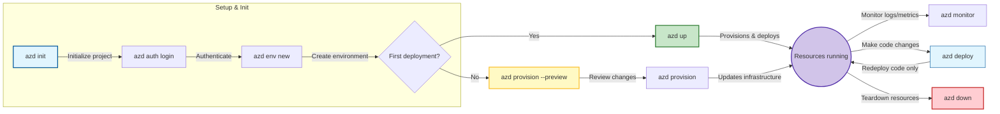
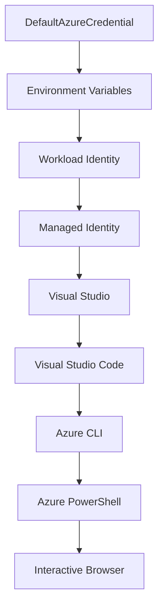

# មូលដ្ឋាន AZD - គំនិតកណ្តាល និងមូលដ្ឋាន

**ការទៅមុខនៅក្នុងជំពូក៖**
- **📚 ទំព័រផ្ទះមេរៀន**៖ [AZD សម្រាប់អ្នកចាប់ផ្ដើម](../../README.md)
- **📖 ជំពូកបច្ចុប្បន្ន**៖ ជំពូក 1 - មូលដ្ឋាន និងការចាប់ផ្ដើមរហ័ស
- **⬅️ មុន**៖ [ទិដ្ឋភាពទូទៅនៃវគ្គសិក្សា](../../README.md#-chapter-1-foundation--quick-start)
- **➡️ បន្ទាប់**៖ [ការដំឡើង និងការតំឡើង](installation.md)
- **🚀 ជំពូកបន្ទាប់**៖ [ជំពូក 2៖ ការអភិវឌ្ឍ AI ជាដំបូង](../chapter-02-ai-development/microsoft-foundry-integration.md)

## ការណែនាំ

> ត្រូវបានពិនិត្យបញ្ជាក់ប្រឆាំងនឹង `azd 1.37.2` (វិច្ឆិកា 2026)។ ពាក្យបញ្ជារ Bash ប្រើចំណងជើងដែលមានសញ្ញាពិពណ៌ដែលអ្នកត្រូវប្ដូរ។ ស្ទង់ការងារគំរូប្រើ `.` ដើម្បីចាប់ផ្ដើមថតបច្ចុប្បន្ន; បើគ្មានអាគុយម៉ង់ថត, ការចាប់ផ្ដើមគំរូបង្កើតថតតូច ហើយមិនប្ដូរថតធ្វើការរបស់ shell របស់អ្នកទេ។ ឯកសារខ្នាតខ្ពស់គឺជាឧទាហរណ៏ មិនមែនគម្រោងពេញលេញ។

មេរៀននេះណែនាំអ្នកអំពី Azure Developer CLI (azd), ឧបករណ៍បញ្ជារ ដែលពេញនិយម ដែលជួយបន្តិចបន្តួចចំពោះផ្លូវចេញដំណើររបស់អ្នកពីការអភិវឌ្ឍនៅក្នុងម៉ាស៊ីនមូលដ្ឋានទៅកាន់ការដាក់បង្ហាញលើ Azure។ អ្នកនឹងរៀនពីគំនិតមូលដ្ឋាន, មុខងារសំខាន់ និងយល់ពីរបៀបដែល azd ធ្វើឱ្យការដាក់បង្ហាញកម្មវិធីផ្អែកលើពពកកាន់តែងាយស្រួល។

## គោលបំណងសិក្សា

នៅចុងបញ្ចប់មេរៀននេះ អ្នកនឹង:
- យល់ពីអ្វីដែល Azure Developer CLI ជា និងគោលបំណងសំខាន់របស់វា
- រៀនពីគំនិតមូលដ្ឋាននៃគំរូ, បរិស្ថាន និងសេវាកម្ម
- រៀបរាប់ពីមុខងារសំខាន់ រួមមានការអភិវឌ្ឍខ្លឹមសារតាមគំរូ និង Infrastructure as Code
- យល់ពីរចនាសម្ព័ន្ធគម្រោង azd និងស្ទង់ការងារ
- រៀបចំដើម្បីដំឡើង និងកំណត់រចនាសម្ព័ន្ធ azd សម្រាប់បរិស្ថានអភិវឌ្ឍរបស់អ្នក

## លទ្ធផលនៃការសិក្សា

បន្ទាប់ពីបញ្ចប់មេរៀននេះ អ្នកនឹងអាច:
- ពន្យល់ពីតួនាទីរបស់ azd ក្នុងស្ទង់ការងារអភិវឌ្ឍលើពពកសម័យថ្មី
- សម្គាល់មុខឡើងវិញនៃរចនាសម្ព័ន្ធគម្រោង azd
- ពិពណ៌នារបៀបដែលគំរូ, បរិស្ថាន, និងសេវាកម្មធ្វើការជាមួយគ្នា
- យល់ពីអត្ថប្រយោជន៍របស់ Infrastructure as Code ជាមួយ azd
- ស្គាល់ពាក្យបញ្ជារផ្សេងៗរបស់ azd និងគោលបំណងរបស់ពួកវា

## Azure Developer CLI (azd) គឺជាអ្វី?

Azure Developer CLI (azd) គឺជាឧបករណ៍បញ្ជារ ដែលត្រូវបានរចនាឡើងដើម្បីល្បឿនចោលផ្លូវចេញដំណើរពីការអភិវឌ្ឍក្នុងម៉ាស៊ីនមូលដ្ឋានទៅការដាក់បង្ហាញលើ Azure។ វាធ្វើឱ្យប្រសើរឡើងក្នុងការបង្កើត, ដាក់បង្ហាញ និងគ្រប់គ្រងកម្មវិធីផ្អែកលើពពកលើ Azure។

### អ្នកអាចដាក់បង្ហាញអ្វីជាមួយ azd?

azd គាំទ្រភារកិច្ចបម្រើការងារច្រើនតម្លៃ—ហើយបញ្ជីនេះនៅតែធំមក។ថ្ងៃនេះ អ្នកអាចប្រើ azd ដើម្បីដាក់បង្ហាញ:

| ប្រភេទបម្រើការ | ឧទាហរណ៍ | ស្ទង់ការងារដូចគ្នា? |
|---------------|----------|----------------|
| **កម្មវិធីប្រពៃណី** | កម្មវិធី вэប, REST API, គេហទំព័រស្ថិតស្ថេរ | ✅ `azd up` |
| **សេវាកម្ម និងមីក្រូសេវាកម្ម** | Container Apps, Function Apps, ដំណើរការបណ្តា​សេវាកម្ម | ✅ `azd up` |
| **កម្មវិធីបង្កើតដោយ AI** | កម្មវិធីសន្ទនា ជាមួយម៉ូដែល Microsoft Foundry, ការដោះស្រាយ RAG ជាមួយ AI Search | ✅ `azd up` |
| **ភ្នាក់ងារច្បាស់លាស់** | ភ្នាក់ងារដែលមានទីតាំងនៅ Foundry, ការរៀបចំភ្នាក់ងារច្រើន | ✅ `azd up` |

បញ្ចប់គំនិតគឺថា **ជីវិតសុីសង្វាក់របស់ azd នៅតែដូចម្តេច មិនថាអ្នកកំពុងដាក់បង្ហាញអ្វី។** អ្នកចាប់ផ្តើមគម្រោង, រៀបចំហេដ្ឋារចនាសម្ព័ន្ធ, ដាក់បង្ហាញកូដរបស់អ្នក, ត្រួតពិនិត្យកម្មវិធី និងបន្សល់សារពើភ័ណ្ឌ– មិនថាជាគេហទំព័រសាមញ្ញ ឬភ្នាក់ងារបង្កើតដោយ AI ខ្ពស់។

ការបន្តនេះគឺដោយការរចនា។ azd ប្រើសមត្ថភាព AI ជាសេវាកម្មមួយដែលកម្មវិធីរបស់អ្នកអាចប្រើបាន មិនមែនជាអ្វីដែលខុសគ្នា។ ចំណុចប្រាប់សន្ទនាដែលគាំទ្រដោយម៉ូដែល Microsoft Foundry គឺ, ពីមุมមองរបស់ azd គឺជាសេវាកម្មមួយទៀតដែលត្រូវកំណត់រចនាសម្ព័ន្ធ និងដាក់បង្ហាញ។

### 🎯 ហេតុអ្វីបានជា AZD? ការប្រៀបធៀបក្នុងជីវិតពិត

តោះយើងប្រៀបធៀបការដាក់បង្ហាញវេបសាមញ្ញមួយជាមួយមូលដ្ឋានទិន្នន័យ:

#### ❌ គ្មាន AZD: ការដា់កបង្ហាញ Azure ដោយដៃ (ជាង 30 នាទី)

**ការប្រៀបធៀបបញ្ជារ Bash ដោយឧទាហរណ៍ ក៏មិនមែនកម្មវិធីចាប់ផ្ដើមដែលអាចរត់បានទេ។** នេះគិតថាមានកូដកម្មវិធីមានរួច ជាមួយឈ្មោះធនធានគឺផ្សេងៗ អ្នកពិនិត្យសិទ្ធិ Azure CLI និងផ្នែកបន្ថែម CLI ត្រូវការ។ ប្រើការហ្វឹកហាត់គំរូខាងក្រោមសម្រាប់ផ្លូវគាំទ្រពេញលេញ។

```bash
# Step 1: Create resource group
az group create --name myapp-rg --location eastus

# Step 2: Create App Service Plan
az appservice plan create --name myapp-plan \
  --resource-group myapp-rg \
  --sku B1 --is-linux

# Step 3: Create Web App
az webapp create --name myapp-web-unique123 \
  --resource-group myapp-rg \
  --plan myapp-plan \
  --runtime "NODE:22-lts"

# Step 4: Create Cosmos DB account (10-15 minutes)
az cosmosdb create --name myapp-cosmos-unique123 \
  --resource-group myapp-rg \
  --kind MongoDB

# Step 5: Create database
az cosmosdb mongodb database create \
  --account-name myapp-cosmos-unique123 \
  --resource-group myapp-rg \
  --name tododb

# Step 6: Create collection
az cosmosdb mongodb collection create \
  --account-name myapp-cosmos-unique123 \
  --resource-group myapp-rg \
  --database-name tododb \
  --name todos

# Step 7: Get connection string
CONN_STR=$(az cosmosdb keys list \
  --name myapp-cosmos-unique123 \
  --resource-group myapp-rg \
  --type connection-strings \
  --query "connectionStrings[0].connectionString" -o tsv)

# Step 8: Configure app settings
az webapp config appsettings set \
  --name myapp-web-unique123 \
  --resource-group myapp-rg \
  --settings MONGODB_URI="$CONN_STR"

# Step 9: Enable logging
az webapp log config --name myapp-web-unique123 \
  --resource-group myapp-rg \
  --application-logging filesystem \
  --detailed-error-messages true

# Step 10: Set up Application Insights
az monitor app-insights component create \
  --app myapp-insights \
  --location eastus \
  --resource-group myapp-rg

# Step 11: Link App Insights to Web App
INSTRUMENTATION_KEY=$(az monitor app-insights component show \
  --app myapp-insights \
  --resource-group myapp-rg \
  --query "instrumentationKey" -o tsv)

az webapp config appsettings set \
  --name myapp-web-unique123 \
  --resource-group myapp-rg \
  --settings APPINSIGHTS_INSTRUMENTATIONKEY="$INSTRUMENTATION_KEY"

# Step 12: Build application locally
npm install
npm run build

# Step 13: Create deployment package
zip -r app.zip . -x "*.git*" "node_modules/*"

# Step 14: Deploy application
az webapp deployment source config-zip \
  --resource-group myapp-rg \
  --name myapp-web-unique123 \
  --src app.zip

# Step 15: Wait and pray it works 🙏
# (No automated validation, manual testing required)
```

**បញ្ហា៖**
- ❌ ពាក្យបញ្ជា 15+ ត្រូវចងចាំ និងអនុវត្តតាមលំដាប់
- ❌ ការងារដែកជាមួយទីពី 30-45 នាទី
- ❌ ងាយធ្វើកំហុស (ពាក្យវាយត្របាក់, ប៉ារ៉ាម៉ែត្រខុស)
- ❌ ឯកសារយោងត្រូវគ្រប់គ្រងផ្ទាល់ខ្លួន; កំណត់ហេតុ Debug និងការតាមដាន Shell អាចបង្ហាញពួកវា
- ❌ មិនមានការដោះស្រាយឡើងវិញដោយស្វ័យប្រវត្តិ បើអ្វីមួយបរាជ័យ
- ❌ ពិបាកចម្លើកសមាជិកក្រុម
- ❌ ផ្សេងៗរាល់ដង (មិនអាចបង្កើតឡើងវិញបាន)

#### ✅ ជាមួយ AZD: ការដាក់បង្ហាញដោយស្វ័យប្រវត្តិ (5 ពាក្យបញ្ជា, 10-15 នាទី)

```bash
# Step 1: Initialize from template
azd init --template todo-nodejs-mongo .

# Step 2: Authenticate
azd auth login

# Step 3: Select the environment created during init
azd env select dev

# Step 4: Preview changes (optional but recommended)
azd provision --preview

# Step 5: Deploy everything
azd up

# ✨ Done! Everything is deployed, configured, and monitored
```

**អត្ថប្រយោជន៍៖**
- ✅ **5 ពាក្យបញ្ជា** ប្រៀបធៀបនឹងជំហានដៃ 15+
- ✅ **10-15 នាទី** ពេលវេលាសរុប (ភាគច្រើនរង់ចាំ Azure)
- ✅ **កំហុសដៃតិចជាង** - ស្ទង់ការងារដែលមានគំរូដឹកនាំ
- ✅ **ការគ្រប់គ្រងសម្ងាត់យ៉ាងសុវត្ថិភាព** - គំរូជាច្រើនប្រើការផ្ទុកសម្ងាត់ដែលគ្រប់គ្រងដោយ Azure
- ✅ **ការដាក់បង្ហាញអាចធ្វើឡើងម្តងទៀត** - ស្ទង់ការងារដូចគ្នារាល់ដង
- ✅ **ការបញ្ជាក់ហេដ្ឋារចនាសម្ព័ន្ធអាចធ្វើឡើងម្តងទៀត** - អាស្រ័យលើគណនា, តំបន់ដែលមាន, និងកំណែគំរូ
- ✅ **រួមចំណែកជាក្រុម** - អ្នកណាក៏អាចដាក់បង្ហាញដោយពាក្យបញ្ជាដូចគ្នា
- ✅ **Infrastructure as Code** - គំរូ Bicep ដែលគ្រប់គ្រងកំណែ
- ✅ **ការត្រួតពិនិត្យតាមគំរូ** - Application Insights កាលបញ្ចូលក្នុងគំរូ

### ពេលវេលា និងភាពជឿទុកចិត្ដ

ពេលវេលានៅលើគឺការប៉ាន់ប្រមាណ មិនមែនជាការវាស់វែងតាមប្លង់។ azd កាត់បន្ថយពាក្យបញ្ជាដែលអ្នកត្រូវគ្រប់គ្រង ប៉ុន្តែមិនធានាថាការដាក់បង្ហាញនឹងបញ្ចប់លឿន, លុបកំហុស ឬផ្តល់ការដោះស្រាយឡើងវិញដោយស្វ័យប្រវត្តិសម្រាប់កម្មវិធី/មូលដ្ឋានទិន្នន័យ។ រក្សាកំណែដែលអាចដំណើរការបាននៅចំណុចត្រួតពិនិត្យមូលដ្ឋាន និងសាកល្បងនូវគោលការណ៍ស្ដារឡើងវិញ។

## គំនិតស្នូល

### គំរូ
គំរូគឺមូលដ្ឋានរបស់ azd។ វាមាន៖
- **កូដកម្មវិធី** - កូដប្រភព និងសមាសធាតុរួម
- **ការបរិយាយហេដ្ឋារចនាសម្ព័ន្ធ** - ធនធាន Azure ប្រើ Bicep ឬ Terraform
- **ឯកសារកំណត់រចនាសម្ព័ន្ធ** - ការកំណត់ និងអថេរបរិស្ថាន
- **ស្ព្រាប់ស្ទង់ការងារ** - ស្ទង់ការងារដាក់បង្ហាញដោយស្វ័យប្រវត្តិ

### បរិស្ថាន
បរិស្ថានតំណាងឲ្យគោលដៅការដាក់បង្ហាញផ្សេងៗ៖
- **អភិវឌ្ឍ** - សម្រាប់តេស្ត និងអភិវឌ្ឍ
- **ស្តេជីង** - បរិស្ថានមុនផលិតកម្ម
- **ផលិតកម្ម** - បរិស្ថានផ្ទាល់

បរិស្ថាននីមួយៗរក្សាទុក៖
- ឈ្មោះបរិស្ថាន និងតម្លៃ; ការបំបែកធនធានអាស្រ័យលើគំរូហេដ្ឋារចនាសម្ព័ន្ធ
- ការកំណត់រចនាសម្ព័ន្ធ
- ស្ថានភាពដាក់បង្ហាញ

### សេវាកម្ម
សេវាកម្មក្នុង `azure.yaml` ពិពណ៌នាអំពីសមាសធាតុនៃកម្មវិធីដែលអាចដាក់បង្ហាញបាន៖
- **ផ្នែកមុខ** - កម្មវិធី вэប, SPA
- **ផ្នែកក្រោយ** - API, មីក្រូសេវាកម្ម

មូលដ្ឋានទិន្នន័យ និងការផ្ទុកទិន្នន័យភាគច្រើនត្រូវបានរៀបចំជាធនធានហេដ្ឋារ, មិនមែនជាម្ចាស់ផ្ទះសេវាកម្មដូចជា `host: postgres`។

## មុខងារសំខាន់

### 1. ការអភិវឌ្ឍដោយគំរូដឹកនាំ
```bash
# Browse available templates
azd template list

# Initialize from a template
azd init --template "<template-name>" .
```

### 2. Infrastructure as Code
- **Bicep** - ភាសាឈានមុខ Azure
- **Terraform** - ឧបករណ៍ហេដ្ឋារចនាសម្ព័ន្ធច្រើនពពក
- Bicep បំលែងទៅជា Template ARM; JSON ARM ផ្ទាល់មិនមែនជា `infra.provider` ថ្នាក់ដាច់ដោយឡែក។

### 3. ស្ទង់ការងាររួមសមាគម
```bash
# Complete deployment workflow
azd up            # Provision + Deploy this is hands off for first time setup

# 🧪 NEW: Preview infrastructure changes before deployment (SAFE)
azd provision --preview    # Simulate infrastructure deployment without making changes

azd provision     # Create Azure resources if you update the infrastructure use this
azd deploy        # Deploy application code or redeploy application code once update
azd down          # Clean up resources
```

#### 🛡️ ការធ្វើផែនការហេដ្ឋារចនាសម្ព័ន្ធដោយសុវត្ថិភាពជាមួយ Preview
ពាក្យបញ្ជារ `azd provision --preview` គឺជាការផ្លាស់ប្តូរប្លង់សម្រាប់ការដាក់បង្ហាញដែលមានសុវត្ថិភាព៖
- **ការវិភាគលើកដំបូងដោយមិនទាក់ទងការប្រើប្រាស់** - បង្ហាញអ្វីដែលនឹងត្រូវបានបង្កើត, កែប្រែ, ឬលុបចោល
- **គ្មានការដាក់ឲ្យបម្រុងហេដ្ឋារចនាសម្ព័ន្ធ** - ពិនិត្យការផ្លាស់ប្តូរពាណិជ្ជកម្ម; ពិនិត្យ hooks គម្រោងជាមុន, ព្រោះ hooks អាចរត់ពាក្យបញ្ជានៅមានប្រសិទ្ធិភាពមួយចំនួន
- **សហការក្រុម** - ចែករំលែកលទ្ធផល preview មុនការដាក់បង្ហាញ
- **ការធ្វើផែនការកម្រៃថ្លៃ** - ពិនិត្យ SKU ដែលបានណែនាំ បន្ទាប់មកគណនាតម្លៃជាមួយក្បាលគណនាគុណតម្លៃ Azure; preview មិនគណនាតម្លៃទេ

```bash
# Example preview workflow
azd provision --preview           # See what will change
# Review the output, discuss with team
azd provision                     # Apply changes with confidence
```

### 📊 សំរុងភាគសម្រាប់: ស្ទង់ការងារ AZD អភិវឌ្ឍ



**ការពិពណ៌នាស្ទង់ការងារ:**
1. **Init** - ចាប់ផ្ដើមជាមួយគំរូ ឬគម្រោងថ្មី
2. **Auth** - ធ្វើការផ្ទៀងផ្ទាត់ជាមួយ Azure
3. **Environment** - បង្កើតបរិស្ថានដាក់បង្ហាញមានការបំបែក
4. **Preview** - 🆕 តែងតែបង្ហាញផ្លាស់ប្តូរហេដ្ឋារចនាសម្ព័ន្ធជាមុន (លក្ខណៈសុវត្ថិភាព)
5. **Provision** - បង្កើត/ធ្វើបច្ចុប្បន្នភាពធនធាន Azure
6. **Deploy** - ផ្ញើកូដកម្មវិធីរបស់អ្នក
7. **Monitor** - ត្រួតពិនិត្យការសម្របសម្រួលកម្មវិធី
8. **Iterate** - ប្ដូររួចដាក់បង្ហាញកូដម្ដងទៀត
9. **Cleanup** - លុបធនធាននៅពេលបានបញ្ចប់

### 4. ការគ្រប់គ្រងបរិស្ថាន
```bash
# Create and manage environments
azd env new "<environment-name>"
azd env select "<environment-name>"
azd env list
```

### 5. ផ្នែកបន្ថែម និងពាក្យបញ្ជារ AI

azd ប្រើប្រព័ន្ធផ្នែកបន្ថែមដើម្បីបន្ថែមសមត្ថភាពលើស CLI មូលដ្ឋាន។ នេះមានប្រយោជន៍ពិសេសសម្រាប់បម្រើការងារ AI:

```bash
# List available extensions
azd extension list

# Install the GA Foundry bundle (requires azd >= 1.37.0)
azd ext install microsoft.foundry

# Initialize an AI agent project interactively
azd ai agent init

# Test a deployed agent (shows latency and time-to-first-byte)
azd ai agent invoke

# Start the MCP server for AI-assisted development (Alpha)
azd mcp start
```

**ជីវិតសុីសង្វាក់ភ្នាក់ងារ, ចុងក្រោយទៅចុងក្រោយ។** កញ្ចប់ GA `microsoft.foundry` មានរួមមាន `azure.ai.agents` និងផ្នែកបន្ថែមមូលដ្ឋាន១៦ផ្សេងទៀត។ ដំឡើង `azure.ai.evaluations` ផ្ទាល់ខ្លួនសម្រាប់ការវាយតម្លៃ។ ប្រើ `azd >= 1.37.0` សម្រាប់ស្ទង់ការងារនេះ។ អ្នកមិនចាំបាច់មានទាំងអស់នៅថ្ងៃដំបូងទេ៖

| ជំហាន | ពាក្យបញ្ជា | អ្វីដែលវាធ្វើ |
|-------|---------|--------------|
| **សាងសង់** | `azd ai agent init --template <path-to-azure.yaml>` | ទទួលយកគំរូគម្រោងភ្នាក់ងារបច្ចុប្បន្ន |
| **រត់ក្នុងភ្លាមៗ** | `azd ai agent run`, បន្ទាប់មក `azd ai agent invoke --local "Test prompt"` នៅក្នុងផ្ទាំងបញ្ជាផ្សេងទៀត | ត្រួតពិនិត្យសកម្មភាពក្នុងភ្នាក់ងារ; ហៅម៉ូដែលនៅ Azure |
| **ដាក់បង្ហាញ** | `azd deploy` | សម្រាប់ភ្នាក់ងារពិភាក្សាគូដ, ផ្ញើប្រភពសម្រាប់ការបង្កើតចម្ងាយ Foundry |
| **សាកល្បង** | `azd ai agent invoke` | ហៅភ្នាក់ងារ និងមើលពេលវេលាពីរឆ្លើយតប |
| **វាស់ស្ទង់** | `azd ai eval init`, `generate`, `run start` | កំណត់រចនាសម្ព័ន្ធ ដាក់បង្ហាញ និងបន្ទាន់សម័យការវាយតម្លៃដោយប្រើផ្នែកបន្ថែមផ្សេងទៀត |
| **ធ្វើឱ្យប្រសើរ** | `azd ai agent optimize --eval <evaluation-name> --optimize-model <optimizer-deployment>` | ប្រើសារវាយតម្លៃសមរម្យដើម្បីបង្កើនសមត្ថភាពភ្នាក់ងារ |
| **ត្រួតពិនិត្យ** | `azd ai agent endpoint show` | មើលការកំណត់ចំណុចប្រទាក់ផ្ទាល់ |
| **សម្អាត** | `azd ai agent delete` | លុបភ្នាក់ងារអភិវឌ្ឍន៍ និងកំណែទាំងអស់របស់វា |

> ចាប់ផ្ដើមជាមួយ [GA hosted-agent walkthrough](../chapter-02-ai-development/microsoft-foundry-integration.md#hosted-agent-walkthrough-ga) ដែលគ្របដណ្តប់លើលក្ខខណ្ឌមុន, ការរៀបចំ និងការសម្អាតយ៉ាងសុវត្ថិភាព។ ផ្នែកបន្ថែមត្រូវបានពិពណ៌នាបន្ថែមក្នុង [AZD AI CLI Commands](../chapter-08-production/production-ai-practices.md#azd-ai-cli-commands-and-extensions) ឯកសារ៖

## 📁 រចនាសម្ព័ន្ធគម្រោង

រចនាសម្ព័ន្ធគម្រោង azd ដែលទូទៅ៖
```
my-app/
├── .azure/                  # Local environments and selected-environment config
│   ├── config.json
│   └── dev/.env
├── .devcontainer/          # Development container config
├── .github/workflows/      # GitHub Actions
├── .vscode/               # VS Code settings
├── infra/                 # Infrastructure code
│   ├── main.bicep        # Main infrastructure template
│   ├── main.parameters.json
│   └── modules/          # Reusable modules
├── src/                  # Application source code
│   ├── api/             # Backend services
│   └── web/             # Frontend application
├── azure.yaml           # azd project configuration
└── README.md
```

## 🔧 ឯកសារកំណត់រចនាសម្ព័ន្ធ

### azure.yaml
ឯកសារកំណត់រចនាសម្ព័ន្ធគម្រោងសំខាន់៖
```yaml
name: my-awesome-app
metadata:
  template: my-template@1.0.0

services:
  web:
    project: ./src/web
    language: js
    host: appservice
  api:
    project: ./src/api
    language: js
    host: appservice

hooks:
  preprovision:
    shell: pwsh
    run: echo "Preparing to provision..."
```

### .azure/config.json
ជម្រើសបរិស្ថានលំនាំដើមក្នុងគម្រោង (ឧទាហរណ៍; គ្រប់គ្រងដោយ azd):
```json
{
  "defaultEnvironment": "dev"
}
```

## 🎪 ស្ទង់ការងារសាកល្បងជាមួយហត្ថកម្ម

> **💡 គំនូសសម្រាប់ការសិក្សា:** តាមដានស្ទង់ការងារទាំងនេះតាមលំដាប់ដើម្បីបង្កើនជំនាញ AZD របស់អ្នកដោយជាប់លាប់។

### 🎯 ស្ទង់ការងារ 1: ចាប់ផ្ដើមគម្រោងដំបូងរបស់អ្នក

**គោលបំណង:** បង្កើតគម្រោង AZD និងស្វែងយល់រចនាសម្ព័ន្ធរបស់វា

**ជំហាន៖**
```bash
# Use a proven template
mkdir azd-basics-practice
cd azd-basics-practice
# Choose "dev" for the environment name when prompted
azd init --template todo-nodejs-mongo .

# Explore the generated files
ls -la  # View all files including hidden ones

# Key files created:
# - azure.yaml (main config)
# - infra/ (infrastructure code)
# - src/ (application code)
```

**✅ ជោគជ័យ:** អ្នកមាន azure.yaml, infra/, និង src/ ថត

---

### 🎯 ស្ទង់ការងារ 2: ដាក់បង្ហាញទៅ Azure

**គោលបំណង:** បំពេញដល់ចុងផ្លូវដាក់បង្ហាញ

**ជំហាន៖**
```bash
# 1. Authenticate
azd auth login

# 2. Select the dev environment created in Exercise 1
azd env select dev
azd env set AZURE_LOCATION eastus

# 3. Preview changes (RECOMMENDED)
azd provision --preview

# 4. Deploy everything
azd up

# 5. Verify deployment
azd show    # View your app URL
```

**ពេលវេលារង់ចាំ:** 10-15 នាទី  
**✅ ជោគជ័យ:** URL កម្មវិធីបើកក្នុងកម្មវិធីរុករក

---

### 🎯 ស្ទង់ការងារ 3: បរិស្ថានច្រើន

**គោលបំណង:** ដាក់បង្ហាញទៅ dev និង staging

**ជំហាន៖**
```bash
# Already have dev, create staging
azd env new staging
azd env set AZURE_LOCATION westus2
azd up

# Switch between them
azd env list
azd env select dev
```

**✅ ជោគជ័យ:** មានក្រុមធនធានពីរដាច់ដោយឡែកក្នុង Azure Portal

**សម្អាត:** ស្ទង់ការងារ 3 បង្កើតការដាក់បង្ហាញគណនាប្រាក់លើទីពីរ។ លុបទាំងពីរនៅពេលចប់:

```bash
azd down --environment dev
azd down --environment staging
```

---

### 🛡️ ការសម្អាតបំផ្លាញ: `azd down --force --purge`

នៅពេលដែលអ្នកចង់លុបធនធាន Azure របស់បរិស្ថានដែលបានជ្រើសរើសដោយមានគោលបំណង៖

```bash
azd down --force --purge
```

**វាធ្វើអ្វី៖**
- `--force`: គ្មានការសួរបញ្ជាក់លុះ
- `--purge`: លុបប្រើបានជាប្រចាំធនធានពីរទីបំពានដែលគាំទ្រ (ឧទាហរណ៍ Key Vaults), ក្នុងករណីមានការការពារការ​ពឹងផ្អែកលើ purge។ វាមិនលុបថត `.azure/` មូលដ្ឋានទេ។

**ប្រើនៅពេល៖** បញ្ចប់ជាមួយបរិស្ថាន disposable។ មិនត្រូវប្រើជាការឆ្លើយតបទីមួយចំពោះកំហុសផ្ទៀងផ្ទាត់សិទ្ធិ, បរិមាណ, ឬកំណត់រចនាសម្ព័ន្ធ។

---

## 🎪 ឯកសារទំាងដើមនៃស្ទង់ការងារ

### ចាប់ផ្ដើមគម្រោងថ្មី
```bash
# Method 1: Use existing template
azd init --template todo-nodejs-mongo .

# Method 2: Start from scratch
azd init

# Method 3: Use current directory
azd init .
```

### សៀគ្វីអភិវឌ្ឍ
```bash
# Set up development environment
azd auth login
azd env new dev
azd env select dev

# Deploy everything
azd up

# Make changes and redeploy
azd deploy

# Clean up when done
azd down --force --purge # Deletes this environment's discovered Azure resources; review before forcing deletion.
```

## យល់អំពី `azd down --force --purge`
ពាក្យបញ្ជារ `azd down --force --purge` គឺជាវិធីកាត់ដោតមួយដ៏មានអំណាចដើម្បីបំផ្លាញបរិស្ថាន azd របស់អ្នក និងធនធានទាំងអស់ដែលទាក់ទង។ នេះគឺជាការបែងចែកអ្វីដែលប៉ារ៉ាម៉ែត្រទាំងអស់ធ្វើ៖
```
--force
```
- ជៀសវាងការសួរបញ្ជាក់។
- មានប្រយោជន៍សម្រាប់ការស្វ័យប្រវត្តិ ឬស្ក្រីបទីមិនអាចចូលដៃបាន។
- មិនលើកកំពស់សិទ្ធិ, ការពារការ purge, ឬបញ្ហាលុបមិនជោគជ័យ។

```
--purge
```
លុបធនធាន Azure ដែលបានលុបតែម្តងទៀតដោយគ្មានការសួរបញ្ជាក់បន្ថែម។ ការការពារការ purge និងសិទ្ធិ នៅតែមាន។ វា **មិន** លុបបរិស្ថានមូលដ្ឋានឬថត `.azure/` ទេ។


### ហេតុអ្វីបានប្រើទាំងពីរ?
ប្រើទាំងពីរម្តងតែមួយនៅពេលដែលអ្នកមានគោលបំណងលុបធនធាន Azure របស់បរិស្ថានដែលបានជ្រើសរើស និងលុបធនធានដែលអាចស្ដារឡើងវិញបាន។ នេះគឺជាការសម្អាតបំផ្លាញ មិនមែនជាការជួសជុលទូទៅឬកំណត់ស្ថានភាពមូលដ្ឋានឡើងវិញ។

វាមានប្រយោជន៍ពិសេសបន្ទាប់ពីការលុបធនធានដោយដៃនៅក្នុងផ្ទាំងគ្រប់គ្រង Azure ឬពេលប្តូរកិច្ចការគំរូ, បរិស្ថាន ឬឈ្មោះក្រុមធនធាន។


### ការគ្រប់គ្រងបរិស្ថានច្រើន
```bash
# Create staging environment
azd env new staging
azd env select staging
azd up

# Switch back to dev
azd env select dev

# Compare environments
azd env list
```

## 🔐 ការផ្ទៀងផ្ទាត់ និងគ្រប់គ្រងឯកសារយោង

បំបែកការផ្ទៀងផ្ទាត់ការដាក់បង្ហាញ (`azd auth login`) ពីការផ្ទៀងផ្ទាត់បំពេញ SDK (`DefaultAzureCredential`)។ ពួកវាស្ថិតឯករាជ្យ។ azd មិនប្រើឯកសារយោង Azure CLI ដោយលំនាំដើមទេ។

### ការផ្ទៀងផ្ទាត់ Azure CLI (`az login`)

រត់ `azd auth login` សម្រាប់ azd។ ពាក្យបញ្ជារ Azure CLI ខាងក្រោមជាជម្រើស ហើយផ្ទៀងផ្ទាត់បញ្ជារ `az` ឯករាជ្យ៖

```bash
# Interactive login (opens browser)
az login

# Login with specific tenant
az login --tenant "<tenant-id>"

# Login with service principal
az login --service-principal -u "<app-id>" -p "<password>" --tenant "<tenant-id>"

# Check current login status
az account show

# List available subscriptions
az account list --output table

# Set default subscription
az account set --subscription "<subscription-id>"
```

### ស្ទេបការផ្ទៀងផ្ទាត់
1. **ការចូលប្រើភ្ជាប់ភ្ជាប់លើប្រាក់អាល់តូច**: បើកកម្មវិធីរុករកលំនាំដើមរបស់អ្នកសម្រាប់ការផ្ទៀងផ្ទាត់
2. **ចរន្តកូដឧបករណ៍**៖ សម្រាប់បរិបទដែលមិនមានការចូលប្រើប្រាស់កម្មវិធីរុករក
3. **Service Principal**៖ សម្រាប់សេណារីយ៉ូ​អូតូម៉ាទិច និង CI/CD
4. **Managed Identity**៖ សម្រាប់កម្មវិធីដែលមានទីតាំងលើ Azure

### ច្រវាក់ DefaultAzureCredential

`DefaultAzureCredential` គឺជាប្រភេទសមីការនៃសិទ្ធិចូលដែលផ្តល់បទពិសោធន៍សម្ងាត់នៃការផ្ទៀងផ្ទាត់ដោយស្វ័យប្រវត្តិតាមរយៈការសាកល្បងចំណុចប្រភពសមត្ថភាពជាច្រើនដោយលំដាប់ដែលបានកំណត់៖

#### ច្រវាក់សមត្ថភាពកម្មវិធី SDK

ច្រវាក់ត្រឹមត្រូវអាស្រ័យលើភាសា Azure Identity SDK, វើស្យុង, ផ្លាក់អ៊ីនដែលបានដំឡើង និងជម្រើស។ រូបតំណាងនេះគឺជាគំនិតមួយ មិនមែនជាលំដាប់ផ្ទៀងផ្ទាត់ azd រឹងមាំទេ; SDK ថ្មីៗក៏អាចបញ្ចូលសមត្ថភាព Azure Developer CLI ផងដែរ។


#### 1. Environment Variables
```bash
# Set environment variables for service principal
export AZURE_CLIENT_ID="<app-id>"
export AZURE_CLIENT_SECRET="<password>"
export AZURE_TENANT_ID="<tenant-id>"
```

#### 2. Workload Identity (Kubernetes/GitHub Actions)
ប្រើដោយស្វ័យប្រវត្តិ​នៅក្នុង៖
- សេវាកម្ម Azure Kubernetes (AKS) ជាមួយ Workload Identity
- GitHub Actions ជាមួយសហព័ន្ធ OIDC
- សេណារីយ៉ូវសភាពសម្គាល់ផ្សេងៗ

#### 3. Managed Identity
សម្រាប់ធនធាន Azure ដូចជា៖
- ម៉ាស៊ីនវើឌ្យួច
- អ៊បទសេវា
- Azure Functions
- Container Instances

```bash
# Inspect a deployed Container App's configured identity (requires az login)
az containerapp show --name "<app-name>" --resource-group "<rg-name>" --query identity
```

#### 4. ការបញ្ចូលឧបករណ៍អ្នកអភិវឌ្ឍន៍
- **Visual Studio**៖ ប្រើប្រាស់គណនីចុះឈ្មោះដោយស្វ័យប្រវត្តិ
- **VS Code**៖ ការគាំទ្រ​អាស្រ័យលើ SDK និងការតំឡើងប្រ៊ូកឬផ្លាក់អ៊ីនរបស់វា
- **Azure CLI**៖ ប្រើសមត្ថភាព `az login` (ពេញនិយមសម្រាប់ការអភិវឌ្ឍក្នុងស្រុក)

### ការតំឡើងការផ្ទៀងផ្ទាត់ AZD

```bash
# Method 1: Direct azd authentication (recommended)
azd auth login

# Method 2: Direct azd authentication
azd auth login --use-device-code  # For headless environments

# Method 3: Check authentication status
azd auth login --check-status

# Method 4: Logout and re-authenticate
azd auth logout
azd auth login
```

### ប្រតិបត្តិការល្អបំផុតសម្រាប់ការផ្ទៀងផ្ទាត់

#### សម្រាប់ការអភិវឌ្ឍក្នុងស្រុក
```bash
# 1. Log in to azd
azd auth login

# 2. Select the subscription for this initialized environment
azd env set AZURE_SUBSCRIPTION_ID "<subscription-id>"

# 3. Check azd sign-in details (read the status message)
azd auth login --check-status
```

#### សម្រាប់បណ្តាញ CI/CD
```yaml
# Partial GitHub Actions steps: assumes checkout, azd installation,
# required AZURE_* environment values, and pipeline secret configuration.
- name: Deploy with azd
  run: |
    azd auth login --client-id ${{ secrets.AZURE_CLIENT_ID }} \
                    --client-secret ${{ secrets.AZURE_CLIENT_SECRET }} \
                    --tenant-id ${{ secrets.AZURE_TENANT_ID }}
    azd up --no-prompt
```

#### សម្រាប់បរិយាកាសផលិតកម្ម
- ប្រើ **Managed Identity** នៅពេលរត់លើធនធាន Azure
- ប្រើ **Service Principal** សម្រាប់សេណារីយ៉ូ​អូតូម៉ាទិច
- ចៀសវាងការផ្ទុកសមត្ថភាពក្នុងកូដ ឬឯកសារកំណត់រចនាសម្ព័ន្ធ
- ប្រើ **Azure Key Vault** សម្រាប់ការកំណត់ដែលមានភាពងាយរងគ្រោះ

### បញ្ហាទូទៅនៃការផ្ទៀងផ្ទាត់ និងជំនួយដោះស្រាយ

#### បញ្ហា៖ "មិនបានរកឃើញការជាវ"
```bash
# Solution: Set default subscription
az account list --output table
az account set --subscription "<subscription-id>"
azd env set AZURE_SUBSCRIPTION_ID "<subscription-id>"
```

#### បញ្ហា៖ "សិទ្ធិមិនគ្រប់គ្រាន់"
```bash
# Solution: Check and assign required roles
az role assignment list --assignee $(az account show --query user.name --output tsv)

# Common required roles:
# - Contributor (for resource management)
# - User Access Administrator (for role assignments)
```

#### បញ្ហា៖ "សញ្ញាសមត្ថភាពផុតកំណត់"
```bash
# Solution: Re-authenticate
az logout
az login
azd auth logout
azd auth login
```

### ការផ្ទៀងផ្ទាត់ក្នុងសេណារីយ៉ូផ្សេងៗ

#### ការអភិវឌ្ឍក្នុងស្រុក
```bash
# Personal development account
az login
azd auth login
```

#### ការអភិវឌ្ឍជាក្រុម
```bash
# Use specific tenant for organization
az login --tenant contoso.onmicrosoft.com
azd auth login --tenant-id "<tenant-id>"
```

#### សេណារីយ៉ូ​បោះពុម្ព​ច្រើនជួល
```bash
# Switch between tenants
az login --tenant tenant1.onmicrosoft.com
azd auth login --tenant-id "<tenant-1-id>"
# Select an environment configured with tenant 1's subscription
azd env select tenant1-dev
# Deploy to tenant 1
azd up

az login --tenant tenant2.onmicrosoft.com  
azd auth login --tenant-id "<tenant-2-id>"
azd env select tenant2-dev
# Deploy to tenant 2
azd up
```

### កិច្ចយកចិត្តទុកដាក់សុវត្ថិភាព

1. **ការផ្ទុកសមត្ថភាពចូល**៖ គ្មានការផ្ទុកសមត្ថភាពចូលក្នុងកូដប្រភព
2. **ការកំណត់ដែនដែលអនុញ្ញាត**៖ ប្រើគោលការណ៍អនុគមន៍តិចបំផុតសម្រាប់ service principals
3. **ការបង្វិលសញ្ញា**៖ បង្វិលសម្ងាត់របស់ service principal ជាទៀងទាត់
4. **ការតាមដានការ Audit**៖ តាមដានសកម្មភាពផ្ទៀងផ្ទាត់ និងការដាក់ប្រាក់ចូល
5. **សុវត្ថិភាពបណ្តាញ**៖ ប្រើចំណុចបញ្ចូលឯកជនពេលដែលអាចធ្វើទៅបាន

### ការដោះស្រាយបញ្ហាក្នុងការផ្ទៀងផ្ទាត់

```bash
# Debug authentication issues
azd auth login --check-status
az account show
az account get-access-token

# Common diagnostic commands
whoami                          # Current user context
az ad signed-in-user show      # Microsoft Entra ID user details
az group list                  # Test resource access
```

## ការស្វែងរកកម្រងពាក្យបញ្ជា

### ការស្វែងរក
```bash
azd template list              # Browse templates
azd template list --help       # Template discovery options
azd init --help               # Initialization options
```

### ការគ្រប់គ្រងគម្រោង
```bash
azd show                     # Project overview
azd env list                # Available environments and selected default
azd config show            # Configuration settings
```

### ការត្រួតពិនិត្យ
```bash
azd monitor                  # Open Azure portal monitoring
azd monitor --logs           # View application logs
azd monitor --live           # View live metrics
azd pipeline config          # Set up CI/CD
```

## ប្រតិបត្តិការល្អបំផុត

### 1. ប្រើឈ្មោះមានអត្ថន័យ
```bash
# Good
azd env new production-east
azd init --template todo-nodejs-mongo .

# Avoid
azd env new env1
azd init --template template1 .
```

### 2. អាស្រ័យលើទំរង់
- ចាប់ផ្តើមជាមួយទំរង់ដែលមានស្រាប់
- ផ្លាស់ប្តូរតាមតម្រូវការ
- បង្កើតទំរង់អាចប្រើជាថ្មីសម្រាប់អង្គភាពរបស់អ្នក

### 3. ការផ្តាច់កន្លែងបរិយាកាស
- ប្រើបរិយាកាសផ្សេងៗសម្រាប់ dev/staging/prod
- មិនចេះបញ្ចូលត្រូវនៅផ្ទាល់ទៅផលិតកម្មពីម៉ាស៊ីនក្នុងស្រុក
- ប្រើបណ្តាញ CI/CD សម្រាប់ការដាក់សម្រាប់ផលិតកម្ម

### 4. ការគ្រប់គ្រងកំណត់រចនាសម្ព័ន្ធ
- ប្រើmanaged identity និង Key Vault សម្រាប់សម្ងាត់; តម្លៃ `azd env set` ទូទៅជាអត្ថបទប្លែកក្នុងស្រុក
- រក្សាកំណត់រចនាសម្ព័ន្ធក្នុងការគ្រប់គ្រងកំណែ
- ឯកសារបរិយាកាសជាក់លាក់

## ការរីកចម្រើនក្នុងការសិក្សា

### អ្នកចាប់ផ្តើម (សប្ដាហ៍ 1-2)
1. ដំឡើង azd និងផ្ទៀងផ្ទាត់
2. ដាក់ប្រើទំរង់សាមញ្ញមួយ
3. យល់ដឹងរចនាសម្ព័ន្ធគម្រោង
4. រៀនពាក្យបញ្ជារមានមូលដ្ឋាន (up, down, deploy)

### មធ្យម (សប្ដាហ៍ 3-4)
1. ផ្លាស់ប្តូរទំរង់
2. គ្រប់គ្រងបរិយាកាសច្រើន
3. យល់ដឹងកូដហេដ្ឋារចនាសម្ព័ន្ធ
4. កំណត់បណ្តាញ CI/CD

### មានជំនាញខ្ពស់ (សប្ដាហ៍ 5+)
1. បង្កើតទំរង់ផ្ទាល់ខ្លួន
2. គំរូហេដ្ឋារចនាសម្ព័ន្ធមានជំនាញខ្ពស់
3. ការដាក់បញ្ចូលប្រាំមុខភាគហ៊ុន
4. កំណត់រចនាសម្ព័ន្ធថ្នាក់សមាជិកសហគ្រាស

## ជំហានបន្ទាប់

**📖 បន្តសិក្សាមុខទី 1:**
- [Installation & Setup](installation.md) - ដំឡើង និងកំណត់រចនាសម្ព័ន្ធ azd
- [Your First Project](first-project.md) - សិក្សាជារូបមន្ត
- [Configuration Guide](../chapter-03-configuration/configuration.md) - ជម្រើសកំណត់រចនាសម្ព័ន្ធកម្រិតខ្ពស់

**🎯 ត្រៀមខ្លួនសម្រាប់មុខទីបន្ទាប់?**
- [Chapter 2: AI-First Development](../chapter-02-ai-development/microsoft-foundry-integration.md) - ចាប់ផ្តើមបង្កើតកម្មវិធី AI

##ធនធានបន្ថែម

- [Azure Developer CLI Overview](https://learn.microsoft.com/en-us/azure/developer/azure-developer-cli/)
- [Template Gallery](https://azure.github.io/awesome-azd/)
- [Community Samples](https://github.com/Azure-Samples)

---

## 🙋 សំណួរញឹកញាប់

### សំនួរទូទៅ

**ស: តើភាពខុសគ្នារវាង AZD និង Azure CLI មានអ្វីខ្លះ?**

ច: Azure CLI (`az`) គឺសម្រាប់គ្រប់គ្រងធនធាន Azure ផ្ទាល់។ AZD (`azd`) សម្រាប់គ្រប់គ្រងកម្មវិធីទាំងមូល៖

```bash
# Azure CLI - Low-level resource management
az webapp create --name myapp --resource-group rg
az sql server create --name myserver --resource-group rg
# ...many more commands needed

# AZD - Application-level management
azd up  # Deploys entire app with all resources
```

**គិតថាវាដូចនេះ៖**
- `az` = ប្រតិបត្តិទៅលើគ្រឿងកូនឡេហ្គោពីរ
- `azd` = ធ្វើការជាមួយសំណុំឡេហ្គោពេញលេញ

---

**ស: តើខ្ញុំ​ត្រូវការរៀន Bicep ឬ Terraform ដើម្បីប្រើ AZD ទេ?**

ច: មិនទេ! ចាប់ផ្តើមជាមួយទំរង់៖
```bash
# Use existing template - no IaC knowledge needed
azd init --template todo-nodejs-mongo .
azd up
```

អ្នកអាចរៀន Bicep បន្ទាប់មក ដើម្បីផ្លាស់ប្តូរហេដ្ឋារចនាសម្ព័ន្ធ។ ទំរង់ផ្តល់ឧទាហរណ៍ដែលអាចប្រើបានសម្រាប់រៀន។

---

**ស: តើមានការចំណាយប៉ុន្មានបើប្រើទំរង់ AZD?**

ច: ចំណាយខុសគ្នាមួយតាមតំបន់, SKU, ម៉ោងដំណើរការ, មុខងារគ្រប់គ្រងទិន្នន័យ និងការប្រើម៉ូដែល។ បរិយាកាសអភិវឌ្ឍអាចបង្កការចំណាយប្រចាំខែខ្ពស់ ទោះបីជាអត់ប្រើក៏ដោយ; កុំគិតថាប្រហែល $50-150 ទាំងស្រុង៖

```bash
# Preview resource changes (not prices)
azd provision --preview

# Always cleanup when not using
azd down --force --purge  # Removes all resources
```

**គន្លឹះឯកទេស៖** ប្រើកម្រិតឥតគិតថ្លៃបើអាចមាន៖
- App Service: កម្រិត F1 (ឥតគិតថ្លៃ)
- Azure OpenAI: មិនមានការធានាតokens ឥតគិតថ្លៃប្រចាំខែទូទៅ; ពិនិត្យម៉ូដែលបច្ចុប្បន្ន និងតម្លៃផ្តល់ជូន
- Cosmos DB: អ្នកមានគណនី provisioned-throughput ដែលលទ្ធភាពជ្រើសរើសកម្រិតឥតគិតថ្លៃ; ទំរង់ serverless មិនបានបញ្ជាក់ស្វ័យប្រវត្តិ

---

**ស: តើខ្ញុំអាចប្រើ AZD ជាមួយធនធាន Azure ដែលមានរួចហើយទេ?**

ច: បាទ/ចាស ព្រោះវាលឿនតែងតែចាប់ផ្តើមថ្មី។ AZD បង្កើតប្រសើរបំផុតនៅពេលដែលគ្រប់គ្រងវេជ្ជកម្មពេញលេញ។ សម្រាប់ធនធានមានរួច៖

```bash
# Option 1: Import existing resources (advanced)
azd init
# Then modify infra/ to reference existing resources

# Option 2: Start fresh (recommended)
azd init --template "<verified-template-name>" .
azd up  # Creates new environment
```

---

**ស: តើខ្ញុំធ្វើដូចម្តេចដើម្បីចែករំលែកគម្រោងរបស់ខ្ញុំជាមួយមិត្តរួមការងារ?**

ច: នាំគម្រោង AZD ទៅ Git (ប៉ុន្តែមិនបញ្ចូលថត .azure ទេ)៖

```bash
# Already in .gitignore by default
.azure/        # Contains secrets and environment data
*.env          # Environment variables

# Team members then:
git clone "<your-repo>"
# Change into the cloned repository before running the remaining commands.
azd auth login
azd env new "<their-name>-dev"
azd up
```

គ្រប់គ្នានឹងទទួលបានហេដ្ឋារចនាសម្ព័ន្ធដូចគ្នាពីទំរង់ដដែល។

---

### សំណួរដោះស្រាយបញ្ហា

**ស: "azd up" ទទួលបរាជ័យកណ្តាលផ្លូវ។ តើខ្ញុំត្រូវធ្វើម៉េច?**

ច: ពិនិត្យកំហុសជួសជុល ហើយសាកល្បងម្ដងទៀត៖

```bash
# Capture detailed diagnostics (redact sensitive values before sharing)
azd up --debug

# Common fixes:

# 1. If quota exceeded:
azd env set AZURE_LOCATION "westus2"  # Try different region

# 2. If resource name conflict:
azd down --force --purge  # Clean slate
azd up  # Retry

# 3. If auth expired:
az login
azd auth login
azd up
```

**បញ្ហាទូទៅបំផុត៖** បានជ្រើសរើសការជាវ Azure មិនត្រឹមត្រូវ
```bash
az account list --output table
az account set --subscription "<correct-subscription>"
azd env set AZURE_SUBSCRIPTION_ID "<correct-subscription-id>"
```

---

**ស: តើខ្ញុំអាចដាក់បញ្ចូលការផ្លាស់ប្តូរកូដតែប៉ុណ្ណោះដោយមិនបង្កើតឡើងវិញទេ?**

ច: ប្រើ `azd deploy` ជំនួស `azd up`៖

```bash
azd up          # First time: provision + deploy (slow)

# Make code changes...

azd deploy      # Subsequent times: deploy only (fast)
```

ប្រៀបធៀបល្បឿន:
- `azd up`: 10-15 នាទី (បង្កើតហេដ្ឋារចនាសម្ព័ន្ធ)
- `azd deploy`: 2-5 នាទី (កូដតែប៉ុណ្ណោះ)

---

**ស: តើខ្ញុំអាចផ្លាស់ប្តូរទំរង់ហេដ្ឋារចនាសម្ព័ន្ធបានទេ?**

ច: បាទ/ចាស! កែសម្រួលឯកសារ Bicep នៅក្នុង `infra/`៖

```bash
# After azd init
cd infra/
code main.bicep  # Edit in VS Code

# Preview changes
azd provision --preview

# Apply changes
azd provision
```

**គន្លឹះ៖** ចាប់ផ្តើមតិចៗ - ផ្លាស់ប្តូរតម្លៃ SKU ជាមុន៖
```bicep
// infra/main.bicep
sku: {
  name: 'B1'  // Change to 'P1V2' for production
}
```

---

**ស: តើខ្ញុំដកស្រង់អ្វីៗទាំងអស់ដែល AZD បង្កើតបានដូចម្តេច?**

ច: មួយពាក្យបញ្ជាដកធនធានទាំងអស់ចេញ៖

```bash
azd down --force --purge

# This deletes:
# - Azure resources/resource groups discovered for the selected environment
# - Supported soft-deleted resources, if purge protection allows
# Local .azure files remain; shared/external resources may remain too.
```

**រត់ពេល៖**
- បញ្ចប់ការប្រលងទំរង់មួយ
- ផ្លាស់ប្ដូរទៅគម្រោងផ្សេង
- ចង់ចាប់ផ្តើមថ្មី

**ពិនិត្យថ្លៃ:** បញ្ជាក់ការលុបចោលនៅ Azure ហើយពិនិត្យថាវាមានធនធានដែលមានការចងខ្សែ/បានចែករំលែកទេ។ ថ្លៃដែលបានស្នាក់នៅមុននេះនៅតែមានបាន។

---

**ស: តើអ្វីប្រសិនបើខ្ញុំបានលុបធនធានក្នុង Azure Portal ដោយចៃដន្យ?**

ច: ស្ថានភាព AZD អាចបាត់បង់ការសម្របសម្រួល។ វិធីសាស្ត្រសំអាតវាល៖

```bash
# 1. Delete remaining resources only if that is your intent
azd down --force --purge

# 2. Start fresh
azd up

# Alternative: Let AZD detect and fix
azd provision  # Will create missing resources
```

---

### សំនួរដ៏ជំនាញ

**ស: តើខ្ញុំអាចប្រើ AZD នៅក្នុងបណ្តាញ CI/CD បានទេ?**

ច: បាទ/ចាស! ឧទាហរណ៍ GitHub Actions៖

```yaml
# .github/workflows/deploy.yml
name: Deploy with AZD

on:
  push:
    branches: [main]

jobs:
  deploy:
    runs-on: ubuntu-latest
    steps:
      - uses: actions/checkout@v4
      
      - name: Install azd
        run: curl -fsSL https://aka.ms/install-azd.sh | bash
      
      - name: Azure Login
        run: |
          azd auth login \
            --client-id ${{ secrets.AZURE_CLIENT_ID }} \
            --client-secret ${{ secrets.AZURE_CLIENT_SECRET }} \
            --tenant-id ${{ secrets.AZURE_TENANT_ID }}
      
      - name: Deploy
        env:
          AZURE_ENV_NAME: dev
          AZURE_LOCATION: ${{ vars.AZURE_LOCATION }}
          AZURE_SUBSCRIPTION_ID: ${{ vars.AZURE_SUBSCRIPTION_ID }}
        run: azd up --no-prompt
```

---

**ស: តើខ្ញុំគ្រប់គ្រងសម្ងាត់ និងទិន្នន័យងាយរងគ្រោះដូចម្តេច?**

ច: ប្រើ Key Vault ជាក់លាក់។ `azd env set` សរសេរតម្លៃទូទៅទៅឯកសារបរិយាកាសក្នុងស្រុក; វាមិនបង្កើតក្រុមឃ្មុំ ស្មាតតួនាទី ឬបញ្ចូលសម្ងាត់ទៅកម្មវិធីរបស់អ្នកដោយស្វ័យប្រវត្តិទេ។

```bash
# Interactive: create/select a Key Vault secret and save its reference
azd env set-secret DATABASE_PASSWORD
```

អ្នកត្រូវការសិទ្ធិគ្រប់គ្រងក្រុមឃ្មុំត្រឹមត្រូវ។ ហេដ្ឋារចនាសម្ព័ន្ធ/កម្មវិធីរបស់អ្នកត្រូវតែភ្ជាប់សម្ងាត់ទៅអ្នកប្រើប្រាស់ និងផ្តល់សិទ្ធិចូលសម័យរត់។ កុំបោះពុម្ពតម្លៃសម្ងាត់ដែលបានដោះសោនៅក្នុងកំណត់ហេតុ។

**មិនដែលកត់បញ្ចូល:**
- ថត `.azure/` (មានទិន្នន័យបរិយាកាស)
- ឯកសារ `.env` (សម្ងាត់ក្នុងស្រុក)
- ខ្សែការតភ្ជាប់

---

**ស: តើខ្ញុំអាចដាក់ក្នុងតំបន់ច្រើនបានទេ?**

ច: បាទ, បង្កើតបរិយាកាសស្របតាមតំបន់៖

```bash
# East US environment
azd env new prod-eastus
azd env set AZURE_LOCATION eastus
azd up

# West Europe environment
azd env new prod-westeurope
azd env set AZURE_LOCATION westeurope
azd up

# Each environment is independent
azd env list
```

សម្រាប់កម្មវិធីពិតប្រាកដច្រើនតំបន់, ផ្លាស់ប្តូរទំរង់ Bicep ដើម្បីដាក់ក្នុងតំបន់ច្រើនក្នុងពេលតែមួយ។

---

**ស: តើខ្ញុំអាចទទួលបានជំនួយនៅណាដែលខ្ញុំឈរមិនដល់?**

1. **ឯកសារ AZD:** https://learn.microsoft.com/azure/developer/azure-developer-cli/
2. **បញ្ហា GitHub:** https://github.com/Azure/azure-dev/issues
3. **Discord:** [Azure Discord](https://discord.gg/microsoft-azure) - វិស័យ #azure-developer-cli
4. **Stack Overflow:** Tag `azure-developer-cli`
5. **វគ្គនេះ:** [មគ្គុទេសក៍ ដោះស្រាយបញ្ហា](../chapter-07-troubleshooting/common-issues.md)

**គន្លឹះអនុវត្ត:** មុនសួរ សូមរត់៖
```bash
azd show       # Shows current state
azd version    # Shows your version
```
បញ្ចូលពត៌មាននេះក្នុងសំណួររបស់អ្នកសម្រាប់ជំនួយលឿន។

---

## 🎓 តើអ្វីជាជំហានបន្ទាប់?

ឥឡូវនេះអ្នកយល់ដឹងមូលដ្ឋាន AZD ។ ជ្រើសផ្លូវរបស់អ្នក៖

### 🎯 សម្រាប់អ្នកចាប់ផ្តើម:
1. **បន្ទាប់:** [Installation & Setup](installation.md) - ដំឡើង AZD នៅលើម៉ាស៊ីនរបស់អ្នក
2. **បន្ទាប់មក:** [Your First Project](first-project.md) - ដាក់កម្មវិធីដំបូងរបស់អ្នក
3. **ហាត់:** បញ្ចប់លំហាត់ទាំង 3 ក្នុងមេរៀននេះ

### 🚀 សម្រាប់អ្នកអភិវឌ្ឍ AI:
1. **រំលងទៅ:** [Chapter 2: AI-First Development](../chapter-02-ai-development/microsoft-foundry-integration.md)
2. **ដាក់រួច:** នៅក្នុងថតគម្រោងស្អាត ចាប់ផ្តើមជាមួយ `azd init --template get-started-with-ai-chat .`
3. **រៀន:** បង្កើតនៅពេលដែលអ្នកដាក់កម្មវិធី

### 🏗️ សម្រាប់អ្នកអភិវឌ្ឍមានបទពិសោធន៍:
1. **ពិនិត្យឡើងវិញ:** [Configuration Guide](../chapter-03-configuration/configuration.md) - ការកំណត់កម្រិតខ្ពស់
2. **ស្វែងរក:** [Infrastructure as Code](../chapter-04-infrastructure/provisioning.md) - រំលាយលម្អិត Bicep
3. **បង្កើត:** បង្កើតទំរង់ផ្ទាល់ខ្លួនសម្រាប់ stack របស់អ្នក

---

**ការបញ្ជូនវិញ្ញាបនបត្រ៖**
- **📚 ផ្ទះវគ្គសិក្សា**: [AZD សម្រាប់អ្នកចាប់ផ្តើម](../../README.md)
- **📖 មុខទីបច្ចុប្បន្ន**: មុខទី 1 - មូលដ្ឋាន និងចាប់ផ្តើមរហ័ស  
- **⬅️ មុខទីមុន**: [ទិដ្ឋភាពវគ្គសិក្សា](../../README.md#-chapter-1-foundation--quick-start)
- **➡️ មុខទីបន្ទាប់**: [Installation & Setup](installation.md)
- **🚀 មុខទីបន្ទាប់**: [Chapter 2: AI-First Development](../chapter-02-ai-development/microsoft-foundry-integration.md)

---

<!-- CO-OP TRANSLATOR DISCLAIMER START -->
**ការបដិសេធ**:
ឯកសារនេះត្រូវបានបម្លែងភាសា ដោយប្រើសេវាបម្លែងភាសា AI [Co-op Translator](https://github.com/Azure/co-op-translator)។ ទោះយើងខ្ញុំមានក្តីប្រាថ្នាឱ្យបានច្បាស់លាស់ តែសូមយល់ដឹងថាការបម្លែងដោយស្វ័យប្រវត្តិក៏អាចមានកំហុសឬភាពមិនត្រឹមត្រូវ។ ឯកសារដើមជាភាសាទីតាំងគួរត្រូវបានគេប្រើជាប្រភពច្បាស់លាស់។ សម្រាប់ព័ត៌មានសំខាន់ៗ សូមណែនាំឱ្យប្រើប្រាស់ការប្រែដោយមនុស្សជំនាញ។ យើងខ្ញុំមិនទទួលខុសត្រូវចំពោះការយល់ច្រឡំ ឬការបកស្រាយខុសបន្ទាប់ពីការប្រើប្រាស់ការបម្លែងនេះនោះទេ។
<!-- CO-OP TRANSLATOR DISCLAIMER END -->