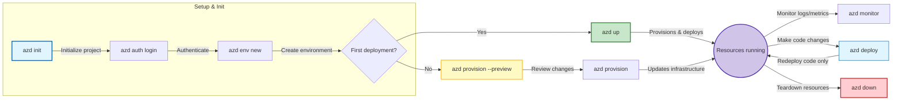
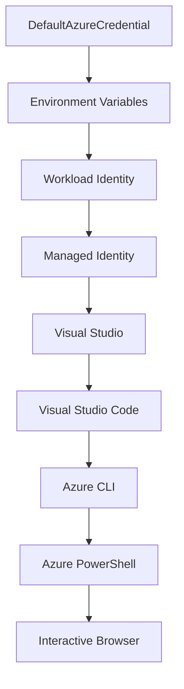

# មូលដ្ឋាន AZD - គំនិតមូលដ្ឋាន និង មូលដ្ឋានធម្មជាតិ

**ការនាវីហ្គേഷൻជំពូក:**
- **📚 ទំព័រមូលដ្ឋានវគ្គ**: [AZD សម្រាប់អ្នកចាប់ផ្ដើម](../../README.md)
- **📖 ជំពូកបច្ចុប្បន្ន**: ជំពូកទី 1 - មូលដ្ឋាន និងចាប់ផ្ដើមយ៉ាងរហ័ស
- **⬅️ មុននេះ**: [មើលទូទៅវគ្គ](../../README.md#-chapter-1-foundation--quick-start)
- **➡️ ក្រោយនេះ**: [ការដំឡើង និងកំណត់តម្លៃ](installation.md)
- **🚀 ជំពូកក្រោយ**: [ជំពូក 2: ការអភិវឌ្ឍ AI-ជាលេខដំបូង](../chapter-02-ai-development/microsoft-foundry-integration.md)

## ការណែនាំ

> បានពិនិត្យឡើងវិញតាម `azd 1.37.2` (ខែវិច្ឆិកា 2026)। ពាក្យបញ្ជា Bash ប្រើកន្លែងចំណុចដែលអ្នកត្រូវជំនួស។ ប្លង់តំណើរការនាំមុខប្រើ `.` ដើម្បីចាប់ផ្ដើមថតបច្ចុប្បន្ន; គ្មានអាគុយម៉ង់ថត, ការចាប់ផ្ដើមប្លង់បង្កើតថតរងហើយមិនផ្លាស់ប្តូរថតធ្វើការលើ shell របស់អ្នកទេ។ ស្នូបទំនើបគឺសម្រាប់បង្ហាញមិនមែនគម្រោងពេញលេញទេ។

មេរៀននេះណែនាំអ្នកឲ្យស្គាល់ Azure Developer CLI (azd), ឧបករណ៍បញ្ជាក្នុងបន្ទាត់ពាក្យដែលមានខ្លាំង ដើម្បីល្បឿនដំណើរការពីការអភិវឌ្ឍតាមកម្រិតមូលដ្ឋានដល់ការដាក់ប្រេីប្រាស់លើ Azure។ អ្នកនឹងរៀនពីគំនិតមូលដ្ឋាន, មុខងារស្នូល, និងយល់ពីរបៀបដែល azd ងាយស្រួលក្នងការដាក់ប្រេីប្រាស់កម្មវិធី cloud-native។

## គោលបំណងសិក្សា

នៅចុងបញ្ចប់មេរៀននេះ អ្នកនឹង:
- យល់ពីអ្វីជាអ្នកអភិវឌ្ឍ Azure Developer CLI និងបំណងធំរបស់វា
- រៀនពីគំនិតស្នូលរបស់ប្លង់, បរិស្ថាន, និងសេវាកម្ម
- ស្វែងយល់ពីមុខងារសំខាន់រួមមានការអភិវឌ្ឍតាមប្លង់ និង វិស្វកម្មជាអក្សរ
- យល់ដឹងអំពីរចនាសម្ព័ន្ធគម្រោង azd និងដំណើរការ
- ត្រៀមខ្លួនសម្រាប់ដំឡើង និងកំណត់តម្លៃ azd សម្រាប់បរិស្ថានការអភិវឌ្ឍរបស់អ្នក

## ផលវិបាកសិក្សា

បន្ទាប់ពីបញ្ចប់មេរៀននេះ អ្នកនឹងអាច:
- ពណ៌នាជំនួយរបស់ azd ក្នុងដំណើរការអភិវឌ្ឍ cloud ឆ្នាំថ្មីៗ
- កំណត់ចំណុចសំខាន់នៃរចនាសម្ព័ន្ធគម្រោង azd
- ពណ៌នាវិធីដែលប្លង់, បរិស្ថាន និងសេវាកម្ម ប្រើការជុំគ្នា
- យល់ពីអត្ថប្រយោជន៍នៃវិស្វកម្មជាអក្សរជាមួយ azd
- ស្គាល់បញ្ជារបស់ azd និងបំណងរបស់ពួកវា

## តើ Azure Developer CLI (azd) គឺជាអ្វី?

Azure Developer CLI (azd) គឺជាឧបករណ៍បញ្ជាទូរសម្រាប់បន្ដឧបករណ៍បញ្ជាពេលយកទៅប្រើទូលំទូលាយ និងល្បឿនការដំណើរការពីការអភិវឌ្ឍតាមកម្រិតមូលដ្ឋានដល់ការដាក់ប្រេីប្រាស់លើ Azure។ វាធ្វើឲ្យការធ្វើ, ដាក់ប្រេី, និងគ្រប់គ្រងកម្មវិធី cloud-native លើ Azure ងាយស្រួលឡើង។

### តើអ្នកអាចដាក់ប្រេីអ្វីជាមួយ azd?

azd គាំទ្រប្រភេទការងារច្រើន — ហើយបញ្ជីនេះកំពុងតែលូតលាស់។ ថ្ងៃនេះ អ្នកអាចប្រើ azd ដើម្បីដាក់ប្រេី:

| ប្រភេទការងារ | ឧទាហរណ៍ | ដំណើរការដូចគ្នាទេ? |
|---------------|----------|----------------|
| **កម្មវិធីប្រពៃណី** | កម្មវិធីវ៉ិប, REST APIs, គេហទំព័រស្ថិតស្ថេរ | ✅ `azd up` |
| **សេវាកម្ម និង មីក្រ៉ាសេវាកម្ម** | Container Apps, Function Apps, multi-service backends | ✅ `azd up` |
| **កម្មវិធី AI** | កម្មវិធីចខជាមួយ Microsoft Foundry Models, ដំណោះស្រាយ RAG ជាមួយ AI Search | ✅ `azd up` |
| **ភ្នាក់ងារច្បាប់ចិត្ត** | ភ្នាក់ងារដែលមានមូលដ្ឋាន Foundry, ការប្រតិបត្ដិការជាច្រើនភ្នាក់ងារ | ✅ `azd up` |

ការយល់ដឹងសំខាន់គឺថា **ជីវចលរបស់ azd នៅតែដូចគ្នាព្រមទាំងអ្វីដែលអ្នកកំពុងដាក់ប្រេី**។ អ្នកចាប់ផ្ដើមគម្រោង, ផ្គត់ផ្គង់វិស្វកម្ម, ដាក់កូដ, តាមដានកម្មវិធី, និងសម្អាត — មិនថាវេបសាយសាមញ្ញ ឬភ្នាក់ងារច្បាប់ចិត្តស្មុគស្មាញដែរ។

សេចក្ដីសន្និដ្ឋាននេះគឺដោយរចនាសម្ព័ន្ធ។ azd លTreatសមត្ថភាព AI ជាប្រភេទសេវាផ្សេងទៀតដែលកម្មវិធីអ្នកអាចប្រើបាន មិនមែនជាអ្វីខុសផ្សេងទេ។ ចំណុចចខដែលគាំទ្រដោយ Microsoft Foundry Models គឺ ទៅផ្ទាល់លើ azd ជាសេវាផ្សេងទៀតដែលត្រូវកំណត់ និងដាក់ប្រេី។

### 🎯 ហេតុអ្វីបានជាចាស់ AZD? ការប្រៀបធៀបពិតប្រាកដ

យើងមកប្រៀបធៀបការដាក់ប្រេីកម្មវិធីវ៉ិបសាមញ្ញមួយជាមួយមូលដ្ឋានទិន្នន័យ:

#### ❌ គ្មាន AZD: ដាក់ប្រេី Azure ដោយដៃ (លើស ៣០ នាទី)

**Bash ប្រៀបធៀបបង្ហាញមិនមែនកម្មវិធីចាប់ផ្ដើមរត់បាន।** វា assumeថាមានកូដកម្មវិធីរួច, ឈ្មោះធនធានតែមួយ, ការផ្ទៀងផ្ទាត់ Azure CLI, និងបន្ថែម CLI ដែលត្រូវការ។ ប្រើហាត់ជាមួយប្លង់ខាងក្រោមសម្រាប់ផ្លូវ end-to-end ដែលគាំទ្រ។

```bash
# Step 1: Create resource group
az group create --name myapp-rg --location eastus

# Step 2: Create App Service Plan
az appservice plan create --name myapp-plan \
  --resource-group myapp-rg \
  --sku B1 --is-linux

# Step 3: Create Web App
az webapp create --name myapp-web-unique123 \
  --resource-group myapp-rg \
  --plan myapp-plan \
  --runtime "NODE:22-lts"

# Step 4: Create Cosmos DB account (10-15 minutes)
az cosmosdb create --name myapp-cosmos-unique123 \
  --resource-group myapp-rg \
  --kind MongoDB

# Step 5: Create database
az cosmosdb mongodb database create \
  --account-name myapp-cosmos-unique123 \
  --resource-group myapp-rg \
  --name tododb

# Step 6: Create collection
az cosmosdb mongodb collection create \
  --account-name myapp-cosmos-unique123 \
  --resource-group myapp-rg \
  --database-name tododb \
  --name todos

# Step 7: Get connection string
CONN_STR=$(az cosmosdb keys list \
  --name myapp-cosmos-unique123 \
  --resource-group myapp-rg \
  --type connection-strings \
  --query "connectionStrings[0].connectionString" -o tsv)

# Step 8: Configure app settings
az webapp config appsettings set \
  --name myapp-web-unique123 \
  --resource-group myapp-rg \
  --settings MONGODB_URI="$CONN_STR"

# Step 9: Enable logging
az webapp log config --name myapp-web-unique123 \
  --resource-group myapp-rg \
  --application-logging filesystem \
  --detailed-error-messages true

# Step 10: Set up Application Insights
az monitor app-insights component create \
  --app myapp-insights \
  --location eastus \
  --resource-group myapp-rg

# Step 11: Link App Insights to Web App
INSTRUMENTATION_KEY=$(az monitor app-insights component show \
  --app myapp-insights \
  --resource-group myapp-rg \
  --query "instrumentationKey" -o tsv)

az webapp config appsettings set \
  --name myapp-web-unique123 \
  --resource-group myapp-rg \
  --settings APPINSIGHTS_INSTRUMENTATIONKEY="$INSTRUMENTATION_KEY"

# Step 12: Build application locally
npm install
npm run build

# Step 13: Create deployment package
zip -r app.zip . -x "*.git*" "node_modules/*"

# Step 14: Deploy application
az webapp deployment source config-zip \
  --resource-group myapp-rg \
  --name myapp-web-unique123 \
  --src app.zip

# Step 15: Wait and pray it works 🙏
# (No automated validation, manual testing required)
```

**បញ្ហា:**
- ❌ ពាក្យបញ្ជា ១៥+ ត្រូវចាំ និងអនុវត្តដោយលំដាប់
- ❌ ៣០-៤៥ នាទីនៃការងារដោយដៃ
- ❌ ងាយធ្វើកំហុស (សរសេរខុស, អាគុយម៉ង់ខុស)
- ❌ គ្រប់គ្រង លិខិតសម្ងាត់ត្រូវការចំណាត់ថ្នាក់ច្បាស់; ឯកសារតាមដាន និង shell នាំអោយបង្ហាញវា
- ❌ គ្មានការដោះស្រាយជាលក្ខណៈស្វ័យប្រវត្តិពេលមានបញ្ហា
- ❌ ពិបាកធ្វើឡើងវិញសម្រាប់សមាជិកក្រុម
- ❌ ផ្លាស់ប្តូរពេលណាក៏មិនដូចគ្នា (មិនអាចស្ទួន)

#### ✅ មាន AZD: ដាក់ប្រេីដោយស្វ័យប្រវត្តិ (5 ពាក្យបញ្ជា, ១០-១៥ នាទី)

```bash
# Step 1: Initialize from template
azd init --template todo-nodejs-mongo .

# Step 2: Authenticate
azd auth login

# Step 3: Select the environment created during init
azd env select dev

# Step 4: Preview changes (optional but recommended)
azd provision --preview

# Step 5: Deploy everything
azd up

# ✨ Done! Everything is deployed, configured, and monitored
```

**អត្ថប្រយោជន៍:**
- ✅ **ពាក្យបញ្ជា 5** ប្រៀបធៀបនឹងជម្រើសដៃ ១៥+
- ✅ **១០-១៥ នាទី** ពេលសរុប (ភាគច្រើនរង់ចាំ Azure)
- ✅ **កំហុសដៃតិចជាង** - វិធានការដំណើរការតាមប្លង់មានលក្ខណៈថេរ
- ✅ **គ្រប់គ្រងសម្ងាត់បានសុវត្ថិភាព** - ប្លង់ជាច្រើនប្រើដាក់ស្តុកសម្ងាត់ដែលគ្រប់គ្រងដោយ Azure
- ✅ **ការដាក់ប្រេីអាចធ្វើឡើងវិញបាន** - ដំណើរការដូចគ្នាសម្រាប់រាល់ពេល
- ✅ **ការបកស្រាយវិស្វកម្មអាចធ្វើឡើងវិញបាន** - អាស្រ័យលើគណនីកំណត់, ភាគ, និងកំណែក្នុងប្លង់
- ✅ **រួមចំណែកក្នុងក្រុមបាន** - អ្នកណាក៏អាចដាក់ប្រេីដោយពាក្យបញ្ជាដូចគ្នា
- ✅ **វិស្វកម្មជាអក្សរ** - ប្លង់ Bicep មានការគ្រប់គ្រងជំនាន់
- ✅ **ការត្រួតពិនិត្យកំណត់ដែលបានកំណត់ប្លង់** - Application Insights ពេលរួមបញ្ចូលក្នុងប្លង់

### ពេលវេលានិងភាពជឿទុកចិត្ត

ពេលវេលាខាងលើគឺជាការវាយតម្លៃមិនមែនជារូបមន្ត។ azd កាត់បន្ថយពាក្យបញ្ជាដែលអ្នកត្រូវរួមចំណែក ប៉ុន្តែមិនធានាឲ្យបានរយៈពេលដាក់ប្រេីជោគជ័យ។ រក្សាកំណែរក្សាទុកនៅក្នុងការគ្រប់គ្រងប្រភព និងសាកល្បងនីតិវិធីស្ដារឡើងវិញ។

## គំនិតមូលដ្ឋាន

### ប្លង់
ប្លង់គឺជាគ្រឹះនៃ azd។ វាបង្កอบដោយ:
- **កូដកម្មវិធី** - កូដប្រភព និងការគាំទ្ររបស់អ្នក
- **ការតំណាងវេស្ដកម្ម** - វិស្វកម្ម Azure បច្ចុប្បន្ននៅក្នុង Bicep ឬ Terraform
- **ឯកសារកំណត់តម្លៃ** - ការកំណត់ និងអថេរបរិស្ថាន
- **ស្គ្រីបដាក់ប្រេី** - ដំណើរការដាក់ប្រេីដោយស្វ័យប្រវត្តិ

### បរិស្ថាន
បរិស្ថានតំណាងឲ្យគោលដៅដាក់ប្រេីផ្សេងៗ:
- **ការអភិវឌ្ឍ** - សម្រាប់ការប្រលង និងអភិវឌ្ឍ
- **ស្តេច** - បរិស្ថានមុនផលិតកម្ម
- **ផលិតកម្ម** - បរិស្ថានផលិតកម្មបន្តផ្ទាល់

បរិស្ថាននីមួយៗរក្សាទុករបស់ខ្លួន:
- ឈ្មោះបរិស្ថាន និងតម្លៃ; ភ្លើងឆក់ធនធានអាស្រ័យលើប្លង់វេស្ដកម្ម
- ការកំណត់តម្លៃ
- ស្ថានភាពដាក់ប្រេី

### សេវាកម្ម
សេវាកម្មក្នុង `azure.yaml` ពណ៌នាអំពីធាតុកម្មវិធីដែលអាចដាក់បាន:
- **មុខផ្នែក** - កម្មវិធីវ៉ិប, SPAs
- **ក្រោយផ្នែក** - APIs, មីក្រ៉ាសេវាកម្ម

មូលទិន្នន័យ និងផ្ទុកទិន្នន័យជាទូទៅត្រូវបានប្រើជាវិស្វកម្ម ឥឡូវនេះ មិនមែនជាអ្នកផ្ដល់សេវាកម្មដែលបង្កើតឡើងដូចជា `host: postgres` ទេ។

## មុខងារសំខាន់

### 1. ការអភិវឌ្ឍតាមប្លង់
```bash
# Browse available templates
azd template list

# Initialize from a template
azd init --template "<template-name>" .
```

### 2. វិស្វកម្មជាអក្សរ
- **Bicep** - ភាសាតំបន់ជាស្រេចរបស់ Azure
- **Terraform** - ឧបករណ៍វិស្វកម្មពហុ-មេឃ
- Bicep បញ្ចេញទៅប្លង់ ARM; ARM JSON ដើមមិនមែនជា `infra.provider` ទេ។

### 3. ដំណើរការរួមបញ្ចូល
```bash
# Complete deployment workflow
azd up            # Provision + Deploy this is hands off for first time setup

# 🧪 NEW: Preview infrastructure changes before deployment (SAFE)
azd provision --preview    # Simulate infrastructure deployment without making changes

azd provision     # Create Azure resources if you update the infrastructure use this
azd deploy        # Deploy application code or redeploy application code once update
azd down          # Clean up resources
```

#### 🛡️ ការរៀបចំវិស្វកម្មសុវត្ថិភាពជាមួយការមើលមុន
ពាក្យបញ្ជា `azd provision --preview` ជាផ្លាស់ប្ដូរល្បឿនសម្រាប់ដាក់ប្រេីដោយសុវត្ថិភាព:
- **ការវិភាគ Dry-run** - បង្ហាញអ្វីដែលនឹងត្រូវបានបង្កើត, បម្លែង, ឬលុប
- **គ្មានការអនុវត្តវិស្វកម្ម** - ពិនិត្យការផ្លាស់ប្ដូរផ្តល់សេវាកម្ម; ពិនិត្យភ្ជាប់គម្រោងជាមុន ព្រោះភ្ជាប់អាចដើរពាក្យបញ្ជាជាមួយផលប៉ះពាល់
- **ការសហការក្រុម** - ចែករំលែកលទ្ធផលមុនដាក់ប្រេី
- **ការរួមបញ្ចូលការរៀបចំថ្លៃ** - ពិនិត្យ SKU đề xuất, បន្ទាប់មកយកតម្លៃជាមួយគណនាតម្លៃ Azure; មើលមុនមិនគណនាថ្លៃ

```bash
# Example preview workflow
azd provision --preview           # See what will change
# Review the output, discuss with team
azd provision                     # Apply changes with confidence
```

### 📊 ការមើលឃើញ: ដំណើរការអភិវឌ្ឍ AZD



**ការពន្យល់ដំណើរការ:**
1. **Init** - ចាប់ផ្តើមជាមួយប្លង់ ឬគម្រោងថ្មី
2. **Auth** - ផ្ទៀងផ្ទាត់ជាមួយ Azure
3. **Environment** - បង្កើតបរិស្ថានដាក់ប្រេីដោយភ្ជាប់គ្នា
4. **Preview** - 🆕 ជានិច្ចមើលមុនការផ្លាស់ប្ដូរវិស្វកម្ម (អនុវត្តដោយសុវត្ថិភាព)
5. **Provision** - បង្កើត/ជួសជុលធនធាន Azure
6. **Deploy** - ជម្រះកូដកម្មវិធីរបស់អ្នក
7. **Monitor** - តាមដានការសម្តែងកម្មវិធី
8. **Iterate** - ប្តូរនិងបន្តដាក់កូដ
9. **Cleanup** - ជម្រះធនធានពេលបញ្ចប់

### 4. ការគ្រប់គ្រងបរិស្ថាន
```bash
# Create and manage environments
azd env new "<environment-name>"
azd env select "<environment-name>"
azd env list
```

### 5. ពន្្​ននិងបញ្ជា AI

azd ប្រើប្រព័ន្ធពន្្​នដើម្បីបន្ថែមសមត្ថភាពក្រៅពី CLI ស្នូល។ វាមានប្រយោជន៍សម្រាប់ការងារ AI មួយចំនួន:

```bash
# List available extensions
azd extension list

# Install the Foundry agents extension
azd extension install azure.ai.agents

# Initialize an AI agent project interactively
azd ai agent init

# Test a deployed agent (shows latency and time-to-first-byte)
azd ai agent invoke

# Start the MCP server for AI-assisted development (Alpha)
azd mcp start
```

**ជីវចលភ្នាក់ងារ, ចាប់ពីដើមដល់ចុង.** ប្រើ `azure.ai.agents` សម្រាប់ប្រតិបត្ដិការជីវចលភ្នាក់ងារ និងដំឡើង `azure.ai.evaluations` បន្ថែមសម្រាប់ការវាយតម្លៃ។ ប្រើ `azd >= 1.37.0` សម្រាប់ដំណើរការរួម។ អ្នកមិនចាំបាច់មានអ្វីទាំងអស់នៅថ្ងៃទីមួយ:

| ជំនួស | ពាក្យបញ្ជា | អ្វីដែលវាធ្វើ |
|-------|---------|--------------|
| **បង្កើត** | `azd ai agent init --template <path-to-azure.yaml>` | ទទួលប្លង់គម្រោងភ្នាក់ងារបច្ចុប្បន្ន |
| **ពិនិត្យ** | `azd ai agent invoke` | ហៅភ្នាក់ងារនិងមើលពេលវេលាចម្លើយ |
| **វាស់** | `azd ai eval init`, `generate`, `run start` | កំណត់ផែនការ, ដាក់ប្រេី, ហើយរត់វាយតម្លៃដោយពន្្​នផ្ទាល់ខ្លួន |
| **បង្កើន** | `azd ai agent optimize --eval <evaluation-name> --optimize-model <optimizer-deployment>` | ប្រើវាយតម្លៃដែលសមរម្យដើម្បីបង្កើនភ្នាក់ងារ |
| **ពិនិត្យ** | `azd ai agent endpoint show` | មើលការកំណត់ចុងភៅរស់រវើក |
| **សម្អាត** | `azd ai agent delete` | លុបភ្នាក់ងារដ៏មាន និងកំណែទាំងអស់ |

> ពន្្​នត្រូវបានពិពណ៌នាជាផ្ទាល់ក្នុង [ជំពូក 2: ការអភិវឌ្ឍ AI-ជាលេខដំបូង](../chapter-02-ai-development/agents.md) និងឯកសារយោង [បញ្ជា AZD AI CLI](../chapter-08-production/production-ai-practices.md#azd-ai-cli-commands-and-extensions)។

## 📁 រចនាសម្ព័ន្ធគម្រោង

រចនាសម្ព័ន្ធគម្រោង azd ធម្មតា:
```
my-app/
├── .azure/                  # Local environments and selected-environment config
│   ├── config.json
│   └── dev/.env
├── .devcontainer/          # Development container config
├── .github/workflows/      # GitHub Actions
├── .vscode/               # VS Code settings
├── infra/                 # Infrastructure code
│   ├── main.bicep        # Main infrastructure template
│   ├── main.parameters.json
│   └── modules/          # Reusable modules
├── src/                  # Application source code
│   ├── api/             # Backend services
│   └── web/             # Frontend application
├── azure.yaml           # azd project configuration
└── README.md
```

## 🔧 ឯកសារកំណត់តម្លៃ

### azure.yaml
ឯកសារកំណត់តម្លៃគម្រោងសំខាន់:
```yaml
name: my-awesome-app
metadata:
  template: my-template@1.0.0

services:
  web:
    project: ./src/web
    language: js
    host: appservice
  api:
    project: ./src/api
    language: js
    host: appservice

hooks:
  preprovision:
    shell: pwsh
    run: echo "Preparing to provision..."
```

### .azure/config.json
ជម្រើសបរិស្ថានលំនាំដើមក្នុងគម្រោង (បង្ហាញ; គ្រប់គ្រងដោយ azd):
```json
{
  "defaultEnvironment": "dev"
}
```

## 🎪 ដំណើរការធម្មតាជាមួយហាត់ការដោយដៃ

> **💡 គន្លឹះសិក្សា:** ជំហានខាងក្រោមបង្ហាញពីការហាត់ដើម្បីបង្កើនជំនាញ AZD របស់អ្នកជាបន្តបន្ទាប់។

### 🎯 ហាត់ 1: ចាប់ផ្តើមគម្រោងដំបូងរបស់អ្នក

**គោលបំណង:** បង្កើតគម្រោង AZD និងស្វែងយល់ពីរចនាសម្ព័ន្ធ

**ជំហាន:**
```bash
# Use a proven template
mkdir azd-basics-practice
cd azd-basics-practice
# Choose "dev" for the environment name when prompted
azd init --template todo-nodejs-mongo .

# Explore the generated files
ls -la  # View all files including hidden ones

# Key files created:
# - azure.yaml (main config)
# - infra/ (infrastructure code)
# - src/ (application code)
```

**✅ ជោគជ័យ:** អ្នកមាន azure.yaml, infra/, និងថត src/

---

### 🎯 ហាត់ 2: ដាក់ប្រេីលើ Azure

**គោលបំណង:** បញ្ចប់ដំណើរការដាក់ប្រេីចេញ

**ជំហាន:**
```bash
# 1. Authenticate
azd auth login

# 2. Select the dev environment created in Exercise 1
azd env select dev
azd env set AZURE_LOCATION eastus

# 3. Preview changes (RECOMMENDED)
azd provision --preview

# 4. Deploy everything
azd up

# 5. Verify deployment
azd show    # View your app URL
```

**ពេលដែលរំពឹងទុក:** ១០-១៥ នាទី  
**✅ ជោគជ័យ:** URL កម្មវិធីបើកក្នុងកម្មវិធីរុករក

---

### 🎯 ហាត់ 3: បរិស្ថានច្រើន

**គោលបំណង:** ដាក់ប្រេីក្នុងក្បួន dev និង staging

**ជំហាន:**
```bash
# Already have dev, create staging
azd env new staging
azd env set AZURE_LOCATION westus2
azd up

# Switch between them
azd env list
azd env select dev
```

**✅ ជោគជ័យ:** ក្រុមធនធានពីរបំបែកនៅក្នុង Azure Portal

**សម្អាត:** ហាត់ 3 បង្កើតការដាក់ប្រេីជាលេខពីរដែលគិតថ្លៃ។ លុបទាំងពីរពេលបញ្ចប់:

```bash
azd down --environment dev
azd down --environment staging
```

---

### 🛡️ ការសម្អាតបាំបែក: `azd down --force --purge`

នៅពេលដែលអ្នកចង់លុបធនធាន Azure របស់បរិស្ថានដែលបានជ្រើសរើសដោយចេតនា:

```bash
azd down --force --purge
```

**អ្វីដែលវាធ្វើ:**
- `--force`: គ្មានការបង្ហាញកំណត់បញ្ញង់
- `--purge`: ក៏លុបធនធានដែលចំនុចសំរាកត្រូវគាំទ្រចំពោះការលុប (ឧទាហរណ៍ Key Vaults), ប្រសិនបើការពារដំណើរការត្រូវបានអនុញ្ញាត។ វាមិនលុបថត `.azure/` នៅលើកុំព្យូទ័ររបស់អ្នកទេ។

**ប្រើពេល:** បញ្ចប់ជាមួយបរិស្ថានចាក់ដកបាន។ មិនត្រូវប្រើសម្អាតបាំបែកជាជំហរ​ដំបូងសម្រាប់បញ្ហាការផ្ទៀងផ្ទាត់ ឬកំណត់ការលំដាប់ឬកំណត់តម្លៃ។

---

## 🎪 ឯកសារយោងដំណើរការដើម

### ការចាប់ផ្តើមគម្រោងថ្មី
```bash
# Method 1: Use existing template
azd init --template todo-nodejs-mongo .

# Method 2: Start from scratch
azd init

# Method 3: Use current directory
azd init .
```

### វដ្តអភិវឌ្ឍ
```bash
# Set up development environment
azd auth login
azd env new dev
azd env select dev

# Deploy everything
azd up

# Make changes and redeploy
azd deploy

# Clean up when done
azd down --force --purge # Deletes this environment's discovered Azure resources; review before forcing deletion.
```

## ការយល់ដឹង `azd down --force --purge`
ពាក្យបញ្ជា `azd down --force --purge` គឺជាវិធីដែលមានប្រសិទ្ធិភាពដាច់ចេញពីបរិស្ថាន azd របស់អ្នក និងធនធានទាំងអស់ដែលពាក់ព័ន្ធ។ នេះជាការបំបែកអ្វីដែលនីមួយៗ flag ធ្វើ៖
```
--force
```
- លើកលែងការបង្ហាញការបញ្ជាក់។
- មានប្រយោជន៍សម្រាប់ស្វ័យប្រវត្តិ ឬស្គ្រីបដែលមិនអាចបញ្ចូលដោយដៃ។
- មិនលើកលែងសិទ្ធិ, ការពារដំណើរការ, ឬការបរាជ័យក្នុងការលុប។

```
--purge
```
លុបធនធាន Azure ដែលគាំទ្រចំណុចសម្រាកបញ្ចាំងដោយគ្មានការបញ្ជាក់បន្ថែម។ ការពារដំណើរការ និងសិទ្ធិគឺនៅតែមាន។ វា **មិន** លុបបរិស្ថានក្នុងកុំព្យូទ័ររបស់អ្នក ឬថត `.azure/` ទេ។


### ហេតុអ្វីបានជាប្រើទាំងពីរ?
ប្រើទាំងពីរពេលដែលអ្នកចង់លុបធនធាន Azure របស់បរិស្ថានដែលបានជ្រើសរើស និងលុបទិន្នន័យដែលអាចស្ដារឡើងវិញបាន។ នេះជាការសម្អាតបាំបែក មិនមែនជាការជួសជុលទូទៅ ឬការត្រួតពិនិត្យស្ថានភាពក្នុងក្រោមឡើងវិញទេ។

វាអាចជួយបានជាភាពពិសេសបន្ទាប់ពីបានលុបធនធានដោយដៃក្នុង Azure portal ឬខណៈពេលប្ដូរប្លង់, បរិស្ថាន, ឬឈ្មោះក្រុមធនធាន។


### ការគ្រប់គ្រងបរិស្ថានច្រើន
```bash
# Create staging environment
azd env new staging
azd env select staging
azd up

# Switch back to dev
azd env select dev

# Compare environments
azd env list
```

## 🔐 ការផ្ទៀងផ្ទាត់ និង លិខិតសម្ងាត់

បំបែកការផ្ទៀងផ្ទាត់ដាក់ប្រេី (`azd auth login`) ពីការផ្ទៀងផ្ទាត់ SDK កម្មវិធី (`DefaultAzureCredential`)។ ពួកវាផ្សេងគ្នា។ azd មិនប្រើលិខិតសម្ងាត់ Azure CLI ដោយលំនាំដើមទេ។

### ការផ្ទៀងផ្ទាត់ Azure CLI (`az login`)

រៀបចំ `azd auth login` សម្រាប់ azd។ ពាក្យបញ្ជា Azure CLI ខាងក្រោមជាជម្រើស និងផ្ទៀងផ្ទាត់ពាក្យបញ្ជា `az` ផ្សេងទៀត:

```bash
# Interactive login (opens browser)
az login

# Login with specific tenant
az login --tenant "<tenant-id>"

# Login with service principal
az login --service-principal -u "<app-id>" -p "<password>" --tenant "<tenant-id>"

# Check current login status
az account show

# List available subscriptions
az account list --output table

# Set default subscription
az account set --subscription "<subscription-id>"
```

### ដំណើរការផ្ទៀងផ្ទាត់
1. **ការ​ចូល​បញ្ចូល​ដោយ​យ៉ាង​អន្តរជាតិ**៖ បើកកម្មវិធីរុករកលំនាំដើមរបស់អ្នកសម្រាប់ការផ្ទៀងផ្ទាត់
2. **ចលនាអក្សរឧបករណ៍**៖ សម្រាប់បរិស្ថានដែលមិនអាចប្រើកម្មវិធីរុករកបាន
3. **សេវាពាណិជ្ជកម្ម Principal**៖ សម្រាប់សកម្មភាពស្វ័យប្រវត្តិនិង CI/CD
4. **អត្តសញ្ញាណគ្រប់គ្រង**៖ សម្រាប់កម្មវិធីដែលមានមូលដ្ឋានលើ Azure

### ខ្សែសង្វាក់ DefaultAzureCredential

`DefaultAzureCredential` គឺជាប្រភេទលិខិតសម្ងាត់ដែលផ្តល់នូវបទពិសោធន៍ផ្ទៀងផ្ទាត់សាមញ្ញ ដោយព្យាយាមប្រភពលិខិតជាច្រើនក្នុងលំដាប់ជាក់លាក់:

#### ខ្សែសង្វាក់លិខិតសម្ងាត់ SDK កម្មវិធី

សង្រ្គោះចម្រាញ់ជាក់លាក់អាស្រ័យលើភាសា Azure Identity SDK, ចំណោទ, ឧបករណ៍ដំនើរការដែលបានដំឡើង និងជម្រើស។ រូបភាពនេះគឺជាគំនិតមួយ មិនមែនជាជម្រៅកំណត់នៃការ Authenticate azd ទេ; SDKs ថ្មីៗក៏អាចរួមបញ្ចូលគណនី Azure Developer CLI ផងដែរ។


#### 1. អថេរបរិស្ថាន
```bash
# Set environment variables for service principal
export AZURE_CLIENT_ID="<app-id>"
export AZURE_CLIENT_SECRET="<password>"
export AZURE_TENANT_ID="<tenant-id>"
```

#### 2. អត្តសញ្ញាណការងារ (Workload Identity) (Kubernetes/GitHub Actions)
ប្រើស្វ័យប្រវត្តិក្នុង:
- សេវាកម្ម Azure Kubernetes Service (AKS) ជាមួយ Workload Identity
- GitHub Actions ជាមួយសម្ព័ន្ធភាព OIDC
- សถานการณ์អត្តសញ្ញាណសម្ព័ន្ធភាពផ្សេងទៀត

#### 3. អត្តសញ្ញាណគ្រប់គ្រង (Managed Identity)
សម្រាប់ធនធាន Azure ដូចជា:
- ម៉ាស៊ីនភ្ញៀវវីរុស (Virtual Machines)
- សេវាកម្មកម្មវិធី (App Service)
- Azure Functions
- កុងតឺន័រផ្ទុក (Container Instances)

```bash
# Inspect a deployed Container App's configured identity (requires az login)
az containerapp show --name "<app-name>" --resource-group "<rg-name>" --query identity
```

#### 4. ការបញ្ចូលឧបករណ៍អភិវឌ្ឍន៌
- **Visual Studio**: ប្រើគណនា​ដែលបានចូលដោយស្វ័យប្រវត្តិ
- **VS Code**: ការគាំទ្រអាស្រ័យលើ SDK និងកា​រតម្រង/កម្មវិធីបន្ថែម​ដែលគាំទ្រ
- **Azure CLI**: ប្រើគណនី `az login` (ធម្មតា​សម្រាប់ការអភិវឌ្ឍក្នុងស្រុក)

### ការកំណត់ Authenticate AZD

```bash
# Method 1: Direct azd authentication (recommended)
azd auth login

# Method 2: Direct azd authentication
azd auth login --use-device-code  # For headless environments

# Method 3: Check authentication status
azd auth login --check-status

# Method 4: Logout and re-authenticate
azd auth logout
azd auth login
```

### អនុវិធីល្អបំផុតសម្រាប់ Authenticate

#### សម្រាប់ការអភិវឌ្ឍក្នុងស្រុក
```bash
# 1. Log in to azd
azd auth login

# 2. Select the subscription for this initialized environment
azd env set AZURE_SUBSCRIPTION_ID "<subscription-id>"

# 3. Check azd sign-in details (read the status message)
azd auth login --check-status
```

#### សម្រាប់បណ្តាញ CI/CD
```yaml
# Partial GitHub Actions steps: assumes checkout, azd installation,
# required AZURE_* environment values, and pipeline secret configuration.
- name: Deploy with azd
  run: |
    azd auth login --client-id ${{ secrets.AZURE_CLIENT_ID }} \
                    --client-secret ${{ secrets.AZURE_CLIENT_SECRET }} \
                    --tenant-id ${{ secrets.AZURE_TENANT_ID }}
    azd up --no-prompt
```

#### សម្រាប់បរិយាកាសផលិតកម្ម
- ប្រើ **Managed Identity** ពេលរត់លើធនធាន Azure
- ប្រើ **Service Principal** សម្រាប់សេចក្តីប្រតិបត្តិការ​ឯករាជ្យ
- ជៀសវាងរក្សាទុកគណនីក្នុងកូដឬឯកសារកំណត់រចនា
- ប្រើ **Azure Key Vault** សម្រាប់កំណត់រចនាត្រជាក់ចិត្ត

### បញ្ហាផ្សេងៗនៃ Authenticate និងដំណោះស្រាយ

#### បញ្ហា៖ "រកមិនឃើញការជាវ"
```bash
# Solution: Set default subscription
az account list --output table
az account set --subscription "<subscription-id>"
azd env set AZURE_SUBSCRIPTION_ID "<subscription-id>"
```

#### បញ្ហា៖ "សិទ្ធិមិនគ្រប់គ្រាន់"
```bash
# Solution: Check and assign required roles
az role assignment list --assignee $(az account show --query user.name --output tsv)

# Common required roles:
# - Contributor (for resource management)
# - User Access Administrator (for role assignments)
```

#### បញ្ហា៖ "Token ផុតកំណត់"
```bash
# Solution: Re-authenticate
az logout
az login
azd auth logout
azd auth login
```

### Authenticate ក្នុងសถานการณ์ផ្សេងៗ

#### ការអភិវឌ្ឍក្នុងស្រុក
```bash
# Personal development account
az login
azd auth login
```

#### ការអភិវឌ្ឍជាក្រុម
```bash
# Use specific tenant for organization
az login --tenant contoso.onmicrosoft.com
azd auth login --tenant-id "<tenant-id>"
```

#### សถานการณ์ច្រើនអ្នកជួល
```bash
# Switch between tenants
az login --tenant tenant1.onmicrosoft.com
azd auth login --tenant-id "<tenant-1-id>"
# Select an environment configured with tenant 1's subscription
azd env select tenant1-dev
# Deploy to tenant 1
azd up

az login --tenant tenant2.onmicrosoft.com  
azd auth login --tenant-id "<tenant-2-id>"
azd env select tenant2-dev
# Deploy to tenant 2
azd up
```

### ការពិចារណាអំពីសុវត្ថិភាព

1. **ការផ្ទុកគណនី**: មិនធ្វើការផ្ទុកគណនីក្នុងកូដដើមទេ
2. **ការរឹតតំណែងដែនកំណត់**: ប្រើគោលការណ៍អនុញ្ញាតតិចបំផុតសម្រាប់ service principals
3. **ការបង្វិល Token**: បង្វិលសម្ងាត់នៃ service principal ជារឿយៗ
4. **ការតាមដាន Audit Trail**: តាមដានសកម្មភាព Authenticate និងការដាក់ចេញ
5. **សុវត្ថិភាពបណ្តាញ**: ប្រើចំណុចចូលឯកជនណែនាំនៅពេលអាច

### ការដោះស្រាយបញ្ហា Authenticate

```bash
# Debug authentication issues
azd auth login --check-status
az account show
az account get-access-token

# Common diagnostic commands
whoami                          # Current user context
az ad signed-in-user show      # Microsoft Entra ID user details
az group list                  # Test resource access
```

## ការស្វែងរកពាក្យបញ្ជា

### ការស្វែងរក
```bash
azd template list              # Browse templates
azd template list --help       # Template discovery options
azd init --help               # Initialization options
```

### ការគ្រប់គ្រងគម្រោង
```bash
azd show                     # Project overview
azd env list                # Available environments and selected default
azd config show            # Configuration settings
```

### ការត្រួតពិនិត្យ
```bash
azd monitor                  # Open Azure portal monitoring
azd monitor --logs           # View application logs
azd monitor --live           # View live metrics
azd pipeline config          # Set up CI/CD
```

## អនុវិធីល្អបំផុត

### 1. ប្រើឈ្មោះមានអត្ថន័យ
```bash
# Good
azd env new production-east
azd init --template todo-nodejs-mongo .

# Avoid
azd env new env1
azd init --template template1 .
```

### 2. ប្រើប្រាស់សំណុំគំរូ
- ដាក់ចាប់ផ្ដើមជាមួយសំណុំគំរូដែលមានរួច
- កែសម្រួលសម្រាប់តម្រូវការរបស់អ្នក
- បង្កើតសំណុំគំរូដែលអាចប្រើឡើងវិញសម្រាប់អង្គការរបស់អ្នក

### 3. ភាពបែកបាក់បរិស្ថាន
- ប្រើបរិស្ថានផ្សេងគ្នាសម្រាប់ dev/staging/prod
- មិន pernah deploy ត្រូវទៅផលិតកម្មពីម៉ាស៊ីនក្នុងស្រុកដោយផ្ទាល់
- ប្រើបណ្តាញ CI/CD សម្រាប់ការដាក់ចេញផលិតកម្ម

### 4. ការគ្រប់គ្រងកំណត់រចនា
- ប្រើ managed identity និង Key Vault សម្រាប់សម្ងាត់; តម្លៃ `azd env set` ទូទៅ​គឺ plaintext ក្នុងស្រុក
- ទុកការកំណត់ទុកក្នុងការត្រួតពិនិត្យកំណែ
- ចុះឈ្មោះបរិស្ថានដោយជាក់លាក់

## ការរៀនបន្ត

### អ្នកចាប់ផ្ដើម (សប្ដាហ៍ 1-2)
1. ដំឡើង azd និង Authenticate
2. ដាក់ចេញសំណុំគំរូសាមញ្ញ
3. យល់អំពីរចនាសម្ព័ន្ធគម្រោង
4. រៀនពាក្យបញ្ជាមូលដ្ឋាន (up, down, deploy)

### ជាន់មធ្យម (សប្ដាហ៍ 3-4)
1. កែសម្រួលសំណុំគំរូ
2. គ្រប់គ្រងបរិស្ថានច្រើន
3. យល់ដឹងអំពីកូដហេដ្ឋារចនាសម្ព័ន្ធ
4. កំណត់បណ្តាញ CI/CD

### ភាពខ្ពស់ (សប្ដាហ៍ 5+)
1. បង្កើតសំណុំគំរូផ្ទាល់ខ្លួន
2. គំរូហេដ្ឋារចនាសម្ព័ន្ធកម្រិតខ្ពស់
3. ដាក់ចេញនៅតំបន់ច្រើន
4. កំណត់រចនាព័ត៌មានសម្រាប់សហគ្រាស

## ជំហានបន្ទាប់

**📖 តាមដានមេរៀនជំពូក 1 ៖**
- [ការដំឡើង និង ការកំណត់](installation.md) - ទទួលបានការដំឡើងនិងកំណត់ azd
- [គម្រោងដំបូងរបស់អ្នក](first-project.md) - បញ្ចប់មេរៀនដៃ
- [មាគ៌ាការកំណត់](../chapter-03-configuration/configuration.md) - ជម្រើសកំណត់កម្រិតខ្ពស់

**🎯 តើអ្នករួចរាល់សម្រាប់ជំពូកបន្ទាប់?**
- [ជំពូក 2: ការអភិវឌ្ឍ AI ជាដំបូង](../chapter-02-ai-development/microsoft-foundry-integration.md) - ចាប់ផ្ដើមបង្កើតកម្មវិធី AI

## ឯកសារបន្ថែម

- [ទិដ្ឋភាពទូទៅ Azure Developer CLI](https://learn.microsoft.com/en-us/azure/developer/azure-developer-cli/)
- [បណ្ណាល័យសំណុំគំរូ](https://azure.github.io/awesome-azd/)
- [គំរូសហគមន៍](https://github.com/Azure-Samples)

---

## 🙋 សំណួរញឹកញាប់

### សំណួរទូទៅ

**Q: តើមានភាពខុសគ្នារវាង AZD និង Azure CLI ម្ដេចដែរ?**

A: Azure CLI (`az`) សម្រាប់គ្រប់គ្រងធនធាន Azure ផ្ទាល់មួយៗ។ AZD (`azd`) សម្រាប់គ្រប់គ្រងកម្មវិធីទាំងមូល៖

```bash
# Azure CLI - Low-level resource management
az webapp create --name myapp --resource-group rg
az sql server create --name myserver --resource-group rg
# ...many more commands needed

# AZD - Application-level management
azd up  # Deploys entire app with all resources
```

**គិតអំពីបែបនេះ៖**
- `az` = បម្រើលើអង្គធាតុ Lego ផ្ទាល់ខ្លួន
- `azd` = បម្រើជាមួយឈុតលេខ Lego ពេញលេញ

---

**Q: តើខ្ញុំត្រូវឯកទេស Bicep ឬ Terraform ដើម្បីប្រើ AZD មែនទេ?**

A: ទេ! ចាប់ផ្ដើមជាមួយសំណុំគំរូ:
```bash
# Use existing template - no IaC knowledge needed
azd init --template todo-nodejs-mongo .
azd up
```

អ្នកអាចរៀន Bicep បន្ទាប់មកសម្រាប់កែប្រែហេដ្ឋារចនាសម្ព័ន្ធ។ សំណុំគំរូផ្តល់ឧទាហរណ៍ការងារដើម្បីរៀនពីវា។

---

**Q: តើចំណាយប៉ុន្មានសម្រាប់រត់សំណុំគំរូ AZD?**

A: ចំណាយខុសគ្នាតាមតំបន់, SKU, រយៈពេលដំណើរការ, បែបបញ្ចូលទិន្នន័យ និងការប្រើប្រាស់ម៉ូដែល។ បរិយាកាសអភិវឌ្ឍន៍អាចមានចំណាយខ្ពស់ប្រចាំខែទោះបីមិនបានប្រើប្រាស់ក៏ដោយ; កុំចាត់ទុកថាជួរលំដាប់ $50-150 ទាំងមូល៖

```bash
# Preview resource changes (not prices)
azd provision --preview

# Always cleanup when not using
azd down --force --purge  # Removes all resources
```

**ជំនួយប្រឹក្សា Pro:** ប្រើសំរាប់ថ្នាក់ឥតគិតថ្លៃនៅពេលអាចធ្វើបាន៖
- សេវាកម្មកម្មវិធី៖ F1 (ថ្នាក់ឥតគិតថ្លៃ)
- Azure OpenAI៖ មិនមានបរិមាណទូទៅនៃសញ្ញាប័ត្រថ្មីផ្តល់ជាប្រចាំខែទេ; ពិនិត្យម៉ូដែលបច្ចុប្បន្ននិងតម្លៃជូន
- Cosmos DB៖ គណនី provisioned-throughput ដែលមាន 자격អាចជ្រើសរើសថ្នាក់ឥតគិតថ្លៃ; សំណុំគំរូ serverless មិនអាប់ឡូដដោយស្វ័យប្រវត្តិ

---

**Q: តើខ្ញុំអាចប្រើ AZD ជាមួយធនធាន Azure ដែលមានស្រាប់របស់ខ្ញុំបានទេ?**

A: បាន, ប៉ុន្តែងាយស្រួលប្រើសម្រាប់ចាប់ផ្ដើមថ្មី។ AZD ដំណើរការល្អបំផុតនៅពេលគ្រប់គ្រងអរិយធម៌ពេញលេញ។ សម្រាប់ធនធានដែលមានស្រាប់:

```bash
# Option 1: Import existing resources (advanced)
azd init
# Then modify infra/ to reference existing resources

# Option 2: Start fresh (recommended)
azd init --template "<verified-template-name>" .
azd up  # Creates new environment
```

---

**Q: តើខ្ញុំចែករំលែកគម្រោងរបស់ខ្ញុំជាមួយសមាជិកបង្រួមការងារយ៉ាងដូចម្តេច?**

A: បញ្ជូនគម្រោង AZD ទៅ Git (ប៉ុន្តែមិនបញ្ជូនថត .azure):

```bash
# Already in .gitignore by default
.azure/        # Contains secrets and environment data
*.env          # Environment variables

# Team members then:
git clone "<your-repo>"
# Change into the cloned repository before running the remaining commands.
azd auth login
azd env new "<their-name>-dev"
azd up
```

គ្រប់គ្នានឹងទទួលបានហេដ្ឋារចនាសម្ព័ន្ធដូចគ្នាពីសំណុំគំរូដូចគ្នា។

---

### សំណួរផ្សេងទៀតសម្រាប់ដោះស្រាយបញ្ហា

**Q: "azd up" បរាជ័យកណ្តាល។ តើខ្ញុំគួរធ្វើអ្វី?**

A: ពិនិត្យកំហុស ដោះស្រាយ បន្ទាប់មកព្យាយាមម្តងទៀត:

```bash
# Capture detailed diagnostics (redact sensitive values before sharing)
azd up --debug

# Common fixes:

# 1. If quota exceeded:
azd env set AZURE_LOCATION "westus2"  # Try different region

# 2. If resource name conflict:
azd down --force --purge  # Clean slate
azd up  # Retry

# 3. If auth expired:
az login
azd auth login
azd up
```

**បញ្ហាទូទៅបំផុត៖** ជ្រើសរើសរូបបញ្ជាទិញ Azure ខុស
```bash
az account list --output table
az account set --subscription "<correct-subscription>"
azd env set AZURE_SUBSCRIPTION_ID "<correct-subscription-id>"
```

---

**Q: តើខ្ញុំអាចដាក់ចេញតែការផ្លាស់ប្តូរកូដដោយគ្មានការបង្កើតឡើងវិញទេ?**

A: ប្រើ `azd deploy` ជំនួស `azd up`៖

```bash
azd up          # First time: provision + deploy (slow)

# Make code changes...

azd deploy      # Subsequent times: deploy only (fast)
```

ប្រៀបធៀបល្បឿន៖
- `azd up`: 10-15 នាទី (បង្កើតហេដ្ឋារចនាសម្ព័ន្ធ)
- `azd deploy`: 2-5 នាទី (កូដតែ)

---

**Q: តើខ្ញុំអាចកែសម្រួលសំណុំគំរូហេដ្ឋារចនាសម្ព័ន្ធទេ?**

A: បាន! កែសម្រួលឯកសារ Bicep ក្នុង `infra/`៖

```bash
# After azd init
cd infra/
code main.bicep  # Edit in VS Code

# Preview changes
azd provision --preview

# Apply changes
azd provision
```

**ដំណាំជំនួយ៖** ចាប់ផ្ដើមតិចៗ - ផ្លាស់ប្តូរមុនគេ SKUs៖
```bicep
// infra/main.bicep
sku: {
  name: 'B1'  // Change to 'P1V2' for production
}
```

---

**Q: តើខ្ញុំត្រូវលុបអ្វីដែល AZD បង្កើតឡើងទាំងអស់យ៉ាងដូចម្តេច?**

A: ពាក្យបញ្ជាមួយលុបធនធានទាំងអស់:

```bash
azd down --force --purge

# This deletes:
# - Azure resources/resource groups discovered for the selected environment
# - Supported soft-deleted resources, if purge protection allows
# Local .azure files remain; shared/external resources may remain too.
```

**តែងតែរត់ពេល:**
- បានបញ្ចប់ការសាកល្បងសំណុំគំរូ
- ប្ដូរទៅគម្រោងផ្សេង
- ចង់ចាប់ផ្ដើមពីដើម

**ពិនិត្យចំណាយ:** បញ្ជាក់ការលុបក្នុង Azure និងពិនិត្យអ្នកចែករំលែក/ធនធានដែលនៅតែរក្សា។ ចំណាយដែលបានកើតឡើងមុននេះនៅតែម្តង។

---

**Q: តើខ្ញុំប៉ះពាល់ធនធាននៅក្នុង Azure Portal បានចៃដន្យ តើធ្វើដូចម្តេច?**

A: ស្ថានភាព AZD អាចមិនស្របគ្នា។ ជម្រើសសម្រាប់លុបសម្អាត៖

```bash
# 1. Delete remaining resources only if that is your intent
azd down --force --purge

# 2. Start fresh
azd up

# Alternative: Let AZD detect and fix
azd provision  # Will create missing resources
```

---

### សំណួរលំអៀង

**Q: តើខ្ញុំអាចប្រើ AZD ក្នុងបណ្តាញ CI/CD បានទេ?**

A: បាន! ឧទាហរណ៍ GitHub Actions៖

```yaml
# .github/workflows/deploy.yml
name: Deploy with AZD

on:
  push:
    branches: [main]

jobs:
  deploy:
    runs-on: ubuntu-latest
    steps:
      - uses: actions/checkout@v4
      
      - name: Install azd
        run: curl -fsSL https://aka.ms/install-azd.sh | bash
      
      - name: Azure Login
        run: |
          azd auth login \
            --client-id ${{ secrets.AZURE_CLIENT_ID }} \
            --client-secret ${{ secrets.AZURE_CLIENT_SECRET }} \
            --tenant-id ${{ secrets.AZURE_TENANT_ID }}
      
      - name: Deploy
        env:
          AZURE_ENV_NAME: dev
          AZURE_LOCATION: ${{ vars.AZURE_LOCATION }}
          AZURE_SUBSCRIPTION_ID: ${{ vars.AZURE_SUBSCRIPTION_ID }}
        run: azd up --no-prompt
```

---

**Q: តើខ្ញុំត្រូវដោះស្រាយសម្ងាត់និងទិន្នន័យសំខាន់យ៉ាងដូចម្តេច?**

A: ប្រើ Key Vault ដោយច្បាស់លាស់។ `azd env set` សរសេរតម្លៃធម្មតាទៅឯកសារបរិស្ថានមូលដ្ឋាន; វាមិនបង្កើត vault, បានភ្ជាប់តួនាទី ឬដាក់សម្ងាត់ចូលកម្មវិធីអ្នកដោយស្វ័យប្រវត្តិទេ។

```bash
# Interactive: create/select a Key Vault secret and save its reference
azd env set-secret DATABASE_PASSWORD
```

អ្នកត្រូវការសិទ្ធិលើ vault ។ ហេដ្ឋារចនាសម្ព័ន្ធ/កម្មវិធីរបស់អ្នកត្រូវធ្វើបច្ចុប្បន្នភាពសម្ងាត់ទៅអ្នកប្រើប្រាស់ហើយផ្តល់សិទ្ធិចូលទៅ identity រត់។ មិនបោះពុម្ពតម្លៃសម្ងាត់ដែលដោះស្រាយក្នុងកំណត់ហេតុ។

**កុំបញ្ចូល៖**
- ថត `.azure/` (ផ្ទុកទិន្នន័យបរិស្ថាន)
- ឯកសារ `.env` (សម្ងាត់ក្នុងស្រុក)
- ខ្សែភ្ជាប់ការតភ្ជាប់

---

**Q: តើខ្ញុំអាចដាក់ចេញទៅតំបន់ច្រើនបានទេ?**

A: បាន, បង្កើតបរិស្ថានមួយប្រចាំតំបន់៖

```bash
# East US environment
azd env new prod-eastus
azd env set AZURE_LOCATION eastus
azd up

# West Europe environment
azd env new prod-westeurope
azd env set AZURE_LOCATION westeurope
azd up

# Each environment is independent
azd env list
```

សម្រាប់កម្មវិធីពិតៗច្រើនតំបន់ ពង្រីកសំណុំគំរូ Bicep ដើម្បីដាក់ចេញទៅតំបន់ច្រើនក្នុងពេលតែមួយ។

---

**Q: ខ្ញុំអាចទទួលជំនួយនៅណាក្រោយប្រសិនបើខ្ញុំផ្អាក?**

1. **ឯកសារ AZD:** https://learn.microsoft.com/azure/developer/azure-developer-cli/
2. **បញ្ហានៅ GitHub:** https://github.com/Azure/azure-dev/issues
3. **Discord:** [Azure Discord](https://discord.gg/microsoft-azure) - ឆានែល #azure-developer-cli
4. **Stack Overflow:** Tag `azure-developer-cli`
5. **មេរៀននេះ:** [មគ្គុទេសក៍ដោះស្រាយបញ្ហា](../chapter-07-troubleshooting/common-issues.md)

**ជំនួយប្រឹក្សា Pro:** មុនសួរ ដំណើរការដូចតទៅ៖
```bash
azd show       # Shows current state
azd version    # Shows your version
```
រួមបញ្ចូលព័ត៌មាននេះក្នុងសំណួររបស់អ្នកដើម្បីទទួលជំនួយលឿនជាងមុន។

---

## 🎓 តើអ្វីជាជំហានបន្ទាប់?

ពេលនេះអ្នកបានយល់ពីមូលដ្ឋាន AZD។ ជ្រើសរើសផ្លូវរបស់អ្នក៖

### 🎯 សម្រាប់អ្នកចាប់ផ្ដើម:
1. **បន្ទាប់មក:** [ការដំឡើង និង ការកំណត់](installation.md) - ដំឡើង AZD លើម៉ាស៊ីនរបស់អ្នក
2. **បន្ទាប់:** [គម្រោងដំបូងរបស់អ្នក](first-project.md) - ដាក់ចេញកម្មវិធីដំបូងរបស់អ្នក
3. **អនុវត្តន៍:** បញ្ចប់លំហាត់ទាំង 3 ក្នុងមេរៀននេះ

### 🚀 សម្រាប់អ្នកអភិវឌ្ឍ AI:
1. **រំលងទៅ:** [ជំពូក 2: ការអភិវឌ្ឍ AI ជាដំបូង](../chapter-02-ai-development/microsoft-foundry-integration.md)
2. **ដាក់ចេញ:** ក្នុងថតគម្រោងទទេ ចាប់ផ្ដើមជាមួយ `azd init --template get-started-with-ai-chat .`
3. **រៀន:** សាងសង់ខណៈពេលអ្នកកំពុងដាក់ចេញ

### 🏗️ សម្រាប់អ្នកអភិវឌ្ឍមានបទពិសោធន៍:
1. **ពិនិត្យឡើងវិញ:** [មាគ៌ាការកំណត់](../chapter-03-configuration/configuration.md) - ការកំណត់កម្រិតខ្ពស់
2. **ស្វែងយល់:** [ហេដ្ឋារចនាសម្ព័ន្ធជា​កូដ](../chapter-04-infrastructure/provisioning.md) - វិភាគជ្រៅ Bicep
3. **បង្កើត:** បង្កើតសំណុំគំរូផ្ទាល់ខ្លួនសម្រាប់ស្តេករបស់អ្នក

---

**ការនាំមុខជំពូក:**
- **📚 ទំព័រដើមវគ្គសិក្សា**: [AZD សម្រាប់អ្នកចាប់ផ្ដើម](../../README.md)
- **📖 ជំពូកបច្ចុប្បន្ន**: ជំពូក 1 - មូលដ្ឋាន និង ចាប់ផ្ដើមលឿន  
- **⬅️ មុននេះ**: [ទិដ្ឋភាពវគ្គសិក្សា](../../README.md#-chapter-1-foundation--quick-start)
- **➡️ បន្ទាប់**: [ការដំឡើង និង ការកំណត់](installation.md)
- **🚀 ជំពូកបន្ទាប់**: [ជំពូក 2: ការអភិវឌ្ឍ AI ជាដំបូង](../chapter-02-ai-development/microsoft-foundry-integration.md)

---

<!-- CO-OP TRANSLATOR DISCLAIMER START -->
**ការបដិសេធ**:
ឯកសារនេះត្រូវបានបម្លែងភាសា ដោយប្រើសេវាបម្លែងភាសា AI [Co-op Translator](https://github.com/Azure/co-op-translator)។ ទោះយើងខ្ញុំមានក្តីប្រាថ្នាឱ្យបានច្បាស់លាស់ តែសូមយល់ដឹងថាការបម្លែងដោយស្វ័យប្រវត្តិក៏អាចមានកំហុសឬភាពមិនត្រឹមត្រូវ។ ឯកសារដើមជាភាសាទីតាំងគួរត្រូវបានគេប្រើជាប្រភពច្បាស់លាស់។ សម្រាប់ព័ត៌មានសំខាន់ៗ សូមណែនាំឱ្យប្រើប្រាស់ការប្រែដោយមនុស្សជំនាញ។ យើងខ្ញុំមិនទទួលខុសត្រូវចំពោះការយល់ច្រឡំ ឬការបកស្រាយខុសបន្ទាប់ពីការប្រើប្រាស់ការបម្លែងនេះនោះទេ។
<!-- CO-OP TRANSLATOR DISCLAIMER END -->