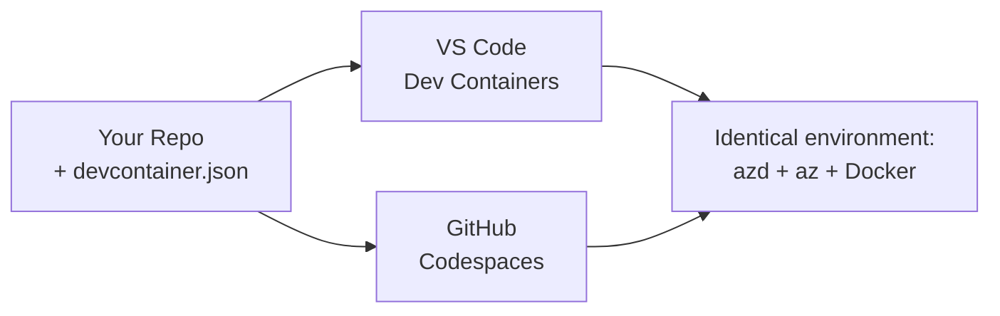

# កុងតឺន័រអភិវឌ្ឍន៍ & GitHub Codespaces សម្រាប់ azd

**ការរុករកជំពូក៖**
- **📚 ទំព័រដើមវគ្គ**: [AZD សម្រាប់អ្នកចាប់ផ្តើម](../../README.md)
- **📖 ជំពូកបច្ចុប្បន្ន**: ជំពូក 1 - មូលដ្ឋាន និងការចាប់ផ្តើមលឿន
- **⬅️ មុន**: [យកកម្មវិធីរបស់អ្នកមក](bring-your-own-app.md)
- **🚀 ជំពូកបន្ទាប់**: [ជំពូក 2: ការអភិវឌ្ឍ AI ជាដំបូង](../chapter-02-ai-development/README.md)

> គោលដៅពិនិត្យពាក្យបញ្ជា និងការកំណត់: `azd 1.37.2` (វិច្ឆិកា 2026)។ ការបង្កើត container និងការដាក់ទទួលនៅលើ Azure មិនត្រូវបានអនុវត្តជាផ្នែកមួយនៃការពិនិត្យនេះទេ។

## ការណែនាំ

ការដំឡើង azd, ភាសារuntime ត្រឹមត្រូវ, Docker និង Azure CLI នៅលើគ្រប់ម៉ាស៊ីនគឺជាការលំបាក—ហើយវាជាហេតុផលលេខមួយដែលមេរៀន "ដំណើរការលើម៉ាស៊ីនរបស់ខ្ញុំ" បរាជ័យសម្រាប់អ្នកផ្សេងទៀត។ **dev container** ដោះស្រាយបញ្ហានេះដោយពណ៌នាអំពីឧបករណ៍របស់អ្នកទាំងមូលក្នុងឯកសារ១។ អ្នកណាដែលបើកគម្រោងនៅក្នុង VS Code ឬ GitHub Codespaces នឹងទទួលបានបរិយាកាសដូចគ្នាដាច់ដោយឡែក គឺមាន azd ត្រូវបានដំឡើងរួចហើយ។ មេរៀននេះបង្ហាញវិធីបន្ថែមវា។

## គោលដៅរៀន

នៅចុងបញ្ចប់មេរៀននេះ អ្នកនឹង:
- យល់ពី dev container គឺជាអ្វី និងមូលហេតុដែលវាជួយដែលមាន azd
- បន្ថែម `.devcontainer/devcontainer.json` យ៉ាងតិចតួចទៅគម្រោង
- រួមបញ្ចូល azd, Azure CLI និង Docker តាមរយៈលក្ខណៈពិសេស Dev Container *
- បើកគម្រោងក្នុង GitHub Codespaces ឬ VS Code

## លទ្ធផលរៀន

បន្ទាប់ពីបញ្ចប់មេរៀននេះ អ្នកនឹងអាច:
- កភ្លើង `devcontainer.json` សម្រាប់គម្រោង azd
- បន្ថែម azd និងឧបករណ៍ Azure ដោយគ្មានការតំឡើងដោយដៃ
- រត់ `azd up` ពីក្នុង container ឬ Codespace

---

## Dev Container ជាអ្វី?

dev container គឺជាបរិយាកាសអភិវឌ្ឍន៍អាស្រ័យលើ Docker ដែលកំណត់ដោយឯកសារ `.devcontainer/devcontainer.json` នៅក្នុង repository របស់អ្នក។ នៅពេលដែលអ្នកបើកគម្រោង:

- **VS Code** (ជាមួយផ្នែកបន្ថែម Dev Containers) បង្កើត container និងភ្ជាប់ទៅវា។
- **GitHub Codespaces** បង្កើត container ដូចគ្នានៅលើពពក ហើយផ្តល់ឱ្យអ្នកកម្មវិធីកែសម្រួលប្រើប្រាស់ក្នុងកម្មវិធីឡើងវិញតាម browser។

មិនថាដូចម្តេច ក្រុមការងារទាំងអស់ចែករំលែកឧបករណ៍ដូចគ្នាទាំងស្រុង—គ្មានបញ្ហា "តើអ្នកបានដំឡើង azd មែនទេ?" ទៀងទាត់។



---

## ជំហានទី 1: បង្កើតឯកសារ devcontainer

បង្កើត `.devcontainer/devcontainer.json` នៅឬសតំបន់គម្រោងរបស់អ្នក:

```json
{
  "name": "azd-project",
  "image": "mcr.microsoft.com/devcontainers/base:bookworm",
  "features": {
    "ghcr.io/devcontainers/features/azure-cli:1": {},
    "ghcr.io/azure/azure-dev/azd:0": { "version": "1.37.2" },
    "ghcr.io/devcontainers/features/docker-in-docker:2": {},
    "ghcr.io/devcontainers/features/node:1": {}
  },
  "customizations": {
    "vscode": {
      "extensions": [
        "ms-azuretools.azure-dev",
        "ms-azuretools.vscode-bicep"
      ]
    }
  },
  "forwardPorts": [3000],
  "postCreateCommand": "azd version"
}
```

អ្វីដែលមួយៗមានន័យដូចជា:

| កូនសោ | គោលបំណង |
|-----|---------|
| `image` | ប្រព័ន្ធប្រតិបត្តិការចម្បងសម្រាប់ container |
| `features` | កម្មវិធីដំឡើងរួចស្រាប់ - នៅទីនេះ: Azure CLI, **azd**, Docker, និង Node.js |
| `customizations.vscode.extensions` | ដំឡើងស្វ័យប្រវត្តិការបន្ថែម azd និង Bicep សម្រាប់ VS Code |
| `forwardPorts` | បង្ហាញច្រកតំបន់កម្មវិធីរបស់អ្នកទៅកម្មវិធីរុករក |
| `postCreateCommand` | រត់មួយដងបន្ទាប់ពី container ត្រូវបានកសាង (នៅទីនេះ ជាការត្រួតពិនិត្យភាពស្របច្បាប់) |

> កំណែលក្ខណៈពិសេស (`azd:0`) និងកំណែ CLI ដែលបានដំឡើងខុសគ្នា។ សូមកំណត់ជម្រើស `version` របស់លក្ខណៈពិសេសទៅ `"1.37.2"` ដើម្បីចាក់បន្ទាប់ CLI; កុំប្រើកំណែ CLI ជាទីតាំងលក្ខណៈពិសេស។

---

## ជំហានទី 2: តម្រូវលក្ខណៈពិសេសទៅភាសារបស់កម្មវិធីរបស់អ្នក

ប្ដូរលក្ខណៈពិសេស `node` ជាលក្ខណៈពិសេសដែលកម្មវិធីរបស់អ្នកប្រើប្រាស់:

```jsonc
// Python project
"ghcr.io/devcontainers/features/python:1": {},

// .NET project
"ghcr.io/devcontainers/features/dotnet:2": {},

// Java project
"ghcr.io/devcontainers/features/java:1": {},

// Go project
"ghcr.io/devcontainers/features/go:1": {}
```

រក្សា `docker-in-docker` នៅពេលដែលកំពុងកសាងរូបភាពនៅក្នុងតំបន់។ ការកំណត់ remote ACR build (`docker.remoteBuild: true`) គឺជាជម្រើសផ្សេងទៀត; តែប្រភេទ host តែមួយមិនត្រូវខ្ទប់ជានិច្ចនូវ Docker ក្នុងតំបន់ទេ។

---

## ជំហានទី 3: បើកវា

**នៅក្នុង VS Code:**
1. ដំឡើងផ្នែកបន្ថែម **Dev Containers**។
2. បើកថតគម្រោង។
3. ចុច **Reopen in Container** នៅពេលមានការជូនដំណឹង (ឬរត់ *Dev Containers: Reopen in Container*)។

**នៅក្នុង GitHub Codespaces:**
1. ជំរុញ repo ទៅ GitHub។
2. ចុច **Code → Codespaces → បង្កើត codespace នៅលើ main**។
3. រង់ចាំ container សាងសង់ - azd បានត្រៀមក្នុង terminal។

---

## ជំហានទី 4: ដាក់ចេញពីក្នុង container

container មាន azd ដំឡើងរួចហើយ ដូច្នេះដំណើរការធម្មតាគឺដំណើរការបានជាទៀងទាត់:

```bash
azd auth login --use-device-code   # device code is handy inside Codespaces
azd up
```

> **ហេតុអ្វីបានជាជ្រើសរើស `--use-device-code`?** ក្នុង container ឬ Codespace ដែលស្ថិតនៅចម្ងាយ គ្មានកម្មវិធីរុករកក្នុងតំបន់សម្រាប់បញ្ជូនបន្តទៅ ដូច្នេះការចូលប្រើប្រាស់បែបកូដឧបករណ៍គឺជាវិធីដែលអាចទុកចិត្តបាន។ អ្នកត្រូវបញ្ចូលកូដនៅក្នុងផ្ទាំងរុករកដើម្បីបញ្ចប់ការចុះឈ្មោះ។

---

## បញ្ហាទូទៅ

| បញ្ហា | ដោះស្រាយ |
|---------|-----|
| `azd up` មិនអាចបង្កើតរូបភាពបាន | បន្ថែមលក្ខណៈពិសេស `docker-in-docker` |
| ការចូលប្រើប្រាស់ដោយ browser ប្រឈមនឹងទាញខ្លួននៅក្នុង Codespaces | ប្រើ `azd auth login --use-device-code` |
| ឧបករណ៍ខុសគ្នារវាងសមាជិក | ចាក់បន្ទាប់ CLI តាមរយៈជម្រើស `version` នៃលក្ខណៈពិសេស azd និងចាក់បន្ទាប់ភាសា runtime |
| កម្មវិធីមិនអាចចូលដំណើរការបានក្នុងកម្មវិធីរុករក | បន្ថែមច្រកទៅ `forwardPorts` |

---

## សង្ខេប

- dev container បង្កើតឱ្យឧបករណ៍ azd របស់អ្នកអាចបង្កើតឡើងវិញសម្រាប់គ្រប់គ្នា។
- បន្ថែម azd, Azure CLI និង Docker តាមរយៈលក្ខណៈពិសេស Dev Container *features*។
- តម្រូវលក្ខណៈភាសាទៅកម្មវិធីរបស់អ្នក ហើយរក្សា `docker-in-docker` សម្រាប់ម្ចាស់ host container។
- ប្រើការចូលបែបកូដឧបករណ៍នៅពេលបង្កើតក្នុង Codespaces។

---

## 🔗 ការរុករក

| ទិស | ធនធាន |
|-----------|----------|
| **មុន** | [យកកម្មវិធីរបស់អ្នកមក](bring-your-own-app.md) |
| **ទំព័រជំពូក** | [ជំពូក 1: មូលដ្ឋាន និងការចាប់ផ្តើមលឿន](README.md) |
| **ជំពូកបន្ទាប់** | [ជំពូក 2: ការអភិវឌ្ឍ AI ជាដំបូង](../chapter-02-ai-development/README.md) |

## 📖 ធនធានពាក់ព័ន្ធ

- [ការដំឡើង និង ការតំឡើង](installation.md)
- [ស្លាកពាក្យបញ្ជា Cheat Sheet](../../resources/cheat-sheet.md)
- [លក្ខណៈបញ្ជាក់ Dev Containers ផ្លូវការ](https://containers.dev/)
- [លក្ខណៈពិសេស dev container azd](https://github.com/Azure/azure-dev/tree/main/ext/devcontainer)

---

<!-- CO-OP TRANSLATOR DISCLAIMER START -->
**ការបដិសេធ**:
ឯកសារនេះត្រូវបានបម្លែងភាសា ដោយប្រើសេវាបម្លែងភាសា AI [Co-op Translator](https://github.com/Azure/co-op-translator)។ ទោះយើងខ្ញុំមានក្តីប្រាថ្នាឱ្យបានច្បាស់លាស់ តែសូមយល់ដឹងថាការបម្លែងដោយស្វ័យប្រវត្តិក៏អាចមានកំហុសឬភាពមិនត្រឹមត្រូវ។ ឯកសារដើមជាភាសាទីតាំងគួរត្រូវបានគេប្រើជាប្រភពច្បាស់លាស់។ សម្រាប់ព័ត៌មានសំខាន់ៗ សូមណែនាំឱ្យប្រើប្រាស់ការប្រែដោយមនុស្សជំនាញ។ យើងខ្ញុំមិនទទួលខុសត្រូវចំពោះការយល់ច្រឡំ ឬការបកស្រាយខុសបន្ទាប់ពីការប្រើប្រាស់ការបម្លែងនេះនោះទេ។
<!-- CO-OP TRANSLATOR DISCLAIMER END -->