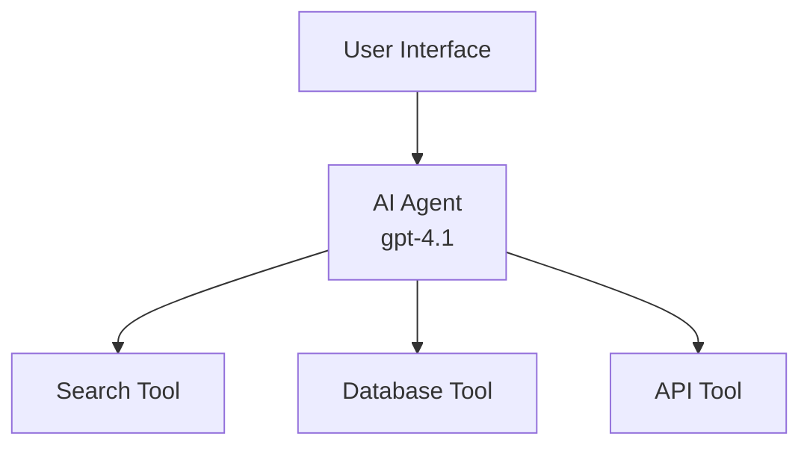
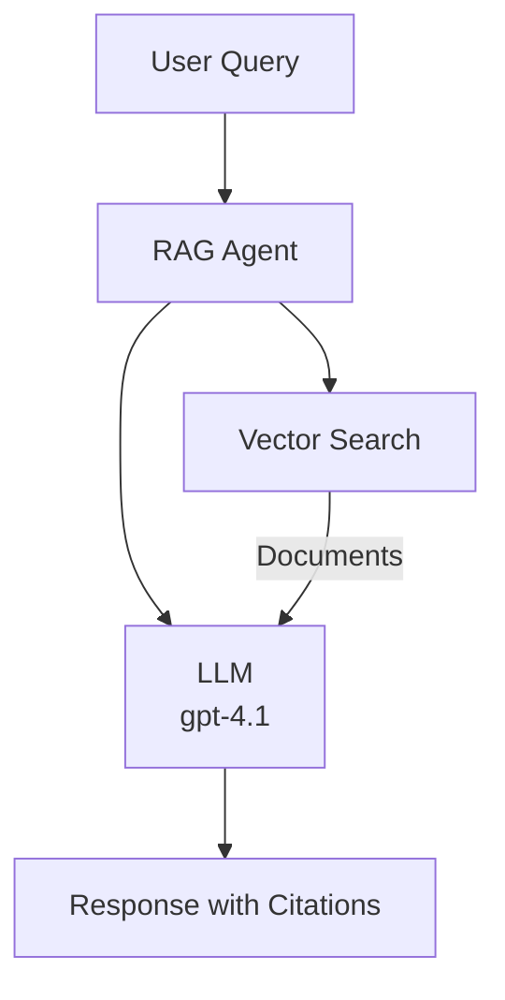
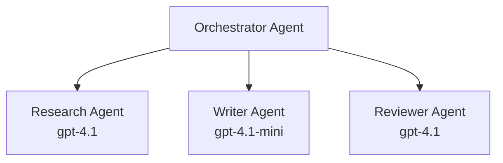

# មុខងារ AI ជាមួយ Azure Developer CLI

**ការរុករកជំពូក៖**
- **📚 ទំព័រដើមមុខវិជ្ជា**: [AZD សម្រាប់អ្នកចាប់ផ្តើម](../../README.md)
- **📖 ជំពូកបច្ចุบัน**: ជំពូក 2 - ការអភិវឌ្ឍន៍ AI ជាមូលដ្ឋាន
- **⬅️ មុននេះ**: [ការរួមបញ្ចូល Microsoft Foundry](microsoft-foundry-integration.md)
- **➡️ បន្ទាប់**: [ការដាក់បញ្ចូលម៉ូឌែល AI](ai-model-deployment.md)
- **🚀 កម្រិតខ្ពស់**: [ដំណោះស្រាយមុខងារ Multi-Agent](../../examples/retail-scenario.md)

---

## ការណែនាំ

មុខងារ AI គឺជាប្រព័ន្ធស្វ័យប្រវត្តិដែលអាចទទួលស្គាល់បរិយាកាសរបស់ខ្លួន, ធ្វើការសម្រេចចិត្ត និងអនុវត្តន៍សកម្មភាពដើម្បីសម្រេចបានគោលបំណងជាក់លាក់។ គឺខុសពី chatbot ដែលបន្តិចបន្តួចត្រូវតែឆ្លើយតបនឹងសំណួរ, មុខងារអាច៖

- **ប្រើប្រដាប់កំចាត់** - ហៅ API, ស្វែងរកក្នុងមូលដ្ឋានទិន្នន័យ, អនុវត្តកូដ
- **ផែនការ និងយល់ថ៌** - បំបែកកិច្ចការលំបាកទៅជាជំហាន
- **រៀនពីបរិបទ** - កាន់ទុកចំណាំ និងសម្របខ្លួន
- **សហការជាមួយគ្នា** - ធ្វើការជាមួយមុខងារ ផ្នែកអាជីវកម្មជាច្រើន

មេរៀននេះបង្ហាញពីរបៀបដាក់បញ្ចូលមុខងារ AI ទៅកាន់ Azure ប្រើ Azure Developer CLI (azd)។

ការប្រើបរិបទនៃការជជែកមិនមែនជាការបណ្តុះបណ្តាលម៉ូឌែលទេ៖ អង្គចងចាំថែមទៀត, ការត្រួតពិនិត្យសិទិ្ធ និងការផ្ទុកទុក ត្រូវបានអនុវត្ត/កំណត់ដោយកម្មវិធី។

> **បحديث Foundry GA (2026-11-09):** ដំឡើងបណ្ណសារជាសាធារណៈ `microsoft.foundry` 1.0 ជាមួយ `azd >= 1.37.0`។ ការវាយតម្លៃត្រូវដំឡើងផ្សេងពីគ្នា; លក្ខណៈពិសេសមើលជាមុននិងផ្នែក SDK រូបមន្តចាស់នៅក្រោមមិនត្រូវបានផ្សព្វផ្សាយហើយ។ ណែនាំនេះផ្អែកលើ [ការ​ប្រកាស GA](https://devblogs.microsoft.com/azure-sdk/microsoft-foundry-azure-developer-cli-ga/) និងឯកសារ, មិនមែនជាការដាក់បញ្ចូលនៅលើ Azure នៅពេលពិត។

## គោលបំណងក្នុងការសិក្សា

បន្ទាប់ពីបញ្ចប់មេរៀននេះ អ្នកនឹង៖
- យល់ពីមុខងារ AI ជា​ចម្លែកពី chatbot
- ដាក់បញ្ចូលគំរូមុខងារ AI ដែលបានបង្ហាញរួចដោយប្រើ AZD
- កំណត់ Foundry Agents សម្រាប់មុខងារផ្ទាល់ខ្លួន
- អនុវត្តលំនាំមុខងារមូលដ្ឋាន (ប្រើឧបករណ៍, RAG, មុខងារជាច្រើន)
- ត្រួតពិនិត្យ និងដោះស្រាយកំហុសមុខងារដាក់បញ្ចូល

## លទ្ធផលក្នុងការសិក្សា

បន្ទាប់ពីបញ្ចប់ អ្នកនឹងអាច៖
- ដាក់បញ្ចូលកម្មវិធីមុខងារ AI ទៅ Azure ជាមួយពាក្យបញ្ជាដែលមួយ
- កំណត់ឧបករណ៍ និងសមត្ថភាពរបស់មុខងារ
- អនុវត្តការបង្កើត RAG ជាមួយមុខងារ
- រចនាស្ថាបត្យកម្មមុខងារជាច្រើនសម្រាប់ប្រតិបត្តិការលំបាក
- ដោះស្រាយបញ្ហាទូទៅនៃការដាក់បញ្ចូលមុខងារ

---

## 🤖 តើអ្វីធ្វើឲ្យមុខងារខុសពី chatbot?

| លក្ខណៈពិសេស | Chatbot | មុខងារ AI |
|---------|---------|----------|
| **ឥរិយាបថ** | ឆ្លើយតប នឹងសំណួរ | អនុវត្តសកម្មភាពដោយស្វ័យប្រវត្តិ |
| **ឧបករណ៍** | ប្រើបាន​ការ​ស្វែងរក ឬ ឧបករណ៍ | ធម្មតាប្រើឧបករណ៍ក្នុងរង្វង់គោលដៅ |
| **អង្គចងចាំ** | អាស្រ័យលើកម្មវិធី | អង្គចងចាំថេរតែបើបានអនុវត្តផ្ទាល់ |
| **ផែនការ** | ឆ្លើយតបតែមួយ | ការយល់ស្មោះជាច្រើនជំហាន |
| **សហការជាមួយគ្នា** | តែមួយអត្តសញ្ញាណ | អាចធ្វើការជាមួយមុខងារផ្សេងទៀត |

### ការពីរបៀបសាមញ្ញ

- **Chatbot** = មនុស្សជួយដែលឆ្លើយសំណួរនៅតុព័ត៌មាន
- **មុខងារ AI** = ជំនួយការផ្ទាល់ខ្លួនដែលអាចហៅទូរសព្ទ, កក់ការណាត់ជួប និងបំពេញកិច្ចការ

---

## 🚀 ចាប់ផ្តើមរហ័ស៖ ដាក់បញ្ចូលមុខងារដំបូងរបស់អ្នក

ជ្រើសរើសមួយជម្រើសក្នុង **ថតការងារថ្មីទទេមួយ**។ កូដ `.` ចាប់ផ្ដើមនៅទីនោះ; ប្រសិនបើគ្មានគោលដៅច្បាស់លាស់, AZD បច្ចុប្បន្នអាចបង្កើតថតគំរូឈ្មោះថតជាន់ក្រោមមួយហើយមិនប្ដូរថត shell របស់អ្នកទេ។ រក្សាគំរូ/បរិដ្ឋានផ្សេងៗនៅក្នុងថតផ្សេងៗ។

ពេលវេលា/តម្លៃខាងក្រោមគ្រាន់តែជាឧទាហរណ៍ មិនមែនជាការដាក់ទំនិញផ្លូវការទេ។ សូមពិនិត្យលក្ខខណ្ឌបច្ចុប្បន្នរបស់គំរូនីមួយៗ តម្លៃ ជាពិសេសម៉ូឌែល និងសេវាកម្មបន្ថែមមុនការដាក់បញ្ចូល។

### ជម្រើស 1: គំរូមុខងារ Foundry (ផ្ដល់អនុសាសន៍)

```bash
# Initialize the AI agents template
azd init --template get-started-with-ai-agents .

# Deploy to Azure
azd up
```

**អ្វីដែលត្រូវបានដាក់បញ្ចូល:** គ្រឹះស្ថាននិងជម្រើសបច្ចុប្បន្ននៃគំរូកំណត់ម៉ូឌែល, ឧបករណ៍, ការផ្គត់ផ្គង់ និងការត្រួតពិនិត្យ។ សូមពិនិត្យ README និង `infra/` មុនពេលផ្គត់ផ្គង់; កុំសន្មត់ថាគំរូមុខងារនេះអាចផ្ដល់ Search ឬចំណុចចូលវេបសាយ។

**ពេលវេលា:** ~15-20 នាទី
**តម្លៃ:** ~$100-150/ខែ (ការអភិវឌ្ឍន៍)

### ជម្រើស 2: មុខងារសរសេរច្នៃប្រឌិតជាមួយ Prompty

```bash
# Initialize the Prompty-based agent template
azd init --template https://github.com/Azure-Samples/contoso-creative-writer .

# Deploy to Azure
azd up
```

**អ្វីដែលត្រូវបានដាក់បញ្ចូល:** កម្មវិធី FastAPI/Prompty មុខងារសរសេរជាច្រើនប្រើ Azure OpenAI, Bing Grounding និង Azure AI Search។ ឃ្លាំង `agent-openai-python-prompty` មុននេះបានបញ្ជូនទៅទីនេះ; មិនមែនជាគំរូមុខងារ weather-agent តាម Azure Functions ទេ។ សូមអនុវត្តតាម README បច្ចុប្បន្នសម្រាប់ការផ្គត់ផ្គង់, តម្រូវម៉ូឌែល និង Bing Grounding។

**ពេលវេលា:** ~10-15 នាទី
**តម្លៃ:** ~$50-100/ខែ (ការអភិវឌ្ឍន៍)

### ជម្រើស 3: មុខងារ RAG Chat

```bash
# Initialize RAG chat template
azd init --template azure-search-openai-demo .

# Deploy to Azure
azd up
```

**អ្វីដែលត្រូវបានដាក់បញ្ចូល:**
- ✅ ម៉ូឌែល Microsoft Foundry
- ✅ Azure AI Search ជាមួយទិន្នន័យគំរូ
- ✅ បណ្តាញដំណើរការឯកសារ
- ✅ ចំណុចចូលជជែកជាមួយយោង

**ពេលវេលា:** ~15-25 នាទី
**តម្លៃ:** ~$80-150/ខែ (ការអភិវឌ្ឍន៍)

### ជម្រើស 4: មុខងារត្រូវភ្ជាប់ផ្ទាល់ជាមួយ GA Foundry Bundle

ប្រើ [ការណែនាំការប្រើជាមួយ​មុខងារត្រូវភ្ជាប់ផ្ទាល់](microsoft-foundry-integration.md#hosted-agent-walkthrough-ga) សម្រាប់គំរូ Python Agent Framework Responses API គំនិតនេះ។ ផ្លូវដាក់បញ្ចូលនេះត្រូវការប្រแกรม Python 3.13+, ការ uv បច្ចុប្បន្ន, សិទិ្ធ Foundry និងតម្រូវម៉ូឌែលតំបន់។ សូម Authenticate ការហៅ SDK នៅក្នុងតំបន់មួយផ្សេងពេលប្រើព័ត៌មានសម្គាល់ Azure CLI។

```bash
azd auth login
azd ext install microsoft.foundry
```

នៅក្នុងថតទទេ ចាប់ផ្តើមគំរូ៖

```text
azd ai agent init --template https://github.com/microsoft-foundry/foundry-samples/blob/main/samples/python/hosted-agents/agent-framework/responses/01-basic/azure.yaml --deploy-mode code --src .
```

ជ្រើសរើសគម្រោងថ្មីឬមានស្រាប់, ពិនិត្យ `azure.yaml` ហើយរត់ `azd provision`។ ប្រើ `azd ai agent run` ដើម្បីបើក Agent Inspector និងពី Terminal ផ្សេងទៀតនៅក្នុងថតនោះ `azd ai agent invoke --local "Explain how this agent is hosted."`។ បន្ទាប់ពីផ្ទៀងផ្ទាត់ក្នុងស្រុករួច, ប្រើ `azd deploy` និង `azd ai agent invoke "Explain how this agent is hosted."` ដើម្បីប្រៀបធៀបចម្លើយដែលបានដាក់បញ្ចូល។ Foundry សាងសង់ប្រភពកូដដែលបានបញ្ចូលពីចម្ងាយ; មិនចាំបាច់សាងសង់ផ្ទាល់ក្នុងក្រឡាហោប៉ៅទេ។

**ពេលណាដែលត្រូវប្រើ `azd ai agent init` ប្រៀបធៀប `azd init --template`:**

| វិធីសាស្រ្ត | ល្អបំផុតសម្រាប់ | របៀបធ្វើការ |
|----------|----------|------|
| `azd init --template` | ចាប់ផ្តើមពីកម្មវិធីគំរូដំណើរការ | បង្កើតស្តុកគំរូពេញលេញជាមួយកូដ + បរិក្ខារ |
| `azd ai agent init --template` | យកគម្រោងមុខងារ Foundry បច្ចុប្បន្ន | ប្រើឯកសារគម្រោង `azure.yaml` និងការបកស្រាយរបស់វា |

> **ជំនួយ:** ជម្រើស 1-3 ចាប់ផ្តើមពីគំរូកម្មវិធីពេញលេញ; ជម្រើស 4 សិក្សាផ្លូវលំនាំការងារតម្រូវ GA។ ពាក្យបញ្ជារចាប់ផ្តើមទាំងពីរនេះមិនផ្លាស់ប្តូរច្បាប់ការបញ្ជាក់របស់មុខងារចាស់ដោយស្វ័យប្រវត្តិទេ។ ដើម្បីបញ្ចូលការបញ្ជាក់ទីតាំងទៅផ្ទាល់ទៅគម្រោងមាន សូមមើល [ការណែនាំចាប់ផ្តើមនិងផ្លាស់ប្តូរ](../chapter-08-production/production-ai-practices.md#initializing-agent-projects-with-azd-ai-agent-init)។

ដំឡើង `azure.ai.evaluations` ផ្សេងពីគ្នា ដើម្បីបង្កើតនិងពិនិត្យទិន្នន័យ/មាតិកាការវាយតម្លៃ, កំណត់ការវាយតម្លៃ និងរត់វាដោយ `azd ai eval`។ ការបង្កើតអតិថិជនអាចប្រើការវាយតម្លៃដែលស័ក្តិសមមួយឡើងវិញ; ពិនិត្យមើលបេក្ខជនមុនពេលដាក់បញ្ចូលជាក់លាក់មួយ។ តាមដាន [លំដាប់ការវាយតម្លៃ](../chapter-08-production/production-ai-practices.md#evaluation-migration-and-quality-checks) និង [ការផ្លាស់ប្តូរការបង្កើត](../chapter-08-production/production-ai-practices.md#optimization-configuration-migration) មុនការប្រើប្រាស់គំរូចាស់ៗឡើងវិញ។ សម្រាប់ការសម្អាត, ធនធានគម្រោង Foundry ត្រូវបានគេរក្សាទុកបន្ទាប់ពី `azd down`; ធនធានក្រុមគម្រោងថ្មីត្រូវបានលុបចោល។ សូមមើល [ការណែនាំសម្អាត](microsoft-foundry-integration.md#7-clean-up-deliberately)។

---

## 🏗️ លំនាំរចនាសម្ព័ន្ធមុខងារ

### លំនាំ 1: មុខងារតែមួយប្រើឧបករណ៍

លំនាំមុខងារចំបងផងដែរមានមុខងារតែមួយដែលអាចប្រើឧបករណ៍ច្រើន។



**ល្អបំផុតសម្រាប់:**
- បុគ្គលិកគាំទ្រអតិថិជន
- ជំនួយការស្រាវជ្រាវ
- មុខងារវិភាគទិន្នន័យ

**គំរូកម្មវិធីដែលពាក់ព័ន្ធ:** `azure-search-openai-demo` បង្ហាញ RAG មិនមែនជាលំហាត់ឧបករណ៍ទូទៅតែមួយជ្រុងក្រោមលំនាំមុខងារ។

### លំនាំ 2: មុខងារ RAG (Retrieval-Augmented Generation)

មុខងារដែលទាញយកឯកសារសមរម្យមុនពេលបង្កើតចម្លើយ។



**ល្អបំផុតសម្រាប់:**
- មូលដ្ឋានចំណេះដឹងសហគ្រាស
- ប្រព័ន្ធសំណួរពីឯកសារ
- ការស្រាវជ្រាវផ្នែកបណ្តឹង និងច្បាប់

**គំរូ AZD:** `azure-search-openai-demo`

### លំនាំ 3: ប្រព័ន្ធមុខងារ Multi-Agent

មុខងារជាច្រើនដែលមានជំនាញខុសៗគ្នាធ្វើការជាមួយគ្នាក្នុងកិច្ចការលំបាក។



**ល្អបំផុតសម្រាប់:**
- ការបង្កើតមាតិកាស្មុគស្មាញ
- ប្រតិបត្តិការជាច្រើនជំហាន
- កិច្ចការដែលតម្រូវជំនាញខុសៗគ្នា

**រៀនបន្ថែម៖** [លំនាំសមរម្យការសហការមុខងារ Multi-Agent](../chapter-06-pre-deployment/coordination-patterns.md)

---

## ⚙️ កំណត់ឧបករណ៍របស់មុខងារ

មុខងារត្រូវធ្វើអោយមានសមត្ថភាពខ្លាំងនៅពេលអាចប្រើឧបករណ៍។ របៀបនេះជាការកំណត់ឧបករណ៍ទូទៅ៖

### ការកំណត់ឧបករណ៍ក្នុង Foundry Agents

ចំណុច **Agent Service SDK វិធីសាស្រ្តចម្រុះ គេហៅថា** ផ្ដោតទៅកាន់ `azure-ai-projects==1.0.0` និង `azure-ai-agents==1.1.0` ជាមួយ `azure-identity`។ វាមិនមែនជាកំណែ agent/Responses API ដែលបានផ្លាស់ប្តូរថ្មីដែលប្រើប្រាស់ដោយស្ទង់ Foundry បច្ចុប្បន្ន អេតែមិនមែនជា `azure.ai.agents` ផ្នែកបន្ថែម AZD (កញ្ចប់ផ្សេង)។ កុំបញ្ចូលជំនាន់ API ទាំងនេះ។ កំណត់ `PROJECT_ENDPOINT` ទៅឆ្នាំបញ្ចប់គម្រោង Foundry របស់អ្នក និង `MODEL_DEPLOYMENT_NAME` ទៅការដាក់ម៉ូដែលមានគាំទ្រ; អះអាងដោយ `az login` នៅក្នុងរូមរបស់អ្នក ហើយផ្តល់អាជ្ញាប័ណ្ណគម្រោងដែលត្រូវការ។

```python
# agent_config.py
import os
from azure.ai.projects import AIProjectClient
from azure.ai.agents.models import FunctionTool
from azure.identity import DefaultAzureCredential

def search_knowledge_base(query: str) -> str:
    """Search the demonstration knowledge base.

    :param query: Search text.
    :return: Matching demonstration information.
    """
    # Local fixture only, not a production search implementation.
    return "Demo policy: returns are accepted within 30 days."

project_client = AIProjectClient(
    endpoint=os.environ["PROJECT_ENDPOINT"],
    credential=DefaultAzureCredential(),
)
search_tool = FunctionTool(functions={search_knowledge_base})
project_client.agents.enable_auto_function_calls(search_tool)
agent = project_client.agents.create_agent(
    model=os.environ["MODEL_DEPLOYMENT_NAME"],
    name="Support Agent",
    instructions="Use search_knowledge_base for policy questions. Label results as demo data.",
    tools=search_tool.definitions,
)
```

ការចុះបញ្ជី schema មុខងារ មិនបានរត់ Python លើសេវាកម្មទេ។ ក្នុង SDK នេះ, `enable_auto_function_calls` និង `agents.runs.create_and_process(...)` បើក callback ដែលបានចុះបញ្ជីក្នុងដំណើរការរបស់អ្នកភ្ញៀវ។ មើល [ឧទាហរណ៍ SDK ដែលបានចេញផ្សាយ](https://github.com/Azure/azure-sdk-for-python/blob/azure-ai-agents_1.1.0/sdk/ai/azure-ai-agents/samples/agents_tools/sample_agents_auto_function_call.py)។ បិទភ្ញៀវ និងលុប agent/threads ពិពណ៌នារបស់អ្នកពេលបញ្ចប់។

### ការកំណត់បរិយាកាស

ឈ្មោះខាងក្រោមនេះ​ជា **ការបញ្ចូលម៉ូដែលគំរូផ្ទាល់ខ្លួន** មិនមែនជាផ្នែកប្ដូរតាម AZD ដដែលទេ។ ដំបូងភ្ជាប់តម្លៃនីមួយៗតាមរយៈ `infra/main.parameters.json`, ស្ថាបត្យកម្ម និងកូដកម្មវិធី។ `azd env set` ម្នាក់មិនប្តូរការប្រើឧបករណ៍ ឬការណែនាំ agent ទេ។

```bash
# Set up agent-specific environment variables
azd env set AZURE_OPENAI_MODEL "gpt-4.1"
azd env set AGENT_INSTRUCTIONS "You are a helpful assistant..."
azd env set ENABLE_CODE_INTERPRETER "true"
azd env set ENABLE_FILE_SEARCH "true"

# Apply wired infrastructure and application changes
azd up
```

---

## 📊 ការតាមដាន Agents

### ការរួមបញ្ចូល Application Insights

ប្រសិនបើគំរូដែលអ្នកបានជ្រើសរើសតម្លើង Application Insights និងកំណត់ការវាស់វែងឧបករណ៍:

```bash
# Open monitoring dashboard
azd monitor --overview

# Open the Application Insights logs view (not a streaming log tail)
azd monitor --logs

# View live metrics
azd monitor --live
```

### វិគីតត្រូវតាមដាន

| វិគីត | ការពិពណ៌នា | គោលដៅ |
|--------|-------------|--------|
| ពេលយូរ​ឆ្លើយតប | ពេលវេលាដើម្បីបង្កើតចម្លើយ | < 5 វិនាទី |
| ការប្រើប្រាស់ Token | តួកូនសម្រាប់សំណើ | តាមដានចំណាយ |
| អត្រាជោគជ័យហៅឧបករណ៍ | % នៃការប្រតិបត្តិការឧបករណ៍ជោគជ័យ | > 95% |
| អត្រាកំហុស | សំណើ agent ដែលបរាជ័យ | < 1% |
| សេចក្ដីពេញចិត្តអ្នកប្រើ | ពិន្ទុមតិយោបល់ | > 4.0/5.0 |

### ការចុះកំណត់ត្រាផ្ទាល់ខ្ពស់សម្រាប់ Agents

```python
import os
from azure.monitor.opentelemetry import configure_azure_monitor
from opentelemetry import trace

# Configure Azure Monitor with OpenTelemetry
configure_azure_monitor(
    connection_string=os.environ["APPLICATIONINSIGHTS_CONNECTION_STRING"]
)

tracer = trace.get_tracer(__name__)

def log_agent_interaction(user_query, agent_response, tools_used, latency_ms):
    with tracer.start_as_current_span("agent_interaction") as span:
        span.set_attributes({
            "query_length": len(user_query),  # Do not log raw prompts or personal data
            "response_length": len(agent_response),
            "tools_used": tools_used,
            "latency_ms": latency_ms
        })
```

> **កំណត់ចំណាំ:** តំឡើងកញ្ចប់ដែលត្រូវការ: `pip install azure-monitor-opentelemetry`។ វាអានជាមួយការគាំទ្រ OpenTelemetry; ឈ្មោះនាំចូលមិនមែនជាការទាមទារដើម្បីតំឡើងកញ្ចប់មានឈ្មោះ `opentelemetry` ទេ។

---

## 💰 ការពិចារណាទំនាក់ទំនងថ្លៃ

### ការប៉ាន់ស្មានថ្លៃប្រចាំខែតាមគំរូ

ទាំងនេះជាកំណត់ត្រាការធ្វើផែនការ មិនមែនជាការដាក់តម្លៃឬកំណត់ថ្លៃចំណាយទេ។ តំបន់, មុខងារតួកូនម៉ូដែល, SKUs ស្វែងរក/គណនា, សម័យឧបករណ៍, ការផ្ទុក, និងចរាចរណ៍អាចលើសល្បឿន។ ពិនិត្យមើលការណែនាំថ្លៃឧទាហរណ៍ និងតម្លៃ Azure មុននឹង `azd up`។

| គំរូ | បរិយាកាសអភិវឌ្ឍ | ផលិតកម្ម |
|---------|-----------------|------------|
| Agent តែមួយ | $50-100 | $200-500 |
| Agent RAG | $80-150 | $300-800 |
| Agent ច្រើន (2-3 agents) | $150-300 | $500-1,500 |
| Agent ច្រើនសម្រាប់សហគ្រិន | $300-500 | $1,500-5,000+ |

### គន្លឹះធនធានដើម្បីសន្សំថ្លៃ

1. **ប្រើ gpt-4.1-mini សម្រាប់ភារកិច្ចសាមញ្ញ** (បើគំរូរបស់អ្នកប្រើប្រាស់ការបញ្ចូលនេះ)
   ```bash
   azd env set AZURE_OPENAI_MODEL "gpt-4.1-mini"
   ```

2. **អនុវត្តការជម្រុះ cache សម្រាប់សំណួរដែលបានធ្វើឡើងជាបន្ទាន់។** រួមបញ្ចូលអាជ្ញាប័ណ្ណ tenant/អ្នកប្រើ, ដាក់ម៉ូដែល, ការណែនាំ និងកំណែចូលប្រើក្នុងកូនសោ cache; កំណត់កំណត់ពេលផុតកំណត់។ កុំចែករំលែកចម្លើយការសន្ទនាផ្ទាល់ខ្លួនតាម cache សំណួរប្រភេទតែមួយជុំវិញដំណើរការ។ វិក័យល័យ SDK agent មិនមានវិធីសាស្រ្ត `agent.run()` ជាទូទៅទេ។

3. **កំណត់កំណត់តួកូនក្នុងមួយដំណើរការ**
   ```python
   # Set max_completion_tokens when running the agent, not during creation
   run = project_client.agents.runs.create_and_process(
       thread_id=thread.id,
       agent_id=agent.id,
       max_completion_tokens=1000  # Budget across the run; may finish as incomplete
   )
   ```

4. **ពង្រីក Container Apps ដែលមានសិទ្ធិក្នុងការប្រើទៅសូន្យនៅពេលមិនប្រើប្រាស់**
   ```bash
   # Custom-template input: must map to template.scale.minReplicas
   azd env set MIN_REPLICAS "0"
   ```
   អនុវត្តការផ្លាស់ប្តូរស្ថាបត្យកម្មជាមួយ `azd provision` ឬ `azd up`។ ការពង្រីកទៅសូន្យត្រូវការទំព័រតំណាងសមរម្យ ហើយមិនបញ្ឈប់ Search, ការផ្ទុក, ឬថ្លៃម៉ូដែល/ឧបករណ៍ទេ។

---

## 🔧 ការចាប់ផ្តើមរកដំណោះស្រាយ Agents

### បញ្ហាទូទៅ និងដំណោះស្រាយ

<details>
<summary><strong>❌ Agent មិនឆ្លើយតបហៅឧបករណ៍</strong></summary>

```bash
# Inspect the application deployment (not the agent's registered tools)
azd show

# Verify OpenAI deployment
az cognitiveservices account deployment list \
  --name $AZURE_OPENAI_NAME \
  --resource-group $RG_NAME

# Check agent logs
azd monitor --logs
```

**មូលហេតុទូទៅ៖**
- ការខុសផ_signature មុខងារ ឧបករណ៍
- ខ្វះអាជ្ញាប័ណ្ណដែលត្រូវការ
- មិនមានការចូល​ដំណើរការ API
</details>

<details>
<summary><strong>❌ ពេលយូរពេកក្នុងចម្លើយ agent</strong></summary>

```bash
# Check Application Insights for bottlenecks
azd monitor --live

# Consider using a faster model
azd env set AZURE_OPENAI_MODEL "gpt-4.1-mini"
azd up
```

**គន្លឹះសម្រួល៖**
- ប្រើចម្លើយបញ្ចាំងរាបៗ
- អនុវត្តកាសេរសំណើចម្លើយ
- បន្ថយទំហំបន្ទប់ context
</details>

<details>
<summary><strong>❌ Agent ត្រឡប់ព័ត៌មានខុស ឬមិនជាការពិត</strong></summary>

```python
# Improve with better system prompts
instructions = """
You are a helpful assistant. IMPORTANT:
- Only answer based on provided context
- If you don't know, say "I don't know"
- Always cite your sources
- Never make up information
"""

# Use these instructions in the agent definition.
# For classic file search, first upload/index documents in a vector store,
# then use FileSearchTool(vector_store_ids=[...]) and pass both its
# .definitions and .resources when creating the agent.
```
 ការណែនាំ និងការទាញយកកាត់បន្ថយហានិភ័យ; គ្មានការធានាចំពោះចម្លើយពិត។ ប៉ាន់ប្រមាណសំណួរដែលមានមូលដ្ឋាន និងក្រៅកំណត់ជាមួយចម្លើយដែលស្គាល់។
</details>

<details>
<summary><strong>❌ កំហុសកំណត់តួកូនលើសកំណត់</strong></summary>

```python
# Implement context window management
def truncate_context(messages, max_tokens=8000, model="gpt-4.1"):
    """Approximate content-only budget for objects with .content strings."""
    import tiktoken
    encoding = tiktoken.encoding_for_model(model)
    total_tokens = 0
    truncated = []
    
    for msg in reversed(messages):
        msg_tokens = len(encoding.encode(msg.content))
        if total_tokens + msg_tokens > max_tokens:
            break
        truncated.insert(0, msg)
        total_tokens += msg_tokens
    
    return truncated
```
 ជំនួយនេះមិនរាប់បញ្ចូល schemas តួនាទី/ឧបករណ៍, ការណែនាំប្រព័ន្ធ, តួកូនរូបភាព និងការជ្រាលបដិសេធប្រព័ន្ធ។ ជួញដូរតំបន់សម្រាប់ពួកនិងពេញ។ កុំបំបែកសំណុំហៅឧបករណ៍/លទ្ធផល ឬបោះបង់ការណែនាំប្រព័ន្ធដែលត្រូវការ។ តំឡើង `tiktoken` ផ្សេង។ វាមិនមែនជាគ្រឿងបញ្ជាក់ context-window ទូទៅទេ។
</details>

---

## 🎓 អនុវត្តដោយដៃ

### អនុវត្ត 1: ដាក់ Agent សាមញ្ញ (២០ នាទី)

**គោលបំណង៖** ដាក់ agent AI ដំបូងរបស់អ្នកដោយប្រើ AZD

```bash
# Step 1: Initialize template
azd init --template get-started-with-ai-agents .

# Step 2: Login to Azure
azd auth login
# If you work across tenants, add --tenant-id <tenant-id>

# Step 3: Deploy
azd up

# Step 4: Test the agent
# Expected output after deployment:
#   Deployment Complete!
#   Endpoint: https://<app-name>.<region>.azurecontainerapps.io
# Open the URL shown in the output and try asking a question

# Step 5: View monitoring
azd monitor --overview

# Step 6: Review the listed resources and confirm cleanup
azd down
```

**គោលការណ៍ជោគជ័យ៖**
- [ ] អ្នកប្រតិបត្តិឆ្លើយសំណួរ
- [ ] អាចចូលដំណើរការ dashboard ដើម្បីត្រួតពិនិត្យតាមរយៈ `azd monitor`
- [ ] ធនធានបានសម្អាតរួចស្រាយដោយជោគជ័យ

### លំហាត់ 2៖ បន្ថែមឧបករណ៍ផ្ទាល់ខ្លួន (30 នាទី)

**គោលបំណង៖** ពន្លឿនភេរវកម្មជាមួយឧបករណ៍ផ្ទាល់ខ្លួនមួយ

**ចំពោះចំណុចចាប់ផ្តើម៖** ប្រើម៉ាស៊ីនភេរវកម្ម SDK ចាស់ពី [Tool Configuration](#tool-configuration-in-foundry-agents), មិនមែនគំរូប្លែកដែល​មាន​បច្ចេកវិទ្យា SDK ខុសៗគ្នាទេ។

1. បន្ថែម fixture រៀបចំ deterministic នេះទៅ `agent_config.py`:
   ```python
   def get_weather(location: str) -> str:
       """Return demonstration weather, not live conditions.

       :param location: City name.
       :return: A clearly labelled fixture.
       """
       print(f"TOOL_CALLED: {location}")
       return f"Demo weather in {location}: Sunny, 72°F (fixture, not live)"
   ```
2. ប្តូរប្លុកចុះបញ្ជី និងបង្កើត search-tool ជាមួយ៖
   ```python
   weather_tool = FunctionTool(functions={get_weather})
   project_client.agents.enable_auto_function_calls(weather_tool)
   agent = project_client.agents.create_agent(
       model=os.environ["MODEL_DEPLOYMENT_NAME"],
       name="Weather Agent",
       instructions="Call get_weather for weather questions; explain that it returns demo data.",
       tools=weather_tool.definitions,
   )
   thread = project_client.agents.threads.create()
   try:
       project_client.agents.messages.create(
           thread_id=thread.id, role="user", content="Use get_weather for Seattle."
       )
       run = project_client.agents.runs.create_and_process(
           thread_id=thread.id, agent_id=agent.id
       )
       if run.status != "completed":
           raise RuntimeError(f"Run status: {run.status}; error: {run.last_error}")
       for message in project_client.agents.messages.list(thread_id=thread.id):
           for text in message.text_messages:
               print(text.text.value)
   finally:
       project_client.agents.threads.delete(thread.id)
       project_client.agents.delete_agent(agent.id)
       project_client.close()
   ```
3. រត់ក្នុងក្រុមហ៊ុនក្នុងតំបន់ស្រុក (នេះនឹងហៅគម្រោង Azure ដែលមានស្រាប់ និងបង្កជាប្រាក់ចំណាយម៉ូដែល):
   ```bash
   python agent_config.py
   # Expected: TOOL_CALLED: Seattle, then a completed answer labelled demo data.
   ```

**គោលការណ៍ជោគជ័យ៖**
- [ ] អ្នកប្រតិបត្តិស្គាល់សំណួរពាក់ព័ន្ធអាកាសធាតុ
- [ ] ឧបករណ៍ត្រូវបានហៅត្រឹមត្រូវ
- [ ] ចម្លើយរួមមានព័ត៌មានអាកាសធាតុ

### លំហាត់ 3៖ បង្កើតភេរវកម្ម RAG (45 នាទី)

**គោលបំណង៖** បង្កើតភេរវកម្មដែលឆ្លើយសំណួរពីឯកសាររបស់អ្នក

```bash
# Step 1: Deploy RAG template
azd init --template azure-search-openai-demo .
azd up

# Step 2: Upload your documents
# For the sample's local ingestion path, place supported files in data/.
# Run from the sample root after following its Python environment setup:
./scripts/prepdocs.sh
# Windows PowerShell equivalent: .\\scripts\\prepdocs.ps1

# Step 3: Test with domain-specific questions
# Open the web app URL from the azd up output
# Ask questions about your uploaded documents
# Responses should include citation references like [doc.pdf]
```

**គោលការណ៍ជោគជ័យ៖**
- [ ] អ្នកប្រតិបត្តិឆ្លើយពីឯកសារដែលបានផ្ទុកឡើង
- [ ] ចម្លើយរួមមានយោង
- [ ] សំណួរធ្វើតេស្តក្រៅដែនត្រូវបានគ្រប់គ្រងដោយគ្មានការអះអាងមិនគាំទ្រ (មិនធានា​សម្រាប់សំណួរផ្សេងទៀតក្នុងអនាគតទាំងអស់)

ប្រសិនបើ `USE_CLOUD_INGESTION=true`, ប្រើនីតិវិធីបញ្ចូលឯកសារពពក/ផ្ទុកឡើងរបស់គំរូជំនួសវិញ។ ការការពារ wrapper ក្នុងតំបន់ស្រុក ត្រូវបានរំលង ingestion ដោយចេតនា។ បន្ទាប់​ពីសាកល្បង សូមរត់ `azd down` ក្នុងបរិស្ថាន RAG ហើយពិនិត្យទ្រព្យសម្បត្តិដែលត្រូវលុបចោល។

---

## 📚 ជំហ៊ានបន្ទាប់

ឥឡូវនេះ អ្នកបានយល់ពីភេរវកម្ម AI សូមស្វែងយល់ពីប្រធានបទជំុខ្ពស់ទាំងនេះ៖

| ប្រធានបទ | ពណ៌នា | តំណភ្ជាប់ |
|-------|-------------|------|
| **ប្រព័ន្ធភេរវកម្មច្រើន** | បង្កើតប្រព័ន្ធជាមួយភេរវកម្មច្រើនដែលសហការគ្នា | [Retail Multi-Agent Example](../../examples/retail-scenario.md) |
| **គំរូសម្រង់សមាសភាពកូអរដោក្រៃយ៉ាស្យុង** | រៀនពីគំរូនិងឧទ្ទិសការសម្របសម្រួលនិងការប្រាស្រ័យទាក់ទង | [Coordination Patterns](../chapter-06-pre-deployment/coordination-patterns.md) |
| **ការបញ្ចូលប្រើប្រាស់ជាក់ស្តែង** | ការដាក់បញ្ចូលភេរវកម្មសម្រាប់សហគ្រាស | [Production AI Practices](../chapter-08-production/production-ai-practices.md) |
| **ការវាយតម្លៃភេរវកម្ម** | សាកល្បងនិងវាយតម្លៃការប្រតិបត្តិការភេរវកម្ម | [AI Troubleshooting](../chapter-07-troubleshooting/ai-troubleshooting.md) |
| **មន្ទីរាជាក់ចិត្ត AI** | ដំណើរការជាមួយដៃ៖ បង្កើតដំណោះស្រាយ AI របស់អ្នកឲ្យ AZD-ready | [AI Workshop Lab](ai-workshop-lab.md) |

---

## 📖 ឯកសារបន្ថែម

### ឯកសារផ្លូវការជាផ្លូវការ
- [Microsoft Foundry Agent Service](https://learn.microsoft.com/azure/ai-services/agents/)
- [Microsoft Foundry Agent Service Quickstart](https://learn.microsoft.com/azure/ai-services/agents/quickstart)
- [Semantic Kernel Agent Framework](https://learn.microsoft.com/semantic-kernel/)

### គំរូ AZD សម្រាប់ភេរវកម្ម
- [ចាប់ផ្តើមជាមួយភេរវកម្ម AI](https://github.com/Azure-Samples/get-started-with-ai-agents)
- [ភេរវកម្មសរសេររឿងសិល្បៈជាមួយ Prompty](https://github.com/Azure-Samples/contoso-creative-writer)
- [ការដេមូ Azure Search OpenAI](https://github.com/Azure-Samples/azure-search-openai-demo)

### ឯកសារសហគមន៍
- [Awesome AZD - គំរូភេរវកម្ម](https://azure.github.io/awesome-azd/?tags=ai-agents)
- [Azure AI Discord](https://discord.gg/microsoft-azure)
- [Microsoft Foundry Discord](https://discord.gg/nTYy5BXMWG)

### ជំនាញភេរវកម្មសម្រាប់កែសំរួលរបស់អ្នក
- [**ជំនាញភេរវកម្ម Microsoft Azure**](https://skills.sh/microsoft/github-copilot-for-azure) - ដំឡើងជំនាញភេរវកម្ម AI អាចប្រើឡើងវិញសម្រាប់ការអភិវឌ្ឍ Azure ក្នុង GitHub Copilot, Cursor ឬភេរវកម្មដែលគាំទ្រ។ រួមមានជំនាញសម្រាប់ [Azure AI](https://skills.sh/microsoft/github-copilot-for-azure/azure-ai), [Microsoft Foundry](https://skills.sh/microsoft/github-copilot-for-azure/microsoft-foundry), [deployment](https://skills.sh/microsoft/github-copilot-for-azure/azure-deploy), និង [diagnostics](https://skills.sh/microsoft/github-copilot-for-azure/azure-diagnostics):
  ```bash
  npx skills add microsoft/github-copilot-for-azure
  ```

---

**ការនាវាចរណ៍**
- **មេរៀនមុន**: [ការចូលរួម Microsoft Foundry](microsoft-foundry-integration.md)
- **មេរៀនបន្ទាប់**: [ការដាក់បញ្ជូនម៉ូដែល AI](ai-model-deployment.md)

---

<!-- CO-OP TRANSLATOR DISCLAIMER START -->
**ការបដិសេធ**:
ឯកសារនេះត្រូវបានបម្លែងភាសា ដោយប្រើសេវាបម្លែងភាសា AI [Co-op Translator](https://github.com/Azure/co-op-translator)។ ទោះយើងខ្ញុំមានក្តីប្រាថ្នាឱ្យបានច្បាស់លាស់ តែសូមយល់ដឹងថាការបម្លែងដោយស្វ័យប្រវត្តិក៏អាចមានកំហុសឬភាពមិនត្រឹមត្រូវ។ ឯកសារដើមជាភាសាទីតាំងគួរត្រូវបានគេប្រើជាប្រភពច្បាស់លាស់។ សម្រាប់ព័ត៌មានសំខាន់ៗ សូមណែនាំឱ្យប្រើប្រាស់ការប្រែដោយមនុស្សជំនាញ។ យើងខ្ញុំមិនទទួលខុសត្រូវចំពោះការយល់ច្រឡំ ឬការបកស្រាយខុសបន្ទាប់ពីការប្រើប្រាស់ការបម្លែងនេះនោះទេ។
<!-- CO-OP TRANSLATOR DISCLAIMER END -->