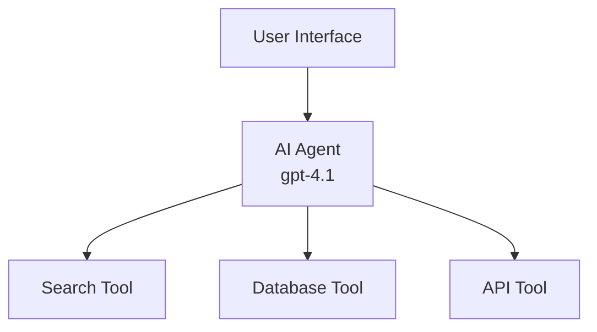
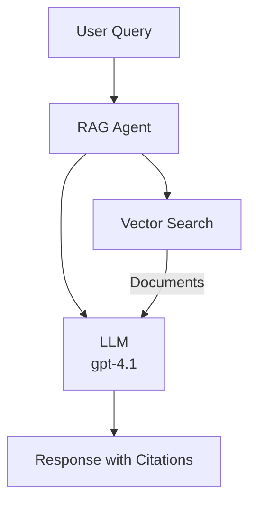
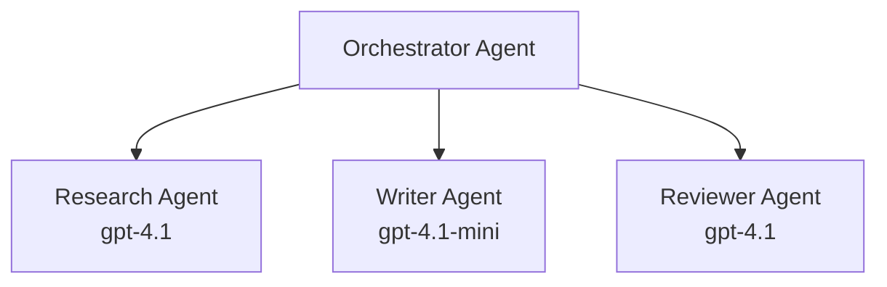

# ប្រភេទភ្នាក់ងារ AI ជាមួយ Azure Developer CLI

**ការរុករកជំពូក:**
- **📚 ទំព័រដើមវគ្គសិក្សា**: [AZD សម្រាប់អ្នកចាប់ផ្តើម](../../README.md)
- **📖 ជំពូកបច្ចុប្បន្ន**: ជំពូក 2 - ការអភិវឌ្ឍផ្អែកលើ AI ជាដើម
- **⬅️ មុននេះ**: [ការរួមបញ្ចូល Microsoft Foundry](microsoft-foundry-integration.md)
- **➡️ បន្ទាប់**: [ការចាប់ផ្តើមម៉ូដែល AI](ai-model-deployment.md)
- **🚀 កម្រិតខ្ពស់**: [ដំណោះស្រាយពហុភ្នាក់ងារ](../../examples/retail-scenario.md)

---

## ការណែនាំ

ភ្នាក់ងារ AI គឺជាប្រព័ន្ធកម្មវិធីអូតូណូម៉ាសដែលអាចសង្កេតបរិស្ថាន របស់ខ្លួន រៀបចំសេចក្តីសម្រេច ហើយធ្វើសកម្មភាពដើម្បីសម្រេចគោលបំណងជាក់លាក់។ មិនដូចជាប៉ុណ្ណោះ chatbot សាមញ្ញ ដែលឆ្លើយតបតាមការស្នើរសុំ ភ្នាក់ងារអាច:

- **ប្រើឧបករណ៍** - เรียก API ស្វែងរកមូលដ្ឋានទិន្នន័យ ប្រតិបត្តិការ code
- **ផែនការ និងគិតស្មាន** - បំបែកភារកិច្ចស្មុគស្មាញជា​ជំហានៗ
- **រៀនពីបរិបទ** - រក្សាអនុស្សាវរីយ៍ និងបង្វែរផ្លូវការប្រព្រឹត្ត
- **ធ្វើការសហការ** - ធ្វើការជាមួយភ្នាក់ងារផ្សេងទៀត (ប្រព័ន្ធពហុភ្នាក់ងារ)

មគ្គុទេសក៍នេះបង្ហាញពីរបៀបចាប់ផ្តើមភ្នាក់ងារ AI ទៅ Azure ដោយប្រើ Azure Developer CLI (azd)។

ការប្រើប្រាស់ context ការសន្ទនា មិនមែនជាការបណ្តុះម៉ូដែលទេៈ អនុស្សាវរីយ៍ចាំបាច់ ការត្រួតពិនិត្យការចូល និងការរក្សាទុកត្រូវតែត្រូវបានអនុវត្ត/កំណត់ដោយកម្មវិធី។

> **ការពិនិត្យការចេញផ្សាយ (2026-11-04):** ឧទាហរណ៍ CLI ត្រូវបានពិនិត្យប្រឆាំងនឹងឯកសារ/ប្រភព `azd` `1.37.2`, `azure.ai.agents` `1.0.0-beta.23`, និង `azure.ai.evaluations` `1.0.0-beta.2` មិនមែនក្នុងការដាក់ឲ្យដំណើរការផ្ទាល់លើ Azure ទេ។ សូមប្រើ `azd >= 1.37.0` សម្រាប់ប្រតិបត្តិការសម្ព័ន្ធតែមួយ។ ចូលមើល [ការផ្លាស់ប្តូរនិងកំណែថ្មីៗ](../chapter-08-production/production-ai-practices.md#recent-release-changes-and-fixes) មុនពេលធ្វើបច្ចុប្បន្នភាពគម្រោងចាស់ៗ។

## គោលដៅសិក្សា

ដោយបញ្ចប់មគ្គុទេសក៍នេះ អ្នកនឹងអាចៈ
- យល់ដឹងពីមុខងារនៃភ្នាក់ងារត្រូវចែកផ្តាច់ពី chatbot
- បង្ហោះទម្រង់ភ្នាក់ងារដែលបានបង្កើតរួចជាមួយ AZD
- កំណត់ Foundry Agents សម្រាប់ភ្នាក់ងារត្រូវការផ្ទាល់ខ្លួន
- អនុវត្តន៍រៀបចំរ៉ូម៉ែនរួម (ប្រើឧបករណ៍, RAG, ភ្នាក់ងារច្រើន)
- ត្រួតពិនិត្យ និងកែតម្រូវភ្នាក់ងារដាក់ចេញ

## លទ្ធផលសិក្សា

បន្ទាប់ពីបញ្ចប់ អ្នកនឹងអាចៈ
- បង្ហោះកម្មវិធីភ្នាក់ងារ AI ទៅ Azure ដោយប្រើពាក្យបញ្ជាតែមួយ
- កំណត់ឧបករណ៍និងសមត្ថភាពរបស់ភ្នាក់ងារ
- អនុវត្តបច្ចេកវិទ្យា​បន្ថែមការទាញយក (RAG) ជាមួយភ្នាក់ងារ
- រៀបចំស្ថាបត្យកម្មភ្នាក់ងារច្រើនសម្រាប់ប្រតិបត្តិការស្មុគស្មាញ
- ដោះស្រាយបញ្ហាទូទៅក្នុងការដាក់ចេញភ្នាក់ងារ

---

## 🤖 តើអ្វីដែលធ្វើអោយភ្នាក់ងារខុសប្លែកពី Chatbot?

| លក្ខណៈ | Chatbot | ភ្នាក់ងារ AI |
|---------|---------|----------|
| **ឥរិយាបថ** | ឆ្លើយតបនឹងសំណួរ | ធ្វើសកម្មភាពដោយឯករាជ្យ |
| **ឧបករណ៍** | ប្រហែលជាអាចប្រើការទាញយកឬឧបករណ៍ | ជាទូទៅប្រើឧបករណ៍ក្នុងសាកល្បងមានគោលបំណង |
| **ចងចាំ** | អាស្រ័យលើកម្មវិធី | មានចងចាំថេរពេលមានការអនុវត្តដោយបញ្ចាក់ច្បាស់ |
| **ការធ្វើផែនការ** | ចម្លើយតែមួយ | គិតបង្រួបបង្រួមជាតាឡើងវិញជាច្រើនជំហាន |
| **សហការណ៍** | អង្គភាពតែមួយ | អាចធ្វើការជាមួយភ្នាក់ងារផ្សេងទៀត |

### ឧទាហរណ៍ងាយៗ

- **Chatbot** = មនុស្សជួយឆ្លើយសំណួរនៅតុព័ត៌មាន
- **ភ្នាក់ងារ AI** = អ្នកជំនួយផ្ទាល់ខ្លួនដែលអាចទំនាក់ទំនងទូរស័ព្ទ កំណត់ការណាត់ និងបញ្ចប់ភារកិច្ចសម្រាប់អ្នក

---

## 🚀 ចាប់ផ្តើមរហ័ស៖ បង្ហោះភ្នាក់ងារដំបូងរបស់អ្នក

ជ្រើសរើសជម្រើសមួយនៅក្នុង **ថតការងារថ្មីទទេមួយ**។ `.` នឹងចាប់ផ្តើមនៅទីនោះ; ប្រសិនបើមិនមានតំបន់កំណត់ច្បាស់ កម្មវិធី AZD បច្ចុប្បន្នអាចបង្កើតថតឈ្មោះទម្រង់និយមជាយថាហេតុ និងមិនប្ដូរថតshell របស់អ្នកទេ។ រក្សាទុកទម្រង់/បរិយាកាសផ្សេងៗនៅក្នុងថតផ្សេងៗ។

កាលបរិច្ឆេទ/តម្លៃដែលបង្ហាញខាងក្រោមគឺជាគំរូសម្គាល់ មិនមែនជាប្រាក់កក់ដែលបានផ្ទៀងផ្ទាត់ឡើយ។ សូមពិនិត្យមើលលក្ខខណ្ឌជាក់លាក់ ប្រាក់ចំណាយ កំណត់គំរូ និងសេវាកម្មជាស្រេចមុនពេលបង្ហោះ។

### ជម្រើស 1៖ ទម្រង់ភ្នាក់ងារ Foundry (ផ្ដល់អនុសាសន៍)

```bash
# Initialize the AI agents template
azd init --template get-started-with-ai-agents .

# Deploy to Azure
azd up
```

**អ្វីដែលត្រូវបានបង្ហោះ៖** វត្ថុបំណងចុងក្រោយនិងជម្រើសដែលបានជ្រើសរើសកំណត់គំរូឧបករណ៍ មជ្ឈមណ្ឌលផ្តល់សេវា និងធនធានត្រួតពិនិត្យ។ សូមពិនិត្យ README និង `infra/` មុនផ្ដល់សេវា; កុំគិតថាទម្រង់ភ្នាក់ងាររាល់ម៉ូដែលមាន Search ឬផ្ទាំងគេហទំព័រ។

**ពេលវេលា៖** ~15-20 នាទី
**តម្លៃ៖** ~$100-150/ខែ (ការអភិវឌ្ឍន៍)

### ជម្រើស 2៖ ភ្នាក់ងារ Creative Writing ជាមួយ Prompty

```bash
# Initialize the Prompty-based agent template
azd init --template https://github.com/Azure-Samples/contoso-creative-writer .

# Deploy to Azure
azd up
```

**អ្វីដែលត្រូវបានបង្ហោះ៖** គំរូកិច្ចការសរសេរច្រើនភ្នាក់ងារយ៉ាងឆាប់រហ័ស FastAPI/Prompty ប្រើ Azure OpenAI, Bing Grounding, និង Azure AI Search។ ឃ្លាំង `agent-openai-python-prompty` ជាមុនប.gson្ជបញ្ជូនទៅទីនេះ; វាមិនមែនជា​ទម្រង់ agent អាកាសធាតុ Azure Functions តិចតួចទេ។ តាមតែមើល README បច្ចុប្បន្នសម្រាប់ហូស្ទីង កំណត់គំរូ និងលក្ខខណ្ឌ Bing Grounding។

**ពេលវេលា៖** ~10-15 នាទី
**តម្លៃ៖** ~$50-100/ខែ (ការអភិវឌ្ឍន៍)

### ជម្រើស 3៖ ភ្នាក់ងារ RAG Chat

```bash
# Initialize RAG chat template
azd init --template azure-search-openai-demo .

# Deploy to Azure
azd up
```

**អ្វីដែលត្រូវបានបង្ហោះ៖**
- ✅ ម៉ូដែល Microsoft Foundry
- ✅ Azure AI Search ជាមួយទិន្នន័យគំរូ
- ✅ សូម្បីដំណើរការឯកសារ
- ✅ ផ្ទាំងជជែកជាមួយហៅយោង

**ពេលវេលា៖** ~15-25 នាទី
**តម្លៃ៖** ~$80-150/ខែ (ការអភិវឌ្ឍន៍)

### ជម្រើស 4៖ AZD AI Agent Init (មើលទម្រង់គម្រោង)

ប្រើ `azd ai agent init` ជារបៀបអន្តរកម្ម ឬទទួលយក `azure.yaml` គម្រោងភ្នាក់ងារ​បច្ចុប្បន្នជាមួយ `--template`/`-t`។ ជម្រើសចាស់ `--manifest`/`-m` គឺជាឈ្មោះចាស់ដែលគ្មានប្រើវិញមិនមែនជាឧបករណ៍បម្លែងសម្រាប់សេចក្តីប្រកាសចាស់ទេ។

```bash
# Install the AI agents extension
azd extension install azure.ai.agents

# Optional: verify the installed preview version
azd extension show azure.ai.agents

# Initialize from a current agent project template (supply your template path)
azd ai agent init --template ./templates/support-agent/azure.yaml

# Deploy to Azure
azd up

# Test the deployed agent (shows latency + time-to-first-byte)
azd ai agent invoke
```

**ពេលណាដើម្បីប្រើ `azd ai agent init` ប្រឆាំងនឹង `azd init --template`:**

| វិធីសាស្រ្ត | សមស្របសម្រាប់ | វិធីធ្វើការ |
|----------|----------|------|
| `azd init --template` | ចាប់ផ្តើមពីកម្មវិធីគំរូដំណើរការ | ចម្លងឃ្លាំងទម្រង់ពេញលេញរួមមានកូដ + មូលដ្ឋានបណ្ដាញ |
| `azd ai agent init --template` | ទទួលយកគម្រោងភ្នាក់ងារ Foundry បច្ចុប្បន្ន | ប្រើឯកសារគម្រោង `azure.yaml` និងនិយមន័យរបស់វា |

> **យោបល់៖** ប្រើ `azd init --template` ពេលកំពុងសិក្សា (ជម្រើស 1-3 ខាងលើ)។ ប្រើ `azd ai agent init` សម្រាប់របៀបធ្វើការភ្នាក់ងារ Foundry។ ដើម្បីបន្ថែមនិយមន័យភ្នាក់ងារផ្ទាល់ទៅគម្រោងដែលមានស្រាប់ សូមមើល [មគ្គុទេសក៍ការចាប់ផ្តើមនិងការផ្លាស់ប្ដូរ](../chapter-08-production/production-ai-practices.md#initializing-agent-projects-with-azd-ai-agent-init)។

បន្ទាប់ពី `azd up`, ប្រើ `azd ai agent invoke` ដើម្បីសាកល្បង, ភាគបំបែក `azure.ai.evaluations` ផ្នែកបន្ថែម (`azd ai eval init`, `generate` និង `run start`) ដើម្បីវាស់កម្រិតគុណភាព និង `azd ai agent optimize` ដើម្បីបង្កើនវា ដោយប្រើការកំណត់ការវាយតម្លៃថ្មី។ Agents beta.22 បានជំនួសដំណើរការវាយតម្លៃចាស់ និងបានផ្លាស់ប្តូររូបមន្ត `--config` នៃការអុបទីម៉ា។ រកមើល [ការផ្លាស់ប្តូរវាយតម្លៃ](../chapter-08-production/production-ai-practices.md#evaluation-migration-and-quality-checks) និង [ការផ្លាស់ប្តូរការអុបទីម៉ា](../chapter-08-production/production-ai-practices.md#optimization-configuration-migration) មុនពេលប្រើឧទាហរណ៍ចាស់ៗម្តងទៀត។

---

## 🏗️ លំនាំរចនាសម្ព័ន្ធ Agent

### លំនាំទី ១៖ Agent តែមួយជាមួយឧបករណ៍

លំនាំ Agent ងាយស្រួលបំផុត - Agent មួយអាចប្រើឧបករណ៍ជាច្រើន។



**ល្អបំផុតសម្រាប់៖**
- បុណ្ណ inbound ទូរស័ព្ទអតិថិជន
- ជំនួយការស្រាវជ្រាវ
- Agent វិភាគទិន្នន័យ

**ឧទាហរណ៍កម្មវិធីដែលពាក់ព័ន្ធ៖** `azure-search-openai-demo` បង្ហាញពី RAG មិនមែនជាលំនាំ Agent ឧបករណ៍បែបចៃដន្យទូទៅទេ។

### លំនាំទី ២៖ Agent RAG (ការបង្កើតដោយបន្ថែមការយកឯកសារ)

Agent ដែលយកឯកសារពាក់ព័ន្ធមុនពេលបង្កើតចម្លើយ។



**ល្អបំផុតសម្រាប់៖**
- មូលដ្ឋានចំណេះដឹងសហគ្រាស
- ប្រព័ន្ធសំណួរ-ចម្លើយឯកសារ
- ការស្រាវជ្រាវគោលការណ៍ និងផ្នែកច្បាប់

**ទម្រង់ AZD:** `azure-search-openai-demo`

### លំនាំទី ៣៖ ប្រព័ន្ធ Multi-Agent

អ្នកជំនាញ Agent ចម្បងច្រើនដែលធ្វើការជាមួយគ្នាលើតប៉ារម៉ែតធ្ងន់ច្រើន។



**ល្អបំផុតសម្រាប់៖**
- ការបង្កើតមាតិកាមួយស្មុគស្មាញ
- សំណុំការងារជាច្រើនជំហាន
- ការងារដែលត្រូវការជំនាញខុសគ្នា

**សូមរៀនបន្ថែម៖** [លំនាំសម្រុក Multi-Agent](../chapter-06-pre-deployment/coordination-patterns.md)

---

## ⚙️ ការកំណត់ឧបករណ៍ភ្នាក់ងារ

ភ្នាក់ងាររីកចម្រើនខ្លាំងនៅពេលពួកគេអាចប្រើឧបករណ៍បាន។ នេះជាវិធីកំណត់ឧបករណ៍ទូទៅ៖

### ការកំណត់ឧបករណ៍នៅក្នុងភ្នាក់ងារ Foundry

នេះគឺជា **ខ្លឹមសារសេវាភ្នាក់ងារបែបបុរាណ** ដែលផ្តោតទៅលើ `azure-ai-projects==1.0.0` និង `azure-ai-agents==1.1.0` ជាមួយ `azure-identity`។ វាមិនមែនជាកំណែ API versioned-agent/Responses ថ្មីដែលប្រើដោយគំរូ Foundry បច្ចុប្បន្នខ្លះទេ ហើយមិនមែនជា `azure.ai.agents` AZD extension (កញ្ចប់ផ្សេងទៀត)។ កុំលាយ API ជំនាន់នេះ។ កំណត់ `PROJECT_ENDPOINT` ទៅចំណុចបញ្ចប់គម្រោង Foundry បែបបុរាណ និង `MODEL_DEPLOYMENT_NAME` ទៅនឹងការតំឡើងម៉ូឌែលគាំទ្រមួយដែលមានស្រាប់; បញ្ជាក់ដោយ `az login` នៅក្នុងเครื่อง និងផ្ដល់សិទ្ធិគម្រោងត្រឹមត្រូវ។

```python
# agent_config.py
import os
from azure.ai.projects import AIProjectClient
from azure.ai.agents.models import FunctionTool
from azure.identity import DefaultAzureCredential

def search_knowledge_base(query: str) -> str:
    """Search the demonstration knowledge base.

    :param query: Search text.
    :return: Matching demonstration information.
    """
    # Local fixture only, not a production search implementation.
    return "Demo policy: returns are accepted within 30 days."

project_client = AIProjectClient(
    endpoint=os.environ["PROJECT_ENDPOINT"],
    credential=DefaultAzureCredential(),
)
search_tool = FunctionTool(functions={search_knowledge_base})
project_client.agents.enable_auto_function_calls(search_tool)
agent = project_client.agents.create_agent(
    model=os.environ["MODEL_DEPLOYMENT_NAME"],
    name="Support Agent",
    instructions="Use search_knowledge_base for policy questions. Label results as demo data.",
    tools=search_tool.definitions,
)
```

ការចុះបញ្ជីស្កីម៉ាត្រការងារមិនធ្វើឲ្យ Python ដំណើរការលើសេវានោះទេ។ ក្នុង SDK នេះ, `enable_auto_function_calls` បូកជាមួយ `agents.runs.create_and_process(...)` នឹងរត់ callback ដែលបានចុះបញ្ជីនៅក្នុងដំណើរការអតិថិជនរបស់អ្នក។ មើលឧទាហរណ៍ SDK ដែលបានចេញផ្សាយ [released SDK example](https://github.com/Azure/azure-sdk-for-python/blob/azure-ai-agents_1.1.0/sdk/ai/azure-ai-agents/samples/agents_tools/sample_agents_auto_function_call.py)។ បិទអតិថិជន និងលុបភ្នាក់ងារ/ខ្សែចំនាត់បង្ហាញពេលបញ្ចប់។

### ការកំណត់បរិស្ថាន

ឈ្មោះខាងក្រោមគឺជាការបញ្ចូលគំរូប тұлឥតស្តង់ដារ **ដែលមានលក្ខណៈប្រើប្រាស់ក្នុងការបង្ហាញ** មិនមែនជាការប្តូរដែលបានបង្កើតរួចរបស់ AZD ទេ។ ជាមុនសិន បណ្តតម្លៃនីមួយៗត្រូវតែកាត់ជាតំណតាមកូដ `infra/main.parameters.json`, សេដ្ឋាភាពហិរញ្ញវត្ថុ និងកូដកម្មវិធី។ `azd env set` តែម្ដងមិនបម្លែងឧបករណ៍ឬការណែនាំរបស់ភ្នាក់ងារឡើយ។

```bash
# Set up agent-specific environment variables
azd env set AZURE_OPENAI_MODEL "gpt-4.1"
azd env set AGENT_INSTRUCTIONS "You are a helpful assistant..."
azd env set ENABLE_CODE_INTERPRETER "true"
azd env set ENABLE_FILE_SEARCH "true"

# Apply wired infrastructure and application changes
azd up
```

---

## 📊 ការត្រួតពិនិត្យភ្នាក់ងារ

### ការបញ្ចូល Application Insights

ប្រសិនបើគំរូដែលអ្នកជ្រើសរើសបានផ្តល់សិទ្ធិ Application Insights និងកំណត់ឧបករណ៍វាស់វែង៖

```bash
# Open monitoring dashboard
azd monitor --overview

# Open the Application Insights logs view (not a streaming log tail)
azd monitor --logs

# View live metrics
azd monitor --live
```

### គោលសញ្ជាតិរបស់គួរត្រួតពិនិត្យ

| គោលសញ្ញា | សេចក្ដីពិពណ៌នា | គោលដៅ |
|--------|-------------|--------|
| ពេលវេលាឆ្លើយតប | ពេលវេលាដើម្បីបង្កើតចម្លើយ | < 5 វិនាទី |
| ការប្រើប្រាស់ Token | តួអក្សរត្រូវបានប្រើក្នុងការស្នើសុំ | តាមដានសម្រាប់ថ្លៃកម្រៃ |
| អត្រាជោគជ័យការហៅឧបករណ៍ | ភាគរយនៃការប្រតិបត្ដិការ​ឧបករណ៍​ជោគជ័យ | > 95% |
| អត្រាខុសបញ្ជា | សំណើភ្នាក់ងារដែលបរាជ័យ | < 1% |
| ការពេញចិត្តរបស់អ្នកប្រើ | ពិន្ទុមតិយោបល់ | > 4.0/5.0 |

### ការចុះបញ្ជីផ្ទាល់ខ្លួនសម្រាប់ភ្នាក់ងារ

```python
import os
from azure.monitor.opentelemetry import configure_azure_monitor
from opentelemetry import trace

# Configure Azure Monitor with OpenTelemetry
configure_azure_monitor(
    connection_string=os.environ["APPLICATIONINSIGHTS_CONNECTION_STRING"]
)

tracer = trace.get_tracer(__name__)

def log_agent_interaction(user_query, agent_response, tools_used, latency_ms):
    with tracer.start_as_current_span("agent_interaction") as span:
        span.set_attributes({
            "query_length": len(user_query),  # Do not log raw prompts or personal data
            "response_length": len(agent_response),
            "tools_used": tools_used,
            "latency_ms": latency_ms
        })
```

> **កំណត់សំគាល់៖** ត្រូវដំឡើងកញ្ចប់ដែលត្រូវការ៖ `pip install azure-monitor-opentelemetry`។ វាប្រើប្រាស់សំណុំបណ្ណៈ OpenTelemetry; ការនាំចូល namespace មិនមែនជាភារកិច្ចក្នុងការដំឡើងកញ្ចប់ដែលមានឈ្មោះ `opentelemetry` ទេ។

---

## 💰 ការផ្តល់អត្រាតម្លៃ

### ការវាយតម្លៃថ្លៃប្រចាំខែតាមលំនាំ

នេះគឺជាជួររចនាប្រាក់សម្រាប់គំរូប៉ុណ្ណោះ មិនមែនជាការដាក់ទំនងថ្លៃឬកំណត់ការចំណាយទេ។ តំបន់ ម៉ូឌែល token SKU ស្វែងរក/គណនា, ការសម្របសម្រួលឧបករណ៍ ប្រភេទផ្ទុក និងចរាចរណ៍អាចលើសពីនេះ។ សូមពិនិត្យការណែនាំថ្លៃរបស់គំរូ និងតម្លៃ Azure មុនពេល `azd up`។

| លំនាំ | បរិបទកំណត់អភិវឌ្ឍន៍ | ផលិតកម្ម |
|---------|-----------------|------------|
| ភ្នាក់ងារតែមួយ | $50-100 | $200-500 |
| ភ្នាក់ងារ RAG | $80-150 | $300-800 |
| ភ្នាក់ងារច្រើន (2-3 ភ្នាក់ងារ) | $150-300 | $500-1,500 |
| ភ្នាក់ងារច្រើនសហគ្រាស | $300-500 | $1,500-5,000+ |

### សន្លឹកជំនួយបង្កើនប្រសិទ្ធភាពថ្លៃ

1. **ប្រើ gpt-4.1-mini សម្រាប់ភារកិច្ចសាមញ្ញៗ** (គ្រាន់តែបើទម្រង់របស់អ្នកប្រើបញ្ចូលទិន្នន័យនេះ)
   ```bash
   azd env set AZURE_OPENAI_MODEL "gpt-4.1-mini"
   ```

2. **អនុវត្តការផ្ទុកក្នុងឃ្លាំងដែលមានដែនកំណត់សម្រាប់ការស្វែងរកម្ដងទៅម្ដងដោយសុវត្ថិភាព។** រួមបញ្ចូលការអនុញ្ញាតជួលអ្នកប្រើ, ការដាក់ចេញម៉ូដែល, ការណែនាំ និងកំណែដកយកក្នុងកូនសោរផ្ទុកក្នុងឃ្លាំង; កំណត់កំណត់ពេលផុតកំណត់។ កុំចែករំលែកការឆ្លើយតបជាឯកជនតាមការស្វែងរកដែលមានតែសំណួរតែមួយតាមដំណើរការទូទៅ។ ឯកសារ SDK agent គ្មានវិធីសាស្រ្តទូទៅ `agent.run()` មួយឡើយ។

3. **កំណត់ដែនកំណត់ token ក្នុងមួយកំណត់ដំណើរ**
   ```python
   # Set max_completion_tokens when running the agent, not during creation
   run = project_client.agents.runs.create_and_process(
       thread_id=thread.id,
       agent_id=agent.id,
       max_completion_tokens=1000  # Budget across the run; may finish as incomplete
   )
   ```

4. **កំណត់ស្កាមប៊ែល Container Apps ដែលមានសិទ្ធិទៅសូន្យនៅពេលមិនបានប្រើបា្រះ**
   ```bash
   # Custom-template input: must map to template.scale.minReplicas
   azd env set MIN_REPLICAS "0"
   ```
   អនុវត្តបម្រែបម្រួលហេដ្ឋារចនាសម្ព័ន្ធជាមួយ `azd provision` ឬ `azd up`។ ការហ្វឹកហាត់ទៅសូន្យត្រូវការការជំរុញសមស្រប ហើយមិនបញ្ឈប់ការស្វែងរក, ការផ្ទុកទិន្នន័យ, ឬការទូទាត់ម៉ូដែល/ឧបករណ៍ឡើយ។

---

## 🔧 ការជួសជុលបញ្ហា Agents

### បញ្ហាទូទៅ និងដំណោះស្រាយ

<details>
<summary><strong>❌ តំណាងមិនឆ្លើយតបនឹងការហៅឧបករណ៍</strong></summary>

```bash
# Inspect the application deployment (not the agent's registered tools)
azd show

# Verify OpenAI deployment
az cognitiveservices account deployment list \
  --name $AZURE_OPENAI_NAME \
  --resource-group $RG_NAME

# Check agent logs
azd monitor --logs
```

**ហេតុផលធម្មតា៖**
- ការដាក់ហត្ថលេខាឧបករណ៍មិនត្រូវគ្នា
- ខ្វះសិទ្ធិទាមទារ
- មិនអាចចូលប្រើ API endpoint បាន
</details>

<details>
<summary><strong>❌ ពេលយឺតខ្ពស់ក្នុងការឆ្លើយតប Agent</strong></summary>

```bash
# Check Application Insights for bottlenecks
azd monitor --live

# Consider using a faster model
azd env set AZURE_OPENAI_MODEL "gpt-4.1-mini"
azd up
```

**គន្លឹះធ្វើឲ្យប្រសើរឡើង៖**
- ប្រើការឆ្លើយតបឆ្លាតវៃតាមបទចងក្រង
- អនុវត្តការផ្ទុកឆ្លើយតបក្នុងឃ្លាំង
- បន្ថយទំហំវីនដូ context
</details>

<details>
<summary><strong>❌ តំណាងបង្ហាញព័ត៌មានមិនត្រឹមត្រូវ ឬមានការស្រមៃ</strong></summary>

```python
# Improve with better system prompts
instructions = """
You are a helpful assistant. IMPORTANT:
- Only answer based on provided context
- If you don't know, say "I don't know"
- Always cite your sources
- Never make up information
"""

# Use these instructions in the agent definition.
# For classic file search, first upload/index documents in a vector store,
# then use FileSearchTool(vector_store_ids=[...]) and pass both its
# .definitions and .resources when creating the agent.
```
 ការណែនាំ និងការដកយកកាត់បន្ថយហានិភ័យ; មិនមានអ្វីធានាថាចម្លើយពិតប្រាកដទេ។ វាយតម្លៃសំណួរដែលមានមូលដ្ឋាន ភាគច្រើន និងក្រៅសម្រាប់ការឆ្លើយតបផ្អែកលើចម្លើយដែលបានស្គាល់។
</details>

<details>
<summary><strong>❌ កំហុសលើកំណត់កំណត់ token</strong></summary>

```python
# Implement context window management
def truncate_context(messages, max_tokens=8000, model="gpt-4.1"):
    """Approximate content-only budget for objects with .content strings."""
    import tiktoken
    encoding = tiktoken.encoding_for_model(model)
    total_tokens = 0
    truncated = []
    
    for msg in reversed(messages):
        msg_tokens = len(encoding.encode(msg.content))
        if total_tokens + msg_tokens > max_tokens:
            break
        truncated.insert(0, msg)
        total_tokens += msg_tokens
    
    return truncated
```
ជំនួយនេះមិនរាប់បញ្ចូលកាលណាស៊ីស្រេមតួនាទី/ឧបករណ៍, សេចក្តីណែនាំប្រព័ន្ធ, សញ្ញារូបភាព និងបន្ទុកពហុប្រព័ន្ធទេ។ សូមរក្សាទីវៅសម្រាប់វា និងការសម្រេច; កុំបំបែកជាគូហៅឧបករណ៍/លទ្ធផលឬបោះបង់សេចក្តីណែនាំប្រព័ន្ធដែលត្រូវការ។ ដំឡើង `tiktoken` ផ្សេងពីគ្នា។ វាមិនមែនជាកម្មវិធីផ្ទៀងផ្ទាត់បង្អួចបរិបទទូទៅឡើយ។
</details>

---

## 🎓 ថ្លែងការណ៍ដៃអនុវត្ត

### លំហាត់ ១៖ ចេញផ្សាយមនុស្សជំនួយមូលដ្ឋាន (២០ នាទី)

**គោលបំណង៖** ចេញផ្សាយមនុស្សជំនួយ AI ដំបូងរបស់អ្នកដោយប្រើ AZD

```bash
# Step 1: Initialize template
azd init --template get-started-with-ai-agents .

# Step 2: Login to Azure
azd auth login
# If you work across tenants, add --tenant-id <tenant-id>

# Step 3: Deploy
azd up

# Step 4: Test the agent
# Expected output after deployment:
#   Deployment Complete!
#   Endpoint: https://<app-name>.<region>.azurecontainerapps.io
# Open the URL shown in the output and try asking a question

# Step 5: View monitoring
azd monitor --overview

# Step 6: Clean up
azd down --force --purge
```

**កម្រិតជោគជ័យ៖**
- [ ] មនុស្សជំនួយឆ្លើយសំណួរ
- [ ] អាចចូលប្រើផ្ទាំងតាមដានតាមរយៈ `azd monitor`
- [ ] ធនធានត្រូវបានសម្អាតដោយជោគជ័យ

### លំហាត់ ២៖ បន្ថែមឧបករណ៍ផ្ទាល់ខ្លួន (៣០ នាទី)

**គោលបំណង៖** ត្រលប់មនុស្សជំនួយជាមួយឧបករណ៍ផ្ទាល់ខ្លួន

**ចំណុចចាប់ផ្តើម៖** ប្រើអត្រាសកល SDK ដែលមានចាស់ពី [ការកំណត់ឧបករណ៍](#tool-configuration-in-foundry-agents) មិនមែនគំរូដែលបង្កើតដោយសំណុំSDK ផ្សេងទេ។

1. បន្ថែមឧបករណ៍កំណត់ដែនបញ្ជាក់នេះទៅក្នុង `agent_config.py`:
   ```python
   def get_weather(location: str) -> str:
       """Return demonstration weather, not live conditions.

       :param location: City name.
       :return: A clearly labelled fixture.
       """
       print(f"TOOL_CALLED: {location}")
       return f"Demo weather in {location}: Sunny, 72°F (fixture, not live)"
   ```
2. ជំនួសប្លុកការចុះឈ្មោះនិងបង្កើត search-tool ជាមួយ:
   ```python
   weather_tool = FunctionTool(functions={get_weather})
   project_client.agents.enable_auto_function_calls(weather_tool)
   agent = project_client.agents.create_agent(
       model=os.environ["MODEL_DEPLOYMENT_NAME"],
       name="Weather Agent",
       instructions="Call get_weather for weather questions; explain that it returns demo data.",
       tools=weather_tool.definitions,
   )
   thread = project_client.agents.threads.create()
   try:
       project_client.agents.messages.create(
           thread_id=thread.id, role="user", content="Use get_weather for Seattle."
       )
       run = project_client.agents.runs.create_and_process(
           thread_id=thread.id, agent_id=agent.id
       )
       if run.status != "completed":
           raise RuntimeError(f"Run status: {run.status}; error: {run.last_error}")
       for message in project_client.agents.messages.list(thread_id=thread.id):
           for text in message.text_messages:
               print(text.text.value)
   finally:
       project_client.agents.threads.delete(thread.id)
       project_client.agents.delete_agent(agent.id)
       project_client.close()
   ```
3. រត់ក្នុងកន្លែង (នេះហៅគម្រោង Azure ដែលមានស្រាប់ ហើយប៉ះពាល់លើការចំណាយម៉ូដែល):
   ```bash
   python agent_config.py
   # Expected: TOOL_CALLED: Seattle, then a completed answer labelled demo data.
   ```

**លទ្ធផលជោគជ័យ៖**
- [ ] ដំណេករាស្រ្តទាក់ទងនឹងសំណួរអាកាសធាតុ
- [ ] ឧបករណ៍ត្រូវបានហៅយ៉ាងត្រឹមត្រូវ
- [ ] ចម្លើយរួមបញ្ចូលព័ត៌មានអាកាសធាតុ

### អនុវត្តទី 3៖ បង្កើតអាជីស RAG (45 នាទី)

**គោលបំណង៖** បង្កើតអាជីសដែលឆ្លើយសំណួរពីឯកសាររបស់អ្នក

```bash
# Step 1: Deploy RAG template
azd init --template azure-search-openai-demo .
azd up

# Step 2: Upload your documents
# For the sample's local ingestion path, place supported files in data/.
# Run from the sample root after following its Python environment setup:
./scripts/prepdocs.sh
# Windows PowerShell equivalent: .\\scripts\\prepdocs.ps1

# Step 3: Test with domain-specific questions
# Open the web app URL from the azd up output
# Ask questions about your uploaded documents
# Responses should include citation references like [doc.pdf]
```

**លទ្ធផលជោគជ័យ៖**
- [ ] អាជីសឆ្លើយពីឯកសារដែលបានផ្ទុកឡើង
- [ ] ចម្លើយរួមបញ្ចូលបញ្ជាក់ប្រភព
- [ ] សំណួរធ្វើតេស្តក្រៅកម្រិតត្រូវបានដោះស្រាយដោយគ្មានការអះអាងមិនគាំទ្រ (មិនមែនជាការធានាថាចំពោះសំណួរចុងក្រោយទាំងអស់)

ប្រសិនបើ `USE_CLOUD_INGESTION=true`, ប្រើការចម្លង / បញ្ចូលពពកគំរូជំនួសផ្ទាល់មុខ; wrapper ក្នុងតំបន់បង្កើតត្រូវបានរំលងការចម្លងដោយមានចេតនា។ បន្ទាប់ពីសាកល្បង រត់ `azd down` នៅក្នុងបរិស្ថាន RAG ហើយពិនិត្យមើលធនធានសម្រាប់លុបចោល។

---

## 📚 ជំហានបន្ទាប់

ឥឡូវនេះដែលអ្នកយល់ពីអាជីស AI សូមស្វែងយល់អំពីប្រធានបទកម្រិតខ្ពស់ទាំងនេះ៖

| ប្រធានបទ | សេចក្ដីអធិប្បាយ | តំណភ្ជាប់ |
|-------|-------------|------|
| **ប្រព័ន្ធអាជីសច្រើន** | បង្កើតប្រព័ន្ធជាមួយអាជីសច្រើនដែលសហការគ្នា | [Retail Multi-Agent Example](../../examples/retail-scenario.md) |
| **លំនាំសម្របសម្រួល** | រៀនលំនាំសម្របសម្រួលនិងទំនាក់ទំនង | [Coordination Patterns](../chapter-06-pre-deployment/coordination-patterns.md) |
| **ការចែកចាយក្នុងផលិតកម្ម** | ការចេញដំណើរការអាជីសសម្រាប់អាជីវកម្ម | [Production AI Practices](../chapter-08-production/production-ai-practices.md) |
| **ការវាយតម្លៃអាជីស** | សាកល្បងនិងវាយតម្លៃសមត្ថភាពអាជីស | [AI Troubleshooting](../chapter-07-troubleshooting/ai-troubleshooting.md) |
| **មន្ទីរពិសោធន៍ AI** | ប្រែក្លាយជាដៃ: ធ្វើឲ្យដំណោះស្រាយ AI របស់អ្នកមាន AZD | [AI Workshop Lab](ai-workshop-lab.md) |

---

## 📖 ឯកសារបន្ថែម

### ឯកសារផ្លូវការជាកំណត់
- [Microsoft Foundry Agent Service](https://learn.microsoft.com/azure/ai-services/agents/)
- [Microsoft Foundry Agent Service Quickstart](https://learn.microsoft.com/azure/ai-services/agents/quickstart)
- [Semantic Kernel Agent Framework](https://learn.microsoft.com/semantic-kernel/)

### លំនាំ AZD សម្រាប់អាជីស
- [ចាប់ផ្តើមជាមួយអាជីស AI](https://github.com/Azure-Samples/get-started-with-ai-agents)
- [អាជីសការសរសេរច្នៃប្រឌិតជាមួយ Prompty](https://github.com/Azure-Samples/contoso-creative-writer)
- [Azure Search OpenAI Demo](https://github.com/Azure-Samples/azure-search-openai-demo)

### ឯកសារសហគមន៍
- [Awesome AZD - លំនាំអាជីស](https://azure.github.io/awesome-azd/?tags=ai-agents)
- [Azure AI Discord](https://discord.gg/microsoft-azure)
- [Microsoft Foundry Discord](https://discord.gg/nTYy5BXMWG)

### ជំនាញអាជីសសម្រាប់អ្នកកែសម្រួលរបស់អ្នក
- [**ជំនាញអាជីស Microsoft Azure**](https://skills.sh/microsoft/github-copilot-for-azure) - តំឡើងជំនាញអាជីស AI ដែលអាចប្រើឡើងវិញសម្រាប់ការអភិវឌ្ឍ Azure ក្នុង GitHub Copilot, Cursor, ឬអាជីសណាមួយគាំទ្រ។ រួមបញ្ចូលជំនាញសម្រាប់ [Azure AI](https://skills.sh/microsoft/github-copilot-for-azure/azure-ai), [Microsoft Foundry](https://skills.sh/microsoft/github-copilot-for-azure/microsoft-foundry), [deployment](https://skills.sh/microsoft/github-copilot-for-azure/azure-deploy), និង [diagnostics](https://skills.sh/microsoft/github-copilot-for-azure/azure-diagnostics):
  ```bash
  npx skills add microsoft/github-copilot-for-azure
  ```

---

**ការរុករក**
- **មេរៀនមុន**៖ [ការអាំងតេករេស្យុន Microsoft Foundry](microsoft-foundry-integration.md)
- **មេរៀនបន្ទាប់**៖ [ការបង្កើតម៉ូដែល AI](ai-model-deployment.md)

---

<!-- CO-OP TRANSLATOR DISCLAIMER START -->
**ការបដិសេធ**:
ឯកសារនេះត្រូវបានបម្លែងភាសា ដោយប្រើសេវាបម្លែងភាសា AI [Co-op Translator](https://github.com/Azure/co-op-translator)។ ទោះយើងខ្ញុំមានក្តីប្រាថ្នាឱ្យបានច្បាស់លាស់ តែសូមយល់ដឹងថាការបម្លែងដោយស្វ័យប្រវត្តិក៏អាចមានកំហុសឬភាពមិនត្រឹមត្រូវ។ ឯកសារដើមជាភាសាទីតាំងគួរត្រូវបានគេប្រើជាប្រភពច្បាស់លាស់។ សម្រាប់ព័ត៌មានសំខាន់ៗ សូមណែនាំឱ្យប្រើប្រាស់ការប្រែដោយមនុស្សជំនាញ។ យើងខ្ញុំមិនទទួលខុសត្រូវចំពោះការយល់ច្រឡំ ឬការបកស្រាយខុសបន្ទាប់ពីការប្រើប្រាស់ការបម្លែងនេះនោះទេ។
<!-- CO-OP TRANSLATOR DISCLAIMER END -->