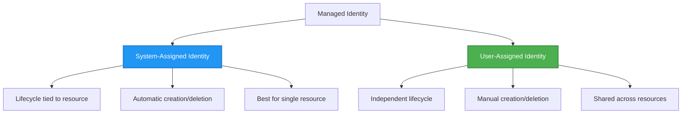

# លំនាំសម្គាល់អត្តសញ្ញាណ និងអត្តសញ្ញាណដែលគ្រប់គ្រង

⏱️ **ពេលវេលាប៉ាន់ប្រមាណ**: អាន ៤៥-៦០ នាទី; អនុញ្ញាតពេលវេលាបន្ថែមសម្រាប់បញ្ចូលលំហាត់ | 💰 **ផលប៉ះពាល់ថ្លៃដើម**: អត្តសញ្ញាណ/RBAC គឺឥតគិតថ្លៃ; ការគណនា, ការផ្ទុក និង Key Vault ដែលបានដាក់ប្រាក់ត្រូវគិតថ្លៃ | ⭐ **ភាពស្មុគស្មាញ**: កម្រិតមធ្យម

> បានពិនិត្យឡើងវិញដោយផ្អែកលើ `azd 1.37.2` (វិច្ឆិកា 2026)។ មេរៀននេះមាន **ផ្នែករួមបញ្ចូលក្នុងការបង្ហាញ ប៉ុន្តែមិនមែនគំរូ `secure-app` ដែលអាចទាញយកបានពេញលេញទេ**។ បង្កើតឯកសារដែលបានយោង, ផ្គត់ផ្គង់ហេដ្ឋារចនាសម្ព័ន្ធដែលផ្គូផ្គង, និងជំនួសកន្លែងទំនេរមុនពេលបង្ហោះ។ គ្មានធនធាន Azure ត្រូវបានចែកចាយនៅពេលពិនិត្យឡើយ។

**📚 ផ្លូវការសិក្សា៖**
- ← មុន៖ [ការគ្រប់គ្រងការកំណត់រចនាសម្ព័ន្ធ](configuration.md) - ការគ្រប់គ្រងអថេរជាបរិបទ និងសម្ងាត់
- 🎯 **អ្នកស្ថិតនៅទីនេះ**៖ ការផ្ទៀងផ្ទាត់ និងសុវត្ថិភាព (អត្តសញ្ញាណគ្រប់គ្រង, ថាសគន្លឹះ, គំរូសុវត្ថិភាព)
- → បន្ទាប់៖ [ហេដ្ឋារចនាសម្ព័ន្ធជាទូទៅ](../chapter-04-infrastructure/README.md) - ការផ្ដល់ និងបញ្ចូលធនធាន
- 🏠 [ទំព័រដើមមេរៀន](../../README.md)

---

## អ្វីដែលអ្នកនឹងរៀន

ដោយបញ្ចប់មេរៀននេះ អ្នកនឹងអាច៖
- យល់ដឹងអំពីគំរូការផ្ទៀងផ្ទាត់ Azure (កូនសោ, ខ្សែចងភ្ជាប់, អត្តសញ្ញាណគ្រប់គ្រង)
- អនុវត្ត **អត្តសញ្ញាណគ្រប់គ្រង** សម្រាប់ការផ្ទៀងផ្ទាត់មិនបញ្ចូលពាក្យសម្ងាត់
- សុវត្ថិភាពសម្ងាត់ជាមួយ **ការរួមបញ្ចូល Azure Key Vault**
- កំណត់តួនាទីផ្អែកលើការគ្រប់គ្រងចូល (RBAC) សម្រាប់ការបង្ហោះ AZD
- អនុវត្តភាពជាក់លាក់ល្អបំផុតសុវត្ថិភាពនៅក្នុង Container Apps និងសេវាកម្ម Azure
- ផ្លាស់ប្តូរពីការផ្ទៀងផ្ទាត់ផ្អែកលើគន្លឹះ ទៅការផ្ទៀងផ្ទាត់ផ្អែកលើអត្តសញ្ញាណ

## ហេតុអ្វីបានជា អត្តសញ្ញាណគ្រប់គ្រងសំខាន់

### បញ្ហា៖ ការផ្ទៀងផ្ទាត់ប្រពៃណី

**មុនអត្តសញ្ញាណគ្រប់គ្រង៖**
```javascript
// ❌ SECURITY RISK: Hardcoded secrets in code
const connectionString = "Server=mydb.database.windows.net;User=admin;Password=P@ssw0rd123";
const storageKey = "xK7mN9pQ2wR5tY8uI0oP3aS6dF1gH4jK...";
const cosmosKey = "C2x7B9n4M1p8Q5w3E6r0T2y5U8i1O4p7...";
```

**បញ្ហា៖**
- 🔴 **សម្ងាត់បង្ហាញចេញ** ក្នុងកូដ, ឯកសារកំណត់រចនាសម្ព័ន្ធ, អថេរជាបរិបទ
- 🔴 **ការបង្វិលប្ដូរពាក្យសម្ងាត់** ត្រូវការការផ្លាស់ប្តូរកូដ និងការបង្ហោះឡើងវិញ
- 🔴 **ការត្រួតពិនិត្យក្រោមសម្ពាធ** - អ្នកណាប្រើប្រាស់អ្វី នៅពេលណា?
- 🔴 **ការចម្លងសម្ងាត់ច្រើនទីតាំង** - សម្ងាត់រាយចែកពូជក្នុងប្រព័ន្ធជាច្រើន
- 🔴 **ហានិភ័យភាពជាអ្នកផ្ទៀងផ្ទាត់** - បរាជ័យការត្រួតពិនិត្យសុវត្ថិភាព

### ដំណោះស្រាយ៖ អត្តសញ្ញាណគ្រប់គ្រង

**បន្ទាប់ពីអត្តសញ្ញាណគ្រប់គ្រង៖**
```javascript
// ✅ SECURE: No secrets in code
const credential = new DefaultAzureCredential();
const client = new BlobServiceClient(
  "https://mystorageaccount.blob.core.windows.net",
  credential  // Azure automatically handles authentication
);
```

**អត្ថប្រយោជន៍៖**
- ✅ **គ្មានសម្ងាត់** នៅក្នុងកូដ ឬការកំណត់រចនាសម្ព័ន្ធ
- ✅ **ការបង្វិលប្ដូរប្រូហ្គ្រាមដោយស្វ័យប្រវត្តិ** - Azure គ្រប់គ្រងវា
- ✅ **រោងចក្រ audit ពេញលេញ** នៅក្នុងកំណត់ហេតុ Microsoft Entra ID
- ✅ **សុវត្ថិភាពមជ្ឈមណ្ឌល** - គ្រប់គ្រងក្នុង Azure Portal
- ✅ **ឆាងលក្ខខណ្ឌសុវត្ថិភាព** - សម្របសម្រួលនឹងស្តង់ដាសុវត្ថិភាព

**ប្រៀបធៀប**៖ ការផ្ទៀងផ្ទាត់ប្រពៃណីដូចជា ការពាក់កូនសោផ្លូវទៅទ្វារផ្សេងៗ។ អត្តសញ្ញាណគ្រប់គ្រងដូចជា ប័ណ្ណសុវត្ថិភាពដែលផ្តល់ការចូលដោយស្វ័យប្រវត្តិ ដោយផ្អែកលើអ្នកជាអ្នក - គ្មានកូនសោដែលអាចបាត់បង់ ចម្លង ឬបង្វិល។

---

## ទិដ្ឋភាពធរណីមាត្រ

### ចរន្តផ្ទៀងផ្ទាត់ជាមួយអត្តសញ្ញាណគ្រប់គ្រង

```mermaid
sequenceDiagram
    participant App as Your Application<br/>(Container App)
    participant MI as Managed Identity<br/>(Microsoft Entra ID)
    participant KV as Key Vault
    participant Storage as Azure Storage
    participant DB as Azure SQL
    
    App->>MI: Request access token<br/>(automatic)
    MI->>MI: Verify identity<br/>(no password needed)
    MI-->>App: Return token for requested audience<br/>(lifetime varies)
    
    App->>KV: Get secret<br/>(using token)
    KV->>KV: Check RBAC permissions
    KV-->>App: Return secret value
    
    App->>Storage: Upload blob<br/>(using token)
    Storage->>Storage: Check RBAC permissions
    Storage-->>App: Success
    
    App->>DB: Query data<br/>(using token)
    DB->>DB: Check SQL permissions
    DB-->>App: Return results
    
    Note over App,DB: Request a separate token for each service audience;<br/>SDK credentials handle caching and renewal
```

### ប្រភេទអត្តសញ្ញាណគ្រប់គ្រង



| លក្ខណៈ | ចាត់​តាមប្រព័ន្ធ | ចាត់​តាមអ្នកប្រើប្រាស់ |
|---------|----------------|---------------|
| **ជីវិត** | ភ្ជាប់ជាមួយធនធាន | ប្រករ​ឈរ​ឯណា​មួយ |
| **ការបង្កើត** | ស្វ័យប្រវត្តិជាមួយធនធាន | បង្កើតដោយដៃ |
| **ការលុប** | លុបជាមួយធនធាន | មាននៅបន្តក្រោយការលុបធនធាន |
| **ការចែករំលែក** | ធនធានមួយតែប៉ុណ្ណោះ | ធនធានច្រើន |
| **ករណីប្រើប្រាស់** | សាមញ្ញ | ស្មុគស្មាញ និងមានធនធានច្រើន |
| **ជម្រើសគំរូ** | កំណត់ជាថ្នាក់ហេដ្ឋារចនាសម្ព័ន្ធ | កំណត់ជាថ្នាក់ហេដ្ឋារចនាសម្ព័ន្ធ |

---

## វិស័យជាមុន

### ឧបករណ៍ដែលត្រូវការ

អ្នកគួរតែបានដំឡើងរួចពីមេរៀនមុនៗ៖

```bash
# Verify Azure Developer CLI
azd version
# ✅ Expected: azd version 1.0.0 or higher

# Verify Azure CLI
az --version
# ✅ Expected: azure-cli 2.50.0 or higher
```

### ការទាមទារ Azure

- មានការចុះឈ្មោះ Azure សកម្ម
- មានសិទ្ធិ​ដូចខាងក្រោម៖
  - បង្កើតអត្តសញ្ញាណគ្រប់គ្រង
  - ចាត់តួនាទី RBAC
  - បង្កើតធនធាន Key Vault
  - បង្ហោះ Container Apps

### គោលការណ៍ចំណេះដឹងមុន

អ្នកត្រូវបានបញ្ចប់៖
- [មគ្គុទ្ទេសក៍ដំឡើង](../chapter-01-foundation/installation.md) - ការតំឡើង AZD
- [មូលដ្ឋាន AZD](../chapter-01-foundation/azd-basics.md) - គំនិតគ្រឹះ
- [ការគ្រប់គ្រងការកំណត់រចនាសម្ព័ន្ធ](configuration.md) - អថេរជាបរិបទបរិស្ថាន

---

## មេរៀន 1៖ យល់ដឹងអំពីគំរូការផ្ទៀងផ្ទាត់

### គំរូ 1៖ ខ្សែចងភ្ជាប់ (ចាស់ - មិនផ្តល់អនុសាសន៍)

**របៀបដំណើរការ៖**
```bash
# Connection string contains credentials
STORAGE_CONNECTION_STRING="DefaultEndpointsProtocol=https;AccountName=myaccount;AccountKey=xK7mN9pQ2wR5..."
COSMOS_CONNECTION_STRING="AccountEndpoint=https://myaccount.documents.azure.com:443/;AccountKey=C2x7..."
SQL_CONNECTION_STRING="Server=myserver.database.windows.net;User=admin;Password=P@ssw0rd..."
```

**បញ្ហា៖**
- ❌ សម្ងាត់បង្ហាញក្នុងអថេរជាបរិបទបរិស្ថាន
- ❌ បានចុះកំណត់ហេតុនៅក្នុងប្រព័ន្ធបញ្ចូល
- ❌ ពិបាកក្នុងការបង្វិលប្ដូរ
- ❌ គ្មានផ្លូវ audit នៃការចូលប្រើ

**ម៉ោងប្រើប្រាស់៖** ពេលដែលសេវាដែលអ្នកចង់ប្រើការទាមទារការផ្ទៀងផ្ទាត់ដោយគន្លឹះ។ ចូរប្រើអត្តសញ្ញាណនៅកន្លែងដែលគាំទ្រ; មិនដូច្នោះទេត្រូវរក្សាកូនសោយ៉ាងសុវត្ថិភាព និងបង្វិលវា រួមទាំងនៅក្នុងផលិតកម្មផងដែរ។

---

### គំរូ 2៖ លំនាំ Key Vault (ល្អជាង)

**របៀបដំណើរការ៖**
**ផ្នែក Bicep បន្តិចបន្តួច៖** ប្រភេទលំនាំ vault ដែលត្រូវការ, អត្តសញ្ញាណ Container App និង`configuration.secrets` មិនមាននៅទីនេះទេ។ `secretRef` បង្ហាញឲ្យឃើញសម្ងាត់ Container App; វា **មិនមែន** URI Key Vault ទេ។ ដើម្បីប្រើ Key Vault, កំណត់សម្ងាត់ដែលមានឈ្មោះនោះជាមួយ `keyVaultUrl` និង`identity` ដែលមានសិទ្ធអនុញ្ញាត។

```bicep
// Store secret in Key Vault
resource keyVault 'Microsoft.KeyVault/vaults@2023-02-01' = {
  name: 'mykv'
  properties: {
    enableRbacAuthorization: true
  }
}

// Reference in Container App
env: [
  {
    name: 'STORAGE_KEY'
    secretRef: 'storage-key'  // References Key Vault
  }
]
```

**អត្ថប្រយោជន៍៖**
- ✅ សម្ងាត់បានរក្សាទុកយ៉ាងសុវត្ថិភាពនៅក្នុង Key Vault
- ✅ ការគ្រប់គ្រងសម្ងាត់មជ្ឈមណ្ឌល
- ✅ ការបង្វិលប្ដូរ ដោយគ្មានការផ្លាស់ប្តូរកូដ

**កំណត់ករិតៈ**
- ⚠️ មិនទេហ្នឹងប្រើកូនសោ/ពាក្យសម្ងាត់
- ⚠️ ត្រូវគ្រប់គ្រងការចូល Key Vault

**ម៉ោងប្រើប្រាស់៖** ជំហានផ្លាស់ប្តូរពីខ្សែចងភ្ជាប់ទៅអត្តសញ្ញាណគ្រប់គ្រង។

---

### គំរូ 3៖ អត្តសញ្ញាណគ្រប់គ្រង (អនុវត្តល្អបំផុត)

**របៀបដំណើរការ៖**
**ផ្នែក Bicep បន្តិចបន្តួច៖** បញ្ចូលប្លុកអត្តសញ្ញាណទៅក្នុង Container App ពេញលេញ និងផ្គត់ផ្គង់ `storageAccount` និងកំណត់តួនាទី។ ការចាត់តួនាទីមួយតម្រូវឲ្យមាន `name` យ៉ាងច្បាស់។

```bicep
// Enable managed identity
resource containerApp 'Microsoft.App/containerApps@2023-05-01' = {
  name: 'myapp'
  identity: {
    type: 'SystemAssigned'  // Automatically creates identity
  }
}

// Grant permissions
resource roleAssignment 'Microsoft.Authorization/roleAssignments@2022-04-01' = {
  name: guid(storageAccount.id, containerApp.id, storageBlobDataContributorRole)
  scope: storageAccount
  properties: {
    roleDefinitionId: storageBlobDataContributorRole
    principalId: containerApp.identity.principalId
    principalType: 'ServicePrincipal'
  }
}
```

**កូដកម្មវិធី៖**
```javascript
// No secrets needed!
const { DefaultAzureCredential } = require('@azure/identity');
const { BlobServiceClient } = require('@azure/storage-blob');

const credential = new DefaultAzureCredential();
const blobServiceClient = new BlobServiceClient(
  'https://mystorageaccount.blob.core.windows.net',
  credential
);
```

**អត្ថប្រយោជន៍៖**
- ✅ គ្មានសម្ងាត់នៅក្នុងកូដ/ការកំណត់រចនាសម្ព័ន្ធ
- ✅ ការបង្វិលប្ដូរប្រូហ្គ្រាមដោយស្វ័យប្រវត្តិ
- ✅ ផ្លូវ audit ពេញលេញ
- ✅ សិទ្ធិ​ផ្អែក​លើ RBAC
- ✅ មានភាពឆាងលក្ខខណ្ឌ

**ម៉ោងប្រើប្រាស់៖** ជ្រើសរើសសម្រាប់កម្មវិធីដែលមាន Azure រៀបចំ ដែលចូលដំណើរការសេវាកម្មគាំទ្រការផ្ទៀងផ្ទាត់ Microsoft Entra។

---

### គំរូ 4៖ អត្តសញ្ញាណសេវាកម្ម (CI/CD និងស្វ័យប្រវត្តិការណ៍)

អត្តសញ្ញាណគ្រប់គ្រងគឺជាគំរូល្អបំផុត *សម្រាប់ធនធានចាប់ផ្តើមក្នុង Azure*។ តែលើសពីនេះទៅ តើធ្វើដូចម្តេចសម្រាប់ពេលធនធានដំណើរការចេញក្រៅ Azure—ដូចជារង្វង់បញ្ចូល CI/CD នៅលើភ្នាក់ងារសាងសង់ ឬស្គ្រីបនៅលើកុំព្យូទ័រយួរដៃរបស់អ្នកដែលមិនអាចប្រើការចូលមុខងារប្រកបដោយអន្តរកម្ម? នោះគឺជាកន្លែងដែល **អត្តសញ្ញាណសេវាកម្ម** ចូលរួម: អត្តសញ្ញាណមិនមែនមនុស្ស ដែលមានសម្ភារៈផ្ទាល់ខ្លួន និងដែលដំណើរការជាដៃគូអាចចូលបាន។

**របៀបដំណើរការ៖**

បង្កើតអត្តសញ្ញាណសេវាកម្មដែលមានព្រំដែនទៅក្រុមធនធាន (តួអត្តនិយមខ្ពស់បំផុត)៖

```bash
az ad sp create-for-rbac \
  --name "myapp-cicd" \
  --role contributor \
  --scopes "/subscriptions/<sub-id>/resourceGroups/<rg-name>"
```

នេះបង្ហាញអត្តសញ្ញាណអតិថិជន, ពាក្យសម្ងាត់អតិថិជន, និង tenant ID។ azd អាចចុះឈ្មោះដោយមិនចូលរួមអន្តរកម្មបាន៖

```bash
azd auth login \
  --client-id "<appId>" \
  --client-secret "<password>" \
  --tenant-id "<tenant>"
```

**របៀបប្រើផ្ទាល់អត្តសញ្ញាណសហគ្រិន (OIDC) ចំពោះសម្ងាត់។** ជំនួសពាក្យសម្ងាត់អតិថិជនប្រវែងវែង ព្យាយាមកំណត់ភាពនៅលើសិទិ្ធអត្តសញ្ញាណសហគ្រិនដែលអោយរង្វង់បញ្ចូលជួញដូរ Access token ខ្លី—គ្មានសម្ងាត់បែកចេញ ឬបង្វិលទេ៖

```bash
azd auth login \
  --client-id "<appId>" \
  --federated-credential-provider "github" \
  --tenant-id "<tenant>"
```

> `azd pipeline config` រៀបចំវាស្វ័យប្រវត្តិក្នុងឲ្យអ្នក។ មើលការដើរវិញ CI/CD នៅ [ជំពូកទី 8](../chapter-08-production/production-ai-practices.md)។

**អត្ថប្រយោជន៍៖**
- ✅ ធ្វើការលើភាគីក្រៅ Azure (ភ្នាក់ងារសាងសង់, ក្នុងទីតាំង, ពពកផ្សេងៗ)
- ✅ អាចកំណត់ព្រំដែនទៅក្រុមធនធានតែមួយជាមួយតួនាទីមួយ
- ✅ របៀបសហគ្រិន (OIDC) មិនប្រើសម្ងាត់រក្សាទុក

**ការចាក់សោ៖**
- ⚠️ របៀបផ្អែកលើសម្ងាត់ត្រូវការការរក្សាទុក និងបង្វិលយ៉ាងប្រុងប្រយ័ត្ន
- ⚠️ ពាក្យសម្ងាត់របាយការណ៍ចេញអាចផ្តល់អោយអត្តសញ្ញាណសេវាកម្មអ្វីៗគ្រប់យ៉ាង—រក្សាព្រំដែនឲ្យតូច

**ម៉ោងប្រើប្រាស់៖** រង្វង់បញ្ចូល CI/CD និងស្វ័យប្រវត្តិការណ៍ដែលមិនអាចប្រើអត្តសញ្ញាណគ្រប់គ្រង។ តែងតែជ្រើសរើសរបៀប **សហគ្រិន/OIDC** ជាជម្រើសលើសម្ងាត់អតិថិជន ហើយជ្រើសរើសអត្តសញ្ញាណគ្រប់គ្រងនៅពេលដែលបន្ទុកការងារបើកដំណើរការនៅក្នុង Azure។

**ការរក្សាទុកសម្ភារៈដោយសុវត្ថិភាព៖**
- មិនដែលបញ្ចូលសម្ងាត់—ប្រើហាងសម្ងាត់របស់រង្វង់បញ្ចូល (GitHub Actions secrets, Azure DevOps variable groups / Key Vault)។
- កំណត់អត្តសញ្ញាណសេវាកម្មទៅតួនាទីតូចបំផុតនិងក្រុមធនធានដែលចាំបាច់។
- កំណត់កាលបរិច្ឆេទផុតកំណត់ និងបង្វិលវា ឬលុបសម្ងាត់ចេញដោយសារតែ OIDC។

---

## មេរៀន 2៖ អនុវត្តអត្តសញ្ញាណគ្រប់គ្រងជាមួយ AZD

### ដំណាក់កាលអនុវត្តជាជំហាន

ផ្នែកខ្សែចុងក្រោយខាងក្រោមបង្ហាញរបៀបរួមបញ្ចូលអត្តសញ្ញាណគ្រប់គ្រងទៅក្នុងគំរូ Container App។ វា **មិនមែនចម្លងរួចហើយរត់បានភ្លាម** អ្នកត្រូវការផ្នែក Storage, បរិស្ថានគ្រប់គ្រងសរុប/បណ្ណាល័យ, Dockerfile, និងឯកសារពារ៉ាម៉ែត្រមិនទាំងអស់បានផ្គត់ផ្គង់នៅទីនេះទេ។ ចាប់ផ្តើមពីគំរូ Container Apps ដែលដំណើរការបាន ហើយបញ្ចូលគំរូទាំងនេះ រក្សាទុកវគ្គបញ្ជាក់ទំនាក់ទំនង Container និងស្លាកសេវាកម្មរបស់វា។

### រចនាសម្ព័ន្ធគម្រោង

```
secure-app/
├── azure.yaml                 # AZD configuration
├── infra/
│   ├── main.bicep            # Main infrastructure
│   ├── core/
│   │   ├── identity.bicep    # Managed identity setup
│   │   ├── keyvault.bicep    # Key Vault configuration
│   │   └── storage.bicep     # Storage with RBAC
│   └── app/
│       └── container-app.bicep
└── src/
    ├── app.js                # Application code
    ├── package.json
    └── Dockerfile
```

### 1. កំណត់រចនាសម្ព័ន្ធ AZD (azure.yaml)

```yaml
name: secure-app
metadata:
  template: secure-app@1.0.0

services:
  api:
    project: ./src
    language: js
    host: containerapp

# Managed identity must be enabled in the infrastructure, not by this YAML.
```

### 2. ហេដ្ឋារចនាសម្ព័ន្ធ៖ បើកអត្តសញ្ញាណគ្រប់គ្រង

**ឯកសារ: `infra/main.bicep`**

```bicep
targetScope = 'subscription'

param environmentName string
param location string = 'eastus'
param containerAppsEnvironmentId string
param containerImage string

var tags = { 'azd-env-name': environmentName }

// Resource group
resource rg 'Microsoft.Resources/resourceGroups@2021-04-01' = {
  name: 'rg-${environmentName}'
  location: location
  tags: tags
}

// Storage Account
module storage './core/storage.bicep' = {
  name: 'storage'
  scope: rg
  params: {
    name: 'st${uniqueString(rg.id)}'
    location: location
    tags: tags
  }
}

// Key Vault
module keyVault './core/keyvault.bicep' = {
  name: 'keyvault'
  scope: rg
  params: {
    name: 'kv-${uniqueString(rg.id)}'
    location: location
    tags: tags
  }
}

// Container App with Managed Identity
module containerApp './app/container-app.bicep' = {
  name: 'container-app'
  scope: rg
  params: {
    name: 'ca-${environmentName}'
    location: location
    tags: tags
    storageAccountName: storage.outputs.name
    keyVaultName: keyVault.outputs.name
    containerAppsEnvironmentId: containerAppsEnvironmentId
    containerImage: containerImage
  }
}

// Grant Container App access to Storage
module storageRoleAssignment './core/role-assignment.bicep' = {
  name: 'storage-role'
  scope: rg
  params: {
    principalId: containerApp.outputs.identityPrincipalId
    roleDefinitionId: 'ba92f5b4-2d11-453d-a403-e96b0029c9fe'  // Storage Blob Data Contributor
    targetResourceType: 'storage'
    targetResourceName: storage.outputs.name
  }
}

// Grant Container App access to Key Vault
module kvRoleAssignment './core/role-assignment.bicep' = {
  name: 'kv-role'
  scope: rg
  params: {
    principalId: containerApp.outputs.identityPrincipalId
    roleDefinitionId: '4633458b-17de-408a-b874-0445c86b69e6'  // Key Vault Secrets User
    targetResourceType: 'keyvault'
    targetResourceName: keyVault.outputs.name
  }
}

// Outputs
output AZURE_STORAGE_ACCOUNT_NAME string = storage.outputs.name
output AZURE_KEY_VAULT_NAME string = keyVault.outputs.name
output APP_URL string = containerApp.outputs.url
```

### 3. Container App ជាមួយអត្តសញ្ញាណប្រាក់ប្រព័ន្ធ

**ឯកសារ: `infra/app/container-app.bicep`**

```bicep
param name string
param location string
param tags object = {}
param storageAccountName string
param keyVaultName string
param containerAppsEnvironmentId string
param containerImage string

resource containerApp 'Microsoft.App/containerApps@2023-05-01' = {
  name: name
  location: location
  tags: union(tags, { 'azd-service-name': 'api' })
  identity: {
    type: 'SystemAssigned'  // 🔑 Enable managed identity
  }
  properties: {
    managedEnvironmentId: containerAppsEnvironmentId
    configuration: {
      ingress: {
        external: true
        targetPort: 3000
      }
    }
    template: {
      containers: [
        {
          name: 'api'
          image: containerImage // Must exist; configure registry credentials for private images
          resources: {
            cpu: json('0.5')
            memory: '1Gi'
          }
          env: [
            {
              name: 'AZURE_STORAGE_ACCOUNT_NAME'
              value: storageAccountName
            }
            {
              name: 'AZURE_KEY_VAULT_NAME'
              value: keyVaultName
            }
            // 🔑 No secrets - managed identity handles authentication!
          ]
        }
      ]
    }
  }
}

// Output the identity for RBAC assignments
output identityPrincipalId string = containerApp.identity.principalId
output id string = containerApp.id
output url string = 'https://${containerApp.properties.configuration.ingress.fqdn}'
```

### 4. ម៉ូឌុលចាត់តួនាទី RBAC

**ឯកសារ: `infra/core/role-assignment.bicep`**

```bicep
param principalId string
param roleDefinitionId string  // Azure built-in role ID
@allowed(['storage', 'keyvault'])
param targetResourceType string
param targetResourceName string

// Typed existing resources give Bicep a valid resource scope, not a string ID.
resource storageTarget 'Microsoft.Storage/storageAccounts@2023-01-01' existing = {
  name: targetResourceName
}
resource vaultTarget 'Microsoft.KeyVault/vaults@2023-02-01' existing = {
  name: targetResourceName
}

resource storageAssignment 'Microsoft.Authorization/roleAssignments@2022-04-01' = if (targetResourceType == 'storage') {
  name: guid(storageTarget.id, principalId, roleDefinitionId)
  scope: storageTarget
  properties: {
    roleDefinitionId: subscriptionResourceId('Microsoft.Authorization/roleDefinitions', roleDefinitionId)
    principalId: principalId
    principalType: 'ServicePrincipal'
  }
}

resource vaultAssignment 'Microsoft.Authorization/roleAssignments@2022-04-01' = if (targetResourceType == 'keyvault') {
  name: guid(vaultTarget.id, principalId, roleDefinitionId)
  scope: vaultTarget
  properties: {
    roleDefinitionId: subscriptionResourceId('Microsoft.Authorization/roleDefinitions', roleDefinitionId)
    principalId: principalId
    principalType: 'ServicePrincipal'
  }
}

// This module assigns at the target resource scope, not the whole resource group.
```

### 5. កូដកម្មវិធីមានអត្តសញ្ញាណគ្រប់គ្រង

**ឯកសារ: `src/app.js`**

```javascript
const express = require('express');
const { DefaultAzureCredential } = require('@azure/identity');
const { BlobServiceClient } = require('@azure/storage-blob');
const { SecretClient } = require('@azure/keyvault-secrets');

const app = express();
const PORT = process.env.PORT || 3000;

// 🔑 Initialize credential (works automatically with managed identity)
const credential = new DefaultAzureCredential();

// Azure Storage setup
const storageAccountName = process.env.AZURE_STORAGE_ACCOUNT_NAME;
const blobServiceClient = new BlobServiceClient(
  `https://${storageAccountName}.blob.core.windows.net`,
  credential  // No keys needed!
);

// Key Vault setup
const keyVaultName = process.env.AZURE_KEY_VAULT_NAME;
const secretClient = new SecretClient(
  `https://${keyVaultName}.vault.azure.net`,
  credential  // No keys needed!
);

// Health check
app.get('/health', (req, res) => {
  res.json({ status: 'healthy', authentication: 'managed-identity' });
});

// Upload file to blob storage
app.post('/upload', async (req, res) => {
  try {
    const containerClient = blobServiceClient.getContainerClient('uploads');
    await containerClient.createIfNotExists();
    
    const blobName = `file-${Date.now()}.txt`;
    const blockBlobClient = containerClient.getBlockBlobClient(blobName);
    
    const content = 'Hello from managed identity!';
    await blockBlobClient.upload(content, Buffer.byteLength(content));
    
    res.json({
      success: true,
      blobName: blobName,
      message: 'File uploaded using managed identity!'
    });
  } catch (error) {
    console.error('Upload error:', error);
    res.status(500).json({ error: error.message });
  }
});

// Get secret from Key Vault
app.get('/secret/:name', async (req, res) => {
  try {
    const secretName = req.params.name;
    const secret = await secretClient.getSecret(secretName);
    
    res.json({
      name: secretName,
      retrieved: secret.value !== undefined, // Never return the secret value to callers
      message: 'Secret retrieved using managed identity!'
    });
  } catch (error) {
    console.error('Secret error:', error);
    res.status(500).json({ error: error.message });
  }
});

// List blob containers (demonstrates read access)
app.get('/containers', async (req, res) => {
  try {
    const containers = [];
    for await (const container of blobServiceClient.listContainers()) {
      containers.push(container.name);
    }
    
    res.json({
      containers: containers,
      count: containers.length,
      message: 'Containers listed using managed identity!'
    });
  } catch (error) {
    console.error('List error:', error);
    res.status(500).json({ error: error.message });
  }
});

app.listen(PORT, () => {
  console.log(`Secure API listening on port ${PORT}`);
  console.log('Authentication: Managed Identity (passwordless)');
});
```

**ឯកសារ: `src/package.json`**

```json
{
  "name": "secure-app",
  "version": "1.0.0",
  "dependencies": {
    "express": "^4.18.2",
    "@azure/identity": "^4.0.0",
    "@azure/storage-blob": "^12.17.0",
    "@azure/keyvault-secrets": "^4.7.0"
  },
  "scripts": {
    "start": "node app.js"
  }
}
```

### 6. ដាក់បញ្ចូល និងសាកល្បង

រត់ពាក្យបញ្ជានេះ **បន្ទាប់ពី** បញ្ចប់ការចងក្រងរចនាសម្ព័ន្ធខ្វះ, Dockerfile, និងការផ្គូផ្គង `main.parameters.json` ក្នុងគម្រោងរបស់អ្នក។ អះអាង azd ជាមួយ `azd auth login`; ចូលដោយឡែកជាមួយ `az login` សម្រាប់ការត្រួតពិនិត្យ Azure CLI ក្នុងពេលក្រោយ។ ចំណុចបញ្ចប់ដែលបង្ហាញគឺជា ការបង្ហាញម៉ូដែល ហើយតម្រូវឱ្យមានការគ្រប់គ្រងការចូលទៅត្រឹមត្រូវ មុនពេលប្រើប្រាស់សាធារណៈ។

```bash
# Initialize AZD environment
azd init

# Deploy infrastructure and application
azd up

# Get the app URL
APP_URL=$(azd env get-value APP_URL)

# Test health check
curl $APP_URL/health
```

**✅ ផលលទ្ធផលដែលរំពឹងទុក:**
```json
{
  "status": "healthy",
  "authentication": "managed-identity"
}
```

**សាកល្បងបញ្ចូល blob:**
```bash
curl -X POST $APP_URL/upload
```

**✅ ផលលទ្ធផលដែលរំពឹងទុក:**
```json
{
  "success": true,
  "blobName": "file-1700404800000.txt",
  "message": "File uploaded using managed identity!"
}
```

**សាកល្បងបញ្ជី container:**
```bash
curl $APP_URL/containers
```

**✅ ផលលទ្ធផលដែលរំពឹងទុក:**
```json
{
  "containers": ["uploads"],
  "count": 1,
  "message": "Containers listed using managed identity!"
}
```

---

## តួនាទី RBAC របស់ Azure ដែលត្រូវប្រើជាញឹកញាប់

### អត្តសញ្ញាណ តួនាទី ដែលបានបង្កើតរួចសម្រាប់ Managed Identity

| សេវាកម្ម | ឈ្មោះតួនាទី | អត្តសញ្ញាណតួនាទី | សិទ្ធិ |
|---------|-----------|---------|-------------|
| **Storage** | អ្នកអានទិន្នន័យ Blob របស់ Storage | `2a2b9908-6ea1-4ae2-8e65-a410df84e7d1` | អាន blobs និង containers |
| **Storage** | អ្នករួមចំណែកទិន្នន័យ Blob របស់ Storage | `ba92f5b4-2d11-453d-a403-e96b0029c9fe` | អាន, សរសេរ, លុប blobs |
| **Storage** | អ្នករួមចំណែកទិន្នន័យ Queue របស់ Storage | `974c5e8b-45b9-4653-ba55-5f855dd0fb88` | អាន, សរសេរ, លុប queues/messages |
| **Key Vault** | អ្នកប្រើប្រាស់ Key Vault Secrets | `4633458b-17de-408a-b874-0445c86b69e6` | អានសម្ងាត់ |
| **Key Vault** | អ្នកគ្រប់គ្រង Key Vault Secrets | `b86a8fe4-44ce-4948-aee5-eccb2c155cd7` | អាន, សរសេរ, លុបសម្ងាត់ |
| **Cosmos DB** | អ្នកអានទិន្នន័យ Cosmos DB ដោយស្វ័យប្រវត្តិ | `00000000-0000-0000-0000-000000000001` | អានទិន្នន័យ Cosmos DB |
| **Cosmos DB** | អ្នករួមចំណែកទិន្នន័យ Cosmos DB ដោយស្វ័យប្រវត្តិ | `00000000-0000-0000-0000-000000000002` | អាន, សរសេរ ទិន្នន័យ Cosmos DB |
| **SQL Database** | អ្នករួមចំណែក SQL DB | `9b7fa17d-e63e-47b0-bb0a-15c516ac86ec` | គ្រប់គ្រងធនាគារទិន្នន័យ; មិនផ្ដល់សិទ្ធិក្នុងការចូលដំណើរការ SQL ទិន្នន័យទេ |
| **Service Bus** | ម្ចាស់ទិន្នន័យ Azure Service Bus | `090c5cfd-751d-490a-894a-3ce6f1109419` | ផ្ញើ, ទទួល, គ្រប់គ្រងសារ |

### របៀបស្វែងរកអត្តសញ្ញាណតួនាទី

អត្តសញ្ញាណទាំងពីរបស់ Cosmos DB សម្រាប់ NoSQL ខាងលើគឺជា **និយមន័យតួនាទីផ្ទាល់ម៉ាស៊ីនអានទិន្នន័យ Cosmos ជាបុរាណ** មិនមែនជា អត្តសញ្ញាណតួនាទីរបស់ Azure RBAC សម្រាប់ការជាវទេ។ ផ្ដល់តួនាទីទាំងនេះជាមួយ `az cosmosdb sql role assignment create` (ឬ `Microsoft.DocumentDB/databaseAccounts/sqlRoleAssignments`), មិនមែន `az role assignment create`។ ការចូលដំណើរការទិន្នន័យ SQL ត្រូវការអ្នកប្រើប្រាស់ថាសទិន្នន័យ Entra និងសិទ្ធិក្នុង SQL។

```bash
# List all built-in roles
az role definition list --query "[].{Name:roleName, ID:name}" --output table

# Search for specific role
az role definition list --query "[?contains(roleName, 'Storage Blob')].{Name:roleName, ID:name}" --output table

# Get role details
az role definition list --name "Storage Blob Data Contributor"
```

---

## ហាត់ប្រាណប្រាជ្ញារបស់អ្នកអនុវត្ត

**លក្ខខណ្ឌមុនសម្រាប់ការសម្របសម្រួលក្នុងហាត់ទាំងបី៖** គំរូ Container App ដែលដំណើរការបានក្នុងគម្រោងផ្ទាល់ខ្លួនរបស់អ្នក, ការចងក្រងធនធាន Bicep ត្រូវគ្នា, ការចូលគណនី Azure CLI/azd និងសិទ្ធិក្នុងការផ្ដល់តួនាទីដែលត្រូវការ។ អ្នកកំពុងតែអនុវត្តន៍ការកែប្រែដែលមានការណែនាំ មិនមែនជាកំណត់ផ្ទាល់ខ្លួនមួយទេ; ជំនួសឈ្មោះធនធានគំរូជាឈ្មោះដែលបានផ្សព្វផ្សាយរបស់អ្នក។

### ហាត់ប្រាណទី ១៖ បើកក្លាយ Managed Identity សម្រាប់កម្មវិធី Container App មានស្រាប់ ⭐⭐ (មធ្យម)

**គោលដៅ**: បន្ថែម managed identity ទៅកាន់ការចាក់បញ្ចូល Container App មានស្រាប់

**ស្ថានភាព**: អ្នកមាន Container App ដែលប្រើ connection strings។ បម្លែងវាទៅជា managed identity។

**ចាប់ផ្ដើមពី**: Container App ជាមួយការកំណត់នេះ៖

```bicep
// ❌ Current: Using connection string
env: [
  {
    name: 'STORAGE_CONNECTION_STRING'
    secretRef: 'storage-connection'
  }
]
```

**ជំហាន**:

1. **បើក managed identity នៅក្នុង Bicep:**

```bicep
resource containerApp 'Microsoft.App/containerApps@2023-05-01' = {
  name: 'myapp'
  identity: {
    type: 'SystemAssigned'  // Add this
  }
  // ... rest of configuration
}
```

2. **ផ្ដល់សិទ្ធិ Storage:**

```bicep
// Get storage account reference
resource storageAccount 'Microsoft.Storage/storageAccounts@2023-01-01' existing = {
  name: storageAccountName
}

// Assign role
resource roleAssignment 'Microsoft.Authorization/roleAssignments@2022-04-01' = {
  name: guid(containerApp.id, 'ba92f5b4-2d11-453d-a403-e96b0029c9fe', storageAccount.id)
  scope: storageAccount
  properties: {
    roleDefinitionId: subscriptionResourceId('Microsoft.Authorization/roleDefinitions', 'ba92f5b4-2d11-453d-a403-e96b0029c9fe')
    principalId: containerApp.identity.principalId
    principalType: 'ServicePrincipal'
  }
}
```

3. **បច្ចុប្បន្នភាពកូដកម្មវិធី:**

**មុន (connection string):**
```javascript
const { BlobServiceClient } = require('@azure/storage-blob');

const blobServiceClient = BlobServiceClient.fromConnectionString(
  process.env.STORAGE_CONNECTION_STRING
);
```

**បន្ទាប់ (managed identity):**
```javascript
const { DefaultAzureCredential } = require('@azure/identity');
const { BlobServiceClient } = require('@azure/storage-blob');

const credential = new DefaultAzureCredential();
const blobServiceClient = new BlobServiceClient(
  `https://${process.env.STORAGE_ACCOUNT_NAME}.blob.core.windows.net`,
  credential
);
```

4. **បច្ចុប្បន្នភាពអថេរសាពត៍មានបរិស្ថាន:**

```bicep
env: [
  {
    name: 'STORAGE_ACCOUNT_NAME'
    value: storageAccountName  // Just the name, no secrets!
  }
  // Remove STORAGE_CONNECTION_STRING
]
```

5. **ចាក់បញ្ចូល និង សាកល្បង:**

```bash
# Redeploy
azd up

# Test that it still works
APP_URL=$(azd show --output json | jq -er '.services.api.ingressUrl')
curl --fail -X POST "$APP_URL/upload"
```

**✅ លក្ខខណ្ឌជោគជ័យ:**
- ✅ កម្មវិធីបានចាក់បញ្ចូលដោយគ្មានកំហុស
- ✅ ប្រតិបត្តិការស្តុកធនធានដំណើរការ (upload, list, download)
- ✅ គ្មាន connection strings នៅក្នុងអថេរសាពត៍មានបរិស្ថាន
- ✅ អត្តសញ្ញាប័ណ្ណ មើលឃើញនៅក្នុង Azure Portal នៅខ្នាត "Identity"

**ការផ្ទៀងផ្ទាត់:**

```bash
# Check managed identity is enabled
az containerapp show \
  --name myapp \
  --resource-group rg-myapp \
  --query "identity.type"
# ✅ Expected: "SystemAssigned"

# Check role assignment
az role assignment list \
  --assignee $(az containerapp show --name myapp --resource-group rg-myapp --query "identity.principalId" -o tsv) \
  --scope /subscriptions/{sub-id}/resourceGroups/rg-myapp/providers/Microsoft.Storage/storageAccounts/mystorageaccount
# ✅ Expected: Shows "Storage Blob Data Contributor" role
```

**ពេលវេលា**: 20-30 នាទី

---

### ហាត់ប្រាណទី ២៖ ការចូលដំណើរការប្រកបដោយសេវាកម្មច្រើនជាមួយ Managed Identity ដែលបានផ្ដល់ឲ្យអ្នកប្រើ ⭐⭐⭐ (កម្រិតខ្ពស់)

**គោលដៅ**: បង្កើត managed identity ដែលផ្ដល់ឲ្យអ្នកប្រើ ចែករំលែករវាង Container Apps ច្រើន

**ស្ថានភាព**: អ្នកមានសេវាកម្មតូច ៣ ត្រូវការចូលដំណើរការទៅកាន់គណនី Storage និង Key Vault ដូចគ្នា។

**ជំហាន**:

1. **បង្កើត managed identity ដែលផ្ដល់ឲ្យអ្នកប្រើ:**

**ឯកសារ: `infra/core/identity.bicep`**

```bicep
param name string
param location string
param tags object = {}

resource userAssignedIdentity 'Microsoft.ManagedIdentity/userAssignedIdentities@2023-01-31' = {
  name: name
  location: location
  tags: tags
}

output id string = userAssignedIdentity.id
output principalId string = userAssignedIdentity.properties.principalId
output clientId string = userAssignedIdentity.properties.clientId
```

2. **ផ្ដល់តួនាទីទៅ managed identity ដែលផ្ដល់ឲ្យអ្នកប្រើ:**

```bicep
// In main.bicep
module userIdentity './core/identity.bicep' = {
  name: 'user-identity'
  scope: rg
  params: {
    name: 'id-${environmentName}'
    location: location
    tags: tags
  }
}

// Grant Storage access
resource storageRoleAssignment 'Microsoft.Authorization/roleAssignments@2022-04-01' = {
  name: guid(storageAccount.id, environmentName, 'storage-contributor')
  scope: storageAccount
  properties: {
    roleDefinitionId: subscriptionResourceId('Microsoft.Authorization/roleDefinitions', 'ba92f5b4-2d11-453d-a403-e96b0029c9fe')
    principalId: userIdentity.outputs.principalId
    principalType: 'ServicePrincipal'
  }
}

// Grant Key Vault access
resource kvRoleAssignment 'Microsoft.Authorization/roleAssignments@2022-04-01' = {
  name: guid(keyVault.id, environmentName, 'kv-secrets-user')
  scope: keyVault
  properties: {
    roleDefinitionId: subscriptionResourceId('Microsoft.Authorization/roleDefinitions', '4633458b-17de-408a-b874-0445c86b69e6')
    principalId: userIdentity.outputs.principalId
    principalType: 'ServicePrincipal'
  }
}
```

3. **ផ្ដល់អត្តសញ្ញាណទៅកាន់កម្មវិធី Container អនុវត្តន៍ជាច្រើន:**

```bicep
resource apiGateway 'Microsoft.App/containerApps@2023-05-01' = {
  name: 'api-gateway'
  identity: {
    type: 'UserAssigned'
    userAssignedIdentities: {
      '${userIdentity.outputs.id}': {}
    }
  }
  // ... rest of config
}

resource productService 'Microsoft.App/containerApps@2023-05-01' = {
  name: 'product-service'
  identity: {
    type: 'UserAssigned'
    userAssignedIdentities: {
      '${userIdentity.outputs.id}': {}
    }
  }
  // ... rest of config
}

resource orderService 'Microsoft.App/containerApps@2023-05-01' = {
  name: 'order-service'
  identity: {
    type: 'UserAssigned'
    userAssignedIdentities: {
      '${userIdentity.outputs.id}': {}
    }
  }
  // ... rest of config
}
```

4. **កូដកម្មវិធី (សេវាកម្មទាំងអស់ប្រើលំនាំដដែល):**

```javascript
const { ManagedIdentityCredential } = require('@azure/identity');
const { BlobServiceClient } = require('@azure/storage-blob');

// For user-assigned identity, specify the client ID
const credential = new ManagedIdentityCredential(
  process.env.AZURE_CLIENT_ID  // User-assigned identity client ID
);

// Alternative (choose ONE credential declaration):
// const { DefaultAzureCredential } = require('@azure/identity');
// const credential = new DefaultAzureCredential({
//   managedIdentityClientId: process.env.AZURE_CLIENT_ID
// });

const blobServiceClient = new BlobServiceClient(
  `https://${process.env.STORAGE_ACCOUNT_NAME}.blob.core.windows.net`,
  credential
);
```

កំណត់ runtime `AZURE_CLIENT_ID` របស់កម្មវិធី Container នីមួយៗទៅជា `userIdentity.outputs.clientId` និង `STORAGE_ACCOUNT_NAME` ទៅឈ្មោះផ្ទុករបស់អ្នកនៅក្នុង Bicep។ ការផ្ដល់អត្តសញ្ញាណឬការរត់ `azd env set` តែម្តង មិនបានកំណត់តម្លៃ runtime ទាំងនេះឡើយ។

5. **ដាក់ពាក្យ និងផ្ទៀងផ្ទាត់:**

```bash
azd up

# Test all services can access storage
# Replace with the actual ingress URLs reported for your three services
curl --fail -X POST "$API_GATEWAY_URL/upload"
curl --fail -X POST "$PRODUCT_SERVICE_URL/upload"
curl --fail -X POST "$ORDER_SERVICE_URL/upload"
```

**✅ លក្ខខណ្ឌជោគជ័យ:**
- ✅ អត្តសញ្ញាណតែមួយចែករំលែកគ្នា ទៅសេវាកម្ម 3
- ✅ សេវាកម្មទាំងអស់អាចចូលប្រើ Storage និង Key Vault
- ✅ អត្តសញ្ញាណនៅស្ថិតិបើអ្នកលុបសេវាកម្មមួយ
- ✅ ការគ្រប់គ្រងសិទ្ធិកណ្តាល

**អត្ថប្រយោជន៍នៃអត្តសញ្ញាណដែលបានផ្ដល់ដោយអ្នកប្រើ:**
- អត្តសញ្ញាណតែមួយដើម្បីគ្រប់គ្រង
- សិទ្ធិមានភាពរួមគ្នាទៅលើសេវាកម្ម
- អាចរួចរាលដាលនៅពេលលុបសេវាកម្ម
- សមស្របសម្រាប់រចនាសម្ព័ន្ធស្មុគស្មាញ

**ពេលវេលា**: 30-40 នាទី

---

### លំហាត់ 3: អនុវត្តការបង្វិលសម្ងាត់ Key Vault ⭐⭐⭐ (កម្រិតខ្ពស់)

**គោលបំណង**: ទុកកូនសោ API ពីភាគីទីបីនៅក្នុង Key Vault និងចូលប្រើវាដោយប្រើអត្តសញ្ញាណបានគ្រប់គ្រង

**សេណារីយ៉ូ**: កម្មវិធីរបស់អ្នកត្រូវការហៅ API ខាងក្រៅ (OpenAI, Stripe, SendGrid) ដែលតម្រូវឲ្យមានកូនសោ API។

**ជំហាន**:

1. **បង្កើត Key Vault ជាមួយ RBAC:**

**ឯកសារ: `infra/core/keyvault.bicep`**

```bicep
param name string
param location string
param tags object = {}

resource keyVault 'Microsoft.KeyVault/vaults@2023-02-01' = {
  name: name
  location: location
  tags: tags
  properties: {
    enableRbacAuthorization: true  // Use RBAC instead of access policies
    sku: {
      family: 'A'
      name: 'standard'
    }
    tenantId: subscription().tenantId
    enableSoftDelete: true
    softDeleteRetentionInDays: 90
  }
}

// Allow Container App to read secrets
output id string = keyVault.id
output name string = keyVault.name
output uri string = keyVault.properties.vaultUri
```

2. **រក្សាសម្ងាត់នៅក្នុង Key Vault:**

```bash
# Get Key Vault name
KV_NAME=$(azd env get-value AZURE_KEY_VAULT_NAME)

# Store third-party API keys
az keyvault secret set \
  --vault-name $KV_NAME \
  --name "OpenAI-ApiKey" \
  --value "sk-proj-xxxxxxxxxxxxx"

az keyvault secret set \
  --vault-name $KV_NAME \
  --name "Stripe-ApiKey" \
  --value "sk_live_xxxxxxxxxxxxx"

az keyvault secret set \
  --vault-name $KV_NAME \
  --name "SendGrid-ApiKey" \
  --value "SG.xxxxxxxxxxxxx"
```

3. **កូដកម្មវិធីដើម្បីទាញយកសម្ងាត់:**

**ឯកសារ: `src/config.js`**

```javascript
const { DefaultAzureCredential } = require('@azure/identity');
const { SecretClient } = require('@azure/keyvault-secrets');

class Config {
  constructor() {
    this.credential = new DefaultAzureCredential();
    this.secretClient = new SecretClient(
      `https://${process.env.AZURE_KEY_VAULT_NAME}.vault.azure.net`,
      this.credential
    );
    this.cache = {};
  }

  async getSecret(secretName) {
    // Check cache first
    if (this.cache[secretName]) {
      return this.cache[secretName];
    }

    try {
      const secret = await this.secretClient.getSecret(secretName);
      this.cache[secretName] = secret.value;
      console.log(`✅ Retrieved secret: ${secretName}`);
      return secret.value;
    } catch (error) {
      console.error(`❌ Failed to get secret ${secretName}:`, error.message);
      throw error;
    }
  }

  async getOpenAIKey() {
    return this.getSecret('OpenAI-ApiKey');
  }

  async getStripeKey() {
    return this.getSecret('Stripe-ApiKey');
  }

  async getSendGridKey() {
    return this.getSecret('SendGrid-ApiKey');
  }
}

module.exports = new Config();
```

4. **ប្រើសម្ងាត់នៅក្នុងកម្មវិធី:**

**ឯកសារ: `src/app.js`**

ចំណែកនៃ **កម្មវិធីជំនួសនេះ** តម្រូវឲ្យមាន `npm install openai`, កូនសោផ្លូវការពីភាគីទីបីពិត, ម៉ូដែលដែលអាចចូលដំណើរការ, និងសំណង់មូលដ្ឋានពីគំរោងការងាររបស់អ្នក។ វាហៅ OpenAI យ៉ាងផ្ទាល់មិនមែនជា Azure OpenAI deployment ទេ។ កូនសោទន់ខាងក្រោមមិនអនុញ្ញាតឲ្យស្នើសុំបានឡើយ។

```javascript
const express = require('express');
const config = require('./config');
const { OpenAI } = require('openai');

const app = express();

// Initialize OpenAI with key from Key Vault
let openaiClient;

async function initializeServices() {
  const openaiKey = await config.getOpenAIKey();
  openaiClient = new OpenAI({ apiKey: openaiKey });
  console.log('✅ Services initialized with secrets from Key Vault');
}

app.post('/chat', async (req, res) => {
  try {
    const completion = await openaiClient.chat.completions.create({
      model: 'gpt-4.1',
      messages: [{ role: 'user', content: 'Hello!' }]
    });
    
    res.json({
      response: completion.choices[0].message.content,
      authentication: 'Key from Key Vault via Managed Identity'
    });
  } catch (error) {
    res.status(500).json({ error: error.message });
  }
});

// Start listening only after initialization succeeds.
initializeServices().then(() => {
  app.listen(3000, () => console.log('Key Vault demo running'));
}).catch(error => {
  console.error('Initialization failed:', error.message);
  process.exitCode = 1;
});
```

5. **បញ្ចេញ និងសាកល្បង៖**

```bash
azd up

# Test that API keys work
curl -X POST https://myapp.azurecontainerapps.io/chat \
  -H "Content-Type: application/json" \
  -d '{"message":"Hello AI"}'
```

**✅ លក្ខខណ្ឌជោគជ័យ៖**
- ✅ មិនមានកូនសោ API នៅក្នុងកូដ ឬអថេរស៊េរីបរិយាកាស
- ✅ កម្មវិធីទាញយកកូនសោពី Key Vault
- ✅ API ភាគីទីបីដំណើរការបានត្រឹមត្រូវ
- ✅ អាចបង្វិលកូនសោដោយមិនបំលែងកូដ

**បង្វិលសម្ងាត់៖**

```bash
# Update secret in Key Vault
az keyvault secret set \
  --vault-name $KV_NAME \
  --name "OpenAI-ApiKey" \
  --value "sk-proj-NEW_KEY_HERE"

# Find the active revision name, then restart it to clear the in-process cache
az containerapp revision list --name myapp --resource-group rg-myapp --output table
az containerapp revision restart \
  --name myapp \
  --resource-group rg-myapp \
  --revision "<active-revision-name>"
```

**ពេលវេលា**៖ ២៥-៣៥ នាទី

---

## ចំណុចពិនិត្យចំណេះដឹង

### 1. លំនាំផ្ទៀងផ្ទាត់អត្តសញ្ញាណ ✓

សាកល្បងយល់ដឹងរបស់អ្នក៖

- [ ] **សំណួរ ១**៖ តើលំនាំផ្ទៀងផ្ទាត់អត្តសញ្ញាណចម្បងបីប្រភេទមានអ្វីខ្លះ? 
  - **ចម្លើយ**៖ ខ្សែសាំកំណត់ (ចាស់), យោងទៅ Key Vault (ផ្លាស់ប្តូរ), អត្តសញ្ញាណគ្រប់គ្រង (ល្អបំផុត)

- [ ] **សំណួរ ២**៖ ហេតុអ្វីបានជា អត្តសញ្ញាណគ្រប់គ្រងបានល្អជាងខ្សែសាំកំណត់?
  - **ចម្លើយ**៖ គ្មានសម្ងាត់នៅក្នុងកូដ, បង្វិលស្វ័យប្រវត្តិ, មុខតំណែងកំណត់ប្រតិបត្តិការពេញលេញ, អនុសាសន៍ RBAC

- [ ] **សំណួរ ៣**៖ តើពេលណាអ្នកនឹងប្រើអត្តសញ្ញាណចាត់តាំងដោយអ្នកប្រើប្រាស់ជំនួសអត្តសញ្ញាណចាត់តាំងដោយប្រព័ន្ធ?
  - **ចម្លើយ**៖ ពេលចែករំលែកអត្តសញ្ញាណនៅលើធនធានច្រើន ឬពេលជីវិតអត្តសញ្ញាណមិនពាក់ព័ន្ធនឹងជីវិតធនធាន

**ផ្ទៀងផ្ទាត់ដោយដៃ៖**
```bash
# Check what type of identity your app uses
az containerapp show \
  --name myapp \
  --resource-group rg-myapp \
  --query "identity.type"

# List all role assignments for the identity
az role assignment list \
  --assignee $(az containerapp show --name myapp --resource-group rg-myapp --query "identity.principalId" -o tsv)
```

---

### 2. RBAC និងសិទ្ធិ ✓

សាកល្បងយល់ដឹងរបស់អ្នក៖

- [ ] **សំណួរ ១**៖ តើ ID តួនាទីសម្រាប់ "Storage Blob Data Contributor" ជាអ្វី?
  - **ចម្លើយ**៖ `ba92f5b4-2d11-453d-a403-e96b0029c9fe`

- [ ] **សំណួរ ២**៖ តើសិទ្ធិអ្វីដែល "Key Vault Secrets User" ផ្ដល់?
  - **ចម្លើយ**៖ ចូលប្រើសម្ងាត់បានតែអានតែប៉ុណ្ណោះ (មិនអាចបង្កើត, និយម, ឬលុប)

- [ ] **សំណួរ ៣**៖ តើធ្វើដូចម្តេចដើម្បីផ្ដល់សិទ្ធិ Container App ចូលទៅ Azure SQL?
  - **ចម្លើយ**៖ កំណត់ Microsoft Entra authentication, បង្កើតអត្តសញ្ញាណជា អ្នកប្រើប្រាស់មូលដ្ឋានទិន្ន័យ, និងផ្ដល់សិទ្ធិ SQL ត្រូវការចាំបាច់។ "SQL DB Contributor" គ្រប់គ្រងធនធាន Azure ប៉ុណ្ណោះ មិនអនុញ្ញាតសំណួរទេ។

**ផ្ទៀងផ្ទាត់ដោយដៃ៖**
```bash
# Find specific role
az role definition list --name "Storage Blob Data Contributor"

# Check what roles are assigned to your identity
PRINCIPAL_ID=$(az containerapp show --name myapp --resource-group rg-myapp --query "identity.principalId" -o tsv)
az role assignment list --assignee $PRINCIPAL_ID --output table
```

---

### 3. សមាសភាពជាមួយ Key Vault ✓

សាកល្បងយល់ដឹងរបស់អ្នក៖

- [ ] **សំណួរ ១**៖ តើធ្វើដូចម្តេចដើម្បីបើក RBAC សម្រាប់ Key Vault ជំនួស access policies?
  - **ចម្លើយ**៖ កំណត់ `enableRbacAuthorization: true` នៅក្នុង Bicep

- [ ] **សំណួរ ២**៖ តើបណ្ណាល័យ SDK Azure ដែលហៅថា អ្វីដើម្បីគ្រប់គ្រងការផ្ទៀងផ្ទាត់អត្តសញ្ញាណគ្រប់គ្រង?
  - **ចម្លើយ**៖ `@azure/identity` ជាមួយ `DefaultAzureCredential` class

- [ ] **សំណួរ ៣**៖ តើសម្ងាត់ Key Vault នៅក្នុង cache រយៈពេលប៉ុន្មាន?
  - **ចម្លើយ**៖ អាស្រ័យលើកម្មវិធី; អ្នកអាចអនុវត្តផែនការការរក្សាទុកដោយខ្លួនឯង

**ផ្ទៀងផ្ទាត់ដោយដៃ៖**
```bash
# Test Key Vault access
az keyvault secret show \
  --vault-name $KV_NAME \
  --name "OpenAI-ApiKey" \
  --query "{name:name,enabled:attributes.enabled}"

# Check RBAC is enabled
az keyvault show \
  --name $KV_NAME \
  --query "properties.enableRbacAuthorization"
# ✅ Expected: true
```

---

## មោទនភាពសុវត្ថិភាពល្អបំផុត

### ✅ អនុវត្ត៖

1. **យកអត្តសញ្ញាណគ្រប់គ្រងជានិច្ចនៅក្នុងផលិតកម្ម**
   ```bicep
   identity: {
     type: 'SystemAssigned'
   }
   ```

2. **ប្រើតួនាទី RBAC ដែលមានសិទ្ធិតិចបំផុត**
   - ប្រើតួនាទី "Reader" នៅពេលអាចធ្វើទៅបាន
   - មិនប្រើ "Owner" ឬ "Contributor" លើកលែងត្រូវការ

3. **ផ្ទុកកូនសោផ្នែកទីបីក្នុង Key Vault**
   ```javascript
   const apiKey = await secretClient.getSecret('ThirdPartyApiKey');
   ```

4. **បើកកំណត់ហេតុ audit logging** (ចំណែកធនធានខ្នាតតូច; បញ្ចូលជាមួយការបញ្ជាក់កំប្លែងនិងកន្លែងធ្វើការ)
   ```bicep
   resource vaultDiagnostics 'Microsoft.Insights/diagnosticSettings@2021-05-01-preview' = {
     name: 'vault-audit'
     scope: keyVault
     properties: {
       workspaceId: logAnalytics.id
       logs: [{ category: 'AuditEvent', enabled: true }]
     }
   }
   ```

5. **ប្រើអត្តសញ្ញាណផ្សេងគ្នាសម្រាប់ dev/staging/prod**
   ```bash
   azd env new dev
   azd env new staging
   azd env new prod
   ```

6. **បង្វិលសម្ងាត់ជាប្រចាំ**
   - កំណត់កាលបរិច្ឆេទផុតកំណត់លើសម្ងាត់ Key Vault
   - ស្វ័យប្រវត្តិបង្វិលជាមួយ Azure Functions

### ❌ មិនត្រូវធ្វើ៖

1. **មិនដែលផ្ទុកសម្ងាត់ជាអក្សរជញ្ជាំង**
   ```javascript
   // ❌ BAD
   const apiKey = "sk-proj-xxxxxxxxxxxxx";
   ```

2. **មិនប្រើខ្សែសាំកំណត់ក្នុងផលិតកម្ម**
   ```javascript
   // ❌ BAD
   BlobServiceClient.fromConnectionString(process.env.STORAGE_CONNECTION_STRING)
   ```

3. **មិនផ្ដល់សិទ្ធិលើសគ្រោះថ្នាក់**
   ```bicep
   // ❌ BAD - too much access
   roleDefinitionId: subscriptionResourceId('Microsoft.Authorization/roleDefinitions', '8e3af657-a8ff-443c-a75c-2fe8c4bcb635')
   
   // ✅ GOOD - least privilege
   roleDefinitionId: subscriptionResourceId('Microsoft.Authorization/roleDefinitions', '2a2b9908-6ea1-4ae2-8e65-a410df84e7d1')
   ```

4. **មិនកត់ត្រាសម្ងាត់**
   ```javascript
   // ❌ BAD
   console.log('API Key:', apiKey);
   
   // ✅ GOOD
   console.log('API Key retrieved successfully');
   ```

5. **មិនចែករំលែកអត្តសញ្ញាណផលិតកម្មក្រៅបរិេវេទ**
   ```bicep
   // ❌ BAD - same identity for dev and prod
   // ✅ GOOD - separate identities per environment
   ```

---

## មគ្គុទេសក៍ដោះស្រាយបញ្ហា

### បញ្ហា៖ "មិនមានសិទ្ធិ" ពេលចូលប្រើ Azure Storage

**រ៉ាពិន្នាក់៖**
```
Error: Unauthorized (403)
AuthorizationPermissionMismatch: This request is not authorized to perform this operation
```

**ការវិភាគ៖**

```bash
# Check if managed identity is enabled
az containerapp show \
  --name myapp \
  --resource-group rg-myapp \
  --query "identity.type"
# ✅ Expected: "SystemAssigned" or "UserAssigned"

# Check role assignments
PRINCIPAL_ID=$(az containerapp show --name myapp --resource-group rg-myapp --query "identity.principalId" -o tsv)
az role assignment list --assignee $PRINCIPAL_ID

# Expected: Should see "Storage Blob Data Contributor" or similar role
```

**ដំណោះស្រាយ៖**

1. **ផ្ដល់តួនាទី RBAC ត្រឹមត្រូវ៖**
```bash
STORAGE_ID=$(az storage account show --name mystorageaccount --resource-group rg-myapp --query "id" -o tsv)
az role assignment create \
  --assignee $PRINCIPAL_ID \
  --role "Storage Blob Data Contributor" \
  --scope $STORAGE_ID
```

2. **រង់ចាំការចែកចាយ (អាចចំណាយពេល 5-10 នាទី)៖**
```bash
# Check role assignment status
az role assignment list --assignee $PRINCIPAL_ID --scope $STORAGE_ID
```

3. **ផ្ទៀងផ្ទាត់កូដកម្មវិធីប្រើសក្ដានុពលត្រឹមត្រូវ៖**
```javascript
// Make sure you're using DefaultAzureCredential
const credential = new DefaultAzureCredential();
```

---

### បញ្ហា៖ មិនអនុញ្ញាតចូល Key Vault

**រ៉ាពិន្នាក់៖**
```
Error: Forbidden (403)
The user, group or application does not have secrets get permission
```

**ការវិភាគ៖**

```bash
# Check Key Vault RBAC is enabled
az keyvault show \
  --name $KV_NAME \
  --query "properties.enableRbacAuthorization"
# ✅ Expected: true

# Check role assignments
az role assignment list \
  --assignee $PRINCIPAL_ID \
  --scope /subscriptions/{sub-id}/resourceGroups/rg-myapp/providers/Microsoft.KeyVault/vaults/$KV_NAME
```

**ដំណោះស្រាយ៖**

1. **បើក RBAC លើ Key Vault៖**
```bash
az keyvault update \
  --name $KV_NAME \
  --enable-rbac-authorization true
```

2. **ផ្ដល់តួនាទី Key Vault Secrets User៖**
```bash
KV_ID=$(az keyvault show --name $KV_NAME --query "id" -o tsv)
az role assignment create \
  --assignee $PRINCIPAL_ID \
  --role "Key Vault Secrets User" \
  --scope $KV_ID
```

---

### បញ្ហា៖ DefaultAzureCredential បរាជ័យក្នុងស្រុក

**រ៉ាពិន្នាក់៖**
```
Error: DefaultAzureCredential failed to retrieve a token
CredentialUnavailableError: No credential available
```

**ការវិភាគ៖**

```bash
# Check if you're logged in
az account show

# Check Azure CLI authentication
az ad signed-in-user show
```

**ដំណោះស្រាយ៖**

1. **ចូលប្រើ Azure CLI៖**
```bash
az login
```

2. **កំណត់ការជាវជាតិ Azure៖**
```bash
az account set --subscription "Your Subscription Name"
```

3. **សម្រាប់ការអភិវឌ្ឍនៅក្នុងស្រុក ប្រើអថេរស៊េរីបរិយាកាស៖**
```bash
export AZURE_TENANT_ID="your-tenant-id"
export AZURE_CLIENT_ID="your-client-id"
export AZURE_CLIENT_SECRET="your-client-secret"
```

4. **ឬប្រើសក្ដានុពលផ្សេងនៅក្នុងស្រុក៖**
```javascript
const { DefaultAzureCredential, AzureCliCredential } = require('@azure/identity');

// Use AzureCliCredential for local dev
const credential = process.env.NODE_ENV === 'production' 
  ? new DefaultAzureCredential()
  : new AzureCliCredential();
```

---

### បញ្ហា៖ ការផ្ដល់តួនាទីចំណាយពេលយូរទៅដល់ការចែកចាយ

**រ៉ាពិន្នាក់៖**
- ការផ្ដល់តួនាទីបានជោគជ័យ
- នៅតែទទួលបានកំហុស 403
- ការចូលប្រើមិនរបៀបម៉្យាង (កាលលើកមិនដំណើរការ កាលលើកដំណើរការ)

**ការពន្យល់៖**
ការផ្លាស់ប្តូរ Azure RBAC អាចចំណាយពេល 5-10 នាទីក្នុងការចែកចាយទូទាំងពិភពលោក។

**ដំណោះស្រាយ៖**

```bash
# Wait and retry
echo "Waiting for RBAC propagation..."
sleep 300  # Wait 5 minutes

# Test access
curl --fail -X POST "$APP_URL/upload"

# If still failing, restart the app
az containerapp revision restart \
  --name myapp \
  --resource-group rg-myapp \
  --revision "<active-revision-name>"
```

---

## ការពិចារណាតម្លៃ

### ចំណាយអត្តសញ្ញាណគ្រប់គ្រង

| ធនធាន | តម្លៃ |
|----------|------|
| **អត្តសញ្ញាណគ្រប់គ្រង** | 🆓 **ឥតគិតថ្លៃ** - មិនមានសាកល្បង |
| **ការផ្ដល់តួនាទី RBAC** | 🆓 **ឥតគិតថ្លៃ** - មិនមានសាកល្បង |
| **សំណើ Token Microsoft Entra ID** | 🆓 **ឥតគិតថ្លៃ** - រួមបញ្ចូល |
| **ប្រតិបត្តិការ Key Vault** | $0.03 សម្រាប់ប្រតិបត្តិការ ១០,០០០ ដង |
| **ការផ្ទុកសម្ងាត់ Key Vault** | សូមពិនិត្យតម្លៃបច្ចុប្បន្ន; កុំសន្មតថាមានថ្លៃផ្ទុករត់ប្រចាំខែតាមចំនួនសម្ងាត់ |

**អត្តសញ្ញាណគ្រប់គ្រងសន្សំសំចៃប្រាក់ដោយ៖**
- ✅ ដកហូតប្រតិបត្តិការ Key Vault សម្រាប់ការផ្ទៀងផ្ទាត់សេវាកម្មទៅសេវាកម្ម
- ✅ កាត់បន្ថយហេតុការសុវត្ថិភាព (គ្មានសក្ដានុពលបានភ័ស្តុតាង)
- ✅ បន្ថយការគ្រប់គ្រងប្រតិបត្តិការ (គ្មានការបង្វិលដៃ)

ចំនួនសំណើកម្មវិធីមិនស្មើនឹងចំនួនប្រតិបត្តិការ Key Vault: លំនាំបង្ហាញនិងបង្វិលកំណត់ថ្លៃអានសម្ងាត់។ អត្តសញ្ញាណមិនដកចេញឲ្យមានថ្លៃម៉ាស៊ីន/ផ្ទុកទេ។ សូមពិនិត្យ [តម្លៃ Key Vault](https://azure.microsoft.com/pricing/details/key-vault/) និងក្រឡា​តម្លៃ Azure សម្រាប់តំបន់របស់អ្នកជាជាងនឹកស្មានការសន្សំប្រាក់ប្រចាំខែពីចំនួនសំណើទេ។

---

## រៀនបន្ថែម

### ឯកសារផ្លូវការជាផ្លូវការ
- [Azure Managed Identity](https://learn.microsoft.com/entra/identity/managed-identities-azure-resources/overview)
- [Azure RBAC](https://learn.microsoft.com/azure/role-based-access-control/overview)
- [Azure Key Vault](https://learn.microsoft.com/azure/key-vault/general/overview)
- [DefaultAzureCredential](https://learn.microsoft.com/dotnet/api/azure.identity.defaultazurecredential)

### ឯកសារ SDK
- [@azure/identity (Node.js)](https://www.npmjs.com/package/@azure/identity)
- [Azure.Identity (C#)](https://www.nuget.org/packages/Azure.Identity/)
- [azure-identity (Python)](https://pypi.org/project/azure-identity/)

### ដំណាក់កាលបន្ទាប់នៅក្នុងវគ្គនេះ
- ← មុន៖ [ការគ្រប់គ្រងការកំណត់](configuration.md)
- → បន្ទាប់៖ [បណ្ដាញជា Code](../chapter-04-infrastructure/README.md)
- 🏠 [ទំព័រដើមវគ្គ](../../README.md)

### ឧទាហរណ៍ដែលពាក់ព័ន្ធ
- [Microsoft Foundry Models Chat Example](../../../../examples/azure-openai-chat) - ប្រើអត្តសញ្ញាណគ្រប់គ្រងសម្រាប់ Microsoft Foundry Models
- [Microservices Example](../../../../examples/microservices) - លំនាំផ្ទៀងផ្ទាត់អត្តសញ្ញាណសេវាកម្មច្រើន

---

## សង្ខេប

**អ្នកបានរៀន៖**
- ✅ លំនាំផ្ទៀងផ្ទាត់អត្តសញ្ញាណបីប្រភេទ (ខ្សែសាំកំណត់, Key Vault, អត្តសញ្ញាណគ្រប់គ្រង)
- ✅ របៀបបើកបរ និងកំណត់អត្តសញ្ញាណគ្រប់គ្រងក្នុង AZD
- ✅ ការផ្ដល់តួនាទី RBAC សម្រាប់សេវាកម្ម Azure
- ✅ ការចូលរួម Key Vault សម្រាប់សម្ងាត់ភាគីទីបី
- ✅ អត្តសញ្ញាណចាត់តាំងដោយអ្នកប្រើប្រាស់ ឬខ្សែប្រព័ន្ធ
- ✅ អនុវត្តវិធីសាស្រ្តសុវត្ថិភាពល្អបំផុត និងដោះស្រាយបញ្ហា

**ចំណុចសំខាន់៖**
1. **យកអត្តសញ្ញាណគ្រប់គ្រងជានិច្ចនៅក្នុងផលិតកម្ម** - គ្មានសម្ងាត់, បង្វិលស្វ័យប្រវត្តិ
2. **ប្រើតួនាទី RBAC ដែលមានសិទ្ធិតិចបំផុត** - ផ្ដល់សិទ្ធិត្រឹមត្រូវប៉ុណ្ណោះ
3. **ផ្ទុកកូនសោភាគីទីបីក្នុង Key Vault** - ការគ្រប់គ្រងសម្ងាត់ក្នងមជ្ឈមណ្ឌល
4. **បំបែកអត្តសញ្ញាណតាមបរិវេណ** - ចែកបំបែក dev, staging, prod
5. **បើកកំណត់ហេតុ audit logging** - តាមដានអ្នកដែលបានចូលប្រើ

**ដំណាក់កាលបន្ទាប់៖**
1. សម្រួលលំហាត់អនុវត្តខាងលើឲ្យបានសម្រេច
2. ផ្លាស់ប្តូរកម្មវិធីដែលមានពីខ្សែសាំកំណត់ទៅអត្តសញ្ញាណគ្រប់គ្រង
3. ធ្វើសំណើជាសារសំខាន់លើការបញ្ចេញគំរូដំបូង៖ [គំរោងដំបូង](../chapter-01-foundation/first-project.md)

---

<!-- CO-OP TRANSLATOR DISCLAIMER START -->
**ការបដិសេធ**:
ឯកសារនេះត្រូវបានបម្លែងភាសា ដោយប្រើសេវាបម្លែងភាសា AI [Co-op Translator](https://github.com/Azure/co-op-translator)។ ទោះយើងខ្ញុំមានក្តីប្រាថ្នាឱ្យបានច្បាស់លាស់ តែសូមយល់ដឹងថាការបម្លែងដោយស្វ័យប្រវត្តិក៏អាចមានកំហុសឬភាពមិនត្រឹមត្រូវ។ ឯកសារដើមជាភាសាទីតាំងគួរត្រូវបានគេប្រើជាប្រភពច្បាស់លាស់។ សម្រាប់ព័ត៌មានសំខាន់ៗ សូមណែនាំឱ្យប្រើប្រាស់ការប្រែដោយមនុស្សជំនាញ។ យើងខ្ញុំមិនទទួលខុសត្រូវចំពោះការយល់ច្រឡំ ឬការបកស្រាយខុសបន្ទាប់ពីការប្រើប្រាស់ការបម្លែងនេះនោះទេ។
<!-- CO-OP TRANSLATOR DISCLAIMER END -->