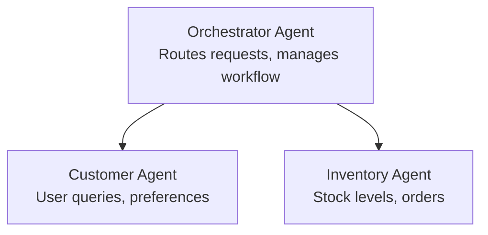

# ដីតាក់ទី 5៖ ដំណោះស្រាយ AI ជាច្រើនភាគី

**📚 មេរៀន**: [AZD សម្រាប់អ្នកចាប់ផ្តើម](../../README.md) | **⏱️ រយៈពេល**: 2-3 ម៉ោង | **⭐ ការលំបាក**: អក្ថរិយៈ

---

## ទិដ្ឋភាពទូទៅ

ដីតាក់នេះគ្របដណ្តប់លើលំនាំស្ថាបត្យកម្ម AI ជាច្រើនភាគីជាន់ខ្ពស់ ការប្រតិបត្តិការ​ភាគី និងការដាក់ប្រេត AI ស្រេចសម្រាប់សេណារីយ៉ូចម្រុះ។

> មេរៀនបញ្ជាដែលបានពិនិត្យលើការចេញផ្សាយឯកសារ `azd 1.37.2`។ ការដាក់ប្រេតក្នុងពពកមិនត្រូវបានអនុវត្តន៍។

## គោលបំណងសិក្សា

ដោយបញ្ចប់ដីតាក់នេះ អ្នកនឹង:
- យល់ដឹងពីលំនាំស្ថាបត្យកម្មលំនាំ AI ជាច្រើនភាគី
- ដាក់ប្រេតប្រព័ន្ធភាគី AI ដែលសម្របសម្រួលគ្នា
- អនុវត្តការទំនាក់ទំនងពីភាគីទៅភាគី
- បង្កើតដំណោះស្រាយ AI ជាច្រើនភាគីស្រេចសម្រាប់ផលិតកម្ម

---

## 📚 មេរៀន

| # | មេរៀន | ការពិពណ៌នា | ម៉ោង |
|---|--------|-------------|------|
| 1 | [មូលដ្ឋានជាច្រើនភាគី](multi-agent-basics.md) | អប់រំពីការដាក់ប្រេតកម្មវិធី AI ជាច្រើនភាគីដោយប្រើ `azd up` | 45 នាក់ |
| 2 | [លំនាំសម្របសម្រួល](../chapter-06-pre-deployment/coordination-patterns.md) |យុទ្ធសាស្ត្រប្រតិបត្តិការ​ភាគី (បន្តនៅ ដីតាក់ 6) | 30 នាក់ |
| 3 | [ការដាក់ប្រេតតាមគំរូ ARM](../../examples/retail-multiagent-arm-template/README.md) | ឧទាហរណ៍ការដាក់ប្រេតក្នុង១ចុច | 30 នាក់ |

> **ចាប់ផ្តើមជាមួយមេរៀនលេខ 1។** វាជាមេរៀនតែមួយដែលអាចធ្វើបានពេញលេញ និងអាចដាក់ប្រេតបាន។ មេរៀនលេខ 2 នៅក្នុងដីតាក់ 6 (ផ្នែកផែនការជាមុនដាក់ប្រេត) និងឯកសាររចនាស្ថាបត្យកម្ម [ដំណោះស្រាយ AI ជាច្រើនភាគីលើតំបន់លក់រាយ](../../examples/retail-scenario.md) គឺជាគំរូសម្រាប់រចនា មិនមែនជាគំរូពាក្យបញ្ជាដាក់ប្រេតតែមួយទេ។

---

## 🚀 ចាប់ផ្តើមយ៉ាងលឿន

```bash
# Option 1: Deploy the multi-agent template used in Lesson 1
azd init --template Azure-Samples/contoso-creative-writer .
azd up

# Option 2: Initialize a Foundry agent interactively with the GA bundle
azd ext install microsoft.foundry
azd ai agent init
azd up
```

> **ផ្លូវមួយណា?** ប្រើ `azd init --template` ដើម្បីចាប់ផ្តើមពីគំរូដែលមានស្រាប់។ ប្រើ `azd ai agent init` ក្នុងរបៀបអន្តរកម្ម ឬ `azd ai agent init --template <path-to-azure.yaml>` ដើម្បីយកគម្រោងភាគីបច្ចុប្បន្ន។ មើលឯកសារ [AZD AI CLI](../chapter-08-production/production-ai-practices.md#azd-ai-cli-commands-and-extensions) សម្រាប់តម្រូវការចំរូង និងការផ្លាស់ប្តូរកំណែ។

បើកដំណើរការជម្រើសទាំងនេះក្នុងថតដាច់ផ្សេងៗគ្នាដោយទទេ។ វិធីសាស្រ្ត GA Foundry ត្រូវការប្រើ `azd >= 1.37.0`; ដំណើរការអន្តរកម្មរបស់វាមិនបង្កើតបណ្តាញដំណើរការបុគ្គលិកក្នុងមេរៀនសម្របសម្រួលទេ។ សម្រាប់ការទូទាត់ក្នុងតំបន់ ការដាក់ប្រេតកូដ និងការសម្អាតគម្រោងថ្មីសំរាប់គម្រោងចាស់ សូមអនុវត្តណែនាំ [ដំណើរការអ្នកផ្ដល់សេវាកម្ម](../chapter-02-ai-development/microsoft-foundry-integration.md#hosted-agent-walkthrough-ga)។

---

## 🤖 ស្ថាបត្យកម្ម AI ជាច្រើនភាគី



---

## 🎯 ដំណោះស្រាយដ៏លេចធ្លោ៖ AI ជាច្រើនភាគីលើតំបន់លក់រាយ

វិធី​សា​ធា​រណៈ [ដំណោះស្រាយភ្នាក់ងារច្រើនក្នុងលក់រាយ](../../examples/retail-scenario.md) បង្ហាញ៖

- **ភ្នាក់ងារអតិថិជន**៖ គ្រប់គ្រងអន្តរកម្ម និងចំណង់ចំណូលចិត្តរបស់អ្នកប្រើ
- **ភ្នាក់ងារទំនិញ**៖ គ្រប់គ្រងស្តុក និងដំណើរការបញ្ជាទិញ
- **អ្នកដឹកនាំ**៖ សម្របសម្រួលរវាងភ្នាក់ងារ
- **ចងចាំរួម**៖ ការគ្រប់គ្រងបរិបទឆ្លងកាត់ភ្នាក់ងារ

### សេវាកម្មដែលបានប្រើ

| សេវា | គោលបំណង |
|---------|---------|
| Microsoft Foundry Models | ការយល់ដឹងភាសា |
| Azure AI Search | កាតាឡុកផលិតផល |
| Cosmos DB | ស្ថានភាពភ្នាក់ងារ និងចងចាំ |
| Container Apps | ការតាំងចំណតភ្នាក់ងារ |
| Application Insights | ការតាមដាន |

---

## 🔗 ការរុករក

| ទិសដៅ | ជំពូក |
|-----------|---------|
| **មុននេះ** | [ជំពូក 4: រចនាសម្ព័ន្ធ](../chapter-04-infrastructure/README.md) |
| **បន្ទាប់** | [ជំពូក 6: មុនការចេញផ្សាយ](../chapter-06-pre-deployment/README.md) |

---

## 📖 ឯកសារពាក់ព័ន្ធ

- [មគ្គុទ្ទេសក៍ភ្នាក់ងារបញ្ញាសិប្បនិម្មិត](../chapter-02-ai-development/agents.md)
- [ការអនុវត្តបញ្ញាសិប្បនិម្មិតក្នុងផលិតកម្ម](../chapter-08-production/production-ai-practices.md)
- [ការដោះស្រាយបញ្ហាបញ្ញាសិប្បនិម្មិត](../chapter-07-troubleshooting/ai-troubleshooting.md)

---

<!-- CO-OP TRANSLATOR DISCLAIMER START -->
**ការបដិសេធ**:
ឯកសារនេះត្រូវបានបម្លែងភាសា ដោយប្រើសេវាបម្លែងភាសា AI [Co-op Translator](https://github.com/Azure/co-op-translator)។ ទោះយើងខ្ញុំមានក្តីប្រាថ្នាឱ្យបានច្បាស់លាស់ តែសូមយល់ដឹងថាការបម្លែងដោយស្វ័យប្រវត្តិក៏អាចមានកំហុសឬភាពមិនត្រឹមត្រូវ។ ឯកសារដើមជាភាសាទីតាំងគួរត្រូវបានគេប្រើជាប្រភពច្បាស់លាស់។ សម្រាប់ព័ត៌មានសំខាន់ៗ សូមណែនាំឱ្យប្រើប្រាស់ការប្រែដោយមនុស្សជំនាញ។ យើងខ្ញុំមិនទទួលខុសត្រូវចំពោះការយល់ច្រឡំ ឬការបកស្រាយខុសបន្ទាប់ពីការប្រើប្រាស់ការបម្លែងនេះនោះទេ។
<!-- CO-OP TRANSLATOR DISCLAIMER END -->