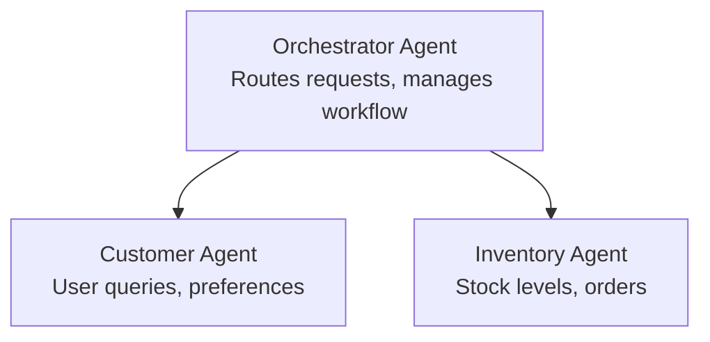

# បទទី 5៖ ដំណោះស្រាយ AI មនុស្សច្រើនភាគី

**📚 មេរៀន**: [AZD សម្រាប់ដំបូង](../../README.md) | **⏱️ រយៈពេល**: 2-3 ម៉ោង | **⭐ កម្រិតស្មុគស្មាញ**: ជំនាញខ្ពស់

---

## ទិដ្ឋភាពទូទៅ

បទនេះគ្របដណ្ដប់ពីរចនាសម្ព័ន្ធមនុស្សច្រើនភាគីដែលជំនាញខ្ពស់, ការត្រួតពិនិត្យភ្នាក់ងារ, និងការដាក់បញ្ចូល AI ស្រេចលក្ខណៈផលិតកម្មសម្រាប់ស្ថានភាពសំណុំបែបបទស្មុគស្មាញ។

> ការណែនាំបញ្ជាដែលបានពិនិត្យវិញប្រឆាំងនឹងគំរូយោង `azd 1.37.2` ដែលបានបញ្ចេញ។ ការដាក់បញ្ចូលពពកមិនបានអនុវត្តន៍ឡើយ។

## គោលបំណងការសិក្សា

ក្រោយពេលបញ្ចប់បទនេះ អ្នកនឹង:
- យល់ដឹងពីរចនាសម្ព័ន្ធមនុស្សច្រើនភាគី
- ដាក់បញ្ចូលប្រព័ន្ធភ្នាក់ងារ AI ដែលទាក់ទាញគ្នា
- គ្រប់គ្រងការទំនាក់ទំនងរវាងភ្នាក់ងារ
- បង្កើតដំណោះស្រាយមនុស្សច្រើនភាគីស្រេចលក្ខណៈផលិតកម្ម

---

## 📚 មេរៀន

| ល. | មេរៀន | ពិពណ៌នា | ល្បឿន ​ពេលវេលា |
|---|--------|-------------|------|
| 1 | [មូលដ្ឋានមនុស្សច្រើនភាគី](multi-agent-basics.md) | ចាប់ពីដៃ៖ ដាក់ប្រព័ន្ធមនុស្សច្រើនភាគីដែលដំណើរការជាមួយ `azd up` | 45 នាទី |
| 2 | [រចនាសម្ព័ន្ធការត្រួតពិនិត្យ](../chapter-06-pre-deployment/coordination-patterns.md) | ទ្រឹស្តីអភិបាលភ្នាក់ងារ (បន្តនៅក្នុងជំពូកទី 6) | 30 នាទី |
| 3 | [ការ​ដាក់បញ្ចូល ARM Template](../../examples/retail-multiagent-arm-template/README.md) | ឧទាហរណ៍ដាក់បញ្ចូលមួយចុច | 30 នាទី |

> **ចាប់ផ្តើមជាមួយមេរៀនទី 1។** វាជាមេរៀនដែលអនុវត្តដោយដៃសម្រាប់ដាក់បញ្ចូលបានប៉ុណ្ណោះនៅក្នុងជំពូកនេះ។ មេរៀនទី 2 មាននៅជំពូកទី 6 (ចែករំលែកជាមួយគម្រោងមានការត្រៀមការដាក់បញ្ចូល), និង [ដំណោះស្រាយមនុស្សច្រើនភាគីលក់រាយ](../../examples/retail-scenario.md) គឺជាគំរូរចនាសម្ព័ន្ធ—ជាការយោងរចនា មិនមែនជាគំរូបញ្ជា​មួយ​សម្រាប់បញ្ជា​តែមួយទេ។

---

## 🚀 ការចាប់ផ្តើមយ៉ាងឆាប់រហ័ស

```bash
# Option 1: Deploy the multi-agent template used in Lesson 1
azd init --template Azure-Samples/contoso-creative-writer .
azd up

# Option 2: Initialize a Foundry agent interactively (requires azure.ai.agents)
azd extension install azure.ai.agents
azd ai agent init
azd up
```

> **វិធីសាស្រ្តណា?** ប្រើ `azd init --template` ដើម្បីចាប់ផ្តើមពីគំរូដំណើរការមួយ។ ប្រើ `azd ai agent init` ដោយអន្តរកម្ម ឬ `azd ai agent init --template <path-to-azure.yaml>` ដើម្បីទទួលយកគម្រោងភ្នាក់ងារបច្ចុប្បន្ន។ មើល [AZD AI CLI reference](../chapter-08-production/production-ai-practices.md#azd-ai-cli-commands-and-extensions) សម្រាប់ទាមទារកំណែ និងការផ្លាស់ប្តូរវាយតម្លៃ។

សូមបញ្ជាលើជម្រើសទាំងនេះក្នុងថតទទេៗបំបែកគ្នា។ ដំណើរការព្រីសកម្មបន្ថែម `1.0.0-beta.23` ត្រូវការព្រីសកម្ម `azd >= 1.37.0`; ដំណើរអន្តរកម្មរបស់វាមិនបង្កើតបណ្តុំបន្ទាត់បេសកកម្ម Service Bus ផ្ទាល់ខ្លួននៅក្នុងមេរៀនការត្រួតពិនិត្យឡើយ។

---

## 🤖 រចនាសម្ព័ន្ធមនុស្សច្រើនភាគី



---

## 🎯 ដំណោះស្រាយល្បី៖ មនុស្សច្រើនភាគីលក់រាយ

ការសម្រង់ [ដំណោះស្រាយភ្នាក់ងារច្រើនក្នុងលក់រាយ](../../examples/retail-scenario.md) បង្ហាញពី៖

- **ភ្នាក់ងារអតិថិជន**: គ្រប់គ្រងការប្រាស្រ័យទាក់ទង និងចំណូលចិត្តរបស់អ្នកប្រើ
- **ភ្នាក់ងារស្តុក**: គ្រប់គ្រងស្តុក និងដំណើរការការបញ្ជាទិញ
- **អ្នកចាត់ការ**: សម្របសម្រួលរវាងភ្នាក់ងារ
- **អង្គចងចាំរួម**: គ្រប់គ្រងបរិបទឆ្លងភ្នាក់ងារ

### សេវាកម្មដែលបានប្រើ

| សេវាកម្ម | គោលបំណង |
|---------|---------|
| ម៉ូដែល Microsoft Foundry | ការយល់ភាសា |
| Azure AI Search | សេចក្ដីរាយការណ៍ផលិតផល |
| Cosmos DB | ស្ថានភាព និងអង្គចងចាំនៃភ្នាក់ងារ |
| Container Apps | ការផ្ដល់ជាតិភ្នាក់ងារ |
| Application Insights | ការតាមដាន |

---

## 🔗 ការរុករក

| ទិស | មេរៀន |
|-----------|---------|
| **មុន** | [មេរៀនទី 4៖ អគារដ្ឋាន](../chapter-04-infrastructure/README.md) |
| **បន្ទាប់** | [មេរៀនទី 6៖ មុនដំណើរការ](../chapter-06-pre-deployment/README.md) |

---

## 📖 ឯកសារដែលទាក់ទង

- [មគ្គុទ្ទេសក៍ភ្នាក់ងារ AI](../chapter-02-ai-development/agents.md)
- [ការអនុវត្ត AI ក្នុងផលិតកម្ម](../chapter-08-production/production-ai-practices.md)
- [ដំណោះស្រាយបញ្ហា AI](../chapter-07-troubleshooting/ai-troubleshooting.md)

---

<!-- CO-OP TRANSLATOR DISCLAIMER START -->
**ការបដិសេធ**:
ឯកសារនេះត្រូវបានបម្លែងភាសា ដោយប្រើសេវាបម្លែងភាសា AI [Co-op Translator](https://github.com/Azure/co-op-translator)។ ទោះយើងខ្ញុំមានក្តីប្រាថ្នាឱ្យបានច្បាស់លាស់ តែសូមយល់ដឹងថាការបម្លែងដោយស្វ័យប្រវត្តិក៏អាចមានកំហុសឬភាពមិនត្រឹមត្រូវ។ ឯកសារដើមជាភាសាទីតាំងគួរត្រូវបានគេប្រើជាប្រភពច្បាស់លាស់។ សម្រាប់ព័ត៌មានសំខាន់ៗ សូមណែនាំឱ្យប្រើប្រាស់ការប្រែដោយមនុស្សជំនាញ។ យើងខ្ញុំមិនទទួលខុសត្រូវចំពោះការយល់ច្រឡំ ឬការបកស្រាយខុសបន្ទាប់ពីការប្រើប្រាស់ការបម្លែងនេះនោះទេ។
<!-- CO-OP TRANSLATOR DISCLAIMER END -->