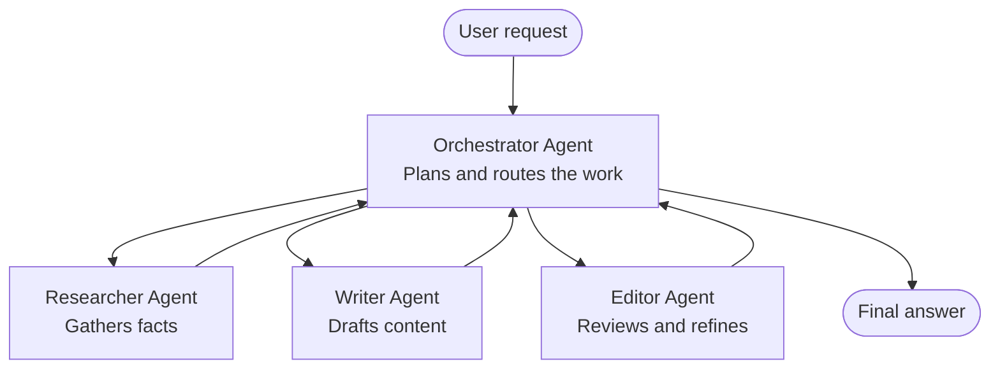

# មូលដ្ឋានអ្នកតំណាងច្រើន - ចេញផ្សាយប្រពន្ធ័ AI ដែលបានសម្របសម្រួលជាលើកដំបូងរបស់អ្នក

**ការរុករកជំពូក:**
- **📚 ផ្ទះសិក្សា**: [AZD សម្រាប់អ្នកចាប់ផ្តើម](../../README.md)
- **📖 ជំពូកបច្ចុប្បន្ន**: ជំពូក ៥ - ដំណោះស្រាយ AI អ្នកតំណាងច្រើន
- **⬅️ មុននេះ**: [ជំពូក ៤: ស្ថាបត្យកម្ម](../chapter-04-infrastructure/README.md)
- **➡️ បន្ទាប់**: [រចនាសម្ព័ន្ធសម្របសម្រួល](../chapter-06-pre-deployment/coordination-patterns.md)

> មគ្គុទ្ទេសក៍ពាក្យបញ្ជា ត្រូវបានពិនិត្យឡើងវិញប្រឆាំងនឹងឯកសារយោង `azd 1.37.2` ដែលបានចេញផ្សាយ។ ការចាក់បញ្ចូលក្នុងមេឃមិនត្រូវបានអនុវត្តឡើយ។

## ការណែនាំ

នៅក្នុងជំពូកមុន អ្នកបានចាក់បញ្ចូលកម្មវិធីតែមួយ—ហើយក្នុងជំពូក 2 អ្នកបានចាក់បញ្ចូលភ្នាក់ងារបញ្ញាសិប្បនិម្មិតតែមួយ។ មេរៀននេះយកជើងចាប់បន្ទាប់៖ ការចាក់បញ្ចូលប្រព័ន្ធភ្នាក់ងារពហុមនុស្សដែលភ្នាក់ងារបញ្ញាសិប្បនិម្មិតជាច្រើនដែលមានជំនាញពិសេសបំពេញការងារជាមួយគ្នាដើម្បីដោះស្រាយបញ្ហាមួយដែលភ្នាក់ងារតែមួយមិនអាចដោះស្រាយបានល្អដោយខ្លួនឯង។

ព័ត៌មានល្អសម្រាប់អ្នកចាប់ផ្តើម៖ **អ្នកមិនចាំបាច់ត្រូវការ ពាក្យបញ្ជាថ្មីទេ។** ដំណោះស្រាយ multi-agent នៅតែជាព្រឹត្តិការណ៍ azd មួយ។ អ្នកនឹង `azd init`, `azd up`, សាកល្បង ហើយ `azd down`—ជាការប្រព្រឹត្តិការណ៍ដែលអ្នកបានស្គាល់រួចហើយ។ អ្វីដែលផ្លាស់ប្តូរនោះគឺ *រាង* នៃកម្មវិធីនៅខាងក្នុង។

## គោលដៅការសិក្សា

នៅចុងបញ្ចប់មេរៀននេះ អ្នកនឹងអាច៖
- យល់ពីអត្ថន័យនៃ "multi-agent" ហើយពេលណាដែលវាគួរប្រើប្រាស់ដោយសារតែភាពស្មុគស្មាញបន្ថែម
- ស្គាល់តួនាទីទូទៅនៅក្នុងប្រព័ន្ធ multi-agent (orchestrator + ជំនាញវិជ្ជាជីវៈ)
- ចាត់តាំងវិចិត្រ multi-agent ដែលមានសុពលភាពជាមួយ `azd up`
- យល់ពីធនធាន Azure ដែលគាំទ្រកម្មវិធី multi-agent
- ស្គាល់វិធីធ្វើការផ្ទៀងផ្ទាត់ ប្តូរតាមតម្រូវការជាមួយការបញ្ចប់ដំណោះស្រាយយ៉ាងសុវត្ថិភាព

## លទ្ធផលការសិក្សា

បន្ទាប់ពីបញ្ចប់មេរៀននេះ អ្នកនឹងអាច៖
- ពន្យល់ពីភាពខុសគ្នារវាងភ្នាក់ងារតែមួយ និងប្រព័ន្ធ multi-agent
- ជ្រើសរើសរវាងភ្នាក់ងារតែមួយជាមួយឧបករណ៍ និងការរចនាមួយ multi-agent ពិតប្រាកដ
- ចាត់តាំងនិងសាកល្បងវិចិត្រ multi-agent ចប់ពីដំណើរការដោយ azd
- កំណត់កន្លែងដែលភ្នាក់ងារ កំពុងរត់ និងវិធីពួកគេទំនាក់ទំនង
- សម្អាតធនធានទាំងអស់ដើម្បីជៀសវាងការចំណាយបន្ត

---

## ប្រព័ន្ធ Multi-Agent គឺជាអ្វី?

ភ្នាក់ងារ AI មួយតែមួយ គឺជារូបមន្តមួយដែលមានសំណុំបញ្ជា និង (មិនបាច់មាន) ឧបករណ៍ខ្លះៗ។ វាដំណើរការល្អសម្រាប់ភារកិច្ចមួយដែលមានផ្ដោតលើ។ ប៉ុន្តែពេលការងារកើនឡើង—ស្រាវជ្រាវ បន្ទាប់មកសរសេរ បន្ទាប់មកកែសម្រួល បន្ទាប់មកពិនិត្យព័ត៌មាន—ការបញ្ចូលគ្រប់យ៉ាងទៅក្នុង prompt តែមួយ ធ្វើឲ្យភ្នាក់ងារដំណើរការអស់ម៉ោងជាង, មិនទៀងទាត់, និងពិបាកក្នុងការជួសជុលកំហុស។

ប្រព័ន្ធ **multi-agent** បំបែកការងារចែកជាចំណុចជួយវិជ្ជាជីវៈ ដែលនីមួយៗ ធ្វើការងារច្បាស់លាស់មួយ ក្នុងការតម្រូវដោយភ្នាក់ងារ orchestrator ៖



### តួនាទីពីរដែលអ្នកនឹងឃើញជានិច

| តួនាទី | ការងារ | ឧទាហរណ៍ |
|------|-----|---------|
| **Orchestrator** | សម្រេចថា *អ្វីទៅរៀងក្រោយ* ហើយបញ្ជូនការងាររវាងភ្នាក់ងារ | "ស្រាវជ្រាវរួច ក្រោយត្រូវសរសេរ ក្រោយត្រូវកែសម្រួល" |
| **ជំនាញវិជ្ជាជីវៈ** | ធ្វើការងារដែលមានផ្តោតចំនួនមួយ ហើយត្រឡប់លទ្ធផល | ជា "អ្នកស្រាវជ្រាវ" ដែលតែយកព័ត៌មាន |

### តើអ្នកត្រូវការភ្នាក់ងារច្រើនពិតទេ?

ចាប់ផ្តើមដោយសាមញ្ញ។ ប្រើប្រាស់ multi-agent **តែប៉ុន្មានពេល**មានមួយក្នុងចំណោមនេះ៖

- ✅ ការងារមាន **ជំពូកច្បាស់លាស់** ដែលទទួលបានអត្ថប្រយោជន៍ពីបញ្ជាផ្សេងគ្នា (ស្រាវជ្រាវ ប្រសិទ្ធប្រើសរសេរ ពិនិត្យពិចារណា)
- ✅ អ្នកចង់ឲ្យជំនាញវិជ្ជាជីវៈរត់ **ជាប្រភេទស្របតាមគ្នា** ដើម្បីបន្ថែមម៉ោងសម្រាក
- ✅ ជំហានផ្សេងគ្នាត្រូវការ **ឧបករណ៍ ឬប្រភពទិន្នន័យតាមគ្នា**
- ✅ អ្នកត្រូវការជំហាននីមួយៗ **អាចតេស្ដ និងដោះស្រាយកំហុសដោយឡែក**

ប្រសិនបើការងាររបស់អ្នកគឺសំណួរ និងចម្លើយតែមួយ ឬការហៅឧបករណ៍សាមញ្ញ មួយភ្នាក់ងារដែលមានឧបករណ៍ (ជាសៀវភៅទី 2) គឺសាមញ្ញ ជាប្រមូលគ្នា និងងាយស្រួលក្នុងការប្រើប្រាស់។

> **គន្លឹះសម្រាប់អ្នកចាប់ផ្តើម៖** "ភ្នាក់ងារច្រើន" មិនមែន "ល្អជាង"។ ភ្នាក់ងារនីមួយៗ បន្ថែមការពន្យាពេល ថ្លៃ និងរបស់ថ្មីដើម្បីតាមដាន។ បន្ថែមភ្នាក់ងារតែពេលដែលបញ្ហាច្បាស់លាស់ចែកជាផ្នែក។

---

## វិធីពីរដើម្បីសាងសង់ Multi-Agent លើ Azure

| វិធីសាស្ត្រ | អ្វីដែលវាជា | ចំណុចល្អសម្រាប់ |
|----------|-----------|----------|
| **ភ្នាក់ងារតែមួយ + ឧបករណ៍** | ភ្នាក់ងារ Foundry មួយដែលហៅប្រតិបត្តិការ/ឧបករណ៍ | ការងារសាមញ្ញចាប់ផ្តើមងាយ |
| **ភ្នាក់ងារជាច្រើនសំរាប់ការសម្របសម្រួល** | ភ្នាក់ងារជាច្រើន មាន orchestrator | ជំពូកច្បាស់ ចំណុចស្របតាមគ្នា ផ្តោតការងារស្រេច |

មេរៀននេះផ្តោតលើវិធីទីពីរដោយប្រើ **វិចិត្រប្រើប្រាស់រួច** ដើម្បីឲ្យអ្នកឃើញប្រព័ន្ធ multi-agent ជាក់ស្តែងកំពុងរត់ មុនពេលអ្នកសាងសង់ផ្ទាល់។

---

## អនុវត្ត៖ ចាត់តាំងកម្មវិធី Multi-Agent ដំណើរការ

យើងនឹងចាត់តាំង **Contoso Creative Writer** គំរូផ្លូវការរបស់ Azure ដែលសម្របសម្រួលអ្នកស្រាវជ្រាវ ផលិតផល សរសេរ និងកែសម្រួល ដើម្បីផលិតអត្ថបទមួយ។ មុនពេលបន្តសូមពិនិត្យ [លក្ខខណ្ឌរួច​រាល់ និងថ្លៃកូស](https://github.com/Azure-Samples/contoso-creative-writer#azure-account-requirements)៖ វាត្រូវការ model quota, Azure AI Search, ការចូលប្រើ Bing Grounding, Python, Docker និង hooks ដែលគាំទ្រ bash។ ស្ទង់មើល availability ម៉ូដែល និងតំបន់ ញែកតាមការជាវរបស់អ្នក; ការចាត់តាំងមិនបានធានា ដោយជ្រើសតំបន់ជាក់លាក់ទេ។

### ជំហាន ១៖ បើក template

```bash
# Create a working folder
mkdir creative-writer && cd creative-writer

# Initialize from the official multi-agent template
azd init --template Azure-Samples/contoso-creative-writer .
```

> រុករកលាក់ multi-agent templates លើកលែងពេលណាក៏ដោយនៅក្នុង [Awesome AZD AI gallery](https://azure.github.io/awesome-azd/?tags=ai)។ ជម្រើសសាមញ្ញសម្រាប់អ្នកចាប់ផ្តើមរួមមាន `get-started-with-ai-agents` និង `azure-ai-travel-agents`។

### ជំហាន ២៖ ធ្វើការផ្ទៀងផ្ទាត់

```bash
# Required for azd workflows
azd auth login

# Also required by this sample's Azure CLI hooks
az login
```

### ជំហាន ៣៖ ពិនិត្យបរិយាកាស

```bash
# init normally creates/selects an environment; confirm it before proceeding
azd env list
# Only if you need an additional environment:
# azd env new dev
```

### ជំហាន ៤៖ មើលមុន បន្ទាប់ចាត់តាំង

```bash
# See what will be created before spending anything (recommended)
azd provision --preview

# Provision infrastructure and deploy all agents in one step
azd up
```

`azd up` នឹងស្នើសុំការកំណត់ subscription និងតំបន់ដែលនៅខ្វះ បន្ទាប់មកបានចុះបញ្ជីធនធាន និងចាត់តាំងកម្មវិធី។ ការមើលមុនមិនបានរក្សាទុក quota ឬធានាជោគជ័យទេ; hooks នៅក្នុង template ក៏អាចរត់នៅពេលមើលមុនការចាត់តាំង ដូច្នេះត្រូវពិនិត្យវាមុន។ ដើម្បីបន្ថែមរយៈពេលដែល azd រងចាំសម្រាប់ **ការចាត់តាំងសេវាកម្ម** (មិនមែនការចុះបញ្ជីម៉ូដែល):

```bash
azd deploy --timeout 1800
```

ការត្រូវពេលវេលាកំណត់បញ្ឈប់ការរងចាំ; វាមិនបោះបង់ការចាត់តាំងនៅ Azure ទេ។ សូមពិនិត្យស្ថានភាពធនធាន មុនពេលព្យាយាមម្តងទៀត។

> **សម្គាល់អំពីថ្លៃ និងសមត្ថភាព:** កម្មវិធី multi-agent ចាត់តាំងម៉ូដែល AI ដែលប្រើ quota និងបង្កថ្លៃ។ ប្រសិនបើ `azd up` បរាជ័យដោយ quota ម៉ូដែល សូមមើល [AI Troubleshooting](../chapter-07-troubleshooting/ai-troubleshooting.md) សម្រាប់ការជួសជុលតំបន់ និង quota ហើយសៀវភៅទី ៦ [Capacity Planning](../chapter-06-pre-deployment/capacity-planning.md)។

---

## យល់ដឹងអំពីអ្វីដែលអ្នកបានចាត់តាំង

កម្មវិធី multi-agent ដែលធម្មតា ដូចនេះ បង្កើតសំណុំធនធាន Azure ដែលផ្ទៀងផ្ទាត់ជាមួយភារកិច្ចឱ្យដូចក្នុងរូបថតខាងលើ៖

| ធនធាន | ហេតុផលមានវា |
|----------|----------------|
| **Microsoft Foundry / Models** | តំណាងម៉ូដែលភាសាដែលភ្នាក់ងារ kutumia |
| **Azure AI Search** | ផ្តល់ទិន្នន័យគាំទ្រ អ្នកស្រាវជ្រាវអាចស្វែងរក |
| **Container Apps** (ឬ App Service) | តំណាងអ្នករចនា និងកូដភ្នាក់ងារ |
| **Cosmos DB** (នៅក្នុងខ្លះ) | រក្សាទុកស្ថានភាពចងក្រង/អនុស្សាវរីយ៍ប្តូរពីរភ្នាក់ងារ |
| **Application Insights** | តាមដានសំណើរ *ពហុ* ភ្នាក់ងារ ដើម្បីអាចជួសជុលកំហុស |

### ដូចម្តេចដែលភ្នាក់ងារបន្តិយោគជាមួយគ្នា

ក្នុងគំរូ azd ធ្វើ multi-agent ច្រើនភាគ ចំណោមនេះ, **orchestrator រត់ក្នុងកូដកម្មវិធីរបស់អ្នក** (ឧទាហរណ៍ ដោយប្រើ frameworks Semantic Kernel ឬ Microsoft Agent Framework)។ Orchestrator ហៅភ្នាក់ងារជំនាញវិជ្ជាជីវៈម្នាក់ៗ ជាប់គ្នា ផ្តល់លទ្ធផល ហើយប្រមូលចម្លើយចុងក្រោយ។ ភ្នាក់ងារចែករំលែក context តាមរយៈ៖

- **ហៅគោលបំណង/ឧបករណ៍** — orchestrator ហៅឯកជំនាញវិជ្ជាជីវៈ និងទទួលលទ្ធផល
- **អនុស្សាវរីយ៍រួម** — មូលដ្ឋានទិន្នន័យ (ភាគច្រើន Cosmos DB) រក្សាស្ថានភាពដែលភ្នាក់ងាររួមអាចអានបាន
- **សារ/ព្រឹត្តិការណ៍** — ដើម្បីទំនាក់ទំនងខ្សោយជាងនេះ, ភ្នាក់ងារទំនាក់ទំនងតាម queue ឬ Service Bus

> **ហេតុអ្វីវាជាអ្វីដែលមានអត្ថន័យសម្រាប់ការជួសជុលកំហុស:** ដោយសារជំហាននីមួយៗបន្សំឡែកออก, Application Insights បង្ហាញអ្នក​ថា *ភ្នាក់ងារណាដែល* យឺត ឬបរាជ័យ។ នេះជាហេតុផលធំមួយក្នុងការបំបែកការងារជារវាងភ្នាក់ងារ។

---

## ផ្ទៀងផ្ទាត់ការចាត់តាំង

បញ្ជាក់ប្រព័ន្ធមានប្រសិទ្ធភាព មុនពេលបន្តទៅមុខ៖

```bash
# Show the deployed endpoints
azd show

# Open the app's monitoring dashboard
azd monitor

# Open Application Insights Logs (not a terminal log stream)
azd monitor --logs
```

បន្ទាប់មកបើក url កម្មវិធី ពី `azd show` ហើយស្នើអត្ថបទខ្លីមួយ។ ប្រើវិចិត្រការបញ្ចៀសកំហុសរបស់គំរូ ដើម្បីពិនិត្យបែបផែនដំណើរការភ្នាក់ងារ។ ការស្វែងរកប្រតិបត្តិការ Application Insights មានន័យបង្ហាញជំហានតែមួយ ប្រសិនបើគំរូនោះបានដាក់បញ្ចូល និងភ្ជាប់វា; azd មិនបន្ថែម agent spans ស្វ័យប្រវត្តិទេ។

**លក្ខខណ្ឌជោគជ័យ៖**
- ✅ `azd show` បញ្ជីនឹងចំពោះអ្នកដែលអាចទំនាក់ទំនងបាន
- ✅ សំណើបានផលិតលទ្ធផលដែលច្បាស់លាស់ថាត្រូវបានដំណើរការ ក្រោមជំុភាគផ្សេងៗ
- ✅ មើលការបញ្ចៀសកំហុសបង្ហាញជំហានជាច្រើនរបស់ភ្នាក់ងារ; ប្រសិនបើបានបើកពិនិត្យ ហើយផ្ទៀងផ្ទាត់ telemetry ត្រូវគ្នាបន្ទាប់ពីទទួលបាន

---

## ប្ដូរផ្ទាល់ខ្លួន៖ បន្ថែម ឬកែប្រែភ្នាក់ងារ

ដោយសារភ្នាក់ងារជាទូទៅគ្រាន់តែបញ្ជា និងឧបករណ៍ ប្ដូរផ្ទាល់ខ្លួនគឺងាយស្រួល៖

1. **ស្វែងរកនិយមន័យភ្នាក់ងារ** ក្នុងទាំងមួយទំរង់ (ជាច្រើនជាទូទៅ `prompts/`, `agents/`, ឬ `*.prompty` សំណុំឯកសារ)។
2. **កំណត់ការណែនាំរបស់ភ្នាក់ងារ** — ឧទាហរណ៍ អាចប្រាប់ភ្នាក់ងារកម្មវិធីកែសម្រួលឲ្យអនុវត្តសំឡេងឬចំនួនពាក្យជាក់លាក់។
3. **បញ្ចូនកូដឡើងវិញតែកូដប៉ុណ្ណោះ** (រចនាសម្ព័ន្ធមិនបានផ្លាស់ប្តូរ):

   ```bash
   azd deploy
   ```

ដើម្បីបន្តជម្រាបជាមួយគម្រោងភ្នាក់ងារ Foundry *ផ្ទាល់ខ្លួន* អ្នកអាចប្រើការចាប់ផ្តើមអន្តរកម្មនៃបន្ថែមភ្នាក់ងារនេះ៖

```bash
azd extension install azure.ai.agents
azd ai agent init
azd up
azd ai agent invoke      # test, with response timing
```

មើលដែល [ជំពូក 2៖ ភ្នាក់ងារ](../chapter-02-ai-development/agents.md) និង [យោង AZD AI CLI](../chapter-08-production/production-ai-practices.md#azd-ai-cli-commands-and-extensions) សម្រាប់ជីវចលពេញលេញ៖ ភ្នាក់ងារ `invoke`, បន្ថែមការវាយតម្លៃបំបែក `azd ai eval`, ភ្នាក់ងារ `optimize` និង ភ្នាក់ងារ `delete`។

---

## សម្អាត

កម្មវិធីភ្នាក់ងារច្រើនដំណើរការបម្រើការបង់ប្រាក់ជាច្រើន។ សូមបំផ្លាញវាទាំងអស់ខណៈដែលអ្នកបានបញ្ចប់៖

```bash
# Review the resources and confirm deletion interactively
azd down
```

ការលុបបង្ហាញពីសកម្មភាពបំផ្លាញ។ សម្រាប់មន្ទីរពិសោធន៍ដែលអាចបង្ហាញជាលើកដំបូង, `azd down --force --purge` លោតបញ្ហាលុបបាត់ និងការបញ្ជាក់សម្រាប់ការលុបទន់; ការលុបបាត់គឺមិនអាចត្រលប់បាននៅពេលដែលគាំទ្រ ហើយអាចត្រូវបានរារាំងដោយការការពារ. ការលុបបាត់ទន់គឺជាបញ្ហារក្សាទុកឬប្រើឈ្មោះឡើងវិញ មិនមែនជាសាក្សីនៃការចំណាយបន្តទេ។ សូមពិនិត្យធនធានដែលនៅសល់ និងការបង់ប្រាក់បន្ទាប់ពីសម្អាត។

---

## សំគាល់អំពីប្រព័ន្ធភ្នាក់ងារច្រើនក្នុងការផលិត

ដំណោះស្រាយ [Retail Multi-Agent Solution](../../examples/retail-scenario.md) ក្នុង repo នេះគឺជាគំនូសស្ថាបតិកម្មមួយ **architecture blueprint**, មិនមែនគំរូបញ្ជា១ពាក្យ command ទេ—វាកត់ត្រាពីរបៀបដែលប្រព័ន្ធលក់រាយផលិតកម្ម *អាច*​ត្រូវបានសាងសង់ (ហើយបានបញ្ជាក់ថាការសាងសង់ពេញលេញត្រូវការខិតខំយ៉ាងច្រើន)។ ប្រើវាជាយោងរចនាសម្ព័ន្ធ *បន្ទាប់ពី* អ្នកបានដាក់ចេញ ឧទាហរណ៍ដែលដំណើរការបាន នៅទីនេះ។ សម្រាប់បញ្ហាផលិតកម្ម (ភាពធន់ទ្រាំ, ថ្លៃដើម, ការត្រួតពិនិត្យ, ពיקាណិការណ៍), ធ្វើយន្តការបន្តទៅ [ជំពូក 8: លំនាំអាជីពប្រាក់ចំណេញ AI](../chapter-08-production/production-ai-practices.md)។

---

## សេចក្ដីសង្ខេប

- ប្រព័ន្ធ multi-agent ចែកចំណែកការងារជាទៅសាខា ដែលបាន التنៃប្រព័ន្ធតំណាងដោយ orchestrator។
- ប្រើវា តែបើបេសកកម្មមានដំណាក់កាលច្បាស់លាស់, ភាពដកម្មស្របគ្នា, ឬឧបករណ៍ផ្សេងៗក្នុងជំហាននីមួយៗ—មិនដូច្នេះទេ ថើប agent តែមួយគត់គឺល្អជាង។
- វិធីសាស្រ្ត azd មិនបានផ្លាស់ប្ដូរ៖ `azd init` → `azd up` → test → `azd down`។
- គំរូពិតដូចជា `contoso-creative-writer` អនុញ្ញាតឲ្យអ្នកមើល និងប្ដូរតម្រូវកម្មវិធី multi-agent ដំណើរការបានថ្ងៃនេះ។
- ការតាមដាន Application Insights ជាស្នូលសំខាន់មួយនៃគុណសម្បត្តិការរចនាជាច្រើន agent។

---

## 🔗 បញ្ជីសម្រាប់រៀបចំ

| ទិស | មេរៀន |
|-----------|--------|
| **មុន** | [ជំពូក ៤៖ សម្ព័ន្ធម្រាម](../chapter-04-infrastructure/README.md) |
| **បន្ទាប់** | [លំនាំសម្របសម្រួល](../chapter-06-pre-deployment/coordination-patterns.md) |

## 📖 ឯកសារមានទំនាក់ទំនង

- [មគ្គុទេសក៍ភ្នាក់ងារបច្ចេកវិទ្យា AI](../chapter-02-ai-development/agents.md)
- [លំនាំសម្របសម្រួល](../chapter-06-pre-deployment/coordination-patterns.md)
- [អនុវត្តន៏បច្ចេកវិទ្យា AI ផលិតកម្ម](../chapter-08-production/production-ai-practices.md)
- [ការដោះស្រាយបញ្ហាបច្ចេកវិទ្យា AI](../chapter-07-troubleshooting/ai-troubleshooting.md)

---

<!-- CO-OP TRANSLATOR DISCLAIMER START -->
**ការបដិសេធ**:
ឯកសារនេះត្រូវបានបម្លែងភាសា ដោយប្រើសេវាបម្លែងភាសា AI [Co-op Translator](https://github.com/Azure/co-op-translator)។ ទោះយើងខ្ញុំមានក្តីប្រាថ្នាឱ្យបានច្បាស់លាស់ តែសូមយល់ដឹងថាការបម្លែងដោយស្វ័យប្រវត្តិក៏អាចមានកំហុសឬភាពមិនត្រឹមត្រូវ។ ឯកសារដើមជាភាសាទីតាំងគួរត្រូវបានគេប្រើជាប្រភពច្បាស់លាស់។ សម្រាប់ព័ត៌មានសំខាន់ៗ សូមណែនាំឱ្យប្រើប្រាស់ការប្រែដោយមនុស្សជំនាញ។ យើងខ្ញុំមិនទទួលខុសត្រូវចំពោះការយល់ច្រឡំ ឬការបកស្រាយខុសបន្ទាប់ពីការប្រើប្រាស់ការបម្លែងនេះនោះទេ។
<!-- CO-OP TRANSLATOR DISCLAIMER END -->