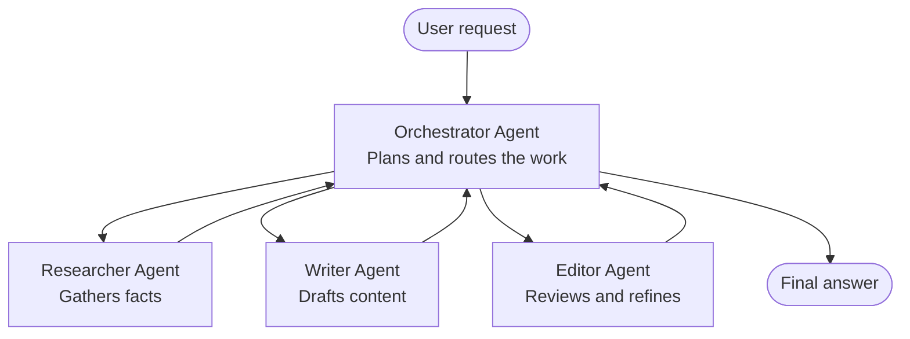

# មូលដ្ឋានអេហ្សិច មនុស្សជាច្រើន - បញ្ចេញប្រព័ន្ធ AI សម្របសម្រួលជាលើកដំបូងរបស់អ្នក

**ការនាវីហ្គេតជំពូក៖**
- **📚 ទំព័រដើមវគ្គសិក្សា**: [AZD សម្រាប់អ្នកថ្មី](../../README.md)
- **📖 ជំពូកបច្ចុប្បន្ន**: ជំពូក ៥ - ដំណោះស្រាយ AI មនុស្សជាច្រើន
- **⬅️ មុននេះ**: [ជំពូក ៤៖ គ្រឹះសេដ្ឋកិច្ច](../chapter-04-infrastructure/README.md)
- **➡️ បន្ទាប់**: [លំនាំសម្របសម្រួល](../chapter-06-pre-deployment/coordination-patterns.md)

> ការណែនាំពាក្យបញ្ជាត្រូវបានពិនិត្យឡើងវិញទាក់ទងនឹងឯកសាររបស់ `azd 1.37.2` ដែលបានចេញផ្សាយ។ ការបញ្ចេញ​​ទៅមេឃមិនត្រូវបានអនុវត្ត។

## ការណែនាំ

ក្នុងជំពូកមុន អ្នកបានបញ្ចេញកម្មវិធីតែមួយ—ហើយនៅជំពូក ២ អ្នកបានបញ្ចេញភ្នាក់ងារ AI តែមួយ។ មេរៀននេះនាំអ្នកទៅជំហានបន្ទាប់៖ បញ្ចេញប្រព័ន្ធ **មនុស្សជាច្រើន**, ដែលភ្នាក់ងារការពិសេសច្រើនបម្រើការងារជាមួយគ្នាដើម្បីដោះស្រាយបញ្ហាមួយដែលភ្នាក់ងារតែមួយមិនអាចដោះស្រាយបានល្អដោយខ្លួនឯង។

ព័ត៌មានល្អសម្រាប់អ្នកថ្មី: **អ្នកមិនចាំបាច់ប្រើពាក្យបញ្ជាថ្មីទេ។** ដំណោះស្រាយមនុស្សជាច្រើននៅតែជាគម្រោង azd។ អ្នកនឹង `azd init`, `azd up`, សាកល្បង, និង `azd down`- ជាមុខងារដដែលដែលអ្នកបានស្គាល់រួច។ អ្វីដែលផ្លាស់ប្តូរនោះគឺ *បែបកំណាត់* របស់កម្មវិធីនៅខាងក្នុង។

## គោលបំណងការសិក្សា

នៅចុងបញ្ចប់មេរៀននេះ អ្នកនឹងអាច៖
- យល់ថា "មនុស្សជាច្រើន" មានអ្វីខ្លះ និងពេលណាដែលវាជាការគួរឱ្យអនុវត្តបន្ថែមភាពស្មុគស្មាញ
- ស្គាល់តួនាទីទូទៅនៅក្នុងប្រព័ន្ធមនុស្សជាច្រើន (អ្នកសម្របសម្រួល + អ្នកជំនាញ)
- បញ្ចេញគំរូមនុស្សជាច្រើនដែលប្រើបានជាក់ស្តែងជាមួយ `azd up`
- យល់ពីធនធាន Azure ដែលគាំទ្រកម្មវិធីមនុស្សជាច្រើន
- ស្គាល់របៀបពិនិត្យ ប្ដូរតាមតម្រូវការ និងរំលាយដំណោះស្រាយយ៉ាងปลอดภัย

## លទ្ធផលការសិក្សា

បន្ទាប់ពីបញ្ចប់មេរៀននេះ អ្នកនឹងអាច៖
- បកស្រាយភាពខុសគ្នារវាងភ្នាក់ងារតែមួយ និងប្រព័ន្ធមនុស្សជាច្រើន
- ជ្រើសរើសរវាងភ្នាក់ងារតែមួយដែលមានឧបករណ៍ និងរចនាសម្ព័ន្ធមនុស្សជាច្រើនពិតប្រាកដ
- បញ្ចេញ និងសាកល្បងគំរូមនុស្សជាច្រើនពីដើមដល់ចុងជាមួយ azd
- កំណត់ទីតាំងដំណើរការរបស់ភ្នាក់ងារ និងរបៀបពួកគេសំរាសំរាសគ្នា
- សម្អាតធនធានទាំងអស់ដើម្បីបន្ថយការចំណាយដែលបន្តរៀងរាល់ខែ

---

## តើអ្វីទៅជា ប្រព័ន្ធមនុស្សជាច្រើន?

ភ្នាក់ងារ AI តែមួយជាម៉ូដែលមួយមានសំណុំធ្វើតាម និង (ជាប្រសិនបើចាំបាច់) ឧបករណ៍ខ្លះៗ។ វាដំណើរការល្អសម្រាប់កិច្ចការផ្តោតលើតែមួយ។ ប៉ុន្តែពេលកិច្ចការកើនឡើង—ស្រាវជ្រាវ បន្ទាប់មកសរសេរ បន្ទាប់មកកែសម្រួល បន្ទាប់មកពិនិត្យព័ត៌មាន—ការបញ្ចូលអ្វីៗទាំងអស់ទៅក្នុងបញ្ជាเดียวធ្វើឲ្យភ្នាក់ងារប្រតិបត្តិការប្រញាប់ពេលយឺត ធ្វើការតិច និងពិបាកក្នុងការពិនិត្យបញ្ហា។

ប្រព័ន្ធ **មនុស្សជាច្រើន** បែងចែកការងារជាភ្នាក់ងារជំនាញដែលបម្រើការងារតែមួយបានល្អ ត្រូវបានចងក្រងដោយអ្នកសម្របសម្រួល៖



### តួនាទីពីរដែលអ្នកនឹងឃើញជានិច្ច

| តួនាទី | ការងារ | ឧទាហរណ៍ |
|------|-----|---------|
| **អ្នកសម្របសម្រួល** | សម្រេចចិត្ត *អ្វីដែលនឹងកើតមានបន្ទាប់* និងចែកចាយការងារវិញ្ញាសារវាងភ្នាក់ងារ | "ស្រាវជ្រាវជាមុន បន្ទាប់សរសេរ បន្ទាប់កែសម្រួល" |
| **អ្នកជំនាញ** | បម្រើការងារផ្តោតលើតែមួយ ហើយបង្វិលលទ្ធផលត្រឡប់ | "អ្នកស្រាវជ្រាវ" ដែលផ្ដោតស្រាវជ្រាវតែព័ត៌មាន |

### តើអ្នកត្រូវការភ្នាក់ងារជាច្រើនពិតមែនទេ?

ចាប់ផ្តើមពីភាពសាមញ្ញ។ ប្រើមនុស្សជាច្រើន **តែប៉ុណ្ណោះ** នៅពេលណាមួយក្នុងចំណោមនេះពិត៖

- ✅ កិច្ចការមាន **ជំហានបំផុតៗ** ដែលបានអត្ថប្រយោជន៍ពីការណែនាំផ្សេងគ្នា (ស្រាវជ្រាវ បន្ទាប់សរសេរ បន្ទាប់ពិនិត្យឡើងវិញ)
- ✅ អ្នកចង់ឲ្យអ្នកជំនាញដំណើរការជា **សមាមាត្រ** ដើម្បីជៀសវាងការចំណាយពេល
- ✅ ជំហានខុសៗគ្នាត្រូវការឧបករណ៍ ឬប្រភពទិន្នន័យ **ខុសគ្នា**
- ✅ អ្នកត្រូវការជំហាននីមួយៗអាច **ត្រូវបានសាកល្បង និងពិនិត្យបញ្ហាដាច់ដោយឡែក**

ប្រសិនបើកិច្ចការរបស់អ្នកជាសំណួរមួយនិងការឆ្លើយតែតែមួយ ឬការហៅឧបករណ៍សាមញ្ញមួយ, ភ្នាក់ងារតែមួយដែលមានឧបករណ៍ (ជំពូក ២) គឺសាមញ្ញជាង សម្រួលថ្លៃដើម និងងាយស្រួលប្រើ។

> **ក្បួនសម្រាប់អ្នកថ្មី៖** "ភ្នាក់ងារច្រើន" មិនមែន "ល្អជាង" ទេ។ រាល់ភ្នាក់ងារមានភាពយឺតថយ តម្លៃ និងរឿងថ្មីមួយដែលត្រូវតាមដាន។ បន្ថែមភ្នាក់ងារតែពេលបញ្ហាក្នុងច្បាស់បំបែកជាផ្នែក។

---

## របៀបពីរសម្រាប់បង្កើតមនុស្សជាច្រើនលើ Azure

| វិធីសាស្រ្ត | វាជាអ្វី | សម្រាប់អ្វីល្អបំផុត |
|----------|-----------|----------|
| **ភ្នាក់ងារតែមួយ + ឧបករណ៍** | ភ្នាក់ងារ Foundry តែមួយហៅមុខងារ/ឧបករណ៍ | របៀបធ្វើការងារសាមញ្ញ ចាប់ផ្តើមងាយ |
| **ភ្នាក់ងារជាច្រើនសម្របសម្រួល** | ភ្នាក់ងារជាច្រើនដែលមានអ្នកសម្របសម្រួល | ជំហានបំផុត សកម្មភាពសមាមាត្រ ការបំពាក់ទំនើប |

មេរៀននេះផ្ដោតលើវិធីសាស្រ្តទីពីរដោយប្រើ **គំរូដែលបានរៀបចំរួច**, ដើម្បីឲ្យអ្នកអាចមើលឃើញប្រព័ន្ធមនុស្សជាច្រើនដំណើរការពិត មុនពេលអ្នកបង្កើតរបស់អ្នកឯង។

---

## ដៃលើផ្ទាល់៖ បញ្ចេញកម្មវិធីមនុស្សជាច្រើនដែលដំណើរការ

យើងនឹងបញ្ចេញ **អ្នកនិពន្ធបង្កើតផ្នែក Contoso**, គំរូផ្លូវការផ្នែក Azure ដែលសម្របសម្រួលអ្នកស្រាវជ្រាវ ផលិតផល សរសេរ និងអ្នកកែសម្រួល ដើម្បីផលិតអត្ថបទមួយ។ មុនពេលចាប់ផ្តើម សូមពិនិត្យ [លក្ខខណ្ឌមុននិងការចំណាយនៃគំរូ](https://github.com/Azure-Samples/contoso-creative-writer#azure-account-requirements): វាត្រូវការចំនួនម៉ូដែល ស្វែងរក Azure AI, ការចូលប្រើ Bing Grounding, Python, Docker, និង hook ដែលគាំទ្ររបៀប Bash។ ការចូលប្រើម៉ូដែល និងតំបន់អាស្រ័យលើយូនិសប្ស្រុសិនរបស់អ្នក; ការបញ្ចេញមិនបានធានាជាក់លាក់ទេដោយជ្រើសរើសតំបន់ណាមួយ។

### ជំហាន ១៖ ចាប់ផ្តើមគំរូ

```bash
# Create a working folder
mkdir creative-writer && cd creative-writer

# Initialize from the official multi-agent template
azd init --template Azure-Samples/contoso-creative-writer .
```

> ស្វែងរកគំរូមនុស្សជាច្រើនបន្ថែមគ្រប់ពេលនៅក្នុង [សារមន្ទីរ AZD AI ពិរោះប្រាកដ](https://azure.github.io/awesome-azd/?tags=ai) ជម្រើសសម្រាប់អ្នកថ្មីផ្សេងទៀតរួមមាន `get-started-with-ai-agents` និង `azure-ai-travel-agents`។

### ជំហាន ២៖ Authenticate

```bash
# Required for azd workflows
azd auth login

# Also required by this sample's Azure CLI hooks
az login
```

### ជំហាន ៣៖ ពិនិត្យបរិយាកាស

```bash
# init normally creates/selects an environment; confirm it before proceeding
azd env list
# Only if you need an additional environment:
# azd env new dev
```

### ជំហាន ៤៖ ពិនិត្យមើលរួចបញ្ចេញ

```bash
# See what will be created before spending anything (recommended)
azd provision --preview

# Provision infrastructure and deploy all agents in one step
azd up
```

`azd up` នឹងស្នើសុំការកំណត់ជាវ និងតំបន់ខ្វះ និងបន្ទាប់មកផ្ដល់ធនធាន និងដាក់កម្មវិធី។ ការមើល 미ុនមិនបានកក់កន្លែងឬធានាជោគជ័យទេ; អាចមានខ្សែមុឺនគម្រោងរត់នៅពេលមើល 미ុនផ្តល់ធនធាន ប៉ុន្តែ សូមពិនិត្យមើលមុន។ ដើម្បីពង្រីករយៈពេលដែល azd រង់ចាំសម្រាប់ **ការដាក់សេវាកម្ម** (មិនមែនការផ្គត់ផ្គង់ម៉ូដែល):

```bash
azd deploy --timeout 1800
```

ការដាច់ពេលវេលាដោះស្រាយ azd មិនរង់ចាំទៀតទេ; វាមិនបោះបង់ការដាក់នៅក្នុង Azure ឡើយ។ សូមពិនិត្យស្ថានភាពធនធានមុនពេលសាកល្បងម្ដងទៀត។

> **ជាប់ចិត្តលើការចំណាយ និងសមត្ថភាព៖** កម្មវិធីពហុភ្នាក់ងារចាក់បញ្ចូលម៉ូដែល AI ដែលប្រើប្រាស់កំណត់ quota និងបណ្តាលឱ្យមានការចំណាយ។ ប្រសិនបើ `azd up` បរាជ័យនៅ quota ម៉ូដែល សូមមើល [ការដោះស្រាយ AI](../chapter-07-troubleshooting/ai-troubleshooting.md) សម្រាប់ការជួសជុលតំបន់ និង quota និងជំពូក 6 [ផែនការសមត្ថភាព](../chapter-06-pre-deployment/capacity-planning.md)។

---

## យល់ដឹងអំពីអ្វីដែលអ្នកបានដាក់

កម្មវិធីពហុភ្នាក់ងារធម្មតាដូចនេះផ្ដល់ធនធាន Azure មួយចំនួនដែលផ្គូផ្គងដោយផ្ទាល់ទៅនឹងភារកិច្ចនៅក្នុងគំនូរផ្ទាំងខាងលើ៖

| ធនធាន | មូលហេតុដែលវានៅទីនោះ |
|----------|----------------|
| **Microsoft Foundry / Models** | ផ្ដល់ម៉ូដែលភាសាតែលោកបណ្ឌិតប្រើប្រាស់ |
| **Azure AI Search** | ផ្ដល់ទិន្នន័យដែលមានមូលដ្ឋានឱ្យភ្នាក់ងារស្រាវជ្រាវស្វែងរក |
| **Container Apps** (ឬ App Service) | ផ្ដល់កូដអ្នកបញ្ជាឱ្យនិងភ្នាក់ងារ |
| **Cosmos DB** (នៅខ្លះប្រភេទ) | ទុកស្ថានភាព/អង្គចងចាំដែលចែករំលែករវាងភ្នាក់ងារ |
| **Application Insights** | តាមដានសំណើរ *អោយហ្នឹង* ភ្នាក់ងារ ដើម្បីឱ្យអ្នកអាចពិនិត្យបញ្ហាបាន |

### របៀបដែលភ្នាក់ងារនិយាយគ្នាទៅ

នៅក្នុងគំរូ azd ពហុភ្នាក់ងារ ភ្នាក់ងារបញ្ជាដំណើរការនៅក្នុងកូដកម្មវិធីរបស់អ្នក (ឧទាហរណ៍ ដោយប្រើផ្នែកបណ្ដាញដូចជា Semantic Kernel ឬ Microsoft Agent Framework)។ ភ្នាក់ងារបញ្ជាហៅភ្នាក់ងារបច្ចេកទេសនីមួយៗតាមលំដាប់ ដាក់ជូនលទ្ធផល ហើយប្រមួលចម្លើយចុងក្រោយ។ ភ្នាក់ងារចែករំលែកបរិបទតាមរយៈ៖

- **ការហៅមុខងារ/ឧបករណ៍** — ភ្នាក់ងារបញ្ជាហៅភ្នាក់ងារបច្ចេកទេស និងទទួលលទ្ធផលវិញ
- **អង្គចងចាំចែករំលែក** — ឃ្លាំងទិន្នន័យ (ភាគច្រើន Cosmos DB) រក្សាស្ថានភាពដែលភ្នាក់ងារទាំងពីរអាចអានបាន
- **សារ/ព្រឹត្តិការណ៍** — សម្រាប់ការភ្ជាប់ទំនាក់ទំនងតិចតួចជាងនេះ ភ្នាក់ងារប្រាស្រ័យទាក់ទងតាមគូរ៉ូសឺ ឬ Service Bus

> **ហេតុអ្វីបានជា សំខាន់សម្រាប់ការត្រួតពិនិត្យ** ៖ ព្រោះជំហាននីមួយៗបំបែកបាន Application Insights បង្ហាញអ្នកថា អ្នកណាភ្នាក់ងារ ឆ្ងាយ ឬបរាជ័យ។ នេះជាហេតុផលសំខាន់មួយសម្រាប់បែងចែកការងារជាភ្នាក់ងារ។

---

## ពិនិត្យការដាក់

ធានាប្រព័ន្ធកំពុងដំណើរការពិត មុនពេលបន្តទៅជំហានបន្ទាប់៖

```bash
# Show the deployed endpoints
azd show

# Open the app's monitoring dashboard
azd monitor

# Open Application Insights Logs (not a terminal log stream)
azd monitor --logs
```

បន្ទាប់មកបើក URL កម្មវិធីពី `azd show` ហើយស្នើរសុំអត្ថបទខ្លីមួយ។ ប្រើចំណុចមើលដើម្បីពិនិត្យលំហាត់ភ្នាក់ងាររបស់វា។ ការស្វែងរកប្រតិបត្តិការនៃ Application Insights អាចបង្ហាញជំហាននីមួយៗបានព្យួរនោះ បើគំរូមានបញ្ចូលឱ្យប្រើ និងភ្ជាប់វា; azd មិនបន្ថែម agent spans ដោយស្វ័យប្រវត្តិទេ។

**លក្ខខណ្ឌជោគជ័យ៖**
- ✅ `azd show` បញ្ជីចំណុចមួយដែលអាចចូលដំណើរការ
- ✅ សំណើរផលិតលទ្ធផលដែលច្បាស់ថាកើតឡើងតាមជំហានច្រើន
- ✅ ចំណុចមើល debug បង្ហាញជំហានភ្នាក់ងារច្រើន; បើបានបើកការតាមដាន សូមពិនិត្យទីផ្សារដែលទាក់ទងនឹងបន្ទាប់ពីបញ្ចូលទិន្នន័យ

---

## ធ្វើតម្រឹម: បន្ថែម ឬកែសម្រួលភ្នាក់ងារ

ព្រោះភ្នាក់ងារអាចសរសេរជាផែនការណ៍និងឧបករណ៍ ការធ្វើតម្រឹមគឺផ្នែកងាយស្រួល:

1. **ស្វែងរកការកំណត់ភ្នាក់ងារ** ក្នុងគំរូ (ភាគច្រើនជា `prompts/`, `agents/`, ឬ `*.prompty` សំណុំនៃឯកសារ)។
2. **កែសម្រួលការណែនាំភ្នាក់ងារ** — ឧទាហរណ៍ អោយភ្នាក់ងារកែសម្រួលលើកទឹកចិត្តវាកាន់តែរឹងមាំ ឬចំនួនពាក្យមួយច្បាស់លាស់។
3. **ដាក់កូដឡើងវិញតែប៉ុណ្ណោះ** (ហេដ្ឋារចនាសម្ព័ន្ធមិនប្រែប្រួល):

   ```bash
   azd deploy
   ```

ដើម្បីទៅឆ្ងាយជាមួយគម្រោងភ្នាក់ងារផ្ទាល់របស់អ្នក ប្រើកញ្ចប់ GA ជាមួយ AZD 1.37.0+ នៅក្នុងថតទំនេរតែមួយផ្សេងទៀត៖

```bash
azd ext install microsoft.foundry
azd ai agent init
azd up
azd ai agent invoke      # test, with response timing
```

សូមមើល [ការដើរឆ្លងជាមួយ hosted-agent GA](../chapter-02-ai-development/microsoft-foundry-integration.md#hosted-agent-walkthrough-ga) សម្រាប់ការតេស្ត Agent Inspector លើកន្លែង សម្រាប់ដាក់កូដពីចម្ងាយ និងការទទួលខុសត្រូវសម្អាត។ [យោង AZD AI CLI](../chapter-08-production/production-ai-practices.md#azd-ai-cli-commands-and-extensions) ក៏គ្របដណ្តប់បន្ថែមពីការវាយតម្លៃដាច់ដោយឡែក ការបង្រ្កាប និងការលុបភ្នាក់ងារ។

---

## សម្អាត

កម្មវិធីពហុភ្នាក់ងារប្រើប្រាស់សេវាកម្មដែលគិតបង់ប្រាក់ច្រើន។ សូមលុបបំបាត់ទាំងអស់នៅពេលដែលអ្នកបញ្ចប់៖

```bash
# Review the resources and confirm deletion interactively
azd down
```

ការលុបបំបាត់គឺបង្កគ្រោះថ្នាក់។ សម្រាប់មន្ទីរពិសោធន៍ដែលអាចបោះបង់បាន `azd down --force --purge` លើកលែងការលុបបំបាត់ និងការបញ្ជាក់លុប purge ដែលគាំទ្រ; ការលុប purge មិនអាចត្រឡប់ក្រោយបាននៅកន្លែងដែលគាំទ្រ ហើយអាចត្រូវបានរាំងខ្ទើយដោយការការពារ purge។ ការលុបបំបាត់ទន់គឺជាបញ្ហាការស្ដារឡើងវិញ/ការប្រើឈ្មោះឡើងវិញមិនមែនជាភស្តុតាងនៃការចំណាយត្រឡប់មកវិញនោះទេ។ សូមពិនិត្យធនធានដែលនៅសល់ និងការគិតប្រាក់បន្ទាប់ពីសម្អាត។

ប្រសិនបើអ្នកបានឆាប់ចាប់ផ្ដើមភ្នាក់ងារជាមួយគម្រោង Foundry មានរួចហើយនៅក្រោយក្រោម ខ្នង `azd down` ទុកភ្នាក់ងារគម្រោងនោះ និងធនធានផ្សេងៗនៅកន្លែង។ សូមលុបធនធានដែលមិនចង់បានដែលអ្នកជាម្ចាស់ទេ។ សម្រាប់គម្រោង Foundry ថ្មីដែលបានបង្កើតដោយបរិស្ថាន AZD របស់វា `azd down` ជាខ្នងលុបក្រុមធនធាន និងអ្វីៗទាំងអស់ក្នុងនោះ។

---

## កំណត់ចំណាំអំពីប្រព័ន្ធពហុភ្នាក់ងារផលិតកម្ម

ការដោះស្រាយ [Retail Multi-Agent Solution](../../examples/retail-scenario.md) ក្នុង repository នេះជា **គំនូសសំណង់ស្ថាបត្យកម្ម** មិនមែនជាគំរូបញ្ជារតែម្ដងទេ — វាឯកសារបង្កើតពីរបៀបដែលប្រព័ន្ធលក់រាយក្នុងផលិតកម្ម *នឹង* ត្រូវបានបង្កើត (ហើយច្បាស់លាស់ថាការបង្កើតពេញលេញជាការខិតខំយ៉ាងខ្លាំងមួយ)។ ប្រើវាជាការយោងរចនាប័ទ្ម *បន្ទាប់ពី* អ្នកបានដាក់បញ្ចូលគំរូដែលដំណើរការមួយនៅទីនេះ។ សម្រាប់ការព្រួយបារម្ភផលិតកម្ម (ភាពរឹងមាំ, ការចំណាយ, ការត្រួតពិនិត្យ, អភិរក្ស) សូមបន្តសិក្សា [ជំពូកទី 8: ប្រតិបត្តិការវិជ្ជាជីវៈ AI ក្នុងផលិតកម្ម](../chapter-08-production/production-ai-practices.md)។

---

## សេចក្ដីសង្ខេប

- ប្រព័ន្ធតំណាង​ច្រើន​ក្រុមហ៊ុន​បំបែក​ការងារ​តាម​ជំនាញ​ដែល​ត្រូវបាន​ចូលរួម​ដោយអ្នករៀបចំ។
- ប្រើ​វា​តែនៅពេល​ការងារ​មាន​ជំហាន​ដាច់ដោយឡែក, ការប្រតិបត្តិ​ប្រព្រឹត្ត, ឬ​ឧបករណ៍​ផ្សេងគ្នា​តាមជំហាន - គឺ​ជ្រើសរើស​តំណាង​តែ​មួយ​ជំនួស។
- ការប្រតិបត្តិ azd មិនបានផ្លាស់ប្តូរ៖ `azd init` → `azd up` → ផ្ទៀងផ្ទាត់ → `azd down`។
- គំរូពិត​ដូចជា `contoso-creative-writer` អនុញ្ញាតឲ្យអ្នកមើល និងប្ដូរតាមតម្រូវការកម្មវិធីតំណាង​ច្រើន​ក្រុមហ៊ុន​ដែលដំណើរការបច្ចុប្បន្ន។
- ការតាមដាន Application Insights តាមតំណាងគឺជា​គុណសម្បត្តិ​ដ៏ធំមួយក្នុងការរចនាទំនាក់ទំនង​តំណាង​ច្រើន​ក្រុមហ៊ុន។

---

## 🔗 ការរាវទ្យាន

| ទិស | មេរៀន |
|-----------|--------|
| **មុននេះ** | [ជំពូក ៤៖ ហេដ្ឋារចនាសម្ព័ន្ធ](../chapter-04-infrastructure/README.md) |
| **បន្ទាប់** | [គំរូសម្ព័ន្ធការសម្របសម្រួល](../chapter-06-pre-deployment/coordination-patterns.md) |

## 📖 ឯកសារស្រាប់ផ្សេងទៀត

- [មគ្គុទេសក៍ភ្នាក់ងាររបស់ AI](../chapter-02-ai-development/agents.md)
- [គំរូសម្ព័ន្ធការសម្របសម្រួល](../chapter-06-pre-deployment/coordination-patterns.md)
- [អនុវត្ត AI ក្នុងផលិតកម្ម](../chapter-08-production/production-ai-practices.md)
- [ដោះស្រាយបញ្ហា AI](../chapter-07-troubleshooting/ai-troubleshooting.md)

---

<!-- CO-OP TRANSLATOR DISCLAIMER START -->
**ការបដិសេធ**:
ឯកសារនេះត្រូវបានបម្លែងភាសា ដោយប្រើសេវាបម្លែងភាសា AI [Co-op Translator](https://github.com/Azure/co-op-translator)។ ទោះយើងខ្ញុំមានក្តីប្រាថ្នាឱ្យបានច្បាស់លាស់ តែសូមយល់ដឹងថាការបម្លែងដោយស្វ័យប្រវត្តិក៏អាចមានកំហុសឬភាពមិនត្រឹមត្រូវ។ ឯកសារដើមជាភាសាទីតាំងគួរត្រូវបានគេប្រើជាប្រភពច្បាស់លាស់។ សម្រាប់ព័ត៌មានសំខាន់ៗ សូមណែនាំឱ្យប្រើប្រាស់ការប្រែដោយមនុស្សជំនាញ។ យើងខ្ញុំមិនទទួលខុសត្រូវចំពោះការយល់ច្រឡំ ឬការបកស្រាយខុសបន្ទាប់ពីការប្រើប្រាស់ការបម្លែងនេះនោះទេ។
<!-- CO-OP TRANSLATOR DISCLAIMER END -->