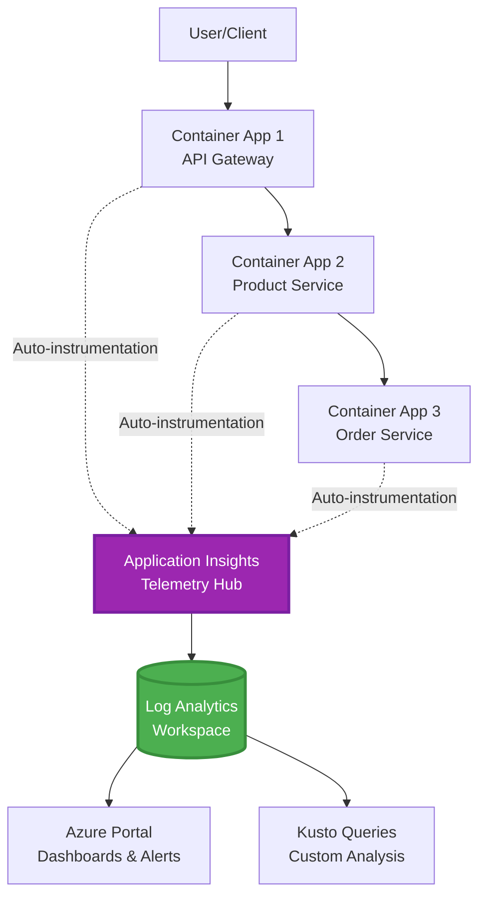
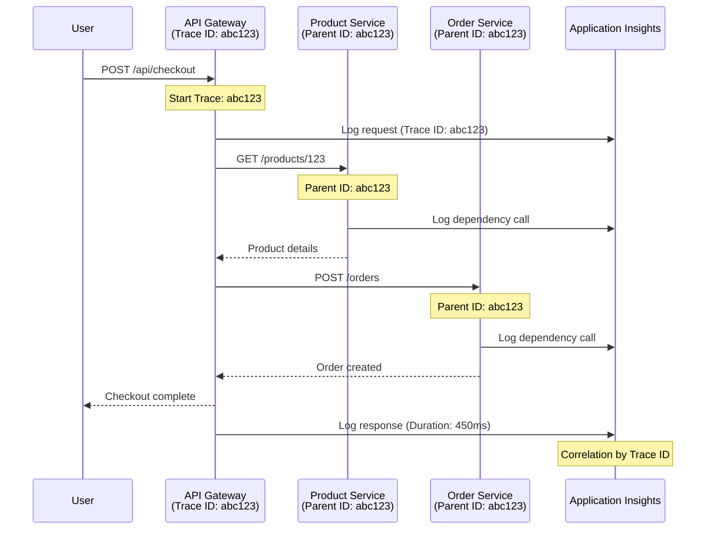

# ការរួមបញ្ចូល Application Insights ជាមួយ AZD

⏱️ **ពេលវេលាប៉ាន់ស្មាន**៖ 40-50 នាទី | 💰 **ប៉ះពាល់ថ្លៃដើម**៖ ~5-15$/ខែ | ⭐ **មុខងារ**៖ មធ្យម

**📚 ផ្លូវឆ្ពោះរៀន៖**
- ← មុន៖ [ការត្រួតពិនិត្យមុនការហោះទៅ](preflight-checks.md) - ការផ្ទៀងផ្ទាត់មុនការចុះបញ្ជី
- 🎯 **អ្នកកំពុងស្ថិតនៅទីនេះ**៖ ការរួមបញ្ចូល Application Insights (តាមដាន, ទិន្នន័យ telemetry, ការជួសជុលកំហុស)
- → បន្ទាប់៖ [មគ្គុទេសក៍ចុះបញ្ជី](../chapter-04-infrastructure/deployment-guide.md) - ចុះបញ្ជីទៅ Azure
- 🏠 [ទំព័រដើមវគ្គរៀន](../../README.md)

---

## អ្វីដែលអ្នកនឹងរៀន

ដោយបញ្ចប់មេរៀននេះ អ្នកនឹងអាច៖
- បញ្ជាក់ **Application Insights** នៅក្នុងហេដ្ឋារចនាសម្ព័ន្ធ AZD ហើយកំណត់ការតម្រូវ SDK instrumentation
- កំណត់ការតាមដានបែងចែកសម្រាប់សេវាកម្មតូចៗ (microservices)
- អនុវត្ត **telemetry បុគ្គលិក** (វិមាត្រ, ព្រឹត្តិការណ៍, ភាពពាក់ព័ន្ធ)
- រៀបចំ **វិមាត្រផ្ទាល់ខ្លួនបណ្ដាញ** សម្រាប់ការតាមដានពេលពិត
- បង្កើត **ព័ត៌មានរោទិ៍ និងផ្ទាំងគ្រប់គ្រង** ពីការចុះបញ្ជី AZD
- ជួសជុលបញ្ហាក្នុងផលិតផលជាមួយ **សំណួរ telemetry**
- បង្កើតភាពសម្រួល **ថ្លៃដើម និងយុទ្ធសាស្រ្តសម្រីងសម្រាប់ការគមនាដ៏**
- តាមដាន **កម្មវិធី AI/LLM** (លេខឯកសារ, ពេលយឺត, ថ្លៃដើម)

## មូលហេតុដែល Application Insights ជាមួយ AZD មានសារៈសំខាន់

### ភាពតានតឹង៖ ការបង្ហាញភាពឃើញក្នុងផលិតផល

**គ្មាន Application Insights:**
```
❌ No visibility into production behavior
❌ Manual log aggregation across services
❌ Reactive debugging (wait for customer complaints)
❌ No performance metrics
❌ Cannot trace requests across services
❌ Unknown failure rates and bottlenecks
```

**ជាមួយ Application Insights + AZD:**
```
✅ Automatic telemetry collection
✅ Centralized logs from all services
✅ Proactive issue detection
✅ End-to-end request tracing
✅ Performance metrics and insights
✅ Real-time dashboards
✅ AZD provisions the monitoring declared in your templates
```

**បញ្ជាក់**៖ Application Insights គឺដូចជាម៉ាស៊ីនកត់ត្រាហោះឯកទេស "ប្រអប់ខ្មៅ" + ផ្ទាំងគ្រប់គ្រងក្នុងរថយន្តសម្រាប់កម្មវិធីរបស់អ្នក។ អ្នកអាចមើលឃើញរាល់អ្វីកើតឡើងនៅពេលពិត និងអាចលេងម្តងទៀតនូវហេតុការណ៍ណាមួយ។

---

## ពិពណ៌នារចនាសម្ព័ន្ធ

### Application Insights នៅក្នុងរចនាសម្ព័ន្ធ AZD



### អ្វីដែលត្រូវបានតាមដានដោយស្វ័យប្រវត្តិ

ការចូលមុខងារinstrumentation ដោយស្វ័យប្រវត្តិនេះ កាន់ការស្នើសុំ/ភាពពាក់ព័ន្ធសម្រាប់បណ្ណាល័យដែលបានដាក់ស្លាក។ ព្រឹត្តិការណ៍ និងវិមាត្របុគ្គលិកត្រូវការកូដកម្មវិធីនិងតេស្តភាពអាចប្រើបានត្រូវបានកំណត់រចនាសម្ព័ន្ធឡែក។ វា​មិនប្រមូលរាល់ជួរដូចខាងក្រោមគ្រាន់តែលើកដំណើរ។

| ប្រភេទ Telemetry | អ្វីដែលវាប្រមូល | ការប្រើប្រាស់ |
|----------------|------------------|----------|
| **សំណើ** | សំណើ HTTP, លេខស្ថានភាព, រយៈពេល | តាមដានប្រសិទ្ធភាព API |
| **ភាពពាក់ព័ន្ធ** | សំណើក្រៅ (DB, API, ការផ្ទុក) | កំណត់កន្លែងរាំងស្ទះ |
| **ករណីកើតមានកំហុស** | កំហុសមិនស្វ័យប្រវត្តិ និងរេគនាក់ | ជួសជុលកំហុស |
| **ព្រឹត្តិការណ៍បុគ្គលិក** | ព្រឹត្តិការណ៍អាជីវកម្ម (ចុះឈ្មោះ, ទិញ) | វិភាគ និងជួរ |
| **វិមាត្រ** | គណនាតំណរ, វិមាត្រ​នៃខ្លួនឯង | ផែនការថាមពល |
| **ការតាមដាន** | សារចុះកំណត់ជាមួយភាពធ្ងន់ធ្ងរ | ជួសជុល និងត្រួតពិនិត្យ |
| **ភាពអាចប្រើបាន** | ការតេស្តពេលវេលាឡើងវិញ និងការឆ្លើយតប | តាមដាន SLA |

---

## លក្ខខណ្ឌដាក់មុន

### ឧបករណ៏ដែលត្រូវការ

```bash
# Verify Azure Developer CLI
azd version
# Command reference baseline: azd 1.37.2

# Verify Azure CLI
az --version
# ✅ Expected: azure-cli 2.50.0 or higher
```

### តម្រូវការរបស់ Azure

- មានការជាវ Azure សកម្ម
- សិទ្ធិដើម្បីបង្កើត៖
  - ធនធាន Application Insights
  - កន្លែងស្ដុក Log Analytics
  - Container Apps
  - ក្រុមធនធាន

### លំនឹងទំនាស់ចំណេះដឹង

អ្នកគួរតែបញ្ចប់៖
- [AZD មូលដ្ឋាន](../chapter-01-foundation/azd-basics.md) - មូលដ្ឋានគំនិត AZD
- [ការកំណត់រចនាសម្ព័ន្ធ](../chapter-03-configuration/configuration.md) - ការតំឡើងបរិដ្ឋាន
- [គម្រោងដំបូង](../chapter-01-foundation/first-project.md) - ការចុះបញ្ជីមូលដ្ឋាន

---

## មេរៀន 1៖ Application Insights ស្វ័យប្រវត្តិជាមួយ AZD

### AZD បង្កើត Application Insights ដូចម្ដេច

AZD បង្កើត Application Insights **តែប៉ុន្តែពេលហេដ្ឋារចនាសម្ព័ន្ធគម្រោងបានបញ្ជាក់វា**។ `azure.yaml` ដាច់ដោយឡែក មិនបង្កើតការត្រួតពិនិត្យ ឬវាយតំលៃកូដកម្មវិធីនោះទេ។

> **ឧទាហរណ៍ដែនកំណត់**៖ មេរៀននេះមានផ្នែករួមបញ្ចូលគ្នា មិនមែនគម្រោង `monitored-app` ទាំងមូលនៅក្នុងឃ្លាំងនេះទេ។ ត្រូវផ្ដល់គំរូមេនិងផែនទីប៉ារ៉ាម៉ែត្រ បរិដ្ឋាន Container Apps ការកំណត់ឣត្តសញ្ញាណ និងភាពក្លែងបន្លំ Dockerfile និងស្លាកសេវាកម្មមុនចុះបញ្ជី។ មេរៀនបន្ទាប់បង្ហាញផ្នែកបន្ថែម/បន្ថែម មិនមែនឯកសារដែលអាចដាក់ជាប់គ្នាដោយមិនបម្លែងនោះទេ។ ចាប់ផ្តើមជាមួយ [ឧទាហរណ៍ microservices](../../../../examples/microservices) ប្រសិនបើអ្នកត្រូវការប្រេសធិបតីបើករឿងដើម។

### រចនាសម្ព័ន្ធគម្រោង

```
monitored-app/
├── azure.yaml                     # AZD configuration
├── infra/
│   ├── main.bicep                # Main infrastructure
│   ├── core/
│   │   └── monitoring.bicep      # Application Insights + Log Analytics
│   └── app/
│       └── api.bicep             # Container App with monitoring
└── src/
    ├── app.py                    # Application with telemetry
    ├── requirements.txt
    └── Dockerfile
```

---

### ជំហ៊ាន 1៖ កំណត់ AZD (azure.yaml)

**ឯកសារ៖ `azure.yaml`**

```yaml
name: monitored-app
metadata:
  template: monitored-app@1.0.0

services:
  api:
    project: ./src
    language: python
    host: containerapp

# Monitoring must be declared in infra/ and enabled in application code.
```

នេះបញ្ជាក់ទៅសេវាកម្មដែលអាចចុះបញ្ជីបាន។ Bicep និងកំណត់ SDK ខាងក្រោមផ្គត់ផ្គង់ការត្រួតពិនិត្យ; azd មិនបន្ថែមវាដោយស្វ័យប្រវត្តិទេ។

---

### ជំហ៊ាន 2៖ ហេដ្ឋារចនាសម្ព័ន្ធត្រួតពិនិត្យ (Bicep)

**ឯកសារ៖ `infra/core/monitoring.bicep`**

```bicep
param logAnalyticsName string
param applicationInsightsName string
param location string = resourceGroup().location
param tags object = {}

// Log Analytics Workspace (required for Application Insights)
resource logAnalytics 'Microsoft.OperationalInsights/workspaces@2022-10-01' = {
  name: logAnalyticsName
  location: location
  tags: tags
  properties: {
    sku: {
      name: 'PerGB2018'  // Pay-as-you-go pricing
    }
    retentionInDays: 30  // Keep logs for 30 days
    features: {
      enableLogAccessUsingOnlyResourcePermissions: true
    }
  }
}

// Application Insights
resource applicationInsights 'Microsoft.Insights/components@2020-02-02' = {
  name: applicationInsightsName
  location: location
  tags: tags
  kind: 'web'
  properties: {
    Application_Type: 'web'
    WorkspaceResourceId: logAnalytics.id
    IngestionMode: 'LogAnalytics'
    publicNetworkAccessForIngestion: 'Enabled'
    publicNetworkAccessForQuery: 'Enabled'
  }
}

// Outputs for Container Apps
output logAnalyticsWorkspaceId string = logAnalytics.id
output logAnalyticsWorkspaceName string = logAnalytics.name
output applicationInsightsConnectionString string = applicationInsights.properties.ConnectionString
output applicationInsightsInstrumentationKey string = applicationInsights.properties.InstrumentationKey
output applicationInsightsName string = applicationInsights.name
output applicationInsightsId string = applicationInsights.id
```

---

### ជំហ៊ាន 3៖ តភ្ជាប់ Container App ទៅ Application Insights

**ឯកសារ៖ `infra/app/api.bicep`**

```bicep
param name string
param location string
param tags object = {}
param containerAppsEnvironmentId string
param containerImage string
param applicationInsightsConnectionString string

resource containerApp 'Microsoft.App/containerApps@2023-05-01' = {
  name: name
  location: location
  tags: tags
  properties: {
    managedEnvironmentId: containerAppsEnvironmentId
    configuration: {
      ingress: {
        external: true
        targetPort: 8000
      }
      secrets: [
        {
          name: 'appinsights-connection-string'
          value: applicationInsightsConnectionString
        }
      ]
    }
    template: {
      containers: [
        {
          name: 'api'
          image: containerImage // Supply an accessible image and registry authentication
          resources: {
            cpu: json('0.5')
            memory: '1Gi'
          }
          env: [
            {
              name: 'APPLICATIONINSIGHTS_CONNECTION_STRING'
              secretRef: 'appinsights-connection-string'
            }
            {
              name: 'APPLICATIONINSIGHTS_ENABLED'
              value: 'true'
            }
          ]
        }
      ]
    }
  }
}

output uri string = 'https://${containerApp.properties.configuration.ingress.fqdn}'
```

---

### ជំហ៊ាន 4៖ កូដកម្មវិធីជាមួយ Telemetry

**ឯកសារ៖ `src/app.py`**

```python
from flask import Flask, request, jsonify
from azure.monitor.opentelemetry import configure_azure_monitor
import logging
import os

app = Flask(__name__)

# Get Application Insights connection string
connection_string = os.environ.get('APPLICATIONINSIGHTS_CONNECTION_STRING')

if connection_string:
    # Azure Monitor OpenTelemetry instruments supported libraries, including Flask.
    configure_azure_monitor(
        connection_string=connection_string,
        logger_name=__name__,
        enable_live_metrics=True
    )
    logger = logging.getLogger(__name__)
    logger.setLevel(logging.INFO)
    
    print("✅ Application Insights enabled")
else:
    logger = logging.getLogger(__name__)
    logger.setLevel(logging.INFO)
    print("⚠️ Application Insights not configured")

@app.route('/health')
def health():
    logger.info('Health check endpoint called')
    return jsonify({'status': 'healthy', 'monitoring': 'enabled' if connection_string else 'disabled'})

@app.route('/api/products')
def get_products():
    logger.info('Fetching products')
    
    # In-memory fixture: this is not a database dependency call.
    products = [
        {'id': 1, 'name': 'Laptop', 'price': 999.99},
        {'id': 2, 'name': 'Mouse', 'price': 29.99},
        {'id': 3, 'name': 'Keyboard', 'price': 79.99}
    ]
    
    logger.info(f'Returned {len(products)} products')
    return jsonify(products)

@app.route('/api/error-test')
def error_test():
    """Test error tracking"""
    logger.error('Testing error tracking')
    try:
        raise ValueError('This is a test exception')
    except Exception as e:
        logger.exception('Exception occurred in error-test endpoint')
        return jsonify({'error': str(e)}), 500

@app.route('/api/slow')
def slow_endpoint():
    """Test performance tracking"""
    import time
    logger.info('Slow endpoint called')
    time.sleep(3)  # Simulate slow operation
    logger.warning('Endpoint took 3 seconds to respond')
    return jsonify({'message': 'Slow operation completed'})

if __name__ == '__main__':
    app.run(host='0.0.0.0', port=8000)
```

**ឯកសារ៖ `src/requirements.txt`**

```txt
Flask
azure-monitor-opentelemetry
gunicorn
requests
openai
```

ដោះស្រាយភាពពាក់ព័ន្ធទាំងនេះនៅក្នុងគម្រោងរបស់អ្នក សាកល្បងរួមគ្នា ហើយចាក់សោមើលកំណែដែលទទួលបាន។ គម្រោងថ្មីគួរប្រើ Azure Monitor OpenTelemetry មិនមែន OpenCensus Python ត្រូវបានលែងទេ។

---

### ជំហ៊ាន 5៖ ចុះបញ្ជី និងផ្ទៀងផ្ទាត់

```bash
# Deploy only after completing and wiring the infrastructure fragments above
azd up

# Get app URL
APP_URL=$(azd env get-value API_URL) # Requires this output in main.bicep

# Generate telemetry
curl $APP_URL/health
curl $APP_URL/api/products
curl $APP_URL/api/error-test
curl $APP_URL/api/slow
```

**✅ លទ្ធផលដែលរំពឹងទុក៖**
```json
{
  "status": "healthy",
  "monitoring": "enabled"
}
```

---

### ជំហ៊ាន 6៖ មើល Telemetry នៅក្នុង Azure Portal

```bash
# Get Application Insights details
azd env get-values | grep APPLICATIONINSIGHTS

# Open in Azure Portal
az monitor app-insights component show \
  --app $(azd env get-values | grep APPLICATIONINSIGHTS_NAME | cut -d '=' -f2 | tr -d '"') \
  --resource-group $(azd env get-values | grep AZURE_RESOURCE_GROUP | cut -d '=' -f2 | tr -d '"') \
  --query "appId" -o tsv
```

**ចូលទៅ Azure Portal → Application Insights → Transaction Search**

អ្នកគួរតែឃើញ៖
- ✅ សំណើ HTTP នឹងលេខស្ថានភាព
- ✅ រយៈពេលសំណើ (3+ វិនាទីសម្រាប់ `/api/slow`)
- ✅ ព័ត៌មានករណីកើតមានកំហុសពី `/api/error-test`
- ✅ សារចុះកំណត់ផ្ទាល់ខ្លួន

---

## មេរៀន 2៖ Telemetry និងព្រឹត្តិការណ៍បុគ្គលិក

### តាមដានព្រឹត្តិការណ៍អាជីវកម្ម

ចូរជួបជាមួយ telemetry បុគ្គលិកសម្រាប់ព្រឹត្តិការណ៍អាជីវកម្មសំខាន់ៗ។

**ឯកសារ៖ `src/telemetry.py`**

```python
from contextlib import contextmanager
from azure.monitor.opentelemetry import configure_azure_monitor
from opentelemetry import metrics, trace
from opentelemetry.trace import SpanKind
import logging
import os

class TelemetryClient:
    """Custom telemetry client for Application Insights"""
    
    def __init__(self, connection_string=None):
        self.connection_string = connection_string or os.environ.get('APPLICATIONINSIGHTS_CONNECTION_STRING')
        
        # Configure once per process. If app.py already calls this, keep only
        # one configure_azure_monitor call and use logger_name='telemetry'.
        if self.connection_string:
            configure_azure_monitor(
                connection_string=self.connection_string,
                logger_name=__name__,
                enable_live_metrics=True
            )
        self.logger = logging.getLogger(__name__)
        self.logger.setLevel(logging.INFO)
        self.tracer = trace.get_tracer(__name__)
        self.meter = metrics.get_meter(__name__)
        self.instruments = {}
    
    def track_event(self, event_name: str, properties: dict = None):
        """Track custom business event"""
        properties = properties or {}
        self.logger.info(
            f"CustomEvent: {event_name}",
            extra={
                # OTel log attributes become customDimensions in App Insights.
                    'event_name': event_name,
                    **properties
            }
        )
    
    def track_metric(self, metric_name: str, value: float, properties: dict = None):
        """Track custom metric"""
        properties = properties or {}
        if metric_name not in self.instruments:
            self.instruments[metric_name] = self.meter.create_histogram(metric_name)
        self.instruments[metric_name].record(value, attributes=properties)
    
    @contextmanager
    def track_dependency(self, name: str):
        """Time the real operation inside a client span; exceptions mark failure."""
        with self.tracer.start_as_current_span(name, kind=SpanKind.CLIENT) as span:
            yield span

# Global telemetry client
telemetry = TelemetryClient()
```

### បច្ចុប្បន្នភាពកម្មវិធីជាមួយព្រឹត្តិការណ៍បុគ្គលិក

**ឯកសារ៖ `src/app.py` (កែលម្អ)**

បន្ថែមផ្លូវទាំងនេះទៅកម្មវិធី Flask ដែលមានរួចហើយ; រក្សាជំហានសុខភាព/សាកល្បងមុន។ ប្លុកខ្លះខាងក្រោមបង្ហាញកម្មវិធីផ្សេងសម្រាប់ភាពច្បាស់លាស់។ ការចាប់ផ្តើម telemetry ឥឡូវនេះនៅក្នុង `telemetry.py`—កុំចាប់ផ្តើមចម្លង exporters ពីរដង។

```python
from flask import Flask, request, jsonify
from telemetry import telemetry
import time
import random
import os

app = Flask(__name__)

@app.route('/api/purchase', methods=['POST'])
def purchase():
    """Track purchase event with custom telemetry"""
    data = request.get_json(silent=True) or {}
    product_id = data.get('product_id')
    quantity = data.get('quantity', 1)
    price = data.get('price', 0)
    if not isinstance(quantity, int) or quantity < 1 or \
       not isinstance(price, (int, float)) or price < 0:
        return jsonify({'error': 'quantity and price must be non-negative numbers; quantity >= 1'}), 400
    
    # Track business event
    telemetry.track_event('Purchase', {
        'product_id': product_id,
        'quantity': quantity,
        'total_amount': price * quantity,
        'user_id': request.headers.get('X-User-Id', 'anonymous')
    })
    
    # Track revenue metric
    telemetry.track_metric('Revenue', price * quantity, {
        'product_id': product_id,
        'currency': 'USD'
    })
    
    return jsonify({
        'order_id': f'ORD-{random.randint(1000, 9999)}',
        'status': 'confirmed',
        'total': price * quantity
    })

@app.route('/api/search')
def search():
    """Track search queries"""
    query = request.args.get('q', '')
    
    start_time = time.time()
    
    # Simulate search (would be real database query)
    results = [{'id': 1, 'name': f'Result for {query}'}]
    
    duration = (time.time() - start_time) * 1000  # Convert to ms
    
    # Track search event
    telemetry.track_event('Search', {
        'query': query,
        'results_count': len(results),
        'duration_ms': duration
    })
    
    # Track search performance metric
    telemetry.track_metric('SearchDuration', duration, {
        'query_length': len(query)
    })
    
    return jsonify({'results': results, 'count': len(results)})

@app.route('/api/external-call')
def external_call():
    """Track external API dependency"""
    import requests
    
    try:
        # Set an actual test endpoint; api.example.com is not a working API.
        with telemetry.track_dependency('ExternalAPI'):
            response = requests.get(os.environ['EXTERNAL_API_URL'], timeout=5)
            response.raise_for_status()
            result = response.json()
    except Exception as e:
        return jsonify({'error': 'External dependency failed'}), 502
    
    return jsonify(result)

if __name__ == '__main__':
    app.run(host='0.0.0.0', port=8000)
```

### សាកល្បង Telemetry បុគ្គលិក

```bash
# Track purchase event
curl -X POST $APP_URL/api/purchase \
  -H "Content-Type: application/json" \
  -H "X-User-Id: user123" \
  -d '{"product_id": 1, "quantity": 2, "price": 29.99}'

# Track search event
curl "$APP_URL/api/search?q=laptop"

# Track external dependency
curl $APP_URL/api/external-call
```

**មើលនៅ Azure Portal៖**

ចូលទៅ Application Insights → Logs បន្ទាប់មកបញ្ជារតម្រូវ:

```kusto
// View purchase events
traces
| where customDimensions.event_name == "Purchase"
| project 
    timestamp,
    product_id = tostring(customDimensions.product_id),
    total_amount = todouble(customDimensions.total_amount),
    user_id = tostring(customDimensions.user_id)
| order by timestamp desc

// Revenue recorded in Purchase events (not a billing ledger)
traces
| where customDimensions.event_name == "Purchase"
| summarize TotalRevenue = sum(todouble(customDimensions.total_amount)) by bin(timestamp, 1h)
| render timechart

// View search performance
traces
| where customDimensions.event_name == "Search"
| summarize 
    AvgDuration = avg(todouble(customDimensions.duration_ms)),
    SearchCount = count()
  by bin(timestamp, 5m)
| render timechart
```

---

## មេរៀន 3៖ ការតាមដានបែងចែកសម្រាប់ Microservices

### បើកការតាមដានលើសេវាកម្មជាច្រើន

ជាមួយនឹងឧបករណ៍ស៊ីម៉ូលតិច និងការបញ្ជូនពត៌មានទិន្នន័យតាម W3C trace-context, Application Insights បញ្ជាក់សំណើជាមធ្យមក្រោមសេវាកម្ម។ ការចែករំលែកខ្សែទំនាក់ទំនងតែមួយមិនបង្កើត spans មាតាបិតា-កូន។ ផ្នែករចនាសម្ព័ន្ធខាងក្រោមយោងទៅកាន់ម៉ូឌុលដែលអ្នកត្រូវអនុវត្ត។

**ឯកសារ៖ `infra/main.bicep`**

```bicep
targetScope = 'subscription'

param environmentName string
param location string = 'eastus'

var tags = { 'azd-env-name': environmentName }

resource rg 'Microsoft.Resources/resourceGroups@2021-04-01' = {
  name: 'rg-${environmentName}'
  location: location
  tags: tags
}

// Monitoring (shared by all services)
module monitoring './core/monitoring.bicep' = {
  name: 'monitoring'
  scope: rg
  params: {
    logAnalyticsName: 'log-${environmentName}'
    applicationInsightsName: 'appi-${environmentName}'
    location: location
    tags: tags
  }
}

// API Gateway
module apiGateway './app/api-gateway.bicep' = {
  name: 'api-gateway'
  scope: rg
  params: {
    name: 'ca-gateway-${environmentName}'
    location: location
    tags: union(tags, { 'azd-service-name': 'gateway' })
    applicationInsightsConnectionString: monitoring.outputs.applicationInsightsConnectionString
  }
}

// Product Service
module productService './app/product-service.bicep' = {
  name: 'product-service'
  scope: rg
  params: {
    name: 'ca-products-${environmentName}'
    location: location
    tags: union(tags, { 'azd-service-name': 'products' })
    applicationInsightsConnectionString: monitoring.outputs.applicationInsightsConnectionString
  }
}

// Order Service
module orderService './app/order-service.bicep' = {
  name: 'order-service'
  scope: rg
  params: {
    name: 'ca-orders-${environmentName}'
    location: location
    tags: union(tags, { 'azd-service-name': 'orders' })
    applicationInsightsConnectionString: monitoring.outputs.applicationInsightsConnectionString
  }
}

output APPLICATIONINSIGHTS_CONNECTION_STRING string = monitoring.outputs.applicationInsightsConnectionString
output GATEWAY_URL string = apiGateway.outputs.uri
```

### មើលប្រតិបត្តិការ End-to-End



**សំណួរតាមដាន end-to-end:**

```kusto
// Find complete request flow
let traceId = "abc123...";  // Copy operation_Id from a request in Application Insights
dependencies
| union requests
| where operation_Id == traceId
| project 
    timestamp,
    type = itemType,
    name,
    duration,
    success,
    cloud_RoleName
| order by timestamp asc
```

---

## មេរៀន 4៖ វិមាត្រផ្ទាល់ខ្លួន និងការតាមដានពេលពិត

### បើកចរន្តវិមាត្រផ្ទាល់ខ្លួន

វិមាត្រប្រចាំផ្តល់អត្ថប្រយោជន៍ជិតពេលពិតនៅពេលគាំទ្រ និងបើកដោយ SDK។ វាមិនមែនជាការធានាប្រភេទ latency SLA ទេ។ ការកំណត់ Python OpenTelemetry ខាងលើជ្រើសរើសជាមួយ `enable_live_metrics=True`។

**ចូលមើលវិមាត្រផ្ទាល់ខ្លួន៖**

```bash
# Get Application Insights resource
APPI_NAME=$(azd env get-values | grep APPLICATIONINSIGHTS_NAME | cut -d '=' -f2 | tr -d '"')

# Get resource group
RG_NAME=$(azd env get-values | grep AZURE_RESOURCE_GROUP | cut -d '=' -f2 | tr -d '"')

echo "Navigate to: Azure Portal → Resource Groups → $RG_NAME → $APPI_NAME → Live Metrics"
```

**អ្វីដែលអ្នកឃើញពេលពិត៖**
- ✅ អត្រាសំណើចូល (សំណើ/វិនាទី)
- ✅ ការហៅពីភាពពាក់ព័ន្ធចេញ(Outgoing)
- ✅ ចំនួនករណីកើតមានកំហុស
- ✅ ការប្រើប្រាស់ CPU និង memory
- ✅ ចំនួនម៉ាស៊ីនបម្រើសកម្ម
- ✅ ទិន្នន័យគំរូ telemetry

### បង្កើតបង្ហាប់សម្រាប់សាកល្បង

```bash
# Generate load to see live metrics
for i in {1..100}; do
  curl --silent --max-time 10 "$APP_URL/api/products"
  curl --silent --max-time 10 "$APP_URL/api/search?q=test$i"
done

# Watch live metrics in Azure Portal
# You should see request rate spike
```

---

## ការអនុវត្តប្រកបដោយជំនាញ

### ការប្រកួត 1៖ បង្កើតព័ត៌មានរោទិ៍ ⭐⭐ (មធ្យម)

**គោលបំណង**៖ បង្កើតព័ត៌មានរោទិ៍សម្រាប់អត្រាខុសខាតខ្ពស់ និងការឆ្លើយតបទាប។

**ជំហ៊ាន៖**

1. **បង្កើតព័ត៌មានរោទិ៍សម្រាប់អត្រាកំហុស៖**

```bash
# Get Application Insights resource ID
APPI_ID=$(az monitor app-insights component show \
  --app $APPI_NAME \
  --resource-group $RG_NAME \
  --query "id" -o tsv)

# Create metric alert for failed requests
az monitor metrics alert create \
  --name "High-Error-Rate" \
  --resource-group $RG_NAME \
  --scopes $APPI_ID \
  --condition "count requests/failed > 10" \
  --window-size 5m \
  --evaluation-frequency 1m \
  --description "Alert when failed request count exceeds 10 per 5 minutes"
```

2. **បង្កើតព័ត៌មានរោទិ៍សម្រាប់ការឆ្លើយតបយឺត៖**

```bash
az monitor metrics alert create \
  --name "Slow-Responses" \
  --resource-group $RG_NAME \
  --scopes $APPI_ID \
  --condition "avg requests/duration > 3000" \
  --window-size 5m \
  --evaluation-frequency 1m \
  --description "Alert when average response time exceeds 3 seconds"
```

3. **បង្កើតព័ត៌មានរោទិ៍តាមរយៈ Bicep (ចូលចិត្តសម្រាប់ AZD):**

**ឯកសារ៖ `infra/core/alerts.bicep`**

```bicep
param applicationInsightsId string
param actionGroupId string = ''
param location string = resourceGroup().location

// High error rate alert
resource errorRateAlert 'Microsoft.Insights/metricAlerts@2018-03-01' = {
  name: 'high-error-rate'
  location: 'global'
  properties: {
    description: 'Alert when error rate exceeds threshold'
    severity: 2
    enabled: true
    scopes: [
      applicationInsightsId
    ]
    evaluationFrequency: 'PT1M'
    windowSize: 'PT5M'
    criteria: {
      'odata.type': 'Microsoft.Azure.Monitor.SingleResourceMultipleMetricCriteria'
      allOf: [
        {
          name: 'Error rate'
          metricName: 'requests/failed'
          operator: 'GreaterThan'
          threshold: 10
          timeAggregation: 'Count'
        }
      ]
    }
    actions: actionGroupId != '' ? [
      {
        actionGroupId: actionGroupId
      }
    ] : []
  }
}

// Slow response alert
resource slowResponseAlert 'Microsoft.Insights/metricAlerts@2018-03-01' = {
  name: 'slow-responses'
  location: 'global'
  properties: {
    description: 'Alert when response time is too high'
    severity: 3
    enabled: true
    scopes: [
      applicationInsightsId
    ]
    evaluationFrequency: 'PT1M'
    windowSize: 'PT5M'
    criteria: {
      'odata.type': 'Microsoft.Azure.Monitor.SingleResourceMultipleMetricCriteria'
      allOf: [
        {
          name: 'Response duration'
          metricName: 'requests/duration'
          operator: 'GreaterThan'
          threshold: 3000
          timeAggregation: 'Average'
        }
      ]
    }
  }
}

output errorAlertId string = errorRateAlert.id
output slowResponseAlertId string = slowResponseAlert.id
```

4. **សាកល្បងព័ត៌មានរោទិ៍៖**

```bash
# Generate errors
for i in {1..20}; do
  curl $APP_URL/api/error-test
done

# Generate slow responses
for i in {1..10}; do
  curl $APP_URL/api/slow
done

# Check rule configuration (not fired/resolved alert-instance history)
az monitor metrics alert list \
  --resource-group $RG_NAME \
  --query "[].{Name:name, Enabled:enabled}" \
  --output table
```

**✅ លក្ខខណ្ឌជោគជ័យ៖**
- ✅ បានបង្កើតព័ត៌មានរោទិ៍ដោយជោគជ័យ
- ✅ ព័ត៌មានរោទិ៍ភ្លើងពេលលើកលែងកំណត់កម្រិត
- ✅ អាចមើលប្រវត្តិបញ្ជីព័ត៌មានរោទិ៍នៅ Azure Portal
- ✅ សម្របសម្រួលជាមួយការចុះបញ្ជី AZD

**ពេលវេលា**៖ 20-25 នាទី

---

### ការប្រកួត 2៖ បង្កើតផ្ទាំងគ្រប់គ្រងបុគ្គលិក ⭐⭐ (មធ្យម)

**គោលបំណង**៖ បង្កើតផ្ទាំងគ្រប់គ្រងបង្ហាញវិមាត្រសំខាន់ៗនៃកម្មវិធី។

**ជំហ៊ាន៖**

1. **បង្កើតផ្ទាំងគ្រប់គ្រងតាមរយៈ Azure Portal:**

ចូលទៅ៖ Azure Portal → Dashboards → ផ្ទាំងគ្រប់គ្រងថ្មី

2. **បន្ថែមតុបតែងសម្រាប់វិមាត្រសំខាន់ៗ៖**

- ចំនួនសំណើ (24 ម៉ោងចុងក្រោយ)
- ពេលវេលាមធ្យមនៃការឆ្លើយតប
- អត្រាកំហុស
- ប្រាំនាក់ដំណើរការយឺតជាងគេ
- ការបែងចែកភូមិសាស្ត្ររបស់អ្នកប្រើប្រាស់

3. **បង្កើតផ្ទាំងគ្រប់គ្រងតាមរយៈ Bicep:**

**ឯកសារ៖ `infra/core/dashboard.bicep`**

```bicep
param dashboardName string
param applicationInsightsId string
param location string = resourceGroup().location

resource dashboard 'Microsoft.Portal/dashboards@2020-09-01-preview' = {
  name: dashboardName
  location: location
  properties: {
    lenses: [
      {
        order: 0
        parts: [
          // Request count
          {
            position: {
              x: 0
              y: 0
              rowSpan: 4
              colSpan: 6
            }
            metadata: {
              type: 'Extension/Microsoft_OperationsManagementSuite_Workspace/PartType/LogsDashboardPart'
              inputs: [
                {
                  name: 'resourceId'
                  value: applicationInsightsId
                }
                {
                  name: 'query'
                  value: '''
                    requests
                    | summarize RequestCount = count() by bin(timestamp, 1h)
                    | render timechart
                  '''
                }
              ]
            }
          }
          // Error rate
          {
            position: {
              x: 6
              y: 0
              rowSpan: 4
              colSpan: 6
            }
            metadata: {
              type: 'Extension/Microsoft_OperationsManagementSuite_Workspace/PartType/LogsDashboardPart'
              inputs: [
                {
                  name: 'resourceId'
                  value: applicationInsightsId
                }
                {
                  name: 'query'
                  value: '''
                    requests
                    | summarize 
                        Total = count(),
                        Failed = countif(success == false)
                    | extend ErrorRate = (Failed * 100.0) / Total
                    | project ErrorRate
                  '''
                }
              ]
            }
          }
        ]
      }
    ]
  }
}

output dashboardId string = dashboard.id
```

4. **ចុះបញ្ជីផ្ទាំងគ្រប់គ្រង:**

```bicep
// Add to a subscription-scoped main.bicep with rg and monitoring declared
module dashboard './core/dashboard.bicep' = {
  name: 'dashboard'
  scope: rg
  params: {
    dashboardName: 'dashboard-${environmentName}'
    applicationInsightsId: monitoring.outputs.applicationInsightsId
    location: location
  }
}
```

```bash
# Deploy
azd up
```

**✅ លក្ខខណ្ឌជោគជ័យ៖**
- ✅ ផ្ទាំងគ្រប់គ្រងបង្ហាញវិមាត្រសំខាន់ៗ
- ✅ អាចចាំនាំទៅផ្ទះ Azure Portal
- ✅ ផ្លាស់ប្តូរពេលពិត
- ✅ អាចចុះបញ្ជីតាមរយៈ AZD

**ពេលវេលា**៖ 25-30 នាទី

---

### ការប្រកួត 3៖ តាមដានកម្មវិធី AI/LLM ⭐⭐⭐ (កំពូលជំនាញ)

**គោលបំណង**៖ តាមដានការប្រើប្រាស់ Microsoft Foundry Models (លេខសម្គាល់, ថ្លៃដើម, ពេលយឺត)។

**ជំហ៊ាន៖**

1. **បង្កើតអាវុធតាមដាន AI៖**

**ឯកសារ៖ `src/ai_telemetry.py`**

```python
from telemetry import telemetry
from openai import AzureOpenAI
import time

class MonitoredAzureOpenAI:
    """Microsoft Foundry Models client with automatic telemetry"""
    
    def __init__(self, api_key, endpoint, input_usd_per_million,
                 output_usd_per_million, api_version="2024-10-21"):
        self.client = AzureOpenAI(
            api_key=api_key,
            api_version=api_version,
            azure_endpoint=endpoint
        )
        self.input_rate = input_usd_per_million
        self.output_rate = output_usd_per_million
    
    def chat_completion(self, model: str, messages: list, **kwargs):
        """Track chat completion with telemetry"""
        start_time = time.time()
        
        try:
            # Call Microsoft Foundry Models
            response = self.client.chat.completions.create(
                model=model,
                messages=messages,
                **kwargs
            )
            
            duration = (time.time() - start_time) * 1000  # ms
            
            # Extract usage
            usage = response.usage
            prompt_tokens = usage.prompt_tokens
            completion_tokens = usage.completion_tokens
            total_tokens = usage.total_tokens
            
            # Approximation: supply actual deployment/region/contract rates.
            # Cached input, batch, provisioned and other charges need separate accounting.
            prompt_cost = (prompt_tokens / 1_000_000) * self.input_rate
            completion_cost = (completion_tokens / 1_000_000) * self.output_rate
            total_cost = prompt_cost + completion_cost
            
            # Track custom event
            telemetry.track_event('OpenAI_Request', {
                'model': model,
                'prompt_tokens': prompt_tokens,
                'completion_tokens': completion_tokens,
                'total_tokens': total_tokens,
                'duration_ms': duration,
                'cost_usd': total_cost,
                'success': True
            })
            
            # Track metrics
            telemetry.track_metric('OpenAI_Tokens', total_tokens, {
                'model': model,
                'type': 'total'
            })
            
            telemetry.track_metric('OpenAI_Cost', total_cost, {
                'model': model,
                'currency': 'USD'
            })
            
            telemetry.track_metric('OpenAI_Duration', duration, {
                'model': model
            })
            
            return response
            
        except Exception as e:
            duration = (time.time() - start_time) * 1000
            
            telemetry.track_event('OpenAI_Request', {
                'model': model,
                'duration_ms': duration,
                'success': False,
                'error': str(e)
            })
            
            raise
```

2. **ប្រើប្រាស់ក្រុមហ៊ុនត្រូវបានតាមដាន៖**

```python
from flask import Flask, request, jsonify
from ai_telemetry import MonitoredAzureOpenAI
import os

app = Flask(__name__)

# Initialize monitored OpenAI client
openai_client = MonitoredAzureOpenAI(
    api_key=os.environ['AZURE_OPENAI_API_KEY'],
    endpoint=os.environ['AZURE_OPENAI_ENDPOINT'],
    input_usd_per_million=float(os.environ['INPUT_USD_PER_MILLION']),
    output_usd_per_million=float(os.environ['OUTPUT_USD_PER_MILLION'])
)

@app.route('/api/chat', methods=['POST'])
def chat():
    data = request.json
    user_message = data.get('message')
    
    # Call with automatic monitoring
    response = openai_client.chat_completion(
        model=os.environ['AZURE_OPENAI_DEPLOYMENT'], # Deployment name, not catalog ID
        messages=[
            {'role': 'user', 'content': user_message}
        ]
    )
    
    return jsonify({
        'response': response.choices[0].message.content,
        'tokens': response.usage.total_tokens
    })
```

3. **សំណួរវិមាត្រព័ត៌មាន AI៖**

```kusto
// Total AI spend over time
traces
| where customDimensions.event_name == "OpenAI_Request"
| where tobool(customDimensions.success) == true
| summarize TotalCost = sum(todouble(customDimensions.cost_usd)) by bin(timestamp, 1h)
| render timechart

// Token usage by model
traces
| where customDimensions.event_name == "OpenAI_Request"
| summarize 
    TotalTokens = sum(toint(customDimensions.total_tokens)),
    RequestCount = count()
  by Model = tostring(customDimensions.model)

// Average latency
traces
| where customDimensions.event_name == "OpenAI_Request"
| summarize AvgDuration = avg(todouble(customDimensions.duration_ms))
| project AvgDurationSeconds = AvgDuration / 1000

// Cost per request
traces
| where customDimensions.event_name == "OpenAI_Request"
| extend Cost = todouble(customDimensions.cost_usd)
| summarize 
    TotalCost = sum(Cost),
    RequestCount = count(),
    AvgCostPerRequest = avg(Cost)
```

**✅ លក្ខខណ្ឌជោគជ័យ៖**
- ✅ រាល់ការហៅ OpenAI ត្រូវបានតាមដានដោយស្វ័យប្រវត្តិ
- ✅ ការប្រើប្រាស់លេខសម្គាល់ និងថ្លៃដើមអាចមើលឃើញ
- ✅ ការពន្យារពេលត្រូវបានតាមដាន
- ✅ អាចកំណត់ព័ត៌មានរោទិ៍ថវិកា

**ពេលវេលា**៖ 35-45 នាទី

---

## ការបង្កើនប្រសិទ្ធភាពថ្លៃដើម

### យុទ្ធសាស្រ្តសម្រីង

ត្រួតពិនិត្យថ្លៃដើមដោយសម្រីង telemetry៖

```python
import os

# Configure before the one configure_azure_monitor() call in your process.
os.environ["OTEL_TRACES_SAMPLER"] = "microsoft.fixed_percentage"
os.environ["OTEL_TRACES_SAMPLER_ARG"] = "0.1" # 10% trace sampling
```

ការសម្រីងតាម Trace មិនបន្ថយរាល់ប្រភេទTelemetry ដល់ 90% ទេ។ វិមាត្រ និងកំណត់ហេតុដែលចេញដោយឯករាជ្យត្រូវការការត្រួតពិនិត្យបរិមាណផ្ទាល់ខ្លួន។ ជ្រើសរើសអត្រាប្រើប្រាស់តាមតម្រូវការត្រួតពិនិត្យ មិនមែនការហាមឃាត់ទាំងមូលនៅក្នុងផលិតផល។

កំណត់ការសម្រីង SDK យ៉ាងច្បាស់; ទ្រង់ទ្រាយ `SamplingPercentage` ក្នុងគ្រឿងផ្សំនេះ មិនដំណើរការជំនួសកំណត់ sampler Python OpenTelemetry ទេ។

### ការរក្សាទិន្នន័យ

```bicep
resource logAnalytics 'Microsoft.OperationalInsights/workspaces@2022-10-01' = {
  name: logAnalyticsName
  properties: {
    retentionInDays: 30  // Minimum (cheapest)
    // Options: 30, 31, 60, 90, 120, 180, 270, 365, 550, 730
  }
}
```

### ប៉ាន់ស្មានថ្លៃដើមប្រចាំខែ

| បរិមាណទិន្នន័យ | រក្សាទុក | ថ្លៃដើមប្រចាំខែ |
|-------------|-----------|--------------|
| 1 GB/ខែ | 30 ថ្ងៃ | ~2-5$ |
| 5 GB/ខែ | 30 ថ្ងៃ | ~10-15$ |
| 10 GB/ខែ | 90 ថ្ងៃ | ~25-40$ |
| 50 GB/ខែ | 90 ថ្ងៃ | ~100-150$ |

គិតតម្លៃទាំងនេះជាឧទាហរណ៍ មិនមែនការទាយទុកតម្លៃយ៉ាងច្បាស់។ ពិនិត្យការទទួលទិន្នន័យ រក្សាទុក ព័ត៌មានរោទិ៍ និងការកំណត់តម្លៃតេស្តនៅតំបន់ និងកិច្ចសន្យារបស់អ្នកឡើងវិញ; ការផ្ដល់ជូនដោយឥតគិតថ្លៃត្រូវបានចែកចាយ/កំណត់តាមតម្លៃ Azure Monitor មិនមែនជាសក្ខីប័ត្រឥតគិតថ្លៃសម្រាប់ធនធាន Application Insights ទេ។

---

## ចំណុចពិនិត្យចំណេះដឹង

### 1. រួមបញ្ចូលមូលដ្ឋាន ✓

សាកល្បងការយល់ដឹងរបស់អ្នក៖

- [ ] **Q1**៖ AZD បង្កើត Application Insights ដូចម្តេច?
  - **A**៖ វាចុះបញ្ជីធនធានត្រួតពិនិត្យដែលបានបញ្ជាក់យ៉ាងច្បាស់ដោយគំរូ Bicep/Terraform របស់គម្រោង។

- [ ] **Q2**៖ តួអក្សរបរិយាសណ្ឋានណាដែលបើក Application Insights?
  - **A**៖ `APPLICATIONINSIGHTS_CONNECTION_STRING`

- [ ] **Q3**៖ ប្រភេទ telemetry សំខាន់បីមានអ្វីខ្លះ?
  - **A**៖ សំណើ (សំណើ HTTP), ភាពពាក់ព័ន្ធ (សំណើក្រៅ), ករណីកើតមានកំហុស (កំហុស)

**ការត្រួតពិនិត្យអនុវត្ត៖**
```bash
# Check if Application Insights is configured
azd env get-values | grep APPLICATIONINSIGHTS

# Verify telemetry is flowing
az monitor app-insights metrics show \
  --app $APPI_NAME \
  --resource-group $RG_NAME \
  --metric "requests/count"
```

---

### 2. Telemetry បុគ្គលិក ✓

សាកល្បងការយល់ដឹងរបស់អ្នក៖

- [ ] **Q1**៖ តើអ្នកតាមដានព្រឹត្តិការណ៍អាជីវកម្មបុគ្គលិកដូចម្តេច?
  - **A**៖ ម៉ាស៊ីនសរសេរលុក OTel មានរចនាសម្ព័ន្ធជាមួយលក្ខណៈ `event_name` សាកសមនៅក្នុង `traces`; ពួកវាមិនត្រូវបានបញ្ជូនដោយស្វ័យប្រវត្តិទៅ `customEvents` ទេ។

- [ ] **Q2**៖ តើមានភាពខុសគ្នា ឬទំនាក់ទំនងអ្វីទេរវាងព្រឹត្តិការណ៍ និងវិមាត្រ?
  - **A**៖ ព្រឹត្តិការណ៍គឺជាការកើតមានផ្សុសផ្សាស់ ចំណែកវិមាត្រជាការវាស់បរិមាណអនុគ្រោះ

- [ ] **Q3**៖ តើធ្វើដើម្បីភ្ជាប់ telemetry រវាងសេវាកម្មៗដូចម្តេច?
  - **A**៖ Application Insights ការបង្ហាញស្វ័យប្រវត្តិនៅរៀងជាមួយ `operation_Id` សម្រាប់ការភ្ជាប់

**ការត្រួតពិនិត្យអនុវត្ត៖**
```kusto
// Verify custom events
traces
| where customDimensions.event_name != ""
| summarize count() by tostring(customDimensions.event_name)
```

---

### 3. ការតាមដានផលិតផល ✓

សាកល្បងការយល់ដឹងរបស់អ្នក៖

- [ ] **Q1**៖ តើ sampling ជាអ្វី ហើយហេតុអ្វីបានជាជ្រើសរើសវា?
  - **A**៖ Sampling បន្ថយបរិមាណទិន្នន័យ (និងថ្លៃដើម) ដោយគ្រាន់តែប្រមូលជំនាន់Telemetry ពិន្ទុមួយ

- [ ] **Q2**៖ តើធ្វើដូចម្តេចដើម្បីកំណត់ព័ត៌មានរោទិ៍?
  - **A**៖ ប្រើព័ត៌មានរោទ្រវិមាត្រនៅក្នុង Bicep ឬ Azure Portal ដោយផ្អែកលើវិមាត្រ Application Insights

- [ ] **Q3**៖ តើមានភាពខុសគ្នាអ្វីនៅចន្លោះ Log Analytics និង Application Insights?
  - **A**៖ Application Insights រក្សាទិន្នន័យនៅក្នុងកន្លែង Log Analytics; App Insights ផ្តល់ការមើលកាន់តែលម្អិតសម្រាប់កម្មវិធី

**ការត្រួតពិនិត្យអនុវត្ត៖**
```bash
# Check the sampler configured for the running application, not only the ARM component.
az containerapp show --name "$APP_NAME" --resource-group "$RG_NAME" \
  --query "properties.template.containers[].env[?starts_with(name, 'OTEL_TRACES_SAMPLER')]"
```

---

## អនុវត្តការល្អបំផុត

### ✅ ត្រូវធ្វើ:

1. **ប្រើអត្តសញ្ញាណសម្រាប់ការភ្ជាប់**
   ```python
   logger.info('Processing order', extra={
           'order_id': order_id,
           'user_id': user_id
   })
   ```

2. **ដាក់ព័ត៌មានរោទ​សម្រាប់វិមាត្រសំខាន់ៗ**
   ```bicep
   // Error rate, slow responses, availability
   ```

3. **ប្រើភាសារចុះកំណត់មានរចនាសម្ព័ន្ធ**
   ```python
   # ✅ GOOD: Structured
   logger.info('User signup', extra={'user_id': 'pseudonymous-id'})
   
   # ❌ BAD: Unstructured
   logger.info(f'User 123 signed up')
   ```

4. **តាមដានភាពពាក់ព័ន្ធ**
   ```python
   # Automatically track database calls, HTTP requests, etc.
   ```

5. **ប្រើវិមាត្រផ្ទាល់ខ្លួនពេលចុះបញ្ជី**

### ❌ កុំធ្វើ:

1. **កុំកត់ត្រាទិន្នន័យដែលមានភាពរងគ្រោះ**
   ```python
   # ❌ BAD
   logger.info(f'Login: {username}:{password}')
   
   # ✅ GOOD
   logger.info('Login attempt', extra={'result': 'failed'})
   ```

2. **កុំជ្រើសរើសការទាញយកគម្របដោយគ្មានការវាស់ស្ទង់បរិមាណ និងតម្រូវការវិចារណាសារ**
   ```python
   # ❌ Expensive
   # 100% traces may be appropriate for a small workload or investigation.
   
   # ✅ Cost-effective
   # A lower trace rate reduces visibility; validate coverage before enabling.
   ```

3. **កុំละเลยតម្រងសំបុត្រស្លាប់**

4. **កុំភ្លេចកំណត់លក្ខណៈកំណត់ការការរក្សាទិន្នន័យ**

---

## ដោះស្រាយបញ្ហា

### បញ្ហា៖ មិនមានទេឡាមេត្រីបង្ហាញឡើងទេ

**វិភាគបញ្ហា៖**
```bash
# Check connection string is set
azd env get-values | grep APPLICATIONINSIGHTS

# Check application logs via Azure Monitor
azd monitor --logs

# Or use Azure CLI for Container Apps:
az containerapp logs show --name $APP_NAME --resource-group $RG_NAME --tail 50
```

**ដំណោះស្រាយ៖**
```bash
# Verify connection string in Container App
az containerapp show \
  --name $APP_NAME \
  --resource-group $RG_NAME \
  --query "properties.template.containers[0].env" \
  | grep -i applicationinsights
```

---

### បញ្ហា៖ ថ្លៃដើមខ្ពស់

**វិភាគបញ្ហា៖**
```bash
# Query ingestion volume in the linked Log Analytics workspace.
# WORKSPACE_ID is the workspace customer ID (GUID), not its ARM resource ID.
az monitor log-analytics query --workspace "$WORKSPACE_ID" \
  --analytics-query "Usage | where TimeGenerated > ago(30d) | where IsBillable == true | summarize IngestedMB=sum(Quantity) by DataType"
```

**ដំណោះស្រាយ៖**
- កាត់បន្ថយអត្រាទាញយកគម្រប
- បន្ថយរយៈពេលរក្សាទុក
- ដកចេញការកត់ត្រាដែលមានលម្អិតច្រើន

---

## រៀនបន្ថែម

### ឯកសារផ្លូវការពាក់ព័ន្ធ
- [ទិដ្ឋភាពទូទៅអំពី Application Insights](https://learn.microsoft.com/azure/azure-monitor/app/app-insights-overview)
- [ការតំឡើង Azure Monitor OpenTelemetry](https://learn.microsoft.com/azure/azure-monitor/app/opentelemetry-enable?tabs=python)
- [ភាសាស្វែងរក Kusto Query Language](https://learn.microsoft.com/azure/data-explorer/kusto/query/)
- [AZD Monitoring](https://learn.microsoft.com/azure/developer/azure-developer-cli/monitor-your-app)

### ជំហានបន្ទាប់ក្នុងវគ្គនេះ
- ← មុន៖ [ការត្រួតពិនិត្យមុនបើកហោះ](preflight-checks.md)
- → បន្ទាប់៖ [មគ្គុទេសក៍ការដាក់ពង្រីក](../chapter-04-infrastructure/deployment-guide.md)
- 🏠 [ទំព័រដើមវគ្គ](../../README.md)

### ឧទាហរណ៍ពាក់ព័ន្ធ
- [ឧទាហរណ៍ម៉ូដែល Microsoft Foundry](../../../../examples/azure-openai-chat) - ទេឡាមេត្រី AI
- [ឧទាហរណ៍ Microservices](../../../../examples/microservices) - ការតាមដានបន្តពាណិជ្ជកម្មចែកចាយ

---

## សង្ខេប

**អ្នកបានរៀន៖**
- ✅ ការផ្គត់ផ្គង់ Application Insights ដោយស្វ័យប្រវត្តិជាមួយ AZD
- ✅ ទេឡាមេត្រីប្ដូរតាមបំណង (ព្រឹត្តិការណ៍, គម្រប់, ការជួបពាក់ព័ន្ធ)
- ✅ ការតាមដានផ្នែកចែកចាយកាត់ពាស
- ✅ មេត្រិចជីវិត និងការត្រួតពិនិត្យពេលវេលាពិត
- ✅ សារព័ត៌មានថាមពល និងការផ្ទៃតាប្លូ
- ✅ ការត្រួតពិនិត្យកម្មវិធី AI/LLM
- ✅ យុទ្ធសាស្រ្តបង្កើនប្រសិទ្ធភាពការចំណាយ

**ចំណុចសំខាន់ៗ៖**
1. **ប្រកាសការត្រួតពិនិត្យយ៉ាងច្បាស់លាស់** - AZD ផ្ដល់ការដាក់ផ្ទាំងរបស់អ្នក; SDK ធ្វើការបញ្ជូនទេឡាមេត្រី
2. **ប្រើការកត់ត្រាសមាសភាគគ្រប់គ្រាន់** - ធ្វើឲ្យការស្វែងរកកាន់តែងាយស្រួល
3. **តាមដានព្រឹត្តិការណ៍អាជីវកម្ម** - មិនមែនតែគម្រប់បច្ចេកទេសទេ
4. **ត្រួតពិនិត្យអំពីការចំណាយ AI** - តាមដានតុកិននិងការចំណាយ
5. **ដំឡើងការជូនដំណឹង** - មានសកម្មភាពមុនមិនមែនចម្លើយក្រោយ
6. **បង្កើនប្រសិទ្ធភាពការចំណាយ** - ប្រើការទាញយកគម្រប និងកំណត់រយៈពេលរក្សាទុក

**ជំហានបន្ទាប់៖**
1. បញ្ចប់លំហាត់អនុវត្តន៍
2. បន្ថែម Application Insights ចូលទៅក្នុងគម្រោង AZD របស់អ្នក
3. បង្កើតផ្ទៃតាប្លូផ្ទាល់ខ្លួនសម្រាប់ក្រុមរបស់អ្នក
4. រៀន [មគ្គុទេសក៍ការដាក់ពង្រីក](../chapter-04-infrastructure/deployment-guide.md)

---

<!-- CO-OP TRANSLATOR DISCLAIMER START -->
**ការបដិសេធ**:
ឯកសារនេះត្រូវបានបម្លែងភាសា ដោយប្រើសេវាបម្លែងភាសា AI [Co-op Translator](https://github.com/Azure/co-op-translator)។ ទោះយើងខ្ញុំមានក្តីប្រាថ្នាឱ្យបានច្បាស់លាស់ តែសូមយល់ដឹងថាការបម្លែងដោយស្វ័យប្រវត្តិក៏អាចមានកំហុសឬភាពមិនត្រឹមត្រូវ។ ឯកសារដើមជាភាសាទីតាំងគួរត្រូវបានគេប្រើជាប្រភពច្បាស់លាស់។ សម្រាប់ព័ត៌មានសំខាន់ៗ សូមណែនាំឱ្យប្រើប្រាស់ការប្រែដោយមនុស្សជំនាញ។ យើងខ្ញុំមិនទទួលខុសត្រូវចំពោះការយល់ច្រឡំ ឬការបកស្រាយខុសបន្ទាប់ពីការប្រើប្រាស់ការបម្លែងនេះនោះទេ។
<!-- CO-OP TRANSLATOR DISCLAIMER END -->