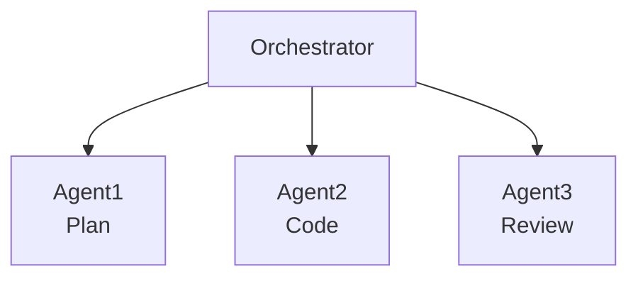
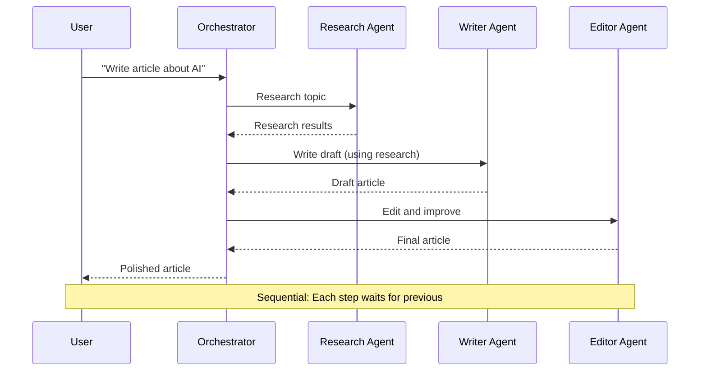
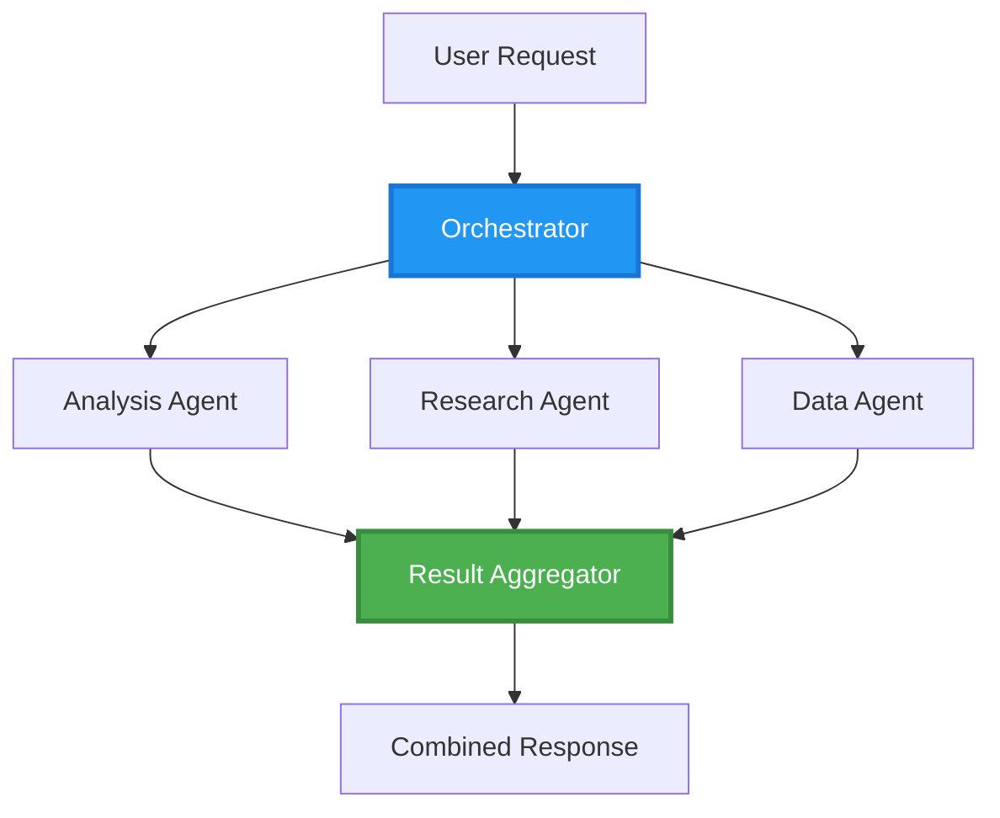
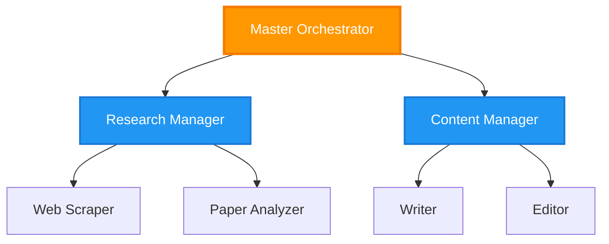
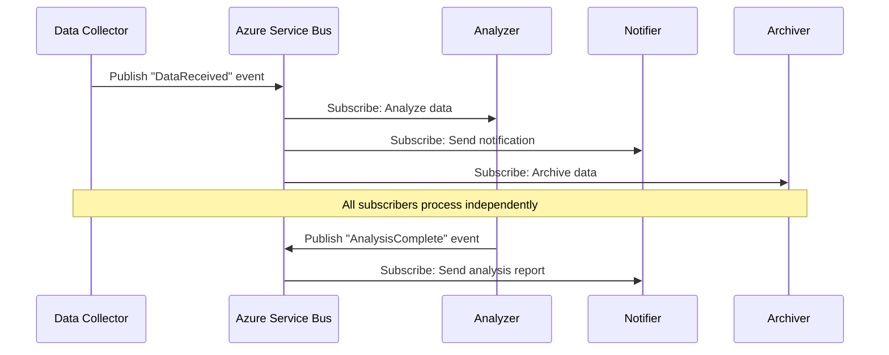
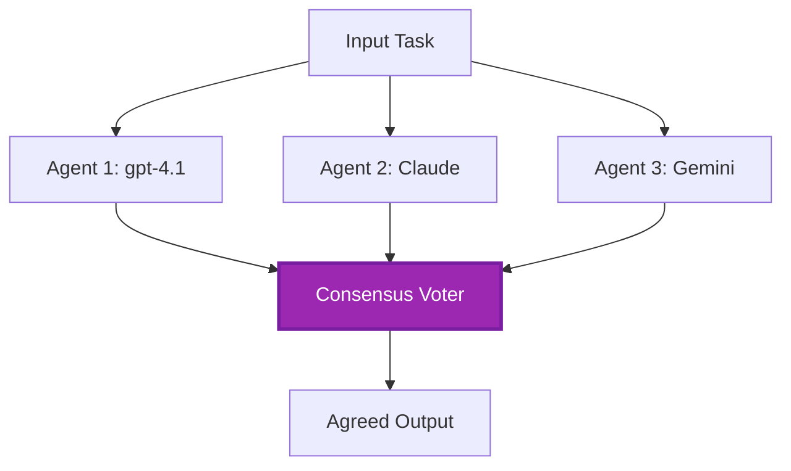
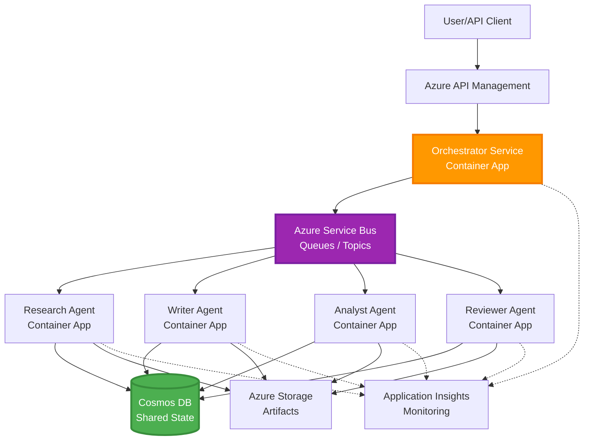

# លំនាំសម្របសម្រួលភ្នាក់ងារជាច្រើន

⏱️ **ពេលវេលាដែលបានប៉ាន់ស្មាន**: ៦០-៧៥ នាទីសម្រាប់អាន; ពីរបីម៉ោងសម្រាប់អនុវត្ត | 💰 **ការចំណាយដែលបានប៉ាន់ស្មាន**: អាស្រ័យលើបន្ទុកការងារ | ⭐ **ភាពស្មុគស្មាញ**: កម្រិតខ្ពស់

**📚 ផ្លូវការរៀន:**
- ← មុន: [ការធ្វើផែនការថាមពល](capacity-planning.md) - វិធានការវាស់ទំហំធនធាននិងការបង្កើតដំណំ
- 🎯 **អ្នកនៅទីនេះ**: លំនាំសម្របសម្រួលភ្នាក់ងារជាច្រើន (ការគ្រប់គ្រងប្រតិបត្តិការ, ការទំនាក់ទំនង, ការគ្រប់គ្រងស្ថានភាព)
- → បន្ទាប់: [ជម្រើស SKU](sku-selection.md) - ការជ្រើសរើសសេវាកម្ម Azure ត្រឹមត្រូវ
- 🏠 [ទំព័រដើមវគ្គសិក្សា](../../README.md)

---

## អ្វីដែលអ្នកនឹងរៀន

តាមការបញ្ចប់មេរៀននេះ អ្នកនឹង:
- យល់ដឹងអំពីលំនាំស្ថាបត្យកម្ម **ភ្នាក់ងារជាច្រើន** និងពេលដែលត្រូវប្រើ
- អនុវត្តលំនាំ **ការគ្រប់គ្រងប្រតិបត្តិការ** (ផ្ដុំក្ដៅ, បែងចែក, ជាលំដាប់ថ្នាក់)
- រចនាយុទ្ធសាស្រ្ត **ការទំនាក់ទំនងរវាងភ្នាក់ងារ** (សម័យ, អសម័យ, ដឹកនាំដោយព្រឹត្តិការណ៍)
- គ្រប់គ្រង **ស្ថានភាពចែករំលែក** តាមរយៈភ្នាក់ងារចែកចាយ
- ដាក់បញ្ចេញ **ប្រព័ន្ធភ្នាក់ងារជាច្រើន** នៅលើ Azure ជាមួយ AZD
- អនុវត្ត **លំនាំសម្របសម្រួល** សម្រាប់ស្ថានភាព AI លើពិភពលោកពិត
- តាមដាន និងរំលោភប្រព័ន្ធភ្នាក់ងារចែកចាយ

## ហេតុអ្វីបានជាសម្របសម្រួលភ្នាក់ងារជាច្រើនមានសារៈសំខាន់

### ការវិវត្ត: ពីភ្នាក់ងារតែ១ទៅភ្នាក់ងារជាច្រើន

**ភ្នាក់ងារតែមួយ (សាមញ្ញ):**
```
User → Agent → Response
```
- ✅ ងាយស្រួលយល់ និងអនុវត្ត
- ✅ លឿនសម្រាប់ភារកិច្ចសាមញ្ញ
- ❌ កំណត់ដោយសមត្ថភាពម៉ូដែលតែមួយ
- ❌ មិនអាចធ្វើការងារច្រើនជាប្រភេទស្រដៀងគ្នាប្រកបដោយសមមូលកាលបាន
- ❌ គ្មានការប្តេជ្ញាពិសេស

**ប្រព័ន្ធភ្នាក់ងារជាច្រើន (ចម្រើន):**

- ✅ ភ្នាក់ងារប្តេជ្ញាពិសេសសម្រាប់ភារកិច្ចជាក់លាក់
- ✅ ប្រតិបត្តិការជាប្រភេទស្រដៀងគ្នាសម្រាប់លឿន
- ✅ ម៉ូឌុល និងងាយស្រួលថែរក្សា
- ✅ ល្អសម្រាប់កម្មវិធីដំណើរការចម្រុះ
- ⚠️ តើបច្ចេកទេសសម្របសម្រួលត្រូវការ។

**ប្រៀបធៀប**: ភ្នាក់ងារតែមួយដូចជាមនុស្សម្នាក់ធ្វើភារកិច្ចគ្រប់យ៉ាង។ ភ្នាក់ងារជាច្រើនដូចជាក្រុមមនុស្សដែលមានជំនាញប្តេជ្ញាពិសេសនេស្ងាត់ (អ្នកស្រាវជ្រាវ, អ្នកកូដ, អ្នកពិនិត្យ, អ្នកសរសេរ) ធ្វើការរួមគ្នា។

---

## លំនាំសម្របសម្រួលស្នូល

### លំនាំ ១: សម្របសម្រួលជាលំដាប់ (ខ្សែសង្រ្គោះកំពុងមានអំណាច)

**ពេលដែលត្រូវប្រើ**: ភារកិច្ចត្រូវបានបញ្ចប់ជាលំដាប់ជាក់លាក់ រាល់ភ្នាក់ងារបង្កើតលើលទ្ធផលមុន



**អត្ថប្រយោជន៍:**
- ✅ បរិច្ឆេទទិន្នន័យច្បាស់លាស់
- ✅ ងាយស្រួលត្រួតពិនិត្យប្រសិទ្ធិភាព
- ✅ លំដាប់ប្រតិបត្តិការមានអាចទាយទ្រាន់បាន

**កំណត់ខ្លះ:**
- ❌ យឺតជាង (គ្មានការប្រតិបត្តិការជាប្រភេទស្រដៀងគ្នា)
- ❌ ករណីខូចខាតមួយរំខានឈូសសង្ស័យខ្សែសង្រ្គោះទាំងមូល
- ❌ មិនអាចដោះស្រាយភារកិច្ចដែលពាក់ព័ន្ធគ្នា

**ឧទាហរណ៍នៃការប្រើប្រាស់:**
- បណ្ដាញបង្កើតមាតិកា (ស្រាវជ្រាវ → សរសេរ → កែសម្រួល → បោះពុម្ព)
- ការបង្កើតកូដ (ផែនការ → អនុវត្ត → សាកល្បង → ចេញផ្សាយ)
- ការបង្កើតរបាយការណ៍ (ប្រមូលទិន្នន័យ → វិភាគ → ការបង្ហាញ → សង្ខេប)

---

### លំនាំ ២: សម្របសម្រួលជាប្រភេទស្រដៀងគ្នា (បង្ហាញចេញ/បញ្ចូល)

**ពេលដែលត្រូវប្រើ**: ភារកិច្ចឯករាជ្យអាចបើកដំណើរការអស់រយៈពេលតែមួយ លទ្ធផលបញ្ចូលរួមចំណូលចុងក្រោយ



**អត្ថប្រយោជន៍:**
- ✅ លឿន (ប្រតិបត្តិការជាប្រភេទស្រដៀងគ្នា)
- ✅ មានការពារកំហុស (លទ្ធផលផ្នែកសម្រាប់ទទួលយកបាន)
- ✅ អាចកំណត់លំដាប់ផ្គុំបានជាលំដាប់ផ្ទាល់ខ្លួន

**កំណត់ខ្លះ:**
- ⚠️ លទ្ធផលអាចមិនស្របលំដាប់
- ⚠️ ត្រូវការយុទ្ធសាស្រ្តសម្រាប់បង្រួមលទ្ធផល
- ⚠️ ការគ្រប់គ្រងស្ថានភាពស្មុគស្មាញ

**ឧទាហរណ៍នៃការប្រើប្រាស់:**
- ការប្រមូលទិន្នន័យពីប្រភពច្រើន (APIs + មូលដ្ឋានទិន្នន័យ + ការទាញចេញពីវេបសាយ)
- វិភាគប្រកួតប្រជែង (ម៉ូដែលច្រើនបង្កើតដំណោះស្រាយ, ជ្រើសរើសល្អបំផុត)
- សេវាកម្មបកប្រែ (បកប្រែក្នុងភាសាជាច្រើនក្នុងពេលតែមួយ)

---

### លំនាំ ៣: សម្របសម្រួលជាលំដាប់ថ្នាក់ (អ្នកគ្រប់គ្រង-កម្មករ)

**ពេលដែលត្រូវប្រើ**: ចរន្តការងារចម្រុះមានភារកិច្ចរង ត្រូវការចែកចាយការងារ



**អត្ថប្រយោជន៍:**
- ✅ រៀបចំចរន្តការងារចម្រុះ
- ✅ ម៉ូឌុល និងងាយស្រួលថែរក្សា
- ✅ ស្វែងយល់ច្បាស់អំពីព្រំដែនភារកិច្ច

**កំណត់ខ្លះ:**
- ⚠️ ស្ថាបត្យកម្មស្មុគស្មាញជាងមុន
- ⚠️ ពន្យារការពេល (មានស្រទាប់សម្របសម្រួលជាច្រើន)
- ⚠️ តម្រូវការសម្របសម្រួលអំណាញ់ខ្លាំង

**ឧទាហរណ៍នៃការប្រើប្រាស់:**
- ការដំណើរការឯកសារអាជីវកម្ម (ចាត់ថ្នាក់ → ផ្ញើ → ដំណើរការ → សន្សំសំចៃ)
- បន្លាញទិន្នន័យបណ្តាតំណាក់ (បញ្ចូល → សម្អាត → បម្លែង → វិភាគ → របាយការណ៍)
- ចរន្តអូតូម៉ាសិនស្មុគស្មាញ (ផែនការ → ផ្ដល់ធនធាន → ប្រតិបត្តិ → តាមដាន)

---

### លំនាំ ៤: សម្របសម្រួលដឹកនាំដោយព្រឹត្តិការណ៍ (ផ្សព្វផ្សាយ-ជាវ)

**ពេលដែលត្រូវប្រើ**: ភ្នាក់ងារត្រូវការឆ្លើយតបទៅព្រឹត្តិការណ៍, ចង់បានការតភ្ជាប់បត់បែន



**អត្ថប្រយោជន៍:**
- ✅ ការតភ្ជាប់តិចតួចរវាងភ្នាក់ងារ
- ✅ ងាយស្រួលបន្ថែមភ្នាក់ងារថ្មី (គ្រាន់តែជាវ)
- ✅ ការបញ្ច្រាសដំណើរការ
- ✅ មានភាពធន់នឹងបញ្ហា (ការរក្សាសារប្រាប់)

**កំណត់ខ្លះ:**
- ⚠️ ភាពជាប្រកាសរាប់ចុងក្រោយ
- ⚠️ ការត្រួតពិនិត្យបញ្ហាស្មុគស្មាញ
- ⚠️ ប្រឈមមុខការបញ្ជាំងលំដាប់សារលំបាក

**ឧទាហរណ៍នៃការប្រើប្រាស់:**
- ប្រព័ន្ធតាមដានពេលវេលាពិត (ការជូនដំណឹង, ផ្ទាំងបង្ហាញ, កំណត់ហេតុ)
- ការជូនដំណឹងច្រើនប៉ុស្តិ៍ (អ៊ីមែល, SMS, ជូនដំណឹងតាម push, Slack)
- ចរន្តដំណើរការទិន្នន័យ (អ្នកប្រើច្រើននៃទិន្នន័យដូចគ្នា)

---

### លំនាំ ៥: សម្របសម្រួលដោយផ្អែកលើការយល់ព្រម (បោះឆ្នោត/Quorum)

**ពេលដែលត្រូវប្រើ**: ត្រូវការយល់ព្រមពីភ្នាក់ងារជាច្រើនមុននឹងទៅមុខ



**អត្ថប្រយោជន៍:**
- ✅ ត្រឹមត្រូវខ្ពស់ (មតិយោបល់ជាច្រើន)
- ✅ មានភាពធន់នឹងកំហុស (ការបរាជ័យតិចតួចទទួលយកបាន)
- ✅ មានការធានាគុណភាពបញ្ចូលដោយស្វ័យប្រវត្តិ

**កំណត់ខ្លះ:**
- ❌ ថ្លៃថ្លា (ហៅម៉ូដែលជាច្រើន)
- ❌ យឺតជាង (រង់ចាំភ្នាក់ងារទាំងអស់)
- ⚠️ ត្រូវការជំនួយដោះស្រាយជម្លោះ

**ឧទាហរណ៍នៃការប្រើប្រាស់:**
- ការត្រួតពិនិត្យមាតិកា (ម៉ូដែលជាច្រើនពិនិត្យមាតិកា)
- ការពិនិត្យកូដ (កម្មវិធីភាសាជាច្រើន/អាណាឡ័យស៊ីស)
- ការធ្វើវិនិច្ឆ័យវេជ្ជសាស្រ្ត (ម៉ូដែល AI ជាច្រើន, ការត្រួតពិនិត្យរបស់អ្នកជំនាញ)

---

## ទិដ្ឋភាពស្ថាបត្យកម្ម

### ប្រព័ន្ធភ្នាក់ងារជាច្រើនលេញលើ Azure



**ផ្នែកសំខាន់ៗ:**

| ផ្នែក | គោលបំណង | សេវាកម្ម Azure |
|-----------|---------|---------------|
| **API Gateway** | ច្រកចូល, កំណត់អត្រា, អ្នកមានសិទ្ធិ | API Management |
| **Orchestrator** | សម្របសម្រួលចរន្តការងារភ្នាក់ងារ | Container Apps |
| **Message Queue** | ការទំនាក់ទំនងអសម័យ | Service Bus / Event Hubs |
| **Agents** | កម្មករជំនាញ AI | Container Apps / Functions |
| **State Store** | ស្ថានភាពចែករំលែក, ការតាមដានភារកិច្ច | Cosmos DB |
| **Artifact Storage** | ឯកសារ, លទ្ធផល, កំណត់ហេតុ | Blob Storage |
| **Monitoring** | ការតាមដានចែកចាយ, កំណត់ហេតុ | Application Insights |

Service Bus queues/topics និង Event Hubs គឺជាសេវាកម្មខុសគ្នាមានគំរូការដឹកជញ្ជូន/ការបរិច្ឆេទខុសៗគ្នា ហើយ Event Hubs មិនមែនជាជំនួសជាន់ខាងក្រោមសម្រាប់កូដកម្មករ Service Bus។ ប្រភេទស្រដៀងគ្នា, សារបានរក្សាទុក, និងការបោះឆ្នោតម៉ូដែលមិនធានាថាមានភាពធន់នឹងបញ្ហា ឬភាពត្រឹមត្រូវខ្ពស់ទេ។

---

## លក្ខខណ្ឌជាមុន

### ឧបករណ៍ដែលត្រូវការ

```bash
# Verify Azure Developer CLI
azd version
# Command reference baseline: azd 1.37.2

# Verify Azure CLI
az --version
# ✅ Expected: azure-cli 2.50.0 or higher

# Verify Docker (for local testing)
docker --version
# ✅ Expected: Docker version 20.10 or higher
```

### លក្ខខណ្ឌ Azure

- មានជាវ Azure សកម្ម
- សិទ្ធិបង្កើត:
  - Container Apps
  - Service Bus namespaces
  - Cosmos DB accounts
  - Storage accounts
  - Application Insights

### វិជ្ជាជីវៈដែលត្រូវមាន

អ្នកគួរបានបញ្ចប់:
- [ការគ្រប់គ្រងការកំណត់តម្លៃ](../chapter-03-configuration/configuration.md)
- [ការផ្ទៀងផ្ទាត់ & សុវត្ថិការ](../chapter-03-configuration/authsecurity.md)
- [ឧទាហរណ៍ Microservices](../../../../examples/microservices)

---

## មគ្គុទេសក៍អនុវត្ត

> **ប្លែកពីការរចនាគម្រោង មិនមែនបន្ទប់ប្រតិបត្តិការ:** ដើមគ្រោងគម្រោង និង ស្លាក `File:` ខាងក្រោមពិពណ៌នាឯកសារដែលត្រូវបង្កើតក្នុងគម្រោងផ្ទាល់ខ្លួនរបស់អ្នក; ឃ្លាំងនេះមិនមានកម្មវិធី `multi-agent-system` ពេញលេញទេ។ ផ្នែកខ្វះរួមមានគំរូ main/parameter, បរិយាកាស/ឃ្លាំង Container Apps, Dockerfiles និងបិទអាស្រ័យទាក់ទង, ការតំឡើងមូលដ្ឋានទិន្នន័យ Cosmos, ការដោតម៉ូដែល, ការកំណត់អត្តសញ្ញាណ/តួនាទី, នីតិវិធីបង្ហាញទំហំនិងកម្មករនៅជាប្រភេទស្រដៀងគ្នា/ជួរដេក។ កុំរំពឹងថា `azd init` នឹងបង្កើតឯកសារទាំងនេះ ឬ `azd up` នឹងដាក់ទាញឯកសារបំណែកបានដូចដើម។ សម្រាប់ចំណុចចាប់ផ្តើមអាចអនុវត្តបាន សូមបញ្ចប់ [មូលដ្ឋានមនុស្សភ្នាក់ងារជាច្រើន](../chapter-05-multi-agent/multi-agent-basics.md)។

**ការជឿជាក់របស់ Runtime:** Python 3.10+, `azure-servicebus`, `azure-cosmos`, `openai`, Flask, និង (សម្រាប់តាមដាន) `azure-monitor-opentelemetry`; ដាក់ `shared` លើផ្លូវនាំចូល Python នៅក្នុងរូបភាពសេវាកម្មនីមួយៗ។ តែងតែមានយន្តការបន្លាត Cosmos `agent-state/tasks` ដែលមានកូនសោ `/id` ហើយ។ ការតភ្ជាប់តាមប្រភេទសោសំខាន់ធ្វើអោយមានភាពងាយស្រួលក្នុងការប្រើប្រាស់ផ្នែកខាងលើ មិនមែនជាអនុសាសន៍បង្កើតផលិតកម្មទេ៖ ជ្រើសរើសអត្តសញ្ញាណគ្រប់គ្រងមានតួនាទីលើ Service Bus/Cosmos/OpenAI ក្នុងផ្ទៃការទិន្នន័យ។ កុំបង្ហាញសោក្នុងលទ្ធផល ឬកំណត់ហេតុ។

ការដឹកជញ្ជូន Service Bus គឺ **យ៉ាងហោចណាស់មួយដង**។ រាល់ការប្រតិបត្តិ idempotency ត្រូវបានរក្សាទុកសម្រាប់ភារកិច្ច **និងជំហាន** ប្រើ optimistic concurrency (ETags) សម្រាប់អាន/កែប្រែ/សរសេរស្ថានភាព និងបន្តបិទសារទីថ្ងៃនៅថ្ងៃបន្ត។ អ្នកគ្រប់គ្រងស្ថានភាពសាមញ្ញខាងក្រោមគឺមានតែមួយលំដាប់ប៉ុណ្ណោះហើយមិនអនុវត្តធានាការផលិតទេ។

### រចនាសម្ព័ន្ធគម្រោង

```
multi-agent-system/
├── azure.yaml                    # AZD configuration
├── infra/
│   ├── main.bicep               # Main infrastructure
│   ├── core/
│   │   ├── servicebus.bicep     # Message queue
│   │   ├── cosmos.bicep         # State store
│   │   ├── storage.bicep        # Artifact storage
│   │   └── monitoring.bicep     # Application Insights
│   └── app/
│       ├── orchestrator.bicep   # Orchestrator service
│       └── agent.bicep          # Agent template
└── src/
    ├── orchestrator/            # Orchestration logic
    │   ├── app.py
    │   ├── workflows.py
    │   └── Dockerfile
    ├── agents/
    │   ├── research/            # Research agent
    │   ├── writer/              # Writer agent
    │   ├── analyst/             # Analyst agent
    │   └── reviewer/            # Reviewer agent
    └── shared/
        ├── state_manager.py     # Shared state logic
        └── message_handler.py   # Message handling
```

---

## មេរៀន ១៖ លំនាំសម្របសម្រួលជាលំដាប់

### អនុវត្ត: ផ្លូវការបង្កើតមាតិកា

យើងនឹងរចនាផ្លូវការជាលំដាប់: ស្រាវជ្រាវ → សរសេរ → កែសំរួល។ ការបោះពុម្ពនៅក្រៅឧទាហរណ៍នេះ។

### ១. ការកំណត់ AZD

**ឯកសារ: `azure.yaml`**

```yaml
name: content-pipeline
metadata:
  template: multi-agent-sequential@1.0.0

services:
  orchestrator:
    project: ./src/orchestrator
    language: python
    host: containerapp
  
  research-agent:
    project: ./src/agents/research
    language: python
    host: containerapp
  
  writer-agent:
    project: ./src/agents/writer
    language: python
    host: containerapp
  
  editor-agent:
    project: ./src/agents/editor
    language: python
    host: containerapp
```

### ២. ឧបករណ៍: Service Bus សម្រាប់សម្របសម្រួល

**ឯកសារ: `infra/core/servicebus.bicep`**

```bicep
param name string
param location string
param tags object = {}

resource serviceBusNamespace 'Microsoft.ServiceBus/namespaces@2022-10-01-preview' = {
  name: name
  location: location
  tags: tags
  sku: {
    name: 'Standard'
    tier: 'Standard'
  }
  properties: {
    minimumTlsVersion: '1.2'
  }
}

// Queue for orchestrator → research agent
resource researchQueue 'Microsoft.ServiceBus/namespaces/queues@2022-10-01-preview' = {
  parent: serviceBusNamespace
  name: 'research-tasks'
  properties: {
    maxDeliveryCount: 3
    lockDuration: 'PT5M'
    deadLetteringOnMessageExpiration: true
  }
}

// Queue for research agent → writer agent
resource writerQueue 'Microsoft.ServiceBus/namespaces/queues@2022-10-01-preview' = {
  parent: serviceBusNamespace
  name: 'writer-tasks'
  properties: {
    maxDeliveryCount: 3
    lockDuration: 'PT5M'
  }
}

// Queue for writer agent → editor agent
resource editorQueue 'Microsoft.ServiceBus/namespaces/queues@2022-10-01-preview' = {
  parent: serviceBusNamespace
  name: 'editor-tasks'
  properties: {
    maxDeliveryCount: 3
    lockDuration: 'PT5M'
  }
}

output namespace string = serviceBusNamespace.name
// Do not output RootManageSharedAccessKey. Resolve scoped credentials
// securely or use managed identity in the application and scale rules.
```

### ៣. អ្នកគ្រប់គ្រងស្ថានភាពចែករំលែក

**ឯកសារ: `src/shared/state_manager.py`**

```python
from azure.cosmos import CosmosClient, PartitionKey
from datetime import datetime, timezone
import os

class StateManager:
    """Manages shared state across agents using Cosmos DB"""
    
    def __init__(self):
        endpoint = os.environ['COSMOS_ENDPOINT']
        key = os.environ['COSMOS_KEY']
        
        self.client = CosmosClient(endpoint, key)
        self.database = self.client.get_database_client('agent-state')
        self.container = self.database.get_container_client('tasks')
    
    def create_task(self, task_id: str, task_type: str, input_data: dict):
        """Create a new task"""
        task = {
            'id': task_id,
            'type': task_type,
            'status': 'pending',
            'input': input_data,
            'created_at': datetime.now(timezone.utc).isoformat(),
            'steps': []
        }
        self.container.create_item(task)
        return task
    
    def update_task_step(self, task_id: str, step_name: str, result: dict):
        """Update task with completed step"""
        task = self.container.read_item(task_id, partition_key=task_id)
        
        task['steps'].append({
            'name': step_name,
            'completed_at': datetime.now(timezone.utc).isoformat(),
            'result': result
        })
        
        self.container.replace_item(task_id, task)
        return task
    
    def complete_task(self, task_id: str, final_result: dict):
        """Mark task as complete"""
        task = self.container.read_item(task_id, partition_key=task_id)
        task['status'] = 'completed'
        task['result'] = final_result
        task['completed_at'] = datetime.now(timezone.utc).isoformat()
        self.container.replace_item(task_id, task)
        return task
    
    def get_task(self, task_id: str):
        """Retrieve task state"""
        return self.container.read_item(task_id, partition_key=task_id)
```

### ៤. សេវាកម្ម Orchestrator

**ឯកសារ: `src/orchestrator/app.py`**

```python
from flask import Flask, request, jsonify
from azure.servicebus import ServiceBusClient, ServiceBusMessage
import json
import uuid
import os
from shared.state_manager import StateManager

app = Flask(__name__)
state_manager = StateManager()

# Service Bus connection
servicebus_connection_str = os.environ['SERVICEBUS_CONNECTION_STRING']
servicebus_client = ServiceBusClient.from_connection_string(servicebus_connection_str)

@app.route('/health', methods=['GET'])
def health():
    return jsonify({'status': 'healthy', 'service': 'orchestrator'})

@app.route('/create-content', methods=['POST'])
def create_content():
    """
    Sequential workflow: Research → Write → Edit (returns a draft; no publishing)
    """
    data = request.get_json(silent=True) or {}
    topic = data.get('topic')
    
    if not topic:
        return jsonify({'error': 'Topic required'}), 400
    
    # Create task in state store
    task_id = str(uuid.uuid4())
    task = state_manager.create_task(
        task_id=task_id,
        task_type='content_creation',
        input_data={'topic': topic}
    )
    
    # Send message to research agent (first step)
    sender = servicebus_client.get_queue_sender('research-tasks')
    message = ServiceBusMessage(
        body=json.dumps({
            'task_id': task_id,
            'topic': topic,
            'next_queue': 'writer-tasks'  # Where to send results
        }),
        content_type='application/json'
    )
    
    with sender:
        sender.send_messages(message)
    
    return jsonify({
        'task_id': task_id,
        'status': 'started',
        'workflow': 'sequential',
        'steps': ['research', 'write', 'edit'],
        'message': 'Content creation pipeline initiated'
    }), 202

@app.route('/task/<task_id>', methods=['GET'])
def get_task_status(task_id):
    """Check task status"""
    try:
        task = state_manager.get_task(task_id)
        return jsonify(task)
    except Exception as e:
        return jsonify({'error': str(e)}), 404

if __name__ == '__main__':
    app.run(host='0.0.0.0', port=8080)
```

### ៥. ភ្នាក់ងារស្រាវជ្រាវ

**ឯកសារ: `src/agents/research/app.py`**

```python
from azure.servicebus import ServiceBusClient, ServiceBusMessage
from openai import AzureOpenAI
import json
import os
import time
from shared.state_manager import StateManager

# Initialize clients
state_manager = StateManager()
servicebus_client = ServiceBusClient.from_connection_string(
    os.environ['SERVICEBUS_CONNECTION_STRING']
)

openai_client = AzureOpenAI(
    api_key=os.environ['AZURE_OPENAI_API_KEY'],
    api_version="2024-10-21",
    azure_endpoint=os.environ['AZURE_OPENAI_ENDPOINT']
)

def process_research_task(message_data):
    """Process research request and pass to writer"""
    task_id = message_data['task_id']
    topic = message_data['topic']
    next_queue = message_data['next_queue']
    
    print(f"🔬 Researching: {topic}")
    
    # Call Microsoft Foundry Models for research
    response = openai_client.chat.completions.create(
        model=os.environ['AZURE_OPENAI_DEPLOYMENT'],
        messages=[
            {"role": "system", "content": "You are a research assistant. Provide comprehensive research on the given topic."},
            {"role": "user", "content": f"Research this topic thoroughly: {topic}"}
        ],
        max_tokens=1500
    )
    
    research_results = response.choices[0].message.content
    
    # Update state
    state_manager.update_task_step(
        task_id=task_id,
        step_name='research',
        result={'research': research_results}
    )
    
    # Send to next agent (writer)
    sender = servicebus_client.get_queue_sender(next_queue)
    message = ServiceBusMessage(
        body=json.dumps({
            'task_id': task_id,
            'topic': topic,
            'research': research_results,
            'next_queue': 'editor-tasks'
        }),
        content_type='application/json'
    )
    
    with sender:
        sender.send_messages(message)
    
    print(f"✅ Research complete for task {task_id}")

def main():
    """Listen to research queue"""
    receiver = servicebus_client.get_queue_receiver('research-tasks')
    
    print("🔬 Research Agent started, listening for tasks...")
    
    with receiver:
        while True:
            messages = receiver.receive_messages(max_wait_time=5)
            for message in messages:
                try:
                    message_data = json.loads(str(message))
                    process_research_task(message_data)
                    receiver.complete_message(message)
                except Exception as e:
                    print(f"❌ Error processing message: {e}")
                    receiver.abandon_message(message)

if __name__ == '__main__':
    main()
```

### ៦. ភ្នាក់ងារសរសេរ

**ឯកសារ: `src/agents/writer/app.py`**

```python
from azure.servicebus import ServiceBusClient, ServiceBusMessage
from openai import AzureOpenAI
import json
import os
from shared.state_manager import StateManager

state_manager = StateManager()
servicebus_client = ServiceBusClient.from_connection_string(
    os.environ['SERVICEBUS_CONNECTION_STRING']
)

openai_client = AzureOpenAI(
    api_key=os.environ['AZURE_OPENAI_API_KEY'],
    api_version="2024-10-21",
    azure_endpoint=os.environ['AZURE_OPENAI_ENDPOINT']
)

def process_writing_task(message_data):
    """Write article based on research"""
    task_id = message_data['task_id']
    topic = message_data['topic']
    research = message_data['research']
    next_queue = message_data['next_queue']
    
    print(f"✍️ Writing article: {topic}")
    
    # Call Microsoft Foundry Models to write article
    response = openai_client.chat.completions.create(
        model=os.environ['AZURE_OPENAI_DEPLOYMENT'],
        messages=[
            {"role": "system", "content": "You are a professional writer. Write engaging, well-structured articles."},
            {"role": "user", "content": f"Based on this research:\n\n{research}\n\nWrite a comprehensive article about: {topic}"}
        ],
        max_tokens=2000
    )
    
    article_draft = response.choices[0].message.content
    
    # Update state
    state_manager.update_task_step(
        task_id=task_id,
        step_name='writing',
        result={'draft': article_draft}
    )
    
    # Send to editor
    sender = servicebus_client.get_queue_sender(next_queue)
    message = ServiceBusMessage(
        body=json.dumps({
            'task_id': task_id,
            'topic': topic,
            'draft': article_draft
        }),
        content_type='application/json'
    )
    
    with sender:
        sender.send_messages(message)
    
    print(f"✅ Article draft complete for task {task_id}")

def main():
    """Listen to writer queue"""
    receiver = servicebus_client.get_queue_receiver('writer-tasks')
    
    print("✍️ Writer Agent started, listening for tasks...")
    
    with receiver:
        while True:
            messages = receiver.receive_messages(max_wait_time=5)
            for message in messages:
                try:
                    message_data = json.loads(str(message))
                    process_writing_task(message_data)
                    receiver.complete_message(message)
                except Exception as e:
                    print(f"❌ Error: {e}")
                    receiver.abandon_message(message)

if __name__ == '__main__':
    main()
```

### ៧. ភ្នាក់ងារកែសំរួល

**ឯកសារ: `src/agents/editor/app.py`**

```python
from azure.servicebus import ServiceBusClient
from openai import AzureOpenAI
import json
import os
from shared.state_manager import StateManager

state_manager = StateManager()
servicebus_client = ServiceBusClient.from_connection_string(
    os.environ['SERVICEBUS_CONNECTION_STRING']
)

openai_client = AzureOpenAI(
    api_key=os.environ['AZURE_OPENAI_API_KEY'],
    api_version="2024-10-21",
    azure_endpoint=os.environ['AZURE_OPENAI_ENDPOINT']
)

def process_editing_task(message_data):
    """Edit and finalize article"""
    task_id = message_data['task_id']
    topic = message_data['topic']
    draft = message_data['draft']
    
    print(f"📝 Editing article: {topic}")
    
    # Call Microsoft Foundry Models to edit
    response = openai_client.chat.completions.create(
        model=os.environ['AZURE_OPENAI_DEPLOYMENT'],
        messages=[
            {"role": "system", "content": "You are an expert editor. Improve grammar, clarity, and structure."},
            {"role": "user", "content": f"Edit and improve this article:\n\n{draft}"}
        ],
        max_tokens=2000
    )
    
    final_article = response.choices[0].message.content
    
    # Mark task as complete
    state_manager.complete_task(
        task_id=task_id,
        final_result={
            'topic': topic,
            'final_article': final_article,
            'word_count': len(final_article.split())
        }
    )
    
    print(f"✅ Article finalized for task {task_id}")

def main():
    """Listen to editor queue"""
    receiver = servicebus_client.get_queue_receiver('editor-tasks')
    
    print("📝 Editor Agent started, listening for tasks...")
    
    with receiver:
        while True:
            messages = receiver.receive_messages(max_wait_time=5)
            for message in messages:
                try:
                    message_data = json.loads(str(message))
                    process_editing_task(message_data)
                    receiver.complete_message(message)
                except Exception as e:
                    print(f"❌ Error: {e}")
                    receiver.abandon_message(message)

if __name__ == '__main__':
    main()
```

### ៨. ដាក់បញ្ចេញ និងសាកល្បង

ពាក្យបញ្ជានេះអនុវត្ត **ប៉ុណ្ណោះបន្ទាប់ពីដែលអ្នកអនុវត្តឯកសារគម្រោងខ្វះ**។ ការចាប់ផ្ដើមភ្នាក់ងារ Interactive Foundry គឺជាចរន្តការងារផ្សេងទៀត; វាមិនបង្កើតនូវការរចនាការសម្របសម្រួល Service Bus នេះទេ។

```bash
# In your completed custom project
azd up

# Alternative in a SEPARATE empty folder (GA bundle workflow requires azd >= 1.37.0)
azd ext install microsoft.foundry
azd ai agent init
azd up
```

> មើល [AZD AI CLI Commands](../chapter-08-production/production-ai-practices.md#azd-ai-cli-commands-and-extensions) សម្រាប់ទ្រង់ទ្រាយនិងជម្រើស `azd ai` ទាំងអស់។

```bash
# Get orchestrator URL
ORCHESTRATOR_URL=$(azd env get-values | grep ORCHESTRATOR_URL | cut -d '=' -f2 | tr -d '"')

# Create content
curl -X POST $ORCHESTRATOR_URL/create-content \
  -H "Content-Type: application/json" \
  -d '{"topic": "The Future of AI in Healthcare"}'
```

**✅ លទ្ធផលដែលរំពឹងទុក:**
```json
{
  "task_id": "a1b2c3d4-e5f6-7890-abcd-ef1234567890",
  "status": "started",
  "workflow": "sequential",
  "steps": ["research", "write", "edit"],
  "message": "Content creation pipeline initiated"
}
```

**ត្រួតពិនិត្យភាពរីកចម្រើនភារកិច្ច:**
```bash
TASK_ID="a1b2c3d4-e5f6-7890-abcd-ef1234567890"
curl $ORCHESTRATOR_URL/task/$TASK_ID
```

**✅ លទ្ធផលដែលរំពឹងទុក (បានបញ្ចប់):**
```json
{
  "id": "a1b2c3d4-e5f6-7890-abcd-ef1234567890",
  "type": "content_creation",
  "status": "completed",
  "steps": [
    {
      "name": "research",
      "completed_at": "2025-11-19T10:30:00Z",
      "result": {"research": "..."}
    },
    {
      "name": "writing",
      "completed_at": "2025-11-19T10:32:00Z",
      "result": {"draft": "..."}
    }
  ],
  "result": {
    "topic": "The Future of AI in Healthcare",
    "final_article": "...",
    "word_count": 1500
  }
}
```

---

## មេរៀន ២៖ លំនាំសម្របសម្រួលជាប្រភេទស្រដៀងគ្នា

### អនុវត្ត: កម្មវិធីប្រមូលព័ត៌មានពីប្រភពច្រើន

យើងនឹងបង្កើតប្រព័ន្ធប្រភេទស្រដៀងគ្នាដែលប្រមូលព័ត៌មានពីប្រភពជាច្រើននៅពេលជាមួយគ្នា។

### Orchestrator ជាប្រភេទស្រដៀងគ្នា

**ឯកសារ: `src/orchestrator/parallel_workflow.py`**

```python
from flask import Flask, request, jsonify
from azure.servicebus import ServiceBusClient, ServiceBusMessage
import json
import uuid
import os
from shared.state_manager import StateManager

app = Flask(__name__)
state_manager = StateManager()

servicebus_client = ServiceBusClient.from_connection_string(
    os.environ['SERVICEBUS_CONNECTION_STRING']
)

@app.route('/research-parallel', methods=['POST'])
def research_parallel():
    """
    Parallel workflow: Multiple agents work simultaneously
    """
    data = request.json
    query = data.get('query')
    
    task_id = str(uuid.uuid4())
    task = state_manager.create_task(
        task_id=task_id,
        task_type='parallel_research',
        input_data={
            'query': query,
            'agents': ['web', 'academic', 'news', 'social']
        }
    )
    
    # Fan-out: publish sequentially; workers may process concurrently.
    agents = [
        ('web-research-queue', 'web'),
        ('academic-research-queue', 'academic'),
        ('news-research-queue', 'news'),
        ('social-research-queue', 'social')
    ]
    
    for queue_name, agent_type in agents:
        sender = servicebus_client.get_queue_sender(queue_name)
        message = ServiceBusMessage(
            body=json.dumps({
                'task_id': task_id,
                'query': query,
                'agent_type': agent_type,
                'result_queue': 'aggregation-queue'
            }),
            content_type='application/json'
        )
        
        with sender:
            sender.send_messages(message)
    
    return jsonify({
        'task_id': task_id,
        'status': 'started',
        'workflow': 'parallel',
        'agents_dispatched': 4,
        'message': 'Parallel research initiated'
    }), 202

if __name__ == '__main__':
    app.run(host='0.0.0.0', port=8080)
```

### យុទ្ធសាស្រ្តបង្រួមលទ្ធផល

**ឯកសារ: `src/agents/aggregator/app.py`**

```python
from azure.servicebus import ServiceBusClient
import json
import os
from collections import defaultdict
from shared.state_manager import StateManager

state_manager = StateManager()
servicebus_client = ServiceBusClient.from_connection_string(
    os.environ['SERVICEBUS_CONNECTION_STRING']
)

# Single-process demo only: not durable or shared across replicas.
# Production: use durable unique (task_id, agent_type) result records.
task_results = defaultdict(dict)
expected_agents = 4  # web, academic, news, social

def process_result(message_data):
    """Aggregate results from parallel agents"""
    task_id = message_data['task_id']
    agent_type = message_data['agent_type']
    result = message_data['result']
    
    # Store result
    task_results[task_id][agent_type] = {
        'agent': agent_type,
        'data': result
    }
    
    print(f"📊 Received result from {agent_type} agent ({len(task_results[task_id])}/{expected_agents})")
    
    # Check if all agents completed (fan-in)
    if len(task_results[task_id]) == expected_agents:
        print(f"✅ All agents completed for task {task_id}. Aggregating...")
        
        # Combine results
        aggregated = {
            'query': message_data['query'],
            'sources': list(task_results[task_id].values()),
            'summary': generate_summary(list(task_results[task_id].values()))
        }
        
        # Mark complete
        state_manager.complete_task(task_id, aggregated)
        
        # Clean up
        del task_results[task_id]
        
        print(f"✅ Aggregation complete for task {task_id}")

def generate_summary(results):
    """Generate summary from all sources"""
    summaries = [r['data'].get('summary', '') for r in results]
    return '\n\n'.join(summaries)

def main():
    """Listen to aggregation queue"""
    receiver = servicebus_client.get_queue_receiver('aggregation-queue')
    
    print("📊 Aggregator started, listening for results...")
    
    with receiver:
        while True:
            messages = receiver.receive_messages(max_wait_time=5)
            for message in messages:
                try:
                    message_data = json.loads(str(message))
                    process_result(message_data)
                    receiver.complete_message(message)
                except Exception as e:
                    print(f"❌ Error: {e}")
                    receiver.abandon_message(message)

if __name__ == '__main__':
    main()
```

**អត្ថប្រយោជន៍នៃលំនាំប្រភេទស្រដៀងគ្នា:**
- ⚡ **អាចបន្ថេខណៈពេលឆ្លើយតប** (គិតពីកម្មករយឺតជាងគេ បូកលើការសម្របសម្រួលបន្ថែម)
- 🔄 **អាចគាំទ្រលទ្ធផលផ្នែក** ជាមួយនឹងកំណត់ពេលវេលាច្បាស់ និងគោលនយោបាយករណីបរាជ័យ (មិនអនុវត្តដោយកម្មវិធីប្រមួលគោលដៅគ្រាន់ប៉ុណ្ណោះ)
- 📈 **អាចពង្រីកបាន** (បន្ថែមភ្នាក់ងារងាយស្រួល)

---

## លំហាត់អនុវត្តជាក់ស្តែង

### លំហាត់ ១: បន្ថែមការគ្រប់គ្រងការដាក់ពេលលើកលែង ⭐⭐ (កម្រិតមធ្យម)

**គោលដៅ**: អនុវត្តចក្ខុវិស័យពេលលើកលែង ដើម្បីឲ្យកម្មវិធីប្រមូលមិនរង់ចាំបន្តខណៈពេលម៉ាស៊ីនស្វ័យប្រវត្តិក្នុងការបញ្ចប់យឺត។

**ចំណុចចាប់ផ្តើម:** រត់កម្រិតពេលវេលាក្នុងមូលដ្ឋានមុន នេះមុននឹងបញ្ចូលទៅក្នុងកម្មករជួរដេក។ ការគ្រប់គ្រងពេលលើកលែងត្រូវបានពិនិត្យម្តងទេពេលមានសារមួយផ្សេងមកមក ហើយមិនបញ្ចេញពេលអ្នកនៅមិនផ្ញើសារមកនោះឡើយ។

**ជំហាន៖**

១. **បន្ថែមការតាមដានពេលលើកលែងទៅកម្មវិធីប្រមូល៖**

```python
import asyncio

async def simulated_agent(name, delay):
    await asyncio.sleep(delay)
    return {'agent': name, 'result': 'done'}

async def main():
    tasks = [asyncio.create_task(simulated_agent(name, delay))
             for name, delay in [('web', 0.1), ('academic', 0.2),
                                 ('news', 0.3), ('social', 3)]]
    done, pending = await asyncio.wait(tasks, timeout=1)
    results = [task.result() for task in done]
    for task in pending:
        task.cancel()
    await asyncio.gather(*pending, return_exceptions=True)
    print({'completed_agents': len(results), 'timed_out': bool(pending)})
    assert len(results) == 3 and pending

asyncio.run(main())
```

២. **លទ្ធផលដែលរំពឹងទុក:**

```text
{'completed_agents': 3, 'timed_out': True}
```

៣. **ការរួមបញ្ចូលជាមួយប្រព័ន្ធជួរដេក (ភារកិច្ចរចនា):** រក្សាកំណត់ពេលវេលាពេលបញ្ជូននិងភ្នាក់ងាររំពឹងទុកពេលបង្កើតភារកិច្ច, រត់ការត្រួតពិនិត្យពេលវេលានៅពេលវេលាត្រូវបានកំណត់ដោយឡែកពីលទ្ធផលដែលបានមក, បញ្ចប់លទ្ធផលផ្នែក ដោយមិនគិតសារយឺត/ចម្លងសម្រាប់ភារកិច្ចបានបញ្ចប់។ ការតំឡើងពេលលើកលែងក្នុងផ្ទាល់មិនបោះបង់កម្មករឆៀងចំកណ្តាល។

សម្រាប់គម្រោងដែលអ្នកបានអនុវត្តប៉ុណ្ណោះ:

```bash
azd deploy aggregator

# Submit task
curl -X POST $ORCHESTRATOR_URL/research-parallel \
  -H "Content-Type: application/json" \
  -d '{"query": "AI safety research"}'

# Check results after 30 seconds
curl $ORCHESTRATOR_URL/task/$TASK_ID
```

**✅ លក្ខណៈសំខាន់នៃភាពជោគជ័យ:**
- ✅ ការធ្វើតេស្តក្នុងស្រុកបញ្ចប់ក្រោយពេលកំណត់ពេល១វិនាទី ទោះភ្នាក់ងារមួយនៅមិនទាន់សរសេរបានចប់
- ✅ ចម្លើយបង្ហាញលទ្ធផលផ្នែក (`"timed_out": true`)
- ✅ លទ្ធផលដែលមាន (៣/៤ ភ្នាក់ងារ)

**ពេលវេលា**: ២០-២៥ នាទី

---

### លំហាត់ ២: អនុវត្តចក្ខុវិស័យ Retry ⭐⭐⭐ (កម្រិតខ្ពស់)

**គោលដៅ**: Retry បញ្ហាភ្នាក់ងារអូតូម៉ាទិច មុនពេលបោះបង់។

**ជំហាន៖**

១. **ប្រើអ្នករាប់ចំនួនដឹកជញ្ជូន Service Bus មិនមែនរាប់ចុះបញ្ជូលការប្រើចំណាត់ Retry ផ្ទាល់ខ្លួន:**

```python
import json
import time
# Integration fragment: use a live peek-lock ServiceBusReceiver.
# Set queue maxDeliveryCount to 4 for one attempt + up to three retries.
```

២. **បន្ថែមអ្នកគ្រប់គ្រង retry ទៅភ្នាក់ងារ:**

```python
def process_with_retry(message, receiver, process_func):
    """Process message with automatic retry on failure"""
    try:
        message_data = json.loads(str(message))
        
        # Process the message
        process_func(message_data)
        
        # Success - complete
        receiver.complete_message(message)
        
    except Exception as e:
        if message.delivery_count < 4:
            # Bounded exponential delay: 5s, 10s, 20s.
            # Renew the lock if processing + waiting can exceed its duration.
            time.sleep(5 * 2 ** (message.delivery_count - 1))
            receiver.abandon_message(message)
        else:
            # Max retries exceeded - move to dead letter queue
            print(f"❌ Max attempts exceeded for message {message.message_id}")
            receiver.dead_letter_message(
                message,
                reason="MaxRetriesExceeded",
                error_description=str(e)
            )
```

៣. **តាមដាន queue dead letter:**

```python
def monitor_dead_letters():
    """Check dead letter queue for failed messages"""
    receiver = servicebus_client.get_queue_receiver(
        'research-tasks',
        sub_queue='deadletter'
    )
    
    with receiver:
        messages = receiver.receive_messages(max_wait_time=5)
        for message in messages:
            print(f"☠️ Dead letter: {message.message_id}")
            print(f"Reason: {message.dead_letter_reason}")
            print(f"Description: {message.dead_letter_error_description}")
```

**✅ លក្ខណៈសំខាន់នៃភាពជោគជ័យ:**
- ✅ ភារកិច្ចបរាជ័យត្រូវលើកឡើងជាពីរចំនួន (រហូតដល់៣ដង)
- ✅ ការលើកឡើងដោយបន្ថែមពេលនៅចន្លោះ retry (៥ វិនាទី, ១០ វិនាទី, ២០ វិនាទី) និងការលើកសោសារក្នុងកន្លែងដែលត្រូវការ
- ✅ បន្ទាប់ពី retry ពេញលេញ សារនៅក្នុង queue dead letter
- ✅ អាចពិនិត្យសារបាត់បង់ក្នុង dead letter; ការចាក់កម្រងត្រូវការផលិតកម្មងារសម្លឹង idempotent ផ្សេងទៀត

**ពេលវេលា**: ៣០-៤០ នាទី

---

### លំហាត់ ៣: អនុវត្ត Circuit Breaker ⭐⭐⭐ (កម្រិតខ្ពស់)

**គោលដៅ**: បញ្ឈប់ការបរាជ័យជាស៊េរី ដោយបញ្ឈប់សំណើទៅភ្នាក់ងារដែលបរាជ័យ

**ជំហាន៖**

១. **បង្កើតថ្នាក់ circuit breaker:**

```python
from enum import Enum
from datetime import datetime, timedelta, timezone

class CircuitState(Enum):
    CLOSED = "closed"      # Normal operation
    OPEN = "open"          # Failing, reject requests
    HALF_OPEN = "half_open"  # Testing if recovered

class CircuitBreaker:
    def __init__(self, failure_threshold=5, timeout_seconds=60):
        self.failure_threshold = failure_threshold
        self.timeout_seconds = timeout_seconds
        self.failure_count = 0
        self.last_failure_time = None
        self.state = CircuitState.CLOSED
    
    def call(self, func):
        """Execute function with circuit breaker protection"""
        if self.state == CircuitState.OPEN:
            # Check if timeout expired
            if datetime.now(timezone.utc) - self.last_failure_time > timedelta(seconds=self.timeout_seconds):
                self.state = CircuitState.HALF_OPEN
                print("🔄 Circuit breaker: HALF_OPEN (testing)")
            else:
                raise Exception(f"Circuit breaker OPEN for agent. Try again in {self.timeout_seconds}s")
        
        try:
            result = func()
            
            # Success
            self.failure_count = 0 # Count consecutive failures only
            if self.state == CircuitState.HALF_OPEN:
                self.state = CircuitState.CLOSED
                self.failure_count = 0
                print("✅ Circuit breaker: CLOSED (recovered)")
            
            return result
            
        except Exception as e:
            self.failure_count += 1
            self.last_failure_time = datetime.now(timezone.utc)
            
            if self.failure_count >= self.failure_threshold:
                self.state = CircuitState.OPEN
                print(f"🔴 Circuit breaker: OPEN (too many failures)")
            
            raise
```

២. **អនុវត្តទៅការហៅភ្នាក់ងារ:**

```python
# In orchestrator
agent_circuits = {
    'web': CircuitBreaker(failure_threshold=5, timeout_seconds=60),
    'academic': CircuitBreaker(failure_threshold=5, timeout_seconds=60),
    'news': CircuitBreaker(failure_threshold=5, timeout_seconds=60),
    'social': CircuitBreaker(failure_threshold=5, timeout_seconds=60)
}

def send_to_agent(agent_type, message_data):
    """Send with circuit breaker protection"""
    circuit = agent_circuits[agent_type]
    
    try:
        circuit.call(lambda: send_message(agent_type, message_data))
    except Exception as e:
        print(f"⚠️ Skipping {agent_type} agent: {e}")
        # Continue with other agents
```

ឈរពាក្យនេះការពារការ **ផ្ញើការប្រតិបត្តិការ** មិនមែនការសម្រេចបានដោយកម្មករពីចម្ងាយឡើយៈ ការបញ្ចូលសារជោគជ័យមិនបាននិយាយអ្វីពីថាតើភ្នាក់ងារម្នាក់នៅមានជីវិតឬទេ។ `send_message` ជាអនុគមន៍អ្នកផ្ញើនៅក្នុងកម្មវិធីរបស់អ្នក។ សម្រាប់សៀគ្វីអនុវត្ត កាត់បន្ថយករណីបរាជ័យ/ពេលវេលាដំណើរការបាត់បង់ចូលទៅកាន់ អ្នកសម្របសម្រួលម្នាក់ដែលមានភាពធន់នឹងខូចខាត។ ថ្នាក់ក្នុងអង្គចងចាំនេះគឺជាបង្ហាញជាមួយត្រង់តែមួយចំនួន មិនមែនជាសៀគ្វីរោទិ៍ចែកចាយឡើយ។

3. **សាកល្បងសៀគ្វីរោទិ៍នៅក្នុងតំបន់មូលដ្ឋាន៖**

```python
# Run after the class definition; no Azure changes required.
circuit = CircuitBreaker(failure_threshold=5, timeout_seconds=0)
def fail():
    raise RuntimeError("simulated failure")
for _ in range(5):
    try:
        circuit.call(fail)
    except RuntimeError:
        pass
assert circuit.state == CircuitState.OPEN
assert circuit.call(lambda: "recovered") == "recovered"
assert circuit.state == CircuitState.CLOSED
print("Circuit breaker recovery verified")
```

**✅ មាតិកាជោគជ័យ៖**
- ✅ បន្ទាប់ពីបរាជ័យ ៥ ដង សៀគ្វីបើក (បដិសេធសំណើ)
- ✅ បន្ទាប់ពី ៦០ វិនាទី សៀគ្វីចូលដំណាក់កាលពាក់កណ្តាលបើក (សាកសួរចំពោះការស្ដារ)
- ✅ ភ្នាក់ងារផ្សេងទៀតបន្តការងារប្រកបដោយស្រេច
- ✅ សៀគ្វីបិតដោយស្វ័យប្រវត្តិពេលភ្នាក់ងារស្ដារឡើងវិញ

**ពេលវេលា**៖ ៤០-៥០ នាទី

---

## ការត្រួតពិនិត្យ និងដោះស្រាយបញ្ហា

### ការតាមដានចែកចាយជាមួយ Application Insights

**ឯកសារ៖ `src/shared/tracing.py`**

```python
from azure.monitor.opentelemetry import configure_azure_monitor
from opentelemetry import trace
from opentelemetry.trace import SpanKind
import logging
import os

connection_string = os.environ.get('APPLICATIONINSIGHTS_CONNECTION_STRING')

# Configure once per process. Message send/receive trace-context propagation
# and agent attributes on exceptions need explicit instrumentation.
if connection_string:
    configure_azure_monitor(connection_string=connection_string, logger_name=__name__)
tracer = trace.get_tracer(__name__)

# Configure logging
logger = logging.getLogger(__name__)
logger.setLevel(logging.INFO)

def trace_agent_call(agent_name, task_id, operation_name, operation):
    """Trace agent operations"""
    with tracer.start_as_current_span(f'agent.{agent_name}.{operation_name}', kind=SpanKind.CLIENT) as span:
        span.set_attribute('agent', agent_name)
        span.set_attribute('task_id', task_id)
        span.set_attribute('operation', operation_name)
        
        try:
            result = operation()
            span.set_attribute('status', 'success')
            logger.info('Agent operation completed', extra={
                'agent': agent_name, 'task_id': task_id, 'operation': operation_name
            })
            return result
        except Exception as e:
            span.set_attribute('status', 'error')
            logger.exception('Agent operation failed', extra={
                'agent': agent_name, 'task_id': task_id, 'operation': operation_name
            })
            raise
```

### សំណួរជាមួយ Application Insights

**តាមដានការប្រតិបត្ដិការពហុភ្នាក់ងារ៖**

```kusto
// Trace complete workflow for a task
traces
| where customDimensions.task_id == "a1b2c3d4-..."
| project timestamp, message, customDimensions.agent, customDimensions.operation
| order by timestamp asc
```

**ប្រៀបធៀបប្រសិទ្ធភាពភ្នាក់ងារ៖**

```kusto
// Compare agent execution times
dependencies
| where name contains "agent"
| summarize 
    avg_duration = avg(duration),
    p95_duration = percentile(duration, 95),
    count = count()
  by agent = tostring(customDimensions.agent)
| order by avg_duration desc
```

**វិភាគការបរាជ័យ៖**

```kusto
// Find which agents fail most
exceptions
| where customDimensions.agent != ""
| summarize 
    failure_count = count(),
    unique_errors = dcount(outerMessage)
  by agent = tostring(customDimensions.agent)
| order by failure_count desc
```

---

## ការវិភាគថ្លៃកម្រៃ

### ថ្លៃកម្រៃប្រព័ន្ធពហុភ្នាក់ងារ (ការប៉ាន់ប្រមាណប្រចាំខែ)

តម្លៃផែនការឧទាហរណ៍ប៉ុន្តែមិនមែនជាគំនិតថ្លៃឱ្យប្រាក់៖ សរុបខាងក្រោមគឺ **$240-565/ខែ**។ សូមផ្ទៀងផ្ទាត់ថ្លៃតំបន់បច្ចុប្បន្ន ម៉ោងយោង/អត់ប្រើប្រាស់ក្នុងស្វា (replica), លំនាំចេញចូលនៃទុកតែន, ការផ្ទុកទិន្នន័យ និងការតាមដាន។ Serverless គ្មានចំនួនទាបលទ្ធផលដែលបានកំណត់ទេ ប៉ុន្តែបង់ថ្លៃសម្រាប់សំណើ និងផ្ទុកទិន្នន័យ។

| គ្រឿងផ្សំ | កំណត់​រចនា​សម្ព័ន្ធ | ថ្លៃកម្រៃ |
|-----------|--------------|------|
| **អ្នករៀបចំ (Orchestrator)** | ១ កុងតឺន័រ(គេហទំព័រ) (១ vCPU, 2GB) | $30-50 |
| **៤ ភ្នាក់ងារ** | ៤ កុងតឺន័រ(គេហទំព័រ) (0.5 vCPU, 1GB រៀងរាល់គ្នា) | $60-120 |
| **Service Bus** | ថ្នាក់ស្តង់ដារ, ១០លានសារ | $10-20 |
| **Cosmos DB** | Serverless, ៥GB តម្ងន់, ១លាន RU | $25-50 |
| **ផ្ទុក Blob** | ១០GB តម្ងន់, ១០០ពាន់ប្រតិបត្តិការ | $5-10 |
| **Application Insights** | ៥GB ដំណើរការ | $10-15 |
| **ម៉ូដែល Microsoft Foundry** | gpt-4.1, ១០លានគ្រឿង | $100-300 |
| **សរុប** | | **$240-565/ខែ** |

### វិធីសាស្រ្តបន្ថយថ្លៃកម្រៃ

1. **ប្រើ serverless នៅកន្លែងអាចធ្វើបាន៖**
   ```bicep
   // Cosmos DB serverless (no minimum cost)
   properties: {
     databaseAccountOfferType: 'Standard'
     capabilities: [{ name: 'EnableServerless' }]
   }
   ```

2. **កំណត់បរិមាណភ្នាក់ងារចុះសូន្យពេលមិនប្រើប្រាស់៖**
   ```bicep
   scale: {
     minReplicas: 0  // Requires a Service Bus/KEDA scale rule to wake workers
     maxReplicas: 10
   }
   ```

3. **ប្រើការបញ្ចូលជាប់សំណើសម្រាប់ Service Bus៖**
   ```python
   # Send messages in batches (cheaper)
   sender.send_messages([message1, message2, message3])
   ```

4. **ផ្ទុកលទ្ធផលដែលបានប្រើជាញឹកញាប់៖**
   ```python
   # Use Azure Cache for Redis
   if cache.exists(query_hash):
       return cache.get(query_hash)
   ```

---

## របៀបបំពេញការងារដែលល្អបំផុត

### ✅ ចូរធ្វើ៖

1. **ប្រើការប្រតិបត្ដិការដែលអាចធ្វើឡើងវិញបានដោយគ្មានផលប៉ះពាល់**
   ```python
   # Pseudocode: implement a durable, atomic per-step deduplication claim.
   def process_task(task_id):
       raise NotImplementedError("Claim (task_id, step) atomically, execute, persist outcome")
   ```

2. **អនុវត្តការចុះបញ្ជីឡើងអ្នករៀបចំយល់ព្រម**
   ```python
   logger.info(f"Agent: {agent_name}, Task: {task_id}, Action: {action}")
   ```

3. **ប្រើលេខសម្គាល់ការតភ្ជាប់**
   ```python
   # Pass task_id through entire workflow
   message_data = {
       'task_id': task_id,  # Correlation ID
       'timestamp': datetime.utcnow().isoformat()
   }
   ```

4. **កំណត់រយៈពេល TTL សារមESSAGE (time-to-live)**
   ```bicep
   properties: {
     defaultMessageTimeToLive: 'PT1H'  // 1 hour max
   }
   ```

5. **ត្រួតពិនិត្យជួរអក្សរស្មានទុកចិត្ត**
   ```python
   # Regular monitoring of failed messages
   monitor_dead_letters()
   ```

### ❌ មិនត្រូវធ្វើ៖

1. **កុំបង្កើតការពឹងផ្អែកវង់វេន**
   ```python
   # ❌ BAD: Agent A → Agent B → Agent A (infinite loop)
   # ✅ GOOD: Define clear directed acyclic graph (DAG)
   ```

2. **កុំឃាត់ខ្សែភាពយន្តភ្នាក់ងារ**
   ```python
   # ❌ BAD: Synchronous wait
   while not task_complete:
       time.sleep(1)
   
   # ✅ GOOD: Use message queue callbacks
   ```

3. **កុំអើពើការបរាជ័យមួយភាគ**
   ```python
   # ❌ BAD: Fail entire workflow if one agent fails
   # ✅ GOOD: Return partial results with error indicators
   ```

4. **កុំប្រើការបញ្ចេញពេលវេលាមិនដែរ**
   ```python
   # ❌ BAD: retry forever
   # ✅ GOOD: max_retries = 3, then dead letter
   ```

---

## ពិធីការដោះស្រាយបញ្ហា

### បញ្ហា៖ សារត្រូវបានទុកនៅក្នុងជួរ

**អាការៈ៖**
- សារបានបូកបញ្ចូលនៅក្នុងជួរ
- ភ្នាក់ងារមិនដំណើរការ
- ស្ថានភាពភារកិច្ចឈរ "pending"

**ការវិភាគ៖**
```bash
# Check queue depth
az servicebus queue show \
  --resource-group "$RG_NAME" \
  --namespace-name mybus \
  --name research-tasks \
  --query "countDetails"

# Check agent logs using Azure CLI
az containerapp logs show --name research-agent --resource-group $RG_NAME --tail 50
```

**ដំណោះស្រាយ៖**

1. **បង្កើនចំនួនពន្យល់ភ្នាក់ងារ៖**
   ```bash
   az containerapp update \
     --resource-group "$RG_NAME" \
     --name research-agent \
     --min-replicas 3 \
     --max-replicas 10
   ```

2. **ពិនិត្យជួរអក្សរស្មានទុកចិត្ត៖**
   ```bash
   az servicebus queue show \
     --resource-group "$RG_NAME" \
     --namespace-name mybus \
     --name research-tasks \
     --query "countDetails.deadLetterMessageCount"
   ```

---

### បញ្ហា៖ ភារកិច្ចផុតពេល / មិនបានបញ្ចប់នៅឡើយ

**អាការៈ៖**
- ស្ថានភាពភារកិច្ចនៅ "in_progress"
- ភ្នាក់ងារមួយចំនួនបញ្ចប់ ខណៈដែលអ្នកផ្សេងមិនបញ្ចប់
- មិនមានសារ erreur

**ការវិភាគ៖**
```bash
# Check task state
curl $ORCHESTRATOR_URL/task/$TASK_ID

# Check Application Insights
# Run query: traces | where customDimensions.task_id == "..."
```

**ដំណោះស្រាយ៖**

1. **អនុវត្តការផុតពេលនៅក្នុងនាយកដ្ឋាន (ប្រធានបទ 1)**

2. **ពិនិត្យការបរាជ័យភ្នាក់ងារប្រើ Azure Monitor:**
   ```bash
   # View logs via azd monitor
   azd monitor --logs
   
   # Or use Azure CLI to check specific container app logs
   az containerapp logs show --name <agent-name> --resource-group $RG_NAME --follow | grep "ERROR\|FAIL"
   ```

3. **ផ្ទៀងផ្ទាត់ថាភ្នាក់ងារ​ទាំងអស់​កំពុងដំណើរការ៖**
   ```bash
   az containerapp list \
     --resource-group rg-agents \
     --query "[].{name:name, status:properties.runningStatus}"
   ```

---

## រៀនបន្ថែម

### ឯកសារផ្លូវការជួយរៀន
- [Azure Service Bus](https://learn.microsoft.com/azure/service-bus-messaging/service-bus-messaging-overview)
- [Cosmos DB](https://learn.microsoft.com/azure/cosmos-db/introduction)
- [Container Apps DAPR](https://learn.microsoft.com/azure/container-apps/dapr-overview)
- [AI Agent Orchestration Patterns](https://learn.microsoft.com/azure/architecture/ai-ml/guide/ai-agent-design-patterns)

### ជំហានបន្ទាប់នៅក្នុងវគ្គនេះ
- ← មុន៖ [Capacity Planning](capacity-planning.md)
- → បន្ទាប់៖ [SKU Selection](sku-selection.md)
- 🏠 [គេហទំព័រវគ្គ](../../README.md)

### ឧទាហរណ៍ទាក់ទង
- [ဥទាហរណ៍ Microservices](../../../../examples/microservices) - លំនាំទំនាក់ទំនងសេវាកម្ម
- [ឧទាហរណ៍ Microsoft Foundry Models](../../../../examples/azure-openai-chat) - ការរួមបញ្ចូល AI

---

## សេចក្ដីសង្ខេប

**អ្នកបានរៀន៖**
- ✅ លំនាំ៥ចំណុចសម្របសម្រួល (ជាប់តាមលំដាប់, 병렬, ចំណាត់ថ្នាក់, គ្រប់គ្រងដោយព្រឹត្តិការណ៍, ឯកភាព)
- ✅ រចនាសម្ព័ន្ធពហុភ្នាក់ងារលើ Azure (Service Bus, Cosmos DB, Container Apps)
- ✅ ការគ្រប់គ្រងរដ្ឋបាលក្រៅភ្នាក់ងារចែកចាយ
- ✅ ការគ្រប់គ្រងពេលវេលាផុត, ការវាយតម្លៃឡើងវិញ, និងសៀគ្វីរោទិ៍
- ✅ ការត្រួតពិនិត្យ និងដោះស្រាយបញ្ហាប្រព័ន្ធចែកចាយ
- ✅ ជម្រាបន៍សម្រាប់ធ្វើអោយថ្លៃកម្រៃថោក

**ចំណុចសំខាន់៖**
1. **ជ្រើសរើសលំនាំត្រឹមត្រូវ** - ជាប់តាមលំដាប់សម្រាប់ចរន្តការ, 병렬សម្រាប់ល្បឿន, បង្ការជាមួយព្រឹត្តិការណ៍សម្រាប់ភាពបត់បែន
2. **គ្រប់គ្រងរដ្ឋបាលយ៉ាងប្រុងប្រយ័ត្ន** - ប្រើ Cosmos DB ឬស្រដៀងសម្រាប់រដ្ឋបាលចែករំលែក
3. **ដោះស្រាយបរាជ័យដោយយិត្យ។** - ពេលវេលា ផុត, ការវាយតម្លៃឡើងវិញ, សៀគ្វីរោទិ៍, ជួរអក្សរស្មានទុកចិត្ត
4. **ត្រួតពិនិត្យគ្រប់យ៉ាង** - ការតាមដានចែកចាយសំខាន់សម្រាប់ដោះស្រាយបញ្ហា
5. **បង្កើតការចំណាយថ្លៃតិច** - កំណត់តំរូវការ ចូល serverless, ចាក់ចម្លងលទ្ធផល

**ជំហានបន្ទាប់៖**
1. បញ្ចប់លំហាត់ប្រាណ
2. បង្កើតប្រព័ន្ធពហុភ្នាក់ងារសម្រាប់ករណីអ្នកប្រើប្រាស់របស់អ្នក
3. សិក្សា [SKU Selection](sku-selection.md) ដើម្បីបង្កើតមុខងារនិងថ្លៃកម្រៃល្អបំផុត

---

<!-- CO-OP TRANSLATOR DISCLAIMER START -->
**ការបដិសេធ**:
ឯកសារនេះត្រូវបានបម្លែងភាសា ដោយប្រើសេវាបម្លែងភាសា AI [Co-op Translator](https://github.com/Azure/co-op-translator)។ ទោះយើងខ្ញុំមានក្តីប្រាថ្នាឱ្យបានច្បាស់លាស់ តែសូមយល់ដឹងថាការបម្លែងដោយស្វ័យប្រវត្តិក៏អាចមានកំហុសឬភាពមិនត្រឹមត្រូវ។ ឯកសារដើមជាភាសាទីតាំងគួរត្រូវបានគេប្រើជាប្រភពច្បាស់លាស់។ សម្រាប់ព័ត៌មានសំខាន់ៗ សូមណែនាំឱ្យប្រើប្រាស់ការប្រែដោយមនុស្សជំនាញ។ យើងខ្ញុំមិនទទួលខុសត្រូវចំពោះការយល់ច្រឡំ ឬការបកស្រាយខុសបន្ទាប់ពីការប្រើប្រាស់ការបម្លែងនេះនោះទេ។
<!-- CO-OP TRANSLATOR DISCLAIMER END -->