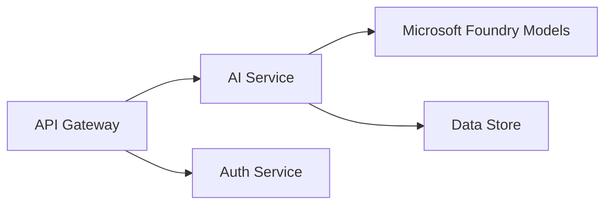
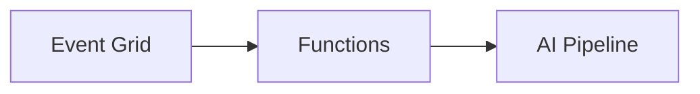

# ជំពូក ៨៖ ឧស្សាហកម្ម & លំនាំសហគ្រាស

**📚 វគ្គសិក្សា**: [AZD សម្រាប់អ្នកចាប់ផ្តើម](../../README.md) | **⏱️ រយៈពេល**: ២-៣ ម៉ោង | **⭐ ស្មុគស្មាញ**: កម្រិតខ្ពស់

---

## សង្ខេប

ជំពូកនេះគ្របដណ្តប់លំនាំការដាក់ឧស្សាហកម្មត្រៀមខ្លួនបាន សុវត្ថិភាពកាន់តែរឹងមាំ ការត្រួតពិនិត្យ និងការបង្កើនប្រសិទ្ធភាពថ្លៃដើមសម្រាប់បេសកកម្ម AI ផលិតកម្ម។

នេះគឺជាឯកសារយោងស្ថាបត្យកម្ម មិនមែនគំរូដាក់ឲ្យប្រើបានពេញលេញសម្រាប់ផលិតកម្មទេ។ឧទាហរណ៍មិនរាប់បញ្ចូលព័ត៌មានលម្អិតរួមបញ្ចូលដែលត្រូវផ្គូផ្គង និងសាកល្បងនៅក្នុងកម្មវិធីរបស់អ្នកផ្ទាល់ទេ; ការអានបញ្ជីពិនិត្យមិនមានន័យថាសម្រាប់ស្ថិតិនូវភាពរួចរាល់សម្រាប់ផលិតកម្មទេ។

> **អាប់ដេត Foundry GA (2026-11-09):** ប្រើ `azd >= 1.37.0` និងបណ្ដុំ `microsoft.foundry` 1.0 ដែលមានស្រាប់សម្រាប់ការប្រតិបត្តិ Foundry; ការវាយតម្លៃត្រូវបានដំឡើងបញ្ចូនផ្សេងទៀត។ មើល [វិសាលភាពការចេញផ្សាយ និងការផ្លាស់ប្តូរ](production-ai-practices.md#recent-release-changes-and-fixes) និង [ឧទាហរណ៍បណ្ដាញផាកសង្គ្រោះដែលមានការផ្ទៀងផ្ទាត់](production-ai-practices.md#cicd-pipeline-configuration)។ នេះគឺជាការពិនិត្យឯកសារ មិនមែនការផ្ទៀងផ្ទាត់ដាក់ឧស្សាហកម្មជាសកម្ម ឬស្ថានភាព GA សម្រាប់មុខងារពិសេសពាក់ព័ន្ធទេ។

## គោលបំណងសិក្សា

ដោយបញ្ចប់ជំពូកនេះ អ្នកនឹងអាចៈ
- ដាក់បញ្ចូលកម្មវិធីឌីជីថលច្រើនតំបន់សម្រាប់ភាពរឹងមាំ
- អនុវត្តលំនាំសុវត្ថិភាពសហគ្រាស
- កំណត់ការត្រួតពិនិត្យប៉ារ៉ាម៉ែត្រដោយពេញលេញ
- បង្កើនប្រសិទ្ធភាពថ្លៃកាលពីផែនការ
- រៀបចំបណ្តាញ CI/CD ជាមួយ AZD

---

## 📚 មេរៀន

| លេខ | មេរៀន | ការពិពណ៌នា | រយៈពេល |
|---|--------|-------------|------|
| ១ | [អនុវត្តការផលិតកម្ម AI](production-ai-practices.md) | លំនាំការដាក់ឧស្សាហកម្ម | ៩០ នាទី |

---

## 🚀 បញ្ជីពិនិត្យផលិតកម្ម

- [ ] ដាក់បញ្ចូលច្រើនតំបន់សម្រាប់ភាពរឹងមាំ
- [ ] សមាជិកភាពគ្រប់គ្រងសម្រាប់ការ Authenticate (គ្មាន key)
- [ ] Application Insights សម្រាប់ការត្រួតពិនិត្យ
- [ ] កំណត់ថវិកា និងការជូនដំណឹង
- [ ] បើកម៉ាស៊ីនសុវត្ថិភាព
- [ ] បញ្ចូលបណ្តាញ CI/CD
- [ ] ផែនការជួយសង្គ្រោះគ្រោះថ្នាក់

---

## 🏗️ លំនាំស្ថាបត្យកម្ម

### លំនាំ ១៖ Microservices AI



### លំនាំ ២៖ AI ជាបណ្តុំព្រឹត្តិការណ៍



---

## 🔐 ផ្លូវការសុវត្ថិភាពល្អបំផុត

```bicep
// Illustrative properties from different resources, NOT a standalone Bicep file.
// Attach identity to the application host:
identity: {
  type: 'SystemAssigned'
}

// AI account properties (also require private endpoints, DNS and app connectivity):
properties: {
  publicNetworkAccess: 'Disabled'
  networkAcls: {
    defaultAction: 'Deny'
  }
}
```

---

## 💰 ការបង្កើនប្រសិទ្ធភាពថ្លៃដើម

| យុទ្ធសាស្ត្រ | ការរឹតត្បិតសំខាន់ |
|----------|---------|
| ច្នៃផ្សំទៅសូន្យ (Container Apps) | តម្រូវឲ្យមានការជំរៅសមរម្យ; សេវាកម្មផ្សេងៗនៅតែចំណាយថ្លៃ |
| ប្រើជាន់ទីតាំងសម្រាប់ dev | ប្រកួតតម្លៃសេវាកម្ម និងបេសកកម្ម |
| កំណត់កាលវិភាគច្នៃផ្សំ | ច្នៃផ្សំតាមរចនាសម្ព័ន្ធ/ស្វ័យប្រវត្តិនង្ហា |
| ការកក់/សមត្ថភាពដែលបានផ្តល់ | មានសំរាប់ពេលគាំទ្រ; ការជំពាក់អាចបង្កើនថ្លៃផ្ដេក |

ប្រើ [លំនាំធនធានថវិកាការពេញលេញ](production-ai-practices.md#2-cost-monitoring-and-budgets) ជាមួយកាលបរិច្ឆេទចាប់ផ្តើមមានសុពលភាព រវាងជំរៅបញ្ជីប្រាក់កក់ អ្នកទទួល និងសិទ្ធិ។ ថវិកាបញ្ចូនការជូនដំណឹង មិនមែនកំណត់ការចំណាយនោះទេ។ ការសន្សំប្រាក់ទៅលើការប្រើប្រាស់ដែលបានវាស់នឹងមិនមានការធានាថា % ។

---

## 📊 កំណត់ការត្រួតពិនិត្យ

```bash
# Open the Application Insights logs view (requires configured monitoring)
azd monitor --logs

# Check Application Insights
azd monitor --overview

# View metrics
az monitor metrics list --resource <resource-id>
```

---

## 🔗 នាវាទិស

| ទិសដៅ | ជំពូក |
|-----------|---------|
| **ពីមុន** | [ជំពូក ៧៖ ការដោះស្រាយបញ្ហា](../chapter-07-troubleshooting/README.md) |
| **ការសិក្សារួចរាល់** | [ទំព័រផ្ទាល់មុខវគ្គ](../../README.md) |

---

## 📖 ឯកសារភ្ជាប់

- [មគ្គុទេសក៍ភ្នាក់ងារបញ្ញាសិប្បនិម្មិត](../chapter-02-ai-development/agents.md)
- [Application Insights](../chapter-06-pre-deployment/application-insights.md)
- [ដំណោះស្រាយភ្នាក់ងារច្រើន](../chapter-05-multi-agent/README.md)
- [ឧទាហរណ៍ Microservices](../../examples/microservices/README.md)

---

<!-- CO-OP TRANSLATOR DISCLAIMER START -->
**ការបដិសេធ**:
ឯកសារនេះត្រូវបានបម្លែងភាសា ដោយប្រើសេវាបម្លែងភាសា AI [Co-op Translator](https://github.com/Azure/co-op-translator)។ ទោះយើងខ្ញុំមានក្តីប្រាថ្នាឱ្យបានច្បាស់លាស់ តែសូមយល់ដឹងថាការបម្លែងដោយស្វ័យប្រវត្តិក៏អាចមានកំហុសឬភាពមិនត្រឹមត្រូវ។ ឯកសារដើមជាភាសាទីតាំងគួរត្រូវបានគេប្រើជាប្រភពច្បាស់លាស់។ សម្រាប់ព័ត៌មានសំខាន់ៗ សូមណែនាំឱ្យប្រើប្រាស់ការប្រែដោយមនុស្សជំនាញ។ យើងខ្ញុំមិនទទួលខុសត្រូវចំពោះការយល់ច្រឡំ ឬការបកស្រាយខុសបន្ទាប់ពីការប្រើប្រាស់ការបម្លែងនេះនោះទេ។
<!-- CO-OP TRANSLATOR DISCLAIMER END -->