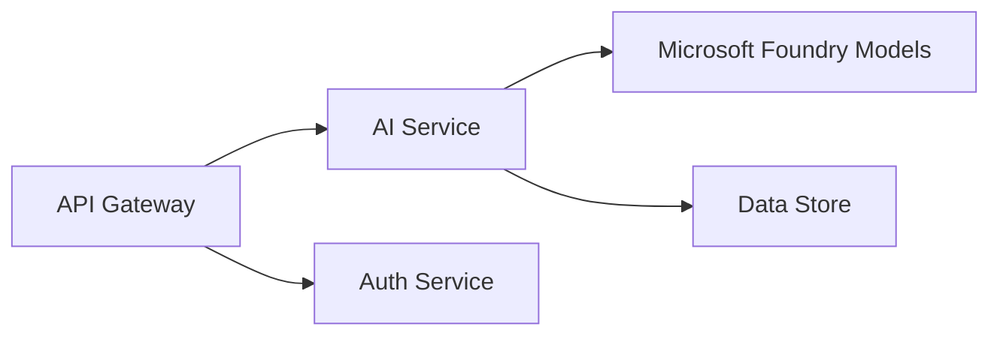
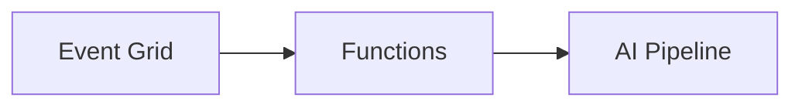

# ភាគទី ៨៖ លំនាំ​ការផលិត និងសហគ្រាស

**📚 ចំណេះដឹង**: [AZD សម្រាប់អ្នកដែលចាប់ផ្តើម](../../README.md) | **⏱️ រយៈពេល**: 2-3 ម៉ោង | **⭐ កម្រិតស្មុគស្មាញ**: ជំរើស​ខ្ពស់

---

## ទិដ្ឋភាពទូទៅ

ភាគនេះគ្របដណ្តប់លំនាំការដាក់បញ្ចូលដែលអាចប្រើប្រាស់ក្នុងសហគ្រាស, ការបញ្ចុះសុវត្ថិភាព, ការត្រួតពិនិត្យ, និងការបង្កើនប្រសិទ្ធភាពថ្លៃសម្រាប់ការងារ AI ក្នុងផលិតកម្ម។

នេះគឺជា​ឯកសារ​យោង​បច្ចេកទេស មិនមែនជា​វិមជ្ឈកាល​ផលិតកម្ម​ដែល​អាច​ដាក់បញ្ចូលបានទាំងមូលទេ។ គំរូ​មិនរាប់បញ្ចូល​លម្អិត​សម្រាប់​ការ​បញ្ចូល ដែលត្រូវបានផ្តល់ និងត្រូវបានសាកល្បងនៅក្នុងកម្មវិធីរបស់អ្នកផ្ទាល់ទេ។ ការអានបញ្ជីត្រួតពិនិត្យមិនបានធានាការត្រៀមខ្លួនសម្រាប់ផលិតកម្មនោះទេ។

> **ការត្រួតពិនិត្យរចនាសម្ព័ន្ធ (2026-11-04):** យោងដល់ការណែនាំ AI CLI ត្រូវបានពិនិត្យទំព័រជាមួយ `azd 1.37.2`, agents `1.0.0-beta.23`, និងឯកសារ/ប្រភពបន្ទាន់ `1.0.0-beta.2`។ សូមមើល [ការផ្លាស់ប្តូរនិងកំណែសម្រួល](production-ai-practices.md#recent-release-changes-and-fixes) សម្រាប់តម្រូវការសំរាប់ការប្រតិបត្តិ និងព័ត៌មានផ្ទេរកម្មវិធី; នេះមិនមែនជាការត្រួតពិនិត្យការដាក់បញ្ចូលជាលាយឡំទេ។

## គោលបំណងការរៀន

ដោយបញ្ចប់ភាគនេះ អ្នកនឹងអាច៖
- ដាក់បញ្ចូលកម្មវិធីដែលរឹងមាំនៅក្នុងតំបន់ច្រើន
- អនុវត្តលំនាំសុវត្ថិភាពសហគ្រាស
- កំណត់ការត្រួតពិនិត្យទាំងមូល
- បង្កើនប្រសិទ្ធភាពថ្លៃវិនិយោគនៅមាត្រដ្ឋានធំ
- បង្កើតបំពង់ CI/CD ជាមួយ AZD

---

## 📚 មេរៀន

| # | មេរៀន | ការពិពណ៌នា | ពេលវេលា |
|---|--------|-------------|------|
| 1 | [អនុវត្ត AI ផលិតកម្ម](production-ai-practices.md) | លំនាំដាក់បញ្ចូលសហគ្រាស | 90 នាទី |

---

## 🚀 បញ្ជីត្រួតពិនិត្យផលិតកម្ម

- [ ] ដាក់បញ្ចូលក្នុងតំបន់ច្រើនសម្រាប់ភាពរឹងមាំ
- [ ] ប្រើអត្តសញ្ញាណគ្រប់គ្រងសម្រាប់ការផ្ទៀងផ្ទាត់លើកលែងកូនសោ
- [ ] ប្រើ Application Insights សម្រាប់ការត្រួតពិនិត្យ
- [ ] កំណត់ថវិកា និងការជូនដំណឹង
- [ ] បើកការស្កេនសុវត្ថិភាព
- [ ] រួមបញ្ចូលបំពង់ CI/CD
- [ ] ផែនការស្ដារឡើងវិញក្រោយវិបត្តិ

---

## 🏗️ លំនាំរចនាសម្ព័ន្ធ

### លំនាំ 1: Microservices AI



### លំនាំ 2: AI ជាដំណើរការតាមព្រឹត្តិការណ៍



---

## 🔐 ប្រព្រឹត្តិមាតិកាសុវត្ថិភាពល្អបំផុត

```bicep
// Illustrative properties from different resources, NOT a standalone Bicep file.
// Attach identity to the application host:
identity: {
  type: 'SystemAssigned'
}

// AI account properties (also require private endpoints, DNS and app connectivity):
properties: {
  publicNetworkAccess: 'Disabled'
  networkAcls: {
    defaultAction: 'Deny'
  }
}
```

---

## 💰 បង្កើនប្រសិទ្ធភាពថ្លៃវិនិយោគ

| យុទ្ធសាស្រ្ត | ការរឹតបន្តឹងសំខាន់ |
|----------|---------|
| ប្ដូរទម្រង់ទៅសូន្យ (Container Apps) | ត្រូវការមូលហេតុដែលសមរម្យ; សេវាផ្សេងទៀតនៅតែមានថ្លៃ |
| ប្រើថ្នាក់កម្រិតប្រាក់ចំណាយសម្រាប់ការអភិវឌ្ឍ | ប្រមាណថ្លៃសេវាដែលជ្រើសរើស និងបន្ទុកការងារ |
| ការពង្រីកតាមកាលវិភាគ | ពង្រីកតាមរចនាសម្ព័ន្ធ/ស្វ័យប្រវត្តិដែលគាំទ្រ |
| ការកក់/កំណត់សមត្ថភាព | មានតែពេលគាំទ្រ; ការប្តេជ្ញាចិត្តអាចបង្កើនថ្លៃទំនេរ |

ប្រើ [លំនាំធនធានថវិកាមិនខ្វះ](production-ai-practices.md#2-cost-monitoring-and-budgets) មានថ្ងៃចាប់ផ្តើមត្រឹមត្រូវ ជំរើសពិន្ទុបង់ប្រាក់ អ្នកទទួល និងសិទ្ធិ។ ថវិកាផ្ញើការជូនដំណឹង; វាមិនកំណត់ការចំណាយទេ។ ការសន្សំប្រាក់អាស្រ័យលើការប្រើប្រាស់វាស់បាន ហើយមិនមែនជាភាគរយផ្តាច់មុខទេ។

---

## 📊 ការកំណត់ការត្រួតពិនិត្យ

```bash
# Open the Application Insights logs view (requires configured monitoring)
azd monitor --logs

# Check Application Insights
azd monitor --overview

# View metrics
az monitor metrics list --resource <resource-id>
```

---

## 🔗 ការរុករក

| ទិសដៅ | ភាគ |
|-----------|---------|
| **មុន** | [ភាគទី ៧៖ ការដោះស្រាយបញ្ហា](../chapter-07-troubleshooting/README.md) |
| **បញ្ចប់វគ្គ** | [ទំព័រដើមវគ្គសិក្សា](../../README.md) |

---

## 📖 ទិន្នន័យពាក់ព័ន្ធ

- [មគ្គុទេសក៍ AI Agents](../chapter-02-ai-development/agents.md)
- [Application Insights](../chapter-06-pre-deployment/application-insights.md)
- [ដំណោះស្រាយអ្នកភ្នាក់ងារច្រើន](../chapter-05-multi-agent/README.md)
- [ឧទាហរណ៍ Microservices](../../examples/microservices/README.md)

---

<!-- CO-OP TRANSLATOR DISCLAIMER START -->
**ការបដិសេធ**:
ឯកសារនេះត្រូវបានបម្លែងភាសា ដោយប្រើសេវាបម្លែងភាសា AI [Co-op Translator](https://github.com/Azure/co-op-translator)។ ទោះយើងខ្ញុំមានក្តីប្រាថ្នាឱ្យបានច្បាស់លាស់ តែសូមយល់ដឹងថាការបម្លែងដោយស្វ័យប្រវត្តិក៏អាចមានកំហុសឬភាពមិនត្រឹមត្រូវ។ ឯកសារដើមជាភាសាទីតាំងគួរត្រូវបានគេប្រើជាប្រភពច្បាស់លាស់។ សម្រាប់ព័ត៌មានសំខាន់ៗ សូមណែនាំឱ្យប្រើប្រាស់ការប្រែដោយមនុស្សជំនាញ។ យើងខ្ញុំមិនទទួលខុសត្រូវចំពោះការយល់ច្រឡំ ឬការបកស្រាយខុសបន្ទាប់ពីការប្រើប្រាស់ការបម្លែងនេះនោះទេ។
<!-- CO-OP TRANSLATOR DISCLAIMER END -->