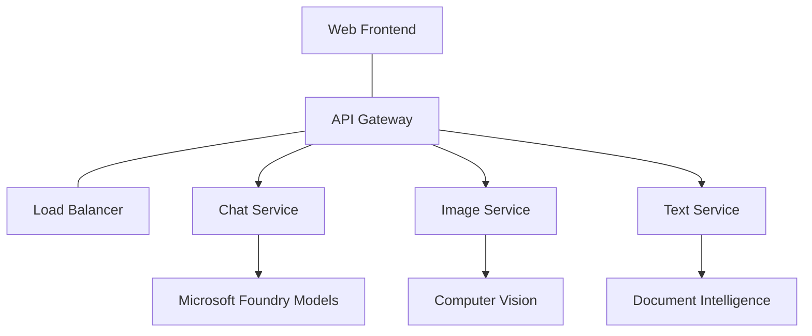

# ព័ត៌មានអនុវត្តល្អសម្រាប់សារពើភ័ណ្ឌ AI ផលិតកម្មជាមួយ AZD

**ការលេងដំណើរការចំណាត់ថ្នាក់:**
- **📚 ទំព័រដើមវគ្គសិក្សា**៖ [AZD សម្រាប់អ្នកចាប់ផ្តើម](../../README.md)
- **📖 ជំពូកបច្ចុប្បន្ន**៖ ជំពូក 8 - លំនាំផលិតកម្ម និងសហគ្រិនភាព
- **⬅️ ជំពូកមុន** ៖ [ជំពូក 7: ការជួសជុលបញ្ហា](../chapter-07-troubleshooting/debugging.md)
- **⬅️ ក៏ពាក់ព័ន្ធ**៖ [មន្ទីរពិសោធន៍ AI](../chapter-02-ai-development/ai-workshop-lab.md)
- **🎯 បញ្ចប់វគ្គសិក្សា**៖ [AZD សម្រាប់អ្នកចាប់ផ្តើម](../../README.md)

## សេចក្ដីសង្ខេប

មគ្គុទេសក៍នេះពិពណ៌នាលំនាំរចនាសម្ព័ន្ធ AI ផលិតកម្មដោយប្រើ Azure Developer CLI (AZD)។ វាជាគំរូយោងសម្រាប់ការរចនា មិនមែនកម្មវិធីដែលអាចរំលោភបានឬវិញ្ញាបនបត្រផលិតកម្មឡើយ។

**ព្រំដែនឧទាហរណ៍**៖ ចូរយកចិត្តទុកដាក់ថា ប្លុក Bicep ទាំងឡាយទាំងអស់ត្រូវបានគេគិតថាអាស្រ័យលើប៉ារ៉ាម៉ែត្រ និងធនធានដែលយោងពីគំរូដែលមានពាសពេញចំណុច។ ពួកវាបាត់បង់រូបភាព/ផែនការអ្នកផ្ទុក សមាជិកភាព ការចាត់តួនាទី DNS, ផលប៉ះពាល់ និងការចូលរួមផ្សេងៗផងដែរ។ ផ្លូវសេវា YAML និងស្គ្រីបហ៊ុច/សាកល្បងគឺជាឯកសារតំណាងសម្រាប់បង្កើតក្នុង **កម្មវិធីរបស់អ្នកផ្ទាល់**; វាគ្មានផ្តល់ដោយវគ្គសិក្សានេះទេ។ ប្រើឧទាហរណ៍ AZD ដំណើរការមួយជាមូលដ្ឋាន បញ្ចូលមូលដ្ឋានស្ថាបត្យកម្មពេញលេញ ហើយសាកល្បងវានៅបរិយាកាសដាច់ដោយឡែកមុនពេលផលិតកម្ម។

## 도ើរោសផ្សេងៗដ៏សំខាន់

បញ្ហាធម្មតាផលិតកម្មរួមមានការដាក់ពង្រីកសេវាកម្មជាច្រើន ការគ្រប់គ្រងអត្តសញ្ញាណ និងសម្ងាត់ ការកំណត់ទំហំថែមប្រាក់ ចំណាយតម្លៃ និងការត្រួតពិនិត្យ។ ខ្ញុំមិនបានដាក់អោយមានការវាស់វែងអត្រារបស់វានៅទីនេះទេ។

## លំនាំស្ថាបត្យកម្មសម្រាប់ AI ផលិតកម្ម

### លំនាំ 1៖ ស្ថាបត្យកម្ម AI ម៉ីក្រូសេវាកម្ម

**ពេលដែលត្រូវប្រើ**៖ កម្មវិធី AI ដែលស្មុំស្មូរ មានមុខងារច្រើន



**ការអនុវត្ត AZD**៖

```yaml
# azure.yaml
name: enterprise-ai-platform
services:
  web:
    project: ./web
    host: staticwebapp
  api-gateway:
    project: ./api-gateway
    host: containerapp
  chat-service:
    project: ./services/chat
    host: containerapp
  vision-service:
    project: ./services/vision
    host: containerapp
  text-service:
    project: ./services/text
    host: containerapp
```

### លំនាំ 2៖ ប្រតិបត្តិការនិយមន័យព្រឹត្តិការណ៍ AI

**ពេលដែលត្រូវប្រើ**៖ ការប្រតិបត្តិការបញ្ចូលជាដំណាក់កាល ការវិភាគឯកសារ សកម្មភាពធ្វើការចម្រូងចម្រាស

```bicep
// Event Hub for AI processing pipeline
resource eventHub 'Microsoft.EventHub/namespaces@2024-01-01' = {
  name: eventHubNamespaceName
  location: location
  sku: {
    name: 'Standard'
    tier: 'Standard'
    capacity: 1
  }
}

// Service Bus for reliable message processing
resource serviceBus 'Microsoft.ServiceBus/namespaces@2024-01-01' = {
  name: serviceBusNamespaceName
  location: location
  sku: {
    name: 'Premium'
    tier: 'Premium'
    capacity: 1
  }
}

// Function App for processing
resource functionApp 'Microsoft.Web/sites@2023-01-01' = {
  name: functionAppName
  location: location
  kind: 'functionapp,linux'
  properties: {
    siteConfig: {
      appSettings: [
        {
          name: 'FUNCTIONS_EXTENSION_VERSION'
          value: '~4'
        }
        {
          name: 'AZURE_OPENAI_ENDPOINT'
          value: '@Microsoft.KeyVault(VaultName=${keyVault.name};SecretName=openai-endpoint)'
        }
      ]
    }
  }
}
```

នេះបង្កើតប្លុក namespace មិនមែន hub, queue, subscription ឬកម្មវិធីបង្ហោះ Function। Function ដែលអាចដំណើរការបាន ត្រូវការផែនការអ៊ុតហ្សឹម(Runtime/Storage), អត្តសញ្ញាណភ្ជាប់, RBAC និងការចូលបណ្តាញ។ ឯកសារយោង Key Vault ត្រូវការអនុញ្ញាតអានសម្ងាត់; URL endpoint មិនមែនគឺជាគន្លងសំងាត់ទេ។

## ការគិតអំពីសុខភាពភ្នាក់ងារ AI

ពេលកម្មវិធីវែបប្រពៃណីខូច មានសញ្ញាដូចគ្នា៖ ទំព័រមិនផ្ទុក, API មានកំហុស ឬការតំឡើងបរាជ័យ។ កម្មវិធីដែលមាន AI អាចខូចទាំងអស់នោះ—ប៉ុន្តែវាក៏អាចមានបញ្ហាដែលមិនបញ្ចេញសារφάλះទេ។

ផ្នែកនេះជួយអ្នកបង្កើតគំរូគិតជាចិត្តសម្រាប់ត្រួតពិនិត្យសកម្មភាព AI ដើម្បីដឹងកន្លែងជួយពិនិត្យពេលមានបញ្ហា។

### របៀបដែលសុខភាពភ្នាក់ងារផ្សឺពីសុខភាពកម្មវិធីប្រពៃណី

កម្មវិធីប្រពៃណីក៏មានបញ្ហាគុណភាពតូចៗផងដែរ។ ភ្នាក់ងារ AI បន្ថែមគុណភាពការឆ្លើយតបមិនច្បាស់លាស់ទៅលើកង្វះភាពប្រសប់ និងអ្នកប្រើប្រាស់។ ចងចាំសុខភាពភ្នាក់ងារជាបន្ទាត់ពីររូប៖

| បន្ទាត់ | អ្វីដែលត្រូវត្រួតពិនិត្យ | កន្លែងដែលត្រូវមើល |
|-------|--------------|---------------|
| **សុខភាពមូលដ្ឋានស្ថាបត្យកម្ម** | តើសេវាកម្មដំណើរការរឺ? តើធនធានត្រូវបានផ្តល់ជូនរឺ? តើ endpoint អាចចូលដំណើរការបានរឺ? | `azd monitor`, សុខភាពធនធាន Azure Portal, សញ្ញាអំណត្តិនិងកំណត់ហេតុកម្មវិធី|
| **សុខភាពអាកប្បី** | តើភ្នាក់ងារឆ្លើយតបត្រឹមត្រូវរឺ? តើចម្លើយបានពេលវេលាឬ? តើម៉ូ​ដែលត្រូវបានហៅត្រឹមត្រូវរឺ? | រការតាមដាន Application Insights, វិធីវាស់ស្ទង់ពេលយឺតនៅម៉ូដែល, កំណត់ហេតុគុណភាពការឆ្លើយតប |

សុខភាពមូលដ្ឋានស្ថាបត្យកម្មគឺជារឿងស្រួលចាប់អារម្មណ៍—វាជាការដូចគ្នាសម្រាប់កម្មវិធី azd មួយណា។ សុខភាពអាកប្បីគឺជាបន្ទាត់ថ្មីដែលសកម្មភាព AI ណែនាំ។

### កន្លែងដែលត្រូវពិនិត្យពេលកម្មវិធី AI មិនឆ្លើយដោយរបៀបដែលរំពឹងទុក

ប្រសិនបើកម្មវិធី AI របស់អ្នកមិនផលិតលទ្ធផលដូចដែលអ្នករំពឹងទុក នេះគឺជាបញ្ជីឆែកគំនិតមួយ៖

1. **ចាប់ផ្តើមពីមូលដ្ឋាន។** តើកម្មវិធីដំណើរការរឺ? តើវាអាចចូលដំណើរការប្រព័ន្ធផ្អែកជាអ្នកផ្ទុករបស់វារឺ? ពិនិត្យ `azd monitor` និងសុខភាពធនធានដូចជាកម្មវិធីផ្សេងៗ។
2. **ពិនិត្យការតភ្ជាប់ម៉ូដែល។** តើកម្មវិធីរបស់អ្នកហៅម៉ូដែល AI បានជោគជ័យរឺ? ការហៅម៉ូដែលដែលបរាជ័យ ឬពន្យារពេលគឺជាហេតុផលសំខាន់នៃបញ្ហាកម្មវិធី AI ហើយនឹងបង្ហាញនៅក្នុងកំណត់ហេតុកម្មវិធី។
3. **ពិនិត្យការបញ្ចូល និងជំនួយដោយសុវត្ថិភាព។** ព័ត៌មានកំហុសអាចបណ្តាលមកពីការទាញយក, សេចក្ដីណែនាំ, ការរឹតត្បិតម៉ូដែល ឬការប្រតិបត្តិឧបករណ៍។ ប្រើទិន្នន័យវាយតម្លៃដោយត្រួតពិនិត្យការចូលប្រើដោយការគ្រប់គ្រង កុំបើកការចុះបញ្ជីការចម្លើយ/បញ្ជាក់ឯកសារបោះពុម្ពក្នុងផលិតកម្ម។
4. **ពិនិត្យពេលយឺតឆ្លើយតប។** ការហៅម៉ូដែល AI យឺតជាងការហៅ API ទូទៅ។ ប្រសិនបើកម្មវិធីរបស់អ្នកមានការយឺត ពិនិត្យមើលពេលឆ្លើយតបម៉ូដែលថាជើង ឬថយចុះ—វាអាចបង្ហាញថាមានការច្រោមខ្ទប់, កំណត់កម្រិតសមត្ថភាព ឬការដាក់ទម្រង់តំបន់ព្រំដែនខ្ពស់។
5. **ត្រួតពិនិត្យសញ្ញាចំណាយ។** ការកើនឡើងមិនរំពឹងទុកនៃការប្រើ token ឬការហៅ API អាចបញ្ជាក់ភាពវង់វៀត ការចេញបញ្ជារដោយមិនត្រឹមត្រូវ ឬការព្យាយាមម្តងទៀតច្រើនពេក។

អ្នកមិនចាំបាច់ត្រូវកាន់ចំណេះដឹងឧបករណ៍សំរាប់ត្រួតពិនិត្យភ្លាមៗឡើយ។ គោលចំណុចសំខាន់គឺកម្មវិធី AI មានស្រទាប់បន្ថែមសម្រាប់ការត្រួតពិនិត្យអាកប្បី ហើយការត្រួតពិនិត្យដែលរួមបញ្ចូលជាមួយ azd (`azd monitor`) ផ្តល់ចំណុចចាប់ផ្តើមសម្រាប់ការស្រាវជ្រាវពីរ​បន្ទាត់។

---

## គោលការណ៍សុវត្ថិភាពល្អបំផុត

### 1. រូបមន្តសុវត្ថិភាព Zero-Trust

**យុទ្ឋសាស្ត្រអនុវត្ត**៖
- គ្មានការទំនាក់ទំនងរវាងសេវាកម្មដោយគ្មានការផ្ទៀងផ្ទាត់អត្តសញ្ញាណ
- ការហៅ API ទាំងអស់ប្រើអត្តសញ្ញាណគ្រប់គ្រង
- ការបំបែកបណ្តាញជាមួយ endpoint ផ្ទាល់ខ្លួន
- ការត្រួតពិនិត្យកម្រិតសិទ្ធិចាប់តិចបំផុត

```bicep
// Managed Identity for each service
resource chatServiceIdentity 'Microsoft.ManagedIdentity/userAssignedIdentities@2023-01-31' = {
  name: 'chat-service-identity'
  location: location
}

// Role assignments with minimal permissions
resource openAIUserRole 'Microsoft.Authorization/roleAssignments@2022-04-01' = {
  scope: openAIAccount
  name: guid(openAIAccount.id, chatServiceIdentity.id, '5e0bd9bd-7b93-4f28-af87-19fc36ad61bd')
  properties: {
    roleDefinitionId: subscriptionResourceId('Microsoft.Authorization/roleDefinitions', '5e0bd9bd-7b93-4f28-af87-19fc36ad61bd')
    principalId: chatServiceIdentity.properties.principalId
    principalType: 'ServicePrincipal'
  }
}
```

### 2. ការគ្រប់គ្រងសម្ងាត់យ៉ាងសុវត្ថិភាព

**ល្បែងរួមផ្សំនៃ Key Vault**៖

```bicep
// Key Vault with proper access policies
resource keyVault 'Microsoft.KeyVault/vaults@2023-02-01' = {
  name: keyVaultName
  location: location
  properties: {
    tenantId: tenant().tenantId
    sku: {
      family: 'A'
      name: 'standard' // Premium is needed for HSM-backed keys, not ordinary secrets
    }
    enableRbacAuthorization: true  // Use RBAC instead of access policies
    enablePurgeProtection: true    // Prevent accidental deletion
    enableSoftDelete: true
    softDeleteRetentionInDays: 90
  }
}

// Optional legacy key-auth alternative; omit when using Entra ID.
resource openAIKeySecret 'Microsoft.KeyVault/vaults/secrets@2023-02-01' = {
  parent: keyVault
  name: 'openai-api-key'
  properties: {
    value: openAIAccount.listKeys().key1
    attributes: {
      enabled: true
    }
  }
}
```

ផ្ដល់អត្តសញ្ញាណ runtime `Key Vault Secrets User` នៅក្នុងដែនកំណត់សមរម្យ ហើយភ្ជាប់វាទៅអ្នកផ្ទុក; `enableRbacAuthorization` ដាច់ដោយឡែកមិនផ្តល់សិទ្ធិ។ ជ្រើសការផ្ទៀងផ្ទាត់អត្តសញ្ញាណ OpenAI ដែលគ្រប់គ្រងជាមួយ `disableLocalAuth: true`។ កូនសោសម្ងាត់ជាជម្រើសគ្មានន័យសម្រាប់គណនីដែលដំណើរការជង់សោដោយចេតនា ហើយអ្នកផ្ដល់កម្មសិទ្ធិផងត្រូវតែមានសិទ្ធិចេញសម្ងាត់ផងដែរ។

### 3. សុវត្ថិភាពបណ្តាញ

**ការកំណត់ Private Endpoint**៖

```bicep
// Virtual Network for AI services
resource virtualNetwork 'Microsoft.Network/virtualNetworks@2023-04-01' = {
  name: vnetName
  location: location
  properties: {
    addressSpace: {
      addressPrefixes: ['10.0.0.0/16']
    }
    subnets: [
      {
        name: 'ai-services-subnet'
        properties: {
          addressPrefix: '10.0.1.0/24'
          privateEndpointNetworkPolicies: 'Disabled'
        }
      }
      {
        name: 'app-services-subnet'
        properties: {
          addressPrefix: '10.0.2.0/24'
          delegations: [
            {
              name: 'Microsoft.Web/serverFarms'
              properties: {
                serviceName: 'Microsoft.Web/serverFarms'
              }
            }
          ]
        }
      }
    ]
  }
}

// Private endpoints for all AI services
resource openAIPrivateEndpoint 'Microsoft.Network/privateEndpoints@2023-04-01' = {
  name: '${openAIAccountName}-pe'
  location: location
  properties: {
    subnet: {
      id: virtualNetwork.properties.subnets[0].id
    }
    privateLinkServiceConnections: [
      {
        name: 'openai-connection'
        properties: {
          privateLinkServiceId: openAIAccount.id
          groupIds: ['account']
        }
      }
    ]
  }
}
```

Private endpoints ត្រូវការក្រុម DNS ផ្ទាល់ខ្លួន / លីង VNet និងការចូលរួម VNet នៃកម្មវិធីផងដែរ។ វាមិនបិទការចូលសាធារណៈដោយស្វ័យប្រវត្តិទេ៖ បិទការចូលបណ្តាញសាធារណៈរបស់គណនី AI បន្ទាប់ពីផ្ទៀងផ្ទាត់កម្លាំងភ្ជាប់ផ្ទាល់ និងការចូលដំណើរការដំឡើង។

## សមត្ថភាព និងកំណត់ទំហំ

### 1. យុទ្ធសាស្ត្រកំណត់ទំហំស្វ័យប្រវត្តិ

** Container Apps កំណត់ទំហំស្វ័យប្រវត្តិ**៖

```bicep
resource containerApp 'Microsoft.App/containerApps@2023-05-01' = {
  name: containerAppName
  location: location
  properties: {
    configuration: {
      ingress: {
        external: true
        targetPort: 8000
        transport: 'http'
      }
    }
    template: {
      scale: {
        minReplicas: 2  // Always have 2 instances minimum
        maxReplicas: 50 // Scale up to 50 for high load
        rules: [
          {
            name: 'http-scaling'
            http: {
              metadata: {
                concurrentRequests: '20'  // Scale when >20 concurrent requests
              }
            }
          }
          {
            name: 'cpu-scaling'
            custom: {
              type: 'cpu'
              metadata: {
                type: 'Utilization'
                value: '70'  // Scale when CPU >70%
              }
            }
          }
        ]
      }
    }
  }
}
```

### 2. យុទ្ធសាស្ត្រគាំទ្រការផ្ទុកក្នុងចង្វាក់

** Redis Cache សម្រាប់ការឆ្លើយតប AI**៖

```bicep
// Legacy Azure Cache for Redis example (not recommended for new deployments)
resource redisCache 'Microsoft.Cache/redis@2023-04-01' = {
  name: redisCacheName
  location: location
  properties: {
    sku: {
      name: 'Premium'
      family: 'P'
      capacity: 1
    }
    enableNonSslPort: false
    minimumTlsVersion: '1.2'
    redisConfiguration: {
      'maxmemory-policy': 'allkeys-lru'
    }
    // Sharding distributes data; replication/failover provides availability.
    shardCount: 2
  }
}

// Cache configuration in application
var cacheConnectionString = '${redisCache.properties.hostName}:6380,password=${redisCache.listKeys().primaryKey},ssl=True,abortConnect=False'
```

Azure Cache សម្រាប់ Redis Basic/Standard/Premium កំពុងត្រូវនាំមុខទៅនឹង [ផ្លូវចោល](https://learn.microsoft.com/azure/azure-cache-for-redis/retirement-faq)។ ប្រើ Azure Managed Redis សម្រាប់ការរចនាថ្មី និងគំរូ SKU, អត្តសញ្ញាណ និងការកំណត់ TLS ដែលបានឯកភាព មិនត្រូវចម្លងធនធានចាស់នេះទៅក្នុងប្រព័ន្ធផលិតកម្មថ្មី។ ផ្លូវកំណត់ភ្ជាប់គឺជាកន្លែងទំនេរមិនអនុវត្ត ហើយមិនមែនសញ្ញាភ្ជាប់ទេ។ ចែកសោបញ្ចូល cache ដោយសិទ្ធិការអនុញ្ញាត ម៉ូដែល/ការណែនាំ និងកំណែការទាញយក ដោយមានការថយចុះ; cache ចែករំលែកសម្រាប់ការសំណួរតែប៉ុណ្ណោះអាចបង្ហាញទិន្នន័យអ្នកប្រើផ្សេងទៀត។

### 3. ការប្រមាណលំនាំផ្ទុក និងគ្រប់គ្រងចរាចរណ៍

** Application Gateway ជាមួយ WAF**៖

```bicep
// Application Gateway with Web Application Firewall
resource applicationGateway 'Microsoft.Network/applicationGateways@2023-04-01' = {
  name: appGatewayName
  location: location
  properties: {
    sku: {
      name: 'WAF_v2'
      tier: 'WAF_v2'
      capacity: 2
    }
    webApplicationFirewallConfiguration: {
      enabled: true
      firewallMode: 'Prevention'
      ruleSetType: 'OWASP'
      ruleSetVersion: '3.2'
    }
    // Backend pools for AI services
    backendAddressPools: [
      {
        name: 'ai-services-pool'
        properties: {
          backendAddresses: [
            {
              fqdn: '${containerApp.properties.configuration.ingress.fqdn}'
            }
          ]
        }
      }
    ]
  }
}
```

នេះជាធនធាន gateway រង៖ ការដំឡើងពេញលេញត្រូវការកំណត់ subnet/IP gateway, អាសយដ្ឋាន IP និងច្រក, អ្នកស្ដាប់ TLS/សញ្ញាប័ត្រ, កំណត់ HTTP ផ្នែកខាងក្រោយ/ការត្រួតពិនិត្យ, ច្បាប់ផ្លូវចរ និងអាទិភាព និងគោលនយោបាយ WAF ដែលបានពិនិត្យ។ TLS hostname/SNI និងការផ្ទៀងផ្ទាត់ត្រូវតែលៃតម្រូវជាមួយ backend Container App។

## 💰 ការបង្កើនប្រសិទ្ធភាពចំណាយ

### 1. ការជ្រើសរើសទំហំធនធានឲ្យត្រឹមត្រូវ

** ការកំណត់លក្ខណៈវិជ្ជមានបរិយាកាស**៖

ឈ្មោះទាំងនេះគឺជា **ការបញ្ចូលគំរូលំនាំបន្ទះផ្ទាល់ខ្លួន** មិនមែនការកំណត់ AZD ដោយស្វ័យប្រវត្តិទេ។ បញ្ជីជាមួយ `infra/main.parameters.json`/Bicep និងកំណត់អ្នកផ្ទុកជាមុន។ ឧទាហរណ៍ កម្មវិធី RAG ប្រើ `AZURE_SEARCH_SERVICE_SKU` និង `AZURE_OPENAI_CHATGPT_DEPLOYMENT_CAPACITY` កុំប្រើឈ្មោះទូទៅខាងក្រោម។ ផ្ដល់អង្គចងចាំ Container Apps ជាឯកត្តា​ដែលគាំទ្រ​ដូចជា `1Gi` នៅក្នុងធនធានពិតប្រាកដ។ អនុវត្តការផ្លាស់ប្តូរស្ថាបត្យកម្មជាមួយ `azd up` ឬ `azd provision`; `azd deploy` ដាច់ដោយឡែកមិនអនុវត្តការផ្លាស់ប្តូរ Bicep។

```bash
# Development environment
azd env new development
azd env set AZURE_OPENAI_SKU "S0"
azd env set AZURE_OPENAI_CAPACITY 10
azd env set AZURE_SEARCH_SKU "basic"
azd env set CONTAINER_CPU 0.5
azd env set CONTAINER_MEMORY 1.0

# Production environment  
azd env new production
azd env set AZURE_OPENAI_SKU "S0"
azd env set AZURE_OPENAI_CAPACITY 100
azd env set AZURE_SEARCH_SKU "standard"
azd env set CONTAINER_CPU 2.0
azd env set CONTAINER_MEMORY 4.0
```

### 2. ការត្រួតពិនិត្យចំណាយ និងថវិកា

```bicep
// Supply the first day of the current UTC month, e.g. 2026-11-01T00:00:00Z.
param budgetStartDate string

// Cost management and budgets
resource budget 'Microsoft.Consumption/budgets@2024-08-01' = {
  name: 'ai-workload-budget'
  properties: {
    timePeriod: {
      startDate: budgetStartDate
    }
    timeGrain: 'Monthly'
    amount: 2000  // In the billing currency, not necessarily USD
    category: 'Cost'
    notifications: {
      warning: {
        enabled: true
        operator: 'GreaterThan'
        threshold: 80
        contactEmails: [
          'finance@company.com'
          'engineering@company.com'
        ]
        contactRoles: [
          'Owner'
          'Contributor'
        ]
      }
      critical: {
        enabled: true
        operator: 'GreaterThan'
        threshold: 95
        contactEmails: [
          'cto@company.com'
        ]
      }
    }
  }
}
```

ជំនួសអ្នកទទួលឧទាហរណ៍ ហើយពិនិត្យកំណត់ដែន/សិទ្ធិក្នុងការចូល។ សញ្ញាថវិកាប្រើទិន្នន័យវិភាគចំណាយយឺត ហើយមិនដាក់កំណត់ការចំណាយ។

### 3. ការបង្កើនប្រសិទ្ធភាពប្រើប្រាស់ Token

** ការគ្រប់គ្រងចំណាយ OpenAI**៖

នេះគឺជាការវាយតម្លៃតួអក្សរតែក្នុងការរំពឹងមើល UI មិនមែនកម្មវិធីវាស់ Token តាមម៉ូដែលទេ។ កូដផលិតកម្មត្រូវប្រើ tokenizer ដែលសមរម្យទៅម៉ូដែលដំឡើង ហើយគិតទៅការណែនាំប្រព័ន្ធ ស្កីមាឧបករណ៍ ប្រវត្តិ និងថវិកាផលិត។ បដិសេធសារ​អ្នកប្រើធំពេក ជាជម្រើសល្អជាងការកាត់បន្ថយដំណើរការដោយខ្ងុំ។

```typescript
// Application-level token optimization
class TokenOptimizer {
  private readonly maxTokens = 4000;
  private readonly reserveTokens = 500;
  
  optimizePrompt(userInput: string, context: string): string {
    const availableTokens = this.maxTokens - this.reserveTokens;
    if (this.estimateTokens(userInput) + 8 >= availableTokens) {
      throw new Error("User input exceeds the illustrative prompt budget");
    }
    const estimatedTokens = this.estimateTokens(userInput + context) + 8;
    
    if (estimatedTokens > availableTokens) {
      // Truncate context, not user input
      context = this.truncateContext(context, Math.max(0, availableTokens - this.estimateTokens(userInput) - 8));
    }
    
    return `${context}\n\nUser: ${userInput}`;
  }
  
  private estimateTokens(text: string): number {
    // Rough estimation: 1 token ≈ 4 characters
    return Math.ceil(text.length / 4);
  }

  private truncateContext(text: string, estimatedBudget: number): string {
    return text.slice(0, Math.max(0, estimatedBudget) * 4);
  }
}
```

## ការត្រួតពិនិត្យ និងការសង្កេត

### 1. Application Insights ពេញលេញ

```bicep
// Application Insights with advanced features
resource applicationInsights 'Microsoft.Insights/components@2020-02-02' = {
  name: applicationInsightsName
  location: location
  kind: 'web'
  properties: {
    Application_Type: 'web'
    WorkspaceResourceId: logAnalyticsWorkspace.id
    SamplingPercentage: 100  // Ingestion setting; review cost and SDK sampling separately
    DisableIpMasking: false  // Retain IP masking
  }
}

// Custom metrics for AI operations
resource aiMetricAlerts 'Microsoft.Insights/metricAlerts@2018-03-01' = {
  name: 'ai-high-error-rate'
  location: 'global'
  properties: {
    description: 'Alert when failed request count exceeds 10 in five minutes'
    severity: 2
    enabled: true
    scopes: [
      applicationInsights.id
    ]
    evaluationFrequency: 'PT1M'
    windowSize: 'PT5M'
    criteria: {
      'odata.type': 'Microsoft.Azure.Monitor.SingleResourceMultipleMetricCriteria'
      allOf: [
        {
          name: 'high-error-rate'
          metricName: 'requests/failed'
          operator: 'GreaterThan'
          threshold: 10
          timeAggregation: 'Count'
        }
      ]
    }
  }
}
```

### 2. ការត្រួតពិនិត្យពិសេសសម្រាប់ AI

**ផ្ទាំងបញ្ជាការប្តូរតំលៃសម្រាប់តួវាស់ AI**៖

```json
{
  "dashboard": {
    "name": "AI Application Monitoring",
    "tiles": [
      {
        "name": "OpenAI Request Volume",
        "query": "dependencies | where target contains 'openai' | summarize count() by bin(timestamp, 5m)"
      },
      {
        "name": "AI Response Latency",
        "query": "dependencies | where target contains 'openai' | summarize avg(duration) by bin(timestamp, 5m)"
      },
      {
        "name": "Token Usage",
        "query": "customMetrics | where name == 'openai_tokens_used' | summarize sum(value) by bin(timestamp, 1h)"
      },
      {
        "name": "Cost per Hour",
        "query": "customMetrics | where name == 'openai_cost' | summarize sum(value) by bin(timestamp, 1h)"
      }
    ]
  }
}
```

JSON នេះជាគំនូសរូបមន្តកម្មវិធីonly មិនមែនschema ផ្ទាំងបញ្ជារពី Azure portal មិនអាចនាំចូលបានទេ។ សំណួរចំនួន/ចំណាយ token ត្រូវការឲ្យកម្មវិធីរបស់អ្នកបញ្ចេញតួវាស់ផ្ទាល់ខ្លួនពីពិត; មិនត្រូវបានបង្កើតដោយ AZD ទេ។ អត្រាពិនិត្យការទំនាក់ទំនងត្រូវប្តូរតាមម៉ូដែល ពហុស្ពាន ឈ្មោះ។

### 3. ការត្រួតពិនិត្យសុខភាព និងសម័យដំណើរការ

```bicep
// Application Insights availability tests
resource availabilityTest 'Microsoft.Insights/webtests@2022-06-15' = {
  name: 'ai-app-availability-test'
  location: location
  tags: {
    'hidden-link:${applicationInsights.id}': 'Resource'
  }
  properties: {
    SyntheticMonitorId: 'ai-app-availability-test'
    Name: 'AI Application Availability Test'
    Description: 'Tests AI application endpoints'
    Enabled: true
    Frequency: 300  // 5 minutes
    Timeout: 120    // 2 minutes
    Kind: 'standard'
    Locations: [
      {
        Id: 'us-east-2-azr'
      }
      {
        Id: 'us-west-2-azr'
      }
    ]
    Request: {
      RequestUrl: 'https://${webApp.properties.defaultHostName}/health'
      HttpVerb: 'GET'
      FollowRedirects: true
      ParseDependentRequests: false
    }
    ValidationRules: {
      ExpectedHttpStatusCode: 200
      SSLCheck: true
      SSLCertRemainingLifetimeCheck: 7
    }
  }
}
```

## ការជួយសង្រ្គោះគ្រោះអាគារ និងភាពអាចប្រើបានខ្ពស់

ការសាកល្បងដែលបានរៀបរាប់មុននេះគឺផ្អែកលើ App Service `webApp` និងធនធាន Application Insights មានរួចហើយ។ ការផ្ទៀងផ្ទាត់ភាពអាចប្រើបានស្ដង់ដារគឺគិតថ្លៃ ហើយតម្រូវឲ្យមាន endpoint ដែលអាចចូលដំណើរការ; កម្មវិធីលក្ខណៈផ្ទាល់ខ្លួនត្រូវការរចនាការត្រួតពិនិត្យផ្ទាល់ខ្លួនត្រឹមត្រូវ។ ការសាកល្បង URL ping ត្រូវបិទ; ប្រើ [ការត្រួតពិនិត្យភាពអាចប្រើបានស្ដង់ដារ](https://learn.microsoft.com/azure/azure-monitor/app/availability)។

### 1. ការដាក់បណ្តាលពហុតំបន់

```yaml
# azure.yaml - Multi-region configuration
name: ai-app-multiregion
services:
  api-primary:
    project: ./api
    host: containerapp
    env:
      AZURE_REGION: eastus
  api-secondary:
    project: ./api
    host: containerapp
    env:
      AZURE_REGION: westus2
```

```bicep
// Separate App Service topology, not the Container Apps declarations above
resource trafficManager 'Microsoft.Network/trafficManagerProfiles@2022-04-01' = {
  name: trafficManagerProfileName
  location: 'global'
  properties: {
    profileStatus: 'Enabled'
    trafficRoutingMethod: 'Priority'
    dnsConfig: {
      relativeName: trafficManagerProfileName
      ttl: 30
    }
    monitorConfig: {
      protocol: 'HTTPS'
      port: 443
      path: '/health'
      intervalInSeconds: 30
      toleratedNumberOfFailures: 3
      timeoutInSeconds: 10
    }
    endpoints: [
      {
        name: 'primary-endpoint'
        type: 'Microsoft.Network/trafficManagerProfiles/azureEndpoints'
        properties: {
          targetResourceId: primaryAppService.id
          endpointStatus: 'Enabled'
          priority: 1
        }
      }
      {
        name: 'secondary-endpoint'
        type: 'Microsoft.Network/trafficManagerProfiles/azureEndpoints'
        properties: {
          targetResourceId: secondaryAppService.id
          endpointStatus: 'Enabled'
          priority: 2
        }
      }
    ]
  }
}
```

ជម្រើសអថេរបរិយាកាសមិនជ្រើសទីតាំងធនធានឡើយ។ IaC ត្រូវតែផ្គត់ផ្គង់អ្នកផ្ទុកតំបន់ផ្សេងៗ និងភ្ជាប់សេវាកម្មដោយប្រើ `resourceName` ឬ `azd-service-name` ជាតិគន្លង។ ឧទាហរណ៍ Traffic Manager គឺជា **ទីតាំង App Service ផ្សេងទៀត** (`primaryAppService`/`secondaryAppService`) មិនមែនជាដំណើរការបញ្ជូនសម្រាប់ការបញ្ជាក់ Container Apps ទេ។ Container Apps ត្រូវការដំណើរការតំណាក់លំដាប់ externel endpoint/front door, TLS/domain ផ្ទាល់ខ្លួន, ការបញ្ជូនសង់ និងសុខភាព។

### 2. ការផ្ទុកទិន្នន័យ និងការជួយសង្រ្គោះ

```bicep
// Backup configuration for critical data
resource backupVault 'Microsoft.DataProtection/backupVaults@2023-05-01' = {
  name: backupVaultName
  location: location
  identity: {
    type: 'SystemAssigned'
  }
  properties: {
    storageSettings: [
      {
        datastoreType: 'VaultStore'
        type: 'LocallyRedundant'
      }
    ]
  }
}

```

តែតំណក់ផ្ទុកមួយគឺមិនសម្រួលការបម្រុងទុកអ្វីទេ។ កំណត់រចនាការ**គោលនយោបាយគាំទ្រពិសេសសម្រាប់បន្ទុកការងារ និងអាជ្ញាប័ណ្ណបម្រុងទុក** សិទ្ធិប្រភព, ការរក្សាទុក និងការតេស្តការស្តារឡើងវិញប្រើប្រាស់ [ម៉ាទ្រីកន្ធកម្មជំនួយ Azure Backup](https://learn.microsoft.com/azure/backup/backup-support-matrix)។ មិនមានគោលនយោបាយ Azure Backup ទូទៅសម្រាប់ការតំឡើងម៉ូដែល Azure OpenAI ជាមួយនឹងអ៊ីសូឡែនទេ។ រក្សាទុកការបញ្ជាក់លំដាប់កិច្ចការវិស្វកម្ម/ការតំឡើងម៉ូដែលនៅក្នុងការត្រួតពិនិត្យប្រភព; អនុញ្ញាតឯកសារផ្ទុកឡើង, ទិន្នន័យកម្មវិធី និង វត្ថុប្រើប្រាស់ fine-tuning ដោយប្រើលក្ខណៈបម្រុងទុក/នាំចេញដែលគាំទ្រដោយសេវាកម្មគាំទ្រនីមួយៗ។ កំណត់និងតេស្ត RPO/RTO អោយច្បាស់លាស់។

## ការបញ្ចូល DevOps និង CI/CD

### 1. ប្រតិបត្តិការ GitHub Actions Workflow

```yaml
# .github/workflows/deploy-ai-app.yml
name: Deploy AI Application

on:
  push:
    branches: [main]
  pull_request:
    branches: [main]

jobs:
  test:
    runs-on: ubuntu-latest
    steps:
      - uses: actions/checkout@v4
      
      - name: Setup Python
        uses: actions/setup-python@v4
        with:
          python-version: '3.11'
          
      - name: Install dependencies
        run: |
          pip install -r requirements.txt
          pip install pytest
          
      - name: Run tests
        run: pytest tests/
        
      - name: AI Safety Tests
        run: |
          python scripts/test_ai_safety.py
          python scripts/validate_prompts.py

```

នេះគឺជាផ្នែក**សម្រាប់តេស្ត​តែប៉ុណ្ណោះ**នៃប្រតិបត្តិការ ហើយគិតថាអ្នកបានបង្កើត `requirements.txt`, `tests/` និងស្គ្រីបសុវត្ថិភាពពីរហើយ។ បន្ថែមការងារផ្ដល់សិទ្ធិ OIDC បានបញ្ជាក់/ការដំឡើងពី [CI/CD Pipeline Configuration](#cicd-pipeline-configuration) ដែលមាន `needs: test`, ការត្រៀមជឿជាក់ក្នុងការបញ្ចូន/បើកដំណើរការដោយដៃ និងបរិស្ថាន GitHub ដែលបានការពារ។ កុំដំឡើងកូដ pull-request មិនទាន់ទុកចិត្តដែលមានភ្ជាប់គណនេយ្យ Cloud។ ប្រតិបត្តិការ runner ថ្មីមិនបានជ្រើសរើសបរិស្ថាន AZD ទូលាយនៅក្នុងតំបន់; ផ្ដល់ជូនព័ត៌មានបរិស្ថាន/ការជាវ/ទីតាំងនិងប្រើ `azd auth login` មិនមែនតែ `azure/login` ទេ។

### 2. ការធ្វើតេស្តត្រឹមត្រូវនៃសំណង់​វិស្វកម្ម

```bash
# scripts/validate_infrastructure.sh
#!/bin/bash
set -euo pipefail

echo "Validating AI infrastructure deployment..."

# Requires Azure CLI login and the resource group selected explicitly.
: "${AZURE_RESOURCE_GROUP:?Set AZURE_RESOURCE_GROUP}"
: "${AZURE_OPENAI_NAME:?Set AZURE_OPENAI_NAME}"
: "${AZURE_OPENAI_CHAT_DEPLOYMENT:?Set the actual deployment name}"

# A successful empty list is not proof that resources exist.
types=("Microsoft.CognitiveServices/accounts" "Microsoft.Search/searchServices"
       "Microsoft.Storage/storageAccounts" "Microsoft.KeyVault/vaults")
for resource_type in "${types[@]}"; do
    count=$(az resource list --resource-group "$AZURE_RESOURCE_GROUP" \
        --resource-type "$resource_type" --query "length(@)" -o tsv)
    if [[ "$count" -lt 1 ]]; then
        echo "ERROR: No $resource_type found in $AZURE_RESOURCE_GROUP"
        exit 1
    fi
done

# Validate OpenAI model deployments
echo "Validating OpenAI model deployments..."
state=$(az cognitiveservices account deployment show \
  --name "$AZURE_OPENAI_NAME" --resource-group "$AZURE_RESOURCE_GROUP" \
  --deployment-name "$AZURE_OPENAI_CHAT_DEPLOYMENT" \
  --query "properties.provisioningState" -o tsv)
if [[ "$state" != "Succeeded" ]]; then
    echo "ERROR: Required model deployment is not provisioned successfully"
    exit 1
fi

echo "Infrastructure validation completed successfully!"
```

រំពឹង: ការចេញកម្មវិធីជាមួយសូន្យ និងសារជូនដំណឹងបញ្ចប់ ប៉ុន្មានសិនទាល់តែប្រភេទទាំងអស់ដែលរំពឹងទុកមាន និងតំឡើងម៉ូដែលដែលបានបញ្ជាក់។ នេះធ្វើការត្រួតពិនិត្យស្ថានភាពសន្ទស្សន៍/ការតម្លើង​ **មិនមែន** សុខភាពធនធាន, ទម្រង់ត្រឹមត្រូវ, RBAC, អាចរកដល់បណ្តាញ ឬអាកប្បកិរិយា​ម៉ូដែលទេ។ សម្រួលប្រភេទដែលរំពឹងទុកទៅតាមសំណង់របស់អ្នកបន្ទាប់មកធ្វើតេស្តត្រៀមប្រើប្រាស់កម្មវិធីដែលបានបញ្ជាក់ផ្សេងទៀត។

## បញ្ជីត្រួតពិនិត្យភាពត្រៀមប្រើប្រាស់ផលិតកម្ម

### សុវត្ថិភាព ✅
- [ ] សេវាសុទ្ធិព្រមទាំងគ្រប់គ្រងតែម្ដង
- [ ] រក្សាទុកពាក្យសម្ងាត់នៅក្នុង Key Vault
- [ ] កំណត់ចំណុចផ្ញើសារឯកជន
- [ ] អនុវត្តក្រុមសុវត្ថិភាព​បណ្ដាញ
- [ ] RBAC ជាមួយអនុញ្ញាតតិចតួចបំផុត
- [ ] បើកយន្តហោះគ្រប់គ្រង WAF លើចំណុច​ចូលសាធារណៈ

### មានប្រសិទ្ធភាព ✅
- [ ] កំណត់ការកើនឡើងដោយស្វ័យប្រវត្តិ
- [ ] អនុវត្តការចងចាំ (caching)
- [ ] កំណត់ការបរាជ័យបន្ទុក
- [ ] CDN សម្រាប់ខ្លឹមសារស្ថិតស្ថេរ
- [ ] ការភ្ជាប់តួលេខទិន្នន័យមានប្រសិទ្ធភាព
- [ ] បំលែងប្រើប្រាស់ token ឲ្យមានប្រសិទ្ធភាព

### ការត្រួតពិនិត្យ ✅
- [ ] កំណត់ Application Insights
- [ ] កំណត់មាត្រដ្ឋានផ្ទាល់ខ្លួន
- [ ] កំណត់ច្បាប់ជូនដំណឹង
- [ ] បង្កើតផ្ទាំងបញ្ជី
- [ ] អនុវត្តការត្រួតពិនិត្យសុខភាព
- [ ] គោលការណ៍រក្សាទុកកំណត់ហេតុ

### ភាពជឿជាក់ ✅
- [ ] តំឡើងបន្តផ្ទាល់ក្នុងតំបន់ជាច្រើន
- [ ] ផែនការបម្រុងទុកនិងស្តារឡើងវិញ
- [ ] អនុវត្តការ​បិទបំពង់​វាយប្រហារ (circuit breakers)
- [ ] កំណត់គោលនយោបាយ Retry
- [ ] ការដាច់ចេញយ៉ាងទន់ភ្លន់
- [ ] ចំណុចផ្ទៀងផ្ទាត់សុខភាព

### ការគ្រប់គ្រងថ្លៃឈ្នួល ✅
- [ ] កំណត់ប្រតិបត្តិការ​រាយការណ៍ថ្លៃឈ្នួល
- [ ] កំណត់ទំហំធនធានអោយត្រឹមត្រូវ
- [ ] ការបញ្ចុះតម្លៃសម្រាប់ការអភិវឌ្ឍន៍/ការប្រឡង
- [ ] ទិញបណ្ដុំ instance រក្សាទុក
- [ ] ផ្ទាំងបញ្ជីត្រួតពិនិត្យថ្លៃឈ្នួល
- [ ] ការពិនិត្យថ្លៃឈ្នួលជារឿយៗ

### ភាពស្របតាមវិធានការ ✅
- [ ] បំពេញតំរូវការទីតាំងទិន្នន័យ
- [ ] បើកមុខងារស្តារកំណត់ហេតុ
- [ ] ដាក់អនុវត្តគោលការណ៍គ្រប់គ្រងតាមច្បាប់
- [ ] អនុវត្តស្តង់ដាសុវត្ថិភាព
- [ ] ការវាយតម្លៃសុវត្ថិភាពជារឿយៗ
- [ ] ផែនការឆ្លើយតបហេតុការណ៍

## គោលវិធានប្រសិទ្ធភាព

### គោលដៅផលិតកម្មអោយយល់ច្បាស់

នេះគឺជាគំរូ SLO ដែលសម្រាប់ចរចា និងតេស្តផ្ទុក មិនមែនជាគោលវិធានដែលបានវាស់ឬធានាឡើយ។ ដំណើរឆ្លើយតបអាស្រ័យលើប្រវែងម៉ូដែល/លទ្ធផល; ការចំណាយ token ប្រចាំខែអាស្រ័យលើចរាចរយ៉ាងដូននិងតម្លៃ មិនមែនត្រឹមតែចំនួន token ទេ។

| គោលវិធាន | គោលដៅ | ការត្រួតពិនិត្យ |
|--------|--------|------------|
| **ពេលវេលាឆ្លើយតប** | < 2 វិនាទី | Application Insights |
| **ភាពអាចប្រើបាន** | 99.9% | ការត្រួតពិនិត្យ uptime |
| **អត្រាលើកកំហុស** | < 0.1% | កំណត់ហេតុកម្មវិធី |
| **ការចំណាយម៉ូដែល** | < $500/ខែ (គំរូថវិកា) | ការគ្រប់គ្រងថ្លៃឈ្នួល |
| **អ្នកប្រើប្រាស់សមរម្យ** | 1000+ | ការតេស្តផ្ទុក |
| **ពេលវេលាស្ដារឡើងវិញ** | < 1 ម៉ោង | ការធ្វើតេស្តស្ដារឡើងវិញពីគ្រោះអាសន្ន |

### ការធ្វើតេស្តបន្ទុក

ខាងក្រោមនេះជាចំណុចប្រទាក់សម្រាប់ស្គេតឆ្រ script តេស្តបន្ទុកដែល **អ្នកត្រូវតែអនុវត្ត**; ឃ្លាំងនេះមិនផ្តល់ជូន `scripts/load_test.py` ទេ។ កំណត់ payloads សំណើ, ការផ្ទៀងផ្ទាត់, បន្ទុកតំណាង, ការបញ្ជាក់ latency/error ក្នុងភាគរយ និងកំណត់ថវិកាចំណាយនៅក្នុងឧបករណ៍តេស្តបន្ទុកដែលអ្នកបានជ្រើសរើសមុនចាប់ផ្តើមរត់វា៖

```bash
# Load testing script for AI applications
python scripts/load_test.py \
  --endpoint https://your-ai-app.azurewebsites.net \
  --concurrent-users 100 \
  --duration 300 \
  --ramp-up 60
```

## 🤝 គោលការណ៍ល្អបំផុតពីសហគមន៍

dựa trên phản hồi cộng đồng Microsoft Foundry Discord:

### សេចក្ដីផ្តល់អនុសាសន៍ដ៏ល្អបំផុតពីសហគមន៍:

1. **ចាប់ផ្តើមតូចៗ, បន្ដរឹតត Gradually**: ចាប់ផ្តើមជាមួយ SKUs មូលដ្ឋាន និងថយធំឡើងទៅតាមការប្រើប្រាស់ពិតប្រាកដ
2. **ត្រួតពិនិត្យគ្រប់យ៉ាង**: កំណត់ការត្រួតពិនិត្យទូលំទូលាយចាប់ពីថ្ងៃដំបូង
3. **អូតូម៉ាទិក សុវត្ថិភាព**: ប្រើប្រាស់ហេដ្ឋារចនាសម្ព័ន្ធជា code ដើម្បីធ្វើសុវត្ថិភាពឲ្យមានស្ថេរភាព
4. **ធ្វើតេស្តយ៉ាងពេញលេញ**: រួមបញ្ចូលការធ្វើតេស្តជាក់លាក់សម្រាប់ AI នៅក្នុងដំណើរការ
5. **ផែនការចំណាយ**: ត្រួតពិនិត្យការប្រើប្រាស់ token និងកំណត់ការជូនដំណឹងថវិកាមុនពេលយូរ

### ចូមកកំហុសសំខាន់ដែលត្រូវជៀសវាង:

- ❌ កំណត់ API កូនសោក្នុងកូដដោយដាច់ដោយខ្លួន
- ❌ មិនបានកំណត់ការត្រួតពិនិត្យត្រឹមត្រូវ
- ❌ មិនយកចិត្តទុកដាក់ការបន្ថយចំណាយ
- ❌ មិនធ្វើតេស្តសំណុំបែបបទបរាជ័យ
- ❌ បង្ហោះដោយគ្មានការត្រួតពិនិត្យសុខភាព

## បញ្ជារបាយ AZD AI CLI និងការពង្រីក

AZD រួមបញ្ចូលបញ្ជាររបស់ AI ជាច្រើន និងការពង្រីកដែលផ្តល់នូវដំណើរការងារវាយយល់ AI ក្នុងផលិតកម្មបានកាន់តែលឿននិងងាយស្រួល។ ឧបករណ៍ទាំងនេះជួយភ្ជាប់ចន្លោះការអភិវឌ្ឍន៍ក្នុងតំបន់និងការបង្ហោះក្នុងផលិតកម្មសម្រាប់ការងារវាយយល់ AI។

> **ការពិនិត្យការបញ្ចេញ (2026-11-04):**ការណែនាំ CLI ខាងក្រោមត្រូវបានពិនិត្យទណ្ឌកម្មជាមួយការបញ្ចេញដែលបានផ្សាយរបស់ `azd` **1.37.2**, `azure.ai.agents` **1.0.0-beta.23**, និង `azure.ai.evaluations` **1.0.0-beta.2**។ Agents beta.23 ត្រូវការជំនួយពី `azd >= 1.37.0`; evaluations beta.2 ត្រូវការជំនួយពី `azd >= 1.33.0`។ សូមប្រើយ៉ាងហោចណាស់ 1.37.0 សម្រាប់ដំណើរការរួមបញ្ចូល។ នេះគឺជាការពិនិត្យឯកសារនិងគោលដៅឆ្លើយតបចំពោះប្រភេទនេះ មិនមែនជាការផ្ទៀងផ្ទាត់ការបង្ហោះរបស់ Azure ដោយផ្ទាល់។

### ការពង្រីក AZD សម្រាប់ AI

AZD ប្រើប្រព័ន្ធការពង្រីកដើម្បីបន្ថែមសមត្ថភាព AI ជាក់លាក់។ ដំឡើងនិងគ្រប់គ្រងការពង្រីកដោយ៖

```bash
# List all available extensions (including AI)
azd extension list

# Inspect installed extension details
azd version
azd extension show azure.ai.agents

# Install the Foundry agents extension
azd extension install azure.ai.agents

# Install the separate Foundry evaluations extension
azd extension install azure.ai.evaluations

# Install the fine-tuning extension
azd extension install azure.ai.finetune

# Install the custom models extension
azd extension install azure.ai.models

# Upgrade all installed extensions
azd extension upgrade --all
```

**ការពង្រីក AI ដែលអាចប្រើបាន:**

| ការពង្រីក | គោលបំណង | ស្ថានភាព |
|-----------|---------|--------|
| `azure.ai.agents` | ការគ្រប់គ្រងសេវាកម្ម Foundry Agent | ពិនិត្យមើលជាមុន |
| `azure.ai.evaluations` | សំណុំទិន្នន័យវាយតម្លៃ, អ្នកវាយតម្លៃ, ក្រុម eval, និងការរត់ | ពិនិត្យមើលជាមុន |
| `azure.ai.skills` | ជំនាញភ្នាក់ងាររើសយកបាន | ពិនិត្យមើលជាមុន |
| `azure.ai.connections` | ការតភ្ជាប់Foundry (ប្រភពទិន្នន័យ, ឧបករណ៍) | ពិនិត្យមើលជាមុន |
| `azure.ai.finetune` | ការបង្វឹកម៉ូដែល Foundry | ពិនិត្យមើលជាមុន |
| `azure.ai.models` | ម៉ូដែលពិសេស Foundry | ពិនិត្យមើលជាមុន |
| `azure.coding-agent` | ការកំណត់ភាពភ្នាក់ងារអក្សរ | អាចប្រើបាន |

> រត់ `azd extension list --installed` និង `azd extension show azure.ai.evaluations` ដើម្បីពិនិត្យមើលកំណែដែលបានដំឡើង។ ធ្វើការ ធ្វើបរិច្ឆេទ core CLI ជាមុនដោយប្រើ [ការណែនាំដំឡើង/បន្ទាន់សម័យ](https://learn.microsoft.com/azure/developer/azure-developer-cli/install-azd) (សម្រាប់ការដំឡើង Windows winget: `winget upgrade Microsoft.Azd`), បន្ទាប់មករត់ `azd extension upgrade --all`។ មិនមានបញ្ជារថ្នាក់ក្រុម `azd upgrade` core ទេ។ សូមពិនិត្យការផ្លាស់ប្តូរដែលបញ្ចេញខ្សោយមុនពេលធ្វើបន្តឹមបង្វឹកការងារផលិតកម្ម; កុំយកប្រើការបង្វឹកបន្ថែមការពង្រីកដែលថ្កោលទោសលក្ខណៈនៃបញ្ជារ ឬទ្រង់ទ្រាយកំណត់រចនាសម្ព័ន្ធចាស់។

### ការផ្លាស់ប្តូរនិងកំណែល่าสุด

| ការចេញផ្សាយ | ផ្លាស់ប្តូរអ្វីសម្រាប់វគ្គសិក្សានេះ |
|---------|------------------------------|
| `azd 1.37.0` | បន្ថែម API stable deployment-preview និងកែលម្អការកែប្រែថ្កោលចំពោះការកំណត់ `azure.yaml` ដែលមិនទាក់ទង |
| `azd 1.37.1` | កែលម្អការបញ្ជូន Ctrl+C មកតាមការពង្រីក និងផ្ដាច់ចោលការបោះបង់/កំណត់ពេលវេលាឆេះពីការបរាជ័យទូទៅ |
| `azd 1.37.2` | កែលម្អការផ្ទៀងផ្ទាត់ provisioning៖ ការព្រមានសំខាន់បើកឡើងជាប្រពៃណីជា **No**, បរាជ័យដោយគ្មានការបញ្ជាក់នៅពេលភាពមិនបានសំរាប់រត់ដែលមិនមានមនុស្សពាក់ព្រោះ, និងបោះបង់កាត់កំណត់ post-provision ហ៊ុក។ ក៏កែលម្អករណីតម្លៃបរិស្ថាននៅក្នុង Deployment Stacks deny lists នៅពេលដែលមុខងារ alpha នេះបើកប្រើ។ |
| Agents `beta.22` | ផ្លាស់ប្តូរវាយតម្លៃទៅ `azd ai eval`, ផ្លាស់ប្តូរការបង្កើតទៅ API GA v1, តម្រូវ plural `toolboxes`, រួមបញ្ចូលកំណត់ managed-harness, សំឡេង និងបញ្ចូលការពិនិត្យរកលក្ខណៈ opt-ins ពី preview រយៈវេលាវែង។ កែលម្អការជ្រើសរើសម៉ូដែលតាមបរិស្ថាន និងការផ្ទៀងផ្ទាត់ toolbox ។ |
| Agents `beta.23` | បង្ហាញ `init --harness`; កែលម្អការបញ្ចេញចម្លើយ A2A 0.3, ផ្លូវផ្គត់ផ្គង់ prompt-agent / ម៉ូដុលមិនត្រឹមត្រូវតាមបណ្ដាលគ្រឿងចក្រ, ការធ្វើតេស្តពេលវេលា activation-timeout, និងការព្រមាន developer RBAC ដែលរក្សាទុក។ |
| Evaluations `beta.2` | តម្រូវការកំណត់វិធីសាស្រ្តវាយតម្លៃនៅក្នុង camelCase, បន្ថែមការបង្កើត static/simulated conversation និងបញ្ជាក់ប្រភព local-file ព្រោះវា បញ្ជាក់កំណត់ dataset identity/version បញ្ហាបរិមាណ អកុសល run និងការពិនិត្យកំហុសរត់ទាំងឡាយ។ |

ការពន្យារពេល activation agent មិនមានន័យថាការបង្ហោះបរាជ័យទេ៖ សូមពិនិត្យវកម្មនិងស្ថានភាពមុនពេលសាកល្បងឡើងវិញ។ ការព្រមាន developer RBAC អាចនៅសល់ទោះបី provisioning បានជោគជ័យ; សូមដោះស្រាយការចូលវាដែលបាត់ខណ: មុនពេលអនុវត្តជាអ្នកអភិវឌ្ឍន៍នោះ។

ប្រភព៖ [ការចេញផ្សាយ AZD](https://github.com/Azure/azure-dev/releases), [ការចេញផ្សាយ agents beta.23](https://github.com/Azure/azure-dev/releases/tag/azd-ext-azure-ai-agents_1.0.0-beta.23), [ការផ្លាស់ប្តូរតាម agents beta.22](https://github.com/Azure/azure-dev/releases/tag/azd-ext-azure-ai-agents_1.0.0-beta.22), និង [ការ​ចេញផ្សាយ evaluations beta.2](https://github.com/Azure/azure-dev/releases/tag/azd-ext-azure-ai-evaluations_1.0.0-beta.2)។

**តើការពង្រីកថ្មីៗ `skills` និង `connections` ជាអ្វី?**

មួយសំណុំការពង្រីកពិនិត្យមើលបានបង្ហាញឡើងជាមួយឧបករណ៍ភ្នាក់ងារនិងគួរតែយល់ដឹងខ្លះសូម្បីតែក្នុងកម្រិតអ្នកចាប់ផ្តើម៖

- **`azure.ai.skills`** — **ជំនាញ** គឺជាសមត្ថភាពអាចការបានកំណត់ឡើងវិញបាន (ឧបករណ៍ឬអាកប្បកិរិយាប៉ែតដែលត្រូវបានវេចខ្ចប់) ដែលអ្នកអាចភ្ជាប់ទៅភ្នាក់ងារច្រើន ជាជំនួយដោយកុំធ្វើឡើងថ្មីរៀងៗ។ គិតថាជាកន្លែងសាងសង់ចែករំលែក: កំណត់ជំនាញ "ស្វែងរកឯកសារ" ឬ "ស្វែងរកការបញ្ជាទិញ" មួយដង រួចប្រើវាទៅភ្នាក់ងារ។ វារក្សាអោយប្រព័ន្ធភ្នាក់ងារច្រើន (ជំពូក ៥) មានសុពលភាព និងជៀសវាងការចម្លងយក។
- **`azure.ai.connections`** — **ការតភ្ជាប់** គឺជាខ្សែភ្ជាប់គ្រប់គ្រងពីគម្រោង Foundry របស់អ្នកទៅធនធានខាងក្រៅដែលភ្នាក់ងារការពារអាចប្រើបាន — ប្រភពទិន្នន័យ (ដូចជា Azure AI Search), ចំណុចឧបករណ៍, ឬសេវាកម្មផ្សេងទៀត។ ការតភ្ជាប់រួមបញ្ចូលគ្នា *កន្លែង* និង *របៀប*ភ្នាក់ងារចូលដល់ទិន្នន័យ ដូច្នេះ អត្តសញ្ញាណនិងចំណុចចូលនៅក្នុងកន្លែងគ្រប់គ្រងមួយមិនមែនរំលែកនៅក្នុងកូដ។

អ្នកមិនត្រូវការទាំងនេះសម្រាប់បង្ហោះភ្នាក់ងារដំបូងរបស់អ្នក—បន្តប្រើ `azure.ai.agents` ខណៈពេលរៀន។ ឈានទៅប្រើ `skills` នៅពេលដែលអ្នកស្គាល់ថាអ្នកកំពុងចម្លងឧបករណ៍ដូចគ្នាចេញវិញនៅក្នុងភ្នាក់ងារ និង `connections` នៅពេលភ្នាក់ងារច្រើនមួយនឹងប្រើប្រាស់ប្រភពទិន្នន័យដូចគ្នា។

### ការចាប់ផ្តើមគម្រោងភ្នាក់ងារជាមួយ `azd ai agent init`

បញ្ជារ `azd ai agent init` បង្កើតគម្រោងភ្នាក់ងារ Microsoft Foundry។ ប្រើប្រភេទគំរូគម្រោង `azure.yaml` បច្ចុប្បន្ន មិនមែន manifest agent និងទំនាស់ចាស់ទេ៖

```bash
# Initialize a new agent project from a local project template
azd ai agent init --template ./templates/support-agent/azure.yaml

# Initialize and target a specific Foundry project
azd ai agent init --template ./templates/support-agent/azure.yaml --project-id <foundry-project-id>

# Adopt the template into a different directory
azd ai agent init --template ./templates/support-agent/azure.yaml --src ./agents/my-agent
```

**យសសញ្ញាសំខាន់ៗ:**

| សញ្ញា | សេចក្ដីពិពណ៌នា |
|------|-------------|
| `-t, --template` | ផ្លូវឬ URI GitHub ដែលគាំទ្រសម្រាប់ឯកសារគម្រោង `azure.yaml` |
| `-p, --project-id` | ID គម្រោង Microsoft Foundry ដែលមានស្រាប់សម្រាប់បរិយាកាស azd របស់អ្នក |
| `-s, --src` | ថតប្រភពសម្រាប់ភ្នាក់ងារបង្កើត ឬថតគោលដៅពេលយកគម្រោងមកបញ្ចូល |
| `--kind` | ចាប់ផ្តើមភ្នាក់ងារភាពជា `hosted`, `prompt` ឬ preview `prompt-voice` |
| `--harness` | ប្រព័ន្ធការប្រតិបត្តិការជាជម្រើសសម្រាប់ `--kind prompt`; ត្រូវការការទទួលខុសត្រូវ preview opt-in របស់វា |
| `-e, --environment` | បរិយាកាស azd ដើម្បីប្រើ |

`--manifest`/`-m` គឺជាឈ្មោះចាស់ដែលមិនបានប្រើឡើងវិញសម្រាប់ `--template`/`-t`; ការផ្លាស់ប្តូរឈ្មោះសញ្ញាមិនបំលែង manifest ចាស់ជាឯកសារគម្រោងបច្ចុប្បន្នទេ។ `--host containerapp` មិនមែនជាសញ្ញាដែលមានសម្រាប់ agent-init បច្ចុប្បន្នទេ។ សម្រាប់កម្មវិធី Container Apps ធម្មតា ប្រើ `azd init --template` ជាមួយគំរូដែលប្រកាស `host: containerapp`។

សម្រាប់គម្រោងដែលមានស្រាប់ដែលមានសេវា `azure.ai.project` មួយតែប៉ុណ្ណោះ, `azd ai agent add support-agent --file ./agents/support-agent.yaml` បន្ថែម ឬធ្វើបច្ចុប្បន្នភាពអក្សរភ្នាក់ងារផ្ទាល់ដោយគ្មានការផ្គត់ផ្គង់ ឬការបង្ហោះ។ បញ្ជារប្រតិបត្តិការពេលរត់ច្រានចេញ `agent.yaml`/AgentManifest ពីរូបសម្បត្តិចាស់ និងតំណាលសេវា nested `config:`; ផ្លាស់ប្តូរទៅសេវា `azure.ai.agent` បច្ចុប្បន្ន។ ពេល init បោះពត៌មាន `cd` ជាជំហានបន្ត, បង្ហោះវាមុន `azd up`: init មិនប្ដូរទីតាំងថត shell របស់អ្នកទេ។

**គន្លឹះផលិតកម្ម**៖ ប្រើ `--project-id` ដើម្បីភ្ជាប់ផ្ទាល់ទៅគម្រោង Foundry ដែលមានស្រាប់ ដែលរក្សាកូដភ្នាក់ងាររបស់អ្នកនិងធនធាន cloud រួមគ្នាពីដំបូង។

#### មុខងារពិនិត្យមើលជាជម្រើស

ការគ្រប់គ្រង harness, សំឡេង, និងការអញ្ជើញរយៈវេលាវែង ត្រូវបានបិទដោយឡែក។ សូមកំណត់ស្វីច័រតែសម្រាប់មុខងារដែលអ្នកត្រូវការនៅ **shell/CI process environment**, មិនមែនជាមួយ `azd env set` ទេ៖

| មុខងារ | អថេរបរិយាកាសដំណើរការ |
|---------|------------------------------|
| Managed harness (`init --kind prompt --harness ...`) | `AZD_ALPHA_ENABLE_AGENTS_MANAGED_HARNESS=true` |
| សំឡេង (`init --kind prompt-voice`) | `AZD_ALPHA_ENABLE_AGENTS_VOICE=true` |
| អញ្ជើញរយៈវេលាវែង | `AZD_ALPHA_ENABLE_AGENTS_LONG_RUNNING=true` |

ឧទាហរណ៍ ប្រើ `export AZD_ALPHA_ENABLE_AGENTS_MANAGED_HARNESS=true` នៅក្នុង Bash ឬ `$env:AZD_ALPHA_ENABLE_AGENTS_MANAGED_HARNESS = "true"` នៅក្នុង PowerShell មុនចាប់ផ្តើមបញ្ជារដែលពាក់ព័ន្ធ។ ស្វីច័រមួយមិនបានបើកអ្នកផ្សេងទៀតទេ។ ចូលទៅមើល [README agents ចេញផ្សាយ](https://github.com/Azure/azure-dev/blob/azd-ext-azure-ai-agents_1.0.0-beta.23/cli/azd/extensions/azure.ai.agents/README.md) សម្រាប់ស្វីច័រសព្វថ្ងៃ និងការបង្ហោះ។

### ការគ្រប់គ្រងជីវជាតិភ្នាក់ងារ

ប្រើ `azure.ai.agents` ដើម្បីធ្វើតេស្ត, ពិនិត្យមើល, បង្កើនប្រសិទ្ធភាព, និងចេញពីការប្រើប្រាស់ភ្នាក់ងារ, និងការពង្រីកបំបែក `azure.ai.evaluations` ដើម្បីវាស់ថ្នាក់គុណភាព៖

```bash
# Invoke a deployed agent and view server response timing
# (total latency and time to first byte)
azd ai agent invoke

# Show the live endpoint configuration before changing it
azd ai agent endpoint show

# Download the deployed source of a code-based hosted agent
# (with SHA-256 verification)
azd ai agent code download

# Delete a hosted agent and all of its versions
# (--force terminates active sessions)
azd ai agent delete --force
```

**ជីវិតរស់នៅក្នុងមួយទិដ្ឋភាព:**

| ដំណាក់កាល | បញ្ជារ | ការប្រើប្រាស់ក្នុងផលិតកម្ម |
|-------|---------|----------------|
| តេស្ត | `azd ai agent invoke` | ផ្ទៀងផ្ទាត់ចម្លើយ និងវាស់ពេលយឺតមុនចេញផ្សាយ |
| ពិនិត្យ | `azd ai agent endpoint show` | ពិនិត្យការផ្ទៀងផ្ទាត់ auth/config ផ្លូវចុងក្រោយ; រកឃើញការផ្លាស់ប្តូរដែលបំបែកជាមុន |
| វាស់ | `azd ai eval init`, `generate`, `run start` | កំណត់, បង្ហោះ, ប្រតិបត្តិវាយតម្លៃដែលអាចធ្វើឡើងម្ដងទៀត |
| ធ្វើអោយប្រសើរ | `azd ai agent optimize --eval <evaluation-name> --optimize-model <optimizer-deployment>` | បង្កើតប្រសើរឡើងដោយប្រើវាយតម្លៃដែលឆបគ្នា |
| ស្ដារឡើងវិញ | `azd ai agent code download` | ទាញយកប្រភពដែលបានបង្ហោះនោះសម្រាប់ការត្រួតពិនិត្យ/ត្រលប់ក្រោយ |
| ចូលលះ | `azd ai agent delete --force` | បំបែកភ្នាក់ងារ និងកំណែរបស់វា ឲ្យស្អាត |

> ទាំងនេះជាបញ្ជារពិនិត្យមើល និងអាចផ្លាស់ប្តូរនៅចន្លោះការបញ្ចេញពង្រីក។ ប្រើ `azd ai agent --help` ដើម្បីមើលបញ្ជារជាក់លាក់ដែលមាននៅក្នុងកំណែដែលបានដំឡើង។

`endpoint show` គាំទ្រភ្នាក់ងារ hosted, prompt, និងសំឡេង ប៉ុន្តែបច្ចប្បន្នភាពចុងបញ្ចប់គឺសម្រាប់ hosted តែប៉ុណ្ណោះ; ភ្នាក់ងារ workflow មិនគាំទ្រ។ ការទាញយកកូដ និងឧទាហរណ៍ចូលលះភ្នាក់ងារ hosted មិនមែនជាសកម្មភាពទូទៅសម្រាប់ភ្នាក់ងារដែលមានប្រភេទផ្សេងទៀត។

#### ការផ្លាស់ប្តូរវាយតម្លៃ និងការពិនិត្យគុណភាព

ចាប់ពីភ្នាក់ងារលេខ **1.0.0-beta.22 (2026-10-23)**, បញ្ជារ legacy `azd ai agent eval` ផ្តល់ដំណើរការផ្លាស់ប្តូរជំនួស workflow វាយតម្លៃចាស់។ កុំចម្លងឧទាហរណ៍ `eval generate --dataset ...` ចាស់ទេ៖ វាយតម្លៃឥឡូវនេះស្ថិតនៅក្រោម **`azd ai eval`**។

នៅក្នុងគម្រោងភ្នាក់ងារដែលបានចាប់ផ្តើម ប្រើ `azd auth login` ដើម្បីផ្ទៀងផ្ទាត់, ទាញយកបរិយាកាស/គម្រោង Foundry ដែលបានជ្រើសរើស, និងដំឡើង `azure.ai.evaluations`។ ការបង្ហោះម៉ូដែល juez ត្រូវការសម្រាប់ការវាយតម្លៃដោយម៉ូដែល; ការបង្កើត និងការសម្តែង សន្ទនា អាចត្រូវការជ្រើសរើសម៉ូដែលផ្សេងទៀតនិងបង្កអោយមានការ​ចំណាយបន្ថែម។

```bash
# Scaffold evals/ and wire an azure.ai.eval service into azure.yaml
azd ai eval init

# Optionally synthesize a rubric and dataset from the agent
azd ai eval generate

# Review generated files, then register datasets, evaluators, and eval groups
azd up

# Start an evaluation and wait for its results
azd ai eval run start --wait

# Inspect runs and available test-case output
azd ai eval run list
azd ai eval run show <run-id>
azd ai eval run output list <run-id>
```

តាមដានចំណាំជ្រើសរើសអន្តរកម្ម និងជំហានបន្ទាប់ដែលបោះពុម្ពមកវិញ មិនត្រូវគិតវាបានចុះដែលបានបង្កើតលទ្ធផលរួចហើយ។ ការកំណត់វាយតម្លៃភាគច្រើនស្ថិតនៅក្នុង `evals/azure.eval.yaml` ដែលយោងទៅសេវា `azure.ai.eval` ក្នុង `azure.yaml`។ កូនសោគឺជា **camelCase** (`evaluationLevel`, `maxSamples`, `initializationParameters`, `dataMapping`); កូនសោបែប snake_case ចាស់ត្រូវបដិសេធ។ ផ្លូវក្នុងការកំណត់គឺអាស្រ័យទៅឯកសារនោះ មិនមែនកំណត់នៅ root ឃ្លាំងទេ។

សម្រាប់ការវាយតម្លៃសន្ទនា, ជ្រើសរើស **static** ដើម្បីវាយតម្លៃអត្ថបទបានសម្រេចដោយគ្មានការអញ្ជើញភ្នាក់ងារ, ឬ **simulation** ដើម្បីបង្កើតសន្ទនាពីគំរូសេណារីយោ។ ការសម្តែងត្រូវមានភ្នាក់ងារគោលបំណង, ម៉ូដែលសម្តែង, និងជ្រើសរើសម៉ូដែល juez ផ្សេងទៀត។ សម្រាប់បញ្ជារដំណើរការមិនមានមនុស្សពាក់ព័ន្ធ, ផ្ដល់ទិន្នន័យបញ្ចូលដែលរាយការណ៍ដោយ `azd ai eval init --help` និង `azd ai eval generate --help`; កុំគិតថាម៉ូដែលបង្កើតគឺជាម៉ូដែល juez ឬសម្តែងផងដែរ។

សម្រាប់ CI, កំណត់គោលការណ៍គុណភាពច្បាស់លាស់ដោយប្រើ `azd ai eval run start --help` (`--fail-on`) និងដាក់កម្រិតវាយតម្លៃជាការបរាជ័យបើ EXIT ដំណើរការ​មិនសូន្យ។ រត់បានល្អមិនស្មើនឹងជាប់គុណភាពដោយស្វ័យប្រវត្តិ។ សូមពិនិត្យជួរដែលបានបរាជ័យ/កំហុស និងបច្ចេកទេសជំនួយ; ការខ្វះឬការមិនស្មើររបស់ចំនួនលទ្ធផលមិនមែនអះអាងនៃភាពជោគជ័យទេ។ សំណុំទិន្នន័យដែលបានចុះបញ្ជីរក្សាភាពសម្គាល់សេវា/កំណែរបស់វា; `--max-samples` មិនអាចចែកក្រាបក្រោមប្រភេទទិន្នន័យដែលបានចុះបញ្ជី។ បោះពុម្ពសំណុំទិន្នន័យតូចជំរៅមួយ ឬប្រើប្រភពទិន្នន័យ local-file ដែលគាំទ្រ។

```bash
# Example CI policy: at least 90% of all test cases must pass
azd ai eval run start --wait --fail-on "pass-rate=0.9"
```

ច្រកអត្រាការឈ្នះប្រើករណីតេស្តដែលបានជោគជ័យចែកដោយចំនួនករណីតេស្តទាំងមូល; ករណីបរាជ័យ, កំហុស, រលកចោល, និងការមិនត្រូវបានជោគជ័យផ្សេងទៀតគិតទុកក្នុងការវាយតម្លៃច្រក។ កុំបន្សំច្រកជាមួយ `--no-wait` ដែលវិលត្រឡប់មុនចេញសេចក្តីសម្រេច។

#### ការផ្លាស់ប្តូរការកំណត់គុណភាពបន្ថែម

ការបង្កើតឡើងបច្ចុប្បន្នប្រើ API GA v1។ ដើម្បីប្រើបន្តវាយតម្លៃ **តំណាក់កាល-តែម្តង, រួមបញ្ចូល dataset** ពី workflow ថ្មី៖

```bash
# Replace placeholders with the evaluation name and optimizer model deployment
azd ai agent optimize --eval-config ./evals/azure.eval.yaml --eval <evaluation-name> --optimize-model <optimizer-deployment>
```

`--eval` ជ្រើសរើសការវាយតម្លៃមួយ; `--eval-config` ជ្រើសរើសឯកសារកំណត់រចនាសម្ព័ន្ធរបស់វា (រួមទាំងការគ្រប់គ្រងផ្ទាំងឯកសារ)។ `--config` ផ្ទេរជំនួសដោយការស្នើសុំ API ផ្ទាល់ខ្លួនសម្រាប់ពុម្ពផ្តាច់មុខ **standalone optimization API request** ជា YAML ឬ JSON។ កុំផ្ទេរបុរាណ agent `eval.yaml` ឬ agent ថ្មី `azure.eval.yaml` ទៅកាន់ `--config` ហើយកុំប្រើប្រាស់រួមគ្នាជាមួយ `--config` និង `--eval`/`--eval-config`។ ការវាយតម្លៃដោយការពិភាក្សា trace-backed ឬ simulation មិនអាចផ្លាស់ប្តូរជាមួយកាត់បន្ថយប្រសិទ្ធភាពដែលគាំទ្រដោយ dataset បានឡើយ; សូមប្រើទ្រង់ទ្រាយការស្នើសុំបម្រើការផ្គត់ផ្គង់ដែលគាំទ្រសម្រាប់ស្ថានភាពទាំងនោះ។ ពិនិត្យបេក្ខភាពមុនពេលអនុវត្ត ឬប្រើប្រាស់។

មើលទំព័រ [ឯកសារយោងសម្រាប់កំណែត្រួតពិនិត្យ](https://github.com/Azure/azure-dev/blob/azd-ext-azure-ai-evaluations_1.0.0-beta.2/cli/azd/extensions/azure.ai.evaluations/README.md) និង [កូដបញ្ជាសម្រាប់បម្រើការកំណែត្រួតពិនិត្យ](https://github.com/Azure/azure-dev/blob/azd-ext-azure-ai-agents_1.0.0-beta.23/cli/azd/extensions/azure.ai.agents/internal/cmd/optimize.go) សម្រាប់ជម្រើសច្បាស់លាស់។

#### មើលជាមុនការតំឡើង Agent ដែលមានសិទ្ធិអានតែ

សម្រាប់បរិយាកាស Foundry ដែលមានសេវាកម្ម `azure.ai.agent` តែមួយរបស់ `kind: hosted` សូមប្រៀបធៀបរចនាសម្ព័ន្ធគាំទ្រមុនពេលដាក់បញ្ចូល៖

```bash
azd deploy <service-name> --preview --no-prompt
```

មើលជាមុននេះមិនបានដាក់បញ្ចូល agent មែនទេ។ វាមិនមែនជាការប្រៀបធៀបស្ថាបត្យកម្ម/សន្តិសុខពេញលេញឡើយ៖ agent ការបញ្ចូលការសរសេរ/សំឡេង/សំណុំការងារ កម្មវិធីបរិក្ខារ legacy និងកំណត់ការងារតំរូវការខ្លះគឺជាផ្នែកក្រៅដែនកំណត់របស់វា។ លទ្ធផល `unknown` មិនមែនជាការអនុម័តដាក់បញ្ចូលទេ។ មិនមានពាក្យបញ្ជា `azd ai agent deploy` ឯករាជ្យ ឬ `--dry-run` agent បែបផ្ទាល់ខ្លួនឡើយ; សូមប្រើខ្សែការងារដាក់បញ្ចូលគោល។

### Model Context Protocol (MCP) ជាមួយ `azd mcp`

AZD រួមបញ្ចូលការគាំទ្រផ្ទៃក្នុង MCP server (Alpha) អនុញ្ញាតឲ្យ AI agents និងឧបករណ៍បង្កើតគម្រោងអាចអន្តរកម្មជាមួយធនធាន Azure របស់អ្នកតាមរយៈប្រព័ន្ធប្រតិបត្តិការតម្លើងបាន៖

```bash
# Start the MCP server for your project
azd mcp start

# Review current Copilot consent rules for tool execution
azd copilot consent list
```

MCP server បង្ហាញព័ត៌មាន context គម្រោង azd របស់អ្នក—បរិយាកាស សេវា និងធនធាន Azure—ទៅឧបករណ៍អភិវឌ្ឍដែលថាមពលដោយ AI។ វាអនុញ្ញាតដូចខាងក្រោម៖

- **ការដាក់បញ្ចូលជួយដោយ AI**៖ អោយ agent ជួរលេខសំណួរចំពោះស្ថានភាពគម្រោង និងបង្កើតការដាក់បញ្ចូល
- **ការរកឃើញធនធាន**៖ ឧបករណ៍ AI អាចរកឃើញធនធាន Azure ដែលគម្រោងរបស់អ្នកប្រើប្រាស់
- **ការគ្រប់គ្រងបរិយាកាស**៖ agent អាចផ្លាស់ប្ដូរពីបរិយាកាស dev/staging/production

### ការបង្កើតស្ថាបត្យកម្មជាមួយ `azd infra generate`

សម្រាប់សកម្មភាព AI ផលិតកម្ម អ្នកអាចបង្កើត និងប្ដូរតាមផ្ទាល់ គម្រោង Infrastructure as Code ជំនួសការបំពានបច្ចុប្បន្ន:

```bash
# Generate supported infrastructure for this project type
azd infra generate
```

ការគាំទ្រគឺផ្អែកលើគម្រោង/ម៉ាស៊ីនផ្ទុក និងអ្នកផ្គត់ផ្គង់បានដំឡើង; នេះមិនមែនជាពាក្យបញ្ជាផ្ទាល់ខ្លួនអំពីការវិលត្រឡប់ក្រោយសម្រាប់ធនធាន Azure ណាមួយឡើយ ឬការសន្យាឱ្យបង្កើតទាំង Bicep និង Terraform ។ ដំណើរការ `azd infra generate --help` ហើយពិនិត្យមើលទ្រង់ទ្រាយដែលបានបង្កើត។ នៅកន្លែងគាំទ្រ ការសរសេរ IaC ទៅឯកសារអនុញ្ញាតឲ្យអ្នក៖
- ពិនិត្យ និងត្រួតពិនិត្យស្ថាបត្យកម្មមុនដាក់បញ្ចូល
- បន្ថែមគោលការណ៍សន្តិសុខផ្ទាល់ខ្លួន (ច្បាប់បណ្តាញ ចំណុចបញ្ចប់ឯកជន)
- រួមបញ្ចូលជាមួយដំណើរការត្រួតពិនិត្យ IaC មានស្រាប់
- គ្រប់គ្រងការផ្លាស់ប្ដូរស្ថាបត្យកម្មដោយមាន version control បំបែកពីកូដកម្មវិធី

### សូចនាករ Lifecycle ផលិតកម្ម

AZD សូចនាករអនុញ្ញាតឲ្យអ្នកបញ្ចូលត្រីវិស័យផ្ទាល់ខ្លួននៅគ្រប់ជំហាននៃជីវិតការដាក់បញ្ចូល—គឺចាំបាច់សម្រាប់សកម្មភាព AI ផលិតកម្ម៖

```yaml
# azure.yaml - Production hooks example
name: ai-production-app
hooks:
  preprovision:
    shell: sh
    run: scripts/validate-quotas.sh    # Check AI model quota before provisioning
  postprovision:
    shell: sh
    run: scripts/verify-networking.sh  # Verify IaC-provisioned private connectivity
  predeploy:
    shell: sh
    run: scripts/run-ai-safety-tests.sh  # Run prompt safety checks
  postdeploy:
    shell: sh
    run: scripts/smoke-test.sh           # Verify agent responses post-deploy
services:
  agent-api:
    project: ./src/agent
    host: containerapp
    hooks:
      predeploy:
        shell: sh
        run: scripts/validate-model-access.sh  # Per-service hook
```

```bash
# Run a specific hook manually during development
azd hooks run predeploy
```

**សូចនាករផលិតកម្មដែលណែនាំសម្រាប់សកម្មភាព AI៖**

| Hook | ករណីប្រើប្រាស់ |
|------|----------|
| `preprovision` | ផ្ទៀងផ្ទាត់គុណភាពការជាវសម្រាប់សមត្ថភាពម៉ូដែល AI |
| `postprovision` | ផ្ទៀងផ្ទាត់ការតភ្ជាប់ផ្ទាល់ខ្លួន និងចំណេញធនធានដែលត្រូវការ |
| `predeploy` | រត់ការធ្វើតេស្តសន្តិសុខ AI ធ្វើការផ្ទៀងផ្ទាត់គំរូការបញ្ជូន |
| `postdeploy` | សាកល្បងការឆ្លើយតប agent ដូចកេស្រេង ស្ទុលការតភ្ជាប់ម៉ូដែល |

### កំណត់រចនាសម្ព័ន្ធ CI/CD Pipeline

ប្រើ `azd pipeline config` ដើម្បីភ្ជាប់គម្រោងរបស់អ្នកទៅ GitHub Actions ឬ Azure Pipelines ជាមួយការផ្ទៀងផ្ទាត់សុវត្ថិភាពរបស់ Azure៖

```bash
# Configure CI/CD pipeline (interactive)
azd pipeline config

# Configure with a specific provider
azd pipeline config --provider github
```

ពាក្យបញ្ជានេះ៖
- បង្កើត ឬកែប្រែអត្តសញ្ញាណ pipeline; ពិនិត្យបរិវេណតួនាទី/សិទ្ធិដែលបានបង្កើត មិនគួររំពឹងថាជាសិទ្ធិតិចបំផុតឡើយ
- កំណត់សញ្ជាតិមូលដ្ឋានសហគមន៍ (គ្មានសម្ងាត់បានរក្សាទុក)
- បង្កើត ឬធ្វើបច្ចុប្បន្នភាពឯកសារកំណត់ដំណើរការ pipeline របស់អ្នក
- កំណត់អថេរបរិយាកាសដែលត្រូវការនៅក្នុងប្រព័ន្ធ CI/CD របស់អ្នក

#### ជំហាន​ដំបូង៖ pipeline GitHub Actions ដំបូងរបស់អ្នក

នេះជាការបណ្តុះបណ្តាលពេញលេញចាប់ពីគម្រោង azd ដែលមានសកម្មភាពដល់ការដាក់បញ្ចូលស្វ័យប្រវត្តិក្នុងរាល់ការជុះផ្សាយ។

**1. ធ្វើឲ្យប្រាកដថាគម្រោងរបស់អ្នកមាននៅលើ GitHub**

```bash
git init
git add .
git commit -m "Initial azd project"
gh repo create my-ai-app --private --source=. --push
```

**2. ប្រតិបត្តិការកំណត់ pipeline**

```bash
azd pipeline config --provider github
```

azd នឹងប្រាស្រ័យទាក់ទងជាមួយអ្នក៖
- សូមប្រាប់ថាលេខសមាជិក Azure Subscription និងបរិយាកាសគោលដៅ
- បង្កើត Entra **app registration + service principal** សម្រាប់ pipeline
- តំឡើង **federated credentials (OIDC)** — ដូច្នេះ GitHub អាចផ្ទៀងផ្ទាត់ទៅ Azure ដោយប្រើសញ្ញាកាត់ថ្មីៗ ហើយ **មិនមានសម្ងាត់ត្រូវរក្សាទុក**
- ជម្ងឺ **អថេរ** ដែលត្រូវការ ទៅកាន់ repo GitHub របស់អ្នក (`AZURE_CLIENT_ID`, `AZURE_TENANT_ID`, `AZURE_SUBSCRIPTION_ID`, `AZURE_ENV_NAME`, `AZURE_LOCATION`)

**3. យល់ដឹងអំពី workflow ត្រូវបានបង្កើត**

សម្រាប់គំរូដែលគាំទ្រ ត្រូវកំណត់/ពិនិត្យមើល `.github/workflows/azure-dev.yml`។ ផ្នែកសំខាន់ៗមានរូបរាងដូចនេះ (គំរូត្រូវផ្តល់ឱ្យនូវ toolchain និងប៉ារ៉ាម៉ែត្របរិយាកាសរបស់កម្មវិធី):

```yaml
# .github/workflows/azure-dev.yml
on:
  push:
    branches: [ main ]
  workflow_dispatch:        # lets you run it manually too

permissions:
  id-token: write           # required for OIDC federated login
  contents: read

jobs:
  build:
    runs-on: ubuntu-latest
    env:
      AZURE_CLIENT_ID: ${{ vars.AZURE_CLIENT_ID }}
      AZURE_TENANT_ID: ${{ vars.AZURE_TENANT_ID }}
      AZURE_SUBSCRIPTION_ID: ${{ vars.AZURE_SUBSCRIPTION_ID }}
      AZURE_ENV_NAME: ${{ vars.AZURE_ENV_NAME }}
      AZURE_LOCATION: ${{ vars.AZURE_LOCATION }}
    steps:
      - uses: actions/checkout@v4
      - name: Install azd
        uses: Azure/setup-azd@v2
      - name: Log in with OIDC
        run: azd auth login --client-id "$AZURE_CLIENT_ID" --federated-credential-provider "github" --tenant-id "$AZURE_TENANT_ID"
      - name: Provision infrastructure
        run: azd provision --no-prompt
      - name: Deploy application
        run: azd deploy --no-prompt
```

**4. ផ្ទៀងផ្ទាត់ថាវាដំណើរការបាន**

```bash
# Push a change to trigger the pipeline
git commit -am "Trigger pipeline" --allow-empty
git push
```

បើកកន្លែង **Actions** នៅ repo GitHub របស់អ្នក ហើយមើល workflow ដំណើរការជាអូតូភាព `azd provision` និង `azd deploy`។

> **មូលហេតុដែលអត្តសញ្ញាណពហុផ្សព្វផ្សាយមានសារៈសំខាន់ៈ** បណ្ដាញចាស់បានរក្សាទុកសម្ងាត់ client នៅក្នុង GitHub។ ការយោងអត្តសញ្ញាណនៃ OIDC ដោយពហុផ្សព្វផ្សាយ គឺយកយកសម្ងាត់នោះចេញពីទាំងស្រុង - GitHub ស្នើសុំសញ្ញាអំណាចខ្លីនៅពេលរត់ ដែលមានសុវត្ថិភាពជាងនិងមិនត្រូវបង្វិលឬរាំងខ្សែឡើយ។ នេះគឺជាការកំណត់ដើមដែល `azd pipeline config` កំណត់។

> **រឿងសម្ងាត់ និងអថេរ:** អត្តសញ្ញាណដែលមិនមែនសម្ងាត់ (`AZURE_CLIENT_ID`, ល. ក.) ទៅក្នុងអថេរ **variables** នៅ repo។ ប្រសិនបើកម្មវិធីរបស់អ្នកត្រូវការសម្ងាត់ពេលសាងសង់ បន្ថែមវាជា **secret** នៅ GitHub ហើយយោងវាជាមួយ `${{ secrets.NAME }}` — ប៉ុន្តែផ្តល់ជម្រើស Key Vault + managed identity នៅពេលរត់ (មើល [ជំពូក 3](../chapter-03-configuration/authsecurity.md))។

**Workflow ផលិតកម្មជាមួយកំណត់តម្រូវ pipeline:**

```bash
# 1. Set up production environment
azd env new production
azd env set AZURE_OPENAI_CAPACITY 100

# 2. Configure the pipeline
azd pipeline config --provider github

# 3. Review the generated trigger, provisioning/deployment steps, and approvals
```

#### ជំហានដល់ជំហាន៖ Azure DevOps Pipelines

ចង់ប្រើ Azure DevOps ជំនួស GitHub Actions? azd គាំទ្រវាដោយធម្មតាមួយជាមួយផ្តល់សេវា `azdo`។ លំហូរច្រើនស្រដៀងគ្នា—azd បង្កើតឯកសារផ្លូវបម្រែបម្រួល, បង្កើតការតភ្ជាប់សេវា, ហើយភ្ជាប់ប្រព័ន្ធផ្ទៀងផ្ទាត់។

**1. ធ្វើអោយប្រាកដថាអ្នកមានគម្រោង Azure DevOps**

អ្នកត្រូវការយួនអង្គភាព និងគម្រោងនៅ `https://dev.azure.com/<your-org>`។ បង្កើត Personal Access Token (PAT) ជាមួយសមត្ថភាព **Build (អាន និងអនុវត្ត)**, **Code (អាន និងសរសេរ)**, និង **Service Connections (អាន, ស្វែងរក និងគ្រប់គ្រង)** — azd នឹងសួរពីវា។

**2. កំណត់ pipeline**

```bash
azd pipeline config --provider azdo
```

azd នឹង:
- សុំអំពីអង្គភាព Azure DevOps និងគម្រោងរបស់អ្នក
- បង្កើត (ឬប្រើវិញ) **service connection** ទៅ Azure ដោយប្រើ service principal
- កំណត់ **workload identity federation (OIDC)** ដើម្បីមិនរក្សាសម្ងាត់ client ទេ
- កំណត់តម្លៃការបញ្ជាក់ pipeline (ភាគច្រើន `.azdo/pipelines/azure-dev.yml`) ពីគំរូ pipeline គម្រោង

**3. ពិនិត្យ pipeline បានបង្កើត**

ប្រើ pipeline ដែលបានបង្កើតរួចរួមទាំង **Azure service connection និងជំហានផ្ទៀងផ្ទាត់ AZD**។ មាគ៌ាផ្លូវការនៃការតំឡើង [Azure Pipelines setup guide](https://learn.microsoft.com/azure/developer/azure-developer-cli/pipeline-azure-pipelines) បង្ហាញកម្រងតែមួយខាងក្រោមនេះ; វា​គ្រាន់តែជា **ការតំឡើងតែប៉ុណ្ណោះ**, មិនមែន workflow យកទៅប្រើដោយផ្ទៀងផ្ទាត់ឡើយ:

```yaml
# .azdo/pipelines/azure-dev.yml (installer fragment only)
trigger:
  - main

pool:
  vmImage: ubuntu-latest

steps:
  - task: setup-azd@0
    displayName: Install azd
```

តំឡើងបន្ថែម AZD Azure DevOps extension ប្រសិនបើមិនមានភារកិច្ចនោះក្នុងអង្គភាពរបស់អ្នក។ កុំចម្លងការប្រតិបត្ដិការបង្ហាញ `azd provision`/`azd deploy` ដោយគ្មានការផ្ទៀងផ្ទាត់: ការកំណត់ service connection មិនបញ្ជាក់ថាចូល AZD ស្វ័យប្រវត្តិទេ។ តាមដានការចូល OIDC និងបរិបទភារកិច្ចដែលបានអនុញ្ញាតជាសហគមន៍នៃគំរូ ហើយផ្គត់ផ្គង់បរិយាកាស/ការជាវ/ទីតាំងដែលបានជ្រើសរើស។

**4. ដើមកំណើតអថេរ**

azd រក្សាទុកតម្លៃបរិយាកាស (`AZURE_ENV_NAME`, `AZURE_LOCATION`, `AZURE_SUBSCRIPTION_ID`) ជា **variable group** ក្នុង Azure DevOps ដើម្បី pipeline អាចអាន។ អ្នកអាចមើលនិងកែប្រែវាបានក្រោម **Pipelines → Library**។

> **អត្ថប្រយោជន៍ OIDC ដូចគ្នាជាមួយ GitHub:** ផ្តល់សេវា `azdo` ក៏កំណត់ workload identity federation ដូចគ្នាដោយលំនាំដើម ដូច្នេះគ្មានសម្ងាត់ client ត្រូវបានរក្សាទុកនៅ service connection — Azure DevOps ប្ដូរតែនៅការប្រើសញ្ញាអំណាចខ្លីនៅពេលរត់។ ផ្ញើ `--auth-type client-credentials` តែប៉ុណ្ណោះ ប្រសិនបើអង្គភាពរបស់អ្នកមិនអាចប្រើ OIDC នៅឡើយ។

**5. បើកដំណើរការ**

```bash
git commit -am "Add Azure DevOps pipeline" --allow-empty
git push
```

បើក **Pipelines** នៅ Azure DevOps មើលការរត់ `azd provision` និង `azd deploy`។

### បន្ថែមធាតុជាមួយ `azd add`

បន្ថែមសេវា Azure ដោយជំហានទៅលើគម្រោងមានស្រាប់:

```bash
# Add a new service component interactively
azd add
```

នេះមានប្រយោជន៍សម្រាប់ពង្រីកកម្មវិធី AI ផលិតកម្ម - ឧទាហរណ៍ បន្ថែមសេវាកម្មស្វែងរក vector, ចំណុចបញ្ចេញភ្នាក់ងារថ្មី, ឬធាត្រត្រួតពិនិត្យទៅលើការដាក់ចេញដែលមានស្រាប់។

## ធនធានបន្ថែម

- **រចនាសម្ព័ន្ធ Azure Well-Architected**: [សេចក្ដីណែនាំសម្រាប់ AI workload](https://learn.microsoft.com/azure/well-architected/ai/)
- **ឯកសារមូលដ្ឋាន Microsoft Foundry**: [ឯកសារផ្លូវការ](https://learn.microsoft.com/azure/ai-studio/)
- **គំរូសហគមន៍**: [ឧទាហរណ៍ Azure](https://github.com/Azure-Samples)
- **សហគមន៍ Discord**: [ប៉ុស្តិ៍ #Azure](https://discord.gg/microsoft-azure)
- **ជំនាញភ្នាក់ងារសម្រាប់ Azure**: [microsoft/github-copilot-for-azure នៅ skills.sh](https://skills.sh/microsoft/github-copilot-for-azure) - ជំនាញភ្នាក់ងាររើសបានសម្រាប់ Azure AI, Foundry, ការដាក់ចេញ, ការបន្ថែមថវិកា និងការវិភាគកំហុស។ តំឡើងនៅក្នុងកម្មវិធីកែសម្រួលរបស់អ្នក:
  ```bash
  npx skills add microsoft/github-copilot-for-azure
  ```

---

**ការរុករកជំពូក:**
- **📚 ផ្ទះវគ្គសិក្សា**: [AZD សម្រាប់អ្នកចាប់ផ្តើម](../../README.md)
- **📖 ជំពូកបច្ចុប្បន្ន**: ជំពូក 8 - លំនាំផលិតកម្ម និងសហគ្រាស
- **⬅️ ជំពូកមុន**: [ជំពូក 7: ដោះស្រាយបញ្ហា](../chapter-07-troubleshooting/debugging.md)
- **⬅️ ផ្សេងទៀតដែលទាក់ទង**: [ព្រឹត្តិការណ៍មន្ទីរ AI](../chapter-02-ai-development/ai-workshop-lab.md)
- **🎯 បញ្ចប់វគ្គសិក្សា**: [AZD សម្រាប់អ្នកចាប់ផ្តើម](../../README.md)

**ចងចាំ**៖ កម្មវិធី AI ផលិតកម្មត្រូវការការធ្វើផែនការយ៉ាងម៉ត់ចត់, ការត្រួតពិនិត្យ និងការបង្កើនប្រសិទ្ធភាពជាប់ជានិច្ច។ ចាប់ផ្តើមពីលំនាំទាំងនេះ ហើយផ្លាស់ប្តូរតាមតម្រូវការពិសេសរបស់អ្នក។

---

<!-- CO-OP TRANSLATOR DISCLAIMER START -->
**ការបដិសេធ**:
ឯកសារនេះត្រូវបានបម្លែងភាសា ដោយប្រើសេវាបម្លែងភាសា AI [Co-op Translator](https://github.com/Azure/co-op-translator)។ ទោះយើងខ្ញុំមានក្តីប្រាថ្នាឱ្យបានច្បាស់លាស់ តែសូមយល់ដឹងថាការបម្លែងដោយស្វ័យប្រវត្តិក៏អាចមានកំហុសឬភាពមិនត្រឹមត្រូវ។ ឯកសារដើមជាភាសាទីតាំងគួរត្រូវបានគេប្រើជាប្រភពច្បាស់លាស់។ សម្រាប់ព័ត៌មានសំខាន់ៗ សូមណែនាំឱ្យប្រើប្រាស់ការប្រែដោយមនុស្សជំនាញ។ យើងខ្ញុំមិនទទួលខុសត្រូវចំពោះការយល់ច្រឡំ ឬការបកស្រាយខុសបន្ទាប់ពីការប្រើប្រាស់ការបម្លែងនេះនោះទេ។
<!-- CO-OP TRANSLATOR DISCLAIMER END -->