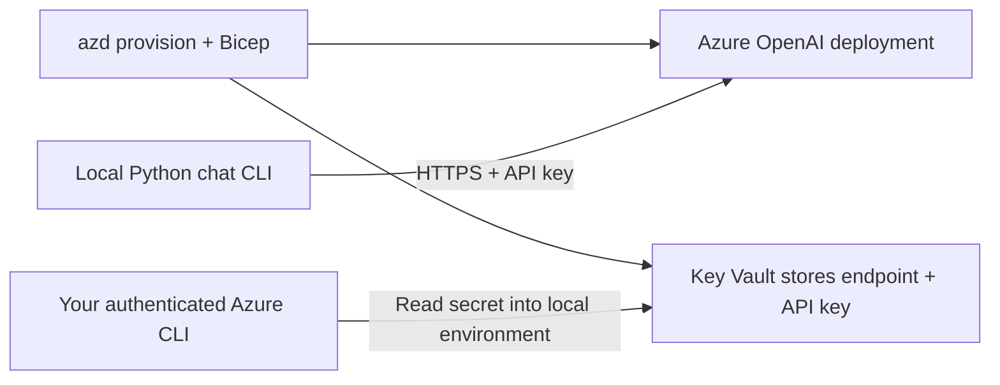

# Azure OpenAI Chat — CLI មូលដ្ឋាន​សំរាប់​តំបន់​ក្រោយ និង​ធម្មវិទ្យា AZD  

**កម្រិត:** មធ្យម · **ម៉ោង:** ៣៥–៦០ នាទី រួមទាំង ការតម្លើង  

ឧទាហរណ៍​នេះ​បង្កើតធនធាន **Azure OpenAI និង Key Vault** បន្ទាប់មករត់  
CLI ខ្សែបន្ទាត់​ការពិភាក្សា Python **នៅលើម៉ាស៊ីនរបស់អ្នក**។ វាមិនរៀបចំវែបសាយ  
ឬ Container App ទេ។ ម៉ូដែល​បើក​ធម្មតាគឺ `gpt-4.1`, ជំនាន់ `2025-04-14`, ជាមួយ  
សមត្ថភាពបោះជំរុញ `GlobalStandard` ២០។ សូមពិនិត្យភាពមានស្រាប់ និងគ្រោងដាក់កំណត់នៅ  
តំបន់អ្នកជ្រើសរើសមុនពេលបង្កើត; កាលបរិច្ឆេទជីវិតម៉ូដែលអាចប្ដូរបាន។  

## គោលបំណងរៀន  

- បង្កើត​គ្រឹះាដំណាក់​គ្រោងម៉ូដែល​ជាមួយ Bicep និង azd។  
- ទាញយកកូនសោ API ពី Key Vault ដោយមិនដាក់វា​នៅក្នុងលទ្ធផលការចេញផ្សាយ។  
- ផ្ញើសំណើរបញ្ចប់ការជជែក Chat និងរក្សាប្រវត្តិការសន្ទនា។  
- ពន្យល់ពីចំនួន token និងកំណត់ការប៉ាន់ស្មានថ្លៃ។  



គ្មានការរួមបញ្ចូលចលនាអត្តសញ្ញាណដែលគ្រប់គ្រង, ការបរាជ័យខុសប្លែកក្នុងតំបន់ជាច្រើន, ម៉ាស៊ីនកំណត់អត្រាប្ដូរតាមបំណង, របៀបចាក់ផ្សាយបន្ត, ឬករណីកុំព្យូទ័រដែលមានម៉ោងវេលានៅក្នុងឧទាហរណ៍នេះទេ។ SDK OpenAI ធ្វើការជួយសាកល្បងឡើងវិញរហូតដល់ពីរដងសម្រាប់កុំទុកចោលនូវកំហុសដែលអាចជួយសាកល្បងឡើងវិញបាន; CLI ចេញផ្សាយកំហុសដែលនៅសល់។
rate limiter, streaming mode, or hosted compute in this sample. The OpenAI SDK
performs up to two retries for retryable failures; the CLI reports remaining errors.

## គ្រឿងចាំបាច់មុន

- កំណែត្រឹមត្រូវបច្ចុប្បន្ន [azd](https://learn.microsoft.com/azure/developer/azure-developer-cli/install-azd)
  (បញ្ចេញការចេញផ្សាយនៅពេលពិនិត្យសម្រួល៖ 1.37.2)។
- [Azure CLI](https://learn.microsoft.com/cli/azure/install-azure-cli)។
- Python **3.10+** (ផ្តល់អនុសាសន៍ 3.11) និងបរិស្ថានវីរុច។
- ការជាវ Azure ដែលមានសិទ្ធិបង្កើតសេវាកម្ម Cognitive Services និង Key Vault
  ការបង្កើតធនធាន, ដាក់ម៉ូដែល, និងអានអាថ៌កំបាំងរបស់ធុង។
- ការចេញផ្សាយតំបន់ និងកូត `GlobalStandard` សម្រាប់ `gpt-4.1`។ ពត៌មានបញ្ជាក់
  អាស្រ័យលើការជាវ និងលក្ខណៈពិសេស; គ្មានពេលវេលាអនុម័តដែលធានាថាត្រូវ។

```bash
azd version
az version
python --version
azd auth login
az login
```

អ្នកត្រូវមានវគ្គសម្គាល់ផ្ទាល់ខ្លួនបំបែកគ្នា។ ជ្រើសការជាវដូចគ្នានៅក្នុងឧបករណ៍ទាំងពីរមុនពេលបញ្ជា។
មុនដំណើរការបញ្ជា ខាងក្រោម។

## ចាប់ផ្តើមយ៉ាងរហ័ស (Bash)

ប្រតិបត្តិការពីរឺស៊ីតរីដើម៖

```bash
cd examples/azure-openai-chat
azd env new myopenai
azd provision
```

ជ្រើសរើសតំបន់ដែលគាំទ្រ។ ការផ្ដល់ធនធានបង្កើតក្រុមធនធាន, គណនី OpenAI,
ការដាក់បញ្ចូលម៉ូដែល, Key Vault, និងសម្ងាត់ `openai-endpoint`/`openai-api-key`។
មិនមាន **សេវាកម្មណាមួយសម្រាប់ដាក់បង្ហាញ** ក្នុង `azure.yaml` ទេ។

ផ្ទុកនូវលទ្ធផលមិនមែនជារឿងសម្ងាត់ ហើយទាញយករឿងសម្ងាត់ចូលទៅក្នុងសែលបច្ចុប្បន្នរបស់អ្នក៖

```bash
export AZURE_OPENAI_ENDPOINT="$(azd env get-value AZURE_OPENAI_ENDPOINT)"
export AZURE_OPENAI_MODEL="$(azd env get-value AZURE_OPENAI_MODEL)"
KV_NAME="$(azd env get-value AZURE_KEY_VAULT_NAME)"
export AZURE_OPENAI_API_KEY="$(az keyvault secret show \
  --vault-name "$KV_NAME" --name openai-api-key --query value --output tsv)"

python -m venv .venv
source .venv/bin/activate
python -m pip install -r src/requirements.txt
python src/chat.py
```

ក្នុង PowerShell បើកប្រើជាមួយ `.\.venv\Scripts\Activate.ps1` ហើយកំណត់អថេរបរិស្ថាន
ជាមួយ `$env:AZURE_OPENAI_ENDPOINT = azd env get-value AZURE_OPENAI_ENDPOINT`
(ហើយដដែលសម្រាប់ម៉ូដែល) រកយកក្ដារចូលប្រើ API ដោយប្រើ
`$env:AZURE_OPENAI_API_KEY = az keyvault secret show --vault-name $KV_NAME --name openai-api-key --query value -o tsv`។
កំណត់ `$KV_NAME = azd env get-value AZURE_KEY_VAULT_NAME` ជាមុនសិន។

កុំបោះពុម្ព បញ្ជូន ឬបិទសោ API ទៅក្នុងរបាយការណ៍បញ្ហា។ CLI អានអថេរបរិស្ថានដំណើរការ;
វា **មិន** ទាញយកអាណត្តិ Key Vault ឬផ្ទុកឯកសារ `.env` ទេ។
`config.py` វាយតម្លៃចុងបញ្ចប់, សមាមាត្រសញ្ញាសម្ងាត់ និងសីតុណ្ហភាពនៅពេលចាប់ផ្តើម។

លទ្ធផលដែលរំពឹងទុក (មាតិកា និងការប្រើប្រាស់ខុសគ្នា):

```text
Azure OpenAI Chat Application
Model: gpt-4.1
...
You: Say hello in one sentence.
Assistant: Hello! How can I help you today?
[Tokens: ... | Cost: $...]
```

ពាក្យបញ្ជា៖ `stats` បង្ហាញចំនួនសរុប, `clear` លុបប្រវត្តិការសន្ទនា, និង
`quit`/`exit` បញ្ចប់សម័យ។ មិនមានពាក្យបញ្ជា `--stream`, `--show-tokens`, `tokens`,
ឬ `cost` ទេ។

## ពិនិត្យការបញ្ចូល

បន្ទាប់ពីផ្ទុកអថេរសែលខាងលើ:

```bash
curl --fail-with-body \
  "${AZURE_OPENAI_ENDPOINT%/}/openai/deployments/${AZURE_OPENAI_MODEL}/chat/completions?api-version=2024-10-21" \
  -H "Content-Type: application/json" \
  -H "api-key: $AZURE_OPENAI_API_KEY" \
  -d '{"messages":[{"role":"user","content":"Say hello!"}],"max_tokens":50}'

az keyvault secret list --vault-name "$KV_NAME" --query "[].name" -o table
```

ជោគជ័យ៖ API ត្រឡប់ HTTP 200 ជាមួយ `choices[0].message.content` និង `usage`;
បន្ទប់សុវត្ថិភាពបង្ហាញ `openai-api-key` និង `openai-endpoint`។ ការបញ្ចូល ARM ដែលជោគជ័យ
ដោយខ្លួនវាមិនបញ្ជាក់ការដោះស្រាយទេ។

## ឯកសារ និងការក្នុងកំណត់

```text
azure.yaml                         # Infrastructure-only AZD project
infra/main.bicep                   # Subscription deployment
infra/main.parameters.json         # Environment, location, principal ID
infra/resources/openai.bicep       # Account + model
infra/resources/keyvault.bicep     # Vault + deploying user's secret access policy
infra/resources/secrets.bicep      # Writes secrets, no key output
src/chat.py                        # Interactive CLI
src/config.py                      # Environment validation
src/requirements.txt               # Python packages
```

ដើម្បីផ្លាស់ប្តូរម៉ូដែល/កំណែ/សមត្ថភាពដែលបានផ្គត់ផ្គង់ សូមកែសម្រួលស្ដង់ដារ​នៅក្នុង
`infra/main.bicep` ហើយរត់ `azd provision`។ ការកំណត់ `AZURE_OPENAI_MODEL` នៅក្នុង
សែលរបស់អ្នកគឺជាការជ្រើសរើស **ឈ្មោះការបញ្ចូលដែលមានរួច** តែប៉ុណ្ណោះ; វាមិនបញ្ចូលម៉ូដែលថ្មីទេ។

| អថេរសម័យដំណើរការ | តម្លៃលំនាំដើម / ប្រភព |
|---|---|
| `AZURE_OPENAI_ENDPOINT` | ត្រូវការរួចទទួលបានពី azd អោយ​ក៏​ទេ | 
| `AZURE_OPENAI_API_KEY` | ត្រូវការរួចទទួលបានពី Key Vault |
| `AZURE_OPENAI_MODEL` | `gpt-4.1`; ឈ្មោះការបញ្ចូល Azure |
| `AZURE_OPENAI_MAX_TOKENS` | 800 (ជួរត្រួតពិនិត្យ 1–4096) |
| `AZURE_OPENAI_TEMPERATURE` | 0.7 (ជួរ 0–2) |
| `AZURE_OPENAI_INPUT_PRICE_PER_1K` | 0.002 USD; អត្រាកិនសម្រាប់បញ្ចូលដែលមិនបានផ្ទុកក្នុងកំណត់ត្រា |
| `AZURE_OPENAI_OUTPUT_PRICE_PER_1K` | 0.008 USD; អត្រាសំរុងទិន្នន័យ |

## ការចំណាយ និងកំណត់សុវត្ថិភាព

ការបង្ហាញចំណាយនេះគឺជាការប៉ាន់ប្រមាណ មិនមែនការបង់ប្រាក់ Azure ពិតប្រាកដទេ។ វាប្រមូលការប្រើប្រាស់សញ្ញា API
ដោយគុណនឹងអត្រាត្រូវបានកំណត់ និងមិនបានគណនាចុះបញ្ជាក់បញ្ចុះតម្លៃសម្រាប់បញ្ចូលដែលបានផ្ទុកក្នុងកំណត់ត្រា,
ការប្រែប្រួលតំបន់/SKU, ពន្ធ, ការផ្លាស់ប្ដូរតម្លៃ ឬការហៅបរាជ័យ/ឆ្លងកាត់ការសាកល្បងម្តងទៀត។
សូមលុបអត្រា **ទាំងពីរ** នៅពេលប្រើម៉ូដែល ឬ SKU ផ្សេងទៀត ហើយពិនិត្យឡើងវិញអំពី
[តម្លៃ OpenAI Azure](https://azure.microsoft.com/pricing/details/cognitive-services/openai-service/) សព្វថ្ងៃ។

សម្រាប់ការបង្ហាញតារាង, ១០០ សំណើដែលប្រើប្រាស់ ៥០០ សញ្ញាបញ្ចូលមិនមានកំណត់ត្រា និង ២០០ សញ្ញាសំរោមក្នុងមួយសំណើ
នៅអត្រាលំនាំដើមនឹងមានតម្លៃ `100 × (500/1000 × .002 + 200/1000 × .008) = $0.26`។
ប្រតិបត្តិការក្បាល Key Vault/ការផ្ទុកទិន្នន័យមានការចំណាយផ្សេងពីនេះ។ គ្មានការចំណាយថេរ $50/ខែ
សម្រាប់ CLI តំបន់មូលដ្ឋាននេះនិងគ្មានក מחשבផ្ទុកក្នុងគំរូ។

ក្បាលក្រឡាអាចប្រើគោលនយោបាយចូលដំណើរការសម្រាប់អ្នកដាក់បំប៉ោងប្រាក់; មិនមែនជាឧទាហរណ៍ RBAC ឬ
កម្មវិធីភាពអត្តសញ្ញាណគ្រប់គ្រង។ ចំណុចចូលសាធារណៈ និងការផ្ទៀងផ្ទាត់ API-key
ត្រូវបានប្រើសម្រាប់ការបង្រៀន។ សូមដាក់កំណត់សិទ្ធិ និងបន្ថែមការគ្រប់គ្រងអត្តសញ្ញាណ/បណ្តាញ
ដើម្បីពាក់ព័ន្ធជាមួយផលិតកម្ម។

## លំហាត់អនុវត្ត

### ១. ពិនិត្យបរិបទ និងកំណត់ឡើងវិញ

**ចាប់ផ្តើម:** បើក CLI។ **គោលបំណង:** ពិនិត្យប្រវត្តិ។
និយាយ “ចងចាំពាក្យ cedar,” បន្ទាប់មកសួរ “តើពាក្យណាដែលខ្ញុំបានសុំអ្នកចងចាំ?”
រត់ `stats`; ពង្រីកជោគជ័យពីរត្រូវតែគិតជាសារប្តូរពីរចេញវិញ។
រត់ `clear` និង `stats`; សារប្តូរគួរតែសូន្យ (បរិមាណសញ្ញាបាននៅតែមាន)។
ពាក្យសម្គាល់ពិសេសរបស់ម៉ូដែលមិនតែងតែមានលក្ខណៈកំណត់។

### ២. ផ្លាស់ប្ដូរពីមាចម្លើយ

**ចាប់ផ្តើម:** ចេញ CLI រក្សាទុក shell ដដែល។
រត់ `export AZURE_OPENAI_MAX_TOKENS=100`, ដំណើរការ `python src/chat.py` រួចសួរពី
ពហុពណ៌នាគ្លីបសង្ខេបអំពី azd។ ពិនិត្យថាបានបង្ហាញបង់ពាន ១០០។
ស្ដារឡើងវិញជាមួយ `unset AZURE_OPENAI_MAX_TOKENS`។ កំណត់ចំនួនចម្លើយតិចជាងមុនមិនបន្ថយសញ្ញាប្រវិត្តដែលបានផ្ញើរួចទេ។


- **៤០៣ អាន Key Vault:** ពិនិត្យការជាវ/ចូល CLI Azure និង principle
  នៅក្នុងគោលនយោបាយចូលក្បាលក្រាល។ ការផ្លាស់ប្តូរគោលនយោបាយអាចចំណាយពេលណែនាំ។
- **៤០៤ ការប្រាប់ផ្គត់ផ្គង់:** ពិនិត្យឈ្មោះបញ្ចេញ, ចំណុចចូល, និងស្ថានភាពបញ្ចេញ។
- **៤២៩ ការប្រាប់ផ្គត់ផ្គង់:** រង់ចាំការកំណត់អត្រាឡើងវិញ; ពិនិត្យសមត្ថភាពម៉ូដែលតំបន់។
- **404 inference:** ពិនិត្យឈ្មោះការតម្លើង, ចំណុចបញ្ចប់, និងស្ថានភាពការតម្លើង។
- **429 inference:** រង់ចាំកំណត់អត្រាថ្មីឡើងវិញ; ធ្វើការផ្ទៀងផ្ទាត់គណៈកម្មាធិការម៉ូដែលតំបន់។
  CLI លុបការបង្វិលដែលបានបរាជ័យចេញពីប្រវត្តិ ដូច្នេះការសាកល្បងមួយទៀតមិនបង្កើតការចំលងទេ។
- **ប្រវែងបរិបទ:** ឧទាហរណ៍មិនបានកាត់បន្ថយការសន្ទនាដែលនៅយូរ; ใช้ `clear`។
- **ម៉ូដែលមិនមាន/ចាកចេញ:** ពិនិត្យមើលភាពអាចប្រើម៉ូដែលបច្ចុប្បន្ន និងធ្វើបច្ចុប្បន្នភាព
  ម៉ូដែល/កំណែ/SKU រួមគ្នា; កំណែ API និងកំណែម៉ូដែលជាការកំណត់ខុសគ្នា។

## ការសម្អាត និងជំហានបន្ទាប់

```bash
azd down
unset AZURE_OPENAI_API_KEY
```

ការរក្សាទុក Key Vault ជាប្រភេទ soft-delete គឺប្រាំពីរថ្ងៃ; ការលុបចោលត្រូវការអំពើសិទ្ធិផ្គាប់ផ្សេង។
គ្មានស៊ុមតេស្តដែលបានប្តេជ្ញា; មិនរ៉ាំបញ្ចូលពាក្យបញ្ជា `pytest tests/` ដែលមិនមានទេ។
បន្ថែមតេស្ត API ប្រើ Mock មុនពេលពង្រីកកូដ។

[ឧទាហរណ៍ Container](../../../../examples/container-app) · [ផែនទីស្ថាបត្យកម្មលក់រាយ](../retail-scenario.md) ·
[ទំព័រដើមវគ្គ](../../README.md) · [រាយការណ៍បញ្ហា](https://github.com/microsoft/AZD-for-beginners/issues)

---

<!-- CO-OP TRANSLATOR DISCLAIMER START -->
**ការបដិសេធ**:
ឯកសារនេះត្រូវបានបម្លែងភាសា ដោយប្រើសេវាបម្លែងភាសា AI [Co-op Translator](https://github.com/Azure/co-op-translator)។ ទោះយើងខ្ញុំមានក្តីប្រាថ្នាឱ្យបានច្បាស់លាស់ តែសូមយល់ដឹងថាការបម្លែងដោយស្វ័យប្រវត្តិក៏អាចមានកំហុសឬភាពមិនត្រឹមត្រូវ។ ឯកសារដើមជាភាសាទីតាំងគួរត្រូវបានគេប្រើជាប្រភពច្បាស់លាស់។ សម្រាប់ព័ត៌មានសំខាន់ៗ សូមណែនាំឱ្យប្រើប្រាស់ការប្រែដោយមនុស្សជំនាញ។ យើងខ្ញុំមិនទទួលខុសត្រូវចំពោះការយល់ច្រឡំ ឬការបកស្រាយខុសបន្ទាប់ពីការប្រើប្រាស់ការបម្លែងនេះនោះទេ។
<!-- CO-OP TRANSLATOR DISCLAIMER END -->