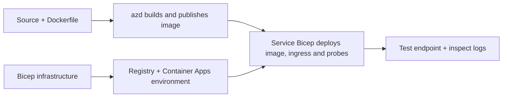

# ឧទាហរណ៍ការតំឡើងកម្មវិធី Container ជាមួយ AZD

ថតនេះមានឧទាហរណ៍រៀនពីពីរដែលមានកូដប្រភព, Dockerfiles,
សំណង់មូលដ្ឋាន Bicep និង `azure.yaml`។ គ្មានមួយណា ត្រូវបានផ្លាស់ប្តូរដើម្បីប្រើក្នុងផលិតកម្មឡើយ។

## ជ្រើសរើសឧទាហរណ៍

| ឧទាហរណ៍ | អ្វីដែលបានអនុវត្ត | មុនចាប់ផ្តើម |
|---|---|---|
| [Simple Flask API](../../../../examples/container-app/simple-flask-api) | API CRUD Python តែមួយ, វត្ថុក្នុង-memory, ការតែ្សវសុខភាព, ការប៉ម HTTP | ចំណេះដឹង CLI និង HTTP មូលដ្ឋាន |
| [Two-service microservices](../../../../examples/container-app/microservices) | វ៉េតនៅ Node.js, សេវាកម្មផលិតផល Python អានតែ​លេខ​ពីក្នុង, ការតាមដាន និងការប៉ម | បញ្ចប់ឧទាហរណ៍សេវាដែលមានតែមួយ ជាមុន |

ចំណាយពេល 30-60 នាទី រួមបញ្ចូលការតំឡើង និងការត្រួតពិនិត្យ។ ពេលវេលាបង្កើត Azure ផ្លាស់ប្ដូរប្រកបដោយភាពអនថេរ។

## មុនចាប់ផ្តើម

- [Azure Developer CLI](https://learn.microsoft.com/azure/developer/azure-developer-cli/install-azd)
- [Azure CLI](https://learn.microsoft.com/cli/azure/install-azure-cli) សម្រាប់ពាក្យបញ្ជារត្រួតពិនិត្យ
- Docker ជាមួយ daemon របស់វាកំពុងដំណើរការសម្រាប់បង្កើតរូបភាព container ទាំងនេះ
- កម្មសិទ្ធ័ Azure មានសិទ្ធបង្កើតធនធាន និងគណនីតំបន់គ្រប់គ្រាន់
- Bash សម្រាប់ឧទាហរណ៍ shell ឬពាក្យបញ្ជា PowerShell ស្រដៀងគ្នា

```bash
azd version
az version
docker info
azd auth login
az login
```

ឧបករណ៍ទាំងពីរមានសម័យចូលប្រើប្រាស់បែកគ្នា។ សូមប្រើ azd ដែលមានស្ថេរភាពបច្ចុប្បន្ន; ម៉ោងចេញផ្សាយបច្ចុប្បន្ននៅពេលពិនិត្យគឺ 1.37.2។ កំណែចាប់ផ្តើមចាស់ៗ មិនត្រូវបានធានាជាការផ្គូរផ្គង។


ពីឫសស្តុករបស់ឃ្លាំងទិន្នន័យ:

```bash
cd examples/container-app/simple-flask-api
azd env new flask-demo
azd up
API_URL=$(azd env get-value API_ENDPOINT)
curl --fail-with-body "${API_URL}/health"
```

មុន: HTTP 200 ជាមួយ `"status": "healthy"`។ អនុវត្តតាម README ឧទាហរណ៍ដើម្បីបង្កើត,
អាន, បន្ទាន់សម័យ, និងលុបធាតុមួយ, ហើយដើម្បីពិនិត្យកំណត់ហេតុ។



ការផ្គត់ផ្គង់ដំបូងប្រើរូបភាព hello-world សាធារណៈនៅលើច្រក 80។ ឯកសារប៉ារ៉ាម៉ែត្រពេញនិយម
សម្រាប់សេវាកម្មអាចអនុញ្ញាតឱ្យ `azd deploy` ជំនួសវាជាមួយរូបភាពកម្មវិធីដែលបានបង្កើត
និងច្រក/ការសាកល្បងកម្មវិធីត្រឹមត្រូវ (8000 សម្រាប់ Flask/ផលិតផល, 8080 សម្រាប់ទ្វារ។
រក្សាទុកឯកសារទាំងនេះជាមួយការកំណត់ `azure.yaml` `module` របស់ពួកវា។

## ការកំណត់រចនាសម្ព័ន្ធ៖ អ្វីជាា្ជការប្រែក្លាយអ្វី

`azure.yaml` ជ្រើសរើសថតដើម, ភាសា, ម៉ាស៊ីនបម្រើ, និងម៉ូឌុលដាក់បញ្ចូល។
CPU/memory ដល់ Container, ingress, ការសាកល្បង, ការគីឡ្រុបចម្លង, និងច្បាប់បង្ហាញការលូតលាស់ត្រូវបានកំណត់
នៅក្នុង **Bicep**, មិនមែនជា `resources`, `scale`, ឬ `regions` តម្លៃសេវាកម្មដែលខ្វះតំណាង។

`azd env set SOME_VALUE ...` រក្សាទុកតម្លៃមួយនៅក្នុងមូលដ្ឋាន។ វាកែប្រែធនធានដែលបានដាក់
ដំណើរការត្រឹមតែពេលមានប៉ារ៉ាម៉ែត្រ, ផែនទីបរិដ្ឋាន, ឬភ្ជាប់ដែលប្រើប្រាស់វាដោយច្បាស់។
តម្លៃ។ ឧទាហរណ៍ទាំងនេះមិនប្រើប្រាស់ `MAX_REPLICAS`, `SCALE_TO_ZERO_TIMEOUT`,
`CONTAINER_APP_REPLICA_TYPE`, ឬកំណត់ canary ផ្ទាល់ខ្លួនពីតម្លៃបរិក្ខារពីបរិវេណ azd ទេ។
កែសម្រួល Bicep ដែលទាក់ទង ហើយរត់ `azd up` ដើម្បីបំពាក់ឡើងវិញ និងដាក់អនុវត្ត។

កុំដាក់ប្រភពកម្មវិធីនៅក្រោម `infra/`។ `project` ត្រូវតែបង្ហាញទៅថតប្រភព
ដែលមាន Dockerfile និងបញ្ជីការពឹងផ្អែក។

## ការត្រួតពិនិត្យ និងការចំណាយ

- `azd monitor --logs` បើកទិដ្ឋភាពផតថល; វាមិនមែនជាជួរបង្ហាញកំណត់ហេតុ terminal នោះទេ។
  ប្រើ `az containerapp logs show --follow` ជាមួយឈ្មោះធនធានពិតប្រាកដ។
- API សាមញ្ញសរសេរកំណត់ហេតុ stdout ដែលប្រមូលបានតាមរយៈ Container Apps/Log Analytics។
  ធនធាន Application Insights ដែលបានផ្ដល់ដោយវាមិនត្រូវបានដាក់ឧបករណ៍ដោយស្វ័យប្រវត្តិ។
- កន្លែងសេវាកម្មទ្វារប្រើប្រាស់ Node.js Application Insights SDK; សេវាកម្ម Python
  នាំចេញការតាមដានកំណត់ហេតុកម្មវិធី។ ការតាមដានសំណើ/ការពឹងផ្អែក Python ពេញលេញ
  មិនត្រូវបានកំណត់រចនាសម្ព័ន្ធទេ។
- ការពង្រីកទៅសូន្យអាចកាត់បន្ថយថ្លៃក្រុមហ៊ុនគណនា, ប៉ុន្តែការចុះបញ្ជីនិងការច្រកបញ្ចូល/រក្សាទុកកំណត់ហេតុ
  នៅតែអាចចំណាយប្រាក់។ ការកំណត់លំនាំដើមរបស់សេវាកម្មតូចៗរក្សាទុកចម្លង។
  ប៉ាន់ប្រមាណតំបន់និងការប្រើប្រាស់របស់អ្នកនៅក្នុង
  [ប្រូក្រាមគិតថ្លៃ Azure](https://azure.microsoft.com/pricing/calculator/)។

## លំនាំដើមដំណើរការ​កម្រិតខ្ពស់ — មិនរួមបញ្ចូលការអនុវត្ត

ទាំងនេះជាទិសដៅរចនាសម្ព័ន្ធ មិនមែនជាគម្រោងក្នុងស្រុកបន្ថែម ឬកូដរបៀបបង្កើតនិងប្រតិបត្តិទេ៖

- **ទិន្នន័យដដែល និងការផ្ទៀងផ្ទាត់អត្តសញ្ញាណ:** ជំនួសឃ្លាំងក្នុងចិត្ត និងបន្ថែម
  ការផ្ទៀងផ្ទាត់/អនុញ្ញាត Microsoft Entra ID មុនចេញផលិតកម្ម។
- **ខៀវ-បៃតង/កានារី:** ប្រើម៉ូដកំណែច្រើនរបស់ Container Apps, ស្លាបព្រិលកំណែ,
  ទម្ងន់ចរាចរណ៍, ការបញ្ជាក់សុខភាព, និងនីតិវិធីត្រឡប់ខ្សែ។
  នៅក្នុងគំរូទាំងនេះ គ្មានការកំណត់កុងហ្វីក្រេស្យុង `deploymentStrategy: canary` azd ទេ។
  មើល [ការគ្រប់គ្រងកំណែ](https://learn.microsoft.com/azure/container-apps/revisions)។
- **តំបន់ច្រើន:** បង្កើតបរិយាកាស និងកម្មវិធីបង្ហាញ ផ្សេងគ្នា ក្នុង Bicep ហើយរចនាសម្ព័ន្ធ
  ការបញ្ជូនទិន្នន័យជាសកល និងភាពស្របគ្នាទិន្នន័យ។ បញ្ជីសេវាកម្ម `regions` មិនមែនជាគ្រឿងចាក់ស្ដារលក្ខណៈ azd ទេ។

- **កម្មករត្រង់រង់:** បន្ថែមប្រភពកម្មករ លទ្ធផលផ្នែកពាក់ព័ន្ធ អនុស្សរណៈជួរដេក ហើយមានគ្រប់គ្រង
  អត្តសញ្ញាណជាមួយតួនាទីថ្នាក់ទិន្នន័យ និងច្បាប់ស្កែលដែលបានផ្ទៀងផ្ទាត់។ មិនត្រូវចម្លង
  ផ្លូវ `src/worker` ធ្មេញ និង​រង់ចាំគម្រោងដែលអាចរត់បាន។
- **Dapr:** ប្រមូលផ្តុំក្រុមធាតុ ប្រមូលផ្តុំ sidecar តំឡើង SDK ដែលបានផ្គូផ្គង,
  និងអនុវត្តការដោះស្រាយកំហុស state/pub-sub។
- **Secrets:** ប្រើអត្តសញ្ញាណគ្រប់គ្រង និងការផ្ដល់តួនាទីនៅកន្លែងដែលអាចធ្វើទៅបាន។ គ្រាន់តែ
  បង្កើត Key Vault មិនមែនផ្តល់សិទិ្ធចូលនិងបញ្ចូលសម្ងាត់ទៅកម្មវិធីឡើយ។

## ការសម្អាត

ពីថតគំរូៈ

```bash
azd down
```

ត្រួតពិនិត្យការជូនដំណឹងលុបចេញ ហើយបញ្ជាក់ថាក្រុមធនធានដែលបានលក់ពិសេសត្រូវបានដកចេញ។
មិនត្រូវប្រើគំរូទាំងនេះជាមូលដ្ឋានផលិតកម្មដោយគ្មានការរចនានិងសាកល្បងបន្ថែមទៀត។

[Examples index](../README.md) · [Course home](../../README.md) ·
[Container Apps documentation](https://learn.microsoft.com/azure/container-apps/) ·
[Report an issue](https://github.com/microsoft/AZD-for-beginners/issues)

---

<!-- CO-OP TRANSLATOR DISCLAIMER START -->
**ការបដិសេធ**:
ឯកសារនេះត្រូវបានបម្លែងភាសា ដោយប្រើសេវាបម្លែងភាសា AI [Co-op Translator](https://github.com/Azure/co-op-translator)។ ទោះយើងខ្ញុំមានក្តីប្រាថ្នាឱ្យបានច្បាស់លាស់ តែសូមយល់ដឹងថាការបម្លែងដោយស្វ័យប្រវត្តិក៏អាចមានកំហុសឬភាពមិនត្រឹមត្រូវ។ ឯកសារដើមជាភាសាទីតាំងគួរត្រូវបានគេប្រើជាប្រភពច្បាស់លាស់។ សម្រាប់ព័ត៌មានសំខាន់ៗ សូមណែនាំឱ្យប្រើប្រាស់ការប្រែដោយមនុស្សជំនាញ។ យើងខ្ញុំមិនទទួលខុសត្រូវចំពោះការយល់ច្រឡំ ឬការបកស្រាយខុសបន្ទាប់ពីការប្រើប្រាស់ការបម្លែងនេះនោះទេ។
<!-- CO-OP TRANSLATOR DISCLAIMER END -->