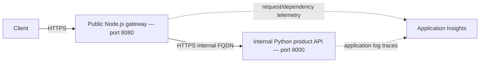

# ស៊ឺវីសិនពីររបស់ Microservices — Azure Container Apps

**កម្រិត:** មធ្យម · **ពេលវេលា:** ៤៥-៦០ នាទី រួមមានការតំឡើង

គំរូការសិក្សានេះអនុវត្ត **Node.js API Gateway** និង **សេវាកម្មផលិតផល Python អានបានតែប៉ុណ្ណោះ**។
មានរួមបញ្ចូលកូដដើម, Dockerfiles, Bicep និងការកំណត់ azd ។
វាមិនមែនជាប្រព័ន្ធដែលបានបង្កើតសម្រាប់ផលិតកម្ម។

## អ្វីដែលអ្នកនឹងរៀន

- ចាប់ផ្ដើមប្រើសេវាកម្មពីរដោយឯករាជ្យ។
- ប្រើ FQDN បណ្ដាញខាងក្រោយក្នុង HTTPS។
- ពិនិត្យភាពជោគជ័យ, មិនឃើញ, និងការឆ្លើយតបសេវាកម្មមិនអាចប្រើបាន។
- យល់ដឹងអំពី telemetry និងដែនកំណត់ការលាស់ឡើងដោយឯករាជ្យ។



កាតាប្រភេទផលិតផលមានផលិតផលថេរចំនួនប្រាំក្នុងមេម៉ូរី។ មាន **គ្មានអ្នកដំណើរការ POST, 
PUT, ឬ DELETE** មូលដ្ឋានទិន្នន័យ, សេវាកម្ម Service Bus, សេវាកម្មបញ្ជាលេខ/អ្នកប្រើ/ការជូនដំណឹង,
C#, ឬកូដ Go។ នោះគឺជាចំណាយអភិវឌ្ឍន៍នាពេលអនាគត មិនមែនលក្ខណៈពិសេសដែលរួមបញ្ចូលទេ។
កាសែតមិនធ្វើការផ្ទៀងផ្ទាត់អ្នកប្រើ; ការចូលផ្លូវក្នុងមិនមែនជាការបញ្ជូលជំនួស
សម្រាប់ការអនុញ្ញាតកម្មវិធី។

## លក្ខខណ្ឌ​មុន

ទប់បញ្ចប់ [Flask API តែមួយ](../../../../../examples/container-app/simple-flask-api) ជាមុន។
ដំឡើង azd ដែលមានស្ថេរភាពបច្ចុប្បន្ន (ចេញផ្សាយក្នុងពេលពិនិត្យ: 1.37.2), Azure CLI,
និង Docker ជាមួយ daemon ដែលកំពុងរត់។ អ្នកត្រូវការជាវ Azure, សិទ្ធិបង្កើតធនធាន,
និងកំណត់បរិមាណ Container Apps តាមតំបន់។

```bash
azd version
az version
docker info
azd auth login
az login
```

ប្រើជាវជាមួយគ្នានៅក្នុងឧបករណ៍CLIទាំងពីរ។ ពាក្យបញ្ជាខាងក្រោមប្រើ Bash។

## បង្ហោះ និងផ្ទៀងផ្ទាត់

ពីដើមផ្ទាំង repository:

```bash
cd examples/container-app/microservices
azd env new microservices-demo
azd up
GATEWAY_URL=$(azd env get-value API_GATEWAY_URL)
RG_NAME=$(azd env get-value AZURE_RESOURCE_GROUP)
GATEWAY_NAME=$(azd env get-value API_GATEWAY_NAME)
PRODUCT_NAME=$(azd env get-value PRODUCT_SERVICE_NAME)

curl --fail-with-body "${GATEWAY_URL}/health"
curl --fail-with-body "${GATEWAY_URL}/api/products"
curl --fail-with-body "${GATEWAY_URL}/api/products/1"
curl -i "${GATEWAY_URL}/api/products/999"
```

**ជោគជ័យ:** health 200; list 200 ជាមួយផលិតផលចំនួន **ប្រាំ**; ផលិតផលលេខ 1 គឺ Laptop
ដែលមានតម្លៃ 999.99 និងមានស្តុក 50; ផលិតផលមិនស្គាល់បង្ហាញ 404។
សេចក្ដីពណ៌នាត្រូវបានរួមបញ្ចូលក្នុងការឆ្លើយតប; ពេលវេលាត្រូវបានផ្លាស់ប្តូរញឹកញាប់។

ការជូនដំណឹងដំបូងប្រើរូបភាព hello-world សាធារណៈលើព្រលព័ន្ធ 80 ដូច្នេះវាមិនព្យាយាម
ទាញយករូបភាពដែលមិនមានពីឃ្លាំងទទេ។ ម៉ូឌុល Bicep មួយចំនួននិងឯកសារពារ៉ាម៉ែត្រ
សម្រាប់សេវាកម្មជំនួសពួកវាជារូបភាពដែលបានបង្កើត និង ports/probes ប្រើកម្មវិធីនៅពេល
`azd deploy`។ លក្ខណៈពិសេសសំខាន់រក្សារឈ្មោះរូបភាពដែលបានបោះពុម្ពផ្សាយសម្រាប់ការជូនដំណឹងបន្ទាប់។

## សេវាកម្ម និងបណ្តាញ

| សេវាកម្ម | ច្រកដែលបង្ហាញ | ធនធានលំនាំដើម |
|---|---|---|
| Gateway | GET `/`, `/health`, `/api/products`, `/api/products/:id` | 1 vCPU, 2 GiB, 2–20 ចម្លង |
| Product | GET `/`, `/health`, `/products`, `/products/<id>` | 0.5 vCPU, 1 GiB, 1–10 ចម្លង |

ការចូលភ្លើងផលិតផលមាន `external: false` និង `allowInsecure: false`។ Bicep ដាក់ចាក់
`PRODUCT_SERVICE_URL=https://<actual-internal-fqdn>` ទៅកាន់ gateway។ HTTP នឹង
បង្វិលទៅ; HTTPS ត្រូវគ្នានឹង ingress ដែលបានកំណត់។ ឈ្មោះ DNS ខ្លីត្រូវតែត្រូវគ្នា
**ឈ្មោះ Container App ពិតប្រាកដ** មិនមែនជាកូនសោសេវាកម្មវាងវៃ `product-service` ទេ។
កុំព្យាយាមហៅ URL ក្នុងផ្ទៃក្នុងដោយផ្ទាល់ពីកុំព្យូទ័រយួរដៃរបស់អ្នក។

ស្តgateway មានពេលវេលាចុងបំផុតប្រាំវិនាទីសម្រាប់ការហៅផលិតផល។ លេខសម្គាល់ផលិតផលដែលខ្វះ
ផ្ទុះទៅជា 404; ការបរាជ័យដឹកជញ្ជូន/ការបរាជ័យផ្សេងទៀតនៅខាងក្រោយត្រឡប់មក 503។ Gateway
`/health` គ្រាន់តែពិនិត្យ gateway ប៉ុណ្ណោះ មិនមើលឃើញភាពអាចប្រើបាននៃ backend ទេ។

## ឯកសារ និងការកំណត់រចនា

```text
azure.yaml
infra/main.bicep
infra/main.parameters.json
infra/abbreviations.json
infra/core/container-apps-environment.bicep
infra/core/monitor.bicep
infra/app/api-gateway.bicep
infra/app/api-gateway.parameters.json
infra/app/product-service.bicep
infra/app/product-service.parameters.json
src/api-gateway/{app.js,package.json,Dockerfile}
src/product-service/{main.py,requirements.txt,Dockerfile}
```

ការបរិច្ឆេទប្រហែល CPU/ម៉េម៉ូរី ច្រក និងការសាកល្បងត្រូវបានកំណត់ក្នុង `infra/app/*.bicep`។ ផ្លាស់ប្តូរ
ឯកសារទាំងនោះ ហើយរត់ `azd up` ដើម្បីអាចអនុវត្តហេដ្ឋារចនាសម្ព័ន្ធ និងបញ្ចូលឡើងវិញ។ គ្មាន
ប៉ារ៉ាម៉ែត្រ បរិស្ថានបម្លែង `GATEWAY_MAX_REPLICAS` ក្នុងឧទាហរណ៍នេះទេ។

សម្រាប់ការផ្លាស់ប្តូរកូដតែប៉ុណ្ណោះ៖

```bash
azd deploy product-service
azd deploy api-gateway
```

រូបភាព Node ប្រើ Node 22; រូបភាព Python ប្រើ Python 3.11។ ទាំងពីរចងភ្ជាប់ទៅ
`0.0.0.0`។ Ingress/ការសាកល្បងប្រើច្រក 8080 (gateway) និង 8000 (ផលិតផល) ដោយលំដាប់។

## ការអភិវឌ្ឍនៅក្នុងស្រុកជាមួយ Docker

រត់ពីថតឧទាហរណ៍នេះ។ ប្រើបណ្តាញដែលបានកំណត់ដោយអ្នកប្រើប្រាស់, **មិនមែនប្រើ `localhost`
ពីធុងមួយទៅចូលធុងមួយទៀតទេ**:

```bash
docker network create azd-microservices-demo
docker build -t local-product ./src/product-service
docker build -t local-gateway ./src/api-gateway
docker run -d --name azd-product --network azd-microservices-demo local-product
docker run -d --name azd-gateway --network azd-microservices-demo \
  -p 8080:8080 -e PRODUCT_SERVICE_URL=http://azd-product:8000 local-gateway
curl --fail-with-body http://localhost:8080/api/products
```

ត្រូវរំពឹង៖ ផលិតផលប្រាំ។ HTTP ត្រូវបានប្រើសម្រាប់បណ្តាញ Docker នៅក្នុងស្រុកតែប៉ុណ្ណោះ។

```bash
docker stop azd-product azd-gateway
docker rm azd-product azd-gateway
docker network rm azd-microservices-demo
```

## ការត្រួតពិនិត្យ

```bash
az containerapp logs show --name "$GATEWAY_NAME" --resource-group "$RG_NAME" --follow
# In a separate terminal:
az containerapp logs show --name "$PRODUCT_NAME" --resource-group "$RG_NAME" --tail 100
```

`azd monitor --logs` បើកមើលពិដានទ្វារ; វាមិនបញ្ចេញហ្វឹកហ្វឺនកំណត់ហេតុទេ។
SDK Node ប្រមូលការស្នើសុំ/ការពឹងផ្អែក gateway។ Python's `AzureLogHandler`
បញ្ជូនចេញ **ស្នូលកំណត់ហេតុ** មិនមែនសំណើ Flask ស្វ័យប្រវត្តិ,ការ​ពឹងផ្អែក SQL, ឬការតាមដានចែកចាយពេញលេញទេ។
OpenCensus គឺជា SDK ចាស់; ចូលចិត្តប្រើ Azure Monitor OpenTelemetry
ពេលបន្ថែមឧទាហរណ៍នេះ។

នៅក្នុង Application Insights Logs, បង្កើតសំណើនិងពិនិត្យមើល៖

```kusto
requests
| where timestamp > ago(1h)
| where name contains "products"
| summarize RequestCount=count(), AvgDuration=avg(duration) by bin(timestamp, 5m)
```

សំរាប់សារ​កម្មវិធី Python:

```kusto
traces
| where timestamp > ago(1h)
| where message contains "products"
| project timestamp, message, severityLevel
```

អនុញ្ញាតឲ្យមានការពន្យារពេលក្នុងការ​ចូលនិងការសំរាញ់; មិនត្រូវរំពឹងថាចំនួនសំណើដូចគ្នាឬមានពេលវេលាបង់ពិនៈប្រាកដ។ មិនមានសារព្រមានប្តូរតាមបំណងឬផ្ទាំងគ្រប់គ្រងណាមួយត្រូវបានកំណត់ឡើយ។


**ចំណុចចាប់ផ្តើម៖** `src/product-service/main.py`។
**គោលបំណង៖** ពិនិត្យការដាក់សេវាកម្មដោយឯករាជ្យ។
បម្លែងស្តុក Laptop ពី ៥០ ទៅ ៤៩ នៅក្នុងបញ្ជីថេរ `products` រួចបញ្ចូល
`azd deploy product-service` បន្ទាប់មកសំណើ `${GATEWAY_URL}/api/products/1`។

**កម្រិតជោគជ័យ /ដំណោះស្រាយ៖** HTTP ២០០ ជាមួយ `"stock":49`។ ស្ដារឡើងវិញ ៥០ និងដាក់ពាក្យម្តងទៀត។
**បញ្ហាជួបជាញឹកញាប់៖** កែសម្រួលខ្សែទំនាក់ទំនង ផ្ទុយពីសេវាកម្មដែលមានមូលដ្ឋានកាតាឡុក។
នេះប្ដូរទិន្នន័យប្រភព មិនមួយប្រព័ន្ធមូលដ្ឋានទិន្នន័យស្តុកជាប់ទេ។

### សមិការ ២៖ ពិនិត្យការកំណត់រចនាសម្ព័ន្ធភាគចម្លង

**ចំណុចចាប់ផ្តើម៖** `infra/app/product-service.bicep`។
**គោលបំណង៖** ហើយមើលឃើញការផ្លាស់ប្តូររចនាសម្ព័ន្ធដោយមិនត្រូវគិតទុកចិត្តការកំណត់ស្វ័យប្រវត្តិ។
បម្លែង `minReplicas: 1` ទៅជា `minReplicas: 2` រួចបញ្ចូល `azd up` បន្ទាប់មក៖

```bash
az containerapp show --name "$PRODUCT_NAME" --resource-group "$RG_NAME" \
  --query properties.template.scale -o json
```

**កម្រិតជោគជ័យ៖** កំណត់អប្បបរមា ត្រឹម ២ និងអតិបរមានៅ ១០។
ស្ដារឡើងវិញអប្បបរមា ១ និងបញ្ចូល `azd up`។
**បញ្ហាជួបជាញឹកញាប់៖** `azd deploy` តែមួយមិនអនុវត្តការផ្លាស់ប្តូរទៅរចនាសម្ព័ន្ធចែករំលែកមិនទាក់ទងគ្នា។
កុំកំណត់ `maxReplicas` ទៅសូន្យ ជាផ្នែកនៃការបង្ហាញកំហុស។
នេះពិនិត្យបញ្ជាក់ការកំណត់រចនាសម្ព័ន្ធ មិនមែនការប្រឡងផ្ទុក ឬកំណត់ចំនួនភាគចម្លងភ្លាមៗដែលបានធានាទេ។

### សមិការ ៣៖ ពិនិត្យការដោះស្រាយសេវាកម្មមិនអាចប្រើបាននៅក្នុងផ្ទះ

**ចំណុចចាប់ផ្តើម៖** ប្រអប់ Docker មូលដ្ឋានទាំងពីរពីខាងលើកំពុងដំណើរការ។
**គោលបំណង៖** ចែកចាយពីការបរាជ័យផ្ទុកពីផលិតផលដែលបាត់។
បញ្ឈប់ប្រអប់ផលិតផលតែប៉ុណ្ណោះ៖

```bash
docker stop azd-product
curl -i http://localhost:8080/api/products
docker start azd-product
curl --fail-with-body http://localhost:8080/api/products
```

**កម្រិតជោគជ័យ៖** នៅពេលផ្អាក ខ្សែទំនាក់ទំនងវិលតប ៥០៣ ជាមួយ
`"error":"Product service unavailable"`; បន្ទាប់ពីចាប់ផ្តើមឡើងវិញ បញ្ជីវិលតប ២០០។
សាកល្បងម្ដងទៀតបន្ទាប់ពីពេលវេលាចាប់ផ្តើមខ្លី ប្រសិនបើទាមទារ។
**បញ្ហាជួបជាញឹកញាប់៖** បញ្ឈប់ខ្សែទំនាក់ទំនង សាកល្បងកំហុសខុស (គ្មានការឆ្លើយតប HTTP)។

## ចំណាយ និងចន្លោះផលិតកម្ម

ភាគចម្លងអប្បបរមា ដំណើរការគណនាដំណើរការ។ កាល្ម ampli registry និងត្រួតពិនិត្យក៏មាន
ធ្វើឱ្យមានការចំណាយផងដែរ។ មិនមានតម្លៃថេរ $៥០/ខែសរុបដែលទទួលបានការបញ្ជាក់: សូមប៉ាន់ប្រមាណ CPU/ម៉ាស៊ីនចងចាំតំបន់,
ម៉ោងភាគចម្លង, សំណើ, បណ្ណាល័យ និងការកំណត់រក្សាវិញនៅក្នុង
[កម្មវិធីគណនាតម្លៃ Azure](https://azure.microsoft.com/pricing/calculator/)។
លុបធនធានរៀនឲ្យបានរហ័ស។

ការងារផលិតកម្មរួមមាន ការផ្ទៀងផ្ទាត់ /ការអនុញ្ញាត’identité និងគ្រប់គ្រងជាក់លាក់,
ទិន្នន័យអចិន្រ្តៃយ៍ ការផ្ទៀងផ្ទាត់បញ្ចូល/ចូល ភាពមើលឃើញគាំទ្រ,
ការប្រឡងផ្ទុក/កំហុស CI/CD ការជូនដំណឹង និងនីតិវិធីស្ដារឡើងវិញ។ បន្ថែមសេវាកម្មបញ្ជាទិញ,
ជួរតំណើរ ឬមូលដ្ឋានទិន្នន័យគឺជាការបំពេញការងារផ្សេងទៀត មិនមែនជាសមិការ
ឬមុខងារដែលមានរួចនៅទីនេះ។

## ការដោះស្រាយបញ្ហានិងការសម្អាត

- **រូបភាពមិនត្រូវបានរកឃើញប្រសិនបើផ្តល់ជូនដំបូង៖** bootstrap គួរតែប្រើរូបភាពសាធារណៈ;
  ពិនិត្យប្រព័ន្ធប៉ារ៉ាម៉ែត្ររូបភាពសំខាន់និងផែនទីម៉ូឌុលដាក់ពាក្យ។
- **៥០៣ ផលិតផល៖** ពិនិត្យកំណត់ហេតុផលិតផល កំណែក្សហេតុរូបភាព និង URL HTTPS របស់ខ្លួនសម្រាប់ចាក់បញ្ចូល។
- **៤០៤ ផ្លូវមិនរំពឹងទុក៖** API របស់ផលិតផលគឺអានតែប៉ុណ្ណោះ; ពិនិត្យមើលផ្លូវ មិនមែនជាអ្នកគ្រប់គ្រង CRUD មិនមាន។
- **គ្មានទិន្នន័យតាមដាន៖** ពិនិត្យខ្សែសង្វាក់រត់ដោយមិនបង្កការជម្រះហើយ
   អនុញ្ញាតឲ្យមានការពន្យារភាពការទទួលយក។ តារាងសំណើ Python មិនត្រូវបានបញ្ចូលដោយអ្នកគ្រប់គ្រងកំណត់ហេតុនោះទេ។

ពីថតឧទាហរណ៍នេះ៖

```bash
azd down
```

សូមពិនិត្យការស្នើសុំលុបចោល និងបញ្ជាក់ថាក្រុមធនធានឯកទេសត្រូវបានលុបចោល។

[មុន៖ Flask API](../../../../../examples/container-app/simple-flask-api) · [បន្ទាប់៖ កម្មវិធីមូលដ្ឋានទិន្នន័យ](../../../../../examples/database-app) ·
[ការអភិវឌ្ឍ AI](../../../docs/chapter-02-ai-development/README.md) ·
[ទំព័រផ្ទះមេរៀន](../../../README.md) · [រាយការណ៍បញ្ហា](https://github.com/microsoft/AZD-for-beginners/issues)

---

<!-- CO-OP TRANSLATOR DISCLAIMER START -->
**ការបដិសេធ**:
ឯកសារនេះត្រូវបានបម្លែងភាសា ដោយប្រើសេវាបម្លែងភាសា AI [Co-op Translator](https://github.com/Azure/co-op-translator)។ ទោះយើងខ្ញុំមានក្តីប្រាថ្នាឱ្យបានច្បាស់លាស់ តែសូមយល់ដឹងថាការបម្លែងដោយស្វ័យប្រវត្តិក៏អាចមានកំហុសឬភាពមិនត្រឹមត្រូវ។ ឯកសារដើមជាភាសាទីតាំងគួរត្រូវបានគេប្រើជាប្រភពច្បាស់លាស់។ សម្រាប់ព័ត៌មានសំខាន់ៗ សូមណែនាំឱ្យប្រើប្រាស់ការប្រែដោយមនុស្សជំនាញ។ យើងខ្ញុំមិនទទួលខុសត្រូវចំពោះការយល់ច្រឡំ ឬការបកស្រាយខុសបន្ទាប់ពីការប្រើប្រាស់ការបម្លែងនេះនោះទេ។
<!-- CO-OP TRANSLATOR DISCLAIMER END -->