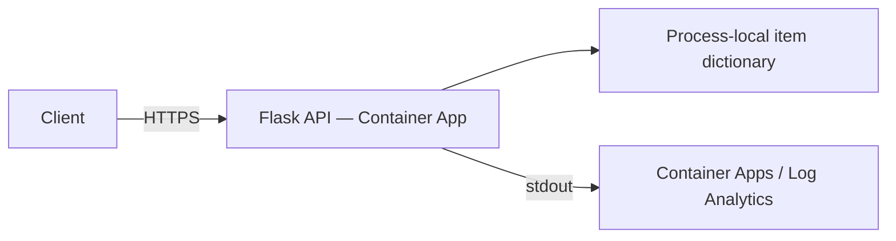

# API Flask រងាយៗ — Azure Container Apps

**កម្រិត:** ជាថ្មី · **ពេលវេលា:** ៣០–៤៥ នាទី រួមបញ្ចូលការតំឡើង

ដេញចេញ Python Flask CRUD API ជាមួយ Azure Developer CLI (azd)។ ម៉ូលដ្ឋានកូដ, Dockerfile,
Bicep, និងប៉ារ៉ាម៉ែត្រ deployment មានរួមបញ្ចូល។ នេះគឺជា **ឧទាហរណ៍សម្រាប់ការសិក្សា** មិនមែន
ជា API រួចរាល់សម្រាប់ផលិតកម្មឡើយ។

## អ្វីដែលអ្នកនឹងរៀន

- បង្កើត និងផ្សព្វផ្សាយ container តាមរយៈ azd។
- កំណត់ ingress និង liveness/readiness probes។
- ផ្ទៀងផ្ទាត់ចម្លើយ CRUD និងពិនិត្យកំណត់ត្រាអ្នកប្រើប្រាស់កម្មវិធី។
- ស្វែងយល់ពីមូលហេតុដែលទិន្នន័យក្នុង-memory មិនសមសម្រាប់កម្មវិធីដែលមានរយៈពេលយូរ។



**សំខាន់៖** ធាតុទាំងអស់ត្រូវបានរក្សាទុកក្នុងដំណើរការមួយ។ ផ្ទួរមុនគឺ **one Gunicorn worker,
0–1 replicas**, ផ្អែកលើការរួមផ្សំឡើងដែលជៀសវាងទិន្នន័យមិនស្របគ្នារវាង workers/replicas។
ធាតុត្រូវបានបាត់បង់ក្រោយការចាប់ផ្តើមម្តងទៀត, បម្រែបម្រួលកំណែ, ឬ scale-to-zero។ ការកើនឡើង replicas
ត្រូវការម្ដងទុកទិន្នន័យយ៉ាងយូរ។ API មិនមានការផ្ទៀងផ្ទាត់ឬការអនុញ្ញាតណា។

## គន្លឹះមុន

- [Current stable azd](https://learn.microsoft.com/azure/developer/azure-developer-cli/install-azd)
  (ចេញផ្សាយ release ពេលមើលវិចារ៖ 1.37.2)។
- [Azure CLI](https://learn.microsoft.com/cli/azure/install-azure-cli) សម្រាប់ការត្រួតពិនិត្យ។
- Docker ជាមួយ daemon របស់វាដំណើរការ; ត្រូវការសម្រាប់ការបង្កើតរូបភាពផ្ទាល់ខ្លួនផ្ទាល់។
- អាជ្ញាប័ណ្ណ Azure, អនុញ្ញាតបង្កើតធនធាន, និងកំណត់ចំណុច Container Apps តំបន់។
- Bash សម្រាប់ពាក្យបញ្ជាខាងក្រោម (ឬ PowerShell ស្មើ)។
- Python 3.11 សម្រាប់ការអភិវឌ្ឍន៍ផ្ទាល់ជាជម្រើស។

```bash
azd version
az version
docker info
azd auth login
az login
```

ឧបករណ៍ CLI មានការចូលទៅនីតិវិធីផ្សេងៗគ្នា។ ប្រើ subscription ដូចគ្នាក្នុងទាំងពីរ។

## ចាប់ផ្តើមរហ័ស

ពីឫសស្នូល repository:

```bash
cd examples/container-app/simple-flask-api
azd env new flask-demo
azd up
API_URL=$(azd env get-value API_ENDPOINT)
RG_NAME=$(azd env get-value AZURE_RESOURCE_GROUP)
API_NAME=$(azd env get-value API_NAME)
curl --fail-with-body "${API_URL}/health"
```

គេរំពឹងថា: HTTP 200 និង JSON មាន `"status":"healthy"`,
`"service":"simple-flask-api"`, និង timestamps UTC បច្ចុប្បន្ន។
ការតំឡើងនិងការបង្កើតរូបភាពភាគច្រើនចំណាយពេលប៉ុន្មាននាទី; រយៈពេលអាចខុសគ្នា។

ការតំឡើងដំបូងប្រើរូបភាព hello-world សាធារណៈស្តាប់លើ port 80។
`azure.yaml` ជ្រើស `infra/app/api.bicep` និងឯកសារប៉ារ៉ាម៉ែត្រដែលត្រូវគ្នា សម្រាប់
ការដេញថោនសេវាកម្ម ដែលផ្លាស់ប្តូររូបភាព ingress, និង probes ទៅ port 8000។
មិនត្រូវលុបប៉ារ៉ាម៉ែត្រដេញថោនទាំងនោះ។

## ផ្ទៀងផ្ទាត់ CRUD

បើកបង្ហាញជាលំដាប់ ខណៈដែល replica ដូចគ្នាអនុវត្តន៍។

```bash
# Create: HTTP 201; note the returned id (1 for a fresh process).
curl -i -X POST "${API_URL}/api/items" \
  -H "Content-Type: application/json" \
  -d '{"name":"Test Item","description":"My first item"}'

# Read list: HTTP 200, total 1 in a fresh process.
curl --fail-with-body "${API_URL}/api/items"

# Replace 1 if your create response returned another id.
curl --fail-with-body "${API_URL}/api/items/1"
curl -i -X PUT "${API_URL}/api/items/1" \
  -H "Content-Type: application/json" -d '{"name":"Updated Item"}'
curl -i -X DELETE "${API_URL}/api/items/1"
curl -i "${API_URL}/api/items/1"
```

ជោគជ័យ: POST 201, អាន/PUT 200, DELETE 204 គ្មានខ្លឹមសារក្រោយ, បន្ទាប់មកឥវ៉ាន់ខ្វះ 404។
JSON ឥតត្រឹមត្រូវ ឬឈ្មោះទទេ ។ ត្រូវតែតប 400។
ប្រសិនបើឥវ៉ាន់បាត់បង់នៅចន្លោះសំណើ, សូមពិនិត្យការចាប់ផ្តើមឡើងវិញ ឬការត្រួបត្រាស់ scale-to-zero;
នេះគឺជាកំណត់អនុញ្ញាតក្នុង-memory មិនមែន persistence ទេ។

| Endpoint | វិធីសាស្រ្ត |
|---|---|
| `/` | GET — ព័ត៌មានសេវាកម្ម |
| `/health` | GET — liveness/readiness |
| `/api/items` | GET, POST |
| `/api/items/{id}` | GET, PUT, DELETE |

## កំណត់ត្រា និង ការកំណត់រចនា

```bash
az containerapp logs show --name "$API_NAME" --resource-group "$RG_NAME" --follow
```

គេរំពឹង៖ ការចាប់ផ្តើម Gunicorn, កំណត់ត្រាចូលសំណើ, និងសារកម្មវិធី។
`azd monitor --logs` បើកមើលផ្ទាំងវាគ្មិន; វាមិនស្ទ្រីមទៅ terminal ទេ។
Application Insights ត្រូវបានតំឡើង តែកូដ Flask នេះ **មិនបានបង្កើតឧបករណ៍**;
ប្រើ Container Apps/Log Analytics សម្រាប់កំណត់ត្រា stdout។

កែប្រែ `infra/app/api.bicep` សម្រាប់ CPU/memory, កំណត់ replica ឬ scale rules, បន្ទាប់មក
ប្រតិបត្តិ `azd up`។ ផ្ទួរពេញលេញគឺ 0.5 vCPU, 1 GiB, កំណត់ទាប 0 /ខ្ពស់ 1 replica, និង
HTTP threshold 50 សំណើសមិទ្ធិ concurrent។ Scale-to-zero អាចបន្ថែមភាពយឺត cold-start។

តម្លៃ `azd env set MAX_REPLICAS`, `API_KEY`, `LOG_LEVEL`, ឬ
`SCALE_TO_ZERO_TIMEOUT` គឺ **មិនបានភ្ជាប់ជាមួយប្លង់ឬកម្មវិធីនេះ**។
ការកំណត់តម្លៃមិនមានន័យថាបង្កើតវាជាព័ត៍មានបរិស្ថានពេលដំណើរការ។
រូបភាពចងកំពង់ port 8000 វាច្បាស់លាស់; កែ Dockerfile, Bicep ingress, និង probes
ជាមួយគ្នា ប្រសិនបើផ្លាស់ប្តូរ port។

## ឯកសារ

```text
azure.yaml
infra/main.bicep
infra/main.parameters.json
infra/app/container-apps.bicep       # Environment, registry, monitoring
infra/app/api.bicep                  # App, ingress, probes, scale settings
infra/app/api.parameters.json        # Image and resource values for azd deploy
src/app.py
src/Dockerfile
src/requirements.txt
```

## ការអភិវឌ្ឍន៍ផ្ទាល់

ពីថតឧទាហរណ៍នេះ:

```bash
python -m venv .venv
source .venv/bin/activate  # PowerShell: .\.venv\Scripts\Activate.ps1
python -m pip install -r src/requirements.txt
python src/app.py
```

នៅ terminal ផ្សេងទៀត សាកល្បង `http://localhost:8000/health` និង endpoints CRUD។
ឬសាងសង់ និងរត់រូបភាពពិតប្រាកដ:

```bash
docker build -t flask-api:local ./src
docker run --rm -p 8000:8000 flask-api:local
```

សម្រាប់កំណែបក្សកូដបន្ទាប់ពីដេញថោនដំបូង, ប្រើ `azd deploy api`។
សម្រាប់កែប្រែ Bicep, ប្រើ `azd up` ដើម្បីតំឡើងឡើងវិញ និងដេញថោន។

## ប្រតិបត្តិការអនុវត្តបុគ្គលិក

### 1. ផ្ទៀងផ្ទាត់ការបដិសេធ input

**ចំណុចចាប់ផ្តើម:** API ដែលបានដេញថោន, `API_URL` ខាងលើ។
**គោលបំណង:** ផ្ទៀងផ្ទាត់ API បដិសេធ JSON មិនត្រឹមត្រូវ និងឈ្មោះខ្វះ។

```bash
curl -i -X POST "${API_URL}/api/items" \
  -H "Content-Type: application/json" -d '[]'
curl -i -X POST "${API_URL}/api/items" \
  -H "Content-Type: application/json" -d '{"name":""}'
```

**លទ្ធផលជោគជ័យ / ដំណោះស្រាយ:** មានការតប ៤០០ ជាមួយកំហុស JSON មិនមែន ៥០០។
**បញ្ហាទូទៅ:** មិនបញ្ចូល header content-type JSON។

### 2. បន្ថែម endpoint វិធីសាស្រ្តអានតែ

**ចំណុចចាប់ផ្តើម:** `src/app.py`។ **គោលបំណង:** ពង្រឹង និងដេញថោន API។
បន្ថែមនេះមុន `if __name__ == '__main__':` block:

```python
@app.route('/version', methods=['GET'])
def version():
    return jsonify({'version': '1.0.0'})
```

ប្រតិបត្តិ `azd deploy api` បន្ទាប់មក `curl --fail-with-body "${API_URL}/version"`។
**លទ្ធផលជោគជ័យ:** HTTP 200 និង `{"version":"1.0.0"}`។
**បញ្ហាប្រជាធិបតេយ្យ៖** ដាក់ផ្លូវក្រោយការហៅ `app.run()` ដែលរារាំងពេល
សាកល្បងជាមួយ `python src/app.py`។

### ចំណុចបញ្ជាក់ចំណេះដឹង

ហេតุก្នុងមូលហេតុមួយអ្នកធ្វើការតែមួយគ្មានគ្រប់គ្រាន់សម្រាប់ទិន្នន័យដែលចេះរឹងប៉ុន្មាន? ព្រោះថាប្រមាណមួយដំណើរការរួចផ្តាច់ភាសាចុះពីពាក្យវចនានុក្រមនៅពេលចាប់ផ្តើមឡើងវិញ។ កំណែផលិតកម្មត្រូវការជំពាក់រក្សាទុកទិន្នន័យរួមមាន,
អត្តសញ្ញាណ​ភាព, អនុញ្ញាត, ការផ្លាស់ប្តូរ, សាកល្បង និងត្រួតពិនិត្យប្រតិបត្តិការ។


## សំរចេខ្លាយ និងការដោះស្រាយបញ្ហា

នេះមិនមែនជាការដាក់ផ្សាយ $0 ជាអនុញ្ញាតទេ៖ បណ្ណាល័យ Basic និងការផ្ទុក/បញ្ចូលកំណត់ហេតុ
អាចបង្កការចំណាយបើទោះបីសូមកុំព្យូទ័រកម្មវិធីនៅលេខសូន្យក៏ដោយ។ ប្រើ
[ម៉ាស៊ីនគិតតម្លៃ](https://azure.microsoft.com/pricing/calculator/) សម្រាប់តំបន់របស់អ្នក។

- **ការបរាជ័យសាងសង់ Docker:** បញ្ជាក់ `docker info`, ការចូលប្រព័ន្ធបណ្ដាញ និងការគាំទ្រទាក់ទង។
- **កម្មវិធីមិនល្អ:** ពិនិត្យកំណត់ហេតុកុងសូល/ប្រព័ន្ធ និងផ្ទៀងផ្ទាត់លេខច្រករូបភាព, ការចូល,
  និងកម្មវិធីពិនិត្យធម្មតាត្រូវគ្នា។ មិនគួរកម្មវិធីកំណត់ជំនួសជានិច្ចត្រូវបានពិនិត្យលើលេខច្រក Flask។
- **403/ការអនុញ្ញាត៖** បញ្ជាក់ជាវសមាជិក និងការអនុញ្ញាតបង្កើតធនធាន។
- **វត្ថុដូរមកមិនមាន៖** សភាពចងចាំក្នុងមនុស្សបាត់បង់នៅពេលចាប់ផ្ដើមឡើងវិញ/បង្ហាញទៅសូន្យ; បន្ថែមមូលដ្ឋានទិន្នន័យ
  សម្រាប់ឱ្យមានឥរិយាបថរឹងប៉ុន្មាន។

## ការសម្អាត និងជំហានបន្ទាប់

```bash
azd down
```

ពិនិត្យការបង្ហាញសំណើលុបចោល និងធានាថាគ្រូបញ្ជាក់ធនធានដែលបានបោះបង់ចោល។
កុំប្រើការសម្អាតបំផ្លាញដល់ក្រុមធនធានដែលមានទិន្នន័យដែលមិនផ្សេងទៀត។

[បន្ទាប់: កម្មវិធីមូលដ្ឋានទិន្នន័យ](../../../../../examples/database-app) · [សេវាមីក្រូ](../../../../../examples/container-app/microservices) ·
[ទិដ្ឋភាពទូទៅនៃកុងតឺន័រ](../README.md) · [ផ្ទះមុខវិជ្ជា](../../../README.md) ·
[រាយការណ៍បញ្ហា](https://github.com/microsoft/AZD-for-beginners/issues)

---

<!-- CO-OP TRANSLATOR DISCLAIMER START -->
**ការបដិសេធ**:
ឯកសារនេះត្រូវបានបម្លែងភាសា ដោយប្រើសេវាបម្លែងភាសា AI [Co-op Translator](https://github.com/Azure/co-op-translator)។ ទោះយើងខ្ញុំមានក្តីប្រាថ្នាឱ្យបានច្បាស់លាស់ តែសូមយល់ដឹងថាការបម្លែងដោយស្វ័យប្រវត្តិក៏អាចមានកំហុសឬភាពមិនត្រឹមត្រូវ។ ឯកសារដើមជាភាសាទីតាំងគួរត្រូវបានគេប្រើជាប្រភពច្បាស់លាស់។ សម្រាប់ព័ត៌មានសំខាន់ៗ សូមណែនាំឱ្យប្រើប្រាស់ការប្រែដោយមនុស្សជំនាញ។ យើងខ្ញុំមិនទទួលខុសត្រូវចំពោះការយល់ច្រឡំ ឬការបកស្រាយខុសបន្ទាប់ពីការប្រើប្រាស់ការបម្លែងនេះនោះទេ។
<!-- CO-OP TRANSLATOR DISCLAIMER END -->