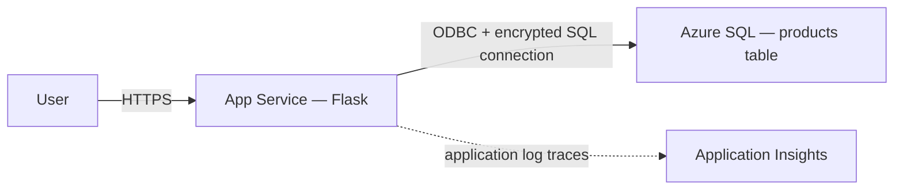

# Flask និង Azure SQL លើ App Service

**កម្រិត៖** មធ្យម · **ពេលវេលា៖** ៣០–៦០ នាទី រួមទាំងតម្រូវការមុន

ឧទាហរណ៍នេះដំណើរការ Python Flask read API ទៅ **Linux App Service** និង
ផ្ទាំងទិន្នន័យ Azure SQL Basic។ រួមមានប្រភព ការកំណត់ Bicep និង azd។
វាជាកម្មវិធីសិក្សា មិនមែនស្ថាបត្យកម្ម សម្រាប់បង្កើតទិន្នន័យជាការផលិត។

## អ្វីដែលអ្នកនឹងរៀន

- ប្រើ App Service, SQL និងធនធានតាមតម្រូវការជាមួយ Bicep។
- កំណត់ការតភ្ជាប់ SQL រក្សាសម្ងាត់ដោយមិនបញ្ចូលព័ត៌មានសម្ងាត់។
- ចាប់ផ្ដើម schema មុនពេលចាប់ផ្ដើមកម្មវិធី Gunicorn workers។
- ពិនិត្យទិន្នន័យបានដំឡើង ចម្លើយមិនបានរកឃើញ និងសុខភាពទិន្នន័យ។



ធនធាន៖ ក្រុមធនធានផ្តាច់មុខ គម្រោង App Service Linux B1 ផ្នែក Python 3.11 Web
App, ម៉ាស៊ីនបម្រើ SQL និងទិន្នន័យ Basic 2-GB, Application Insights និង Log Analytics។
កម្មវិធីបណ្តាញប្រើប្រាស់ **ការដាក់បញ្ចូលផ្ទាល់ពី source/ZIP និងការដំឡើងអាសយដ្ឋាន Oryx**;
`azd deploy` មិនបង្កើត ឬដាក់បញ្ចូល Dockerfile ជាជម្រើសទេ។

## លក្ខខណ្ឌចាំបាច់

- កំណែថេរ​បច្ចុប្បន្ន [azd](https://learn.microsoft.com/azure/developer/azure-developer-cli/install-azd)
  (កំណែ​ដែលបាន​ចេញផ្សាយ​នៅ​ពេល​ពិនិត្យ៖ 1.37.2)។
- [Azure CLI](https://learn.microsoft.com/cli/azure/install-azure-cli) សម្រាប់ការផ្ទៀងផ្ទាត់។
- ការជាវ Azure, សិទ្ធិក្នុងការបង្កើតធនធានដែលបានរាយបញ្ជី និងកម្រិតតំបន់។
- Python **3.11** សម្រាប់ការអភិវឌ្ឍដោយផ្ទាល់; `pyodbc==5.0.1` បានប្តេជ្ញាអាចត្រូវការជំនួយ
  ឧបករណ៍សំណង់ដើមនៅលើកំណែ Python ថ្មីៗ។
- ម៉ាស៊ីនបញ្ជា Microsoft ODBC ម៉ាស៊ីនបញ្ជា 18 (ឬ 17) សម្រាប់ SQL Server លើកុំព្យូទ័រផ្ទាល់ `pip install
  pyodbc` មិនតំឡើងម៉ាស៊ីនបញ្ជារព័ត៌មាន។ មើល
  [ការតំឡើង ODBC](https://learn.microsoft.com/sql/connect/odbc/download-odbc-driver-for-sql-server)។
- Docker តែបើសិនជាធ្វើតេស្តកុងតែន័រជាជម្រើសក្នុងបរិបទផ្ទាល់។

```bash
azd version
az version
azd auth login
az login
```

ប្រើប្រាស់ការជាវដូចគ្នានៅក្នុងឧបករណ៍ទាំងពីរ។ ពាក្យបញ្ជាខាងក្រោមប្រើ Bash។

## បញ្ចេញ

ចាប់ពីឫសឃ្លាំង:

```bash
cd examples/database-app
azd env new sql-demo
azd provision
azd deploy
WEB_URL=$(azd env get-value WEB_APP_URI)
WEB_NAME=$(azd env get-value WEB_APP_NAME)
RG_NAME=$(azd env get-value AZURE_RESOURCE_GROUP)
```

ជ្រើសរើសតំបន់ដែលគាំទ្រ។ `sqlAdminLogin` ជា​លំនាំដើមទៅ​ឲ្យ `sqladmin`; ប៉ារ៉ាម៉ែត្រ
`sqlAdminPassword` គឺជាប៉ារ៉ាម៉ែត្រ­sុវត្ថិភាព។ ផ្តល់ពាក្យសម្ងាត់ដ៏ខ្លាំងពេល​មានការស្នើសុំ។
រក្សាទុកប្រតិបត្តិការចុះផ្សាយឲ្យឆ្ងាយពី Git និងរបាយការណ៍បញ្ហា។ ចងខ្សែការតភ្ជាប់បច្ចុប្បន្ន
ជឿនលឿនការបញ្ចូលពាក្យសម្ងាត់ដោយគ្មានឧបករណ៍ដាក់សញ្ញាចែកខ្សែដូចជា
`;`; កែប្រែបច្ចេកទេសការរំលោភមុនប្រើតម្លៃបែបនេះ។

Bicep កំណត់បញ្ជារចាប់ផ្តើមដែលរត់ `init_database()` **មុន** ការចាប់ផ្តើមការងារ Gunicorn។
នេះជាតម្រូវការដោយសារការនាំចូល `app:app` មិនអនុវត្ត
ប្លុក `if __name__ == '__main__'` របស់ Python ទេ។ លើផ្ទាំងគម្របទិន្នន័យថ្មី
ការចាប់ផ្តើមបង្កើត `products` ហើយដាក់បញ្ចូលប្រាំជួរ។ វាជាគ្រាប់សាលារៀនសាមញ្ញ មិនមែនជាគ្រាប់
សំរាប់គ្រោងការប្រែប្រួលសហគមន៍; ប្រើប្រាស់ការប្រែប្រួលសមស្របមុនបង្រួមចំណុចបន្ថែម។

កម្មវិធីជ្រើសរើស Microsoft ODBC Driver 18 ដែលបានដំឡើង បន្ទាប់មក 17 ប្រសិនបើខ្សែការតភ្ជាប់
មិនបានបញ្ជាក់ឈ្មោះអ្នកបើកឆាកយ៉ាងច្បាស់។ ប្រសិនបើគ្មានខ្លួនណាមួយ ការចាប់ផ្តើមនឹងបរាជ័យជាមួយ
កំហុសការដំឡើងដែលអាចដំណើរការ។ សូមអនុច្ឆេទភាពមានរបស់អ្នកបើកឆាកនៅក្នុងម៉ាស៊ីន App Service របស់អ្នកជំនួសដូចដែលអ្នកគិត។


## ផ្ទៀងផ្ទាត់

```bash
curl --fail-with-body "${WEB_URL}/"
curl --fail-with-body "${WEB_URL}/health"
curl --fail-with-body "${WEB_URL}/products"
curl --fail-with-body "${WEB_URL}/products/1"
curl -i "${WEB_URL}/products/999"
```

ឆ្លើយតបដែលបានរំពឹងទុក៖

- `/` បញ្ជូនព័ត៌មាន​អំពីចំណុចបញ្ចប់។
- `/health` បញ្ជូន 200 ជាមួយ `{"status":"healthy","database":"connected"}`។
- `/products` បញ្ជូនផលិតផលប្រាំដែលបានដាំនៅលើទិន្នន័យថ្មី។
- `/products/1` បញ្ជូន Laptop ដែលមានតម្លៃ 1299.99។
- ផលិតផលគ្មាននៅអត់មានបញ្ជូន 404 ជាមួយ `{"error":"Product not found"}`។

API គឺអានបានតែម្ដង។ គ្មានផ្លូវ POST/PUT/DELETE ឬ UI ប្រើប្រាស់ទេ។
ការបរាជ័យកាដោនមូលដ្ឋានទិន្នន័យបញ្ជូន 503 ពី `/health`; វាមិនមែនជាឈ្នះទេ។

## ឯកសារ និងការរៀបចំ

```text
azure.yaml                         # Python App Service source deployment
infra/main.bicep
infra/main.parameters.json
infra/abbreviations.json
infra/resources/sql-server.bicep
infra/resources/sql-database.bicep
infra/resources/app-service-plan.bicep
infra/resources/web-app.bicep       # Settings + initialization/startup command
infra/resources/app-insights.bicep
src/web/app.py
src/web/requirements.txt
src/web/Dockerfile                 # Optional local container, not the azd target
.env.sample
```

`SQL_CONNECTION_STRING` ត្រូវបានផ្តល់ជាប៉ារ៉ាម៉ែត្រ Bicep ដែលមានសុវត្ថិភាពទៅម៉ូឌុល Web App
ហើយបានផ្ទុកនៅក្នុងការកំណត់ App Service មិនមែនក្នុង​ប្រតិបត្តិការចុះផ្សាយ។
`APPLICATIONINSIGHTS_CONNECTION_STRING` កំណត់ការនាំចេញកំណត់ហេតុ។
`SCM_DO_BUILD_DURING_DEPLOYMENT=true` បើកការដំឡើង​សេវាកម្ម​អាស្រ័យ​ដៃពីម៉ាស៊ីន​បម្រុង។
ការកំណត់តម្លៃ `azd env` អំពីការបង្កើតបែបគ្មានភាសារត្រូវ​គ្រាន់តែ​បំលែងការកំណត់កម្មវិធី។

សេចក្ដីណែនាំថា ​​បទបញ្ជា `0.0.0.0` នៃ SQL firewall អនុញ្ញាតឲ្យភ្ជាប់ពី **សេវាកម្ម Azure,
រួមទាំងការជាវក្នុងរបស់អតិថិជនផ្សេងទៀត**, ដែលមានលក្ខខណ្ឌត្រឹមត្រូវ SQL authentication។ វា
មិនបានដាក់កំណត់ទៅកម្មវិធីនេះឬការជាវនេះទេ។ ការចូលប្រើបណ្តាញសាធារណៈ SQL ត្រូវបានបើក។
ប្រើ​បណ្តាញ​កំណត់ដែន និងអត្តសញ្ញាណកម្មប្រើកម្មវិធីមិនមែនអភិបាល មុនចូលផលិតកម្ម។

## ការអភិវឌ្ឍកន្លែងធ្វើការ

ប្រើ Python 3.11 និងអ្នកបើកឆាក Microsoft SQL ODBC ដែលបានដំណើរការ៖

```bash
python -m venv .venv
source .venv/bin/activate  # PowerShell: .\.venv\Scripts\Activate.ps1
python -m pip install -r src/web/requirements.txt
export SQL_CONNECTION_STRING='Server=tcp:YOUR_SERVER.database.windows.net,1433;Database=YOUR_DATABASE;UID=YOUR_USER;PWD=YOUR_PASSWORD;Encrypt=yes;TrustServerCertificate=no;Connection Timeout=30;'
python src/web/app.py
```

ប្តូរទីតាំងជាមួយកន្លែងស្នាក់យ៉ាងសុវត្ថិភាព។ ឯកសារ `.env` ត្រូវបានចម្លង **មិនត្រូវបានផ្ទុកដោយស្វ័យប្រវត្តិ**
ដោយកម្មវិធីនេះទេ។ បញ្ចេញអថេរនៅក្នុងផ្ទាំងសែលក្នុងបច្ចុប្បន្នយក។
សម្រាប់ Azure SQL ពីកុំព្យូទ័រជំនួយ ឲ្យអនុញ្ញាតឲ្យតែ IP ជាសាធារណៈរបស់អ្នកបណ្ដោះអាសន្ន៖

```bash
SQL_SERVER=$(azd env get-value SQL_SERVER_NAME)
MY_IP=YOUR_PUBLIC_IP
az sql server firewall-rule create -g "$RG_NAME" -s "$SQL_SERVER" \
  -n AllowMyLearningIP --start-ip-address "$MY_IP" --end-ip-address "$MY_IP"
```

ដកចេញបទបញ្ជាក្រោយពេលសាកល្បង៖

```bash
az sql server firewall-rule delete -g "$RG_NAME" -s "$SQL_SERVER" -n AllowMyLearningIP
```

តេស្តកុងតឺន័រជាជម្រើសពីថតឧទាហរណ៍នេះ៖

```bash
docker build -t sql-flask:local src/web
docker run --rm -p 8000:8000 -e SQL_CONNECTION_STRING sql-flask:local
```

រូបភាពនេះដំឡើង Driver 18 ដោយប្រើឃ្លាំង Debian 12 ដែលទៅតាមមូលដ្ឋាន Bookworm,
ចាប់ផ្តើមការបង្កើតទិន្នន័យមួយដង បន្ទាប់មកចាប់ផ្តើម Gunicorn។

## ការត្រួតពិនិត្យ និងរបាយការណ៍បញ្ហា

បើក/តាមដានកំណត់ហេតុអ្នកប្រើ filesystem នៃ App Service ពេលវេលាដោះស្រាយការចាប់ផ្តើម៖

```bash
az webapp log config --name "$WEB_NAME" --resource-group "$RG_NAME" \
  --application-logging filesystem --level information
az webapp log tail --name "$WEB_NAME" --resource-group "$RG_NAME"
```

កូដនេះនាំចេញកំណត់ហេតុ **log trace** តាមរយៈអ្នកដោះស្រាយ OpenCensus ចាស់​
វាមិនកំណត់ឱ្យមានការតាមដានសំណើក្រុមហ៊ុន Flask ឬអាស្រ័យភាពដោយស្វ័យប្រវត្តិ មេត្រ Live,
ការត្រួតពិនិត្យ SQL, ការកំណត់វាយតម្លៃ ឬការជូនដំណឹងទេ។ អ្វីដែលទាំងនេះត្រូវការការដំឡើងផ្សេងទៀត។
សម្រាប់ឧបករណ៍មន្រ្តីថ្មី សូមអនុវត្ត Azure Monitor OpenTelemetry។

ក្នុង Application Insights Logs បន្ទាប់ពីធ្វើសំណើ API៖

```kusto
traces
| where timestamp > ago(1h)
| where message contains "products" or message contains "Health check"
| project timestamp, message, severityLevel
```

អនុញ្ញាតឲ្យមានការពន្យារពេលក្នុងការបញ្ចូល។ សកម្មភាពតារាងសំណើឬរួមមេត្រ Live មិនមែនជាកាពេញលេញ
នៃឧបករណ៍ប្រែប្រួលនេះទេ។

- **អត់អ្នកបើកឆាក:** ពិនិត្យ `pyodbc.drivers()` នៅក្នុង runtime ហើយដំឡើង
  អ្នកបើកឆាក Microsoft ODBC ដែលគាំទ្រ។ កញ្ចប់ Python តែម្តងគ្នាគឺមិនគ្រប់គ្រាន់ទេ។
- **បរាជ័យភ្ជាប់:** ពិនិត្យការកំណត់ SQL, លេខសម្ងាត់, firewall, និងការជាវដែលបានជ្រើស។
  កុំដំណើរការលុបការកូដសំងាត់ដើម្បីរំកិលកំហុស។
- **អត់តារាងផលិតផល:** បញ្ជាក់ថា បញ្ជារចាប់ផ្តើម Bicep ត្រូវបានចុះផ្សាយ;
  ចាប់ផ្តើម `gunicorn app:app` ដាច់ដោយឡែកធ្វើឲ្យវាមិនធ្វើការចាប់ផ្តើម។
- **បរាជ័យសង់កញ្ចប់:** ប្រើ Python 3.11 ឬផ្តល់ឧបករណ៍សង់ដើម(native)។
- **ទិន្នន័យតម្លៃសូន្យ:** សូន្យគឺជាតម្លៃពិសេសមួយ "decimal" ដែលត្រូវតែលេខស៊េរៀលជា 0.0,
  មិនមែនជា `null` ទេ។

## លំហាត់អនុវត្តន៍

### លំហាត់ 1: ផ្ទៀងផ្ទាត់ឥរិយាបថផលិតផលដែលខ្វះ

**ចំណុចចាប់ផ្តើម:** API ដែលបានចុះផ្សាយ និង `WEB_URL` ខាងលើ។
**គោលបំណង:** រំលេចភាពខុសគ្នារវាងជួរខ្វះ និងមូលដ្ឋានទិន្នន័យខូច។
ស្នើសុំ `/health` និង `/products/999` ដោយប្រើបញ្ជាខាងលើ។
**លទ្ធផលសម្រេច/ចម្លើយ:** សុខភាព 200, ផលិតផលមិនមាន 404 (មិនមែន 500 ឬ 503)។
**បញ្ហាទូទៅ:** គិតថា តបអត់មានបញ្ជាក់ថា តំណ ការ SQL ខូច។

### លំហាត់ 2: ប្តូរតម្លៃដែលបានដាំ

**ចំណុចចាប់ផ្តើម:** Azure SQL Query Editor, ភ្ជាប់ទៅមូលដ្ឋានទិន្នន័យគំរូ។
**គោលបំណង:** បង្ហាញថា ទិន្នន័យ API ត្រូវបានផ្ទុកក្នុង SQL មិនមែននៅក្នុងអនុស្សារោះ​កម្មវិធី។

```sql
UPDATE products SET price = 0 WHERE id = 1;
SELECT id, name, price FROM products WHERE id = 1;
```

ស្នើសុំ `${WEB_URL}/products/1`។ **លទ្ធផលសម្រេច:** តម្លៃគឺ `0.0` មិនមែន `null`។
បញ្ចូនតម្លៃត្រឡប់៖

```sql
UPDATE products SET price = 1299.99 WHERE id = 1;
```

**បញ្ហាទូទៅ:** ការកែប្រែបញ្ជី Python seed មិនជាថ្មីជួរដែលមាននៅក្នុង SQL ទេ។
កុំធ្វើលំហាត់ schema/data ប្រយ័ត្នលើមូលដ្ឋានទិន្នន័យផលិតកម្ម។

### លំហាត់ 3: បន្ថែមចំណុចចំនួនអានប៉ុណ្ណោះ

**ចំណុចចាប់ផ្តើម:** `src/web/app.py`។
**គោលបំណង:** ពង្រីក API ដោយប្រើសំណួរជាប្រមាណមិនផ្សេង។
បន្ថែមនេះមុនប្លុក `if __name__ == '__main__':`៖

```python
@app.route('/product-count')
def product_count():
    from contextlib import closing
    with closing(get_db_connection()) as conn, closing(conn.cursor()) as cursor:
        cursor.execute("SELECT COUNT(*) FROM products")
        return jsonify({'count': cursor.fetchone()[0]})
```

ប្រតិបត្តិ `azd deploy web` បន្ទាប់មកស្នើសុំ `${WEB_URL}/product-count`។
**លទ្ធផលសម្រេច:** 200 ជាមួយ `{"count":5}` លើមូលដ្ឋានទិន្នន័យ seed ដើម។
**បញ្ហាទូទៅ:** ប្ដូរផ្លូវ ក៏ប៉ុន្តែលង់ភ្នាក់ងារត្រូវបានរំឭកបច្ចុប្បន្ន។
សម្រាប់ផលិតកម្ម បន្ថែមការគ្រប់គ្រងកំហុស/ការធ្វើតេស្ត; លំហាត់ខ្លីនេះផ្តោតលើសំណួរ។

## ចំណាយ, កន្លែងខ្វះក្នុងផលិតកម្ម, និងការសម្អាត

B1 App Service និងមូលដ្ឋានទិន្នន័យ Basic ត្រូវបានគិតថ្លៃក្នុងពេលផ្គត់ផ្គង់។ បញ្ឈប់
Web App មិនត្រូវបញ្ឈប់ការគិតថ្លៃ App Service plan ទេ។ កំណត់ហេតុ និងការផ្ទុកអាចបន្ថែមចំណាយ។
ប្រើ [Azure pricing calculator](https://azure.microsoft.com/pricing/calculator/)
សម្រាប់តម្លៃតំបន់បច្ចុប្បន្ន។ ប្ដូរទៅ F1 ត្រូវការលុប `alwaysOn` ជាមួយ;
វាមិនមែនជាការផ្លាស់ប្តូរបន្ទាត់មួយគត់ទេ។ SQL serverless មិនមែនឥតគិតថ្លៃដោយស្វ័យប្រវត្តិ។

ការងារផលិតកម្មរួមមានអត្តសញ្ញាណកម្មកម្មវិធីដែលមានសិទ្ធិអប្បបរមា (មិនមែនអភិបាល SQL),
សុវត្ថិភាព/ការអនុម័ត, បណ្តាញឯកជន, ការផ្លាស់ប្តូរយ៉ាងសុវត្ថិភាព, ការត្រួតពិនិត្យពេលរស់,
ការត្រួតពិនិត្យ, ការជូនដំណឹង, ការធ្វើតេស្ត និងដំណើរការស្ដារឡើងវិញ។
ការផ្ទុក Redis និងតារាងបន្ថែមគឺជាគំនិតអភិវឌ្ឍន៍ មិនមែនជាលំហាត់ដែលបានអនុវត្ត។

ពីថតឧទាហរណ៍នេះ៖

```bash
azd down
```

ពិនិត្យការស្នើសុំលុប និងផ្ទៀងផ្ទាត់ថាក្រុមធនធានឯកទេសត្រូវបានលុបចេញ។
កុំលុបក្រុមដែលមានទិន្នន័យដែលមិនពាក់ព័ន្ធ។

[Container examples](../../../../examples/container-app) ·
[AI development](../../docs/chapter-02-ai-development/README.md) ·
[Course home](../../README.md) · [Report an issue](https://github.com/microsoft/AZD-for-beginners/issues)

---

<!-- CO-OP TRANSLATOR DISCLAIMER START -->
**ការបដិសេធ**:
ឯកសារនេះត្រូវបានបម្លែងភាសា ដោយប្រើសេវាបម្លែងភាសា AI [Co-op Translator](https://github.com/Azure/co-op-translator)។ ទោះយើងខ្ញុំមានក្តីប្រាថ្នាឱ្យបានច្បាស់លាស់ តែសូមយល់ដឹងថាការបម្លែងដោយស្វ័យប្រវត្តិក៏អាចមានកំហុសឬភាពមិនត្រឹមត្រូវ។ ឯកសារដើមជាភាសាទីតាំងគួរត្រូវបានគេប្រើជាប្រភពច្បាស់លាស់។ សម្រាប់ព័ត៌មានសំខាន់ៗ សូមណែនាំឱ្យប្រើប្រាស់ការប្រែដោយមនុស្សជំនាញ។ យើងខ្ញុំមិនទទួលខុសត្រូវចំពោះការយល់ច្រឡំ ឬការបកស្រាយខុសបន្ទាប់ពីការប្រើប្រាស់ការបម្លែងនេះនោះទេ។
<!-- CO-OP TRANSLATOR DISCLAIMER END -->