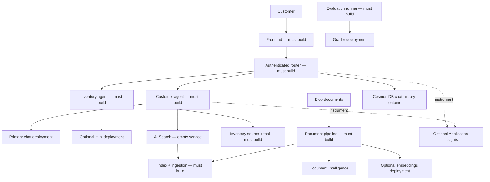

# ការគាំទ្រអតិថិជនច្រើនភាគី — គម្រោងស្ថាបត្យកម្មលក់រាយ

**ជំពូក 5៖ ដំណោះស្រាយ AI ច្រើនភាគី**

- [ទំព័រផ្តើមវគ្គសិក្សា](../README.md)
- [ជំពូក 5](../docs/chapter-05-multi-agent/README.md)
- [មុនត្រូវធ្វើ៖ បញ្ចូល AI](../docs/chapter-02-ai-development/microsoft-foundry-integration.md)
- [បន្ទាប់៖ ការគ្រប់គ្រងសមត្ថភាព](../docs/chapter-06-pre-deployment/capacity-planning.md)
- [សំណង់ប្លង់ហេដ្ឋារចនាសម្ព័ន្ធ ARM](retail-multiagent-arm-template/README.md)

> **មគ្គុទេសក៍ស្ថាបត្យកម្ម មិនមែនកម្មវិធីដំណើរការពិត។** ឯកសារអនុវត្តន៍លក់រាយ
> តែមួយគត់មាននៅក្នុង `azuredeploy.json`, `azuredeploy.parameters.json` និង `deploy.sh` ក្នុង
> `retail-multiagent-arm-template/`។ ធុង Router/frontend គឺជាកន្លែងរក្សាទុក hello-world
> ជា តំណរមួយទៀត។ មិនមានភ្នាក់ងារលក់រាយ UI, ទង្កីតទិន្នន័យ, អ្នកវាយតម្លៃ, អ្នកស្កេន, ឬ
> ក្រុមសាកល្បងកម្មវិធីនៅលើម៉ាស៊ីនក្នុងតំបន់ទេ។

## ទិដ្ឋភាពទូទៅ

**គោលបំណង៖** រៀបចំប្រព័ន្ធគាំទ្រអតិថិជនមានភ្នាក់ងារអតិថិជន និងភ្នាក់ងារចំណូល ដើម្បីកំណត់ថា
ទ្រព្យសម្បត្តិប្លុកផ្តល់អ្វីខ្លះ និងគ្រោងសន្សំពាណិជ្ជកម្ម(contracts) ការត្រួតពិនិត្យដែលអវត្តមាន។


**អ្នកទស្សនា:** អ្នកអwickរ៉ា ដែលបានបញ្ចប់ការងារផ្ទាល់ខ្លួន
[chat sample](../../../examples/azure-openai-chat) និង [two-service container sample](../../../examples/container-app/microservices)។
អនុញ្ញាតឱ្យចំណាយពេល ២-៣ ម៉ោងសម្រាប់ការសិក្សារចនាសម្ព័ន្ធ។ ការសាងសង់កម្មវិធីគឺជាព្រឹត្តិការណ៍ផ្សេងទៀត៖ ៨០-១២០ ម៉ោងអភិវឌ្ឍន៍គឺជាការប៉ាន់ប្រមាណផែនការជាចំណុចយោងសម្រាប់អ្នកអភិវឌ្ឍមានបទពិសោធន៍, **មិនមែនជារស្មីបញ្ចេញ**; ការកែលម្អការផលិត, សាកល្បង, ការត្រួតពិនិត្យសុវត្ថិភាព, និងការប្រតិបត្តិការត្រូវការភារកិច្ចបន្ថែម។


### លទ្ធផលការសិក្សា

- អធិប្បាយអំពីការបញ្ជូន, ការប្រឹងប្រែង, សិទ្ធិឧបករណ៍, និងកម្មសិទ្ធិការពិភាក្សា។
- ធ្វើការបំបែករៀងមួយនៃម៉ូដែលណាម, ឈ្មោះប្រព័ន្ធ, ជំនាន់ API, និងជំនាន់ ARM។
- រចនាកម្រងលិខិតពង្រីក និងចូលប្រមូលពួកវាក្នុងវិមាត្រចំណុចវ៉ិចទ័រដូចគ្នា។
- កំណត់តម្រូវការ​ដែលអាចបញ្ជាក់បានសង្ខេបមុខងារ, ការប៉ាន់ប្រមាណ, និងការស្ដារឡើងវិញក្រោយបរាជ័យ។
- បំបែកគោលបំណងរចនាសម្ព័ន្ធជាជម្រើសពីធនធានដែលបានផ្គត់ផ្គង់ជាក់ស្តែង។

## រចនាសម្ព័ន្ធដំណោះស្រាយ



នេះជារចនាសម្ព័ន្ធកម្មវិធីគោលដៅមួយ, មិនមែនជារូបភាពជាសេវាកម្មភ្នាក់ងាររត់។
ស្នូល ARM បង្កើតសេវាកម្មរង និងធុងបន្ទុកស្នូលពីរ​តែមួយ។ Front Door, ការចុះបញ្ជី, អត្តសញ្ញាណគ្រប់គ្រង, ការចាត់តួនាទី,
ចំណុចបញ្ចប់ឯកជន, ការបរាជ័យប្តូរ, ការត្រួតពិនិត្យកម្មវិធី, និងការព្រមានមិនត្រូវបានបញ្ចូល។


### ភារកិច្ច និងកិច្ចសន្យា

| ធាតុ | អាកប្បកម្មត្រូវការ | ព័ត៌មានមុនការចាត់ទុកថាចប់ |
|---|---|---|
| មុខងារ​មុខត្រី | អះអាងអ្នកប្រើ, បង្ហាញការជជែក, បញ្ចូលឯកសារយ៉ាងមានសុវត្ថិភាព | UI និងសាកល្បងបញ្ចូល, បញ្ហាដែលអាចចូលរួមបាន |
| កម្មវិធីបញ្ជូន | អនុញ្ញាតសំណើ, ជ្រើសរើសភ្នាក់ងារ, ការហៅឧបករណ៍កំណត់ពេលវេលា | សាកល្បងបញ្ជូន, ពិនិត្យសិទ្ធិ, សាកល្បងបរាជ័យ |
| ភ្នាក់ងារ​អតិថិជន | ជម្រុញចម្លើយគោលនយោបាយ/ផលិតផលតាមប្រភពដែលអនុម័ត | ការដកស្រង់អោយត្រឹមត្រូវ, លើកលែងពេលទិន្នន័យគ្មាន |
| ឧបករណ៍សាធារណៈ | អានស្តុកផ្លូវការ មានសិទ្ធិស្កុប | សាកល្បងស្តុកដែលអាចកំណត់បាន; មិនមានការបង្កើតភាពមាន |
| ផ្លូវផ្គត់ផ្គង់ឯកសារ | ដកស្រង់, បំបែកជា​ដុំ, បញ្ចូល, សន្ទស្សន៍, ផ្លាស់ប្ដូរ/លុប | ដំណើរការសន្ទស្សន៍ និងសកម្មភាពRetry/Dead-letter |
| ការផ្ទុកការជជែក | បំបែកអ្នកប្រើ, ប្រើគោលការណ៍រក្សាទុក | ពិនិត្យសិទ្ធិអ្នកលើសគ្នា និងសាកល្បង TTL |
| ឱ្យដំណើរការវាយតម្លៃ | ប្រៀបធៀបទិន្នផលនឹងការពិត និងស្ទង់មតិកាលកម្ម | ការស្រាវជ្រាវ, ការរាប់បរាជ័យ, របាយការណ៍ផ្សេងៗដែលអាចធ្វើឡើងឡើងវិញ |

សូមគិតពីកម្មវិធីបញ្ជូនជាការិយាល័យទទួល និងឧបករណ៍ជាប្រព័ន្ធក្នុងមានកំណត់៖
ការជ្រើសរើសជំនាញពិសេសមិនមែនជាការអនុញ្ញាតឱ្យចូលកំណត់ត្រារបស់អតិថិជនទាំងអស់នោះទេ។
ប្រើអត្តសញ្ញាណ និងសិទ្ធិក្នុងកូដកម្មវិធី និងសេវាកម្មទិន្នន័យ, មិនអោយប្រើការបញ្ចេញនៃការបង្ហាញ។

## វថុនិងកម្មវិធី

អាន [scaffold README](retail-multiagent-arm-template/README.md) មុនពេល
ធ្វើ provisioning។ វាចុះបញ្ជីធនធាន ឧបករណ៍នានា ថ្លៃដើម ការ៉េ និងកំណត់គ្រាអេត។

| ការប្រើប្រាស់យ៉ាងមានហេតុផល | ឈ្មោះការដាក់ ARM | ម៉ូដែល / កំណែ | តំបន់លំនាំដើម |
|---|---|---|---|
| ការជជែកជាមួយអតិថិជន | `gpt-4.1-chat` | `gpt-4.1` / `2025-04-14` | `eastus2` |
| ផ្ទុកសារព័ត៌មាន | `gpt-4.1-mini-inventory` | `gpt-4.1-mini` / `2025-04-14` | `westus2`, ជម្រើស |
| Embeddings | `text-embedding-ada-002` | `text-embedding-ada-002` / `2` | `francecentral`, ជម្រើស |
| ការវាយតម្លៃ | `gpt-4.1-grader` | `gpt-4.1` / `2025-04-14` | តំបន់សំខាន់ដោយលំនាំដើម |

ពិនិត្យអំពីភាពមាន គ្រប់គ្រងសម្ភារៈ និងកំណត់ទំហំ SKU ជា **តំបន់នីមួយៗ**។ ការជជែក/mini/grader
ប្រើ `GlobalStandard`; embeddings ប្រើ `Standard`។ ការចងចាំខ្នាតទៅ TPM គឺ
ជាគំរូជាក់លាក់។ កុំបន្ថែមឯកតាកំលាំងមិនស្រដៀងគ្នាជាការធានាកំណត់ទំហំសកល។

ការស្នើសុំ Azure OpenAI មានអាគុយម៉ង់ `model` ជា **ឈ្មោះការដាក់​បញ្ចូល** មិនមែន
ត្រូវគ្នានឹងអត្តសញ្ញាណម៉ូដែលកាតាឡុក។ កំណែ API សម្របសម្រួលតំបន់ទិន្នន័យ `2024-10-21`
ខុសពីកំណែម៉ូដែល `2025-04-14` និងធនធាន ARM `apiVersion`។
មិនអាចជួសជុលម៉ូដែលមិនមាននៅបានដោយការប្រែប្រួលតែ API សម្របសម្រួលតំបន់ទិន្នន័យ។

`--no-multi-region` ជៀសវាងគណនីជំនួយ និង embeddings។ គណនីការជជែកសំខាន់ និង
គណនីgrader ឯករាជ្យនៅតែមាន។ គណនីម៉ូដែលផ្សេងៗគ្នា មិនផ្តល់ឱ្យមានការបរាជ័យ
ស្វ័យប្រវត្តិទេ; វាត្រូវការរុំរ៉ូ application routing, ការដាក់បញ្ជីសមរម្យ, ការត្រួតពិនិត្យសុខភាព,
កំណត់ដែនកំណត់ retry និងការពិនិត្យទីតាំងទិន្នន័យ។

## ផែនមុខងារ អនុវត្តិ

### ១. ចាប់ផ្តើមជាមួយការបង្រៀនតែមួយដែលបានសាកល្បង

មុនពេល provision scaffold ធំៗ សូមប្រើឧទាហរណ៍ការជជែកក្នុងស្រុកដើម្បីបង្កើត
ការតភ្ជាប់សម្រង់។ កំណត់សំណួរអតិថិជនតែមួយ ដែលតំណាងឱ្យសំណួរនោះ ប្រភពចម្លើយដែលបានអនុម័ត
ការដកសារលើកំពស់ និងអាកប្បកិរិយាការរអាក់រអួលក្រោមពេលដែលប្រភពនោះអស់ខ្លួន។

### ២. កំណត់ការបង់ចេញ និងដែនការប្រើឧបករណ៍

បង្កើតប្រភព router ផ្ទាល់ខ្លួន រចនាសម្ព័ន្ធអាស្រ័យលើ អ្នកប្រើ Dockerfile និងតេស្ត។ An
សន្ធិសញ្ញាឧទាហរណ៍អាចត្រូវបាន `POST /chat` ជាមួយនឹង `{"message":"...","conversation_id":"..."}`។
**ចំណុចបញ្ចប់នោះគឺជាការផ្តល់យោបល់រចនាសម្ព័ន្ធ; វាមិនបានអនុវត្តដោយគំរូ ARM ទេ។**

ផ្ទៀងផ្ទាត់ប្រភេទ/ដែនកំណត់រាងកាយ, ផ្តកអត្តសញ្ញាណអ្នកប្រើពីការផ្ទៀងផ្ទាត់, បង្ខំ
បានរក្សាម្ចាស់កម្មវីធីនិយាយ, ប្រើពេលវេលាចំណាយសំណើ, ហើយត្រឡប់កូដកំហុសមានអត្ថន័យ។
កុំពិចារណាការបរាជ័យ HTTP ឬការឆ្លើយតបទទេជាលទ្ធផលភ្នាក់ងារជោគជ័យ។

### 3. អនុវត្តការដាក់ជម្រះនិងការបញ្ចូលទិន្នន័យ

គំរូ ARM មិនបង្កើតសន្ទស្សន៍ស្វែងរកទេ។ នេះគឺជាកំណត់ត្រា JSON សម្រាប់យោង
ដើម្បីធ្វើឲ្យសមរម្យនៅក្នុងការបរិច្ឆេទសន្ទស្សន៍របស់អ្នកផ្ទាល់, មិនមែនជា​ឯកសារមួយដែលមានរួចហើយនៅក្នុងឃ្លាំងទេ៖

```json
{
  "name": "retail-product-index",
  "fields": [
    {"name": "id", "type": "Edm.String", "key": true},
    {"name": "title", "type": "Edm.String", "searchable": true},
    {"name": "content", "type": "Edm.String", "searchable": true},
    {"name": "category", "type": "Edm.String", "filterable": true},
    {
      "name": "content_vector",
      "type": "Collection(Edm.Single)",
      "searchable": true,
      "dimensions": 1536,
      "vectorSearchProfile": "retail-profile"
    }
  ],
  "vectorSearch": {
    "algorithms": [{"name": "retail-hnsw", "kind": "hnsw"}],
    "profiles": [{"name": "retail-profile", "algorithm": "retail-hnsw"}]
  }
}
```

ព៌ហ្វាយល្ 연결ទីវ៉ិចទ័រទៅកម្មវិធីរបស់វា។ មាត្រដ្ឋានត្រូវតែផ្គូផ្គងនឹង 
លទ្ធផល embedding ពិតប្រាកដ (1536 សម្រាប់ការចាត់ចែង `ada-002` នេះ)។ សម្រាប់ការទាញយក Python, 
ប្រើ `azure.search.documents.models.VectorizedQuery` ជំនួសមិនមែនជា 
សត្យាឡេតមួយដែលខ្វះប្រភេទសំណួរវ៉ិចទ័រៈ

```python
# Reference function only: supply an authenticated async SearchClient and an embedding.
from azure.search.documents.models import VectorizedQuery

async def retrieve(search_client, embedding):
    results = await search_client.search(
        search_text=None,
        vector_queries=[VectorizedQuery(
            vector=embedding,
            k_nearest_neighbors=5,
            fields="content_vector"
        )],
        select=["id", "title", "content"]
    )
    return [document async for document in results]
```

បង្កើតមុខងារចាក់ចូលបំបែកផ្សេង ដែល៖

1. អនុញ្ញាតការចុះបញ្ចូល និងផ្ទៀងផ្ទាត់ប្រភេទអត្ថបទ និងទំហំនៃមាតិកា។
2. អានប្លបែលឯកជនដោយប្រើការហៅ SDK ដែលបានសញ្ញាអត្តសញ្ញាណ។ URL ប្លបែលឯកជនដោយខ្លួនវា 
   **មិនមែន**ជាបញ្ចូល Document Intelligence ដែលអាចអានបាន; ផ្ញើបៃតbytes ធ្វើដោនឡូដជាមួយ 
   `AnalyzeDocumentRequest(bytes_source=...)` ឬប្រើ SAS ដែលមានការកំណត់ត្រឹមត្រូវ និងមានអាយុកាលខ្លី បន្ទាប់ពីពិនិត្យអត្តសញ្ញាណចូលប្រើ។
3. ដកស្រង់អត្ថបទ បំបែកវាឱ្យសមស្របនឹងដែន embed និងបង្កើត embeddings។
4. បង្កើតសោឯកសារដែលមានស្ថិរភាពត្រឹមត្រូវ និងបញ្ចូលប្លុកជាមួយវ៉ិចទ័រផ្គូផ្គង។
5. ពិនិត្យលទ្ធផលការចុះបញ្ជីរាល់ឯកសារ គ្រប់គ្រងការសាកល្បងម្តងទៀត និងធ្វើបច្ចុប្បន្នភាព/លុបទិន្នន័យចាស់។


ផ្ទៀងផ្ទាត់ប្រភេទតម្លៃ និងចៀសវាងសញ្ញាសongezaអក្សរ។ តម្រងប៊ូលីយ៉ានិងលេខត្រូវការតម្លៃមានប្រភេទ 
មិនមែនអក្សរត្រូវបានសញ្ញាសongeza។


**Bing Search v7 ត្រូវបានលះបង់នៅថ្ងៃទី 11 ខែសីហា ឆ្នាំ 2025។** `Microsoft.Bing/accounts` ចាស់
ដើមហើយនិង `api.bing.microsoft.com/v7.0/search` ឧទាហរណ៍មិនមែនជាមធ្យោបាយអនុវត្តដែលគាំទ្រ។
វាយតម្លៃការរួមបញ្ចូលនេះដែលគាំទ្របច្ចុប្បន្ននៅ Microsoft Foundry និង SDK របស់វា សិទ្ធិ
ការកត់ត្រា និងការទាមទារការលើកយោង; គ្មានការអនុវត្តណាមួយនៅទីនេះទេ។
វាមិនមែនជាជំនួសផ្ទាល់សម្រាប់ចំណុចចេញដែលបានលះបង់នោះទេ។

### 5. បន្ថែមការតាមដាននិងការវាយតម្លៃ

ការបង្កើត Application Insights មិនដែលជាការកំណត់ឧបករណ៍កូដទេ។ ប្រើការតាមដាន OpenTelemetry របស់ Azure Monitor ដែលគាំទ្រ នៅពេលបង្កើតកម្មវិធីថ្មី ផ្សព្វផ្សាយបរិបទតាមដានរវាងសេវាកម្ម និងជៀសវាងកត់ត្រាសំណូមពរពីអតិថិជន ឯកសារ ឬជំរក។
ការបន្ថែមបរិបទតាមដានរវាងសេវាកម្ម។
កាត់បន្ថយសំណួរមិនមានន័យថាអ្នកកាន់ខ្សែភាពយន្ត។
កាត់បន្ថយសំណួរមិនមានន័យថាអ្នកកាន់ខ្សែភាពយន្ត។

វាស់រយៈពេលស្នើសុំនានា ការបរាជ័យផ្លូវរដ្ឋ/ឧបករណ៍ ការសម្របសម្រួលការទាញយក ការត្រឹមត្រូវនៃការលើកយោង ការប្រើប្រាស់សញ្ញាសំគាល់ និងការមិនចូលរួម។
ទុករបស់ពិតប្រាកដ/គន្លងនយោបាយជាមួយនឹងករណីវាយតម្លៃ៖ អ្នកវាយតម្លៃមិនអាចកំណត់បានភាពត្រឹមត្រូវនៃការពិត
ពីសំណួរនិងចម្លើយតែមួយ។


ដូចគ្នានេះផង ពិនិត្យពាក្យគន្លឹះមិនមែនជាការបញ្ចាក់សុវត្ថិភាព។ ពាក្យស្នើ HTTP បរាជ័យ គ្មានយុទ្ធសាស្រ្តសាកល្បង ឬចម្លើយទទេ ត្រូវធ្វើឱ្យការប្រឡង **មិនច្បាស់លាស់ ឬបរាជ័យ** មិនមែនផ្តល់ពិន្ទុ "100% សុវត្ថិភាព" ទេ។ បំពេញការសាកល្បងដោយមានអាជ្ញាបណ្ណជាមួយនឹងការអនុវត្តសមរម្យ
និងករណីដែលបានពិនិត្យដោយមនុស្ស។ រាយការណ៍ករណីមិនបញ្ចប់/កំហុសជាពិសេស; កុំបម្លែង
ពួកវាទៅជាការវាយតម្លៃជោគជ័យ ឬបញ្ចូលពួកវាដោយស្ងាចជាជម្លោះគុណភាពគ្មានគំរូ។

ដូច្នេះដែរ ការត្រួតពិនិត្យពាក្យគន្លឹះក៏មិនមែនជាការត្រួតពិនិត្យសុវត្ថិភាពនោះទេ។ សំណើ HTTP ដែលបរាជ័យ,
យុទ្ធសាស្រ្តតេស្តខ្វះ, ឬចម្លើយទទេ គួរតែលើកឡើងថា **ការតេស្តមិនច្បាស់លាស់ ឬបរាជ័យ** មិនមែនផ្តល់ពិន្ទុ “សុវត្ថិភាព ១០០%” ទេ។ ធ្វើការតេស្តដោយបានអនុញ្ញាតជាមួយ
ភាពសមរម្យ។
ឧបករណ៍ និងការពិនិត្យមនុស្សមុនពេលពិចារណាថាសង្កេតប្រតិបត្តិការណ៍បានរួច។

### 6. ដាក់បង្ហោះកម្មវិធីរបស់អ្នក

បង្កើតថតប្រភព ផ្ទាំងបង្ហាញ ការធ្វើតេស្ត ការចុះបញ្ជី និងការអនុញ្ញាតទាញរូបភាពផ្ទាល់ខ្លួន។ ជំនួសទីតាំងបញ្ចូលដោយរូបភាពដែលបានសាងសង់ និងធ្វើបច្ចុប្បន្នភាពការចូល/ការត្រួតពិនិត្រ
permissions. Replace placeholders with built images and update ingress/probes to
ត្រូវសម្រួលច្រកដំណើរកាស្តាប់របស់កម្មវិធីនីមួយៗ។ កំណត់អថេរបរិយាបន្ន runtime ក្នុង Bicep  
ឬផែនទីបរិយាកាស azd ដែលគាំទ្រដោយច្បាស់លាស់។  

មិនមានវចនានុក្រម `config` ទូទៅនៅក្នុងសេវាកម្ម azd ដែលបង្កើតអថេរបរិយាបន្ន runtime ទាន់
សក្តានុពលឡើងយ៉ាងស្វ័យប្រវត្តិទេ។ `azd env set` ផ្លាស់ប្តូរត្រឹមតែធនធានដែល  
ប្រើតម្លៃទាំងនោះយ៉ាងច្បាស់លាស់ប៉ុណ្ណោះ។ មិនមានការត្រួតពិនិត្យ canary, បញ្ជីតំបន់, ឬការតំរូវលំអៀងយ៉ាងម៉ត់ចត់  
ទាំងឡាយនៅក្នុងស្ទោងនេះទេ។  

## លំហាត់រចនាបទជាក់ស្តែង  

នេះគឺជាលំហាត់​​ **ស្ថាបត្យកម្ម** មិនមែនជាការទាមទារលេខកូដ starters លក់រាយអាចបញ្ចេញបាននោះទេ។  

### លំហាត់ទី 1៖ ត្រួតពិនិត្យស្មើនឹងព្រំដែន  

**ចំណុចចាប់ផ្តើម៖**​ ផ្ទាំងឯកសារ 3 នៅក្នុង `retail-multiagent-arm-template/`។  
**គោលបំណង៖** ផ្សះផ្សារពីការផ្ដល់សេវាកម្មពីមុខងារកម្មវិធី។  
បើក `azuredeploy.json` ស្វែងរករូបភាពកុងតেইន័រ និងតម្លៃ `targetPort` ទាំងពីរ,  
បន្ទាប់មករាយបញ្ជីគ្រឿងផ្សំកម្មវិធីដែលខ្វះនៅក្នុងឃ្លាំងគ្មាន។  

**ក្រមបទជោគជ័យ / ចម្លើយ៖** រូបភាពទាំងពីរគឺជា hello-world ជំនួសដែលស្តាប់  
នៅលើព្រិល 80; តំណាង, ផ្ទាំងសន្ទនា UI, អ្នកចាត់ការចរាចរ, សិុវហិច/ការចូលយក, អ្នកវាយតម្លៃ និងអ្នកស្កេន គ្មាន។
សំណើររុករកប្រាក់កំណត់ដើមដោយជោគជ័យមិនបញ្ជាក់តម្លៃ `/chat` ទេ។
**បញ្ហាទូទៅ៖** ពន្យល់ឈ្មោះធនធានដូចជា `retail-router` ជាកូដដែលដំណើរការ។

### ហាត់លំហាត់ 2៖ តាមដានរចនាសម្ព័ន្ធវ៉ិចទ័រ

**ចំណុចចាប់ផ្តើម៖** JSON សុិតខាងលើ។
**គោលដៅ៖** យល់ដឹងពីទំនាក់ទំនងដែន → បprofile → អាល់ហ្គារីធម៍។
ស្វែងរកថាតើតម្លៃណាខ្លះត្រូវផ្លាស់ប្ដូរនៅពេលប្តូរទៅម៉ូដែលអំប៉ុងដែលមាន
ទំហំចេញខុសគ្នា, បន្ទាប់មកពិនិត្យមើលមុខងារ `retrieve`។

**កម្រិតជោគជ័យ / ចម្លើយ៖** ប្ដូរដែន `dimensions` ទៅប្រវែងវ៉ិចទ័រពិតប្រាកដ;
រក្សាតម្លៃ `vectorSearchProfile` ស្របតាមបprofile ដែលបានប្រកាស និង អាល់ហ្គារីធម៍របស់វា;
សំណើ `fields` ត្រូវតែមានឈ្មោះដែនវ៉ិចទ័រ។ បង្កើតមូលដ្ឋានឯកសារវ៉ិចទ័រដែលមានស្រាប់ឡើងវិញ
នៅពេលម៉ូដែលអំប៉ុងផ្លាស់ប្ដូរ។
**បញ្ហាទូទៅ៖** ប្ដូរឈ្មោះម៉ូដែលតែប៉ុណ្ណោះ ប៉ុន្តែនៅតែមិនសមរម្យនឹងវ៉ិចទ័រ។

### ហាត់លំហាត់ 3៖ កំណត់ការប្រលងបរាជ័យ

**ចំណុចចាប់ផ្តើម៖** តារាងភារកិច្ច។
**គោលដៅ៖** ការបញ្ជៀសការជោគជ័យមិនពិតប្រាកដ។
សរសេរព័ត៌មានដែលរំពឹងទុកសម្រាប់ API សារពើភ័ណ្ឌមិនអាចប្រើបាន, សុិតស្វែងរកដែលគ្មានឯកសារចូលរួម,
និងសំណើវាយតម្លៃដែលត្រឡប់មកនូវ HTTP 503។

**កម្រិតជោគជ័យ / ចម្លើយ៖** មិនបង្កើតតម្លៃសារពើភ័ណ្ឌ; លែងតបាសច្បាស់ ឬ
ការលើកស្ទួយពេលបរិបទខ្វះ; របាយការណ៍វាយតម្លៃថា មិនអាចដឹកជញ្ជូនដោយសារបំពានឈ្មួញ
ជាងការឆ្លើយតបទៅគុណភាព ឬសុវត្ថិភាព។ បន្ថែមតេស្តដែលអាចដំណើរការបានពេលអ្នកកសាងកម្មវិធី។
**បញ្ហាទូទៅ៖** ចាប់យកករណី excepción ទាំងអស់ និងបន្តដោយចម្លើយទំនេរ។

## ថ្លៃដើម, ការឈឺចាប់ និងការសម្អាត

- រចនាសម្ព័ន្ធមានការចំណាយបន្តទោះបីសុិតស្វែងរកទំនេរ និងកម្មវិធីដាក់កន្លែងកំណត់។
  ប្រើតម្លៃតំបន់បច្ចុប្បន្ន; មិនមានន័យថា “អប្បបរមា” ឬពហុតំបន់មានសេវាឥតគិតថ្លៃទេ។
- ថ្លៃតុគិនអាស្រ័យលើម៉ូដែល, បញ្ចូលដែលបានរក្សាទុក/មិនបានរក្សាទុក, ត្រឡប់ និង SKU តម្កល់។
  ចរាចរអាចសន្សំប្រាក់ទៅតែមែន ប្រសិនបើមានការវាស់ម៉ោងការងារនិងលទ្ធផលគុណភាពយុត្តិធម៌;
  មិនមានការធានាជាក់លាក់សន្សំបានពី 60–80%។ 
- ពិនិត្យមើលភាពរឹតត្បិតម៉ូដែល និងកូតង់មុនពេលផ្តល់; បំបែកកំហុសនៃការអនុញ្ញាត,
  ឈ្មោះdeployment, តំបន់, កំណែម៉ូដែល និងកំណែAPI។
- កុំបើកចំហ់ `setup-data.sh` ខកខាន, បញ្ជា CLI evaluator ឬបញ្ជា `pytest tests/`។
  ការអនុវត្តន៍ទាំងនេះជា​ផ្នែកនៃបំណាត់ការអភិវឌ្ឍថ្មីរបស់អ្នក។
- កម្មវិធីនេះមានតែARM ប៉ុណ្ណោះ: តាមដានវិធីសាស្រ្ត
  [ការត្រួតពិនិត្យនិងការសម្អាត](retail-multiagent-arm-template/README.md)។
  `azd down` មិនគ្រប់គ្រងធនធានទាំងនោះទេ។

## ធនធានទាក់ទង

- [គំរូការសន្ទនាតំបន់បណ្ដាញដែលដំណើរការបាន](../../../examples/azure-openai-chat)
- [គំរូ컨테ឺន័រ នៃសេវាកម្មពីរដែលដំណើរការបាន](../../../examples/container-app/microservices)
- [សុិតស្វែងរកវ៉ិចទ័រ AI](https://learn.microsoft.com/azure/search/vector-search-how-to-create-index)
- [ឯកសារកម្មវិធី Container Apps](https://learn.microsoft.com/azure/container-apps/)
- [ដោះស្រាយបញ្ហា](../docs/chapter-07-troubleshooting/common-issues.md)
- [រាយការណ៍បញ្ហា](https://github.com/microsoft/AZD-for-beginners/issues)

---

<!-- CO-OP TRANSLATOR DISCLAIMER START -->
**ការបដិសេធ**:
ឯកសារនេះត្រូវបានបម្លែងភាសា ដោយប្រើសេវាបម្លែងភាសា AI [Co-op Translator](https://github.com/Azure/co-op-translator)។ ទោះយើងខ្ញុំមានក្តីប្រាថ្នាឱ្យបានច្បាស់លាស់ តែសូមយល់ដឹងថាការបម្លែងដោយស្វ័យប្រវត្តិក៏អាចមានកំហុសឬភាពមិនត្រឹមត្រូវ។ ឯកសារដើមជាភាសាទីតាំងគួរត្រូវបានគេប្រើជាប្រភពច្បាស់លាស់។ សម្រាប់ព័ត៌មានសំខាន់ៗ សូមណែនាំឱ្យប្រើប្រាស់ការប្រែដោយមនុស្សជំនាញ។ យើងខ្ញុំមិនទទួលខុសត្រូវចំពោះការយល់ច្រឡំ ឬការបកស្រាយខុសបន្ទាប់ពីការប្រើប្រាស់ការបម្លែងនេះនោះទេ។
<!-- CO-OP TRANSLATOR DISCLAIMER END -->