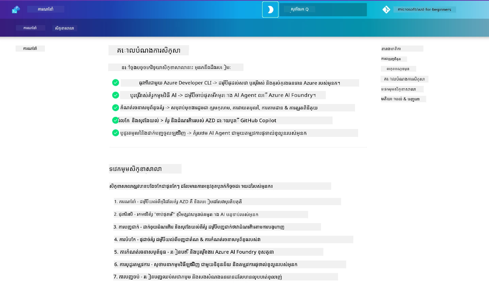

<div align="center">
  <div style="background: linear-gradient(135deg, #0078d4, #106ebe); border-radius: 10px; padding: 20px; margin: 20px 0; box-shadow: 0 4px 15px rgba(0, 120, 212, 0.3); border: 2px solid #005a9e;">
    <h2 style="color: white; margin: 0; font-size: 24px; text-shadow: 1px 1px 2px rgba(0,0,0,0.3);">
      🎯 សិក្ខាសាលា AZD សម្រាប់អ្នកអភិវឌ្ឍ AI
    </h2>
    <p style="color: white; margin: 10px 0 0 0; font-size: 16px; text-shadow: 1px 1px 2px rgba(0,0,0,0.3);">
      <strong>សិក្ខាសាលាដែលអនុវត្តដោយដៃសម្រាប់កសាងកម្មវិធី AI ជាមួយ Azure Developer CLI។</strong><br>
      បំពេញ ៧ ម៉ូឌុល ដើម្បីគ្រប់គ្រងគំរូ AZD និងដំណើរការដាក់ពាក្យ AI។
    </p>
    <div style="margin-top: 15px;">
      <span style="background: rgba(255,255,255,0.2); padding: 5px 10px; border-radius: 15px; color: white; font-size: 14px;">
        📅 ការណែនាំប្រភពបានពិនិត្យ៖ កញ្ញា ២០២៦
      </span>
    </div>
  </div>
</div>

# សិក្ខាសាលា AZD សម្រាប់អ្នកអភិវឌ្ឍ AI

សូមស្វាគមន៍មកកាន់សិក្ខាសាលាដែលអនុវត្តដោយដៃសម្រាប់ការរៀន Azure Developer CLI (AZD) ដែលផ្តោតលើការដាក់ពាក្យកម្មវិធី AI។ សិក្ខាសាលានេះជួយអ្នកទទួលបានការយល់ដឹងអំពីគំរូ AZD ក្នុង ៣ ជំហាន៖

1. **ការស្វែងរក** - ស្វែងរកគំរូដែលសមស្របសម្រាប់អ្នក។
1. **ការដាក់ពាក្យ** - ដាក់ពាក្យ និងផ្ទៀងផ្ទាត់ថាវាដំណើរការ។
1. **ការតម្រូវផ្ទាល់ខ្លួន** - ប្តូរ និងធ្វើឡើងវិញឲ្យជារបស់អ្នក!

ក្នុងអំឡុងរយៈពេលសិក្ខាសាលានេះ អ្នកនឹងបានណែនាំឧបករណ៍និងដំណើរការអភិវឌ្ឍន៍សំខាន់ៗ ដើម្បីជួយអ្នកធ្វើដំណើរអភិវឌ្ឍចុងពីលើដល់ចុងក្រោយបានប្រសើរឡើង។

<br/>

## មគ្គុទេសក៍ផ្អែកលើកម្មវិធីរុករក

មេរៀនកេងោងនៅក្នុង Markdown អ្នកអាចរុករកវាតាមទំព័រ GitHub ដោយផ្ទាល់ ឬបើកមើលជាមុននៅក្នុងកម្មវិធីរុករកដូចដែលបង្ហាញក្នុងរូបភាពខាងក្រោម។



ដើម្បីប្រើជម្រើសនេះ - សូមចំលងរ៉េប៉ូទៅក្នុងប្រវត្តិរូបអ្នក ហើយបើក GitHub Codespaces។ ពេល VS Code terminal ដំណើរការ សូមវាយពាក្យបញ្ជានេះ៖

ការមើលជាមុននេះដំណើរការបាននៅក្នុង GitHub Codespaces, dev containers, ឬចម្លងមកទម្រង់មួយក្នុងម៉ាស៊ីនតាមផ្ទាល់ដែលបានដំឡើង Python និង MkDocs។

```bash title="" linenums="0"
python -m pip install -r requirements-dev.txt
python -m mkdocs serve --config-file workshop/mkdocs.yml
```

ប្រតិបត្តិការបញ្ជាទាំងនេះពី **ដើមរ៉េប៉ូរបស់វគ្គសិក្សា** មិនមែនពីគម្រោង AI នីមួយៗដែលបានចាប់ផ្ដើមឡើងនោះទេ។ រក្សាទុកការមើលជាមុននៅមុខ ទើបកំហុសនានា​កើតឡើងអាចមើលឃើញបាន; បញ្ឈប់វាជាមួយ Ctrl+C។ ដើម្បីពិនិត្យគេហទំព័រដោយមិនចំលងវា សូមរត់ `python -m mkdocs build --strict --config-file workshop/mkdocs.yml`។

ខណៈពេលពីរបីវិនាទី អ្នកនឹងឃើញប្រអប់ pop-up មួយ។ ជ្រើសរើសជម្រើស `Open in browser`។ មគ្គុទេសក៍ផ្អែកលើវេបសាយនឹងបើកក្នុងផ្ទាំងថ្មីក្នុងកម្មវិធីរុករក។ អត្ថប្រយោជន៍ខ្លះនៃការមើលជាមុននេះ៖

1. **ស្វែងរកនៅក្នុងកម្មវិធីតែមួយ** - រកពាក្យសំខាន់ ឬមេរៀនឆាប់រហ័ស។
1. **រូបតំណាងចម្លង** - វៀតលើកូដប្លុក ដើម្បីឃើញជម្រើសនេះ
1. **ផ្លាស់ប្តូរមូលដ្ឋានរូបរាង** - ប្តូររវាងរូបរាងខ្មៅ និងស្រាល
1. **ទទួលបានជំនួយ** - ចុចរូបតំណាង Discord នៅផ្នែកជើងដើម្បីចូលរួម!

<br/>

## សង្ខេបសិក្ខាសាលា

**រយៈពេល:** ៣-៤ ម៉ោង  
**កម្រិត:** អ្នកចាប់ផ្តើមដល់ជំនាញមធ្យម  
**លក្ខខណ្ឌមុន:** ជាប់ចិត្តល្អនឹង Azure, គំនិត AI, VS Code និង​ឧបករណ៍បញ្ជា។

នេះជាសិក្ខាសាលាដែលអនុវត្តដោយដៃដែលអ្នករៀនតាមការអនុវត្ត។ បន្ទាប់ពីបញ្ចប់លំហាត់ហាត់ប្រាណ សូមផ្តល់អនុសាសន៍អានវិញ្ញាសា AZD សម្រាប់អ្នកចាប់ផ្តើម ដើម្បីបន្តការសិក្សារបស់អ្នកទៅកាន់ការអនុវត្តសុវត្ថិភាព និងផលិតភាព។

| ពេលវេលា| ម៉ូឌុល  | គោលបំណង |
|:---|:---|:---|
| ១៥ នាទី | [ការណែនាំ](docs/instructions/0-Introduction.md) | កំណត់ចំណុចចាប់ផ្តើម, បញ្ចេញគោលបំណង |
| ៣០ នាទី | [ជ្រើសរើសគំរូ AI](docs/instructions/1-Select-AI-Template.md) | ស្វែងយល់ជម្រើស និងជ្រើសរើសចាប់ផ្តើម | 
| ៣០ នាទី | [ផ្ទៀងផ្ទាត់គំរូ AI](docs/instructions/2-Validate-AI-Template.md) | ដាក់ពាក្យដំណោះស្រាយលំនាំដើមទៅ Azure |
| ៣០ នាទី | [បំបែកគំរូ AI](docs/instructions/3-Deconstruct-AI-Template.md) | ស្វែងយល់រចនាសម្ព័ន្ធ និងការកំណត់ |
| ៣០ នាទី | [កំណត់គំរូ AI](docs/instructions/4-Configure-AI-Template.md) | ចាប់ផ្តើម និងសាកល្បងលក្ខណៈដែលមាន |
| ៣០ នាទី | [ប្តូរតាមតម្រូវការ គំរូ AI](docs/instructions/5-Customize-AI-Template.md) | បត់បែនគំរូទៅតាមតម្រូវការ |
| ៣০ នាទី | [បញ្ចប់បរិក្ខារ](docs/instructions/6-Teardown-Infrastructure.md) | សម្អាត និងលែងដំណើរការ |
| ១៥ នាទី | [សង្ខេប និងជំហានបន្ទាប់](docs/instructions/7-Wrap-up.md) | ឯកសាររៀន, 챌្លែងសិក្ខាសាលា |

<br/>

## អ្វីដែលអ្នកនឹងរៀន

គិតគូរគំរូ AZD ជាទីលំហែសិក្សាដើម្បីស្វែងយល់ពីសមត្ថភាពនានា និងឧបករណ៍សម្រាប់អភិវឌ្ឍចុងពីលើ Microsoft Foundry។ តាមចប់សិក្ខាសាលា អ្នកគួរតែមានការយល់ដឹងបឋមលើឧបករណ៍ និងគំនិតផ្សេងៗរបស់បរិបទនេះ។

| គំនិត  | គោលបំណង |
|:---|:---|
| **Azure Developer CLI** | យល់ដឹងពីបញ្ជា និងដំណើរការឧបករណ៍|
| **គំរូ AZD**| យល់ដឹងពីរចនាសម្ព័ន្ធគម្រោង និងការកំណត់|
| **ភ្នាក់ងារលើ Azure AI**| បំពេញ និងដាក់ពាក្យគម្រោង Microsoft Foundry  |
| **ការស្វែងរក Azure AI**| អនុញ្ញាតអោយរចនាសម្ព័ន្ធបរិបទជាមួយភ្នាក់ងារ |
| **ការត្រួតពិនិត្យ**| ស្វែងយល់ពីការតាមដាន, ការត្រួតពិនិត្យ និងការវាយតម្លៃ |
| **ការតេស្តទ្វេភាគី**| ស្វែងយល់ពីការតេស្តប្រឆាំង និងការជៀសវាងកំហុស |

<br/>

## រចនាសម្ព័ន្ធសិក្ខាសាលា

សិក្ខាសាលាត្រូវបានរៀបចំឲ្យអ្នកធ្វើដំណើរពីការស្វែងរកគំរូ ទៅការដាក់ពាក្យ បំបែក និងការតម្រូវ ផ្អែកលើគំរូចាប់ផ្តើមផ្លូវការណ៍ [ការចាប់ផ្តើមជាមួយភ្នាក់ងារលើ AI](https://github.com/Azure-Samples/get-started-with-ai-agents)។

### [ម៉ូឌុល ១: ជ្រើសរើសគំរូ AI](docs/instructions/1-Select-AI-Template.md) (៣០ នាទី)

- គំរូ AI ជាអ្វី?
- អ្នកអាចស្វែងរកគំរូ AI នៅណា?
- តើធ្វើដូចម្តេចដើម្បីចាប់ផ្តើមបង្កើតភ្នាក់ងារលើ AI?
- **មន្ទីរពិសោធន៍**: ចាប់ផ្តើមរហ័សក្នុង Codespaces ឬ រូបមន្ត dev

### [ម៉ូឌុល ២: ផ្ទៀងផ្ទាត់គំរូ AI](docs/instructions/2-Validate-AI-Template.md) (៣០ នាទី)

- រចនាសម្ព័ន្ធគំរូ AI ជាអ្វី?
- ដំណើរការអភិវឌ្ឍ AZD ជាអ្វី?
- តើធ្វើដូចម្តេចទទួលបានជំនួយសម្រាប់អភិវឌ្ឍ AZD?
- **មន្ទីរពិសោធន៍**: ដាក់ពាក្យ និងផ្ទៀងផ្ទាត់គំរូភ្នាក់ងារលើ AI

### [ម៉ូឌុល ៣: បំបែកគំរូ AI](docs/instructions/3-Deconstruct-AI-Template.md) (៣០ នាទី)

- ស្វែងយល់បរិវេណរបស់អ្នកក្នុង `.azure/` 
- ស្វែងយល់ការតម្រូវធនធានរបស់អ្នកក្នុង `infra/` 
- ស្វែងយល់ការកំណត់ AZD របស់អ្នកក្នុង `azure.yaml`s
- **មន្ទីរពិសោធន៍**: ប្តូរផ្សំលំនាំបរិវេណ និងដាក់ពាក្យឡើងវិញ

### [ម៉ូឌុល ៤: កំណត់គំរូ AI](docs/instructions/4-Configure-AI-Template.md) (៣០ នាទី)
- ស្វែងយល់៖ ការបង្កើតបន្ថែមតាមបែប Retrieval
- ស្វែងយល់៖ ការវាយតម្លៃភ្នាក់ងារ និងការតេស្តទ្វេភាគី
- ស្វែងយល់៖ ការតាមដាន និងការគ្រប់គ្រង
- **មន្ទីរពិសោធន៍**: ស្វែងយល់ភ្នាក់ងារលើ AI និងការត្រួតពិនិត្យ

### [ម៉ូឌុល ៥: ប្តូរតាមតម្រូវការ គំរូ AI](docs/instructions/5-Customize-AI-Template.md) (៣០ នាទី)
- កំណត់៖ PRD ជាមួយតម្រូវការ​សេណារីយ៉ូ
- កំណត់៖ ផ្សំលំនាំបរិវេណសម្រាប់ AZD
- អនុវត្ត៖ ហ៊ុកជីវចម្រុះសម្រាប់ការងារបន្ថែម
- **មន្ទីរពិសោធន៍**: ប្តូរតាមតម្រូវការគំរូសម្រាប់សេណារីយ៉ូរបស់ខ្ញុំ

### [ម៉ូឌុល ៦: បញ្ចប់បរិក្ខារ](docs/instructions/6-Teardown-Infrastructure.md) (៣០ នាទី)
- សង្ខេប៖ គំរូ AZD ជាអ្វី?
- សង្ខេប៖ ហេតុអ្វីបានជាកត់ Azure Developer CLI?
- ជំហានបន្ទាប់៖ សាកល្បងគំរូផ្សេងទៀត!
- **មន្ទីរពិសោធន៍**: លែងដំណើរការ និងសម្អាតបរិក្ខារ

<br/>

## 챌្លែងសិក្ខាសាលា

ចង់បញ្ចេញ챌្លែងសម្រាប់ខ្លួនឯងទៀតទេ? នៅទីនេះមានគម្រោងមួយចំនួនផ្តល់ជំនួយ - ឬចែករំលែកគំនិតរបស់អ្នកជាមួយយើង!!

| គម្រោង | ការពិពណ៌នា |
|:---|:---|
|1. **បំបែកគំរូ AI ស្មុគស្មាញមួយ** | ប្រើដំណើរការ និងឧបករណ៍ដែលយើងបានរៀបរាប់ ពិនិត្យមើលអាចដាក់ពាក្យ, ផ្ទៀងផ្ទាត់ និងប្តូរតាមតម្រូវការ គំរូដំណោះស្រាយ AI ផ្សេងទៀតបានប៉ុណ្ណា? _តើអ្នកបានរៀនអ្វី?_|
|2. **ប្តូរតាមសេណារីយ៉ូរបស់អ្នក**  | សាកល្បងសរសេរឯកសារតម្រូវការផលិតផល (PRD) សម្រាប់សេណារីយ៉ូផ្សេងទៀត។ បន្ទាប់មកប្រើ GitHub Copilot នៅក្នុង repo គំរូរបស់អ្នកនៅគំរូភ្នាក់ងារ - ហើយសុំឲ្យវាបង្កើតដំណើរការប្តូរតាមតម្រូវការ។ _តើអ្នកបានរៀនអ្វី? តើអ្នកអាចកែលម្អលើយោបល់ទាំងនេះដូចម្តេច?_|
| | |

## មានមតិយោបល់?

1. បង្ហោះបញ្ហាក្នុង repo នេះ - ស្លាកវា​ជា `Workshop` សម្រាប់ភាពងាយស្រួល។
1. ចូលរួម <i>Discord</i> Microsoft Foundry - ភ្ជាប់ជាមួយមិត្តរួមការងាររបស់អ្នក!


| | | 
|:---|:---|
| **📚 ទំព័រដើមវគ្គសិក្សា**| [AZD សម្រាប់អ្នកចាប់ផ្តើម](../README.md)|
| **📖 ឯកសារ** | [ចាប់ផ្តើមជាមួយគំរូ AI](https://learn.microsoft.com/en-us/azure/ai-foundry/how-to/develop/ai-template-get-started)|
| **🛠️ គំរូ AI** | [គំរូ Microsoft Foundry](https://ai.azure.com/templates) |
|**🚀 ជំហានបន្ទាប់** | [ចាប់ផ្តើមសិក្ខាសាលា](#workshop-overview) |
| | |

<br/>

---

**រុករក៖** [វគ្គសិក្សាចម្បង](../README.md) | [ការណែនាំ](docs/instructions/0-Introduction.md) | [ម៉ូឌុល ១: ជ្រើសរើសគំរូ](docs/instructions/1-Select-AI-Template.md)

**ត្រៀមខ្លួនចាប់ផ្តើមក្នុងការបង្កើតកម្មវិធី AI ជាមួយ AZD?**

[ចាប់ផ្តើមសិក្ខាសាលា៖ ការណែនាំ →](docs/instructions/0-Introduction.md)

---

<!-- CO-OP TRANSLATOR DISCLAIMER START -->
**ការបដិសេធ**:
ឯកសារនេះត្រូវបានបម្លែងភាសា ដោយប្រើសេវាបម្លែងភាសា AI [Co-op Translator](https://github.com/Azure/co-op-translator)។ ទោះយើងខ្ញុំមានក្តីប្រាថ្នាឱ្យបានច្បាស់លាស់ តែសូមយល់ដឹងថាការបម្លែងដោយស្វ័យប្រវត្តិក៏អាចមានកំហុសឬភាពមិនត្រឹមត្រូវ។ ឯកសារដើមជាភាសាទីតាំងគួរត្រូវបានគេប្រើជាប្រភពច្បាស់លាស់។ សម្រាប់ព័ត៌មានសំខាន់ៗ សូមណែនាំឱ្យប្រើប្រាស់ការប្រែដោយមនុស្សជំនាញ។ យើងខ្ញុំមិនទទួលខុសត្រូវចំពោះការយល់ច្រឡំ ឬការបកស្រាយខុសបន្ទាប់ពីការប្រើប្រាស់ការបម្លែងនេះនោះទេ។
<!-- CO-OP TRANSLATOR DISCLAIMER END -->