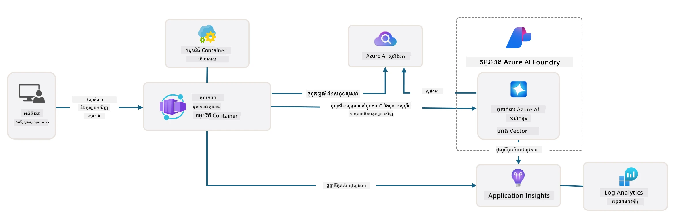
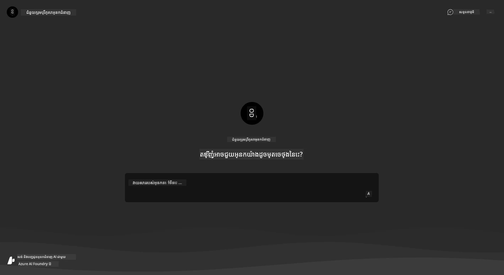

# 2. ពិនិត្យមែនទេនៃ សំបូរគំរូ

> មគ្គុទេសក៍ប្រភពបានពិនិត្យឆ្លុះទៅតាម AZD 1.37.2 និងគំរូបច្ចុប្បន្ននៅថ្ងៃទី 4 ខែវិច្ឆិកា ឆ្នាំ 2026។ រូបថតចម្លងនេះគឺជាឧទាហរណ៍បង្ហាញ; ប្រព័ន្ធចល័តរុករក ផ្ទាំងលំនាំដើមនៃសំបូរគំរូ និង ការចូលប្រើសេវាកម្មអាចប្រែប្រួលបាន។ ការពិនិត្យនេះមិនបានបញ្ជាទាញជីវិតនៅលើ Azure ទេ។

!!! tip "នៅចុងបញ្ចប់របស់មូឌុលនេះ អ្នកនឹងអាច"

    - [ ] Identify the sample's prerequisites and intended resources
    - [ ] Deploy the selected template into an intentional environment
    - [ ] Verify the application and agent behavior separately from deployment success
    - [ ] **Lab 2:** Record evidence of a working baseline, or an actionable deployment blocker

---

## 1. ពិនិត្យបណ្ដាលដំណើរការមុន

កម្មវិធី [Azure Developer CLI](https://learn.microsoft.com/azure/developer/azure-developer-cli/) គ្រប់គ្រងការដាក់ពាក្យកម្មវិធីដោយប្រើការកំណត់រចនាសម្ព័ន្ធ, ហេដ្ឋារចនាសម្ព័ន្ធ និងកូដនៃពុម្ពរចនារបស់វា។ សូមពិនិត្យកំនែដែលបានដំឡើងរបស់អ្នក៖

```bash
azd version
```

ប្រើ [ការណែនាំដំឡើង/ធ្វើបច្ចុប្បន្នភាពបច្ចុប្បន្ន](https://learn.microsoft.com/azure/developer/azure-developer-cli/install-azd) ប្រសិនបើចាំបាច់។ ឧទាហរណ៍ដែលបានពិនិត្យសរសេរថា AZD `>=1.14.0` ប៉ុន្តែកំណែដែលគាំទ្របច្ចុប្បន្នត្រូវបានណែនាំ។ ការពង្រីក AI ជាជម្រើសមានតម្រូវការកំណែផ្សេងៗ; ការងារប្រក្រតី `azd up` នៃឧទាហរណ៍នេះមិនត្រូវការបន្ថែមភ្នាក់ងារនោះទេ។

មុនពេលអោយសេវា ប្រើប្រាស់សូមអាន [ការតំឡើងគណនី Azure](https://github.com/Azure-Samples/get-started-with-ai-agents/blob/main/docs/azure_account_setup.md) និង [មេរៀនដឹកនាំការតំឡើង](https://github.com/Azure-Samples/get-started-with-ai-agents/blob/main/docs/deployment.md) របស់គំរូ។ សូមបញ្ជាក់ការជាវសេវា ការអនុញ្ញាត ការទូលំនួយម៉ូដែល ការកំណត់តំបន់ និងចំណាយដែលរំពឹងទុក។ គណនី Azure ពេលឥតគិតថ្លៃ មិនធានារកសិទ្ធិចូលប្រើ ឬប្រើប្រាស់ឥតគិតថ្លៃសម្រាប់សេវាកម្មដែលត្រូវការប្រភេទណាឡើយ។

## 2. បើកគំរូដែលបានជ្រើស

ប្រើតម្លៃ [Get Started with AI Agents](https://github.com/Azure-Samples/get-started-with-ai-agents) ដែលបានបង្កើតក្នុងមូឌុល 1។ ប្រសិនបើអ្នកមិនបានបង្កើតវា សូមជ្រើសរើសមួយក្នុងចំណោមជម្រើសទាំងនេះ៖

- បើក [Codespace សម្រាប់គំរូ](https://github.com/codespaces/new/Azure-Samples/get-started-with-ai-agents)។
- ចម្លងគំរូនិងអនុវត្តការកំណត់នៅក្នុង dev-container/ផ្លូវមូលដ្ឋាន។
- នៅក្នុង **ថតទទេ** រត់៖

```bash
azd init --template Azure-Samples/get-started-with-ai-agents .
```

កុំបង្កើតគំរូទីពីរលើគម្រោងដែលមានស្រាប់។ រត់ពាក្យបញ្ជាបន្តពីថតគំរូដែលមាន `azure.yaml` មិនមែនពីថតមូលដ្ឋានប្រភេទម៉ូឌុល។

គំរូនេះផ្តល់នូវកម្មវិធីកិច្ចសន្ទនាដែលគាំទ្រដោយភ្នាក់ងារនៅក្នុង Container Apps និងផ្តល់ធនធាន Foundry ជាជំនួយ។ សូមពិនិត្យមើលសំណុំរចនាសម្ព័ន្ធបច្ចុប្បន្ន និងសេវាកម្មជាជម្រើស ដោយកុំយករូបភាពចាស់មួយជាសារពើភ័ណ្ឌធនធានពិតប្រាកដ។



## ៣. ចេញផ្សាយដោយមានគោលបំណង

```bash
azd auth login
azd up
```

ពិនិត្យមើលសំណើ:

១. ជ្រើសឈ្មោះបរិយាកាស AZD ឯកត្តិយ.
២. ជ្រើសជាវដែលមានគោលបំណង មិនមែនត្រឹមតែជាវណាមួយដែលត្រូវបានផ្តល់ជាលើកដំបូង។
៣. ជ្រើសតំបន់ដែលគាំទ្រដោយម៉ូឌែល/កំណែ/SKU ដែលទាមទារ និងកំណត់ quota របស់អ្នក។
៤. អានលទ្ធផលព្យួរ (provisioning), ចេញផ្សាយ (deployment), និងបន្ទាប់ពីចេញផ្សាយ (post-deployment hook)។

ពីរបៀបលំនាំដើមដែលបានពិនិត្យរួចមាន `gpt-5-mini`, កំណែ `2025-08-07`, និង `GlobalStandard`។ ពិនិត្យមើលទំព័រលំនាំដើមដែលអ្នកបានចាប់ផ្តើម និង [បញ្ជីម៉ូឌែល/តំបន់ដែលគាំទ្រ](https://learn.microsoft.com/azure/ai-services/agents/concepts/model-region-support)។ មិនមានតំបន់ណាមួយដែលមានការធានាថានឹងដំណើរការ​សម្រាប់​ទាំងអស់។

រយៈពេលចេញផ្សាយអាចខុសគ្នា។ ប្រសិនបើការព្យួរក្នុងការបង្ហោះបរាជ័យ សូមរក្សា​មិនឲ្យបាត់បង់កំហុស និងជួសជុលហេតុផលមុនពេលព្យាយាមម្ដងទៀត។ កុំលុបចេញផ្សាយឬលុបធនធានជារដ្ឋបាលដើម្បីជំហានដោះស្រាយកំហុសទូទៅ។

## ៤. ផ្ទៀងផ្ទាត់កម្មវិធី

```bash
azd show
```

បើកចំណុចចូលសម្រាប់ `api_and_frontend`, ឬស្វែងរក Container App នៅក្នុងក្រុមធនធាននៃការចេញផ្សាយនៅក្នុង [បន្ទះគ្រប់គ្រង Azure](https://portal.azure.com/)។ តាមដានការណែនាំការចូលប្រើ/ការផ្ទៀងផ្ទាត់នៃគំរូបើត្រូវចាំបាច់ចូល; កុំបើកការផ្ទៀងផ្ទាត់ដើម្បីឲ្យធ្វើតេស្ដភក់អាកាសជោគជ័យ។



ព្យាយាមសំណួរផ្ទាល់ខ្លួនពី [គំរូសំណួរ](https://github.com/Azure-Samples/get-started-with-ai-agents/blob/main/docs/sample_questions.md):

- សំណួរពីការពិតទូទៅ។
- សំណួរដែលចម្លើយគួរត្រូវមានក្នុងឯកសារដែលបានផ្ទុកឡើងក្នុងគំរូ។
- សំណួរដែលមិនអាចឆ្លើយបានពីឯកសារទាំងនោះ។

ផ្ទៀងផ្ទាត់ថា UI បានផ្ទុក, API ឆ្លើយតប, ការទាញយកប្រើទិន្នន័យដែលបានរំពឹងទុក, ការដកស្រង់ផ្គូផ្គងជាមួយមាតិកាមូលដ្ឋាន, និងសំណួរដែលមិនគាំទ្រត្រូវបានដោះស្រាយយ៉ាងត្រឹមត្រូវ។ សារជោគជ័យ `azd up` ដោយផ្ទាល់មិនបង្កើតលទ្ធផលទាំងនេះឡើយ។

## 5. ស៊ើបអង្កេតភ្នាក់ងារដែលបានដាក់លើ

បើកគម្រោងរបស់អ្នកនៅក្នុង [ច្រក Foundry](https://ai.azure.com/)។ នៅក្នុងហ​យបញ្ជារចរន្តច្រកដែលបានពិនិត្យរួចជ្រើសរើស **Build**, បន្ទាប់មក **Agents**, ហើយស្វែងរកភ្នាក់ងារដែលបានបង្កើតដោយគំរូ។ ស្លាកផ្លូវដឹកជញ្ជូនអាចផ្លាស់ប្ដូរបាន។

កត់ត្រា៖

- ឈ្មោះភ្នាក់ងារនិងកំណែ។
- ការដាក់ចេញម៉ូដែលដែលបានកំណត់រចនា។
- ពាក្យ​បញ្ជាពិតប្រាកដនិងឧបករណ៍ដែលបានបើក។
- ឯកសារឬក៏សន្ទស្សន៍ស្វែងរកដែលបានភ្ជាប់, និងថាតើការតំឡើងបានបញ្ចប់ដោយជោគជ័យឬទេ។

គំរូដែលបានពិនិត្យប្រើប្រាស់អត្តសញ្ញាណភ្នាក់ងារក្នុងទ្រង់ទ្រាយ `agent_name:agent_version` សម្រាប់ការសាកល្បងវាយតម្លៃ។ កុំចម្លងអត្តសញ្ញាណភ្នាក់ងារបុរាណ/ខ្សែភាពយន្តពីរូបថតចាស់ទៅក្នុងចរន្ត API ថ្មី។

ប្រៀបធៀបឯកសារដែលបានបញ្ចូលជាមួយ `src/files/` ក្នុងការតម្កល់កំណែដែលបានដាក់ចូលរបស់អ្នក។ រូបថតចាស់បង្ហាញថា មាន ៣២ ឯកសារ; ចំនួននោះមិនមែនជាដើមតំលៃបច្ចុប្បន្នដែលត្រូវបានធានា។ ផ្ទៀងផ្ទាត់ចំលើយណាមួយអំពីអតិថិជន/ផលិតផលគំរូប្រឆាំងនឹងទិន្នន័យដើមស្ថិតិ, ហើយកុំបញ្ចូលទិន្នន័យអតិថិជនពិតសម្រាប់លំហាត់នេះ។

## 6. ប្រៀបធៀបទៅនឹងកន្លែងលេង

បើកកន្លែងលេងភ្នាក់ងារជ្រើសរើសនៅក្នុង Foundry ហើយសួរពីសំណួរទាញយកដូចគ្នា។ ប្រៀបធៀបកំណែភ្នាក់ងារដែលបានកំណត់, ឧបករណ៍, ដកស្រង់, និងគុណភាពចម្លើយជាមួយកម្មវិធីដែលបានដាក់ពេញលេញ។

ចម្លើយមានលក្ខណៈប្រតិបត្តិ; ការផ្គូផ្គងពាក្យដោយពាក្យមិនមែនជាកម្រិតវិជ្ជមាន។ ប្រសិនបើលទ្ធផលខុសគ្នាខ្លាំង ពិនិត្យមើលថាកម្មវិធី និងកន្លែងលេងនៅលើគម្រោងដូចគ្នា, ភ្នាក់ងារកំណែដូចគ្នា, និងប្រភពចំណេះដឹងដូចគ្នា។

## 7. ពិនិត្យមើលលក្ខខណ្ឌមុនសម្រាប់ការត្រួតពិនិត្យ

គណវិភាគ [មគ្គុទេសក៍សម្រួលការត្រួតពិនិត្យ](https://github.com/Azure-Samples/get-started-with-ai-agents/blob/main/docs/observability.md) គឺជាផ្នែកគ្រឹះសម្រាប់ការតាមដាន, វាយតម្លៃ, និងការតភ្ជាប់ក្រុមក្រហម។

នៅក្នុងលំនាំដើមគ្រឹះហេដ្ឋារចនាសម្ព័ន្ធដែលបានពិនិត្យមើល Application Insights ត្រូវបានបើក ប៉ុន្តែ **ការតាមដានអ្នកប្រើប្រាស់ត្រូវបានបិទ** (`ENABLE_AZURE_MONITOR_TRACING=false`)។ ការបង្កើតធនធានត្រួតពិនិត្យមិនបញ្ជាក់ថាកម្មវិធីកំពុងនាំចេញការតាមដានឬទេ។ មុខងារ Module 5 អំពាវនាវដល់ការបើកបរសក្ដានុពលតាមដាននិងបង្កើតសំណើសាកល្បង។

ប្រើកំណត់ហេតុកម្មវិធី Container App ដើម្បីស៊ើបអង្កេតកំហុសចាប់ផ្តើម/API។ នៅក្នុង Foundry សូមពិនិត្យទិដ្ឋភាពការតាមដាននិងមើលការត្រួតពិនិត្យដែលភ្នាក់ងារអាចប្រើបាន។ កំណត់សំគាល់វាយតម្លៃត្រូវការការកំណត់រចនាសម្ព័ន្ធជាក់លាក់, អ្នកវាយតម្លៃ/តំបន់ដែលគាំទ្រ, និងសំណើជាក់ស្តែង; មិនមានការធានាថានឹងបង្ហាញដោយស្វ័យប្រវត្តិសម្រាប់ការប្រតិបត្តិជារៀងរាល់កាលពីនេះឡើយ។

បោះបង់ការចាប់យកមាតិការប្រាប់/ឆ្លើយតបឡើយ លុះត្រាតែការរ៉ាប់រ៉ៃភាពឯកជន, រក្សាទុក, ការចូលប្រើ និងការលុបបញ្ជីបានពិនិត្យរួច។

## 8. យល់ដឹងអំពីតម្លៃបរិយាកាស

AZD រក្សាទុកបរិយាកាសដែលបានជ្រើសរើសក្រោម `.azure/<environment-name>/`។ បញ្ចូលបរិយាកាសដែលមានចំណាំ និងលទ្ធផលការដាក់ចេញអាចអានបានជាមួយ៖

```bash
azd env list
azd env get-value AZURE_ENV_NAME
azd env get-value AZURE_LOCATION
```

`azd env get-values` បញ្ជីតម្លៃទាំងអស់ដែលអាចរួមបញ្ចូលការកំណត់រចនាសម្ព័ន្ធយ៉ាងហង្រ្កាន។ កុំបិទភ្ជាប់ចេញទៅកាន់បញ្ហាសាធារណៈ ឬកំណត់ហេតុផ្សេងទៀត។

AZD ប្រើបរិស្ថានដែលបានជ្រើសរើសនៅពេលបញ្ជា/ចំណុចចាប់ខ្សែរបស់វារត់ ខណៈដែលអថេរបរិស្ថានដំណើរការអាចមានឥទ្ធិពលដល់បញ្ជា និងគំរូផងដែរ។ វា **មិន**នាំចេញតម្លៃទៅក្នុងសែលឪពុកម្តាយរបស់អ្នក ឬដំណើរការ Python ដែលចាប់ផ្តើមឡោមៗនីមួយៗឡើយ។ សូមអនុវត្តតាម [សំណាំការអភិវឌ្ឍន៍ក្នុងតំបន់](https://github.com/Azure-Samples/get-started-with-ai-agents/blob/main/docs/local_development.md) របស់គំរូ។

តម្លៃលំនៅដើមរបស់ទំព័រគំរូអាចត្រូវបានអនុវត្តនៅក្នុង `infra/main.parameters.json` ដោយមិនបង្ហាញជាតម្លៃមូលដ្ឋាននៅតំបន់មូលដ្ឋានទេ។ ការកំណត់អថេរណាមួយដោយចៃដន្យមិនធ្វើឲ្យបម្លែងហេដ្ឋារចនាសម្ព័ន្ធឡើយ លុះត្រាតែទំព័រគំរូប្រើវា។

ឧទាហរណ៍ ដើម្បីជ្រើសរើសតម្លៃលំនៅដើមម៉ូដែលដែលបានពិនិត្យយ៉ាងច្បាស់៖

```bash
azd env set AZURE_AI_AGENT_MODEL_NAME gpt-5-mini
azd env set AZURE_AI_AGENT_MODEL_VERSION 2025-08-07
azd env set AZURE_AI_AGENT_DEPLOYMENT_SKU GlobalStandard
azd provision --preview
azd up
```

ពិនិត្យមើលការចងក្រងភាពឆបគ្នា សមត្ថភាព ការចូលប្រើ និងការផ្លាស់ប្តូរតែលទល់មុខជាដំបូង។ ការអាប់ដេតហេដ្ឋារចនាសម្ព័ន្ធត្រូវការការផ្គត់ផ្គង់; `azd deploy` ដាច់ខាតមិនគ្រប់គ្រាន់ទេ។ ការផ្លាស់ប្តូរម៉ូដែលដែលគាំទ្រធម្មតាមិនចាំបាច់បំផ្លាញកម្មវិធីទាំងមូលឡើយ។

`azd env refresh` ទាញយកលទ្ធផលការតំឡើងសម្រាប់បរិយាកាសដែលអាចចូលដំណើរការ; វាមិនសង់ឡើងវិញនូវការបញ្ចូលផ្ទាល់ខ្លួនទាំងអស់ សមមែនសម្ងាត់ ឬជំនួសការគ្រប់គ្រងបង្ហាញផ្ទាល់ទេ។

## 9. កត់ត្រាបន្ទឹមបុព្វ

- [ ] បរិយាកាសត្រឹមត្រូវ ការជាវ ផ្នែក និងម៉ូដែល បានបញ្ជាក់។
- [ ] ការផ្គត់ផ្គង់ ការតំឡើង និងបំពាក់ខ្សែរក្សាទុកចាំបាច់ បានបញ្ចប់ដោយគ្មានកំហុសដែលមិនបានដោះស្រាយ។
- [ ] ការចូលប្រើកម្មវិធី ការជជែក ការទាញយក និងការដំឡើងបានត្រួតពិនិត្យ។
- [ ] រ៉ូបូ/កំណែ និងប្រភពចំណេះដឹង ត្រូវបានកំណត់។
- [ ] លក្ខខ័ណ្ឌការពិចារណា និងឧបសគ្គសល់ៗ ត្រូវបានចុះបញ្ជី។

បន្តទៅ [បំបែកសំណុំនම්](3-Deconstruct-AI-Template.md)។

---

<!-- CO-OP TRANSLATOR DISCLAIMER START -->
**ការបដិសេធ**:
ឯកសារនេះត្រូវបានបម្លែងភាសា ដោយប្រើសេវាបម្លែងភាសា AI [Co-op Translator](https://github.com/Azure/co-op-translator)។ ទោះយើងខ្ញុំមានក្តីប្រាថ្នាឱ្យបានច្បាស់លាស់ តែសូមយល់ដឹងថាការបម្លែងដោយស្វ័យប្រវត្តិក៏អាចមានកំហុសឬភាពមិនត្រឹមត្រូវ។ ឯកសារដើមជាភាសាទីតាំងគួរត្រូវបានគេប្រើជាប្រភពច្បាស់លាស់។ សម្រាប់ព័ត៌មានសំខាន់ៗ សូមណែនាំឱ្យប្រើប្រាស់ការប្រែដោយមនុស្សជំនាញ។ យើងខ្ញុំមិនទទួលខុសត្រូវចំពោះការយល់ច្រឡំ ឬការបកស្រាយខុសបន្ទាប់ពីការប្រើប្រាស់ការបម្លែងនេះនោះទេ។
<!-- CO-OP TRANSLATOR DISCLAIMER END -->