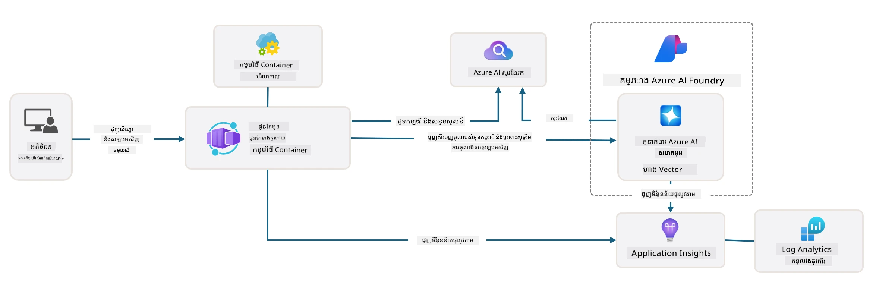

# 3. បំបែកគំរូមួយ

!!! tip "នៅចុងបច្ចេកវិទ្យានេះ អ្នកនឹងអាចធ្វើបាន"

    - [ ] Use GitHub Copilot and optional MCP tools for Azure documentation and read-only exploration
    - [ ] Identify the template's application, infrastructure, configuration, and test entry points
    - [ ] Verify generated explanations against actual repository files
    - [ ] **Lab 3:** Trace one request and one configuration input through the project

---

## 1. បើកការប្រើប្រាស់ GitHub Copilot

បើកគំរូ AI ដែលបានចាប់ផ្តើមនៅ VS Code ហើយបើក [GitHub Copilot](https://code.visualstudio.com/docs/copilot/chat/chat-agent-mode)។ ចុះឈ្មោះជាមួយគណនីដែលមានផែនការដែលអាចប្រើបាន; កម្រិតប្រើប្រាស់មានភាពខុសគ្នា។ សួរ Copilot ដើម្បីពន្យល់អំពីឃ្លាំងសម្រាប់យោងមុនពេលអនុម័តការផ្លាស់ប្តូរ។

### ម៉ាស៊ីនមេ MCP ជាជម្រើស

សេវាកម្មទាំងនេះអាចផ្ដល់ឧបករណ៍បន្ថែម៖

- [ម៉ាស៊ីនមេ Azure MCP](https://learn.microsoft.com/azure/developer/azure-mcp-server/overview)
- [ម៉ាស៊ីនមេ Microsoft Learn MCP](https://learn.microsoft.com/training/support/mcp)

នៅក្នុង VS Code ពិនិត្យមើល [មគ្គុទេសក៍ការកំណត់ MCP](https://code.visualstudio.com/docs/copilot/chat/mcp-servers) ហើយបង្កើត `.vscode/mcp.json` ប្រសិនបើតម្រូវការ៖

```json
{
  "servers": {
    "Azure MCP Server": {
      "type": "stdio",
      "command": "npx",
      "args": ["-y", "@azure/mcp@latest", "server", "start"]
    },
    "microsoft.docs.mcp": {
      "type": "http",
      "url": "https://learn.microsoft.com/api/mcp"
    }
  }
}
```

ពាក្យបញ្ជា `npx` ត្រូវការការតំឡើង Node.js/npm ដែលគាំទ្រ និងទាញយកកូដអនុវត្ត។ ពិនិត្យមើលកញ្ចប់ និងដាក់លេខកំណែដែលអនុម័តសម្រាប់ការតំឡើងក្រុមដែលអាចបង្កើតឡើងម្ដងទៀត។ ចាប់ផ្តើមម៉ាស៊ីនមេដោយប្រើការគ្រប់គ្រង MCP របស់ VS Code ហើយពិនិត្យឧបករណ៍ដែលមាន; ឈ្មោះអាចផ្លាស់ប្ដូរវិញក្នុងកំណែផ្សេងៗ។

**ការផ្ទៀងផ្ទាត់អត្តសញ្ញាណគឺបំបែកម្ដងទៀត។** ប្រើ `azd auth login` សម្រាប់ AZD។ អនុវត្តដំណើរការផ្ទៀងផ្ទាត់អត្តសញ្ញាណដែលបានរៀបរាប់របស់ Azure MCP សម្រាប់ឧបករណ៍របស់វា; ការចូលបើក AZD តែប៉ុណ្ណោះមិនបង្កើតសម័យ MCP ទេ។ ប្រើ `az login` ដោយបំបែកពេលវាយកម្រឹតមួយឬ hook​ ហៅ Azure CLI។

សាកល្បងបញ្ចូល_prompt_សម្រាប់អានតែ​យ៉ាងតិច៖

1. “ប្រើ Microsoft Learn MCP ដើម្បីស្វែងរកឯកសារកំណត់រចនាសម្ព័ន្ធ Azure Developer CLI ។”
2. “ពន្យល់ `azure.yaml` របស់ឃ្លាំងនេះ; លើកយកឯកសារដែលអនុវត្តន៍ hook មួយៗ។”
3. “ដោយប្រើឧបករណ៍ Azure MCP ដែលមានស្រាប់ សូមរាយបញ្ជីធនធានដែលខ្ញុំបានដាក់បញ្ចូលដោយហើយសូមមិនបន្ថែម ឬកែលម្អអ្វីឡើយ។”

ពិនិត្យ tenant/subscription ដែលបានជ្រើសរើស និងការហៅឧបករណ៍ណាមួយដែលបានផ្តល់ជូន។ កុំយល់ព្រមសម្រាប់ការបង្កើតធនធាន ការលុបបំបាក់ ឬវិភាគការចូលប្រើដើម្បីតែធ្វើការស្រាវជ្រាវស្ថាបត្យកម្ម។

## 2. យល់ដឹងពីស្ថាបត្យកម្ម

គំរូនេះមាន backend Python FastAPI និង frontend React/TypeScript នៅក្នុង Azure Container Apps. Backend ទំនាក់ទំនងជាមួយភ្នាក់ងារនៅក្នុងគម្រោង Microsoft Foundry ។ ការទាញយក និងការត្រួតពិនិត្យអាស្រ័យលើលក្ខណៈពិសេសគំរូដែលបានបើក និងការតំឡើងបានជោគជ័យ; មិនមានការធានាថានឹងមានតែប៉ុណ្ណោះព្រោះកម្មវិធីបានដាក់បញ្ចូល។



ប្រៀបធៀបរូបមន្តនេះជាមួយ [មគ្គុទេសក៍ដាក់បញ្ចូលបច្ចុប្បន្ន](https://github.com/Azure-Samples/get-started-with-ai-agents/blob/main/docs/deployment.md) និងធនធានរបស់អ្នកនៅពេលពិត។ ពិនិត្យមើលម៉ូដែលដាក់បញ្ចូល កម្មវិធីភ្នាក់ងារ អត្តសញ្ញាណគ្រប់គ្រង ការបែងចែកតួនាទី និងធនធាន AI Search/Application Insights ជាជម្រើស។

**លំហាត់:** សុំ Copilot តាមដានសំណើជជែកពី frontend ដល់ API ទៅ Foundry ជាមួយការពន្យល់ឯកសារ និងមុខងារ។ បើកយោងនោះ ហើយពិនិត្យការពន្យល់។ កុំសន្និដ្ឋានពីការផ្ទៀងផ្ទាត់អត្តសញ្ញាណ ការផ្គុំផ្គង់ ទន្លេឬការអនុម័តត្រូវបានអនុវត្តពីរូបមន្តតែម្ដង។

## 3. រចនាសម្ព័ន្ធឃ្លាំង

ផ្លូវដែលបានជ្រើសរើសខាងក្រោមត្រូវបានពិនិត្យជាមួយគំរូនៅថ្ងៃទី ៤ ខែវិច្ឆិកា ឆ្នាំ ២០២៦។ កំណែដែលអ្នកចាប់ផ្តើមនៅតែគឺជាផលត្រឹមត្រូវ៖

```text
get-started-with-ai-agents/
  azure.yaml
  docker-compose.yaml
  requirements-dev.txt
  .devcontainer/
  infra/
    main.bicep
    main.parameters.json
    api.bicep
    core/
  src/
    Dockerfile
    pyproject.toml
    requirements.txt
    api/
      main.py
      routes.py
      search_index_manager.py
    frontend/
      package.json
      src/
    files/
  scripts/
    validate_env_vars.sh
    validate_env_vars.ps1
    postdeploy.sh
    postdeploy.ps1
  tests/
    test_evaluation.py
    test_red_teaming.py
  docs/
    deployment.md
    deploy_customization.md
    ai_search.md
    observability.md
    local_development.md
    troubleshooting.md
```

### រចនាសម្ព័ន្ធហេដ្ឋារចនាសម្ព័ន្ធ និងការកំណត់រចនាសម្ព័ន្ធ

`infra/main.bicep` គ្រប់គ្រងធនធាន; `main.parameters.json`ភ្ជាប់បញ្ចូលគំរូទៅតម្លៃបរិស្ថាន AZD។ `azure.yaml` ជ្រើសរើសសេវាកម្មកម្មវិធី និង hook ជីវិតកម្ម។ តាមដានបញ្ចូលដូចជា `USE_AZURE_AI_SEARCH_SERVICE` តាមឯកសារទាំងនេះដើម្បីស្វែងរកអ្វីដែលបានផ្លាស់បម្លែងពិតប្រាកដ។

### កម្មវិធី និងអត្តសញ្ញាណ

អាន `src/api/` និង `src/frontend/` រួមគ្នា។ ស្គាល់កន្លែងដែលភ្នាក់ងារត្រូវបានបង្កើត ឬទទួលបាន កន្លែងដែលនៅត្រៀមនិងដាក់ការណែនាំ/ឧបករណ៍ ក៏ដូចជាអត្តសញ្ញាណណាដែលហៅ Azure ។ ឯកសារគំរូក្រោម `src/files/` គឺជាទិន្នន័យបង្ហាញ មិនមែនជាបញ្ជីផលិតកម្ម ឬគំរូអនុញ្ញាត។

### ការធ្វើតេស្ត និងការបញ្ជាក់

ចំណុចវាយតម្លៃ និងចូលរួមក្រុមក្រហមបច្ចុប្បន្នស្ថិតនៅក្រោម `tests/`; ឯកសារ `evals/` និង `airedteaming/` ពីមុនមិនមានប្រសិទ្ធភាពសម្រាប់គំរូនេះទេ។ អាន `docs/observability.md` សម្រាប់លក្ខខណ្ឌ និងថ្លៃចំណាយ មុនពេលបើកតេស្តពពក។ ការធ្វើតេស្ត Python ទាំងនេះបំបែកពីការពង្រីក AZD ជាជម្រើស `azure.ai.evaluations`។

## 4. ផ្ទៀងផ្ទាត់ការស្វែងរករបស់អ្នក

- កំណត់ផ្លូវ API, ការប tesភ្នាក់ងារ និងកូដទាញយកសម្រាប់សំណួរគំរូមួយ។
- ពន្យល់អត្តសញ្ញាណណាអាចចូលប្រើ Foundry និងការកំណត់ណាដែលជ្រើសរើសចំណុចចេញ។
- ស្វែងរកស្គ្រីប pre-up និង post-deploy ហើយរបៀបដោះស្រាយកំហុសរបស់វា។
- រាយបញ្ជីការពឹងផ្អែក ឬលក្ខណៈជាជម្រើសណាដែលមិនមាននៅក្នុងការដាក់បញ្ចូលរបស់អ្នក។

បន្តទៅ [កំណត់រចនាសម្ព័ន្ធគំរូ](4-Configure-AI-Template.md)។

---

<!-- CO-OP TRANSLATOR DISCLAIMER START -->
**ការបដិសេធ**:
ឯកសារនេះត្រូវបានបម្លែងភាសា ដោយប្រើសេវាបម្លែងភាសា AI [Co-op Translator](https://github.com/Azure/co-op-translator)។ ទោះយើងខ្ញុំមានក្តីប្រាថ្នាឱ្យបានច្បាស់លាស់ តែសូមយល់ដឹងថាការបម្លែងដោយស្វ័យប្រវត្តិក៏អាចមានកំហុសឬភាពមិនត្រឹមត្រូវ។ ឯកសារដើមជាភាសាទីតាំងគួរត្រូវបានគេប្រើជាប្រភពច្បាស់លាស់។ សម្រាប់ព័ត៌មានសំខាន់ៗ សូមណែនាំឱ្យប្រើប្រាស់ការប្រែដោយមនុស្សជំនាញ។ យើងខ្ញុំមិនទទួលខុសត្រូវចំពោះការយល់ច្រឡំ ឬការបកស្រាយខុសបន្ទាប់ពីការប្រើប្រាស់ការបម្លែងនេះនោះទេ។
<!-- CO-OP TRANSLATOR DISCLAIMER END -->