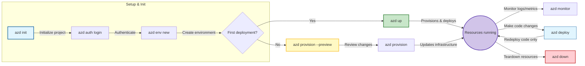
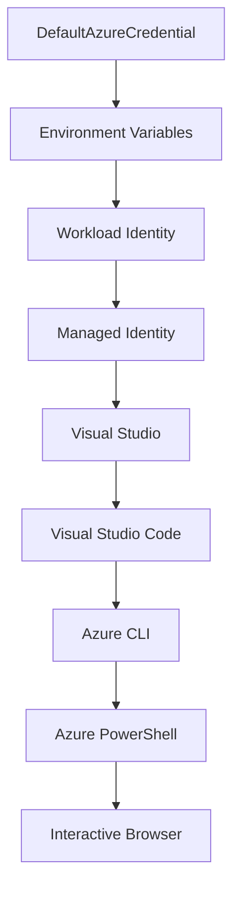

# AZD ಮೂಲಭೂತಗಳು - ಕೋರ್ ಸಂಯುಕ್ತಗಳು ಮತ್ತು ಮೂಲಭೂತ ಅಂಶಗಳು

**ಅಧ್ಯಾಯ ನ್ಯಾವಿಗೇಶನ್:**
- **📚 ಕೋರ್ಸ್ ಹೋಮ್**: [ಆಜಿಡಿ ಆರಂಭಿಕರಿಗೆ](../../README.md)
- **📖 ಪ್ರಸ್ತುತ ಅಧ್ಯಾಯ**: ಅಧ್ಯಾಯ 1 - ಅಡಿಪಾಯ & ವೇಗದ ಪ್ರಾರಂಭ
- **⬅️ ಹಿಂದೆ**: [ಕೋರ್ಸ್ ಅವಲೋಕನ](../../README.md#-chapter-1-foundation--quick-start)
- **➡️ ಮುಂದಿನ**: [ಹೊಂದಿಕೆ & ಸ್ಥಾಪನೆ](installation.md)
- **🚀 ಮುಂದಿನ ಅಧ್ಯಾಯ**: [ಅಧ್ಯಾಯ 2: AI-ಪ್ರಥಮ ಅಭಿವೃದ್ಧಿ](../chapter-02-ai-development/microsoft-foundry-integration.md)

## ಪರಿಚಯ

> `azd 1.37.2` ವಿರುದ್ಧವಾಗಿ ಪರಿಶೀಲಿಸಲಾಗಿದೆ (ನವೆಂಬರ್ 2026). Bash ಕಮಾಂಡ್‌ಗಳು ನೀವು ಬದಲಾಯಿಸಬೇಕಾಗಿರುವ ಉಲ್ಲೇಖಿತ ಪ್ಲೇಸ್‌ಹೋಲ್ಡರ್‌ಗಳನ್ನು ಬಳಸುತ್ತವೆ. ಮಾದರಿ ವರ್ಕ್‌ಫ್ಲೋಗಳು ಪ್ರಸ್ತುತ ಡೈರೆಕ್ಟರಿಯನ್ನು ಪ್ರಾರಂಭಿಸಲು `.` ಅನ್ನು ಬಳಸುತ್ತವೆ; ಡೈರೆಕ್ಟರಿ ಆರ್ಗ್ಯುಮೆಂಟ್ ಇಲ್ಲದೆ, ಮಾದರಿ ಆರಂಭವು ಒಂದು ಉಪಡೈರೆಕ್ಟರಿಯನ್ನು ರಚಿಸುತ್ತದೆ ಮತ್ತು ನಿಮ್ಮ ಶೆಲ್‌ ಕಾರ್ಯ ಡೈರೆಕ್ಟರಿಯನ್ನು ಬದಲಾಯಿಸುವುದಿಲ್ಲ. ಅತ್ಯಾಧುನಿಕ ಸ্নಿಪೆಟ್‌ಗಳು ಪೂರ್ಣ ಯೋಜನೆಗಳಲ್ಲ, ಚಿತ್ರಣಾತ್ಮಕವಾಗಿವೆ.

ಈ ಪಾಠವು ನಿಮಗೆ ಅಝೂರ್ ಡೆವಲಪರ್ CLI (azd) ಅನ್ನು ಪರಿಚಯಿಸುತ್ತದೆ, ಇದು ಸ್ಥಳೀಯ ಅಭಿವೃದ್ಧಿಯಿಂದ ಅಝೂರಿಗೆ ಕಳುಹಿಸುವುದರ ಪಯಣವನ್ನು ವೇಗಗೊಳಿಸುವ ಶಕ್ತಿಶಾಲಿ ಕಮಾಂಡ್-ಲೈನ್ ಸಾಧನವಾಗಿದೆ. ನೀವು ಮೂಲಭೂತ ಅಂಶಗಳು, ಮುಖ್ಯ ಲಕ್ಷಣಗಳು ಮತ್ತು azd ಹೇಗೆ ಕ್ಲೌಡ್-ನೇಟಿವ್ ಅಪ್ಲಿಕೇಶನ್ ನಿಯೋಜನೆಯನ್ನು ಸರಳಗೊಳಿಸುತ್ತದೆ ಎಂದು ತಿಳಿಯುತ್ತೀರಿ.

## ಕಲಿಕೆ ಗುರಿ

ಈ ಪಾಠದ ಅಂತ್ಯದಲ್ಲಿ, ನೀವು:
- ಏಜೊರ್ ಡೆವಲಪರ್ CLI ಎನ್ನುವುದು ಮತ್ತು ಅದರ ಪ್ರಮುಖ ಉದ್ದೇಶವನ್ನು ಅರ್ಥಮಾಡಿಕೊಂಡಿರುತ್ತೀರಿ
- ಟೆಂಪ್ಲೇಟುಗಳು, ವಾತಾವರಣಗಳು ಮತ್ತು ಸೇವೆಗಳ ಮೂಲ ಧಾರ್ಮಿಕತೆಯನ್ನು ಕಲಿಯುತ್ತೀರಿ
- ಟೆಂಪ್ಲೇಟು-ಚಾಲಿತ ಅಭಿವೃದ್ಧಿ ಮತ್ತು ಇನ್‌ಫ್ರಾಸ್ಟ್ರಕ್ಚರ್ ಅಾಸ್ ಕೋಡ್ ಸೇರಿದಂತೆ ಪ್ರಮುಖ ವೈಶಿಷ್ಟ್ಯಗಳನ್ನು ಅನ್ವೇಷಿಸುತ್ತೀರಿ
- azd ಯೋಜನೆ ರಚನೆ ಮತ್ತು ಕಾರ್ಯಪದ್ಧತಿಯನ್ನು ಅರ್ಥಮಾಡಿಕೊಳ್ಳುತ್ತೀರಿ
- ನಿಮ್ಮ ಅಭಿವೃದ್ಧಿ ವಾತಾವರಣಕ್ಕಾಗಿ azd ಅನ್ನು ಸ್ಥಾಪಿಸಿ ಮತ್ತು ಸಂರಚಿಸಲು ಸಿದ್ಧವಾಗುತ್ತೀರಿ

## ಕಲಿಕೆ ಫಲಿತಾಂಶಗಳು

ಈ ಪಾಠವನ್ನು ಪೂರ್ಣಗೊಳಿಸಿದ ಮೇಲೆ, ನೀವು ಮಾಡಬಹುದಾಗಿದೆ:
- ಆಧುನಿಕ ಕ್ಲೌಡ್ ಅಭಿವೃದ್ಧಿ ಕಾರ್ಯಪ್ರವಾಹಗಳಲ್ಲಿ azd ನ ಪಾತ್ರವನ್ನು ವಿವರಿಸಿ
- azd ಪ್ರಾಜೆಕ್ಟ್ ರಚನೆಯ ಅಂಶಗಳನ್ನು ಗುರುತಿಸಿ
- ಟೆಂಪ್ಲೇಟುಗಳು, ಪರಿಸರಗಳು ಮತ್ತು ಸೇವೆಗಳು ಹೇಗೆ ಕೈಜೋಡಿಸಿಕೊಂಡು ಕಾರ್ಯನಿರ್ವಹಿಸುತ್ತವೆ ಎಂದು ವಿಸ್ತಾರವಾಗಿ ಹೇಳಿ
- azd ಜೊತೆಗೆ ಕಂಪೋನენტის ಮೂಲಕೋಡಿನ ಲಾಭಗಳನ್ನು ಅರ್ಥಮಾಡಿಕೊಳ್ಳಿ
- ವಿಭಿನ್ನ azd ಆಜ್ಞೆಗಳ ಮತ್ತು ಅವುಗಳ ಉದ್ದೇಶಗಳನ್ನು ಗುರುತಿಸಿ

## ಅಜ್ಯೂರ್ ಡೆವಲಪರ್ CLI (azd) ಏನು?

ಅಜ್ಯೂರ್ ಡೆವಲಪರ್ CLI (azd) ಅನ್ನು ನೈಜ್ಯ ಸ್ಥಳೀಯ ಅಭಿವೃದ್ಧಿಯಿಂದ ಅಜ್ಯೂರ್ ನಿಯೋಜನೆಗೆ ನಿಮ್ಮ ಪ್ರಯಾಣವನ್ನು ವೇಗಗೊಳಿಸಲು ವಿನ್ಯಾಸಗೊಳ್ಳಲಾದ ಕಮಾಂಡ್-ಲೈನ್ ಉಪಕರಣವಾಗಿದೆ. ಇದು ಅಜ್ಯೂರ್ ನಲ್ಲಿ ಕ್ಲೌಡ್-ನೇಟಿವ್ ಅಪ್ಲಿಕೇಶನ್‌ಗಳನ್ನು ನಿರ್ಮಿಸುವುದು, ನಿಯೋಜಿಸುವುದು ಮತ್ತು ನಿರ್ವಹಿಸುವ ಪ್ರಕ್ರಿಯೆಯನ್ನು ಸರಳಗೊಳಿಸುತ್ತದೆ.

### azd ಮೂಲಕ ನೀವು ಏನು ನಿಯೋಜಿಸಬಹುದು?

azdವು ವಿಸ್ತೃತ ಕಾರ್ಯಭಾರಗಳನ್ನು ಬೆಂಬಲಿಸುತ್ತದೆ—ಮತ್ತು ಪಟ್ಟಿ ಬೆಳೆಯುತ್ತಿದೆ. ಇಂದು, ನೀವು azd ಅನ್ನು ನಿಯೋಜಿಸಲು ಬಳಸಬಹುದು:

| ಕಾರ್ಯಭಾರದ ಪ್ರಕಾರ | ಉದಾಹರಣೆಗಳು | ಅದೇ ಕಾರ್ಯನಿರ್ವಹಣೆ? |
|---------------|----------|----------------|
| **ಪ್ರಚಲಿತ ಅಪ್ಲಿಕೇಶನ್ಗಳು** | ವೆಬ್ ಆ್ಯಪ್‌ಗಳು, REST APIಗಳು, ಸ್ಥಿರ ತಾಣಗಳು | ✅ `azd up` |
| **ಸೈವೆಸು ಮತ್ತು ಸೂಕ್ಷ್ಮ ಸೇವೆಗಳು** | ಕಂಟೇನರ್ ಆ್ಯಪ್‌ಗಳು, ಫಂಕ್ಷನ್ ಆ್ಯಪ್‌ಗಳು, ಬಹು-ಸೈವೆಸು ಬ್ಯಾಕ್‌ಎಂಡ್‌ಗಳು | ✅ `azd up` |
| **ಕೃತ್ರಿಮ ಬುದ್ಧಿಮತ್ತೆ ಆಧಾರಿತ ಅಪ್ಲಿಕೇಶನ್ಗಳು** | ಮೈಕ್ರೋಸಾಫ್ಟ್ ಫೌಂಡ್ರಿ ಮಾದರಿಗಳೊಂದಿಗೆ ಚಾಟ್ ಆ್ಯಪ್‌ಗಳು, AI ಹುಡುಕಾಟದೊಂದಿಗೆ RAG ಪರಿಹಾರಗಳು | ✅ `azd up` |
| **ಬುದ್ಧಿವಂತ πράತುಗಳು** | ಫೌಂಡ್ರಿ-ಹೋಸ್ಟ್ ಮಾಡಲಾದ πράತುಗಳು, ಬಹು- πράತು ನಿರ್ದೇಶನಗಳು | ✅ `azd up` |

ಮುಖ್ಯವಾದ ಅರ್ಥವೇನೆಂದರೆ **ನೀವು ಯಾವ ಕಾರ್ಯಕ್ರಮವನ್ನಾದರೂ ನಿಯೋಜಿಸುವುದಾದರೂ azd ಯ ಪೂರ್ಣಜೀವನಚಕ್ರ ಸರಿಯೇ ಇರುತ್ತದೆ**. ನೀವು ಒಂದು ಯೋಜನೆಯನ್ನು ಪ್ರಾರಂಭಿಸಿ, ಮೂಲಭೂತ ವಸತಿಗಳನ್ನು ವ್ಯವಸ್ಥೆ ಮಾಡಿ, ನಿಮ್ಮ ಕೋಡ್ ನಿಯೋಜಿಸಿ, ನಿಮ್ಮ ಆ್ಯಪ್‌ನಿಂದ ಗಮನ ಮಾಡಿ ಮತ್ತು ಕ್ಲೀನ್‌ಅಪ್ ಮಾಡಿ—ಅದು ಸರಳ ವೆಬ್‌ಸೈಟ್ ಆದರೂ ಬಲಿಷ್ಠ AI πράತು ಆದರೂ ಒಬ್ಬರೇ.

ಈ ಪಾಠಕತೆಯು ವಿನ್ಯಾಸದಿಂದಾಗಿ. azd AI ಸಾಮರ್ಥ್ಯಗಳನ್ನು ನಿಮ್ಮ ಅಪ್ಲಿಕೇಶನ್ ಬಳಸಬಹುದಾದ ಇನ್ನೊಂದು ಸೇವೆಯಾಗಿ ಪರಿಗಣಿಸುತ್ತದೆ, ಬೇರೆ ರೀತಿಯದು ಅಲ್ಲ. ಮೈಕ್ರೋಸಾಫ್ಟ್ ಫೌಂಡ್ರಿ ಮಾದರಿಗಳ ಮೂಲಕ ಬೆಂಬಲಿಸಲ್ಪಡುವ ಚಾಟ್ ಎಂಡ್ಪಾಯಿಂಟ್ azd ದೃಷ್ಟಿಕೋನದಿಂದ ಮತ್ತೊಂದು ಸೇವೆಯಂತೆ ಕಾಣುತ್ತದೆ ಮತ್ತು ನಿಯೋಜಿಸಲಾಗುತ್ತದೆ.

### 🎯 ಏಕೆ AZD ಬಳದುಕೊಂಡು? ನಿಜವಾದ ಹೋರಾಟದ ಹೋಲಿಕೆ

ಸರಳ ವೆಬ್ ಆ್ಯಪ್ ಮತ್ತು ಡೇಟಾಬೇಸ್ ಅನ್ನು ನಿಯೋಜಿಸುವುದು ಹೋಲಿಸೋಣ:

#### ❌ AZD ಇಲ್ಲದೆ: ಕೈಯಿಂದ ಆಜೂರ್ ನಿಯೋಜನೆ (30+ ನಿಮಿಷಗಳು)

**ಚಿತ್ರಣಾತ್ಮಕ ಬಾಷ್ ಹೋಲಿಕೆ, ಚಾಲನೆಯಲ್ಲದ ಅಪ್ಲಿಕೇಶನ್ ಪ್ರಾರಂಭವಲ್ಲ.** ಇದು ಇದ್ದ ಗುಂಪುಕೆಯ ಅಪ್ಲಿಕೇಶನ್ ಕೋಡ್, ವಿಶಿಷ್ಟ ಸಂಪನ್ಮೂಲ ಹೆಸರಿನ ಕುರಿತು ಧಾರಣೆ ಇರುತ್ತದೆ, ಆಜೂರ್ CLI ದೃಢೀಕರಣ ಮತ್ತು ಬೇಕಾದ CLI ವಿಸ್ತರಣೆಗಳನ್ನು ಒಳಗೊಂಡಿದೆ. ಬೆಂಬಲಿತ ಪೂರ್ಣಮಾರ್ಗ ನಿಗದಿತ ಉಪಯೋಗಕ್ಕಾಗಿ ಕೆಳಗಿನ ಟೆಂಪ್ಲೇಟ್ ಅಭ್ಯಾಸವನ್ನು ಬಳಸಿ.

```bash
# Step 1: Create resource group
az group create --name myapp-rg --location eastus

# Step 2: Create App Service Plan
az appservice plan create --name myapp-plan \
  --resource-group myapp-rg \
  --sku B1 --is-linux

# Step 3: Create Web App
az webapp create --name myapp-web-unique123 \
  --resource-group myapp-rg \
  --plan myapp-plan \
  --runtime "NODE:22-lts"

# Step 4: Create Cosmos DB account (10-15 minutes)
az cosmosdb create --name myapp-cosmos-unique123 \
  --resource-group myapp-rg \
  --kind MongoDB

# Step 5: Create database
az cosmosdb mongodb database create \
  --account-name myapp-cosmos-unique123 \
  --resource-group myapp-rg \
  --name tododb

# Step 6: Create collection
az cosmosdb mongodb collection create \
  --account-name myapp-cosmos-unique123 \
  --resource-group myapp-rg \
  --database-name tododb \
  --name todos

# Step 7: Get connection string
CONN_STR=$(az cosmosdb keys list \
  --name myapp-cosmos-unique123 \
  --resource-group myapp-rg \
  --type connection-strings \
  --query "connectionStrings[0].connectionString" -o tsv)

# Step 8: Configure app settings
az webapp config appsettings set \
  --name myapp-web-unique123 \
  --resource-group myapp-rg \
  --settings MONGODB_URI="$CONN_STR"

# Step 9: Enable logging
az webapp log config --name myapp-web-unique123 \
  --resource-group myapp-rg \
  --application-logging filesystem \
  --detailed-error-messages true

# Step 10: Set up Application Insights
az monitor app-insights component create \
  --app myapp-insights \
  --location eastus \
  --resource-group myapp-rg

# Step 11: Link App Insights to Web App
INSTRUMENTATION_KEY=$(az monitor app-insights component show \
  --app myapp-insights \
  --resource-group myapp-rg \
  --query "instrumentationKey" -o tsv)

az webapp config appsettings set \
  --name myapp-web-unique123 \
  --resource-group myapp-rg \
  --settings APPINSIGHTS_INSTRUMENTATIONKEY="$INSTRUMENTATION_KEY"

# Step 12: Build application locally
npm install
npm run build

# Step 13: Create deployment package
zip -r app.zip . -x "*.git*" "node_modules/*"

# Step 14: Deploy application
az webapp deployment source config-zip \
  --resource-group myapp-rg \
  --name myapp-web-unique123 \
  --src app.zip

# Step 15: Wait and pray it works 🙏
# (No automated validation, manual testing required)
```

**ಸಮಸ್ಯೆಗಳು:**
- ❌ 15+ ಆಜ್ಞೆಗಳು ನೆನಪಿಡುವುದು ಮತ್ತು ಕ್ರಮವಾಗಿ ನಡಿಸಲು
- ❌ 30-45 ನಿಮಿಷಗಳ ಹಸ್ತಚಾಲಿತ ಕೆಲಸ
- ❌ ದೋಷಮಾಡುವುದು ಸುಲಭ (ಟೈಪೋಗಳು, ತಪ್ಪು ಪರಿಮಾಣಗಳು)
- ❌ ಪ್ರಮಾಣಪತ್ರಗಳಿಗೆ ಸ್ಪಷ್ಟ ಹ್ಯಾಂಡ್ಲಿಂಗ್ ಅಗತ್ಯ; ಡಿಬಗ್ ಲಾಗ್‌ಗಳು ಮತ್ತು ಶೆಲ್ ಟ್ರೇಸಿಂಗ್‌ಗಳು ಅವುಗಳನ್ನು ಬಹಿರಂಗಪಡಿಸ ಬಹುದು
- ❌ ಏನಾದರೂ ವಿಫಲವಾದರೆ ಸ್ವಯಂಚಾಲಿತರ್‌ಹೋಲು ಇಲ್ಲ
- ❌ ತಂಡ ಸದಸ್ಯರಿಗೆ ನಕಲಿಸಿ ಮಾಡಲು ಕಷ್ಟ
- ❌ ಪ್ರತಿ ಬಾರಿಗೆ ವಿವಿಧ (ಪುನರುತ್ಪಾದಿಸಲು ಸಾಧ್ಯವಿಲ್ಲ)

#### ✅ AZD ಜೊತೆ: ಸ್ವಯಂಚಾಲಿತ ನಿಯೋಜನೆ (5 ಆಜ್ಞೆಗಳು, 10-15 ನಿಮಿಷಗಳು)

```bash
# Step 1: Initialize from template
azd init --template todo-nodejs-mongo .

# Step 2: Authenticate
azd auth login

# Step 3: Select the environment created during init
azd env select dev

# Step 4: Preview changes (optional but recommended)
azd provision --preview

# Step 5: Deploy everything
azd up

# ✨ Done! Everything is deployed, configured, and monitored
```

**ಲಾಭಗಳು:**
- ✅ **5 ಆಜ್ಞೆಗಳು** ಮುಂದು 15+ ಹಸ್ತಚಾಲಿತ ಹಂತಗಳ ಬದಲು
- ✅ **ಒಟ್ಟು 10-15 ನಿಮಿಷಗಳು** (ಬಹುತೇಕ ಅಜೂರ್ ಕಾಯುವಿಕೆಯಾಗಿ)
- ✅ **ಕಡಿಮೆ ಹಸ್ತಚಾಲಿತ ದೋಷಗಳು** - ನಿರಂತರ, ಟೆಂಪ್ಲೇಟ್ನ ಅವಲಂಬನೆ workflow
- ✅ **ಗೌಪ್ಯತೆಯ ಸುರಕ್ಷಿತ ಹ್ಯಾಂಡ್ಲಿಂಗ್** - ಅನೇಕ ಟೆಂಪ್ಲೇಟುಗಳು ಅಜೂರ್ ನಿರ್ವಹಿತ ಗುಪ್ತ ಸಂಗ್ರಹಣೆ ಉಪಯೋಗಿಸುತ್ತವೆ
- ✅ **ಮರುಪಾವತಿ ನಿಯೋಜನೆಗಳು** - ಪ್ರತಿ ಸಾರಿ ಒಂದೇ workflow
- ✅ **ಮರುಪಾವತಿ ಮೂಲಸೌಕರ್ಯ ವಿವರಗಳು** - ಕ್ವೋಟಾಗಳು, ಪ್ರಾಂತ್ಯ ಲಭ್ಯತೆ ಮತ್ತು ಟೆಂಪ್ಲೇಟ್ ಆವೃತ್ತಿಗಳ ಅವಲಂಬನೆಯೊಂದಿಗೆ
- ✅ **ತಂಡಕ್ಕೆ ಸಿದ್ಧ** - ಯಾರಾದರೂ ಒಂದೇ ಆಜ್ಞೆಗಳಿಂದ ನಿಯೋಜಿಸಬಹುದು
- ✅ **ಕೋಡಾಗಿ ಇನ್ಫ್ರಾಸ್ಟ್ರಕ್ಚರ್‍** - ಆವೃತ್ತಿ ನಿಯಂತ್ರಿತ ಬೈಸೆಪ್ ಟೆಂಪ್ಲೇಟ್‌ಗಳು
- ✅ **ಟೆಂಪ್ಲೇಟು ನಿರ್ಧರಿಸಿದ ಮಾನಿಟರಿಂಗ್** - ಟೆಂಪ್ಲೇಟಿನಲ್ಲಿ ಸೇರಿಸಿದಾಗ ಅಪ್ಲಿಕೇಶನ್ ಇನ್ಸೈಟ್ಸ್

### ಸಮಯ ಮತ್ತು ನಂಬಿಕೆ

ಮೇಲಿನ ಸಮಯವನ್ನು ಅಂದಾಜುಗಳು ಮತ್ತು benchಮಾರ್ಕ್‌ಗಳಾಗಿ ಪರಿಗಣಿಸಬೇಡಿ. azd ನೀವು ಹೊಂದಿಸಬೇಕಾದ ಆಜ್ಞೆಗಳನ್ನು ಕಡಿಮೆ ಮಾಡುತ್ತದೆ, ಆದರೆ ನಿಯೋಜನೆ ವ್ಯತ್ಯಯವನ್ನು ಗ್ಯಾರೆಂಟಿ ಮಾಡದು, ದೋಷಗಳನ್ನು ದೂರ ಮಾಡದು ಅಥವಾ ಸ್ವಯಂಚಾಲಿತ ಅಪ್ಲಿಕೇಶನ್/ಡೇಟಾಬೇಸ್ rollback ಅನ್ನು ಒದಗಿಸುವುದಿಲ್ಲ. ಕಾರ್ಯನಿರ್ವಹಣಾ ಆವೃತ್ತಿಗಳನ್ನು ಮೂಲ ನಿಯಂತ್ರಣದಲ್ಲಿ ಇಡಿರಿ ಮತ್ತು ಪುನರುದ್ಧಾರ ಕ್ರಮಗಳನ್ನು ಪರೀಕ್ಷಿಸಿ.

## ಮೂಲ ಕಲ್ಪನೆಗಳು

### ಟೆಂಪ್ಲೇಟ್‌ಗಳು
ಟೆಂಪ್ಲೇಟ್‌ಗಳು azd‌ನ ಆಧಾರವು. ಅವು ಒಳಗೊಂಡಿವೆ:
- **ಅಪ್ಲಿಕೇಶನ್ ಕೋಡ್** - ನಿಮ್ಮ ಮೂಲ ಕೋಡ್ ಮತ್ತು ಅವಲಂಬನೆಗಳು
- **ಮೂಲಸೌಕರ್ಯ ವಿವರಗಳು** - ಬೈಸೆಪ್ ಅಥವಾ ಟೆರೆಫಾರ್ಮ್‌ನಲ್ಲಿನ ಅಜೂರ್ ಸಂಪನ್ಮೂಲಗಳು
- **ರಚನೆ ಕಡತಗಳು** - ಸೆಟ್ಟಿಂಗ್ಗಳು ಮತ್ತು ಪರಿಸರಚರಗಳು  
- **ဖြန်ကြားမှု ಸ್ಕ್ರಿಪ್ಟ್‌ಗಳು** - ಸ್ವಯಂಚಾಲಿತ ဖြန်ကြားမှု ಕಾರ್ಯಪ್ರವಾಹಗಳು  

### ಪರಿಸರಗಳು  
ಪರಿಸರಗಳು ವಿಭಿನ್ನ ဖြန်ကြားမှု ಗುರಿಗಳನ್ನು ಪ್ರತಿನಿಧಿಸುತ್ತವೆ:  
- **ಅಭಿವೃದ್ಧಿ** - ಪರೀಕ್ಷೆ ಮತ್ತು ಅಭಿವೃದ್ಧಿಗಾಗಿ  
- **ಸ್ಥಾಪನೆ** - ಉತ್ಪಾದನಾ ಮುನ್ನಿರಿಸಿ ಪರಿಸರ  
- **ಉತ್ಪಾದನೆ** - ಜೀವಂತ ಉತ್ಪಾದನಾ ಪರಿಸರ  

ಪ್ರತಿ ಪರಿಸರವು ಅದಕ್ಕೇತಗಿನನ್ನು ನಿರ್ವಹಿಸುತ್ತದೆ:  
- ಪರಿಸರ ಹೆಸರು ಮತ್ತು ಮೌಲ್ಯಗಳು; ಸಂಪನ್ಮೂಲ पृथक्कರಣೆ ಮೂಲಸೌಕರ್ಯ ಟೆಂಪ್ಲೇಟ್ನ ಮೇಲೆ დამოკიდಿರುತ್ತದೆ  
- ಸಂರಚನಾ ಸೆಟ್ಟಿಂಗ್ಗಳು  
- ဖြನುતಿದ್ದು ಸ್ಥಿತಿ  

### ಸೇವೆಗಳು  
`azure.yaml`ಯിലെ ಸೇವೆಗಳು ಪ್ರತ್ಯೇಕವಾಗಿ ಕಳುಹಿಸಬಹುದಾದ ಅಪ್ಲಿಕೇಶನ್ ಭಾಗಗಳನ್ನು ವಿವರಿಸುತ್ತವೆ:  
- **ಮುಂಭಾಗ** - ವೆಬ್ ಅಪ್ಲಿಕೇಶನ್‌ಗಳು, SPAಗಳು  
- **ಹಿಂಭಾಗ** - APIಗಳು, ಮೈಕ್ರೋಸೇವೆಗಳು  

ಡೇಟಾಬೇಸ್‌ಗಳು ಮತ್ತು ಸಂಗ್ರಹಣೆ ಸಾಮಾನ್ಯವಾಗಿ ಮೂಲಸೌಕರ್ಯ ಸಂಪನ್ಮೂಲಗಳಾಗಿ ಒದಗಿಸಲಾಗುತ್ತವೆ, ಉಪಕ್ರಮಿಸುವ ಸೇವೆ ಹುಟ್ಟಿಸುವಂತಿಲ್ಲ, ಉದಾಹರಣೆಗೆ `host: postgres`.  

## ಪ್ರಮುಖ ವೈಶಿಷ್ಟ್ಯಗಳು  

### 1. ಟೆಂಪ್ಲೇಟ್ನಿರೂಪಿತ ಅಭಿವೃದ್ಧಿ  
```bash
# Browse available templates
azd template list

# Initialize from a template
azd init --template "<template-name>" .
```
  
### 2. ಮೂಲಸೌಕರ್ಯ ಪ್ರಶ್ನೆರೂಪದಲ್ಲಿ  
- **ಬೈಸಪ್** - ಅಜೂರ್ ನ ಡೊಮೇನ್-ನಿರ್ದಿಷ್ಟ ಭಾಷೆ  
- **ಟೆರ್ರಾಫಾರ್ಮ್** - ಬಹು-ಮেঘ ಮೂಲಸೌಕರ್ಯ ಸಾಧನ  
- ಬೈಸಪ್ ARM ಟೆಂಪ್ಲೇಟ್ಗಳಿಗೆ ಸಂಕಲನಗೊಳ್ಳುತ್ತದೆ; ಕಚ್ಚಾ ARM JSON ಒಂದು ಪ್ರತ್ಯೇಕ ನಿರ್ಮಿತ `infra.provider` ಅಲ್ಲ.  

### 3. ಏಕೀಕೃತ ಕಾರ್ಯಪ್ರವಾಹಗಳು  
```bash
# Complete deployment workflow
azd up            # Provision + Deploy this is hands off for first time setup

# 🧪 NEW: Preview infrastructure changes before deployment (SAFE)
azd provision --preview    # Simulate infrastructure deployment without making changes

azd provision     # Create Azure resources if you update the infrastructure use this
azd deploy        # Deploy application code or redeploy application code once update
azd down          # Clean up resources
```
  
#### 🛡️ ಪೂರ್ವದರ್ಶನದೊಂದಿಗೆ ಸುರಕ್ಷಿತ ಮೂಲಸೌಕರ್ಯ ಯೋಜನೆ  
`azd provision --preview` ಆಜ್ಞೆ ಸುರಕ್ಷಿತ deployment ಗೆ ಪರಿವರ್ತಕವಾಗಿದೆ:  
- **ಶುಷ್ಕ-ಓಟ ವಿಶ್ಲೇಷಣೆ** - ಏನು ಸೃಷ್ಟಿಯಾಗಲಿದೆ, ಬದಲಾಯಿಸಲಾಗಲಿದೆ, ಅಥವಾ ಅಳಿಸಲಾಗಲಿದೆ ತೋರಿಸುತ್ತದೆ  
- **ಮೂಲಸೌಕರ್ಯ ಅನ್ವಯಿಸಬೇಡಿ** - ಒದಗಿಸುವವರ ಬದಲಾವಣೆಗಳನ್ನು ಪರಿಶೀಲಿಸಿ; ಪ್ರಾಜೆಕ್ಟ್ ಹೊಕಸ್‌ಗಳನ್ನು ಮೊದಲು ಪರಿಶೀಲಿಸಿ, ಏಕೆಂದರೆ ಹೊಕಸ್‌ಗಳು ಸೈಡ್ ಪರಿಣಾಮಗಳೊಂದಿಗೆ ಆಜ್ಞೆಗಳು ನಡೆಸಬಹುದು  
- **ಟೀಂ ಸಹಕಾರ** - deployment ಮುಂಚಿತವಾಗಿ ಪೂರ್ವದರ್ಶನ ಫಲಿತಾಂಶಗಳನ್ನು ಹಂಚಿಕೊಳ್ಳಿ  
- **ಖರ್ಚು ಯೋಜನೆಗೆ ಇನ್ಪುಟ್** - ಯೋಚಿಸಲಾದ SKUಗಳನ್ನು ಪರಿಶೀಲಿಸಿ, ನಂತರ ಅವುಗಳನ್ನು ಅಜೂರ್ ಬೆಲೆಗಣಕ ಬಳಸಿಕೊಂಡು ಬೆಲೆ ನಿಗದಿಗೊಳಿಸಿ; ಪೂರ್ವದರ್ಶನ ಬೆಲೆಗಳನ್ನು ಗಣನೆ ಮಾಡುವುದಿಲ್ಲ  

```bash
# Example preview workflow
azd provision --preview           # See what will change
# Review the output, discuss with team
azd provision                     # Apply changes with confidence
```

### 📊 ದೃಶ್ಯ: AZD ಅಭಿವೃದ್ಧಿ ಕಾರ್ಯಪ್ರವಾಹ



**ಕಾರ್ಯಪ್ರವಾಹ ವಿವರಣೆ:**
1. **ಆರಂಭಿಸು** - ಟೆಂಪ್ಲೇಟಿನಿಂದ ಅಥವಾ ಹೊಸ ಪ್ರಾಜೆಕ್ಟಿನಿಂದ ಪ್ರಾರಂಭಿಸಿ
2. **ಅಥೆಂಟಿಕೇಟ್** - ಅಝೂರ್ ಜೊತೆಗೆ ವಿಧಾಣಿತಗೊಳಿಸಿಕೊಳ್ಳಿ
3. **ಪರಿಸರ** - ವಿಶಿಷ್ಟ ನಿಯೋಜನೆ ಪರಿಸರವನ್ನು ರಚಿಸಿ
4. **ಪೂರ್ವನೋಟ** - 🆕 ಮೊದಲಿಗೆ ಸದಾ ಮೂಲಸೌಲಭ್ಯ ಬದಲಾವಣೆಗಳನ್ನು ಪೂರ್ವನೋಟ ಮಾಡಿ (ಚೆನ್ನಾದ ಪ್ರಕ್ರಿಯೆ)
5. **ನಿರ್ವಹಣೆ** - ಅಝೂರ್ ಸಂಪನ್ಮೂಲಗಳನ್ನು ರಚಿಸಿ/ನವೀಕರಿಸಿ
6. **ನಿಯೋಜನೆ** - ನಿಮ್ಮ ಅಪ್ಲಿಕೇಶನ್ ಕೋಡ್ ಅನ್ನು ಕಳುಹಿಸಿ
7. **ನಿರೀಕ್ಷಣೆ** - ಅಪ್ಲಿಕೇಶನ್ ಕಾರ್ಯಕ್ಷಮತೆಯನ್ನು ಗಮನೆ ಮಾಡಿ
8. **ಪುನರಾವರ್ತನೆ** - ಬದಲಾವಣೆಗಳನ್ನು ಮಾಡಿ ಕೋಡ್ ಅನ್ನು ಮರುನಿಯೋಜಿಸಿ
9. **ಶುದ್ಧಿಕರಣ** - ಕೆಲಸ ಮುಗಿದಾಗ ಸಂಪನ್ಮೂಲಗಳನ್ನು ತೆಗೆಯಿರಿ

### 4. ಪರಿಸರ ನಿರ್ವಹಣೆ
```bash
# Create and manage environments
azd env new "<environment-name>"
azd env select "<environment-name>"
azd env list
```

### 5. ವಿಸ್ತರಣೆಗಳು ಮತ್ತು AI ಆಜ್ಞೆಗಳು

azd ಮೂಲ CLI ಅನ್ನು ಮೀರಿದ ಸಾಮರ್ಥ್ಯಗಳನ್ನು ಸೇರಿಸಲು ವಿಸ್ತರಣೆ ವ್ಯವಸ್ಥೆಯನ್ನು ಬಳಸುತ್ತದೆ. ಇದು ವಿಶೇಷವಾಗಿ AI ಕಾರ್ಯಭಾರಗಳಿಗೆ ಉಪಯುಕ್ತ:

```bash
# List available extensions
azd extension list

# Install the GA Foundry bundle (requires azd >= 1.37.0)
azd ext install microsoft.foundry

# Initialize an AI agent project interactively
azd ai agent init

# Test a deployed agent (shows latency and time-to-first-byte)
azd ai agent invoke

# Start the MCP server for AI-assisted development (Alpha)
azd mcp start
```

**ಏಜೆಂಟ್ ಜೀವನಚರಿತ್ರೆ, ಆರಂಭದಿಂದ ಅಂತ್ಯವರೆಗೆ.** GA `microsoft.foundry` ಪ್ಯಾಕ್ ನಲ್ಲಿ `azure.ai.agents` ಮತ್ತು ಉಪ್ಪರ್ ಆರು ಮೂಲ ವಿಸ್ತರಣೆಗಳು ಸೇರಿವೆ. ಮೌಲ್ಯಮಾಪನಕ್ಕಾಗಿ `azure.ai.evaluations` ಅನ್ನು ಪ್ರತ್ಯೇಕವಾಗಿ ಸ್ಥಾಪಿಸಿ. ಈ ಕಾರ್ಯಪ್ರವಾಹಕ್ಕಾಗಿ `azd >= 1.37.0` ಅನ್ನು ಬಳಸಿ. ನೀವು ಮೊದಲ ದಿನವೇ ಇವುಗಳಲ್ಲೆಲ್ಲ ಬೇಕಾಗಿರುವುದಿಲ್ಲ:

| ಹಂತ | ಆಜ್ಞೆ | ಅದು ಮಾಡುವುದು |
|-------|---------|--------------|
| **ಸ್ಕಾಫೋಲ್ಡ್** | `azd ai agent init --template <path-to-azure.yaml>` | ಪ್ರಸ್ತುತ ಏಜೆಂಟ್ ಪ್ರಾಜೆಕ್ಟ್ ಟೆಂಪ್ಲೇಟನ್ನು ಸ್ವೀಕರಿಸಿ |
| **ಸ್ಥಳೀಯವಾಗಿ ರನ್ ಮಾಡಿ** | `azd ai agent run`, ನಂತರ ಇನ್ನೊಂದು ಟರ್ಮಿನಲ್‌ನಲ್ಲಿ `azd ai agent invoke --local "Test prompt"` | ಏಜೆಂಟ್ ಇನ್ಸ್‌പೆಕ್ಟರ್‌ನಲ್ಲಿ ಸ್ಥಳೀಯ ಕ್ರಿಯೆಯನ್ನು ಪರಿಶೀಲಿಸಿ; ಮಾದರಿ ಕರೆಗಳು ಇನ್ನೂ ಅಝೂರ್ ಅನ್ನು ಬಳಸುತ್ತವೆ |
| **ಡಿಪ್ಲಾಯ್ ಮಾಡಿ** | `azd deploy` | ಕೋಡ್-ಮೋಡ್ ಹೋಸ್ಟ್ ಮಾಡಿದ ಏಜೆಂಟ್ಗಳಿಗಾಗಿ, ದೂರದ Foundry ನಿರ್ಮಾಣಕ್ಕಾಗಿ ಮೂಲವನ್ನು ಅಪ್‌ಲೋಡ್ ಮಾಡಿ |
| **ಪರೀಕ್ಷೆ ಮಾಡಿ** | `azd ai agent invoke` | ಏಜೆಂಟನ್ನು ಕರೆ ಮಾಡಿ ಮತ್ತು ಪ್ರತಿಕ್ರಿಯೆ ಸಮಯವನ್ನು ವೀಕ್ಷಿಸಿ |
| **ಅಳೆಯಿರಿ** | `azd ai eval init`, `generate`, `run start` | ಪ್ರತ್ಯೇಕ ವಿಸ್ತರಣೆ ಬಳಸಿ ترتیبಮಾಡಿ, ಡಿಪ್ಲಾಯ್ ಮಾಡಿ ಮತ್ತು ಮೌಲ್ಯಮಾಪನಗಳನ್ನು ನಡೆಸಿ |
| **ಸುಧಾರಿಸಿ** | `azd ai agent optimize --eval <evaluation-name> --optimize-model <optimizer-deployment>` | ಏಜೆಂಟ್‌ ಅನ್ನು ಆಪ್ಟಿಮೈಜ್ ಮಾಡಲು ಹೊಂದಿಕೊಳ್ಳುವ ಮೌಲ್ಯಮಾಪನವನ್ನು ಪುನಃ ಬಳಸಿ |
| **ಪರಿಶೀಲಿಸಿ** | `azd ai agent endpoint show` | ಲೈವ್ ಎಂಡ್ಪಾಯಿಂಟ್ ಕಾನ್ಫಿಗರೇಶನ್ ವೀಕ್ಷಿಸಿ |
| **ಶುಚಿತ್ವ ರೂಪಿಸು** | `azd ai agent delete` | ಹೋಸ್ಟ್ ಮಾಡಿದ ಏಜೆಂಟ್ ಹಾಗೂ ಅದರ ಎಲ್ಲಾ ಆವೃತ್ತಿಗಳನ್ನು ಅಳಿಸಿ |

> ಪ್ರಾರಂಭಿಸಿ [GA ಹೋಸ್ಟ್ ಮಾಡಿದ ಏಜಂಟ್ ವಾಕ್‌ಥ್ರೂ](../chapter-02-ai-development/microsoft-foundry-integration.md#hosted-agent-walkthrough-ga)ಯಿಂದ, ಇದು ಪೂರ್ವಾಪೇಕ್ಷಿತ ಗಳು, ಪ್ರೋವಿಷನಿಂಗ್ ಮತ್ತು ಸುರಕ್ಷಿತ ಕ್ಲೀನುಅಪ್ ಅನ್ನು ಒಳಗೊಂಡಿದೆ. ವಿಸ್ತರಣೆಗಳನ್ನು [AZD AI CLI ಕಮಾಂಡ್‌ಗಳು](../chapter-08-production/production-ai-practices.md#azd-ai-cli-commands-and-extensions) ರೆಫರೆನ್ಸ್‌ನಲ್ಲಿ ಇನ್ನಷ್ಟು ವಿವರಿಸಲಾಗಿದೆ.

## 📁 ಪ್ರಾಜೆಕ್ಟ್ ರಚನೆ

ಒಂದು ಸಾಮಾನ್ಯ azd ಯೋಜನಾ ರಚನೆ:
```
my-app/
├── .azure/                  # Local environments and selected-environment config
│   ├── config.json
│   └── dev/.env
├── .devcontainer/          # Development container config
├── .github/workflows/      # GitHub Actions
├── .vscode/               # VS Code settings
├── infra/                 # Infrastructure code
│   ├── main.bicep        # Main infrastructure template
│   ├── main.parameters.json
│   └── modules/          # Reusable modules
├── src/                  # Application source code
│   ├── api/             # Backend services
│   └── web/             # Frontend application
├── azure.yaml           # azd project configuration
└── README.md
```

## 🔧 ಸಂರಚನಾ ಕಡತಗಳು

### azure.yaml
ಮುಖ್ಯ ಪ್ರಾಜೆಕ್ಟ್ ಸಂರಚನಾ ಫೈಲ್:
```yaml
name: my-awesome-app
metadata:
  template: my-template@1.0.0

services:
  web:
    project: ./src/web
    language: js
    host: appservice
  api:
    project: ./src/api
    language: js
    host: appservice

hooks:
  preprovision:
    shell: pwsh
    run: echo "Preparing to provision..."
```

### .azure/config.json
ಪ್ರಾಜೆಕ್ಟ್-ಲೋಕಲ್ ಡಿಫಾಲ್ಟ್ ಪರಿಸರ ಆಯ್ಕೆ (ಉದಾಹರಣೆಗೆ; azd ಮೂಲಕ ನಿರ್ವಹಿಸಲಾಗಿದೆ):
```json
{
  "defaultEnvironment": "dev"
}
```

## 🎪 ಸಾಮಾನ್ಯ ಕಾರ್ಯಪ್ರವಾಹಗಳು ಅಥವಾ ಕೈಗೆಟುಕುವ ಅಭ್ಯಾಸಗಳೊಂದಿಗೆ

> **💡 ಕಲಿಕೆ ಟಿಪ್:** ನಿಮ್ಮ AZD ಕೌಶಲ್ಯಗಳನ್ನು ಕ್ರಮೇಣ ಅಭಿವೃದ್ಧಿಪಡಿಸಲು ಈ ಅಭ್ಯಾಸಗಳನ್ನು ಕ್ರಮವಾಗಿ ಅನುಸರಿಸಿ.

### 🎯 ಅಭ್ಯಾಸ 1: ನಿಮ್ಮ ಮೊದಲ ಪ್ರಾಜೆಕ್ಟ್ ಅನ್ನು ಪ್ರಾರಂಭಿಸಿ

**ಲಕ್ಷ್ಯ:** ಒಂದು AZD ಪ್ರಾಜೆಕ್ಟ್ ಸೃಷ್ಟಿಸಿ ಮತ್ತು ಅದರ ರಚನೆಯನ್ನು ಪರಿಶೀಲಿಸಿ

**ಹಂತಗಳು:**
```bash
# Use a proven template
mkdir azd-basics-practice
cd azd-basics-practice
# Choose "dev" for the environment name when prompted
azd init --template todo-nodejs-mongo .

# Explore the generated files
ls -la  # View all files including hidden ones

# Key files created:
# - azure.yaml (main config)
# - infra/ (infrastructure code)
# - src/ (application code)
```

**✅ ಯಶಸ್ಸು:** ನಿಮ್ಮ ಬಳಿ azure.yaml, infra/, ಮತ್ತು src/ ಡೈರೆಕ್ಟರಿಗಳು ಇವೆ

---

### 🎯 ವ್ಯಾಯಾಮ 2: Azure ಗೆ развит ಮಾಡು

**ಲಕ್ಷ್ಯ:** ಪೂರ್ಣಾಂಗಿ ಡಿಪ್ಲಾಯ್ಮೆಂಟ್ ಪೂರ್ಣಗೊಳಿಸು

**ಹಂತಗಳು:**
```bash
# 1. Authenticate
azd auth login

# 2. Select the dev environment created in Exercise 1
azd env select dev
azd env set AZURE_LOCATION eastus

# 3. Preview changes (RECOMMENDED)
azd provision --preview

# 4. Deploy everything
azd up

# 5. Verify deployment
azd show    # View your app URL
```

**ನಿರೀಕ್ಷಿತ ಸಮಯ:** 10-15 ನಿಮಿಷಗಳು  
**✅ ಯಶಸ್ಸು:** ಅಪ್ಲಿಕೇಶನ್ URL ಬ್ರೌಸರ್ ನಲ್ಲಿ ತೆರೆಯುತ್ತದೆ

---

### 🎯 ವ್ಯಾಯಾಮ 3: ಬಹು ಪರಿಸರಗಳು

**ಲಕ್ಷ್ಯ:** dev ಮತ್ತು staging ಗೆ ಡಿಪ್ಲಾಯ್ ಮಾಡು

**ಹಂತಗಳು:**
```bash
# Already have dev, create staging
azd env new staging
azd env set AZURE_LOCATION westus2
azd up

# Switch between them
azd env list
azd env select dev
```

**✅ ಯಶಸ್ಸು:** Azure ಪೋರ್ಟಲ್‌ನಲ್ಲಿ ಎರಡು ವಿಭಿನ್ನ ರಿಸೋರ್ಸ್ ಗ್ರೂಪ್ಗಳು

**ಶುಧ್ಧೀಕರಣ:** ವ್ಯಾಯಾಮ 3 ಒಂದು ಎರಡನೇ ಬಿಲ್ಲಿಂಗ್ ಡಿಪ್ಲಾಯ್ಮೆಂಟ್ ರಚಿಸುತ್ತದೆ. ಇವು ಎರಡನ್ನು ಮುಗಿಸಿದ ಮೇಲೆ ಅಳಿಸಿ:

```bash
azd down --environment dev
azd down --environment staging
```

---

### 🛡️ ವಿನಾಶಕಾರಿ ಶುಧ್ಧೀಕರಣ: `azd down --force --purge`

ನೀವು ಉದ್ದೇಶಪೂರ್ವಕವಾಗಿ ಆಯ್ದ ಪರಿಸರದ Azure ಸಂಪನ್ಮೂಲಗಳನ್ನು ಅಳಿಸಲು ಬಯಸಿದಾಗ:

```bash
azd down --force --purge
```

**ಇದು ಏನು ಮಾಡುತ್ತದೆ:**
- `--force`: ಅನುಮತಿ ದೃಢೀಕರಣಗಳು ಇಲ್ಲ
- `--purge`: ಸಹ ಮಾದರಿ ಸಾಫ್ಟ್-ಅಳಿಸಲಾಗಿದೆ ಸಂಪನ್ಮೂಲಗಳನ್ನು ಶಾಶ್ವತವಾಗಿ ಅಳಿಸುತ್ತದೆ (ಉದಾಹರಣೆಗೆ, Key Vaults), ಅಲ್ಲಿ ಪರ್ಗ್ ರಕ್ಷಣಾ ಅನುಮತಿಸುತ್ತದೆ. ಇದು ಸ್ಥಳೀಯ `.azure/` ಡೈರೆಕ್ಟರಿಯನ್ನು ಅಳಿಸುವುದಿಲ್ಲ.

**ಬಳಸುವಾಗ:** ಒಂದು ಉಪಯೋಗಿಸಿ ನಂತರದ ಪರಿಸರ ಮುಗಿದಾಗ..authentication, quota, ಅಥವಾ ಸಂರಚನಾ ದೋಷಕ್ಕೆ ಪ್ರತಿಕ್ರಿಯೆಯಾಗಿ ವಿನಾಶಕಾರಿ ಶುಧ್ಧೀಕರಣವನ್ನು ಪ್ರಥಮ ಪರಿಹಾರವಾಗಿ ಕಾಣಬೇಡಿ.

---

## 🎪 ಮೂಲ ಕೆಲಸದ ಪ್ರಕ್ರಿಯೆಯ ಸೂಚನೆ

### ಹೊಸ ಪ್ರಾಜೆಕ್ಟ್ ಪ್ರಾರಂಭಿಸುವುದು
```bash
# Method 1: Use existing template
azd init --template todo-nodejs-mongo .

# Method 2: Start from scratch
azd init

# Method 3: Use current directory
azd init .
```

### ಅಭಿವೃದ್ಧಿ ಚಕ್ರ
```bash
# Set up development environment
azd auth login
azd env new dev
azd env select dev

# Deploy everything
azd up

# Make changes and redeploy
azd deploy

# Clean up when done
azd down --force --purge # Deletes this environment's discovered Azure resources; review before forcing deletion.
```

## `azd down --force --purge` ಅನ್ನು ಅರ್ಥಮಾಡಿಕೊಳ್ಳುವುದು
`azd down --force --purge` ಆಜ್ಞೆ ನಿಮ್ಮ azd ಪರಿಸರ ಮತ್ತು所有 सम्बद्ध ಸಂಪನ್ಮೂಲಗಳನ್ನು ಸಂಪೂರ್ಣವಾಗಿ ತೆರವುಗೊಳಿಸುವ ಶಕ್ತಿಶಾಲಿ ಮಾರ್ಗವಾಗಿದೆ. ಪ್ರತಿಯೊಂದು ಧ್ವಜವು ಏನು ಮಾಡುತ್ತದೆಯೋ ಇಲ್ಲಿದೆ ವಿವರಣೆ:
```
--force
```
- ದೃಢೀಕರಣ ಪ್ರಾಂಪ್ಟ್‌ಗಳನ್ನು ಮೀರಿ ಹೋಗುತ್ತದೆ.
- ಮಾನುವಲ್ ಇನ್ಪುಟ್ ಸಾಧ್ಯವಿಪಲ್ಲವಿರುವ ಸ್ವಯಂಚಾಲನೆ ಅಥವಾ ಸ್ಕ್ರಿಪ್ಟಿಂಗ್‌ಗೆ ಉಪಯುಕ್ತವಾಗಿದೆ.
- ಅನುಮತಿಗಳು, ಶುದ್ದಿಕರಣ ರಕ್ಷಣೆ ಅಥವಾ ಅಳಿಸುವ ವಿಫಲತೆಯನ್ನು ಬಾಹ್ಯಗೊಳಿಸುವುದಿಲ್ಲ.

```
--purge
```
ಹೊಂದಿದ ಸಾಫ್ಟ್-ಡಿಲೀಟ್ ಮಾಡಲಾದ Azure ಸಂಪನ್ಮೂಲಗಳನ್ನು ಹೆಚ್ಚುವರಿ ದೃಢೀಕರಣವಿಲ್ಲದೆ ಶಾಶ್ವತವಾಗಿ ಅಳಿಸುತ್ತದೆ. ಪರ್ಜಾ ರಕ್ಷಣೆ ಮತ್ತು ಅನುಮತಿಗಳು ಇನ್ನೂ ಅನ್ವಯಿಸುತ್ತವೆ. ಇದು **ವಿಲ್ಲ** ಸ್ಥಳೀಯ ಪರಿಸರಗಳನ್ನು ಅಥವಾ `.azure/` ಫೋಲ್ಡರ್ ಅನ್ನು ತೆಗೆದುಹಾಕುತ್ತದೆ.


### ಎರಡನ್ನೂ ಏಕೆ ಬಳಸಬೇಕು?
ನೀವು ಆಯ್ಕೆಮಾಡಿದ ಪರಿಸರದ Azure ಸಂಪನ್ಮೂಲಗಳನ್ನು ಅಳಿಸಲು ಮತ್ತು ಪೂರಕವಾಗಿ ಪುನಃಪ್ರಾಪ್ಯದ ಸಂಪನ್ಮೂಲಗಳನ್ನು ಶುದ್ದಗೊಳಿಸಲು ಉದ್ದೇಶಿಸುವಾಗ ಮಾತ್ರ ಎರಡನ್ನೂ ಬಳಸಿ. ಇದು ವಿನಾಶಕಾರಿ ಸ್ವಚ್ಛತೆ, ಸಾಮಾನ್ಯ ದುರಸ್ತಿ ಅಥವಾ ಸ್ಥಳೀಯ-ಸ್ಥಿತಿ ಮರುಹೊಂದಿಸುವಿಕೆ ಅಲ್ಲ.

ಇದು ವಿಶೇಷವಾಗಿ Azure ಪೋರ್ಟಲ್‌ನಲ್ಲಿ ಕೈಯಿಂದ ಸಂಪನ್ಮೂಲಗಳನ್ನು ಅಳಿಸುವಾಗ ಅಥವಾ ಟೆಂಪ್ಲೇಟುಗಳು, ಪರಿಸರಗಳು, ಅಥವಾ ಸಂಪನ್ಮೂಲ ಗುಂಪಿನ ಹೆಸರಿಡುವ ನಿಯಮಗಳನ್ನು ಬದಲಾಯಿಸುವಾಗ ಸಹಾಯಕವಾಗಿದೆ.


### ಅನೇಕ ವಾತಾವರಣಗಳನ್ನು ನಿರ್ವಹಣೆ
```bash
# Create staging environment
azd env new staging
azd env select staging
azd up

# Switch back to dev
azd env select dev

# Compare environments
azd env list
```

## 🔐 ಪ್ರಮಾಣೀಕರಣ ಮತ್ತು ಪ್ರಮಾಣಪತ್ರಗಳು

ನಿಯೋಜನೆ ಪ್ರಮಾಣೀಕರಣ (`azd auth login`) ಅನ್ನು ಅಪ್ಲಿಕೇಶನ್ SDK ಪ್ರಮಾಣೀಕರಣ (`DefaultAzureCredential`) ನಿಂದ ವಿಭಿನ್ನಗೊಳಿಸಿ. ಅವು ವಿಭಿನ್ನವಾಗಿವೆ. ಡೀಫಾಲ್ಟ್ ಆಗಿಯಾಗಿ azd ಏಜೂರ್ CLI ಪ್ರಮಾಣಪತ್ರಗಳನ್ನು ಬಳಸುವುದಿಲ್ಲ.

### ಏಜೂರ್ CLI ಪ್ರಮಾಣೀಕರಣ (`az login`)

azd ಗೆ `azd auth login` ರನ್ ಮಾಡಿ. ಕೆಳಕಂಡ ಏಜೂರ್ CLI ಆಜ್ಞೆಗಳು ಐಚ್ಛಿಕವಾಗಿದ್ದು ಹಾಗು `az` ಆಜ್ಞೆಗಳನ್ನು ಪ್ರತ್ಯೇಕವಾಗಿ ಪ್ರಮಾಣೀಕರಿಸುತ್ತವೆ:

```bash
# Interactive login (opens browser)
az login

# Login with specific tenant
az login --tenant "<tenant-id>"

# Login with service principal
az login --service-principal -u "<app-id>" -p "<password>" --tenant "<tenant-id>"

# Check current login status
az account show

# List available subscriptions
az account list --output table

# Set default subscription
az account set --subscription "<subscription-id>"
```

### ಪ್ರಮಾಣೀಕರಣ ಪ್ರಕ್ರಿಯೆ
1. **ಇಂಟರಾಕ್ಟಿವ್ ಲಾಗಿನ್**: ಪ್ರಮಾಣೀಕರಣಕ್ಕಾಗಿ ನಿಮ್ಮ ಡೀಫಾಲ್ಟ್ ಬ್ರೌಸರನ್ನು ತೆರೆಯುತ್ತದೆ
2. **ಡಿವೈಸ್ ಕೋಡ್ ಫ್ಲೋ**: ಬ್ರೌಸರ್ ಪ್ರವೇಶವಿಲ್ಲದ ವಾತಾವರಣಗಳಿಗೆ
3. **ಸೇವಾ ಪ್ರინცಿಪಲ್**: ಸ್ವಯಂಚಾಲಿತ ಮತ್ತು ಸಿಐ/ಸಿಡಿ ದೃಶ್ಯಕೋನಗಳಿಗೆ
4. **ನಿರ್ವಹಿಸಲಾದ ಗುರುತಿನಡಿ**: ಅಝೂರ್-ಆಧಾರಿತ ಅಪ್ಲಿಕೇಶನ್ಗಳಿಗೆ

### DefaultAzureCredential ಸರಪಳಿ

`DefaultAzureCredential` ಒಂದು ಕ್ರೆಡೆನ್ಶಿಯಲ್ ಪ್ರಕಾರವಾಗಿದೆ, ಅದು ಸ್ವಯಂಚಾಲಿತವಾಗಿ ನಿರ್ದಿಷ್ಟ ಆದ್ಯತೆಯಲ್ಲಿ ಹಲವಾರು ಕ್ರೆಡೆನ್ಶಿಯಲ್ ಮೂಲಗಳನ್ನು ಪ್ರಯತ್ನಿಸುವ ಮೂಲಕ ಸರಳೀಕೃತ ಪ್ರಾಮಾಣೀಕರಣ ಅನುಭವವನ್ನು ಒದಗಿಸುತ್ತದೆ:

#### ಅಪ್ಲಿಕೇಶನ್ SDK ಕ್ರೆಡೆನ್ಶಿಯಲ್ ಸರಪಳಿ

ಸರಿಯಾದ ಸರಪಳಿ ಅಜೂರ್ ಐಡೆಂಟಿಟಿ SDK ಭಾಷೆ, ಆವೃತ್ತಿ, ಇನ್‌ಸ್ಟಾಲ್ ಮಾಡಲಾದ ಪ್ಲಗಿನ್‌ಗಳು ಮತ್ತು ಆಯ್ಕೆಮಾಡಿದ ಆಯ್ಕೆಗಳ ಆಧಾರವಾಗಿರುತ್ತದೆ. ಈ ಚಿತ್ರಪಟ ಒಂದು ಸಾಂದರ್ಭಿಕ ಚಿತ್ರಣವಾಗಿದೆ, ನಿಶ್ಚಿತ azd ಪ್ರಾಮಾಣೀಕರಣ ಕ್ರಮವಲ್ಲ; ಇತ್ತೀಚಿನ SDKಗಳು ಅಜೂರ್ ಡೆವಲಪರ್ CLI ಕ್ರೆಡೆನ್ಶಿಯಲ್ಗಳನ್ನೂ ಒಳಗೊಂಡಿರಬಹುದು.


#### 1. ಪರಿಸರ ಚರ
```bash
# Set environment variables for service principal
export AZURE_CLIENT_ID="<app-id>"
export AZURE_CLIENT_SECRET="<password>"
export AZURE_TENANT_ID="<tenant-id>"
```

#### 2. ವರ್ಕ್ಲೋಡ್ ಐಡೆಂಟಿಟಿ (ಕ್ಯೂಬರ್ ನೆಟೀಸ್/ಗಿಥಬ್ ಆಕ್ಷನ್ಸ್)
ಸ್ವಯಂಚಾಲಿತವಾಗಿ ಬಳಸಲಾಗುತ್ತದೆ:
- ಅಜೂರ್ ಕುಬರ್ ನೆಟಿಸ್ ಸರ್ವೀಸ್ (AKS) ವಿಥ್ ವರ್ಕ್ಲೋಡ್ ಐಡೆಂಟಿಟಿ
- ಗಿಥಬ್ ಆಕ್ಷನ್ಸ್ ವಿಥ್ OIDC ಫೆಡೆರೇಷನ್
- ಇತರ ಫೆಡೆರೇಟೆಡ್ ಐಡೆಂಟಿಟಿ ದೃಶ್ಯಕೋನಗಳು

#### 3. ನಿರ್ವಹಿಸಲಾದ ಗುರುತಿನಡಿ
ಅಜೂರ್ ಸಂಪನ್ಮೂಲಗಳಿಗಾಗಿ:
- ವರ್ಚುವಲ್ ಯಂತ್ರಗಳು
- ಆಪ್ ಸರ್ವೀಸ್
- ಅಜೂರ್ ಫಂಕ್ಶನ್ಸ್
- ಕಂಟೈನರ್ ಇನ್ಸ್ಟಾನ್ಸಸ್

```bash
# Inspect a deployed Container App's configured identity (requires az login)
az containerapp show --name "<app-name>" --resource-group "<rg-name>" --query identity
```

#### 4. ಡೆವಲಪರ್ ಉಪಕರಣಗಳ ಸಂಯೋಜನೆ
- **ವಿಜುಯಲ್ ಸ್ಟೂಡಿಯೋ**: ಸ್ವಯಂಚಾಲಿತವಾಗಿ ಸೈನ್-ಇನ್ ಖಾತೆಯನ್ನು ಬಳಸುತ್ತದೆ
- **VS ಕೋಡ್**: ಬೆಂಬಲ SDK ಮತ್ತು ಅದರ ಬೆಂಬರುವ ಬ್ರೋಕರ/ಪ್ಲಗಿನ್ ಸೆಟಪ್ ಮೇಲೆ ಅವಲಂಬಿತವಾಗಿದೆ
- **ಅಜೂರ್ CLI**: `az login` ಕ್ರೆಡೆನ್ಶಿಯಲ್ಗಳನ್ನು ಬಳಸುತ್ತದೆ (ಸ್ಥಳೀಯ ಅಭಿವೃದ್ಧಿಗೆ ಸಾಮಾನ್ಯ)

### AZD ಪ್ರಾಮಾಣೀಕರಣ ಸಜ್ಜು ಮಾಡುವಿಕೆ

```bash
# Method 1: Direct azd authentication (recommended)
azd auth login

# Method 2: Direct azd authentication
azd auth login --use-device-code  # For headless environments

# Method 3: Check authentication status
azd auth login --check-status

# Method 4: Logout and re-authenticate
azd auth logout
azd auth login
```

### ಪ್ರಾಮಾಣೀಕರಣ ಉತ್ತಮ ಅಭ್ಯಾಸಗಳು

#### ಸ್ಥಳೀಯ ಅಭಿವೃದ್ಧಿಗಾಗಿ
```bash
# 1. Log in to azd
azd auth login

# 2. Select the subscription for this initialized environment
azd env set AZURE_SUBSCRIPTION_ID "<subscription-id>"

# 3. Check azd sign-in details (read the status message)
azd auth login --check-status
```

#### ಸಿಐ/ಸಿಡಿ ಪೈಪ್ಲೈನ್ಗಳಿಗಾಗಿ
```yaml
# Partial GitHub Actions steps: assumes checkout, azd installation,
# required AZURE_* environment values, and pipeline secret configuration.
- name: Deploy with azd
  run: |
    azd auth login --client-id ${{ secrets.AZURE_CLIENT_ID }} \
                    --client-secret ${{ secrets.AZURE_CLIENT_SECRET }} \
                    --tenant-id ${{ secrets.AZURE_TENANT_ID }}
    azd up --no-prompt
```

#### ಉತ್ಪಾದನಾ ವಾತಾವರಣಗಳಿಗಾಗಿ
- **ನಿರ್ವಹಿಸಲಾದ ಗುರುತಿನಡಿ** ಬಳಸಿ ಅಜೂರ್ ಸಂಪನ್ಮೂಲಗಳ ಮೇಲಿನಲ್ಲಿ ಚಾಲನೆ ಮಾಡುವಾಗ
- ಸ್ವಯಂಚಾಲಿತ ದೃಶ್ಯಕೋನಗಳಿಗಾಗಿ **ಸೇವಾ ಪ್ರಿನ್ಸಿಪಲ್** ಬಳಸಿ
- ಕೋಡ್ ಅಥವಾ ಸಂರಚನಾ ಫೈಲ್‌ಗಳಲ್ಲಿ ಕ್ರೆಡೆನ್ಶಿಯಲ್ಗಳನ್ನು ಸಂಗ್ರಹಿಸುವುದನ್ನು ತಡೆಹಿಡಿ
- ಸಂವೇದಿ ಸಂರಚನೆಗಾಗಿ **ಅಜೂರ್ ಕೀ ವಾಲ್ಟ್** ಬಳಸಿ

### ಸಾಮಾನ್ಯ ಪ್ರಾಮಾಣೀಕರಣ ಸಮಸ್ಯೆಗಳು ಮತ್ತು ಪರಿಹಾರಗಳು

#### ಸಮಸ್ಯೆ: "ಯಾವುದೇ ಸಬ್ಸ್ಕ್ರಿಪ್ಷನ್ ಕಂಡುಬಂದಿಲ್ಲ"
```bash
# Solution: Set default subscription
az account list --output table
az account set --subscription "<subscription-id>"
azd env set AZURE_SUBSCRIPTION_ID "<subscription-id>"
```

#### ಸಮಸ್ಯೆ: "ಅನಿವಾರ್ಯ ಅನುಮತಿಗಳು ಇಲ್ಲ"
```bash
# Solution: Check and assign required roles
az role assignment list --assignee $(az account show --query user.name --output tsv)

# Common required roles:
# - Contributor (for resource management)
# - User Access Administrator (for role assignments)
```

#### ಸಮಸ್ಯೆ: "ಟೋಕನ್ ಸಮಯ ಮುಗಿದುಹೋಯಿದೆ"
```bash
# Solution: Re-authenticate
az logout
az login
azd auth logout
azd auth login
```

### ಬೇರೆ ಬೇರೆ ದೃಶ್ಯಕೋನಗಳಲ್ಲಿ ಪ್ರಾಮಾಣೀಕರಣ

#### ಸ್ಥಳೀಯ ಅಭಿವೃದ್ಧಿ
```bash
# Personal development account
az login
azd auth login
```

#### ತಂಡದ ಅಭಿವೃದ್ಧಿ
```bash
# Use specific tenant for organization
az login --tenant contoso.onmicrosoft.com
azd auth login --tenant-id "<tenant-id>"
```

#### ಬಹು-ಕಿರಾಯಿದಾರರ ದೃಶ್ಯಕೋನಗಳು
```bash
# Switch between tenants
az login --tenant tenant1.onmicrosoft.com
azd auth login --tenant-id "<tenant-1-id>"
# Select an environment configured with tenant 1's subscription
azd env select tenant1-dev
# Deploy to tenant 1
azd up

az login --tenant tenant2.onmicrosoft.com  
azd auth login --tenant-id "<tenant-2-id>"
azd env select tenant2-dev
# Deploy to tenant 2
azd up
```

### ಭದ್ರತಾ ಪರಿಗಣನೆಗಳು

1. **ಕ್ರೆಡೆನ್ಶಿಯಲ್‌ ಸಂಗ್ರಹಣೆ**: ಮೂಲ ಕೋಡ್‌ನಲ್ಲಿ ಕ್ರೆಡೆನ್ಶಿಯಲ್ಗಳನ್ನು ಎಂದಿಗೂ ಸಂಗ್ರಹಿಸಬೇಡಿ
2. ** ವ್ಯಾಪ್ತಿಯ ನಿಯಂತ್ರಣೆ**: ಸೇವಾ ಪ್ರಿನ್ಸಿಪಲ್‌ಗಳಿಗೆ ಕನಿಷ್ಠ ಹಕ್ಕು ಸಿದ್ಧಾಂತವನ್ನು ಅನ್ವಯಿಸಿ
3. **ಟೋಕನ್ ರೋಟೇಶನ್**: ಸೇವಾ ಪ್ರಿನ್ಸಿಪಲ್ ಸिक्रೆಟ್‌ಗಳನ್ನು ನಿಯಮಿತವಾಗಿ ತಿರುಗಿಸಿ
4. **ಆಡಿಟ್ ಟ್ರೇಲ್**: ಪ್ರಾಮಾಣೀಕರಣ ಮತ್ತು ನಿಯೋಜನೆ ಚಟುವಟಿಕೆಗಳನ್ನು ಗಮನಿಸಿರಿ
5. **ನೆಟ್‌ವರ್ಕ್ ಭದ್ರತೆ**: ಸಾಧ್ಯವಾಗುವಾಗ ಖಾಸಗಿ ಕೊನೆಬಿಂದುವನ್ನು ಬಳಸಿ

### ಪ್ರಾಮಾಣೀಕರಣ ಸಮಸ್ಯೆ ನಿವಾರಣೆ

```bash
# Debug authentication issues
azd auth login --check-status
az account show
az account get-access-token

# Common diagnostic commands
whoami                          # Current user context
az ad signed-in-user show      # Microsoft Entra ID user details
az group list                  # Test resource access
```

## ಆದೇಶ ಪತ್ತೆ

### ಪತ್ತೆ
```bash
azd template list              # Browse templates
azd template list --help       # Template discovery options
azd init --help               # Initialization options
```

### ಯೋಜನೆ ನಿರ್ವಹಣೆ
```bash
azd show                     # Project overview
azd env list                # Available environments and selected default
azd config show            # Configuration settings
```

### ಗಮನಾರ್ಹತೆ
```bash
azd monitor                  # Open Azure portal monitoring
azd monitor --logs           # View application logs
azd monitor --live           # View live metrics
azd pipeline config          # Set up CI/CD
```

## ಉತ್ತಮ ಅಭ್ಯಾಸಗಳು

### 1. ಅರ್ಥಪೂರ್ಣ ಹೆಸರಿಗಳನ್ನು ಬಳಸಿ
```bash
# Good
azd env new production-east
azd init --template todo-nodejs-mongo .

# Avoid
azd env new env1
azd init --template template1 .
```

### 2. ಟೆಂಪ್ಲೇಟುಗಳನ್ನು ಉಪಯೋಗಿಸಿ
- ಈಗಿರುವ ಟೆಂಪ್ಲೇಟುಗಳಿಂದ ಪ್ರಾರಂಭಿಸಿ
- ನಿಮ್ಮ ಅಗತ್ಯಗಳಿಗೆ ಅಣುಗೊಳ್ಳಿಸಿ
- ನಿಮ್ಮ ಸಂಸ್ಥೆಗೆ ಮರುಬಳಕೆಯಾದ ಟೆಂಪ್ಲೇಟುಗಳನ್ನು ರಚಿಸಿ

### 3. ಪರಿಸರ ತಾತ್ಕಾಲಿಕತೆ
- ಅಭಿವೃದ್ಧಿ/ಪ್ರವೇಶ/ಉತ್ಪಾದನೆಗೆ ವಿಭಿನ್ನ ಪರಿಸರಗಳನ್ನು ಬಳಸಿ
- ಸ್ಥಳೀಯ ಯಂತ್ರದಿಂದ ನೇರವಾಗಿ ಉತ್ಪಾದನಗೆ ನಿಯೋಜಿಸಬೇಡಿ
- ಉತ್ಪಾದನಾ ನಿಯೋಜನೆಗಳಿಗೆ ಸಿಐ/ಸಿಡಿ ಪೈಪ್ಲೈನ್ಗಳನ್ನು ಬಳಸಿ

### 4. ಸಂರಚನಾ ನಿರ್ವಾಹಣೆ
- ರಹಸ್ಯಗಳಿಗಾಗಿ ನಿರ್ವಹಿಸಲಾದ ಗುರುತಿನಡಿ ಮತ್ತು ಕೀ ವಾಲ್ಟ್ ಬಳಸಿ; ಸಾಮಾನ್ಯ `azd env set` ಮೌಲ್ಯಗಳು ಸ್ಥಳೀಯ ಪ್ಲೇನ್‌ಟೆಕ್ಸ್ಟ್ ಗಾಗಿ
- ಸಂರಚನೆಯನ್ನು ಆವೃತ್ತಿ ನಿಯಂತ್ರಣದಲ್ಲಿ ನೀಡುವಿರಿ
- ಪರಿಸರ-ನಿರ್ದಿಷ್ಟ ಸೆಟ್ಟಿಂಗ್ಗಳನ್ನು ದಾಖಲೆಗೊಳಿಸಿ

## ಕಲಿಕೆಯ ಪ್ರಗತಿ

### ಶುರುಮಾಡುವವರು (ವಾರ 1-2)
1. azd ಅನ್ನು ಇನ್‌ಸ್ಟಾಲ್ ಮಾಡಿ ಮತ್ತು ಪ್ರಾಮಾಣೀಕರಿಸಿ
2. ಸರಳ ಟೆಂಪ್ಲೇಟು ಅನ್ನು ನಿಯೋಜಿಸಿ
3. ಯೋಜನೆ ರಚನೆಯನ್ನು ಅರ್ಥಮಾಡಿಕೊಳ್ಳಿ
4. ಮೂಲ ಆದೇಶಗಳನ್ನು ಕಲಿಯಿರಿ (ಮೇಲಕ್ಕೆ, ಕೆಳಕ್ಕೆ, ನಿಯೋಜನೆ)

### ಮಧ್ಯಮ (ವಾರ 3-4)
1. ಟೆಂಪ್ಲೇಟುಗಳನ್ನು ಅಣುಗೊಳ್ಳಿಸಿ
2. ಬಹು ಪರಿಸರಗಳನ್ನು ನಿರ್ವಹಿಸಿ
3. ಮೂಲಸೌಕರ್ಯ ಕೋಡ್ ಅನ್ನು ಅರ್ಥಮಾಡಿಕೊಳ್ಳಿ
4. ಸಿಐ/ಸಿಡಿ ಪೈಪ್ಲೈನ್ಗಳನ್ನು ಸಜ್ಜುಗೊಳಿಸಿ

### ಉನ್ನತ (ವಾರ 5+)
1. ಕಸ್ಟಮ್ ಟೆಂಪ್ಲೇಟುಗಳನ್ನು ರಚಿಸಿ
2. ಉನ್ನತ ಮೂಲಸೌಕರ್ಯ ಮಾದರಿಗಳು
3. ಬಹು ಪ್ರದೇಶ ನಿಯೋಜನೆಗಳು
4. ಉದ್ಯಮ-ಮಟ್ಟದ ಸಂರಚನೆಗಳು

## ಮುಂದಿನ ಹಂತಗಳು

**📖 ಅಧ್ಯಾಯ 1 ಕಲಿಕೆಯ ಮುಂದುವರೆಸಿರಿ:**
- [ಇನ್‌ಸ್ಟಾಲೇಶನ್ & ಸೆಟಪ್](installation.md) - azd ಅನ್ನು ಇನ್‌ಸ್ಟಾಲ್ ಮಾಡಿ ಮತ್ತು ಕಾನ್ಫಿಗರ್ ಮಾಡಿ
- [ನಿಮ್ಮ ಮೊದಲ ಯೋಜನೆ](first-project.md) - ಕೈಗೊಂಡು ಲೇಖನ್ ಪಾಠ ಪೂರ್ಣಗೊಳಿಸಿ
- [ಕಾನ್ಫಿಗರೇಶನ್ ಮಾರ್ಗದರ್ಶಿ](../chapter-03-configuration/configuration.md) - ಉನ್ನತ ಕಾನ್ಫಿಗರೇಶನ್ ಆಯ್ಕೆಗಳು

**🎯 ಮುಂದಿನ ಅಧ್ಯಾಯಕ್ಕೆ ಸಿದ್ಧರಾ?**
- [ಅಧ್ಯಾಯ 2: AI-ಮೊದಲನೇ ಅಭಿವೃದ್ಧಿ](../chapter-02-ai-development/microsoft-foundry-integration.md) - AI ಅಪ್ಲಿಕೇಶನ್ಗಳ ನಿರ್ಮಾಣ ಪ್ರಾರಂಭಿಸಿ

## ಹೆಚ್ಚುವರಿ ಸಂಪನ್ಮೂಲಗಳು

- [ಅಜೂರ್ ಡೆವಲಪರ್ CLI ಅವಲೋಕನ](https://learn.microsoft.com/en-us/azure/developer/azure-developer-cli/)
- [ಟೆಂಪ್ಲೇಟ್ ಗ್ಯಾಲರಿ](https://azure.github.io/awesome-azd/)
- [ಸಮುದಾಯದ ಮಾದರಿಗಳು](https://github.com/Azure-Samples)

---

## 🙋 ಯೋಚನೆಗಳು

### ಸಾಮಾನ್ಯ ಪ್ರಶ್ನೆಗಳು

**ಪ್ರ: AZD ಮತ್ತು ಅಜೂರ್ CLI ನಡುವಿನ ವ್ಯತ್ಯಾಸ ಏನು?**

ಉತ್ತರ: ಅಜೂರ್ CLI (`az`) ವೈಯಕ್ತಿಕ ಅಜೂರ್ ಸಂಪನ್ಮೂಲಗಳನ್ನು ನಿರ್ವಹಿಸಲು ಇದೆ. AZD (`azd`) ಸಂಪೂರ್ಣ ಅಪ್ಲಿಕೇಶನ್ಗಳನ್ನು ನಿರ್ವಹಿಸಲು ಇದೆ:

```bash
# Azure CLI - Low-level resource management
az webapp create --name myapp --resource-group rg
az sql server create --name myserver --resource-group rg
# ...many more commands needed

# AZD - Application-level management
azd up  # Deploys entire app with all resources
```

**ಇದನ್ನು ಈ ರೀತಿಯಾಗಿ ভাবಿ:**
- `az` = ವೈಯಕ್ತಿಕ ಲೆಗೋ ಬ್ಲಾಕ್‌ಗಳ ಮೇಲೆ ಕಾರ್ಯಾಚರಣೆ
- `azd` = ಸಂಪೂರ್ಣ ಲೆಗೋ ಸೆಟ್‌ಗಳೊಂದಿಗೆ ಕೆಲಸ

---

**ಪ್ರ: AZD ಉಪಯೋಗಿಸಲು ಬೈಸೆಪ್ ಅಥವಾ ಟೆರಾಫಾರ್ಮ್ ತಿಳಿಯಬೇಕೇ?**

ಉತ್ತರ: ಇಲ್ಲ! ಟೆಂಪ್ಲೇಟುಗಳಿಂದ ಪ್ರಾರಂಭಿಸಿ:
```bash
# Use existing template - no IaC knowledge needed
azd init --template todo-nodejs-mongo .
azd up
```

ನಿಮಗೆ ಬೇಕಾದಷ್ಟಕ್ಕೆ ಬೈಸೆಪ್ ಕಲಿಯಬಹುದು ಮೂಲಸೌಕರ್ಯವನ್ನು ಕಸ್ಟಮೈಸ್ ಮಾಡಲು. ಟೆಂಪ್ಲೇಟುಗಳು ಕೆಲಸದ ಉದಾಹರಣೆಗಳನ್ನು ಒದಗಿಸುತ್ತವೆ ಕಲಿಯಲು.

---

**ಪ್ರ: AZD ಟೆಂಪ್ಲೇಟುಗಳನ್ನು ಅವಶ್ಯವಿಲ್ಲದೆ ಓಡಿಸಲು ವೆಚ್ಚ ಎಷ್ಟು?**

ಉತ್ತರ: ವೆಚ್ಚಗಳು ಪ್ರದೇಶ, SKU, ಕಾರ್ಯಸಮಯ, ಡೇಟಾಬೇಸ್ ಮೋಡ್ ಮತ್ತು ಮಾದರಿ ಬಳಸಿದ ಮೇಲೆ ಬದಲಾಗುತ್ತವೆ. ಅಭಿವೃದ್ಧಿ ವಾತಾವರಣಗಳು ನಿರತವಾಗಿದ್ದಾಗಲೂ ಬೃಹತ್ ಮಾಸಿಕ ಶುಲ್ಕಗಳನ್ನು ಹೊಂದುಕೊಳ್ಳಬಹುದು; ಸಾಮಾನ್ಯ $50-150 ಶ್ರೇಣಿಯನ್ನು ಅನುವಾದಿಸಬೇಡಿ:

```bash
# Preview resource changes (not prices)
azd provision --preview

# Always cleanup when not using
azd down --force --purge  # Removes all resources
```

**ಪ್ರವೀಣ ಸಲಹೆ:** ಲಭ್ಯವಿದ್ದರೆ ಉಚಿತ ಮಟ್ಟಗಳನ್ನು ಬಳಸಿ:
- ಆಪ್ ಸರ್ವಿಸ್: F1 (ಉಚಿತ) ಮಟ್ಟ
- ಅಜೂರ್ ಓಪನ್ ಎಐ: ಸಾಮಾನ್ಯವಾಗಿ ಖಚಿತ ಮಾಸಿಕ ಉಚಿತ ಟೋಕನ್ ಅಗತ್ಯವಿಲ್ಲ; ಇತ್ತೀಚಿನ ಮಾದರಿ ಮತ್ತು ಕೊಡುಗೆ ಬೆಲೆ ಏನು ಎಂಬುದನ್ನು ಪರಿಶೀಲಿಸಿ
- ಕೊಸ್ಮೋಸ್ ಡಿಬಿ: ಅರ್ಹತೆ ಹೊಂದಿರುವ ಪ್ರೊವಿಷನ್ ಮಾಡಲಾದ ಥ್ರೂಪುಟ್ ಖಾತೆಗಳು ಉಚಿತ ಮಟ್ಟಕ್ಕೆ ಆಯ್ಕೆ ಮಾಡಬಹುದು; ಸರ್ವರ್‌ಲೆಸ್ ಟೆಂಪ್ಲೇಟುಗಳು ಸ್ವಯಂಚಾಲಿತ ಅರ್ಹತೆಯನ್ನು ಪಡೆಯುವುದಿಲ್ಲ

---

**ಪ್ರ: ಈಗಿರುವ ಅಜೂರ್ ಸಂಪನ್ಮೂಲಗಳೊಂದಿಗೆ AZD ಬಳಸಬಹುದೇ?**

ಉತ್ತರ: ಹೌದು, ಆದರೆ ಹೊಸದಾಗಿ ಪ್ರಾರಂಭಿಸುವುದು ಸುಲಭ. AZD ಸಂಪೂರ್ಣ ಜೀವನಚರಿತ್ರೆಯನ್ನು ನಿರ್ವಹಿಸುವಾಗ ಉತ್ತಮವಾಗಿ ಕಾರ್ಯನಿರ್ವಹಿಸುತ್ತದೆ. ಈಗಿರುವ ಸಂಪನ್ಮೂಲಗಳಿಗಾಗಿ:

```bash
# Option 1: Import existing resources (advanced)
azd init
# Then modify infra/ to reference existing resources

# Option 2: Start fresh (recommended)
azd init --template "<verified-template-name>" .
azd up  # Creates new environment
```

---

**ಪ್ರ: ನನ್ನ ಯೋಜನೆಯನ್ನು ಸಹೋದ್ಯೋಗಿಗಳೊಡನೆ ಹಂಚಿಕೊಳ್ಲುವುದು ಹೇಗೆ?**

ಉತ್ತರ: AZD ಯೋಜನೆಯನ್ನು ಗಿಟ್‌ಗೆ ಗಳಿಸಿಕೊಂಡು ಹಾಕಿ (.azure ಫೋಲ್ಡರ್ ಅಲ್ಲ):

```bash
# Already in .gitignore by default
.azure/        # Contains secrets and environment data
*.env          # Environment variables

# Team members then:
git clone "<your-repo>"
# Change into the cloned repository before running the remaining commands.
azd auth login
azd env new "<their-name>-dev"
azd up
```

ಎಲ್ಲರೂ ಅದೇ ಟೆಂಪ್ಲೇಟಿನಿಂದ ಸಮಾನ ಮೂಲಸೌಕರ್ಯವನ್ನು ಪಡೆಯುತ್ತಾರೆ.

---

### ಸಮಸ್ಯೆ ನಿವಾರಣೆ ಪ್ರಶ್ನೆಗಳು

**ಪ್ರ: "azd up" ಮಧ್ಯದಲ್ಲಿ ವಿಫಲವಾಗಿದೆ. ನಾನು ಏನು ಮಾಡಬೇಕು?**

ಉತ್ತರ: ದೋಷವನ್ನು ಪರಿಶೀಲಿಸಿ, ಸರಿಪಡಿಸಿ, ನಂತರ ಪುನಃ ಪ್ರಯತ್ನಿಸಿ:

```bash
# Capture detailed diagnostics (redact sensitive values before sharing)
azd up --debug

# Common fixes:

# 1. If quota exceeded:
azd env set AZURE_LOCATION "westus2"  # Try different region

# 2. If resource name conflict:
azd down --force --purge  # Clean slate
azd up  # Retry

# 3. If auth expired:
az login
azd auth login
azd up
```

**ಸಾಮಾನ್ಯ సమస్య:** ತಪ್ಪಿದ ಅಜೂರ್ ಸಬ್ಸ್ಕ್ರಿಪ್ಷನ್ ಆಯ್ಕೆ
```bash
az account list --output table
az account set --subscription "<correct-subscription>"
azd env set AZURE_SUBSCRIPTION_ID "<correct-subscription-id>"
```

---

**ಪ್ರ: ಪುನಃನಿರ್ಮಾಣ ಮಾಡದೆ ಕೇವಲ ಕೋಡ್ ಬದಲಾವಣೆಗಳನ್ನು ನಿಯೋಜಿಸುವುದು ಹೇಗೆ?**

ಉತ್ತರ: `azd deploy` ಬಳಸಿ ಬದಲಾಗಿ `azd up`:

```bash
azd up          # First time: provision + deploy (slow)

# Make code changes...

azd deploy      # Subsequent times: deploy only (fast)
```

ವೇಗ ಹೋಲಿಕೆ:
- `azd up`: 10-15 ನಿಮಿಷಗಳು (ಮೂಲಸೌಕರ್ಯ ನಿಯೋಜಿಸುತ್ತದೆ)
- `azd deploy`: 2-5 ನಿಮಿಷಗಳು (ಕೇವಲ ಕೋಡ್)

---

**ಪ್ರ: ಮೂಲಸೌಕರ್ಯ ಟೆಂಪ್ಲೇಟುಗಳನ್ನು ನಾನು ಕಸ್ಟಮೈಸ್ ಮಾಡಬಹುದೇ?**

ಉತ್ತರ: ಹೌದು! `infra/` ನಲ್ಲಿ ಬೈಸೆಪ್ ಫೈಲ್‌ಗಳನ್ನು ಸಂಪಾದಿಸಿ:

```bash
# After azd init
cd infra/
code main.bicep  # Edit in VS Code

# Preview changes
azd provision --preview

# Apply changes
azd provision
```

**ಸೂಚನೆ:** ಸಣ್ಣದನ್ನು ಪ್ರಾರಂಭಿಸಿ - ಮೊದಲು SKUಗಳನ್ನು ಬದಲಾಯಿಸಿ:
```bicep
// infra/main.bicep
sku: {
  name: 'B1'  // Change to 'P1V2' for production
}
```

---

**ಪ್ರ: AZD ರಚಿಸಿದ ಎಲ್ಲವನ್ನೂ ನಾನು ಹೇಗೆ ಅಳಿಸಬೇಕು?**

ಉತ್ತರ: ಒಂದು ಆದೇಶದಿಂದ ಎಲ್ಲಾ ಸಂಪನ್ಮೂಲಗಳನ್ನು ಅಳಿಸಬಹುದು:

```bash
azd down --force --purge

# This deletes:
# - Azure resources/resource groups discovered for the selected environment
# - Supported soft-deleted resources, if purge protection allows
# Local .azure files remain; shared/external resources may remain too.
```

**ಯಾವಾಗಲಾದರೂ ಇದನ್ನು ಓಡಿಸಿರಿ:**
- ಟೆಂಪ್ಲೇಟು ಪರೀಕ್ಷಿಸುವುದನ್ನು ಮುಗಿಸಿದಾಗ
- ಬೇರೆ ಯೋಜನೆಗೆ ಬದಲಾಗುವಾಗ
- ಹೊಸದಾಗಿ ಪ್ರಾರಂಭಿಸುವುದಾದರೆ

**ವೆಚ್ಚ ಪರಿಶೀಲನೆ:** ಅಜೂರ್‌ನಲ್ಲಿ ಅಳಿಸುವುದನ್ನು ಖಚಿತಪಡಿಸಿ ಮತ್ತು ಉಳಿದ/ಹಂಚಿಕೊಂಡ ಸಂಪನ್ಮೂಲಗಳನ್ನು ಪರಿಶೀಲಿಸಿ. ಛಾರ್ಜಗಳು ಮುಂಚಿತವಾಗಿ ವಿಧಿಸಲಾಗಿದೆ.

---

**ಪ್ರ: ನಾನು ತಪ್ಪಾಗಿ ಅಜೂರ‍್ ಪೋರ್ಟಲ್‌ನಲ್ಲಿ ಸಂಪನ್ಮೂಲಗಳನ್ನು ಅಳಿಸಿದ್ದೇನೆ. ಏನು ಮಾಡಬೇಕು?**

ಉತ್ತರ: AZD ಸ್ಥಿತಿ ಸಿಂಕ್ರೋನೈಸ್ ಆಗಿಲ್ಲ. ಕ್ಲೀನ್ ಸ್ಲೇಟ್ ವಿಧಾನ:

```bash
# 1. Delete remaining resources only if that is your intent
azd down --force --purge

# 2. Start fresh
azd up

# Alternative: Let AZD detect and fix
azd provision  # Will create missing resources
```

---

### ಉನ್ನತ ಪ್ರಶ್ನೆಗಳು

**ಪ್ರ: ನಾನು ಸಿಐ/ಸಿಡಿ ಪೈಪ್ಲೈನ್ಗಳಲ್ಲಿ AZD ಬಳಸಬಹುದೇ?**

ಉತ್ತರ: ಹೌದು! ಗಿಥಬ್ ಆಕ್ಷನ್ಸ್ ಉದಾಹರಣೆ:

```yaml
# .github/workflows/deploy.yml
name: Deploy with AZD

on:
  push:
    branches: [main]

jobs:
  deploy:
    runs-on: ubuntu-latest
    steps:
      - uses: actions/checkout@v4
      
      - name: Install azd
        run: curl -fsSL https://aka.ms/install-azd.sh | bash
      
      - name: Azure Login
        run: |
          azd auth login \
            --client-id ${{ secrets.AZURE_CLIENT_ID }} \
            --client-secret ${{ secrets.AZURE_CLIENT_SECRET }} \
            --tenant-id ${{ secrets.AZURE_TENANT_ID }}
      
      - name: Deploy
        env:
          AZURE_ENV_NAME: dev
          AZURE_LOCATION: ${{ vars.AZURE_LOCATION }}
          AZURE_SUBSCRIPTION_ID: ${{ vars.AZURE_SUBSCRIPTION_ID }}
        run: azd up --no-prompt
```

---

**ಪ್ರ: ನಾನು ರಹಸ್ಯಗಳ ಮತ್ತು ಸಂವೇದಿ ಮಾಹಿತಿಯನ್ನೇ ಹೇಗೆ ನಿರ್ವಹಿಸಬೇಕು?**

ಉತ್ತರ: ಕೀ ವಾಲ್ಟ್ ಅನ್ನು ಸ್ಪಷ್ಟವಾಗಿ ಬಳಸಿ. `azd env set` ಸಾಮಾನ್ಯ ಮೌಲ್ಯಗಳನ್ನು ಸ್ಥಳೀಯ ಪರಿಸರ ಫೈಲ್ಗೆ ಬರೆಯುತ್ತದೆ; ಸ್ವಯಂಚಾಲಿತವಾಗಿ ವಾಲ್ಟ್ ಸೃಷ್ಟಿಸುವುದು ಅಥವಾ ಪಾತ್ರಗಳನ್ನು ಹಂಚುವುದು ಅಥವಾ ರಹಸ್ಯಗಳನ್ನು ಅಪ್ಲಿಕೇಶನ್‌ಗೆ ಒಳಗೊಳ್ಳಿಸುವುದಿಲ್ಲ.

```bash
# Interactive: create/select a Key Vault secret and save its reference
azd env set-secret DATABASE_PASSWORD
```

ನೀವು ಸರಿಯಾದ ವಾಲ್ಟ್ ಅನುಮತಿಗಳನ್ನು ಹೊಂದಿರಬೇಕು. ನಿಮ್ಮ ಮೂಲಸೌಕರ್ಯ/ಅಪ್ಲಿಕೇಶನ್ ಇನ್ನೂ ರಹಸ್ಯವನ್ನು ಉಪಯೋಗಿಸುವವರಿಗೆ ಕನೆಕ್ಟ್ ಮಾಡಿ, ರನ್‌ಟೈಮ್ ಗುರುತಿನಡಿಗೆ ಪ್ರವೇಶವನ್ನು ನೀಡಬೇಕು. ಲಾಗ್‌ಗಳಲ್ಲಿ ಪರಿಹರಿಸಿದ ರಹಸ್ಯ ಮೌಲ್ಯಗಳನ್ನು ಮುದ್ರಿಸಬೇಡಿ.

**ಎಂದಿಗೂ ಕಾಯ್ಮಿಟ್ ಮಾಡಬೇಡಿ:**
- `.azure/` ಫೋಲ್ಡರ್ (ಪರಿಸರ ಮಾಹಿತಿ ಹೊಂದಿದೆ)
- `.env` ಕಡತಗಳು (ಸ್ಥಳೀಯ ರಹಸ್ಯಗಳು)
- ಸಂಪರ್ಕ ಸರಣಿಗಳು

---

**ಪ್ರ: ನಾನು ಬಹು ಪ್ರದೇಶಗಳಿಗೆ ನಿಯೋಜಿಸಬಹುದೇ?**

ಉತ್ತರ: ಹೌದು, ಪ್ರತಿ ಪ್ರದೇಶಕ್ಕೊಂದು ಪರಿಸರ ರಚಿಸಿ:

```bash
# East US environment
azd env new prod-eastus
azd env set AZURE_LOCATION eastus
azd up

# West Europe environment
azd env new prod-westeurope
azd env set AZURE_LOCATION westeurope
azd up

# Each environment is independent
azd env list
```

ನಿಜವಾದ ಬಹು-ಪ್ರದೇಶ ಅಪ್ಲಿಕೇಶನ್‌ಗಳಿಗಾಗಿ, ಒಮ್ಮೆಗೆ ಬಹು ಪ್ರದೇಶಗಳಿಗೆ ನಿಯೋಜಿಸಲು ಬೈಸೆಪ್ ಟೆಂಪ್ಲೇಟುಗಳನ್ನು ಕಸ್ಟಮೈಸ್ ಮಾಡಿ.

---

**ಪ್ರ: ನಾನು ಅಡಕುಗೊಂಡರೆ ಸಹಾಯ ಎಲ್ಲಿ ಪಡೆಯಬಹುದು?**

1. **AZD ಡಾಕ್ಯುಮೆಂಟೇಶನ್:** https://learn.microsoft.com/azure/developer/azure-developer-cli/
2. **ಗಿಥಬ್ ಸಮಸ್ಯೆಗಳು:** https://github.com/Azure/azure-dev/issues
3. **ಡಿಸ್ಕೋರ್ಡ್:** [ಅಜೂರ್ ಡಿಸ್ಕೋರ್ಡ್](https://discord.gg/microsoft-azure) - #azure-developer-cli ಚಾನಲ್
4. **ಸ್ಟ್ಯಾಕ್ ಓವರ್ಫ್ಲೋ:** ಟ್ಯಾಗ್ `azure-developer-cli`
5. **ಈ ಪಾಠಕ್ರಮ:** [ಸಮಸ್ಯೆ ಪರಿಹಾರ ಮಾರ್ಗದರ್ಶಿ](../chapter-07-troubleshooting/common-issues.md)

**ಪ್ರವೀಣ ಸಲಹೆ:** ಕೇಳುವ ಮೊದಲು ಕಲ:
```bash
azd show       # Shows current state
azd version    # Shows your version
```
ಮುಖ್ಯ ಮಾಹಿತಿಯನ್ನು ನಿಮ್ಮ ಪ್ರಶ್ನೆಯಲ್ಲಿ ಸೇರಿಸಿ ವೇಗದ ಸಹಾಯಕ್ಕಾಗಿ.

---

## 🎓 ಮುಂದೇನು?

ನೀವು ಈಗ AZD ಮೂಲಭೂತಗಳನ್ನು ಅರ್ಥ ಮಾಡಿಕೊಂಡಿದ್ದೀರಿ. ನಿಮ್ಮ ಮಾರ್ಗವನ್ನು ಆಯ್ಕೆಮಾಡಿ:

### 🎯 ಆರಂಭಿಕರಿಗಾಗಿ:
1. **ಮುಂದಿನ ಹಂತ:** [ಇನ್‌ಸ್ಟಾಲೇಶನ್ & ಸೆಟಪ್](installation.md) - ನಿಮ್ಮ ಯಂತ್ರದಲ್ಲಿ AZD ಅನ್ನು ಇನ್‌ಸ್ಟಾಲ್ ಮಾಡಿ
2. **ತರುವಾಯ:** [ನಿಮ್ಮ ಮೊದಲ ಯೋಜನೆ](first-project.md) - ನಿಮ್ಮ ಮೊದಲ ಅಪ್ಲಿಕೇಶನ್ ಅನ್ನು ನಿಯೋಜಿಸಿ
3. **ಅಭ್ಯಾಸ:** ಈ ಪಾಠದಲ್ಲಿ ಎಲ್ಲಾ 3 ವ್ಯಾಯಾಮಗಳನ್ನು ಪೂರ್ಣಗೊಳಿಸಿ

### 🚀 AI ಡೆವಲಪರ್ಗಳಿಗಾಗಿ:
1. **ಎಳೆತು ಹೋಗಿ:** [ಅಧ್ಯಾಯ 2: AI-ಮೊದಲನೇ ಅಭಿವೃದ್ಧಿ](../chapter-02-ai-development/microsoft-foundry-integration.md)
2. **ನಿಯೋಜಿಸಿ:** ಖಾಲಿ ಯೋಜನೆ ಡೈರೆಕ್ಟರಿಯಲ್ಲಿ `azd init --template get-started-with-ai-chat .`ನಿಂದ ಪ್ರಾರಂಭಿಸಿ
3. **ಕಲಿಯಿರಿ:** ನಿಯೋಜಿಸುವಾಗ ನಿರ್ಮಿಸಿ

### 🏗️ ಅನುಭವಿಗಳಿಗಾಗಿ:
1. **ಪರಿಶೀಲಿಸಿ:** [ಕಾನ್ಫಿಗರೇಶನ್ ಮಾರ್ಗದರ್ಶಿ](../chapter-03-configuration/configuration.md) - ಉನ್ನತ ಸೆಟ್ಟಿಂಗ್ಗಳು
2. **ಅನ್ವೇಷಿಸಿ:** [ಕೋಡ್ ಆಗಿರುವ ಮೂಲಸೌಕರ್ಯ](../chapter-04-infrastructure/provisioning.md) - ಬೈಸೆಪ್ ಆಳವಾದ ತಜ್ಞತೆ
3. **ನಿರ್ಮಿಸಿ:** ನಿಮ್ಮ ಸ್ಟಾಕ್‌ಗಾಗಿ ಕಸ್ಟಮ್ ಟೆಂಪ್ಲೇಟುಗಳನ್ನು ರಚಿಸಿ

---

**ಅಧ್ಯಾಯ ನ್ಯಾವಿಗೇಶನ್:**
- **📚 ಕೋರ್ಸ್ ಮನೆ**: [ಆರಂಭಿಕರಿಗಾಗಿ AZD](../../README.md)
- **📖 ಪ್ರస్తుత ಅಧ್ಯಾಯ**: ಅಧ್ಯಾಯ 1 - ಅಡಿತಿ ಮತ್ತು ತ್ವರಿತ ಪ್ರಾರಂಭ  
- **⬅️ ಹಿಂದಿನ**: [ಕೋರ್ಸ್ ಅವಲೋಕನ](../../README.md#-chapter-1-foundation--quick-start)
- **➡️ ಮುಂದಿನ**: [ಇನ್‌ಸ್ಟಾಲೇಶನ್ & ಸೆಟಪ್](installation.md)
- **🚀 ಮುಂದಿನ ಅಧ್ಯಾಯ**: [ಅಧ್ಯಾಯ 2: AI-ಮೊದಲನೇ ಅಭಿವೃದ್ಧಿ](../chapter-02-ai-development/microsoft-foundry-integration.md)

---

<!-- CO-OP TRANSLATOR DISCLAIMER START -->
**ಅಸ್ವೀಕಾರ**:
ಈ ದಸ್ತಾವೇಜು AI ಅನುವಾದ ಸೇವೆ [Co-op Translator](https://github.com/Azure/co-op-translator) ಬಳಸಿ ಅನುವಾದಿಸಲಾಗಿದೆ. ನಾವು ನಿಖರತೆಯನ್ನು ಸಾಧಿಸಲು ಪ್ರಯತ್ನಿಸುತ್ತಿದ್ದರೂ, ದಯವಿಟ್ಟು ಗಮನಿಸಿ, ಸ್ವಯಂಚಾಲಿತ ಅನುವಾದಗಳಲ್ಲಿ ದೋಷಗಳು ಅಥವಾ ಅಸಡ್ಡೆಗಳು ಇರಬಹುದು. ಮೂಲ ಭಾಷೆಯಲ್ಲಿರುವ ಮೂಲ ದಸ್ತಾವೇಜು ಪ್ರಾಮಾಣಿಕ ಮೂಲವೆಂದು ಪರಿಗಣಿಸಬೇಕು. ಪ್ರಮುಖ ಮಾಹಿತಿಗಾಗಿ, ವೃತ್ತಿಪರ ಮಾನವ ಅನುವಾದವನ್ನು ಶಿಫಾರಸು ಮಾಡಲಾಗುತ್ತದೆ. ಈ ಅನುವಾದವನ್ನು ಬಳಸುವ ಮೂಲಕ ಉಂಟಾಗುವ ಯಾವುದೇ ತಪ್ಪು ಅರ್ಥಗಳ ಅಥವಾ ತಪ್ಪು ವ್ಯಾಖ್ಯಾನಗಳ ಬಗ್ಗೆ ನಾವು ಹೊಣೆಗಾರರಲ್ಲ.
<!-- CO-OP TRANSLATOR DISCLAIMER END -->